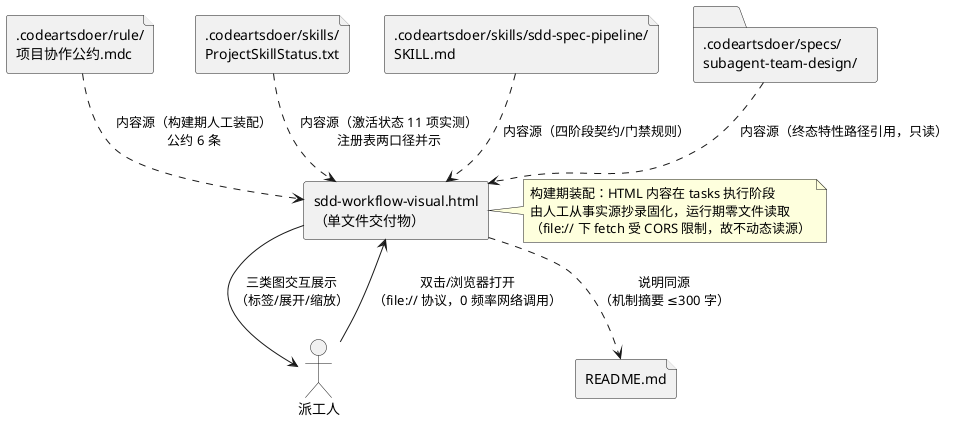
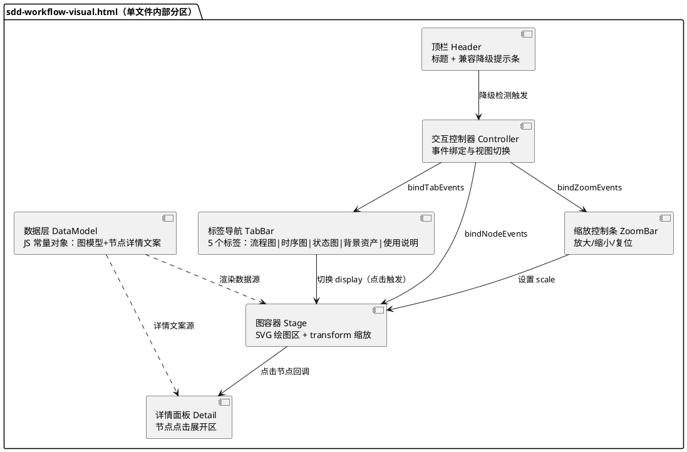
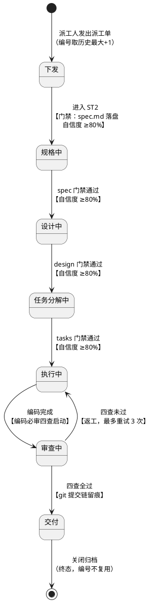
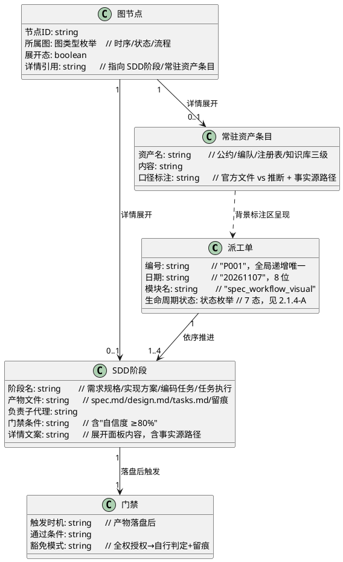

# 实现方案：SDD 干活机制可视化与派工留痕（spec_workflow_visual）

> 派工单：P001 / 20261107 ｜ 上游产物：spec.md（EARS 格式，340 行）｜ 本文档状态：待门禁

## 0. 需求覆盖编号总表（防漏防编造）

按经验库"覆盖编号组织"方法，将 spec.md 核心能力编成显式清单，本文档逐项映射：

| 编号 | 需求点 | spec.md 来源 | 本文档映射章节 |
|------|--------|-------------|---------------|
| ① | 派工目录与命名管理 | 5.1 | 1.1.1 / 2.1.3-D / 2.3 |
| ② | SDD 干活机制介绍内容（覆盖度 7 条目） | 5.2 | 1.2 / 2.1.3-B / 2.2.3 |
| ③ | HTML 动态流程图（三类图+交互） | 5.3 | 1.1.3 / 2.1 / 2.2.1 / 2.3 |
| ④ | 留痕交付（TASK.md / README.md） | 5.4 | 1.1.1 / 1.1.2 / 2.2.2 |
| ⑤ | 派工编号递增管理 | 5.5 | 2.1.3-D / 2.3.2 |
| ⑥ | 提交链留痕（编码必审四查） | 5.4.1 规则 3 | 2.1.3-C / 2.2.2 |

---

# 一、需求与存量功能关系分析

**写作说明**：本项目为 AI 协作规范型项目（非传统代码工程），"存量功能"指 `.codeartsdoer/` 下已固化的规则文件、技能契约、规格产物目录。以下分析全部基于本轮批量并行实查（一轮并行调用核实，符合经验库 2026-11-07-stage1-evidence-baseline-and-halt-reporting）。

## 1.1 需求功能与存量功能对比

### 1.1.1 已实现功能

| 需求功能 | 存量功能 | 代码位置 | 匹配度 |
|---------|---------|---------|--------|
| ① 派工子目录创建（日期_编号_模块名） | 目录 `20261107_P001_spec_workflow_visual` 已按规范创建，命名三要素与 spec.md 6.1 数据约束一致 | `.codeartsdoer/specs/20261107_P001_spec_workflow_visual/`（目录实存） | 100% |
| ④ TASK.md 派工单原文存档 | TASK.md 已含 P001 编号/日期/模块名 + 原文全文 + 补充上下文标注，满足 spec.md 6.2 四项数据约束 | `.codeartsdoer/specs/20261107_P001_spec_workflow_visual/TASK.md:1-41` | 100% |
| ② SDD 四阶段流水线契约内容 | sdd-spec-pipeline 技能已登记四阶段序列、门禁呈报、全权授权豁免、裁决落盘纪律 | `.codeartsdoer/skills/sdd-spec-pipeline/SKILL.md:6-29` | 100%（内容源现成，仅需可视化搬运） |
| ② 公约 6 条呈现内容源 | 项目协作公约 6 条已生效（全程 SDD / 学习材料评估 / 只读隔离 / 规矩层冻结 / 禁定时任务 / 单一事实源+仲裁） | `.codeartsdoer/rule/项目协作公约.mdc:1-6` | 100%（内容源现成） |
| ② 注册表激活状态事实源 | ProjectSkillStatus.txt 逐条登记激活状态（事实核对基准） | `.codeartsdoer/skills/ProjectSkillStatus.txt:1-11` | 100%（作为事实源引用） |
| ② 已关闭特性背景素材 | subagent-team-design 终态目录实存，含 spec/design/tasks 等 9 个产物文件，可直接引用路径 | `.codeartsdoer/specs/subagent-team-design/`（9 文件） | 100%（只读引用） |
| ⑤ 编号取号依据素材 | specs/ 下既有 6 个目录可扫描取最大 P 编号（当前最大 = P001） | `.codeartsdoer/specs/`（6 目录：20261107_P001_…、codeartsdoer_init、kb_arch_foundation、kb_maintenance、pd003_exec、subagent-team-design） | 100%（规则已在 spec.md 5.5 定义，素材实存） |

**匹配度判定依据**：以上条目均为文件/目录级实存性核实（非推断），内容与 spec.md 数据约束（第 6 章）逐字段比对一致，故判 100%。匹配度含义为"存量可直接支撑该需求点，无需改造"。

### 1.1.2 需要扩展的功能

| 需求功能 | 存量功能 | 差异说明 | 扩展方向 |
|---------|---------|---------|---------|
| ④ README.md 交付说明 | 本目录当前仅有 spec.md + TASK.md，README.md 不存在 | 输入差异：需汇总 HTML 查看方式、机制摘要（≤300 字）、文件清单、更新方式四段（spec.md 6.3）；存量无任何 README 基础 | 实现阶段新建 README.md，结构按 6.3 四字段组织；引用事实源路径采用相对路径（从本目录出发指向 `../../rule/`、`../../skills/`） |
| ② 口径冲突并示 | 派工单口径"注册表 19 项" vs 事实源 `ProjectSkillStatus.txt` 实测 11 项（11 个技能目录全部登记 true） | 业务逻辑差异：spec.md 5.2.3 异常场景 2 要求"两口径并示"而非取单一值；存量注册表仅提供事实侧 | HTML 注册表标注区同时呈现"派工单口径 19 项 / 事实源核对值 11 项激活（见 ProjectSkillStatus.txt）"，README 中按仲裁规则（规则>知识库>记忆>推断）标注口径差异说明 |
| ④ TASK.md 进展留痕 | TASK.md 现状态行写"需求规格阶段（待门禁确认）" | 边界条件差异：流水线推进至设计/任务/执行阶段后，状态行需同步更新（追加，不改原文） | 后续各阶段门禁通过后在 TASK.md"补充上下文"区追加阶段进展行（含门禁豁免依据），原文正文零改动（满足 6.2 规则 4"不得删改原始要求"） |

### 1.1.3 需要新增的功能或接口

**模块 A：HTML 动态流程图（需求③核心，全新交付物）**

文件：`sdd-workflow-visual.html`（单文件，落在本派工目录内）。依赖关系：内容依赖模块 B 的覆盖度条目；无任何外部依赖（零 CDN，公约第 2 条 + spec.md 4.3）。

| 功能点 | 输入 | 输出 | 核心逻辑 |
|--------|------|------|---------|
| A1 时序图视图 | 页面加载事件 | 泳道式 SVG 时序图（派工人/主控/spec 子代理/design 子代理/task 子代理/审查·交付 六泳道） | 按真实阶段次序绘制消息箭头，含门禁呈报消息（spec.md 5.3.1 规则 4） |
| A2 状态图视图 | 标签切换事件 | SVG 状态机图（派工单生命周期 7 态 + 门禁转移条件标注，含"自信度 ≥80%"字样） | 状态节点 + 转移箭头 + 条件标签（spec.md 5.3.1 规则 3） |
| A3 流程图视图 | 标签切换事件（默认视图） | 节点连线图（需求规格→实现方案→编码任务→任务执行→核验收尾 五节点主链路） | 四阶段依序可见，末节点含"核验收尾"（spec.md 5.3.1 规则 2） |
| A4 多标签切换 | 点击标签事件 | 单图显示、其余隐藏 | display 切换，无刷新（spec.md 5.3.1 规则 5） |
| A5 节点详情展开/收起 | 点击节点事件 | 详情面板显示/隐藏（产出物、门禁说明） | toggle 切换，再点收起（spec.md 5.3.1 规则 6） |
| A6 缩放/复位 | 点击缩放控件 | 视图连续缩放/恢复初始 | transform scale 三档以上连续变化（spec.md 5.3.1 规则 7） |
| A7 背景标注区 | 页面常驻 | 常驻资产区（公约 6 条、编队 1+2+4、注册表两口径、知识库三级加载）+ 已关闭特性区（subagent-team-design 终态 + 产物路径） | 独立标签页 + 各图侧栏摘要双通道呈现（spec.md 5.3.1 规则 8） |
| A8 命名规范入图 | 流程图/状态图内嵌元素 | "20261107_P001_spec_workflow_visual"实例 + 三要素拆解（日期/编号/模块名） | 作为图节点呈现命名规则本身（spec.md 5.3.1 规则 9） |
| A9 兼容降级提示 | 页面加载时特性检测 | 过旧内核顶部降级提示条 | 探测 CSS/JS 特性，失败则显示建议 Chrome/Edge 提示（spec.md 5.3.3 场景 1） |

**模块 B：机制介绍内容装配（需求②，内容层）**

功能点 B1：覆盖度 7 条目装配器（HTML 图内文字 + README 摘要双出口）。输入 = 模块 A 图模型数据；输出 = 与 spec.md 5.2.1 覆盖度规则逐条对应的展示内容；依赖 = 公约文件、SKILL.md、ProjectSkillStatus.txt、subagent-team-design 目录四个事实源。缺失事实源时按"来源不可达"呈现、不虚构（spec.md 5.2.3 场景 1）。

**模块 C：流水线产物与提交（需求①④⑤⑥，流程层）**

功能点 C1：design.md（本文档）、tasks.md（下一阶段产物）、sdd-workflow-visual.html、README.md 四文件落盘于本派工目录（禁止项：不得输出到 `.codeartsdoer/specs/` 之外，spec.md 5.1.1 规则 5）。
功能点 C2：编码必审四查通过后 git 提交链留痕；未过不完工（公约第 6 条 + spec.md 5.4.1 规则 3）。

## 1.2 存量功能详细分析

### 1.2.1 sdd-spec-pipeline 技能契约（内容需求②的首要事实源）

- **接口契约**：作为技能被调用，产出物为四阶段文档序列（spec.md → design.md → tasks.md → 执行留痕）；每阶段 prompt 必带 4 要素（上游产物路径+先读后写、用户裁决基线、硬约束清单、呈报格式要求）。
- **业务规则**：禁跳阶段；门禁=结论前置摘要+询问修改；全权授权时门禁自行判定并留痕豁免依据；唯一可中断呈报=事实性阻塞。
- **扩展点**：无钩子；本设计将其契约内容"原样搬运"进 HTML 图节点详情，不做语义改写——搬运结果必须逐条可溯源到 SKILL.md 行号。
- **约束**：裁决落盘纪律要求"已否决方案不得回潮、修订处标【vN 日期】"，本设计文档修订需遵守。

### 1.2.2 ProjectSkillStatus.txt（单一事实源约束的实例）

- **接口契约**：纯文本键值对（技能名=true），11 行对应 11 个技能目录。
- **业务规则**：激活状态唯一以此文件为准（公约第 6 条"状态只存事实表一处"）。
- **与需求的交叉点**：派工单口径 19 项与事实源 11 项不一致 → 按 spec.md 5.2.1 规则 2 + 5.2.3 场景 2 处理：HTML 并示两口径，README 标注差异。判定依据：11 个技能目录（ruleinit、skill-writer、lazy-exec、find-skills、grill-me、review-code、learn-gate、register-feature、codearts-platform-registration、sdd-spec-pipeline、windows-git-powershell-quirks）逐一与 Status.txt 行比对一致，"11 项"为实测事实而非推断。
- **约束**：本设计禁止修改该文件（只读引用）。

### 1.2.3 subagent-team-design 终态目录（已关闭特性背景素材）

- **接口契约**：9 个产物文件（spec/design/tasks/design 草案、实验记录、审查报告等）。
- **业务规则**：spec.md 5.4.1 规则 4 禁止删除或改写该目录内容；HTML 仅引用其路径与"终态"标签。
- **扩展点**：无；纯只读背景展示。
- **约束**：引用时标注"（终态/已关闭）"字样（spec.md 5.2.1 规则 3 验收条件：背景区出现"subagent-team-design（终态）"及产物路径）。

### 1.2.4 既有 specs 目录结构（命名规范与编号管理的佐证）

- **业务规则**：6 个既有目录中仅本派工目录采用"日期_编号_模块名"新命名规范，其余 5 个为历史命名（无日期/编号前缀）——取号规则（spec.md 5.5.1 规则 2"扫描既有目录取最大 P 编号"）在新规范下扫描对象为"符合命名规范的目录"，历史目录不参与编号序列（当前最大 = P001，无空洞）。
- **约束**：本设计不触碰历史目录（兼容性：spec.md 4.5"不破坏既有目录"）。
- **知识库三级加载佐证**：`.codeartsdoer/experience-reuse/experiences/` 按领域分目录（agent-ops、architecture、workflow 等）+ index.md 索引，与"规则层→知识库→经验/记忆"三级结构对应，作为 HTML 知识库三级加载条目的展示素材（来源：目录实查，非推断）。

---
# 二、增量设计方案

## 2.1 实现模型

### 2.1.1 技术选型（结论前置）

| 方案 | 说明 | 判定 |
|------|------|------|
| **A. 纯 HTML/CSS/JS 单文件自研（SVG+DOM 绘图）** | 手写三类图渲染，零依赖，双击即开 | **✅ 选用** |
| B. Mermaid.js 等渲染库 | CDN 引入违反公约第 2 条与 spec.md 4.3/5.3.1 规则 10；内嵌库体积 300KB+ 且主题定制受限、源码可维护性差 | ❌ 排除 |
| C. 前端框架+构建链（React/Vite） | 违反 spec.md 4.5"无构建、无服务器依赖"；产物非单文件 | ❌ 排除 |

**选型理由**：三类图节点规模均 ≤30 个（时序 6 泳道约 14 条消息、状态图 7 态 8 转移、流程图 5 主节点+8 子节点），SVG/DOM 手绘复杂度可控；自研可获得与"覆盖度 7 条目"精确对齐的节点详情内容；单文件方案天然满足 DFX 全部约束（断网可用、≤2s 加载、本地即时交互 ≤500ms）。

### 2.1.2 上下文视图



**关键决策**：HTML 运行期**不读取**任何本地文件（file:// 协议下 fetch 被浏览器 CORS 策略拦截，会导致控制台报错、违反 spec.md 4.2.2"控制台无报错"）。事实源内容在 tasks 执行阶段由执行者**读源→抄录→固化**进 HTML，并在节点详情中标注事实源路径，满足"来源标注规则"（spec.md 5.2.1 规则 2）。常驻资产更新时的同步修订走 README"更新方式"指引（人工改 HTML 对应标注区，spec.md 4.4.2）。

### 2.1.3 组件总体架构



**职责说明**：
- **TabBar**：5 标签组织（三类图 + 背景资产 + 使用说明内嵌），对应 spec.md 6.4"标签组"约束；"标签装不下可多标签切换"（派工单 2b）由此承载。
- **Stage**：每标签一个独立 SVG 画布，容器级 `transform: scale()` 实现缩放（对整图统一缩放，保持布局不重排）。
- **Detail**：点击节点在节点旁或面板区展开详情（产出物清单/门禁条件/事实源路径），再点收起；同一时刻至多一个节点处于展开态（避免布局跳动）。
- **DM（数据层）**：全部图结构与文案集中在 JS 常量对象中声明，渲染函数只消费数据——满足可维护性（spec.md 4.4.2"源文件可编辑，无需重新设计"：改文案只需改 DataModel，不动渲染逻辑）。

### 2.1.4 实现设计文档

#### A. 派工单生命周期状态机（状态图视图内容设计）



- 每个转移箭头必须带门禁条件标注（满足 spec.md 5.3.1 规则 3 验收条件"每个门禁转移处可见通过条件标注"）。
- "自信度 ≥80%"字样在 4 个前进转移上重复出现（对应 spec.md 5.2.1 门禁机制条目）。
- 返工回路体现"四查未过不完工"（公约第 6 条），重试上限 3 次对应 spec.md 5.4.3 场景 1。
- 用户全权授权分支：状态图侧栏备注"全权授权时门禁自行判定通过并留痕豁免依据"（sdd-spec-pipeline SKILL.md:24 原文语义搬运）。

#### B. SDD 步骤主链路流程图（流程图视图内容设计）

主链路 5 节点：**需求规格 → 实现方案 → 编码任务 → 任务执行 → 核验收尾**。每节点可展开详情：

| 节点 | 展开详情内容（DataModel 中固化） | 内容事实源 |
|------|--------------------------------|-----------|
| 需求规格 | 产出 spec.md（EARS 格式）；调 spec-requirement-agent；门禁呈报要求 | SKILL.md:9、:22 |
| 实现方案 | 产出 design.md；调 spec-design-agent；分析存量匹配度+增量方案 | SKILL.md:10、本设计文档实践 |
| 编码任务 | 产出 tasks.md；任务映射能力编号+验收对照表；调 spec-task-agent | SKILL.md:11 |
| 任务执行 | 按 tasks 顺序实施，全程留痕；编码必审四查前置 | SKILL.md:12、公约第 6 条 |
| 核验收尾 | 四查通过→git 提交链→交活不阻塞日常；未过返工≤3 次 | spec.md 5.4 |

流程图内嵌**派工单命名规范子图**（满足 spec.md 5.3.1 规则 9）：展示三要素拆解 `20261107_P001_spec_workflow_visual` = `日期(8位YYYYMMDD)_派工编号(P+≥3位递增)_模块名(小写字母数字下划线)`，并示意目录路径 `.codeartsdoer/specs/{目录名}/`。

#### C. 角色交互时序图（时序图视图内容设计）

六泳道：派工人、主控（编队 1）、spec/design/task 子代理（编队 4 运行时角色代表）、审查·交付。消息序列（按真实阶段次序，含门禁呈报）：

```
派工人→主控：下发派工单（日期/编号/模块名）
主控→主控：创建派工目录 + TASK.md 存档
主控→spec子代理：调需求规格（prompt 带 4 要素）
spec子代理→主控：spec.md 落盘
主控→派工人：门禁呈报（摘要+是否修改）【全权授权→自行判定+留痕豁免】
主控→design子代理：调实现方案 → design.md
主控→派工人：门禁呈报
主控→task子代理：调任务规划 → tasks.md
主控→派工人：门禁呈报
主控→主控：按 tasks 顺序执行（持久角色 2 维护状态/知识）
主控→审查：编码必审四查
审查→主控：通过 → git 提交链
主控→派工人：结论前置交活（不阻塞日常）
```

消息总条数约 14 条（含 3 条门禁呈报 + 1 条豁免备注），满足 spec.md 5.3.1 规则 4 验收条件。

#### D. 门禁分支与降级流程（流程分支设计）

- **门禁三分支**：通过（自信度 ≥80%）→ 下一阶段；驳回 → 返工修订（修订处标【vN 日期】，已否决方案不回潮）；全权授权 → 执行方自行判定 + 豁免依据留痕（TASK.md 追加记录）。
- **事实源缺失分支**（spec.md 5.2.3 场景 1）：对应标注区显示"来源不可达 + 路径"，README 登记。
- **口径冲突分支**（spec.md 5.2.3 场景 2）：两口径并示（注册表 19 项 vs 11 项实测），按仲裁链裁决：事实源 ProjectSkillStatus.txt 优先于派工单口径（规则>知识库>记忆>推断中的事实源规则位），README 标注说明。
- **浏览器降级分支**（spec.md 5.3.3 场景 1）：特性检测失败 → 顶部黄条提示"建议使用 Chrome/Edge 现代版本"，页面其余功能不阻断。

## 2.2 接口设计

### 2.2.1 总体设计

接口分两类：**文件产物契约**（跨阶段、跨角色）与 **HTML 内部 JS 模块接口**（运行期）。无对外网络接口（零 CDN/遥测，spec.md 4.3）。变更策略：文件契约由 spec.md 第 6 章数据约束冻结，HTML 内部接口随 DataModel 演进，渲染函数签名保持稳定。

| 接口 | 类别 | 稳定性 |
|------|------|--------|
| TASK.md 存档契约 | 文件契约 | 稳定（spec.md 6.2 冻结） |
| README.md 四段契约 | 文件契约 | 稳定（spec.md 6.3 冻结） |
| HTML 产物六要素契约 | 文件契约 | 稳定（spec.md 6.4 冻结） |
| switchTab / toggleNode / setZoom / resetZoom / detectCompat | JS 内部接口 | 实验（可随实现微调） |

### 2.2.2 接口清单

**I1. TASK.md 存档契约**（需求④，已实现，扩展方向见 1.1.2）
- 字段：派工编号 / 日期 / 模块名（三段与目录名一致，必填）+ 原文正文（不得删改，仅可追加补充上下文）。
- 前置条件：派工单下发事件。后置条件：子目录内 TASK.md 存在且含原文全文。
- 异常映射：原文缺失 → 验收失败（spec.md 5.4.1 规则 1a）；检出敏感信息 → 拒绝写入并移除（5.4.3 场景 2）。

**I2. README.md 交付说明契约**（需求④）
- 四段：① 查看方式（HTML 相对路径 + 双击/浏览器打开步骤）② 机制摘要（结论前置 ≤300 字）③ 文件清单（子目录全部产物及用途）④ 更新方式（常驻资产变更时同步修订指引，选填）。
- 后置条件：新人按 README 可独立打开并理解 HTML（spec.md 5.4.1 规则 2a）。
- 异常映射：事实源缺失 → README 登记路径与"来源不可达"标注。

**I3. HTML 产物契约**（需求③，六要素对应 spec.md 6.4）
- 图类型三类齐备、标签组可切换、节点详情可展开/收起、缩放三控件、背景标注区两区、单文件零外部依赖。
- 后置条件：断网打开功能完整、控制台无报错、切换类操作 ≤500ms、首屏 ≤2s（spec.md 4.1/4.2）。

**I4. HTML 内部 JS 模块接口**（命名与签名约定，实现时类型安全：全用具名常量对象，禁字符串魔法值散落）

```
// TabBar 交互
switchTab(tabId: TabId): void          // TabId = 'flow' | 'sequence' | 'state' | 'assets' | 'help'
// 节点详情
toggleNode(nodeId: string): void       // 展开/收起互斥，同一时刻仅一个展开态
// 缩放
setZoom(delta: number): void           // 连续缩放，clamp 至 [0.5, 2.0]
resetZoom(): void                      // 复位 scale=1
// 兼容
detectCompat(): { ok: boolean, missing: FeatureId[] }  // 加载时特性检测
```

- 前置条件：DOMContentLoaded 后由 Controller 统一绑定；后置条件：仅对应视图可见性/缩放/详情状态变化，无页面刷新。
- 异常映射：事件绑定目标缺失 → detectCompat 降级提示条显示（不静默失败）。

## 2.3 数据模型

### 2.3.1 设计目标

1. 支撑场景：派工人离线浏览 SDD 机制、核对常驻资产口径、追溯派工单生命周期。
2. 性能/容量目标：图模型节点总量 ≤60，单文件体积目标 ≤200KB，首屏 ≤2s。
3. 兼容策略：所有产物落盘本派工目录，不触碰历史目录；TASK.md 只增不改。

### 2.3.2 模型实现

**领域对象关系**（与 spec.md 第 2 章术语对齐；运行期全部内嵌于 HTML DataModel，无持久化存储——持久化即 HTML 文件本身与 TASK.md/README.md）：



**模型要点**：
1. **派工单是聚合根**：编号/日期/模块名三段与目录名严格一致（spec.md 6.1），生命周期 7 态单向推进 + 1 条审查返工回路。
2. **图节点是展示层投影**：与领域对象解耦——同一"实现方案"阶段可同时出现在流程图节点与时序图消息中，详情引用同一份文案（单一文案源，避免两图口径漂移，呼应公约第 6 条）。
3. **常驻资产条目强制带口径标注**：每条目必须含"来源（官方文件 vs 推断）+ 事实源路径"（spec.md 5.2.1 规则 2）；注册表条目固定为两口径并示结构（派工单口径 19 项 / 事实源核对 11 项激活 / ProjectSkillStatus.txt 路径）。
4. **创建与销毁策略**：领域对象随 HTML 构建期装配一次性创建；派工单对象随"交付→关闭"进入终态后不再变更（终态编号不复用，spec.md 5.5.1 规则 4）。

## 2.4 门禁切分与文件清单（实施顺序约束）

按经验库"门禁编号切分"，本特性后续推进门禁如下（每门禁写明放行条件与未过后果）：

| 门禁 | 放行条件 | 未过后果 |
|------|---------|---------|
| G1 设计门禁（当前） | design.md 落盘且覆盖 ①~⑥ 全部编号；用户全权授权→自行判定+留痕豁免依据于 TASK.md | 返工修订 design.md，不得进入 G2 |
| G2 任务门禁 | tasks.md 含任务映射能力编号+验收对照表（EARS 条目逐条对应） | 不得进入 G3 |
| G3 编码门禁 | HTML+README 按本设计产出；四查（功能/断网/控制台无报错/内容覆盖度）通过 | 不完工，返工 ≤3 次，仍败降级并报告未决项 |
| G4 交付门禁 | git 提交链完成；TASK.md 进展行补齐；交活总结 ≤300 字结论前置 | 不阻塞日常，缺陷转后续派工单 |

**最终文件清单**（全部落于 `.codeartsdoer/specs/20261107_P001_spec_workflow_visual/`）：

| 文件 | 阶段 | 状态 |
|------|------|------|
| TASK.md | 派工下发 | ✅ 已落盘 |
| spec.md | ST2 需求规格 | ✅ 已落盘 |
| design.md | ST3 实现方案 | ✅ 本文档 |
| tasks.md | ST4 任务规划 | 待 G2 |
| sdd-workflow-visual.html | ST5 执行 | 待 G3 |
| README.md | ST5 执行 | 待 G3 |