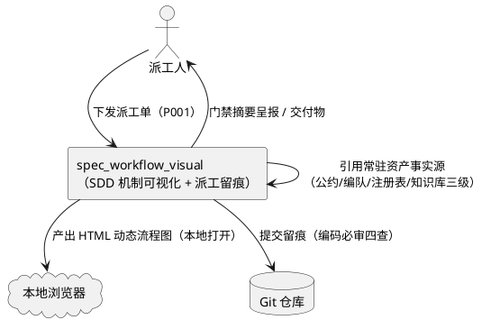
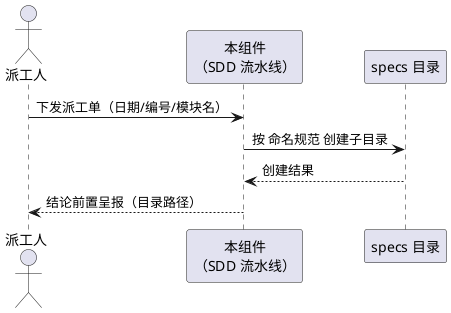
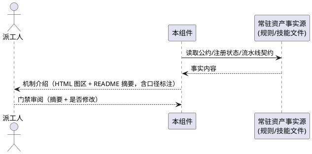
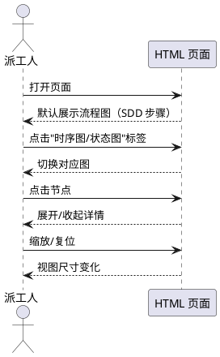
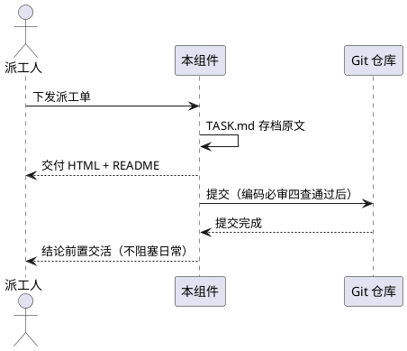
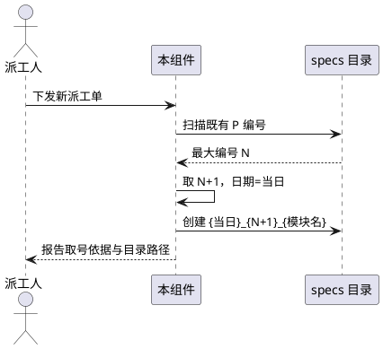

# 需求规格：SDD 干活机制可视化与派工留痕（spec_workflow_visual）

> 派工单：P001 / 20261107 ｜ 状态：待用户确认 ｜ 验收条件格式：EARS（当[触发]时，系统应当[响应]）

# **1. 组件定位**

## **1.1 核心职责**
本组件负责将本项目 SDD（Spec-Driven Development）规范开发的干活机制整理为可交互的 HTML 动态流程图，并落实派工单目录命名、编号递增与留痕交付，实现规范透明化与派工资产沉淀。

## **1.2 核心输入**
1. **派工单文本**：来源为派工人（用户），含日期、编号（P001）、模块名（spec_workflow_visual）与任务要求。
2. **项目常驻资产事实源**：`.codeartsdoer/rule/项目协作公约.mdc`（6 条公约）、`.codeartsdoer/skills/ProjectSkillStatus.txt`（技能注册状态）、`.codeartsdoer/skills/sdd-spec-pipeline/SKILL.md`（四阶段流水线契约）、`.codeartsdoer/specs/subagent-team-design/`（终态特性规格产物）。

## **1.3 核心输出**
1. **派工子目录**：`.codeartsdoer/specs/20261107_P001_spec_workflow_visual/` 内的 spec.md → design.md → tasks.md → 实现产物（HTML 动态流程图、README.md）。
2. **留痕文件**：TASK.md（派工单原文存档）。
3. **Git 提交记录**：按既有提交规范完成的提交链。

## **1.4 职责边界**
本组件**不负责**：
1. 修改项目协作公约及规则层文件（规矩层冻结，零改动）。
2. 技能注册登记（新流程一律走 register-feature 五步准入，非本组件职责）。
3. 自建定时任务（一切触发走事件，本组件所有交互均为用户事件驱动）。
4. HTML 接入任何外部网络服务或遥测（纯本地静态展示）。
5. 替代 design.md / tasks.md 的内容决策（本规格只约束"做什么"，不约束"怎么做"）。

# **2. 领域术语**

**SDD（Spec-Driven Development）**
: 规范驱动开发流水线，指本项目强制执行的"需求规格 → 实现方案 → 编码任务 → 任务执行（含核验收尾）"四阶段推进方式，禁跳阶段。

**派工单**
: 派工人下发的任务工单，含日期、编号（P+递增数字）、模块名三要素，是启动一次 SDD 流水线的事件源。

**常驻资产**
: 长期生效、全流程可引用的项目资产，包括：项目协作公约 6 条、编队（1 主控 + 2 持久 + 4 运行时）、注册表（派工单口径 19 项）、知识库三级加载机制。备注：事实源为 rule/ 与 skills/ 目录内文件。

**终态特性（已关闭特性）**
: 已完成生命周期并关闭的特性。本项目当前唯一实例为 subagent-team-design，其规格产物（spec.md、design.md、tasks.md 等）已固化于 `.codeartsdoer/specs/subagent-team-design/`。

**编队**
: 当前 AI 执行体的常驻角色配置：1 个主控编排 + 2 个持久角色 + 4 个运行时角色。

**注册表**
: 项目技能/流程的登记名册，派工单口径为 19 项；激活状态以 `skills/ProjectSkillStatus.txt` 为事实源核对展示。

**知识库三级加载**
: 项目知识库按三级层次（规则层 → 知识库 → 经验/记忆）逐级加载引用的机制。

**五步准入**
: 新流程以技能形式登记的准入流程（规矩层冻结后，新流程一律分装技能登记，禁止直接改公约）。

**编码必审四查**
: 编码完工前必须通过的四项审查；未通过不视为完工（公约第 6 条）。

**门禁**
: 阶段产物落盘后的评审关口：结论前置呈报摘要 + 询问是否修改；用户全权授权时由执行方自行判定通过并留痕豁免依据。

# **3. 角色与边界**

## **3.1 核心角色**
1. **派工人（用户）**：下发派工单、审批各阶段门禁产物、终审交付物、裁决编号冲突。
2. **AI 执行编队**：主控（1）负责编排与门禁呈报；持久角色（2）负责状态/知识维护；运行时角色（4）负责 spec/design/task 子代理与审查执行。

## **3.2 外部系统**
1. **本地浏览器**：渲染 HTML 动态流程图（Chrome/Edge 现代内核，本地文件打开）。
2. **Git 仓库**：承接提交链留痕。

## **3.3 交互上下文**

# **4. DFX 约束**

## **4.1 性能**
1. HTML 在本地浏览器打开后，标签切换、节点展开/收起、缩放操作均无网络等待，本地即时响应（无明显卡顿，切换类操作 ≤500ms）。
2. 页面打开至三类图首次可切换展示，加载时间 ≤2s（本地文件场景）。

## **4.2 可靠性**
1. HTML 为单文件自包含产物，双击本地打开即可用，断网环境功能完整。
2. 打开页面浏览器控制台无报错（排除浏览器扩展干扰）。
3. 数据一致性：机制介绍内容与常驻资产事实源一致；冲突时按"规则 > 知识库 > 记忆 > 推断"裁决并在 README 中标注口径差异。

## **4.3 安全性**
1. 禁止引入外部 CDN 脚本/字体/遥测。
2. 禁止在 HTML、README、TASK.md 中写入密钥、凭证等敏感信息。

## **4.4 可维护性**
1. README 必须说明查看方式与文件清单，后续派工单（P002…）可按同结构复用。
2. 常驻资产内容更新时，HTML 图对应标注区必须可同步修订（源文件可编辑，无需重新设计）。

## **4.5 兼容性**
1. 支持 Chrome / Edge 现代内核浏览器直接打开，无构建、无服务器依赖。
2. 目录结构与命名遵循派工单命名规范，后续派工单按同规范递增，不破坏既有目录。

# **5. 核心能力**

## **5.1 派工目录与命名管理**

### **5.1.1 业务规则**
1. **命名规则**：子目录名 = 日期_派工编号_模块名，存放于 `.codeartsdoer/specs/` 下。
   a. 验收条件：当收到派工单 P001（20261107，模块 spec_workflow_visual）时 → 系统应当创建 `.codeartsdoer/specs/20261107_P001_spec_workflow_visual/`，全部派工产物仅存放于该目录。
2. **日期格式规则**：目录名日期段必须为 8 位数字（YYYYMMDD）。
   a. 验收条件：当日期段非 8 位数字时 → 拒绝创建并提示修正。
3. **模块名规则**：模块名必须为小写字母、数字、下划线。
   a. 验收条件：当模块名含大写、空格、连字符等非法字符时 → 拒绝创建并提示修正。
4. **冲突规则**：当目标目录名已存在时，系统应当报告冲突并交由派工人裁决，禁止静默覆盖或删除既有目录。
   a. 验收条件：尝试在已存在目录上重新初始化 → 输出冲突报告，既有目录内容保持不变。
5. **禁止项**：禁止将派工产物存放在 `.codeartsdoer/specs/` 之外。
   a. 验收条件：尝试输出到其他路径 → 拒绝并说明单一事实源路径约束。

### **5.1.2 交互流程**

### **5.1.3 异常场景**
1. **目录名冲突**
   a. 触发条件：同日期同编号同模块名目录已存在。
   b. 系统行为：停止创建，输出冲突说明。
   c. 用户感知：报告冲突，等待派工人裁决（改编号或改模块名）。
2. **非法命名**
   a. 触发条件：模块名/日期段不符合 5.1.1 规则。
   b. 系统行为：拒绝创建。
   c. 用户感知：提示具体非法字符与修正格式。

## **5.2 SDD 干活机制介绍（内容需求）**

### **5.2.1 业务规则**
1. **覆盖度规则**：当生成干活机制介绍内容（HTML 图内文字与 README 摘要）时，内容必须覆盖以下全部条目，逐条可定位：
   - 四阶段流水线：需求规格（spec.md，EARS 格式）→ 实现方案（design.md）→ 编码任务（tasks.md，任务映射能力编号+验收对照表）→ 任务执行（含核验收尾、编码必审四查）。
   - 门禁机制：每阶段产物落盘后结论前置呈报摘要 + 询问是否修改；用户全权授权时门禁自行判定并留痕豁免依据；阶段推进带自信度阈值（≥80% 才过 ST2→ST3→ST4→ST5）。
   - 项目协作公约 6 条逐条呈现（全程 SDD / 学习材料先评估后引用 / 参考仓库只读隔离 / 规矩层冻结·五步准入 / 禁自建定时任务 / 单一事实源+仲裁）。
   - 编队：1 主控 + 2 持久 + 4 运行时。
   - 注册表：派工单口径 19 项，激活状态以 ProjectSkillStatus.txt 为事实源核对。
   - 知识库三级加载（规则层 → 知识库 → 经验/记忆）。
   - 仲裁规则：冲突按 规则 > 知识库 > 记忆 > 推断 裁决并报告。
   a. 验收条件：当审阅 HTML 与 README 时 → 上述每一条目均有对应可定位的展示内容，缺任一条即验收失败。
2. **口径标注规则**：当呈现常驻资产时，系统应当标注来源（官方文件 vs 推断）及事实源路径。
   a. 验收条件：注册表条目 → 标注"派工单口径 19 项 / 激活状态见 ProjectSkillStatus.txt"。
3. **终态标注规则**：当呈现已关闭特性时，系统应当标注 subagent-team-design 为终态（已关闭），并指向其规格产物目录。
   a. 验收条件：HTML 背景区 → 出现"subagent-team-design（终态）"及产物路径。
4. **禁止项**：禁止在介绍内容中给出与公约冲突的描述（如"允许跳阶段""允许自建定时任务"）。
   a. 验收条件：审阅全部文案 → 无与 6 条公约冲突的表述。

### **5.2.2 交互流程**

### **5.2.3 异常场景**
1. **事实源缺失**
   a. 触发条件：某常驻资产文件不可读。
   b. 系统行为：对应标注区按"来源不可达"呈现，不虚构内容。
   c. 用户感知：README 中标注该条目事实源缺失及路径。
2. **口径冲突**
   a. 触发条件：派工单口径与事实源不一致（如注册表项数）。
   b. 系统行为：按仲裁规则以事实源核对，两口径并示。
   c. 用户感知：展示区同时给出"派工单口径"与"事实源核对值"。

## **5.3 交互式动态流程图（HTML）**

### **5.3.1 业务规则**
1. **图型齐备规则**：当打开 HTML 页面时，系统应当提供至少三类图：**时序图**（角色交互流程）、**状态图**（派工单/SDD 阶段生命周期）、**流程图**（SDD 步骤主链路）。
   a. 验收条件：打开页面 → 三种图型均可切换查看，缺一即验收失败。
2. **主链路规则**：流程图必须完整呈现"需求规格 → 实现方案 → 编码任务 → 任务执行（含核验收尾）"四阶段主链路。
   a. 验收条件：流程图中四阶段节点依序可见，任务执行阶段含"核验收尾"收尾节点。
3. **状态图规则**：状态图必须体现阶段门禁推进（含自信度 ≥80% 过门槛标注）与派工单生命周期（下发 → 规格中 → 设计中 → 任务分解中 → 执行中 → 审查中 → 交付/关闭）。
   a. 验收条件：状态图中每个门禁转移处可见通过条件标注；生命周期起止态完整。
4. **时序图规则**：时序图必须体现派工人、主控、各阶段子代理（spec/design/task）、审查/交付环节的交互次序。
   a. 验收条件：时序图消息按真实阶段次序排列，含门禁呈报消息。
5. **多标签规则**：当存在多图/多分组时，系统应当以标签页组织，点击标签即时切换对应图。
   a. 验收条件：点击任一标签 → 对应图显示、其余图隐藏，无需刷新页面。
6. **展开/收起规则**：当点击图中节点或分组时，系统应当展开该节点的详情内容，再次点击收起。
   a. 验收条件：点击"需求规格"节点 → 展开产出物/门禁说明；再次点击 → 收起。
7. **缩放规则**：系统应当提供图的放大、缩小、复位能力。
   a. 验收条件：点击缩放控件或使用对应操作 → 视图尺寸连续变化且复位后恢复初始。
8. **背景标注规则**：图中必须包含常驻资产区（6 条公约、编队、注册表 19 项、知识库三级加载）与已关闭特性区（subagent-team-design 终态）。
   a. 验收条件：任一图视图或专用背景标签中，两类区域均可定位。
9. **命名规范入图规则**：派工单命名规范本身（日期_派工编号_模块名 → 子目录结构）必须作为图元素呈现。
   a. 验收条件：图中可见"20261107_P001_spec_workflow_visual"实例与其命名三要素拆解。
10. **禁止项**：禁止依赖外部 CDN/网络资源加载渲染库。
    a. 验收条件：断网打开页面 → 全部图与交互正常。

### **5.3.2 交互流程**

### **5.3.3 异常场景**
1. **浏览器不兼容**
   a. 触发条件：使用过旧内核浏览器打开。
   b. 系统行为：页面可打开但降级提示。
   c. 用户感知：顶部提示建议使用 Chrome/Edge 现代版本。
2. **交互无响应**
   a. 触发条件：点击标签/节点无反应（实现缺陷）。
   b. 系统行为：不满足 5.3.1 规则 5/6，判验收失败。
   c. 用户感知：按 tasks.md 对应验收条目返工。

## **5.4 留痕交付（TASK.md / README.md）**

### **5.4.1 业务规则**
1. **派工单存档规则**：当派工单下发时，系统应当将其原文（含编号、日期、任务要求）存入子目录 TASK.md。
   a. 验收条件：`20261107_P001_spec_workflow_visual/TASK.md` 存在且含 P001 原文全文。
2. **README 规则**：系统应当在子目录产出 README.md，至少包含：HTML 查看方式（双击/浏览器打开路径）、当前干活机制摘要（≤300 字结论前置）、文件清单与更新方式。
   a. 验收条件：README 三段内容齐备，新人按 README 可独立打开并理解 HTML。
3. **提交留痕规则**：当产出完成时，系统应当按既有提交规范完成提交链（编码必审四查通过），不阻塞日常。
   a. 验收条件：git log 可见对应提交，审查记录留痕。
4. **禁止项**：禁止在留痕文件中写入密钥/凭证；禁止删除或改写既有终态特性目录内容。
   a. 验收条件：审阅留痕文件 → 无敏感信息；`specs/subagent-team-design/` 目录内容零改动。

### **5.4.2 交互流程**

### **5.4.3 异常场景**
1. **审查未通过**
   a. 触发条件：编码必审四查任一项未过。
   b. 系统行为：不提交，返工修复（最多重试 3 次），仍失败则降级并继续推进、报告未决项。
   c. 用户感知：交活说明中标注未过项与降级情况。
2. **敏感信息检出**
   a. 触发条件：留痕文件中含凭证类内容。
   b. 系统行为：拒绝写入并移除。
   c. 用户感知：提示被拦截的字段类型。

## **5.5 派工编号递增管理**

### **5.5.1 业务规则**
1. **递增规则**：系统应当以 P 编号全局递增管理派工单（P001 → P002 → P003…），不随日期重置。
   a. 验收条件：下一派工单编号为 P002，即使日期跨天。
2. **取号规则**：当新派工单下发时，系统应当取历史最大编号 +1，日期取派工当日。
   a. 验收条件：扫描 specs/ 下既有目录取最大 P 编号 → 新目录编号为其 +1。
3. **冲突规则**：当编号已被占用时，系统应当报告并继续向后取号。
   a. 验收条件：P002 已存在 → 自动取 P003 并报告取号依据。
4. **禁止项**：禁止跳号、复用已关闭派工单的编号。
   a. 验收条件：新目录编号必须严格大于全部既有编号。

### **5.5.2 交互流程**

### **5.5.3 异常场景**
1. **编号空洞**
   a. 触发条件：历史编号存在跳号（如 P001、P003）。
   b. 系统行为：按"最大编号 +1"取号，不回填空洞。
   c. 用户感知：报告取号结果与既有空洞事实。

# **6. 数据约束**

## **6.1 派工目录（目录名对象）**
1. **日期段**：8 位数字 YYYYMMDD，取派工当日。
2. **编号段**：字母 P + 至少 3 位递增数字，全局唯一且严格递增。
3. **模块名段**：仅小写字母、数字、下划线，建议不超过 20 字符。
4. **完整性**：三段以半角下划线连接，目录必须位于 `.codeartsdoer/specs/` 下。

## **6.2 TASK.md（派工留痕对象）**
1. **派工编号**：与目录编号段一致，必填。
2. **日期**：与目录日期段一致，必填。
3. **模块名**：与目录模块名段一致，必填。
4. **原文正文**：派工单全文，不得删改原始要求，仅可追加补充上下文标注。

## **6.3 README.md（交付说明对象）**
1. **查看方式**：HTML 打开路径与步骤，必填。
2. **机制摘要**：SDD 干活机制简介，结论前置，≤300 字，必填。
3. **文件清单**：子目录内全部产物及用途，必填。
4. **更新方式**：常驻资产变更时的同步修订说明，选填。

## **6.4 HTML 动态流程图（交付物对象）**
1. **图类型**：时序图、状态图、流程图，三类必备。
2. **标签组**：每类图至少一个标签，支持切换。
3. **节点详情**：可展开/收起，内容与 5.2.1 覆盖度规则对齐。
4. **缩放控件**：放大/缩小/复位三操作必备。
5. **背景标注区**：常驻资产区 + 已关闭特性区（subagent-team-design 终态）必备。
6. **自包含**：单文件、零外部网络依赖。