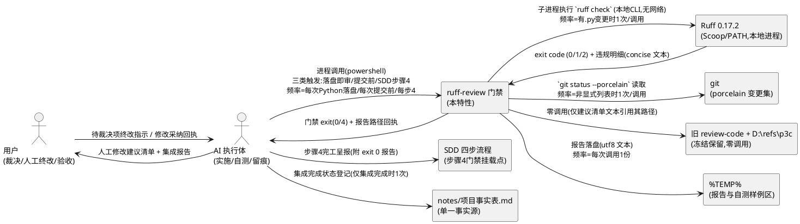
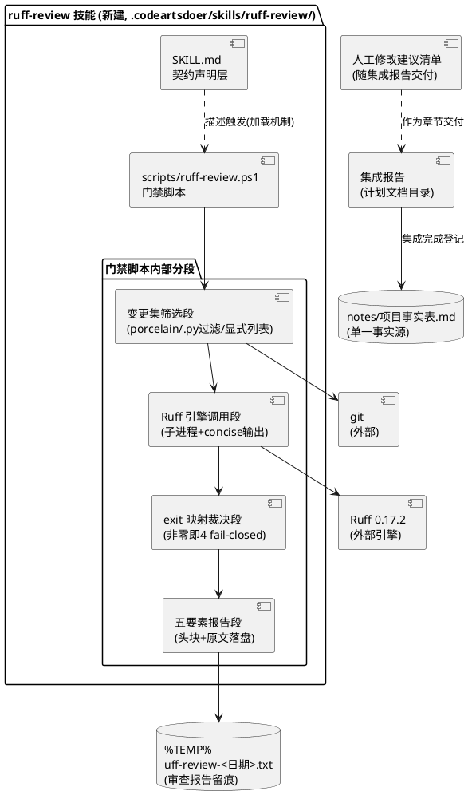
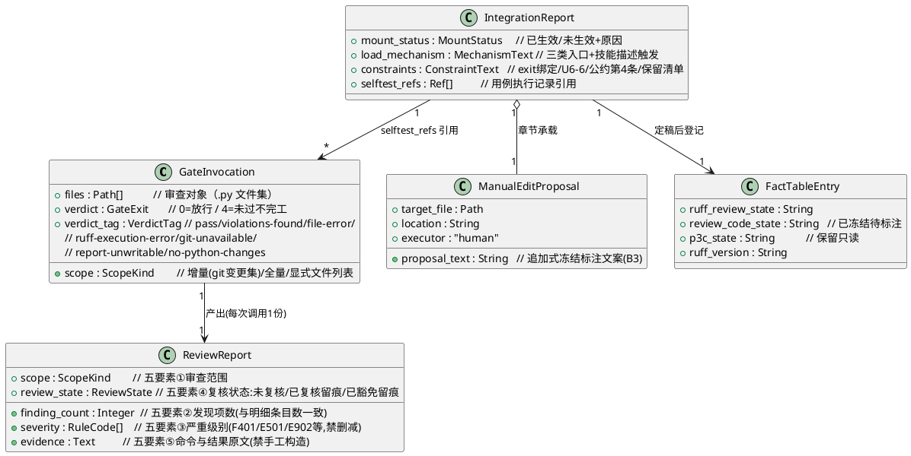

# Ruff 审查门禁替换 — 技术设计（design.md）

> 版本：v1 | 日期：2026-11-09 | 上游：同目录 spec.md（v1，2026-11-09，REQ-RUFF 全条款）
> 阶段：实现方案设计（design）——本阶段仅产 design.md，不产 tasks.md
> 已承接裁决基线：U6-6 人工终改（2026-11-08）、公约第 4 条零改动、旧 P3C 文件零删除仅解绑、附录 B 全部按预设承接（用户未覆盖）

## 0. 设计前置实测依据（2026-11-09 实测，来源=本机实测，非官方文档推断）

| # | 实测项 | 实测命令 | 实测结果 | 对设计的约束 |
|---|--------|---------|---------|-------------|
| M1 | Ruff 版本与可用性 | `ruff --version` | `ruff 0.17.2`，exit=0，Scoop/PATH 可用 | 引擎版本锁定 0.17.2，与 spec 术语一致 |
| M2 | 干净样例裁决 | `ruff check --isolated <干净.py>` | `All checks passed!`，exit=0 | 映射规则：Ruff 0 → 门禁 0 |
| M3 | 违规样例裁决 | `ruff check --isolated <含未使用导入.py>` | `Found 1 error`（F401），exit=1 | 映射规则：Ruff 1 → 门禁 4 |
| M4 | 文件级异常裁决 | `ruff check <不存在路径>` | 输出 E902 诊断（系统找不到指定的文件），exit=**1**（非 2） | **关键实测**：Ruff 将文件级异常归入 exit 1 通道；fail-closed 必须设计为"非零即 4"，同时覆盖违规（1）与异常（1/2），比 spec 预设"仅 exit 2 异常"覆盖面更宽 |
| M5 | 参数面 | `ruff check --help` | 支持 `[FILES]...` 显式列表、`--output-format`（concise/full/json 等）、`-o`、`--select/--extend-select/--config`（TOML 扩展位）、`--exit-zero`、`-w/--watch` | 显式列表参数服务自测（B6）；`--config` 为 B2 扩展位落点；`--exit-zero` 与 `-w/--watch` 列入**禁用项**（前者弱化门禁，后者本质为文件监视轮询循环，违反公约第 5 条） |

> 结论：Ruff exit 2（官方文档记载的进程/配置级异常）在本机未复现，但 M4 证明非零退出码中本就混杂异常语义。故门禁裁决收敛为一条铁律：**Ruff 非零（1 或 2）→ 门禁 exit 4**，fail-closed 无死角。

# 一、需求与存量功能关系分析

## 1.1 需求功能与存量功能对比

### 1.1.1 已实现功能

存量基线：`.codeartsdoer/skills/review-code/SKILL.md`（8 行，现行 P3C 审查承载）+ `.codeartsdoer/skills/review-code/scripts/review-code.ps1`（20 行，PMD 调用脚本）+ `.codeartsdoer/rule/项目协作公约.mdc`（6 条规则层）。

| 需求功能 | 存量功能 | 代码位置 | 匹配度 | 判定依据 |
|---------|---------|---------|--------|---------|
| SDD 步骤 4 门禁挂载语义（编码产物落盘后、完工呈报前必调，exit 0/4 绑定公约第 6 条） | 旧 SKILL.md 第 5 条 SDD 挂载说明：调用时机、exit 语义与公约绑定、"同一承载无双轨"表述齐备 | skills/review-code/SKILL.md:8 | 100% | 承载语义与新需求完全同构，仅技能名与引擎名不同，新 SKILL.md 照此结构复刻即可 |
| 门禁 exit 0/4 语义框架（0=放行留痕 / 4=未过不完工） | 旧 SKILL.md 第 2 条声明 exit 0/4；旧脚本以 `exit $LASTEXITCODE` 透传 PMD 退出码（PMD 约定 0=无违规/4=有违规，与门禁语义恰好同构） | skills/review-code/scripts/review-code.ps1:19；SKILL.md:6 | 75% | 语义框架同构，但实现机制是"透传"而非"映射"——PMD 退出码恰为 0/4 故透传即满足；Ruff 为 0/1/2 体系，透传不可用，必须改为显式映射（见 2.1.3.2） |
| git 变更集筛选 + 按语言过滤 | `git -C $RepoRoot status --porcelain` 取状态行，`.java$` 正则过滤，Join-Path 还原全路径 | review-code.ps1:8 | 75% | 筛选与过滤骨架可直接复用，唯一差异是语言正则 `.java$` → `.py$` |
| 无变更 skip 豁免留痕 | 空文件集时输出 `no-java-changes: skip review` 并 exit 0 | review-code.ps1:9-12 | 75% | 豁免语义与留痕模式齐备，输出文案与语言边界改写为 no-python-changes |
| 报告落盘 %TEMP% 模式 | OutReport 参数默认 `$env:TEMP\p3c-review-report.txt`，引擎输出经 `Out-File -Encoding utf8` 落盘 | review-code.ps1:5,18 | 75% | 落盘模式沿用（B7 预设 %TEMP%\ruff-review-\<日期\>.txt），仅路径与文件名变化，且须补"落盘失败 fail-closed"分支（旧脚本无此保护） |
| 报告五要素定义 | 旧 SKILL.md 第 3 条声明五要素（审查范围/发现项数/严重级别/复核状态/命令与结果原文） | SKILL.md:7 | 50% | 要素**定义**齐备，但旧脚本实际仅落 PMD 原文，未结构化产出五要素头块；新设计需将五要素从"声明"落为"结构化输出"（见 2.3.2） |

**结论行**：存量与需求的功能覆盖加权匹配度约 **75%**（6 项中 100% 一项、75% 四项、50% 一项）。存量提供了完整的"门禁形态骨架"（筛选→调用→裁决→留痕 + SDD 挂载语义），本特性增量本质 = **引擎调用段整体重写（PMD→Ruff）+ exit 透传改映射 + 五要素结构化落盘 + 新技能/新产物注册**，其余均为形态复刻。

### 1.1.2 需要扩展的功能

| 需求功能 | 存量功能 | 差异说明 | 扩展方向 |
|---------|---------|---------|---------|
| Ruff 引擎调用（`ruff check` 静态审查） | `java -cp "$PmdClasses;$PmdDep" net.sourceforge.pmd.PMD -d ... -f text -R <ali-*.xml 规则集>` | ①调用命令与进程模型不同（java/PMD 多进程装配 vs Ruff 单二进制）；②规则集来源不同（PMD 需文件系统扫描 ali-*.xml 且空集 throw，Ruff 内置默认规则 E4/E7/E9/F 无需发现步骤）；③输出格式不同（PMD text vs Ruff concise/full 等，M5 实测支持 `--output-format`） | 脚本执行段整体重写：规则集发现段删除，改为 Ruff 默认规则起步；预留 `--config ruff.toml` 定制扩展位（B2 预设，本特性只占位不启用）；输出采用 `--output-format concise` 保证报告可读性 |
| exit 裁决逻辑（透传→映射） | `exit $LASTEXITCODE` 直接透传 PMD 码 | ①PMD 0/4 与门禁 0/4 恰好同构，透传可用；②Ruff 为 0/1/2 体系且 M4 实测文件级异常（E902）走 exit 1，透传会产生非法裁决值 1，直接违反 spec 6.1（取值域仅 {0,4}） | 新增显式映射段：Ruff 0→门禁 0；Ruff 非零（1/2）→门禁 4（fail-closed）；映射铁律写入脚本裁决点与 SKILL.md exit 语义表 |
| 变更集语言过滤 | `.java$` 正则过滤 | 语言边界 Java→Python；spec 5.1.1 规则 5 要求非 Python 豁免如实标注 | 复用同一 porcelain 管道，正则换 `.py$`；豁免留痕文案沿用 `no-python-changes: skip review` 模式 |
| 五要素结构化落盘 | 引擎原文整块 Out-File，无结构化头块 | 旧报告可读但不可机判（发现项数、复核状态需人读）；spec 6.2 要求五要素逐项结构化 | 报告增加结构化头块（五要素键值区）+ 引擎原文区（命令行与结果原文），头块与原文同文件落盘 |
| 显式文件列表参数（自测通道） | 无此参数，git porcelain 是唯一文件来源 | spec 5.3.1 规则 3 与 B6 预设要求：自测样例在项目外 %TEMP% 目录，必须经显式列表传入门禁 | 新增可选 Files 参数；与 git 筛选互斥（显式列表优先），显式模式下审查范围如实记录为"显式文件列表" |
| 报告落盘失败保护 | 无（Out-File 失败将随 `$ErrorActionPreference='Stop'` 直接崩出） | spec 5.1.3 异常 3 要求落盘失败禁止完工结论，需 exit 4 + report-unwritable 标注 | 落盘前置可写性预检 + try/catch 收敛，落盘失败统一归门禁 4 |

### 1.1.3 需要新增的功能或接口

**A. ruff-review 技能模块**（新能力注册，B1 预设豁免 U6-6 直建）
- SKILL.md：frontmatter description（触发条件）+ 四项契约正文（触发条件三类入口 / exit 语义映射表 / SDD 步骤 4 挂载说明 / Ruff 底座来源指针 0.17.2 via Scoop/PATH）。依赖：scripts/ruff-review.ps1。
- scripts/ruff-review.ps1：门禁脚本（变更集筛选、Ruff 调用、exit 映射、五要素报告）。依赖：Ruff（PATH）、git（PATH）、%TEMP% 写权限。

**B. 解绑产物模块**
- 人工修改建议清单：针对 skills/review-code/SKILL.md 的追加式冻结标注建议（B3 预设文案），由人工终改执行。依赖：集成报告（随其交付）。

**C. 验收与登记模块**
- 集成报告：挂载状态/加载机制/约束确认三要素，落计划文档目录。依赖：自测结果（第三章）。
- 事实表登记：集成完成后向 notes/项目事实表.md 单点登记最终状态。依赖：集成报告定稿。

**D. 规则扩展位（仅占位）**
- ruff.toml 扩展位声明：本特性不创建该文件、不启用定制规则（B2 预设默认规则起步），仅在 SKILL.md 与集成报告中声明扩展路径，防后续迭代无落点。

## 1.2 存量功能详细分析

### 1.2.1 review-code.ps1 接口契约（现行实测）

- **入参**：`RepoRoot`（默认当前目录）、`PmdClasses`/`PmdDep`（D:\refs\p3c 硬编码默认）、`OutReport`（默认 %TEMP%\p3c-review-report.txt）。
- **执行策略**：`$ErrorActionPreference='Stop'`——任何 cmdlet 异常直接抛出、进程以非预期码崩溃，**无 0/4 收敛**。此异常模式不可沿用：新脚本必须显式 try/catch 并将一切异常收敛到门禁 4（fail-closed），否则崩溃码（如 PowerShell 常见 1）会被下游误读为"违规"以外的语义。
- **变更集管道**：porcelain 输出每行前 3 字符为状态码，`Substring(3).Trim('"')` 取路径——不区分暂存/未暂存、不区分状态类型，全量纳入过滤。新脚本沿用同一策略（行为一致性优先，语义已在旧技能中运行一个月无异议）。
- **规则集发现**：`Get-ChildItem -Filter "ali-*.xml"`，空集 throw。Ruff 无此步骤（默认规则内置），该段删除后顺带消除了一个 fail 点。
- **引擎调用**：`2>&1 | Out-File` 将 stderr 并入报告。新脚本沿用合并策略（Ruff 诊断含 E902 类 stderr 输出，M4 实测其走 stdout 诊断通道，合并保底）。
- **退出码**：透传 `$LASTEXITCODE`。**扩展点识别**：旧脚本无任何裁决转换层，这是本次最大的结构性改动点。

### 1.2.2 旧 SKILL.md 契约与约束

- **description 触发语义**："当编码动作发生（Write/Edit 落盘 Java 文件）或提交前需要质量审查时触发"——即"落盘即审 + 提交前审查"两类入口的旧表达；SDD 入口由第 5 条补足。新 SKILL.md 的三类入口描述与此结构一一对应（仅换语言边界与引擎）。
- **语言边界纪律**：第 4 条"非 Java 变更按 G4 豁免语义如实标注留痕，禁虚构多语言能力"——新技能逐字继承该纪律为"非 Python 变更"（spec 5.1.1 规则 5）。
- **约束识别（解绑设计的依据）**：旧技能被 Python 流程误触发的唯一通道是 frontmatter description 的触发描述；因此解绑=对 description 追加冻结标注（B3），无需触碰正文 5 条——正文保留即 Java 冻统能力保留，满足"冻结 ≠ 删除 ≠ 失效"。

### 1.2.3 公约规则层约束（设计边界来源）

- **第 3 条**（仓库只读隔离、伪完成即违规）→ 报告落盘失败禁完工（spec 4.2.3）与自测样例放 %TEMP%（B6）的规则依据。
- **第 4 条**（规矩层冻结、公约零改动）→ 本设计全程不触公约文件；spec 已核实第 6 条原文无 P3C 字样，无需公约修订。
- **第 5 条**（禁轮询走事件）→ 三类触发全事件驱动的规则依据；同时 M5 实测发现 Ruff 自带 `-w/--watch` 文件监视模式，本质为轮询循环，**列入脚本禁用项**。
- **第 6 条**（单一事实源 + 编码必审未过不完工）→ exit 0=完工必要条件的绑定依据 + 事实表单点登记的规则依据。

# 二、增量设计方案

## 2.1 实现模型

### 2.1.1 上下文视图

对齐 spec 3.3 交互上下文，补充通信协议与调用频率标注：



要点：Gate 对 Old 为**零调用**关系（仅文本引用路径，满足底座只读规则 spec 5.4.1 规则 5）；Gate 对 Ruff/Git 均为本地进程调用，无网络（spec 4.3.3）。

### 2.1.2 服务/组件总体架构



**组件职责与依赖表**：

| 组件 | 职责 | 依赖 | 调用频率 |
|------|------|------|---------|
| SKILL.md（契约声明层） | 声明三类触发入口、exit 语义表、SDD 挂载说明、Ruff 来源指针；作为技能加载机制的触发描述源 | ruff-review.ps1 | 每次技能加载读 1 次 |
| 变更集筛选段 | git 可用性检查（fail-closed）→ porcelain 读取 → .py 过滤；或接收显式文件列表 | git、RepoRoot | 每次门禁调用 1 次 |
| Ruff 引擎调用段 | 以禁用项裁剪后的参数面调用 `ruff check --output-format concise` | Ruff 0.17.2（PATH） | 有 .py 变更时 1 次/调用 |
| exit 映射裁决段 | Ruff 0/1/2 → 门禁 0/4 显式映射；git 异常/报告异常一并收敛到 4 | 引擎调用段结果 | 每次调用 1 次 |
| 五要素报告段 | 结构化头块（五要素）+ 命令与结果原文区，utf8 落盘 %TEMP%；落盘失败 fail-closed | %TEMP% 写权限 | 每次调用 1 份 |
| 人工修改建议清单 | 旧技能 SKILL.md 的追加式冻结标注建议，标明人工执行 | 集成报告载体 | 集成期产出 1 次 |
| 集成报告 | 三要素验收文档（挂载状态/加载机制/约束确认） | 自测结果、建议清单 | 集成期产出 1 次 |
| 事实表登记 | 集成最终状态单点写入 | 集成报告定稿 | 集成完成 1 次 |

**配置项及取值策略**：RepoRoot（默认项目根）、OutReport（默认 %TEMP%\ruff-review-<日期\>.txt，B7 预设）、Files（可选显式列表，服务自测）、规则集（B2 预设：Ruff 默认 E4/E7/E9/F，不建 ruff.toml，仅声明扩展位）。

### 2.1.3 实现设计文档（逐机制）

#### 2.1.3.1 ruff-review 技能承载（B1 承接）

- **承载形态**：独立技能目录 `.codeartsdoer/skills/ruff-review/`（SKILL.md + scripts/ruff-review.ps1），与旧 review-code 技能并存隔离——互不调用、互不覆盖、互不误触发（spec 5.3.1 规则 4）。
- **新建豁免**：B1 预设=新建文件属新能力注册，AI 直接创建 SKILL.md 与脚本，不走人工终改；其**后续**修改仍走人工终改（U6-6 对既有文件生效）。
- **SKILL.md 四项契约**（spec 5.3.1 规则 2，缺一不可）：
  1. 触发条件：三类入口（Write/Edit 落盘 .py 即触发"落盘即审" / git 提交前 / SDD 步骤 4 完工呈报前）；
  2. exit 语义：0=放行留痕 / 4=未过不完工（含映射表：Ruff 0→0，Ruff 非零→4，git 不可用→4，报告不可写→4）；
  3. SDD 挂载说明：SDD 四步流程步骤 4"代码审查门禁"环节必调，与公约第 6 条"编码必审未过不完工"同一承载；
  4. Ruff 底座来源指针：Ruff 0.17.2 via Scoop/PATH（2026-11-09 实测基线，M1）。
- **表述纪律**：SKILL.md 全文使用"落盘即审"，不出现"保存时钩子/IDE 钩子"可实现暗示（spec 5.2.1 规则 4 降级规则）。

#### 2.1.3.2 审查脚本参数契约与 exit 映射（核心机制）

**处理流**（五段顺序）：
1. 报告可写预检：OutReport 目标目录可写性检查，失败→exit 4 + report-unwritable（先于一切审查动作，保证"留痕先行"）；
2. 文件集确定：有显式 Files 参数→按显式列表（审查范围=显式文件列表）；否则 git 可用性检查（失败→exit 4 + git-unavailable，fail-closed）→ porcelain 读取→`.py$` 过滤；
3. 空集短路：无 .py 文件→exit 0 + `no-python-changes: skip review` 留痕（不调用 Ruff，豁免语义如实标注，spec 5.1.1 规则 4/5）；
4. 引擎调用：`ruff check --output-format concise <文件集>`，输出（含违规明细与 E902 类文件级异常原文）整体并入报告；
5. 映射裁决与落盘：按裁决矩阵得出门禁 exit，报告落盘后以门禁码退出。

**门禁裁决矩阵**（唯一裁决依据，spec 5.1.1 规则 3 全覆盖 + M4 实测修正）：

| # | 输入场景 | Ruff exit | git 状态 | 报告落盘 | 门禁 exit | 留痕标注 |
|---|---------|-----------|---------|---------|-----------|---------|
| D1 | 无违规 | 0 | 正常 | 成功 | **0** | `pass` + 五要素头块 |
| D2 | 存在违规 | 1 | 正常 | 成功 | **4** | `violations-found` + 明细逐条入报告 |
| D3 | 文件级异常（E902 等，M4 实测走 exit 1） | 1 | 正常 | 成功 | **4** | `file-error(fail-closed)` + 异常原文 |
| D4 | 进程/配置级异常（官方保留码） | 2 | 正常 | 成功 | **4** | `ruff-execution-error` + 异常原文 |
| D5 | git 不可用（非 git 仓/命令失败） | 未调用 | 失败 | — | **4** | `git-unavailable` |
| D6 | 报告不可写 | — | — | 失败 | **4** | `report-unwritable`（禁任何完工结论） |
| D7 | 变更集无 .py | 未调用 | 正常 | 成功 | **0** | `no-python-changes: skip review` |
| D8 | 显式列表调用 | 0/1/2 | 不读 | 成功 | 0/4 | `explicit-list` + 列表清单入报告 |

**禁用项**（参数面裁剪，写入脚本约束）：
- `--exit-zero`：违规时返回 0，直接弱化门禁，禁用（M5）；
- `-w/--watch`：文件监视循环，本质轮询，违反公约第 5 条，禁用（M5）；
- `--fix`：门禁只审不改，修复由 AI 执行体完成，禁用。

**异常处理策略**：显式 try/catch 包裹全段（区别于旧脚本 `$ErrorActionPreference='Stop'` 崩出模式），任何未预期异常统一收敛到门禁 4 + `unexpected-error` 标注 + 异常原文入报告——即"任何非 0/4 语义的执行结果都不得逃逸出裁决矩阵"。

#### 2.1.3.3 三类触发时机挂接（全事件驱动，禁定时/禁轮询）

| 触发入口 | 触发事件 | 挂接机制 | 完工绑定 |
|---------|---------|---------|---------|
| 落盘即审 | Write/Edit 工具完成 .py 文件落盘 | SKILL.md description 声明触发语义；AI 执行体落盘后随即调用门禁（环境无 IDE 保存钩子，按 spec 5.2.1 规则 1 降级表述） | 产出对应门禁报告留痕 |
| 提交前审查 | git 提交动作即将发生 | 变更集含 .py 时提交前必调门禁 | exit 4 → 不提交不完工（spec 5.2.1 规则 2） |
| SDD 步骤 4 门禁 | 步骤 4 编码产物落盘、完工呈报未发出 | 门禁作为"代码审查门禁"环节必调（与旧 SKILL.md 第 5 条同一承载语义，spec 5.2.1 规则 3） | exit 0 报告为完工呈报必要条件；缺失即呈报违规 |

**兜底链**（承接 spec 5.2.3 异常 1）：落盘即审遗漏 → SDD 步骤 4 门禁 + 提交前审查两级兜底；任一后续环节发现某 .py 产物无门禁留痕，即要求补审，禁止无留痕完工。

**事件纪律自证**：三入口均为离散事件（落盘动作/提交动作/SDD 流程节点），无定时器、无轮询循环、无守护进程；脚本内 `-w/--watch` 禁用（2.1.3.2）。

#### 2.1.3.4 旧技能解绑冻结标注方案（B3 承接）

- **标注方式**：B3 预设=skills/review-code/SKILL.md frontmatter **description 追加**冻结字样："已冻结（2026-11-09）：Python 流程改由 ruff-review 承载，本技能仅保留 Java 冻统能力"。追加式、不删原文、不改写正文 5 条——Java 能力与 P3C 来源指针（第 5 条）原样保留，满足"冻结 ≠ 删除 ≠ 失效"。
- **执行主体**：该标注仅作为**人工修改建议清单**条目交付（AI 零直改，U6-6），由人工终改落盘。
- **过渡期自律**（承接 spec 5.3.2/5.4.2 异常场景）：人工终改完成前，AI 执行体以 spec 本节为准自律调用新技能（Python 流程一律走 ruff-review）；集成报告"挂载状态"与"约束确认"中如实标注"解绑建议已交付、待人工落地"，不做伪完成记录。
- **底座只读**：D:\refs\p3c 全程零读写、零删除；新技能调用链无任何指向该目录的引用（对照旧脚本 PmdClasses/PmdDep 硬编码参数，新脚本无对应参数）。

#### 2.1.3.5 人工修改建议清单的载体与内容（IF-5 详见 2.2）

- **载体**：集成报告的独立章节（随集成报告交付，落计划文档目录；spec 5.4.1 规则 2"随集成报告交付"）。
- **内容字段**（每条建议）：目标文件路径（仅限既有规则文件）、修改位置（行级定位，如 frontmatter description 行末尾）、建议性质（追加式标注）、建议原文（可整段复制的追加文本）、执行主体标注（"由人工终改，AI 不执行"）。
- **唯一性约束**（spec 6.3.4）：每个既有规则文件在清单中仅出现一条建议；本特性范围内目标文件仅 skills/review-code/SKILL.md 一项（公约经核实无需建议，零条目）。

#### 2.1.3.6 事实表单点登记

- **登记时机**：集成完成（含自测通过）后 1 次。
- **登记内容**：ruff-review 已挂载（含 SDD 步骤 4 门禁生效）、review-code 已冻结待标注（人工终改状态）、P3C 底座保留、Ruff 0.17.2 版本指针。
- **唯一性约束**（spec 5.5.1 规则 3 / 4.4.2）：最终状态只存 notes/项目事实表.md 一处；本 design.md、SKILL.md、集成报告中出现的同主题文字均为"设计声明/验收描述"而非状态记录，冲突时以事实表为权威。

## 2.2 接口设计

### 2.2.1 总体设计

**接口分类**（三类）：进程类（脚本↔外部引擎）、产物类（门禁/集成期落盘产物）、语义类（裁决与登记契约）。

| IF | 名称 | 类别 | 方向 | 稳定性 |
|----|------|------|------|--------|
| IF-1 | 审查脚本入口 ruff-review.ps1 | 进程类 | AI 执行体 → 门禁脚本 | 稳定（门禁语义绑定公约第 6 条，仅引擎层可替换） |
| IF-2 | Ruff 引擎调用契约 | 进程类 | 门禁脚本 → Ruff 0.17.2 | 实验（受 B2 规则集扩展影响） |
| IF-3 | 审查报告输出契约 | 产物类 | 门禁脚本 → %TEMP% 报告文件 | 稳定（五要素结构，spec 6.2 锁定） |
| IF-4 | 门禁判定语义（exit 映射） | 语义类 | 门禁脚本 → 全部调用方 | 稳定（0/4 取值域，spec 6.1 锁定） |
| IF-5 | 人工修改建议清单契约 | 产物类 | AI → 用户（随集成报告） | 稳定 |
| IF-6 | 集成报告契约 | 产物类 | AI → 用户（计划文档目录） | 稳定 |
| IF-7 | 事实表登记契约 | 语义类 | AI → notes/项目事实表.md | 稳定（单点权威） |

**接口变更策略**：IF-1/IF-3/IF-4 为门禁契约，与公约第 6 条绑定，变更需走新一轮 spec；IF-2 为内部适配层，规则集扩展（B2 后续迭代）只动该层，不破坏 IF-1/IF-4；IF-5/IF-6/IF-7 为一次性集成产物契约，集成验收后冻结。

### 2.2.2 接口清单

#### IF-1 审查脚本入口 ruff-review.ps1

```
接口签名（伪类型）:
  invoke ruff-review.ps1
    -RepoRoot  : Path    = 项目根（默认当前目录）
    -Files     : Path[]? = 可选显式文件列表（服务自测；缺省走 git 变更集）
    -OutReport : Path    = %TEMP%\ruff-review-<日期>.txt（可覆盖）
  返回 : 进程 exit code，取值域 {0, 4}（IF-4）
  副作用 : 落盘一份审查报告（IF-3）
```

- **业务说明**：Python 编码审查门禁的唯一入口；三类触发时机（落盘即审/提交前/SDD 步骤 4）均汇聚此接口，仅触发源不同。
- **前置条件**：Ruff 0.17.2 在 PATH（M1 实测）；非显式列表模式时 RepoRoot 为 git 仓。
- **后置条件**：%TEMP% 下存在本次调用的报告文件；进程退出码 ∈ {0,4}；无任何对 review-code 技能与 D:\refs\p3c 的引用。
- **异常映射**：git 不可用→4（git-unavailable）；报告不可写→4（report-unwritable）；未预期异常→4（unexpected-error，异常原文入报告）。无 exit 4 以外的失败形态。

#### IF-2 Ruff 引擎调用契约

```
接口签名（伪类型）:
  subprocess: ruff check --output-format concise [--isolated] <文件集...>
  入参 : 文件集 = .py 绝对路径列表（由 IF-1 筛选段或显式列表给出）
  返回 : exit code ∈ {0,1,2}（Ruff 语义）+ 诊断文本（违规明细/E902 异常原文）
  禁用参数 : --exit-zero（弱化门禁）| -w/--watch（轮询）| --fix（门禁只审不改）
  扩展位 : [--config <ruff.toml>]（B2 预留，本特性不启用）
```

- **业务说明**：门禁脚本的唯一审查引擎调用；自测样例在项目外时附加 `--isolated` 隔离项目配置。
- **前置条件**：文件集非空且均为 .py（空集已在 IF-1 短路，不达本接口）。
- **后置条件**：诊断文本整体并入 IF-3 报告"命令与结果原文"区，禁删减（spec 6.2.3）。
- **异常映射**：Ruff 1→门禁 4；Ruff 2→门禁 4（M4 实测：E902 类文件级异常走 exit 1，与违规同通道，非零即 4 覆盖两类）。

#### IF-3 审查报告输出契约

```
接口签名（伪类型）:
  artifact ReviewReport = <OutReport>.txt
  sections: [五要素头块] + [命令与结果原文区]
  编码 : utf8 | 命名 : ruff-review-<日期>.txt（含日期，spec 6.1.2）
```

- **业务说明**：每次门禁调用的留痕载体，五要素齐备（spec 6.2 逐项对应 IF-3 字段，结构详见 2.3.2）。
- **前置条件**：OutReport 目录可写（不可写走 IF-1 的 D6 裁决，不产出半份报告）。
- **后置条件**：报告文件完整落盘后进程才允许以门禁码退出；exit 0 的报告为完工呈报必要材料（SDD 步骤 4）。
- **异常映射**：落盘失败→IF-1 exit 4 + report-unwritable；禁止"报告缺失但呈报完工"的组合（公约第 3 条）。

#### IF-4 门禁判定语义（exit 映射）

```
接口签名（伪类型）:
  gate_exit : RuffExit ∪ GitFault ∪ ReportFault → {0, 4}
  规则 : Ruff 0 → 0 | Ruff 非零(1/2) → 4 | git 不可用 → 4
         | 报告不可写 → 4 | 未预期异常 → 4
  取值域锁定 : 不存在 0/4 以外的裁决值（spec 6.1.1）
```

- **业务说明**：门禁裁决的唯一语义契约，绑定公约第 6 条"编码必审未过不完工"；对全部调用方（AI 执行体/SDD 流程/提交动作）一致生效。
- **前置条件**：无（任何调用形态都可获得确定裁决）。
- **后置条件**：裁决必有对应报告留痕（spec 6.1.2）；exit 0 是完工呈报必要条件（spec 6.1.3）。
- **异常映射**：即本契约本体——一切异常态收敛到 4（fail-closed，spec 4.2.2，B4 预设）。

#### IF-5 人工修改建议清单契约

```
接口签名（伪类型）:
  artifact ManualEditProposal
  items: [{
    target_file  : Path          // 仅限既有规则文件
    location     : String        // 行级定位（frontmatter description 行末尾）
    change_kind  : "append"      // 仅追加式，禁删除/改写建议
    proposal_text: String        // 可整段复制的追加文本
    executor     : "human"       // 由人工终改，AI 不执行
  }]  // 唯一性：每文件 ≤1 条（spec 6.3.4）
```

- **业务说明**：U6-6 零直改的落地通道；本特性范围内仅 1 条（review-code/SKILL.md 冻结标注，B3 文案，见 2.1.3.4）。
- **前置条件**：目标文件为既有规则文件且 AI 实施期间对其零改动（git diff 可证）。
- **后置条件**：清单随集成报告交付；人工终改后旧 SKILL.md 原条款保留、仅新增冻结标注。
- **异常映射**：无执行态异常（纯交付物）；"建议未落地"状态由 IF-6 集成报告如实标注，不阻断新流程（过渡期自律，2.1.3.4）。

#### IF-6 集成报告契约

```
接口签名（伪类型）:
  artifact IntegrationReport  // 落盘: 计划文档目录
  sections:
    mount_status   : "已生效" | "未生效+原因"     // 基于实测填写
    load_mechanism : {triggers: 三类入口, load: 技能描述触发}
    constraints    : {exit_绑定公约6条: 逐条确认, U6-6遵守: 确认,
                      公约第4条零改动: 确认, 旧文件保留清单: Path[]}
    manual_edits   : IF-5 清单（章节引用）
    selftest_refs  : 第三章用例执行记录（命令原文）
```

- **业务说明**：集成验收三要素文档（spec 5.5.1 规则 1 / 6.4）；用户验收入口。
- **前置条件**：第三章自测用例全部执行且有独立留痕；允许"未过用例降级呈报"（如实报告失败点，最多重试 3 次，PREFERENCE_5）。
- **后置条件**：报告定稿后触发 IF-7 登记；交付链内可由用户在计划文档目录找到本文件。
- **异常映射**：自测未全过→不伪完成，约束确认中如实标注失败点与降级说明（公约第 3 条）。

#### IF-7 事实表登记契约

```
接口签名（伪类型）:
  update notes/项目事实表.md  // 增量追加一行状态记录
  record: {ruff_review: "已挂载(SDD步骤4门禁生效)",
           review_code: "已冻结待标注(建议已交付,待人工终改)",
           p3c_base  : "保留(D:\\refs\\p3c 只读)",
           ruff_version: "0.17.2 via Scoop/PATH"}
```

- **业务说明**：集成最终状态的唯一权威记录点（spec 5.5.1 规则 3）；冲突时按公约第 6 条裁决序（规则>知识库>记忆>推断）以本记录为准。
- **前置条件**：IF-6 集成报告已定稿（登记内容与其一致）。
- **后置条件**：全项目搜索门禁状态记录时，仅事实表为权威状态；本 design.md/SKILL.md/集成报告中的同主题文字降为设计声明。
- **异常映射**：事实表不可写→集成呈报如实标注"状态未登记"，禁伪完成；不得转投第二存储点（单一事实源禁双写）。

## 2.3 数据模型

### 2.3.1 设计目标

1. **支撑场景**：审查留痕可事后审计（spec 4.3.1）、裁决可机判（exit 与报告头块一致）、违规收敛轨迹可查（复检循环每次独立留痕，spec 5.1.3 异常 4）。
2. **容量与性能**：单报告为纯文本（concise 格式，增量 ≤20 文件场景 KB 级）；按日期文件名自然分片，无需索引与查询组件。
3. **兼容策略**：报告路径模式沿用旧脚本 %TEMP% 惯例（B7），不与旧 p3c-review-*.txt 文件冲突（不同前缀）；领域术语与 spec 第 2 章逐一对齐（门禁/落盘即审/exit 语义/五要素）。
4. **生命周期**：审查报告为事件驱动一次性产物（每次调用 1 份，创建后不改写）；建议清单/集成报告为集成期一次性产物（验收后冻结）；事实表为长期增量文件（仅追加状态行）。

### 2.3.2 模型实现

**核心领域对象类图**（只含业务属性，不含技术字段）：



**对象关系与创建/销毁策略**：
- GateInvocation : ReviewReport = 1:1，报告随调用即时创建、只写不改（追加场景仅限复检循环产生**新**文件，不修改旧文件——保证收敛轨迹）。
- IntegrationReport 聚合 ManualEditProposal（1:1，本特性仅 1 条建议项）并引用自测期全部 GateInvocation 留痕。
- FactTableEntry 由集成报告定稿派生，全项目仅 1 条权威记录。
- 销毁策略：均无主动销毁；%TEMP% 报告受系统临时目录清理策略影响属可接受损耗（重要留痕在集成报告 selftest_refs 中以命令原文摘录兜底）。

**持久化策略**（不含表结构——本特性无数据库，全部为文件产物）：

```
%TEMP%\
  ├─ ruff-review-2026-11-09.txt      # IF-3 审查报告（五要素头块 + 命令与结果原文）
  └─ ruff-selftest\                  # B6 自测样例区（项目外，禁污染工作区）
      ├─ clean_sample.py
      ├─ violation_f401.py
      └─ ...（五类用例样例）

计划文档目录\
  ├─ 集成报告（IF-6，含 IF-5 建议清单章节）

notes\项目事实表.md                   # IF-7 单点登记（增量追加）

.codeartsdoer\specs\20261109_ruff_review_gate\
  ├─ spec.md / design.md              # 过程留痕（本目录）
  └─ （tasks.md 由后续阶段承接）

.codeartsdoer\skills\ruff-review\
  ├─ SKILL.md                         # 新技能契约（B1 豁免直建）
  └─ scripts\ruff-review.ps1          # 门禁脚本
```

**留痕目录布局说明**：审查报告（高频、可再生产物）在系统临时区；验收产物（集成报告/建议清单）在用户可见的计划文档目录；过程留痕在 spec 目录；状态唯一权威在事实表——四区各司其职，互不重复记录状态。

---

# 三、测试方案

## 3.1 测试策略

自测 = **真实运行验证**（spec 5.6.1 规则 1）：全部用例真实调用 `ruff check` 与门禁脚本，禁纸面推演；样例置于 `%TEMP%\ruff-selftest\`（B6 预设），经 IF-1 显式 Files 参数传入门禁，项目工作区零污染；每例记录门禁裁决 + 命令原文 + 结果原文，构成验收证据链。

## 3.2 五类用例（对齐 spec 5.6.1 规则 2）

| # | 场景 | 样例/输入 | 预期门禁裁决 | 对应裁决矩阵 | 验收要点 |
|---|------|----------|-------------|-------------|---------|
| T1 | 违规样例 | violation_f401.py（含未使用导入，M3 已预验 Ruff exit 1） | exit 4 + violations-found | D2 | 违规明细逐条入报告；"未过不完工" |
| T2 | 干净样例 | clean_sample.py（M2 已预验 Ruff exit 0） | exit 0 + pass | D1 | 放行 + 五要素头块齐备 |
| T3 | 无 Python 变更 | 在临时 git 仓（%TEMP% 内）使变更集仅含 .md | exit 0 + no-python-changes | D7 | skip 留痕如实，无"已审查"虚假记录；不调用 Ruff |
| T4 | 非 Python 变更豁免 | 显式传入 .md 文件列表 | exit 0 + 豁免标注 | D7/D8 | Ruff 不执行；禁虚构多语言能力 |
| T5（可选） | 工具异常 fail-closed | 显式传入不存在路径（M4 已预验 E902→Ruff exit 1） | exit 4 + file-error | D3 | 异常原文入报告；禁放行（fail-closed 实证） |

**补充实测用例**（设计期已完成预验，自测期复跑留痕）：M1 版本探测、M2/M3 干净与违规裁决、M4 异常路径——作为 T1/T2/T5 的样例预验依据。

## 3.3 三类触发时机演练（对齐 spec 5.6.1 规则 3）

| 触发入口 | 演练方式 | 等价性说明 |
|---------|---------|-----------|
| 落盘即审 | 在 %TEMP% 临时区落盘 .py 后立即显式列表调用门禁 | 等价演练：触发源（落盘事件）与门禁调用解耦，门禁契约本身与触发源无关，显式列表调用验证同一入口（IF-1） |
| 提交前审查 | 临时 git 仓制造含 .py 变更集，提交前调用门禁 | 直接演练 |
| SDD 步骤 4 门禁 | 以"步骤 4 编码产物落盘后、完工呈报前"的时序调用门禁并检查 exit 0 报告存在性 | 直接演练 |

## 3.4 性能红线验证（B5 预设承接）

- 端到端 ≤60 秒、Ruff 引擎执行 ≤10 秒（增量 ≤20 文件场景）：自测中记录每次调用耗时（真实测量，非估算）；超线即如实呈报并触发校准（用户可覆盖阈值）。
- 事件纪律核查：检查脚本与触发链无定时器/轮询/watch 循环（含 `-w` 禁用项落实）。

## 3.5 收敛呈报

全部用例通过 → 产出集成报告（IF-6）呈报验收；存在未过用例 → 修复复测（最多重试 3 次）后降级如实呈报（PREFERENCE_5），禁伪完成（公约第 3 条）。

# 四、风险表

| # | 风险 | 等级 | 影响面 | 缓解措施（设计落位） |
|---|------|------|--------|---------------------|
| R1 | 解绑标注未人工落地，过渡期 Python 变更误触发旧 review-code 技能 | 中 | 门禁双轨混用，审查留痕分裂 | 过渡期自律规则（2.1.3.4）：AI 一律调用新技能；集成报告如实标注"建议已交付、待人工落地"；建议文案可整段复制，降低人工终改成本（IF-5） |
| R2 | Ruff 版本漂移（Scoop 升级后 exit/参数语义变化） | 低 | 裁决矩阵失效，门禁误判 | SKILL.md 写死版本指针 0.17.2（2.1.3.1）；事实表登记版本（IF-7）；裁决矩阵按"非零即 4"收敛，对版本内参数面变化鲁棒（2.1.3.2） |
| R3 | E902 类文件级异常与真实违规同走 Ruff exit 1，报告语义混淆 | 低 | 审计读报告时误读异常为违规 | 报告原文区保留 Ruff 原始诊断（E902 可辨识）；裁决矩阵单列 D3 标注 file-error（2.1.3.2）；fail-closed 语义不受混淆影响 |
| R4 | %TEMP% 报告被系统清理，历史留痕丢失 | 低-中 | 事后审计缺证据 | 报告名含日期（IF-3）；集成报告 selftest_refs 以命令原文摘录兜底关键留痕（2.3.2 销毁策略）；用户如需长期存档可覆盖 OutReport 路径 |
| R5 | 事实表状态与他处记录冲突（双写） | 低 | 状态裁决混乱，违反公约第 6 条 | IF-7 单点权威 + 各文档声明降级为"设计声明"（2.1.3.6）；设计自检第 4 条专项自证（第七章） |
| R6 | Ruff 默认规则面窄（E4/E7/E9/F），部分团队规约未覆盖 | 低 | 审查强度低于原 P3C 期望 | B2 预设明确"默认起步、扩展留待迭代"；ruff.toml 扩展位已声明（1.1.3 D 项），后续迭代经 spec 流程扩展，不在本特性混入 |
| R7 | 性能红线（60s/10s）在本机实measure超标 | 低 | 门禁阻塞编码流 | 自测实测记录耗时（3.4），超线如实呈报并请用户校准阈值（B5 备选即用户覆盖通道） |
| R8 | 显式 Files 参数被误用于绕过 git 变更集（漏审未列入文件） | 低 | 门禁漏审 | 显式模式仅服务自测（IF-1 契约注明）；集成流程（三类触发）一律走 git 变更集；报告 scope 如实记录审查范围（2.3.2 ScopeKind），可审计发现绕过 |

# 五、待裁决项承接（spec 附录 B1~B7 逐项）

| # | 待裁决项 | 承接口径 | 设计落位章节 | 改判影响面（若用户改判） |
|---|---------|---------|-------------|------------------------|
| B1 | 新建 ruff-review 技能是否豁免 U6-6 | **按预设承接**：豁免，新建文件属新能力注册，AI 直建 SKILL.md + 脚本；后续修改仍人工终改 | 2.1.3.1 | 若改"不豁免"：技能首建改为建议清单交人工落笔，集成报告挂载状态将长期处于"未生效"，触发链全靠自律，R1 风险升级 |
| B2 | Ruff 规则集选择 | **按预设承接**：默认规则（E4/E7/E9/F）起步，不创建 ruff.toml，仅声明扩展位 | 1.1.3 D 项、2.1.2 配置项、IF-2 扩展位 | 若改"定制配置"：新增 ruff.toml 设计（属新决策），IF-2 增加 --config 参数，T1/T2 预验需按新规则面重跑 |
| B3 | 解绑标注方式 | **按预设承接**：SKILL.md description 追加冻结字样（2026-11-09 日期 + "仅保留 Java 冻统能力"），追加式不删原文 | 2.1.3.4、IF-5 | 若改方式 A/B（首部公告块/重写 description）：仅 IF-5 proposal_text 与 2.1.3.4 文案变化，接口与流程无影响 |
| B4 | Ruff exit 2 异常裁决 | **按预设承接**：fail-closed 判 exit 4，禁带病放行 | 2.1.3.2 裁决矩阵 D4、IF-4 | 若改 fail-open：违反"编码必审"（spec 5.1.1 规则 3c 验收条件被推翻），需重开 spec 修订，不建议 |
| B5 | 性能红线具体值 | **按预设承接**：端到端 ≤60s、引擎 ≤10s，自测后可由用户覆盖校准 | 3.4 | 若用户指定更严/更宽阈值：仅 3.4 数值与自测判定线变化，机制无影响 |
| B6 | 自测样例存放位置 | **按预设承接**：%TEMP%\ruff-selftest\，经显式列表传入门禁，项目区零污染 | 3.1、3.2、2.3.2 目录布局 | 若改"specs 目录内样例子目录"：需用户特批放宽"产物仅限 spec 目录"边界（与公约第 3 条仓库隔离张力），R4 风险缓解不变 |
| B7 | 报告路径 | **按预设承接**：%TEMP%\ruff-review-<日期\>.txt（沿用旧脚本模式） | IF-1/IF-3、2.3.2 目录布局 | 若改固定目录（如 D:\refs\reports\）：仅 IF-1 OutReport 默认值变化，落盘失败保护（D6）机制原样生效 |

> 承接说明：用户未覆盖任何一项，7 项全部按 spec 预设方案锁定为设计基线；后续如需改判，沿"改判影响面"列定位改动范围。

# 六、EARS 追溯表（spec 条款 → 设计章节逐行映射）

| spec 条款 | 条款摘要（EARS 句式） | 设计承接章节 |
|-----------|----------------------|-------------|
| 5.1.1 R1 | 当触发 Python 门禁调用时，必须由 Ruff 承载（ruff check），报告命令原文可证 | 2.1.3.2（引擎调用段）、IF-2；T1/T2 命令原文留痕 |
| 5.1.1 R2 | 当门禁启动时，必须从 git porcelain 筛选 .py；支持显式列表服务自测 | 2.1.3.2（筛选段）、IF-1 Files 参数 |
| 5.1.1 R3a | 当 Ruff 结果 0 时，门禁 exit 0 放行留痕 | 2.1.3.2 矩阵 D1、IF-4 |
| 5.1.1 R3b | 当 Ruff 结果 1 时，门禁 exit 4，明细逐条入报告 | 2.1.3.2 矩阵 D2、IF-3 原文区 |
| 5.1.1 R3c | 当 Ruff 结果 2 时，fail-closed 判 exit 4（B4 预设） | 2.1.3.2 矩阵 D4；M4 实测补充"exit 1 亦含异常态，非零即 4" |
| 5.1.1 R3d | 当变更集无 Python 文件时，exit 0 + skip 留痕 | 2.1.3.2 矩阵 D7 |
| 5.1.1 R4 | 当无 Python 变更时，放行且如实标注 skip，禁虚假"已审查" | 2.1.3.2 D7、T3 验收要点 |
| 5.1.1 R5 | 当非 Python 变更时，豁免标注放行，禁虚构多语言 | 2.1.3.2（语言过滤）、T4 |
| 5.1.1 R6 | 任一门禁调用必须产出五要素报告 | 2.1.2 报告段、IF-3、2.3.2 ReviewReport |
| 5.1.1 R7 | 禁 P3C/PMD 作 Python 引擎；禁"保存时"提法；禁轮询/定时 | 2.1.3.2 禁用项、2.1.3.1 表述纪律、2.1.3.3 事件纪律自证 |
| 5.1.2 | 交互流程（筛选→调用→裁决→回执） | 2.1.3.2 处理流五段 |
| 5.1.3 异常1 | Ruff 执行异常 → fail-closed，异常原文入报告 | 矩阵 D3/D4、IF-3 |
| 5.1.3 异常2 | git 变更集不可用 → exit 4 + git-unavailable | 矩阵 D5 |
| 5.1.3 异常3 | 报告落盘失败 → 禁完工结论，exit 4 + report-unwritable | 矩阵 D6、IF-3 异常映射 |
| 5.1.3 异常4 | 修复后复检循环，每次独立留痕，收敛可查 | 2.3.2 生命周期（只写不改）、3.1 |
| 5.2.1 R1 | 当 .py 落盘时，立即触发门禁（落盘即审） | 2.1.3.3 表、2.1.3.1 SKILL.md 契约 1 |
| 5.2.1 R2 | 当提交前且含 .py 时，exit 4 禁止提交推进 | 2.1.3.3 表 |
| 5.2.1 R3 | 当 SDD 步骤 4 有 Python 产物时，完工呈报前必调，exit 0 为必要条件 | 2.1.3.3 表、IF-4 后置条件 |
| 5.2.1 R4 | "保存时"如实标注不可行，降级为落盘即审，无可实现暗示 | 2.1.3.1 表述纪律、2.1.3.3 挂接机制说明 |
| 5.2.1 R5 | 三类触发全事件驱动，禁定时/轮询/守护进程 | 2.1.3.3 事件纪律自证、2.1.3.2 禁用项（-w） |
| 5.2.3 异常1 | 落盘即审遗漏 → SDD/提交前两级兜底，补审后放行 | 2.1.3.3 兜底链 |
| 5.2.3 异常2 | 提交被拦截 → 提交不推进，违规明细交回修复循环 | 2.1.3.3 表、矩阵 D2 |
| 5.3.1 R1 | Python 门禁由独立 ruff-review 技能承载，不触碰 review-code | 2.1.3.1 承载形态、2.1.2 组件图 |
| 5.3.1 R2 | SKILL.md 四项契约齐备（触发/exit/挂载/来源指针） | 2.1.3.1 四项契约逐项 |
| 5.3.1 R3 | 脚本支持 RepoRoot + 显式列表；报告路径 %TEMP%\ruff-review-<日期\>.txt | IF-1、IF-3、B7 承接 |
| 5.3.1 R4 | 新旧技能并存隔离（互不调用/覆盖/误触发） | 2.1.3.1 并存隔离、2.1.1 上下文视图（Gate→Old 零调用） |
| 5.3.2 异常1 | 双轨误触发 → 过渡期自律 + 集成报告如实标注解绑状态 | 2.1.3.4 过渡期自律、R1 风险 |
| 5.4.1 R1 | 旧 P3C 文件零删除、零内容覆盖 | 2.1.3.4 底座只读、2.1.1（Old 零调用）、第七章自检 2 |
| 5.4.1 R2 | 既有规则文件零直改，仅产建议清单 | IF-5、2.1.3.5、第七章自检 1 |
| 5.4.1 R3 | 公约零改动 | 1.2.3、第七章自检 1（公约条目 0） |
| 5.4.1 R4 | 解绑=追加式标注（人工终改），冻结≠删除≠失效 | 2.1.3.4、IF-5（change_kind=append） |
| 5.4.1 R5 | D:\refs\p3c 只读，新调用链零指向 | 2.1.3.4、2.1.2 组件依赖表（无 p3c 依赖项） |
| 5.4.2 异常1 | 建议未落地 → 过渡期自律走新技能，状态透明 | 2.1.3.4、IF-6 constraints |
| 5.5.1 R1 | 集成报告三要素齐备且与实测一致 | IF-6 sections、3.2/3.3 实测记录 |
| 5.5.1 R2 | 集成报告落计划文档目录 | IF-6、2.3.2 目录布局 |
| 5.5.1 R3 | 最终状态只存事实表一处 | IF-7、2.1.3.6、第七章自检 4 |
| 5.6.1 R1 | 自测真实运行（真实 ruff check），样例置项目外 | 3.1、3.2、B6 承接 |
| 5.6.1 R2 | 五类用例逐例记录裁决（T1~T5） | 3.2 用例表 |
| 5.6.1 R3 | 三类触发时机逐一演练留痕（落盘即审等价演练） | 3.3 演练表 |
| 5.6.1 R4 | 全过→集成报告验收；未过→如实呈报+降级（重试 ≤3 次） | 3.5、IF-6 异常映射 |
| 6.1.1 | exit_code 取值域 {0,4}，异常归 4 | IF-4 取值域锁定、2.1.3.2 |
| 6.1.2 | 每次裁决必有含日期报告留痕 | IF-3 命名、IF-4 后置条件 |
| 6.1.3 | exit 0 绑定公约第 6 条，为完工必要条件 | IF-4 后置条件、2.1.3.3 |
| 6.2.1 | 审查范围如实记录（增量/全量/显式列表） | 2.3.2 ReviewReport.scope、IF-3 |
| 6.2.2 | 发现项数与明细条目数一致 | 2.3.2 ReviewReport.finding_count |
| 6.2.3 | 严重级别记录规则代码与级别，禁删减 | 2.3.2 ReviewReport.severity、IF-2 后置条件 |
| 6.2.4 | 复核状态三态（未复核/已复核留痕/已豁免留痕） | 2.3.2 ReviewReport.review_state |
| 6.2.5 | 命令与结果原文真实，禁手工构造 | 2.3.2 ReviewReport.evidence、IF-2 |
| 6.3.1 | 建议清单列明目标文件与修改位置 | IF-5（target_file/location） |
| 6.3.2 | 建议为追加式，禁删除/改写建议 | IF-5（change_kind=append） |
| 6.3.3 | 清单标明人工终改，AI 不执行 | IF-5（executor=human） |
| 6.3.4 | 每文件仅一条建议，禁重复冲突 | IF-5 唯一性约束 |
| 6.4.1 | 挂载状态基于实测（已生效/未生效+原因） | IF-6 mount_status |
| 6.4.2 | 加载机制描述三类入口与加载方式 | IF-6 load_mechanism |
| 6.4.3 | 约束确认逐条（exit 绑定/U6-6/公约第 4 条/保留清单） | IF-6 constraints |
| 4.1.1-4 | 性能红线 60s/10s；禁轮询下仅事件时考核 | 3.4 |
| 4.2.1-3 | 裁决确定性；fail-closed；落盘失败禁完工 | 2.1.3.2、IF-4、矩阵 D6 |
| 4.3.1-3 | 命令结果原文留痕；豁免如实标注；无网络访问 | IF-3、2.1.1 上下文视图（本地进程）、T3/T4 |
| 4.4.1-3 | 五要素轨迹；状态单点；SKILL.md 自解释 | 2.3.2、IF-7、2.1.3.1 |
| 4.5.1-3 | 旧文件零删零覆盖；追加式解绑；exit 语义绑定不变 | 2.1.3.4、IF-4、第七章自检 2/5 |

# 七、设计自检（横切约束逐条自证）

| # | 横切约束 | 自证结论 | 设计证据 |
|---|---------|---------|---------|
| 1 | **AI 零直改既有规则文件（U6-6）** | 满足 | 全设计对既有文件的唯一动作=IF-5 建议清单（executor=human，change_kind=append）；目标文件仅 review-code/SKILL.md 一项（公约经核实 0 条目）；新建文件（ruff-review 技能/报告产物）属新能力注册豁免，B1 预设承接（2.1.3.1） |
| 2 | **旧 P3C 文件零删除、零内容覆盖** | 满足 | 组件依赖表无 p3c/review-code 依赖项（2.1.2）；上下文视图 Gate→Old 为零调用（2.1.1）；解绑为追加式标注建议、由人工执行（2.1.3.4）；D:\refs\p3c 只读（5.4.1 R5 承接行） |
| 3 | **禁定时任务/禁轮询，三类触发全事件驱动** | 满足 | 三入口均为离散事件（2.1.3.3）；脚本禁用项含 -w/--watch 轮询形态与 --exit-zero（2.1.3.2，M5 实测参数面）；无任何定时器/守护进程设计元素 |
| 4 | **单一事实源（公约第 6 条）** | 满足 | IF-7 单点登记 + 各文档声明降级为"设计声明"（2.1.3.6）；EARS 表 5.5.1 R3 行对应；事实表不可写时不转投第二存储点（IF-7 异常映射） |
| 5 | **exit 语义绑定门禁，fail-closed 不弱化** | 满足 | 取值域锁定 {0,4}（IF-4）；裁决矩阵 8 场景全部收敛 0/4（2.1.3.2）；M4 实测将 fail-closed 强化为"非零即 4"，覆盖违规与异常双通道；--exit-zero 禁用；exit 0 为完工必要条件（IF-4 后置条件） |
| 6 | **不执行业务编码、不改项目源码** | 满足 | 变更范围=新技能目录 + %TEMP% 报告/样例 + 计划文档目录 + 事实表 + spec 目录（2.3.2 布局），项目源码零触点；门禁脚本 --fix 禁用（只审不改） |
| 7 | **产物仅限授权范围** | 满足 | 产物清单逐项对齐 spec 授权：spec 目录（本文档）、新技能目录（B1 豁免）、%TEMP%（B6/B7 预设）、计划文档目录（spec 5.5.1 R2）、事实表（spec 5.5.1 R3）——无越界产物 |
| 8 | **设计文档禁含实现代码** | 满足 | 全文无实现代码段；接口以 IF-N 伪类型契约块表达（2.2.2）；脚本内部以"分段职责 + 裁决矩阵"表达（2.1.2/2.1.3.2），不涉逐行实现 |

---

> 设计状态：待用户评审。本文档为设计阶段唯一产物；tasks.md 由 spec-task-agent 承接。