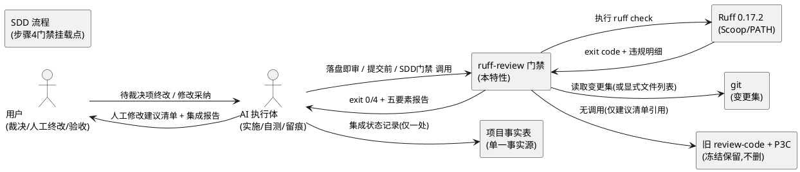
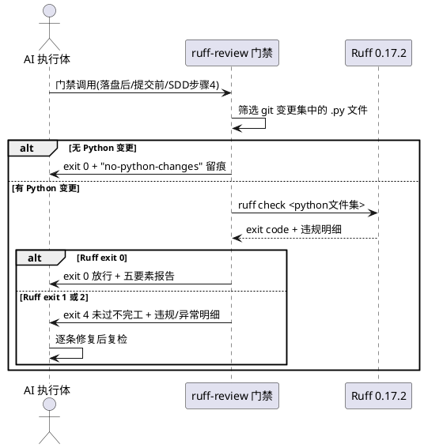

# Ruff 审查门禁替换 — 需求规格说明（spec.md）

> 版本：v1 | 日期：2026-11-09 | 基线：派工单《替换 P3C 审查框架为 Ruff》原文 + 用户已裁决基线（U6-6 人工终改、公约第 4 条规矩层冻结、旧 P3C 文件不删除、Ruff 0.17.2 实测可用）
> 阶段：需求规格（spec）——本阶段仅产 spec.md，不产 design/tasks

# **1. 组件定位**

## **1.1 核心职责**
本特性（20261109_ruff_review_gate）负责将项目 Python 编码审查门禁的承载工具从 P3C（Java/PMD）切换为 Ruff 0.17.2，以新建的独立 ruff-review 技能承载"编码必审未过不完工"（公约第 6 条），并解除旧 review-code 技能在 Python 编码流程中的绑定（停用/冻结标注，不删除）。

一句话：本组件负责以 Ruff 为引擎承载 Python 编码审查门禁，实现审查工具链底座的替换与新旧隔离。

## **1.2 核心输入**
1. **Python 落盘事件**：AI 执行体通过 Write/Edit 工具完成 Python 文件落盘后产生的审查触发信号。
2. **提交前审查请求**：git 提交动作发生前，对变更集中 Python 文件的门禁调用。
3. **SDD 执行步门禁调用**：SDD 四步流程步骤 4（执行派工）中，编码产物落盘后、完工呈报前的门禁调用。
4. **人工修改建议的采纳指令**：用户对"人工修改建议清单"（针对既有规则文件的解绑标注）的裁决与终改结果。

## **1.3 核心输出**
1. **门禁裁决结果**：exit code（0=门禁过，4=未过不完工），与公约第 6 条"编码必审"绑定。
2. **审查报告**：五要素留痕（审查范围、发现项数、严重级别、复核状态、命令与结果原文），路径约定见 5.1。
3. **人工修改建议清单**：针对既有规则文件（review-code/SKILL.md 等）的解绑标注建议，交由人工终改。
4. **新建技能产物**：ruff-review 技能（SKILL.md + 审查脚本），属新能力注册。
5. **集成报告**：含挂载状态、加载机制、约束确认三要素，落盘于计划文档目录。
6. **事实表状态记录**：集成完成后的状态归 notes/项目事实表.md 一处。

## **1.4 职责边界**
本特性明确不负责以下事项：
1. **不执行业务编码、不修改项目源码**：所有变更限于审查工具链配置与 SDD 产物目录。
2. **不删除任何旧 P3C 文件**：review-code 技能（SKILL.md + review-code.ps1）、D:\refs\p3c 底座原样保留，仅解除其在 Python 编码流程中的绑定。
3. **不直改既有规则文件**：依据 U6-6（2026-11-08 用户裁决），对 review-code/SKILL.md、项目协作公约.mdc 等既有规则文件一律零直改，只产出人工修改建议清单。
4. **不改动公约本体**：公约第 4 条规矩层冻结。已核实公约第 6 条原文不含 P3C 字样，"规则约束更新"无需触碰公约，天然满足第 4 条。
5. **不建定时任务/轮询**：审查触发一律走事件（落盘动作/提交前/SDD 门禁环节），遵守公约第 5 条。
6. **不承载 Java 审查**：Ruff 能力边界为 Python（非 Java 任务）；旧 P3C 的 Java 审查能力以冻结态原样保留。
7. **不产 design.md / tasks.md**：由后续阶段的其他智能体承接。

# **2. 领域术语**

**门禁（Gate）**
: 编码产物进入"完工"状态前必须通过的强制审查关卡，依据公约第 6 条"编码必审未过不完工"，未过门禁不得呈报完工。
: 备注：与旧 SKILL.md 中"代码审查门禁环节"同一承载语义，本特性仅更换承载工具，门禁语义本身不变。

**落盘即审（Review-on-Write）**
: 当 Write/Edit 工具完成 Python 文件落盘动作后立即触发 Ruff 审查的事件式触发机制。
: 备注：本环境无 IDE 保存钩子，派工单中"保存时触发"按环境事实降级为本机制，不再保留"保存时"提法。

**提交前审查（Pre-commit Review）**
: git 提交动作发生前对变更集中 Python 文件执行的门禁调用。

**SDD 执行步门禁（SDD Step-4 Gate）**
: SDD 四步流程步骤 4（执行派工）中，编码产物落盘后、完工呈报前必调的代码审查环节。

**绑定解除（Unbind）**
: 通过在既有规则文件上追加停用/冻结标注（由人工终改），使旧 review-code 技能不再被 Python 编码流程触发调用，但文件本体及其 Java 能力原样保留。
: 备注：冻结 ≠ 删除 ≠ 失效；Java 变更仍可走冻结态技能（本项目主栈 Python，实际不触发）。

**exit 语义（Exit Code Mapping）**
: 门禁脚本退出码与门禁裁决的固定映射关系：0=放行留痕，4=有违规未过不完工，其他=异常裁决（详见 5.1）。

**集成报告（Integration Report）**
: 集成完成后产出的验收文档，必须包含挂载状态、加载机制、约束确认三要素，落盘于计划文档目录。

**人工修改建议清单（Manual-Edit Proposal List）**
: AI 对既有规则文件应做的修改建议集合，仅提建议不直改，最终由人工执行修改（U6-6 裁决）。

**单一事实源（Single Source of Truth）**
: 集成后状态只存 notes/项目事实表.md 一处（公约第 6 条），禁止多处记录产生冲突。

**Ruff**
: Python linter/formatter，版本 0.17.2，经 Scoop 包管理器安装、已挂系统 PATH（2026-11-09 实测基线），本特性选定的审查引擎。
: 备注：来源=官方文档（Ruff 自带 lint 与 format 双能力，单二进制，exit code：0=无违规，1=有违规，2=执行错误）。

**P3C**
: 阿里巴巴 Java 开发规约集（p3c-pmd 2.1.1），原审查底座，位于 D:\refs\p3c，本特性后进入冻结保留态。

# **3. 角色与边界**

## **3.1 核心角色**
1. **用户（裁决者/方向把控）**：裁决附录 B 待裁决项；对既有规则文件执行人工终改（U6-6）；验收集成报告与自测结果。
2. **AI 执行体（实施者）**：产出 spec、人工修改建议清单、新建 ruff-review 技能、集成报告；执行真实运行自测；更新事实表。对规则文件仅建议、零直改。

## **3.2 外部系统**
1. **Ruff 0.17.2（Scoop/PATH）**：审查执行引擎，被门禁脚本调用，返回 exit code 与违规明细。
2. **git**：变更集来源（porcelain 状态），供门禁脚本筛选 Python 变更文件。
3. **SDD 四步流程**：宿主流程，步骤 4 提供门禁挂载点。
4. **notes/项目事实表.md**：单一事实源，接收集成状态记录。
5. **旧 review-code 技能 + D:\refs\p3c 底座**：冻结保留对象，仅被人工修改建议清单引用，不被新流程调用。
6. **项目协作公约.mdc**：规则层，只读约束源（第 4/5/6 条），零改动。

## **3.3 交互上下文**

图中不含内部模块、数据库等技术组件与接口参数，符合上下文图约束。

# **4. DFX 约束**

## **4.1 性能**
1. 单次门禁调用端到端时长上限 60 秒（含变更集筛选、Ruff 执行、报告落盘）。
2. 其中 Ruff 引擎执行时长上限 10 秒（增量 ≤20 个 Python 文件场景）。
3. 来源标注：Ruff 官方文档宣称 Rust 实现高性能（单文件毫秒级），10 秒为含进程启动与多文件批量的保守预设值，可在自测后由用户覆盖调整。
4. 禁止以轮询/定时方式实现触发（公约第 5 条），性能指标仅在事件触发时考核。

## **4.2 可靠性**
1. exit 语义必须确定性映射（见 5.1），同一输入多次运行裁决结果一致。
2. 审查工具执行异常（Ruff exit 2）必须按 fail-closed 处理：判定门禁未过，禁止误判放行（预设方案，附录 B 待裁决项 4）。
3. 门禁报告落盘失败时，禁止呈现"完工"结论（伪完成即违规，公约第 3 条）。

## **4.3 安全性**
1. 每次门禁调用必须留痕：命令原文与结果原文入报告，可事后审计。
2. 豁免场景（非 Python 变更、无变更）必须如实标注留痕，禁虚构多语言能力（沿用旧 SKILL.md 第 3 条纪律）。
3. 新脚本不引入网络访问，仅本地进程调用。

## **4.4 可维护性**
1. 审查报告五要素（审查范围、发现项数、严重级别、复核状态、命令与结果原文）必须落执行轨迹。
2. 集成状态单点存于事实表，任何其他文档不得另存冲突状态。
3. 新技能 SKILL.md 必须写明触发条件、exit 语义、SDD 挂载点、Ruff 底座来源指针，使后续维护者无需读脚本即可理解门禁契约。

## **4.5 兼容性**
1. 旧 review-code 技能、review-code.ps1、D:\refs\p3c 底座零删除、零内容覆盖，与新技能并存隔离。
2. 绑定解除通过追加式标注实现（人工终改），不重写既有条款原文。
3. 门禁 exit 语义（0/4）与公约第 6 条及 SDD 流程的既有绑定保持不变，仅更换底层引擎，下游调用方无感知。

# **5. 核心能力**

## **5.1 审查门禁替换（P3C → Ruff）**

### **5.1.1 业务规则**
1. **引擎替换规则**：Python 编码审查门禁必须由 Ruff 0.17.2 承载，替代 P3C/PMD 引擎；Ruff 必须以 `ruff check` 对变更 Python 文件执行静态审查。
   a. 验收条件：[触发 Python 门禁调用] → [实际调用的是 Ruff 而非 java/PMD，报告中的命令原文可证明]
2. **变更集筛选规则**：门禁必须从 git 变更集（porcelain）中筛选 `.py` 文件作为审查对象；支持显式文件列表参数以服务自测。
   a. 验收条件：[变更集仅含 .py 文件] → [全部进入审查范围]；[变更集无 .py 文件] → [skip 审查]
3. **exit 语义映射规则**：门禁退出码必须按以下映射固定裁决——
   a. 验收条件：[Ruff 结果 0（无违规）] → [门禁 exit 0，放行并留痕]
   b. 验收条件：[Ruff 结果 1（存在违规）] → [门禁 exit 4，判定"未过不完工"（公约第 6 条），违规明细逐条入报告]
   c. 验收条件：[Ruff 结果 2（工具执行异常/配置错误）] → [门禁 exit 4，fail-closed 判定未过，异常原文入报告（预设方案，附录 B 待裁决项 4）]
   d. 验收条件：[变更集无 Python 文件] → [门禁 exit 0，留痕 "no-python-changes: skip review"]
4. **无变更放行规则**：变更集中无 Python 文件时门禁必须放行，且留痕必须如实标注 skip 原因，禁止出现"已审查"的虚假记录。
   a. 验收条件：[git 变更集仅含 .md/.java 等非 .py 文件] → [exit 0 + "no-python-changes" 留痕]
5. **非 Python 豁免规则**：Ruff 门禁能力边界为 Python；非 Python 变更不进入 Ruff 审查，按豁免语义如实标注留痕，禁虚构多语言能力。
   a. 验收条件：[Java 文件变更请求 Ruff 门禁] → [不执行 Ruff，按豁免标注放行]
6. **报告五要素规则**：每次门禁调用必须产出报告并落执行轨迹，五要素=审查范围（增量/全量/显式列表）、发现项数、严重级别、复核状态（未复核/已复核留痕/已豁免留痕）、命令与结果原文。
   a. 验收条件：[任一次门禁调用] → [报告文件存在且五要素齐备]
7. **禁止项**：禁止以 P3C/PMD 作为 Python 门禁引擎；禁止在无 IDE 钩子的环境中宣称"保存时触发"；禁止轮询/定时触发。
   a. 验收条件：[检查门禁调用链] → [无 java/PMD 调用、无轮询循环、无定时器]

### **5.1.2 交互流程**

### **5.1.3 异常场景**
1. **审查工具异常（Ruff exit 2）**
   a. 触发条件：Ruff 进程启动失败、配置解析错误、目标文件不可读等执行级错误。
   b. 系统行为：门禁按 fail-closed 判定未过，异常原文完整入报告，呈报调用方。
   c. 用户感知：exit 4 + "ruff-execution-error" 标注，禁放行。
2. **git 变更集不可用**
   a. 触发条件：RepoRoot 非 git 仓或 git 命令失败。
   b. 系统行为：门禁终止，显式报错入报告，判定未过（fail-closed）。
   c. 用户感知：exit 4 + "git-unavailable" 标注。
3. **报告落盘失败**
   a. 触发条件：报告路径不可写（磁盘/权限）。
   b. 系统行为：门禁禁止给出任何"完工"结论（公约第 3 条伪完成即违规），显式报错。
   c. 用户感知：exit 4 + "report-unwritable" 标注。
4. **修复后复检循环**
   a. 触发条件：首次审查 exit 4，AI 修复违规后再次调用。
   b. 系统行为：复检按同一 exit 语义裁决，直至 exit 0 或用户明示豁免。
   c. 用户感知：每次复检均有独立报告留痕，违规收敛轨迹可查。

## **5.2 三类触发时机**

### **5.2.1 业务规则**
1. **落盘即审规则**：当（When）Write/Edit 工具完成 Python 文件落盘动作时，系统必须在落盘后立即触发一次 Ruff 门禁审查，落盘即审取代"保存时触发"。
   a. 验收条件：[Write/Edit 产出任一 .py 文件] → [随即产生一份对应门禁报告留痕]
2. **提交前审查规则**：当（When）git 提交动作即将发生且变更集含 Python 文件时，系统必须在提交前完成一次门禁调用，exit 4 时禁止提交动作推进。
   a. 验收条件：[提交前门禁 exit 4] → [不完工不提交，违规明细在手]；[exit 0] → [放行提交]
3. **SDD 执行步门禁规则**：当（When）SDD 四步流程步骤 4 产生 Python 代码变更且编码产物已落盘、完工呈报尚未发出时，ruff-review 门禁必须作为"代码审查门禁"环节必调，exit 语义与门禁判定绑定（0=过，4=未过不完工）。
   a. 验收条件：[步骤 4 有 Python 编码产物] → [完工呈报前存在 exit 0 的门禁报告；缺失则呈报违规]
4. **"保存时"降级规则**：Where 触发需求来源为"保存时（IDE 钩子）"时，系统必须按环境事实（本环境无 IDE 钩子）如实标注该形态不可行，并降级为落盘即审，不得在文档中保留"保存时触发"的可实现暗示。
   a. 验收条件：[检查新 SKILL.md 与集成报告表述] → [出现的是"落盘即审"，无"保存时钩子"承诺]
5. **事件触发纪律规则**：三类触发时机必须全部为事件驱动，禁止出现任何定时任务、轮询循环或守护进程形态的触发实现。
   a. 验收条件：[检查触发机制] → [仅有落盘事件/提交前动作/SDD 流程节点三类入口]

### **5.2.2 交互流程**
见 5.1.2 时序图——三类触发时机汇聚为同一门禁调用入口，仅触发源不同（Write/Edit 落盘事件 / git 提交动作 / SDD 步骤 4 节点）。

### **5.2.3 异常场景**
1. **落盘即审遗漏**
   a. 触发条件：AI 执行体落盘 Python 文件后未触发门禁。
   b. 系统行为：SDD 步骤 4 门禁与提交前审查兜底，任一后续环节发现缺失即要求补审，禁止无门禁留痕的 Python 产物呈报完工。
   c. 用户感知：完工呈报被门禁纪律拦截，补审后放行。
2. **提交被门禁拦截**
   a. 触发条件：提交前门禁 exit 4。
   b. 系统行为：提交动作不推进，违规明细交回修复循环。
   c. 用户感知：exit 4 + "未过不完工"（公约第 6 条）。

## **5.3 新技能承载形态（ruff-review）**

### **5.2.1 业务规则**（编号更正：本节实为 5.3.1）
1. **独立技能规则**：Python 门禁必须由新建的独立技能 ruff-review 承载（.codeartsdoer/skills/ruff-review/ 下含 SKILL.md 与 scripts/ruff-review.ps1），与旧 review-code 技能并存隔离，无双轨混用。
   a. 验收条件：[Python 门禁调用] → [调用的是 ruff-review 技能，不触碰 review-code]
2. **SKILL.md 契约规则**：新技能 SKILL.md 必须写明——触发条件（落盘即审/提交前/SDD 步骤 4）、exit 语义（0/4 映射表）、SDD 挂载说明（执行步门禁环节，与"编码必审"同一承载）、Ruff 底座来源指针（Ruff 0.17.2 via Scoop/PATH）。
   a. 验收条件：[阅读新 SKILL.md] → [四项契约内容齐备且与 spec 一致]
3. **脚本参数契约规则**：审查脚本必须支持 RepoRoot 参数（默认项目根）与可选显式文件列表参数（服务自测），报告路径约定 `%TEMP%\ruff-review-<日期>.txt`（沿用旧脚本报告落盘模式）。
   a. 验收条件：[以显式文件列表调用脚本] → [仅审查该列表文件并产出对应报告]
4. **并存隔离规则**：新旧技能必须做到"互不调用、互不覆盖、互不误触发"——新流程（Python）不触发旧技能，旧技能冻结标注后不被新流程引用。
   a. 验收条件：[Python 变更触发审查] → [仅 ruff-review 被调用]

### **5.3.2 异常场景**
1. **双轨误触发**
   a. 触发条件：Python 变错误触发旧 review-code 技能。
   b. 系统行为：属解绑未完成状态；在人工终改完成前，AI 执行体必须以 spec 本节为准自律调用新技能，并在集成报告中如实标注解绑标注尚未人工落盘。
   c. 用户感知：报告中"绑定解除状态"如实反映（已建议/已人工落地）。

## **5.4 既有文件处置与绑定解除**

### **5.4.1 业务规则**
1. **零删除规则**：旧 P3C 文件（review-code/SKILL.md、scripts/review-code.ps1、D:\refs\p3c 底座）必须原样保留，禁止删除、禁止内容覆盖。
   a. 验收条件：[比对处置前后文件] → [内容与路径零变化]
2. **零直改规则（U6-6）**：对既有规则文件（review-code/SKILL.md、项目协作公约.mdc 等）的任何修改，AI 必须仅产出"人工修改建议清单"，由人工执行终改；建议清单属新产物，随集成报告交付。
   a. 验收条件：[git diff 既有规则文件] → [AI 实施期间无任何变更记录]
3. **公约零改动规则**：项目协作公约.mdc 必须零改动（公约第 4 条）；已核实第 6 条原文不含 P3C 字样，无需求层面的公约修订诉求。
   a. 验收条件：[git diff 公约文件] → [无变更]
4. **解绑标注规则**：绑定解除必须以追加式停用/冻结标注实现（如 SKILL.md description 追加"已冻结：Python 流程改由 ruff-review 承载"字样），标注内容为建议清单，人工终改落地；标注语义必须满足"冻结 ≠ 删除 ≠ 失效"。
   a. 验收条件：[人工按建议清单终改后] → [SKILL.md 原条款保留，仅新增冻结标注]
5. **底座只读规则**：D:\refs\p3c 底座必须保持只读引用，新流程禁止读写该目录。
   a. 验收条件：[新技能调用链] → [无指向 D:\refs\p3c 的调用]

### **5.4.2 异常场景**
1. **解绑标注延迟落地**
   a. 触发条件：建议清单已产出但用户尚未人工终改。
   b. 系统行为：过渡期内 AI 执行体按 spec 自律走新技能，集成报告标注"解绑建议已交付、待人工落地"。
   c. 用户感知：状态透明，无伪完成记录。

## **5.5 集成报告与状态归档**

### **5.5.1 业务规则**
1. **三要素规则**：集成报告必须包含挂载状态（ruff-review 在 SDD 步骤 4 门禁环节的挂载是否生效）、加载机制（触发时机=落盘即审/提交前/SDD 步骤 4，加载方式=技能描述触发）、约束确认（exit 语义与公约第 6 条绑定、U6-6/公约第 4 条遵守情况、旧文件保留清单）。
   a. 验收条件：[阅读集成报告] → [三要素齐备且与实测结果一致]
2. **落盘位置规则**：集成报告必须落盘于计划文档目录（用户指定），与 spec 产物同属交付链。
   a. 验收条件：[用户在计划文档目录] → [能找到集成报告文件]
3. **单一事实源规则**：集成完成后的最终状态（ruff-review 已挂载、review-code 已冻结待标注、P3C 保留）必须只存 notes/项目事实表.md 一处。
   a. 验收条件：[全项目搜索门禁状态记录] → [仅事实表一处为权威状态]

## **5.6 自测与验收**

### **5.6.1 业务规则**
1. **真实运行规则**：自测必须包含对 Ruff 的真实运行验证（真实调用 ruff check，非纸面推演），自测样例必须置于项目外临时目录（如 %TEMP%），通过显式文件列表参数传入门禁，禁污染项目工作区（公约第 3 条仓库隔离）。
   a. 验收条件：[自测报告] → [含真实命令行与结果原文]
2. **用例覆盖规则**：自测用例必须覆盖以下五类场景，逐例记录门禁裁决——
   a. 验收条件（用例 1 违规样例）：[含确定违规的 Python 样例（如未使用导入 F401）] → [Ruff exit 1 → 门禁 exit 4，未过不完工]
   b. 验收条件（用例 2 干净样例）：[无违规 Python 样例] → [门禁 exit 0，放行]
   c. 验收条件（用例 3 无 Python 变更）：[变更集无 .py] → [skip 留痕，exit 0]
   d. 验收条件（用例 4 非 Python 变更）：[仅 .md 等文件] → [豁免标注留痕，exit 0]
   e. 验收条件（用例 5 工具异常，可选）：[模拟 Ruff 不可用] → [fail-closed exit 4，禁放行]
3. **触发时机演练规则**：三类触发时机必须逐一演练并留痕（落盘即审可在自测中以"显式列表调用门禁"等价演练，集成报告说明演练等价性）。
   a. 验收条件：[集成报告] → [三类时机的演练记录齐备]
4. **收敛呈报规则**：自测全部通过后必须产出集成报告并呈报用户验收；存在未过用例时禁止伪完成呈报，如实报告失败点并修复复测（最多重试 3 次后降级呈报，PREFERENCE_5）。
   a. 验收条件：[最终呈报] → [全部用例过 = 验收通过；或失败如实呈报 + 降级说明]

# **6. 数据约束**

## **6.1 门禁裁决结果**
1. **exit_code**：取值域 {0, 4}；0=放行留痕，4=未过不完工；0 与 4 的判定必须与 5.1.1 第 3 条映射规则一致，禁出现 0/4 以外的门禁裁决值（执行异常亦归入 4）。
2. **裁决留痕**：每次裁决必须有对应报告文件存在，报告文件名含日期，禁止无留痕裁决。
3. **绑定关系**：裁决值必须与公约第 6 条"编码必审未过不完工"的完工判定绑定，即 exit 0 是完工呈报的必要条件。

## **6.2 审查报告**
1. **审查范围**：取值为 {增量(git 变更集), 全量, 显式文件列表} 之一，必须如实记录。
2. **发现项数**：非负整数，与 Ruff 违规明细条目数一致。
3. **严重级别**：必须记录 Ruff 违规的规则代码（如 F401/E501）与级别，禁删减。
4. **复核状态**：取值 {未复核, 已复核留痕, 已豁免留痕} 三态之一。
5. **命令与结果原文**：必须为真实执行记录，禁止手工构造。

## **6.3 人工修改建议清单**
1. **目标文件**：仅限既有规则文件（如 review-code/SKILL.md），必须明确列出文件路径与建议修改位置。
2. **建议性质**：必须为追加式标注建议（冻结/停用），禁止建议删除原文或覆盖改写。
3. **执行主体**：清单必须标明"由人工终改"，AI 不执行。
4. **唯一性**：每个既有规则文件的解绑建议在清单中仅出现一次，禁止重复冲突建议。

## **6.4 集成报告**
1. **挂载状态**：取值为 {已生效, 未生效+原因} 之一，必须基于实测结果填写。
2. **加载机制**：必须描述触发时机三类入口与技能加载方式。
3. **约束确认**：必须逐条确认 exit 语义绑定公约第 6 条、U6-6 零直改遵守情况、公约第 4 条零改动、旧文件保留清单（逐文件路径）。

---

# 附录 A：需求 ↔ 条款覆盖映射表

| # | 派工单必须覆盖项 | 对应条款 | 落点摘要 |
|---|---|---|---|
| ① | 审查工具替换（P3C→Ruff）+ 触发条件与 exit 门禁语义 | 5.1.1 规则 1/2/3/4/5/7；5.2.1 规则 1/2/3；6.1 | Ruff 承载引擎；exit 0/4 映射含异常 fail-closed |
| ② | 既有文件处置（绑定解除=停用/冻结标注，不删） | 5.4.1 规则 1/2/3/4/5；6.3 | 零删除、零直改、建议清单、公约零改动 |
| ③ | 新技能/新脚本形态（独立 ruff-review，与旧技能并存隔离） | 5.3.1 规则 1/2/3/4；6.2 | 独立技能 + SKILL.md 四项契约 + 并存隔离 |
| ④ | 三类触发时机（落盘即审/提交前/SDD 步骤 4；"保存时"降级） | 5.2.1 规则 1/2/3/4/5 | 事件驱动三入口；保存时如实标注不可行并降级 |
| ⑤ | 集成报告要求（挂载状态/加载机制/约束确认三要素） | 5.5.1 规则 1/2/3；6.4 | 三要素 + 计划文档目录 + 事实表单点 |
| ⑥ | 自测方案（含 Ruff 对测试样例真实运行验证） | 5.6.1 规则 1/2/3/4 | 五类用例 + 三时机演练 + 真实命令留痕 |
| — | 禁定时/禁轮询 | 4.1.4；5.1.1 规则 7；5.2.1 规则 5 | 事件触发纪律 |
| — | 单一事实源 | 5.5.1 规则 3；4.4.2；2 术语 | notes/项目事实表.md 一处 |
| — | 公约第 4 条冻结 / U6-6 零直改 | 1.4 边界 3/4；5.4.1 规则 2/3 | 规则层零触碰 |

# 附录 B：待裁决项（附预设方案，可被用户覆盖）

| # | 待裁决项 | 预设方案（默认推荐） | 备选 |
|---|---|---|---|
| B1 | 新建 ruff-review 技能的 SKILL.md 是否豁免 U6-6 人工终改限制 | 豁免：新建文件属新能力注册（用户基线 1 已明确"新建文件不适用该限制"），AI 可直接创建；其后续修改仍建议人工终改 | 不豁免：首建即交建议清单，人工落笔 |
| B2 | Ruff 规则集选择 | 默认规则起步（`ruff check` 默认 = E4/E7/E9/F），先跑通门禁，规则扩展留待后续迭代 | 定制配置文件（pyproject.toml/ruff.toml，如全选 E/F/W 或加 I 排序）；注：定制配置属设计阶段决策 |
| B3 | review-code 技能的解绑标注方式 | SKILL.md description 追加冻结字样："已冻结（2026-11-09）：Python 流程改由 ruff-review 承载，本技能仅保留 Java 冻统能力"，追加式不删原文 | 方式 A：文件首部插入冻结公告块；方式 B：整文件重写 description（不推荐，违背追加式原则） |
| B4 | Ruff 执行异常（exit 2）的门禁裁决 | fail-closed：异常判 exit 4 未过不完工，禁带病放行 | fail-open：异常放行但留痕标注（不推荐，违反"编码必审"） |
| B5 | 性能红线具体值 | 端到端 ≤60s、Ruff 引擎 ≤10s（官方性能依据 + 保守预设，自测后可校准） | 由用户指定更严/更宽阈值 |
| B6 | 自测样例存放位置 | 项目外临时目录（%TEMP%\ruff-selftest\），经显式文件列表参数传入门禁，不污染项目区 | specs 目录内样例子目录（会与"产出文件仅限 spec 目录"约束部分冲突，需用户特批） |
| B7 | 报告路径 | `%TEMP%\ruff-review-<日期>.txt`（沿用旧脚本 %TEMP% 模式） | 项目外固定目录（如 D:\refs\reports\） |

---

*（本文档为需求规格阶段唯一产物；design.md 与 tasks.md 由后续阶段智能体承接。文档状态：待用户评审。）*