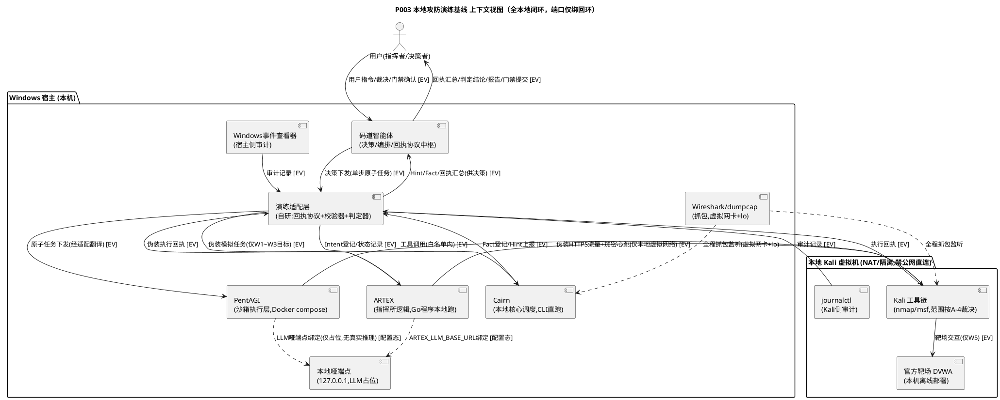
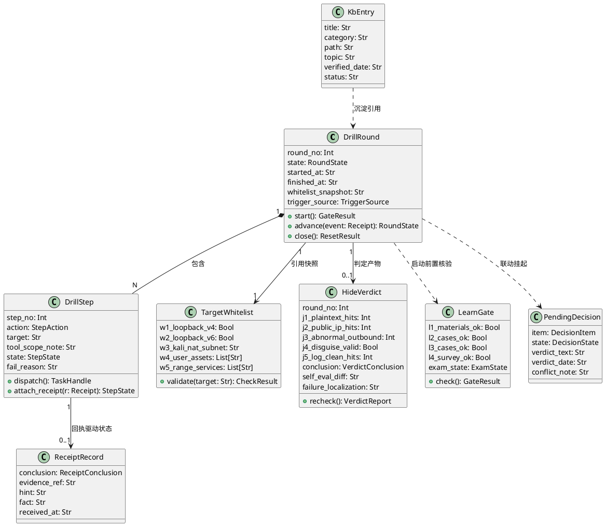
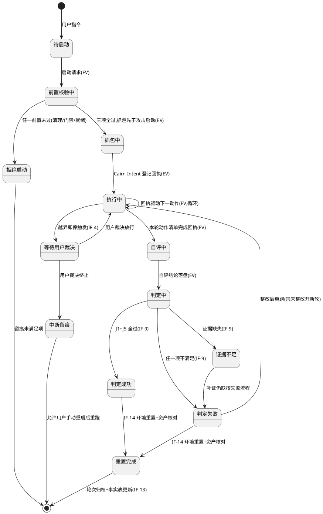

# P003 本地授权攻防演练基线 实现方案（design.md）

> 依据：spec.md v1.1（814 条款全文承接）+ pre_check.md v1.0 实测填充版（G-PC3 已放行）+ 上游 device_workflow_api v2.0 底座规格（环境口径/红线/回执模式原则以其为准）。
> 用户已裁决基线承接登记（逐条承接，禁回潮）：
> 1. ARTEX 来源=RuoJi6/ARTEX 社区续维护版（AGPL-3.0，Go），浅克隆 `D:\refs\ARTEX`（HEAD=73d5437）；原仓库 Autumn-27/ARTEX 与"仅逻辑模拟不部署"兜底不再讨论。
> 2. 模型解耦=方案 a 回执模式：框架剥离/屏蔽 LLM 调用（配置层重定向或 mock 端点绑定 127.0.0.1），调度决策由码道智能体承担，框架只负责状态记录、调度与工具调用回执；禁方案 b 作主路线、方案 c 已实测不可行，均不复活。
> 3. 禁本地 Ollama（本机带不动）。
> 4. PentAGI=vxcontrol/pentagi（HEAD=cffed94），模型耦合点 `LLM_SERVER_URL` 自定义 OpenAI 兼容端点（pre_check.md 第 3 章实测清单）。
> 5. Cairn 复用本地资产 `D:\refs\Cairn`（HEAD=2ae4eef，工作区干净）；查询端零 LLM/零 embedding 已复核成立；构建端有 mock provider 与 `--fake` 开关。
> 6. G-PC3 已放行（用户裁决 2026-11-12）；先学后干门禁（spec 5.2 L1~L4）未取消，登记为编码/部署执行阶段前置门禁。
> 7. 附录 A 四项（A-1~A-4）维持暂挂：本文档只给推荐项与理由，留【待裁决】标记，不替用户决策。
> 8. 四不红线、目标白名单 W1~W5、越界即停、隐藏判定 J1~J5 全部维持（spec 第 4/6 章原文为准）。
>
> 编写纪律：本文档只写架构/接口/伪代码/配置示例，禁实现代码；自研仅接口层与适配层，底层复用三现成框架；全程事件驱动、禁定时任务与轮询；全端口仅绑回环；全本地闭环。

# 一、需求与存量功能关系分析

**写作说明**：本章依据 pre_check.md v1.0 实测数据（`D:\refs` 三仓库只读 grep 实测留痕，实测命令与原始输出见 pre_check.md 附录）与三仓库顶层目录实查（2026-11-12：`D:\refs\ARTEX`、`D:\refs\PentAGI`、`D:\refs\Cairn` 均 Test-Path=True）编制；代码位置引用全部来自 pre_check.md 已实测结论，本文档不重复实测。

## 1.1 需求功能与存量功能对比

### 1.1.1 已实现功能

判定依据说明：匹配度按"需求功能点与存量代码/资产的可直接复用程度"分四档（100%/75%/50%/25%），判定依据均给出 pre_check.md 实测证据或仓库结构实查证据，不做主观臆断。

| # | 需求功能 | 存量功能 | 代码位置 | 匹配度 | 判定依据 |
|---|---------|---------|---------|--------|---------|
| 1 | 演练状态记录（Fact/Intent/Hint 黑板机制） | Cairn 黑板机制原生实现，状态仅记录本地 | `D:\refs\Cairn`（core/、service/ 目录实存；`service/internal/service/sentinel.go:6` 源码自注"纯 CPU、零 LLM"） | 100% | spec 2 章"Cairn=本地核心调度框架，黑板机制"与 Cairn 原生定位一致；pre_check.md 2.3 资产健康（HEAD=2ae4eef 工作区干净） |
| 2 | 调度链路零 LLM 化（方案 a 的调度载体） | Cairn 查询端零 LLM 零 embedding（历史"4/4 等价断言 PASS"复核仍成立） | `D:\refs\Cairn` `service/internal`（grep `anthropic.New\|openai.New\|NewLLM\|LLMAnnotator\|llm.Client\|NewAnthropic` → No files found，pre_check.md 3.1 实测） | 100% | grep 实测零命中即"框架只做状态记录与调度"能力天然成立，无需改造 |
| 3 | 构建端 LLM 屏蔽（mock 推理占位） | Cairn 构建端内置 mock provider（上游一等公民）+ `--fake` 开关 | `D:\refs\Cairn` `build/internal/llm/mock.go`（MockClient 线程安全确定性实现）、`build/internal/llm/factory.go`（`case "mock": return NewMockClient()`）、`build/cmd/cairnd/main.go:119-129`（`--fake` → `runner.FakePRSummarizer{}`） | 100% | mock 为工厂 switch 显式分支；调用点全部经单一工厂（pre_check.md 3.1），屏蔽即配置选择，不删源码 |
| 4 | PentAGI 模型端点重定向（OpenAI 兼容端点可配） | PentAGI Custom provider：`LLM_SERVER_URL/LLM_SERVER_KEY/LLM_SERVER_MODEL/LLM_SERVER_PROVIDER` 任意 OpenAI 兼容端点 | `D:\refs\PentAGI` `.env.example:144-154`、`backend/pkg/config/config.go:99-137`（env tag 注入单点）、`backend/pkg/providers/providers.go:210-212`（custom 校验）、`provider/provider.go:31`（注释"Custom fronts behind LLM_SERVER_URL"） | 100% | 配置面/注入单点/校验面三点实测齐全，重定向为纯配置动作 |
| 5 | ARTEX 模型端点重定向 | `ARTEX_LLM_BASE_URL`（endpoint optional）+ `ARTEX_LLM_PROXY`（proxy URL）环境变量单点读取 | `D:\refs\ARTEX` `agent/provider.go:143-166`（`FromEnv()` 单点）、`.env.example:10-15` | 100% | FromEnv 单入口实测；`ARTEX_LLM_BASE_URL` 置本地即完成重定向 |
| 6 | 沙箱执行层（Kali 工具 nmap/msf 调用载体） | PentAGI 多代理+工具调用执行体系（backend 全栈） | `D:\refs\PentAGI` `backend/`（pkg/providers、tools、config 等目录实存；1728 文件浅克隆完整） | 90% | 执行载体能力齐备扣 10% 原因：PentAGI 原生是"自主决策体"（agent 决策环依赖 LLM），方案 a 下须短路其自主决策面、降格为"单步原子任务执行器"，该角色改造属扩展（见 1.1.2-1） |
| 7 | 流量伪装与 C2 伪装模拟（仅本地回环/虚拟网络） | ARTEX traffic/guard/intercept 模块（流量、守卫、拦截） | `D:\refs\ARTEX` `traffic/`、`guard/`、`intercept/`（顶层目录实查实存；README 实测"AI 自主渗透测试系统（Go 后端+Next.js 前端）"） | 75% | 模块存在可承载伪装模拟扣 25% 原因：ARTEX 原生面向真实渗透场景，本单仅取"本地虚拟网络内 HTTPS 伪装+加密心跳模拟"子集；用途限定（spec 4.3.3）与本地化配置需设计层落实（见 1.1.2-4） |
| 8 | 三框架容器化/本地化部署载体 | PentAGI 官方 docker-compose 多服务栈；Cairn/ARTEX Go 工程直跑（Makefile、build.sh、start.bat） | `D:\refs\PentAGI` `docker-compose.yml`；`D:\refs\Cairn` `Makefile`；`D:\refs\ARTEX` `build.sh`、`start.bat` | 90% | 三框架启动入口齐备扣 10% 原因：默认配置均非回环口径，须按 spec 4.3.2-3 改造绑定（见 1.1.2-1/2/4） |
| 9 | 回执模式底座原则（执行靠回执/模型只规划不直控） | 上游 v2.0 底座规格成文原则 | `device_workflow_api/spec.md` 5.7.1-1/2（模型只规划、回执权威）、6.3（执行回执数据约束） | 100% | 方案 a 与上游"回执模式"原则完全同构，属原则复用无需开发 |
| 10 | 官方开源靶场（DVWA 等）本机离线部署 | 上游 v2.0 已登记官方靶场口径与获取渠道 | `device_workflow_api/spec.md` 2 章"官方开源靶场"术语、5.2.1-6 | 100% | 渠道与限定口径既有，属执行期配置动作 |

### 1.1.2 需要扩展的功能

差异说明含输入/输出/业务逻辑/边界条件差异；扩展方向含修改范围、新增依赖、兼容性影响。

| # | 需求功能 | 存量功能 | 差异说明 | 扩展方向 |
|---|---------|---------|---------|---------|
| 1 | PentAGI 自主决策面短路（降格为单步原子任务执行器） | PentAGI 多代理决策环（flow/assistant provider 驱动自主任务分解） | 输入差异：原生接收高层目标自主分解 vs 方案 a 接收码道智能体下发的单步原子任务；业务逻辑差异：原生 LLM 决策 vs 决策上移至码道智能体（哑端点+原子任务注入短路决策环） | 改动范围：仅部署配置层（`LLM_SERVER_URL` 绑本地哑端点 127.0.0.1 + 全部云端厂商 KEY 置空）+ 任务下发模式设计（本文档 2.1.3-M2）；不删源码、不改框架核心；新增依赖：本地哑端点占位服务（127.0.0.1）；兼容性：框架调度逻辑保持不变（spec 5.3.1-6） |
| 2 | PentAGI 全栈回环绑定与子栈外连面封堵 | 默认 `SERVER_HOST=0.0.0.0`、`SERVER_PORT=8443`（`.env.example:257-258`）；search/scraper/graphiti/observability 子栈默认外部端点；`PROXY_URL` 支持全局代理 | 边界差异：默认绑全部网卡/含外部依赖 vs 红线仅回环/禁公网外连；业务逻辑差异：默认联网更新检索 vs 全本地闭环 | 改动范围：`.env` 部署配置逐项显式改绑（SERVER_HOST=127.0.0.1、docker 端口映射 127.0.0.1 前缀、PROXY_URL 置空、EMBEDDING_URL 绑本地或禁用、子栈外部端点逐项禁用/绑回环）；新增依赖：无；兼容性：部署后须过 J2/J3 抓包核验（2.1.3-M5）与端口核验（IF-3 联动） |
| 3 | Cairn 构建端 mock 化部署配置 | 默认 provider 必填校验（`service/internal/config/validator.go:82-87` provider/api_key_env 必填） | 输入差异：默认要求真实 provider 配置 vs mock 占位；功能差异：mock 仅跑通流程不产出真实语义图谱 | 改动范围：部署配置选 `provider=mock` + `--fake` 开关；图谱语义质量不作本单验收目标（功能性差异如实登记，属"构建流程占位"而非"构建能力交付"）；兼容性：无（mock 为上游一等公民分支） |
| 4 | ARTEX 控制台回环绑定与用途限定 | Go server 默认监听配置 + 前端 Next.js；原生面向真实渗透场景 | 输出差异：默认监听 vs 必须仅绑 127.0.0.1（spec 4.3.2-3 点名）；用途差异：真实渗透 vs 仅本地虚拟网络内伪装模拟 | 改动范围：启动参数/env 显式绑 127.0.0.1 + 启动后监听核验；`ARTEX_LLM_PROXY` 置空禁用代理面；伪装目标配置仅允许 W1~W3；兼容性：traffic 模块本地化运行（不触碰 intercept 真实拦截面） |
| 5 | Cairn 重新接入形态适配 | 曾注册 MCP（2026-11-08 退役时移除）；本地 CLI 直跑能力原生存在 | 接入形态差异：MCP 注册形态 vs 本地 CLI 直跑形态 | 改动范围：按附录 A-2 裁决落位（推荐项见 3.3 章）；两种形态的适配面均在本设计预留（IF-12 框架接入适配器）；裁决前不实施任何一种 |
| 6 | nmap/msf 使用范围控制 | PentAGI/Kali 原生全量工具面无范围限制 | 边界差异：无限制 vs 附录 A-4 裁决范围（慢速扫描上限/本地模块/payload 回连限 W1+W3/禁第三方模块） | 改动范围：任务指令层白名单校验+范围标注字段（6.2-4）；依赖 A-4 裁决，裁决前相关动作挂起；兼容性：不影响框架本体 |

### 1.1.3 需要新增的功能或接口

全部为接口层/适配层自研（符合 spec 1.4-2"不写底层全量代码"），按业务模块分组；依赖关系标注为"→ 依赖 XX 模块"。

**A. 演练编排与回执协议模块（自研适配层核心）**
- A1 演练任务下发接口：输入=码道智能体决策结果（单步原子任务：目标+动作+范围标注），输出=框架任务句柄；核心逻辑=任务校验（白名单+能力声明）后经适配层翻译为框架可执行指令；→ 依赖 B 模块白名单校验先行。
- A2 执行回执回收接口：输入=框架/Kali 执行回执（成败结论+证据引用），输出=轮次状态机状态迁移；核心逻辑=回执权威（回执未到状态保持"执行中"，禁猜测标记成功，spec 4.2-1）；→ 依赖 A1。
- A3 演练轮次状态机：输入=回执事件/用户指令，输出=轮次与步骤状态迁移；核心逻辑=纯事件驱动（禁定时器/轮询，spec 4.1-1、6.2-3）。
- A4 码道智能体决策循环接口：输入=框架上报 Hint/Fact，输出=下一动作决策（决策不直控执行，经 A1 下发）；核心逻辑=回执驱动闭环（框架出 Hint/Fact → 决策 → 回执驱动下一动作）。

**B. 安全校验模块**
- B1 目标地址白名单校验器：输入=任一网络动作的目的地址，输出=放行/拒绝+拦截日志；核心逻辑=W1~W5 集合匹配，白名单外一律拒绝（spec 4.3.2-1）。
- B2 越界即停阻断器：输入=执行中捕获的越界连接尝试，输出=动作终止+外发阻断+告警留痕+状态转"等待用户裁决"；核心逻辑=禁自行继续、禁重试绕过（spec 4.3.2-2）。
- B3 端口绑定核验器：输入=框架启动后监听清单，输出=合规/不合规结论；核心逻辑=仅允许回环/虚拟网卡地址，出现 0.0.0.0 即判不合规并阻断（spec 4.3.2-3）。
- B4 代理进程存活检测器：输入=演练启动自检请求，输出=存活/无存活；核心逻辑=发现 Dev-Sidecar/Tor 存活进程即阻断演练启动（spec 5.1.1-2）。

**C. 检测判定模块**
- C1 J1~J5 隐藏判定核查器：输入=一轮抓包文件+双侧审计记录，输出=J1~J5 逐项核验值与判定结论（隐藏成功/隐藏失败/证据不足不予通过）；核心逻辑=五项量化标准逐项核验（spec 5.7.1-3）；→ 依赖 D 模块抓包会话。
- C2 攻防配对检查器：输入=任一攻击动作记录，输出=配对完整性结论；核心逻辑=每个攻击动作必须存在时间序一致的抓包+审计记录（spec 4.3.3-2），缺配对判不合规。
- C3 真实特征泄漏专项核查：输入=任一轮抓包复核请求，输出=泄漏/未泄漏结论；核心逻辑=真实 IP/真实身份/真实证书指纹出现即判失败并告警（spec 5.7.1-5）。
- C4 攻击侧自评记录器：输入=攻击侧每轮隐藏模拟完成事件，输出=自评结论（预判隐藏成功/失败）；核心逻辑=自评与防御判定差异如实呈现（spec 5.6.1-5）。

**D. 检测证据采集模块**
- D1 抓包会话管理器：输入=演练开始/结束指令，输出=抓包会话句柄+起止时间戳；核心逻辑=抓包先于攻击动作开始、全程连续、中断即该轮证据无效（spec 5.7.1-1、4.1-2）；监听对象=本地虚拟网卡/lo。
- D2 日志审计采集器：输入=演练开始指令，输出=Kali 侧 journalctl + 宿主侧 Windows 事件查看器审计流；核心逻辑=与攻击动作时间序一致、不允许事后补录（spec 5.7.1-2、5.5.1-6）。

**E. 门禁与留痕模块**
- E1 先学后干门禁检查单：输入=门禁放行请求，输出=放行/拒绝；核心逻辑=L1~L4 四项逐一核验（学习材料清单合规、成果落盘 notes/学习成果-*.md、知识库索引登记、考核通过留痕链完整），任一环缺失判违规（spec 5.2.1-5）。
- E2 知识库索引登记接口：输入=知识文档条目（条目名/类别/路径/主题/最后核验日期/状态），输出=登记回执；核心逻辑=查重后登记（spec 5.9.3-1）。
- E3 事实表更新接口：输入=项目核心状态变化（框架部署状态/演练轮次/判定结论/待裁决状态），输出=notes/项目事实表.md 原地更新+核验日期刷新；核心逻辑=单一事实源，其他文档活引用（spec 5.9.1-2、4.4-3）。
- E4 待裁决项登记接口：输入=裁决状态变化，输出=待裁决项记录（状态/裁决原文/冲突背景/暂挂标记）；核心逻辑=仅"待裁决/已裁决/已搁置"三态，暂挂期禁催裁禁默认执行（spec 6.6）。

**F. 报告与重置模块**
- F1 基线报告生成器：输入=全部轮次留痕+判定记录，输出=本地攻防基线报告（含框架拉取命令、Kali 命令、Wireshark 过滤规则三类代码块+可重复步骤）；核心逻辑=要素缺失判不合格（spec 5.8.1-3）。
- F2 环境重置清单执行器：输入=重置指令，输出=逐项清理留痕（性质标注"环境重置，非恶意擦痕"）；核心逻辑=资产保全核对先行、冲突项跳过呈报（spec 5.8.1-1/2、5.8.3-1）。
- F3 前置废弃清理执行器：输入=清理启动指令，输出=废弃清单逐项留痕；核心逻辑=仅限废弃清单范围、未裁决项保持现状、与"不删现有文件"冲突即跳过呈报（spec 5.1.1-1、5.1.3-3）。

**结论行（占比，按 1.1 各表设计点计数）**：复用约 60%（10 项已实现，三框架原生能力+底座原则直接承接）、扩展约 15%（6 项，全部为部署配置层与任务下发模式改造，不删源码不改框架核心）、新增约 25%（21 个功能点，全部为接口层/适配层自研，无底层全量代码）。判定基准：设计点总数 37 项（10+6+21），自研代码量预计集中在回执协议/校验器/判定核查器/报告生成等薄接口层。

## 1.2 存量功能详细分析

分析维度：接口契约、业务规则、扩展点、约束。以下引用均来自 pre_check.md v1.0 实测结论。

### 1.2.1 Cairn（本地核心调度框架，D:\refs\Cairn，HEAD=2ae4eef）

- **接口契约**：构建端 LLM 客户端层为 `build/internal/llm/` 的 Client 接口（`llm.go`），Config 支持 `anthropic | openai_compatible | anthropic_compatible | mock` 四种 provider；全部调用点收敛于单一工厂（`factory.go` NewClient switch），具体接入点为 `cairn-ingest/main.go:69`、`cairn-incremental/main.go:58`、`cairn-rebalance/main.go:62`、`build/internal/controller/runner/runner.go:109`。黑板机制（Fact/Intent/Hint）由 core/service 承载，状态仅记录本地。
- **业务规则**：查询端零 LLM 零 embedding（`sentinel.go:6`"纯 CPU、零 LLM"、`knowledge_service.go:66`、`core/metrics/metrics.go:14`"绝不引入 embedding（R-no-embedding）"、`core/observe/diff.go:13`"零 LLM 零向量（R-ev-4）"）；配置层 provider 必填校验（`validator.go:82-87`）；env 覆盖入口 `CAIRN_LLM_API_KEY/CAIRN_LLM_PROVIDER/CAIRN_LLM_MODEL`（`config.go:222-230`）。
- **扩展点**：工厂 switch 是唯一扩展点——`case "mock"` 为上游一等公民（`mock.go` MockClient 线程安全确定性实现）；`build/cmd/cairnd/main.go:119-129` 的 `--fake` 开关直通 `runner.FakePRSummarizer{}`；上游 e2e 已实证自定义 Endpoint 重定向可行（`build/test/e2e/real-build/main.go:139` 用 `Provider:"openai_compatible"`+自定义 Endpoint）。接入方式扩展点：CLI 直跑与 MCP 注册两形态均预留（附录 A-2 待裁决）。
- **约束**：① 查询端零 LLM 为源码铁律，任何改造不得引入；② R-no-embedding 全仓库无 embedding 实现，禁引入；③ 构建端真实推理才能产出语义图谱——mock 仅跑通流程，本单以"流程占位"口径验收，不作图谱质量目标（功能性问题非耦合问题，pre_check.md 3.2 已判定）；④ 全局 LLM 并发上限单点 `core/parallel/parallel.go:15` MaxConcurrency=300；⑤ 状态仅记录本地，禁写本机仓库外任何位置（spec 2 章黑板机制术语）。

### 1.2.2 PentAGI（沙箱执行层框架，D:\refs\PentAGI，HEAD=cffed94）

- **接口契约**：ProviderController 接口（`backend/pkg/providers/providers.go`：NewFlowProvider/NewAssistantProvider/Embedder()/GetProvider）为模型调用统一面；全部 provider env 经 `config.go:99-137` 的 env tag 注入（单点）；安装向导收敛到同名 env（`backend/cmd/installer/wizard/controller/controller.go:154-156、338-342、538-570`）。
- **业务规则**：custom provider 校验——`LLM_SERVER_URL` 已设置但 `LLM_SERVER_KEY` 为空时 warning（`providers.go:210-212`）；`LLM_FALLBACK_PROVIDER` 兜底（`.env.example:381-382`）；`PROXY_URL` 为"every backend LLM, embedding, search and update-check call"的全局代理（`.env.example:207-209` 注释原文）。
- **扩展点**：Custom provider（`.env.example:144-154`：`LLM_SERVER_URL/LLM_SERVER_KEY/LLM_SERVER_MODEL/LLM_SERVER_PROVIDER/LLM_SERVER_API_TYPE`）支持任意 OpenAI 兼容端点，是方案 a 在 PentAGI 侧的落点；EMBEDDING 独立可配（`:167-174`）；九组厂商 provider 可逐组置空（`:94-141`）。
- **约束**：① 默认监听 `SERVER_HOST=0.0.0.0:8443`（`:257-258`），部署时必须显式改绑回环（静态证据已登记）；② `config.go:100-101` 默认 `https://api.openai.com/v1` 云端端点，必须显式覆盖；③ search/scraper/graphiti 子栈各有外连面，须逐项显式绑本地或禁用（pre_check.md 3.3 风险评级"中"的来源）；④ 模型调用面 39 处 grep 命中全部位于 config 定义/向导/校验，无业务代码硬编码云端 endpoint——屏蔽可收敛到配置层；⑤ 官方部署形态为 docker-compose 多服务栈（含 observability/graphiti 可选栈），本单仅启用必要服务，端口映射全部加 127.0.0.1 前缀。

### 1.2.3 ARTEX（指挥所逻辑框架，D:\refs\ARTEX，HEAD=73d5437，RuoJi6/ARTEX，AGPL-3.0）

- **接口契约**：模型配置单点 `agent/provider.go:143-166` `FromEnv()`——`ARTEX_LLM_BASE_URL`（endpoint optional）、`ARTEX_LLM_PROXY`（proxy URL optional; http/https/socks5）、`ARTEX_LLM_PROVIDER/ARTEX_LLM_MODEL`；`config.example.json:2` 明示"本文件仅含 database 与 skill_dir 两项；LLM 等其余配置走环境变量或应用内设置"。
- **业务规则**：仓库保留原 Autumn-27/ARTEX 提交历史与 AGPL-3.0 许可证；程序发布包从 Releases 下载，Docker 镜像 ruoji6/artex 由 GitHub Actions 构建（README 实测摘录）；顶层含 `agent/llmhttp/llmpool/llmrec/traffic/intercept/guard/evidence/mcphttp/server/web/skills` 等模块。
- **扩展点**：`ARTEX_LLM_BASE_URL` 单 env 重定向 + `ARTEX_LLM_PROXY` 显式控向/置空，即完成模型面与代理面双屏蔽（pre_check.md 3.4 判定"低"风险的依据）；traffic/guard/intercept 模块可独立配置。
- **约束**：① AGPL-3.0 许可证——本单仅本机内部使用（不对外分发服务），合规使用须在部署留痕中登记来源与许可证；② 控制台必须仅绑 127.0.0.1（spec 4.3.2-3 点名，验收硬条件）；③ 仅取"本地虚拟网络内流量伪装+加密心跳模拟"子集用途，intercept 真实拦截面与任何指向公网的伪装目标一律禁用（spec 5.4.1-3"ARTEX 配置中出现任何指向公网的伪装目标即拒绝"）；④ 前端 Next.js 与 Go 后端分离，本地化部署须两者均绑回环。

### 1.2.4 上游底座（device_workflow_api v2.0，原则层复用）

- **接口契约**：工作流底座"类目挂载—任务下发—执行回执—状态呈现"四段式（上游 5.1/5.3）；执行回执为任务成败唯一判定依据（上游 5.7.1-2 回执权威规则）；本特性是其攻防白客研究模拟类目下的实例。
- **业务规则**：四不红线（上游 4.3-10）；真实目标红线（模拟对象仅本机自建资产，上游 4.3-2）；用途限定红线（攻击手法仅以"特征研究→防御检测"呈现，上游 4.3-4）；白客并列红线（每攻击场景必配防御产出，上游 4.3-5）。
- **扩展点**：环境口径——v2.0"Windows/Kali 本机直跑、不强制虚拟机嵌套隔离"（上游 5.2-3）；本单 Kali 以单层虚拟机形态（NAT/隔离）承载不构成回归（spec 1.4-9）。
- **约束**：底座核心禁因类目不同而修改（上游 5.1.1-4 领域无关规则）——本特性全部差异落适配层；接口契约须带版本号（上游 4.4-2）。

# 二、增量设计方案

## 2.1 实现模型

### 2.1.1 上下文视图

上下文视图展示本特性与外部角色/系统的交互关系。节点只显示接口名称，不显示内部结构；通信均为本机回环/NAT 虚拟网段内的进程间或本机网络调用，调用频率标注为事件驱动（EV：仅由用户指令或回执事件触发）。



要点说明：
1. 码道智能体是唯一决策中枢，不直控执行环境——决策一律经演练适配层翻译后下发（上游 5.7.1-1 模型只规划规则承接）。
2. 三框架与本地哑端点之间为配置态绑定（启动时读取 env），哑端点仅占位无真实推理（方案 a：调度决策由码道智能体承担）。
3. 全部网络动作的目的地址落白名单 W1~W5（spec 6.1），Kali 为 NAT/隔离单层虚拟机。
4. 抓包（Wireshark/dumpcap）与双侧日志审计为旁观记录面，随演练开始启动、随清理重置结束，全程连续。

### 2.1.2 服务/组件总体架构

组件职责与依赖表（依赖关系标注调用频率：EV=事件驱动，Cfg=启动配置态）：

| 组件 | 部署形态 | 核心职责 | 依赖 | 调用频率 |
|------|---------|---------|------|---------|
| 码道智能体（决策中枢） | 码道平台内置能力（GLM-5.3-Flash），无独立进程端口 | 接收 Hint/Fact/回执→演练决策→单步原子任务下发；门禁核验；判定裁决建议 | 演练适配层 | EV |
| 演练适配层（自研） | Python 接口层/适配层，绑 127.0.0.1 | 回执协议、白名单校验、越界即停、J1~J5 判定核查、攻防配对检查、报告生成、门禁检查单、事实表/索引登记 | Cairn/PentAGI/ARTEX 适配器、抓包会话、审计采集 | EV |
| Cairn（本地核心调度） | Go 单二进制本地直跑（go build），控制台绑 127.0.0.1 | 黑板机制 Fact/Intent/Hint 状态记录；探索编排登记 | 演练适配层；构建端绑 mock provider（Cfg） | EV |
| PentAGI（沙箱执行层） | Docker compose 官方栈（仅必要服务），端口映射全部 127.0.0.1 前缀 | 接收单步原子任务→Kali 工具调用→回执上报；自主决策面经哑端点+原子任务注入短路 | Kali 工具链；LLM 哑端点（Cfg） | EV |
| ARTEX（指挥所逻辑） | Go 程序本地跑（build.sh/start.bat），控制台绑 127.0.0.1 | 本地虚拟网络内流量伪装模拟+加密心跳生成（仅取 traffic 子集） | LLM 哑端点（Cfg）；目标限 W1~W3 | EV |
| 本地哑端点（LLM 占位） | 轻量本地服务绑 127.0.0.1（任意非空响应，无模型推理） | 承接 PentAGI `LLM_SERVER_URL` 与 ARTEX `ARTEX_LLM_BASE_URL` 的配置绑定占位，杜绝云端 endpoint 残留 | 无 | Cfg+EV（框架误调用时返回占位响应并留痕） |
| 本地 Kali 虚拟机 | 单层虚拟机，NAT/隔离（就绪方式按 A-3 裁决） | 目标机+渗透工具宿主（nmap/msf 按 A-4 范围）；DVWA 靶场宿主 | 虚拟化底座 | EV |
| Wireshark/dumpcap（防御侧） | 宿主侧本地直跑 | 全程抓包（虚拟网卡+lo），先于攻击动作开始 | 无 | EV（会话启停）+连续记录 |
| 日志审计（SIEM/EDR 模拟） | Kali journalctl + Windows 事件查看器 | 异常进程/连接审计记录，与攻击动作时间序一致 | 无 | EV+连续记录 |

配置项取值策略（关键项，完整清单见 2.1.3-M2）：

| 配置项 | 归属 | 取值策略 | 约束来源 |
|--------|------|---------|---------|
| `SERVER_HOST` | PentAGI | `127.0.0.1`（禁 0.0.0.0） | spec 4.3.2-3 |
| `LLM_SERVER_URL` | PentAGI | `http://127.0.0.1:<哑端点端口>/v1`（OpenAI 兼容路径） | 用户裁决方案 a |
| `LLM_SERVER_KEY` | PentAGI | 任意非空占位值（满足 custom provider 校验，规避 warning） | pre_check.md 3.1 |
| `OPEN_AI_KEY/ANTHROPIC_API_KEY/`九组厂商 KEY | PentAGI | 全部置空（禁云端残留） | spec 5.3.1-6 |
| `PROXY_URL` | PentAGI | 置空（禁全局代理面） | spec 5.1.1-2 |
| `EMBEDDING_URL` | PentAGI | 绑本地哑端点或禁用（无 embedding 实义） | spec 4.3.2-1 |
| `ARTEX_LLM_BASE_URL` | ARTEX | `http://127.0.0.1:<哑端点端口>` | 用户裁决方案 a |
| `ARTEX_LLM_PROXY` | ARTEX | 置空（禁代理控向） | pre_check.md 3.4 |
| ARTEX 控制台监听 | ARTEX | 仅 `127.0.0.1` | spec 4.3.2-3 点名 |
| Cairn provider | Cairn | `mock` + 启动加 `--fake` | 用户裁决方案 a；spec 5.3.1-6 |
| `CAIRN_LLM_*` env | Cairn | 指向 mock 配置（api_key_env 用占位环境变量名满足必填校验） | Cairn validator.go:82-87 |
| 白名单 W1~W5 | 适配层 | 按 spec 6.1 逐条登记；W3 网段以实际虚拟网卡登记；W4 默认空集；变更须用户拍板 | spec 6.1 |
| 触发方式 | 任务配置 | 仅"用户指令/上一环回执事件"二值 | spec 6.2-3 |

### 2.1.3 实现设计文档（逐机制设计，每条决策给"结论+理由"）

#### M0 前置废弃清理与环境口径切换

- **结论**：清理按三段组织——① 代理通道停用：Dev-Sidecar 与 Tor 进程停用（资产处置按 A-1 裁决，裁决前保持现状仅停用进程）；② 码道云同步账号退出+本地缓存清理；③ TAO 旧思路残留配置与旧会话清除。清理完成后执行 B4 代理存活检测，通过才放行演练启动。
- **理由**：spec 5.1.1-1/2/4 要求废弃清单逐项留痕且禁扩大范围；A-1 未裁决期间"保持现状仅停用进程"是 spec 4.3.4-2 资产保全规则与 6.6-1 待裁决三态的直接推论。清理与"不删现有文件"冲突时跳过呈报（spec 5.1.3-3），由 F3 执行器承载。

#### M1 三框架部署形态

- **结论**：三框架三种形态，与上游 v2.0"Windows/Kali 本机直跑"口径一致——
  1. **Cairn：本地直跑**（Go 工程 go build 出单二进制，CLI 直跑形态为推荐接入方式，最终按 A-2 裁决）；构建端配置 `provider=mock` + `--fake`；控制台/服务绑 127.0.0.1。
  2. **PentAGI：Docker compose 端口回环映射**（官方标准形态 docker-compose.yml，仅启用 backend/frontend 必要服务；全部端口映射显式加 `127.0.0.1:` 前缀；`SERVER_HOST=127.0.0.1`）；子栈（graphiti/observability/langfuse）默认不启用，如启用其外部端点逐项禁用或绑回环。
  3. **ARTEX：Go 程序本地跑**（Windows 宿主 go build 或 start.bat 直跑；控制台仅绑 127.0.0.1；`ARTEX_LLM_BASE_URL` 绑哑端点、`ARTEX_LLM_PROXY` 置空）。
  4. **Kali：单层虚拟机 NAT/隔离**（就绪方式 A-1 复用现成 vs A-2 新建镜像，按 A-3 裁决；NAT 子网登记入 W3）。
- **理由**：① Cairn/ARTEX 均为 Go 工程且自带直跑入口（Makefile/build.sh/start.bat 实查），Docker 化反增本机负担，且 v2.0 明确本机直跑口径；② PentAGI 官方唯一标准部署形态是 docker-compose（多服务栈源码结构实测），偏离官方形态会引入不可控改造，但端口映射必须回环前缀以满足 spec 4.3.2-3"禁 0.0.0.0/公网可达监听"；③ Kali 单层虚拟机不构成多层嵌套回归（spec 1.4-9），NAT/隔离是禁公网直连的结构性保障（spec 4.3.2-1 W3）。
- **部署就绪自检**（spec 5.4.1-6）：每框架登记来源（官方渠道/本地资产）、版本/提交标识（HEAD）、监听地址核验结果（IF-3 联动 B3）、角色分工声明、就绪状态；任一未通过项对应演练任务禁止启动。

#### M2 模型解耦方案 a 实施细节

- **结论**：按用户裁决方案 a（回执模式）实施，三框架解耦点如下——
  1. **PentAGI**：`.env` 设 `LLM_SERVER_URL=http://127.0.0.1:<哑端点端口>/v1` + `LLM_SERVER_KEY=<占位非空>` + `LLM_SERVER_MODEL=<占位>` + `LLM_SERVER_PROVIDER=openai_compatible`，启用 custom provider 绑定本地哑端点；同时 `OPEN_AI_KEY/ANTHROPIC_API_KEY` 与九组厂商 KEY 全部置空、`PROXY_URL` 置空、`EMBEDDING_URL` 绑本地或禁用。其自主决策面（flow/assistant provider 决策环）经"哑端点无真实推理 + 码道智能体单步原子任务注入"双重机制短路：框架不再自主分解目标，只执行下发原子任务并回报执。
  2. **ARTEX**：`ARTEX_LLM_BASE_URL=http://127.0.0.1:<哑端点端口>`（FromEnv 单点读取即重定向）+ `ARTEX_LLM_PROXY` 置空；指挥所逻辑（双图/子代理）的"决策"由码道智能体承担，ARTEX 只保留 traffic 子集在本地虚拟网络内执行伪装模拟与心跳生成，执行结果以回执上报。
  3. **Cairn**：查询端天然零 LLM 零 embedding（无需拆，直接作为调度与状态载体）；构建端配置 `provider=mock` + `--fake` 开关，图谱构建流程占位跑通，无任何真实推理与外连。
  4. **码道智能体回执协议**（方案 a 核心闭环）：框架出 Hint/Fact → 演练适配层汇总上报码道智能体 → 码道智能体决策产出单步原子任务 → 经适配层校验（白名单+能力声明+范围标注）下发框架 → 框架执行并回报执 → 回执驱动下一决策。决策与执行分离：决策不直控执行环境，执行成败只认回执。
- **理由**：① pre_check.md 3.1 实测三框架模型调用面均为"低耦合、可配置重定向"，方案 a 改造量最小（PentAGI custom 绑哑端点/ARTEX FromEnv 置空旁路/Cairn mock 原生）；② 方案 a 与上游 v2.0"回执模式"底座原则契合度最高（pre_check.md 3.3 对比表判定"最高"），且公网外连风险为零（无真实模型 API 调用发生）；③ 方案 c 已实测不可行（平台无本地模型 HTTP 端点）、方案 b 禁作主路线（用户裁决 2026-11-12），哑端点仅作配置绑定占位而非推理来源，不构成方案 b 复活——哑端点的存在意义是"让框架配置合法化并确保任何误调用都落在 127.0.0.1 而非云端"，真实决策全部来自码道智能体；④ 禁本地 Ollama：三框架配置中不出现任何 Ollama 端点（spec 5.3.1-6 验收条件）。
- **交付关联**：本机制实施后按 spec 5.3.1-8 交付《模型解耦方案》（notes/模型解耦方案-P003.md，交付物 13）：改动清单（改了哪）+ 接入方式（如何接码道模型）+ Wireshark 抓包证明无外连（对齐 J2 公网 IP=0、J3 异常外连=0）。

#### M3 演练执行工作流（事件驱动）

- **结论**：单轮演练工作流按七个状态推进（状态机详图见 2.3.2），全部迁移由"用户指令或上一环回执事件"触发（spec 6.2-3）：
  1. 启动前置核验：废弃清理完成（M0）∧ 先学后干门禁通过（E1）∧ 三框架就绪自检通过（M1），任一未满足拒绝启动并指明未满足项（spec 5.5.1-1）。
  2. 环境启动：Kali 虚拟机（NAT/隔离）+ 官方靶场 DVWA 本机离线部署（仅官方开源，spec 5.5.1-3）→ 启动抓包会话（D1，先于攻击动作）+ 双侧日志审计（D2）。
  3. Cairn 登记 Intent（演练意图入黑板）。
  4. 攻击链循环（事件驱动）：Cairn 调度（Intent/Hint）→ 码道智能体决策 → PentAGI 沙箱执行 Kali 探测（nmap 慢速扫描白名单内资产/msf 本地模块，范围按 A-4 裁决）→ 执行回执 → Cairn Fact 登记结果 → 码道智能体决策下一动作 → ARTEX 流量伪装模拟（HTTPS 伪装+加密心跳，仅本地虚拟网络）→ 伪装回执 → ……循环直至本轮动作清单完成；每步触发源留痕可查，出现定时器/轮询驱动即判不合规（spec 5.5.1-4）。
  5. 每攻击动作同步检测留痕：抓包+审计记录时间序一致，禁事后补录（spec 5.5.1-6、4.3.3-2）。
  6. 攻击侧自评（C4）→ 防御侧 J1~J5 判定（C1）→ 判定结论落盘。
  7. 环境重置（M6）→ 轮次归档。
- **理由**：① 事件驱动是 spec 4.1-1/6.2-3 硬约束，"回执驱动下一动作"天然消除定时/轮询需求；② 攻击链分工承接 spec 5.4.1-3 角色分工规则（Cairn 调度/PentAGI 沙箱执行/ARTEX 伪装模拟）；③ 前置核验三项是 spec 5.5.1-1 的直接展开；④ 抓包先于攻击是 spec 5.5.1-2"时间序可查"的必要条件。
- **异常分支**：前置核验失败→拒绝启动（指明项）；Kali 未就绪→拒绝启动并呈 A-3 裁决选项；回执超时→支持用户手动重查，重查无果标记该轮中断留痕允许重跑（禁自动静默重试，spec 4.2-2）；越界连接尝试→B2 越界即停（终止+阻断+留痕+状态转"等待用户裁决"）。

#### M4 OPSEC 三层隐藏模拟

- **结论**：三层逐项落实——
  1. **网络层**：禁用一切真实代理（M0 停用验证）；演练流量全部走本地虚拟网络；ARTEX 逻辑将演练流量模拟为正常 HTTPS（含加密心跳），禁裸 TCP 明文通道（spec 5.6.1-1）；伪装目标仅 W1~W3。
  2. **主机层**：内存执行优先、无文件落盘模拟口径（演练动作执行载体层面；学习成果/报告/留痕文档等正常项目资产不属此口径约束对象，spec 5.6.1-2 括注原文）；演练结束后按 M6 重置 bash_history/日志。
  3. **框架层**：Cairn 状态仅记录本地（不写外部）；PentAGI 沙箱隔离运行（Docker 网络隔离+端口回环）；ARTEX 控制台仅绑 127.0.0.1（spec 5.6.1-3）。
- **理由**：三层划分是 spec 5.6.1-1/2/3 的原文结构；每层留痕可查、逐项自检（框架层三项自检任一不满足判不合规）。用途限定贯穿：所有隐藏模拟产出必须含"特征分析+检测方法"配对（spec 4.3.3-1、5.6.1-4），C2 攻防配对检查器机械核验。
- **自证机制**：每轮隐藏模拟完成先出攻击侧自评结论（C4，预判成功/失败），再交防御侧判定复核；自评与判定差异如实呈现（spec 5.6.1-5）。降级分支：ARTEX 伪装异常致流量退化为裸 TCP 明文时，如实留痕（该现象本身即检测样本）、自评记"预判隐藏失败"交防御判定（spec 5.6.3-1）。

#### M5 Wireshark+SIEM 检测验证与 J1~J5 判定

- **结论**：
  1. **抓包**：dumpcap/Wireshark 监听本地虚拟网卡 + lo，自演练开始持续至清理重置完成，全程连续不中断；中断即该轮证据无效并重跑（spec 5.7.1-1、4.1-2）。抓包原始文件（pcapng）落 `temp/p003_drill/round-XX/` 按轮归档（spec 6.4-1）。
  2. **审计**：Kali 侧 journalctl + 宿主侧 Windows 事件查看器同步启用，记录异常进程与连接，与攻击动作时间序一致（spec 5.7.1-2）；审计通道故障时阻断演练判定（J5 无法核验，spec 5.7.3-3）。
  3. **判定**：J1~J5 逐项量化核验（C1 核查器），过滤器集留档——J1 明文命中=0（http/ftp/telnet/smtp 等明文族过滤器对演练通道计数为 0）；J2 公网 IP=0（源/目 IP 非白名单地址计数为 0，覆盖 RFC1918 私有段/127.0.0.0/8/W3 虚拟网段之外项）；J3 异常外连=0（白名单外连接尝试含异常 DNS 指向计数为 0）；J4 伪装有效（心跳全部为本地虚拟网络内标准 TLS 会话，握手完整、负载无可读明文，无裸 TCP 明文通道）；J5 日志干净（审计中未登记的异常进程/连接计数为 0）。五项全过判"隐藏成功"；任一不满足判"隐藏失败"，须定位失败项调整框架配置后重跑，禁未整改直接开下一轮（spec 5.7.1-3/4）。证据不足时判"证据不足不予通过"按失败流程整改（spec 5.7.3-2）。
  4. **真实特征泄漏专项核查**（C3）：真实 IP/真实身份/真实证书指纹出现在演练流量即判失败并告警（spec 5.7.1-5）。
- **理由**：五项标准为 spec 5.7.1-3 原文量化口径，判定器机械化核验保证可重复性（spec 4.5-3 基线可重复）；抓包/审计/判定三段分离保证证据链完整。判定争议时呈现原始证据（抓包文件+审计摘录）供用户复核，最终结论由用户拍板（spec 5.7.3-4，AI 只判定建议不终裁）。

#### M6 清理重置

- **结论**：轮次完成（含判定）后执行——① 清理演练临时进程与临时文件；② 重置 bash_history 与相关日志（Kali 侧）；③ 逐项留痕且性质标注"环境重置，非恶意擦痕"；④ 资产保全核对先行（notes/ 全部文档、specs/ 全部文档、既有资产裁决前保持现状，重置清单与既有项目文件清单交叉核对，冲突项跳过呈报，spec 5.8.1-2、5.8.3-1）；⑤ 抓包证据按轮归档后进入判定结论永久留档流程（交付物 6→7 关联）。
- **理由**：spec 5.8.1-1/2 原文要求；"重置≠恶意擦痕"的性质标注是合规边界（spec 2 章环境重置术语）；资产保全核对是"不删现有文件"红线（spec 1.4-5）在重置场景的落地。

#### M7 知识库沉淀与事实表更新

- **结论**：① 学习成果落盘 notes/学习成果-*.md（可拆多份：三大框架官方文档/真实案例正反例/攻防框架近三月使用调研），每条标注公开来源出处，落盘后经 E2 登记知识库索引（条目名/类别/路径/主题/最后核验日期/状态）；② 框架部署留痕（notes/学习成果-三大框架本地部署留痕.md）、隐藏判定记录、基线报告（notes/本地攻防基线报告-P003.md）、优化建议（notes/攻防演练优化建议-P003.md，独立文档仅建议形式）、模型解耦方案（notes/模型解耦方案-P003.md）逐项落盘并登记索引；③ 项目核心状态（框架部署状态/演练轮次/判定结论/待裁决状态）经 E3 更新 notes/项目事实表.md 并刷新核验日期——单一事实源，其他文档活引用不抄死值（spec 5.9.1-2、4.4-3）；④ 全部任务完成且用户验收后执行验收测试+版本提交（spec 5.9.1-4，用户既定偏好）；⑤ 全部知识库文档路径为本机仓库路径，禁云盘引用、禁真实身份信息（spec 5.9.1-5）。
- **理由**：知识库索引是全库唯一登记与查重入口（spec 2 章术语）；事实表更新点是本 design 在单一事实源约束下的登记动作（不改规则文件）；优化建议不直改 SKILL.md/.mdc（人工终改）。

## 2.2 接口设计

### 2.2.1 总体设计

接口分类依据：按调用方分为三类——① 码道智能体↔演练适配层（决策与回执，自研适配层核心）；② 演练适配层↔三框架（经各框架适配器翻译，配置态+事件态）；③ 演练适配层↔知识库/留痕（落盘登记）。全部接口仅在 127.0.0.1 回环可用（上游 4.3-6 承接），契约带版本号 v1（上游 4.4-2），版本策略：向后兼容变更升次版本号，不兼容变更升主版本号。

| 接口分组 | 接口 | 稳定性 | 调用方向 |
|---------|------|--------|---------|
| 回执协议（核心） | IF-1 演练任务下发 / IF-2 执行回执上报 | 稳定 | 码道智能体→适配层；框架→适配层 |
| 安全校验 | IF-3 白名单校验 / IF-4 越界即停 / IF-5 端口绑定核验 / IF-6 代理存活检测 | 稳定 | 适配层内部+启动自检 |
| 门禁 | IF-7 门禁放行核验 | 稳定 | 适配层→用户留痕链 |
| 检测证据 | IF-8 抓包会话管理 | 稳定 | 适配层→dumpcap/审计 |
| 判定 | IF-9 隐藏判定核查（J1~J5）/ IF-10 攻防配对检查 | 稳定 | 适配层判定模块 |
| 报告与沉淀 | IF-11 报告生成 / IF-12 知识库登记 / IF-13 事实表更新 / IF-14 环境重置 / IF-15 待裁决登记 | 稳定 | 适配层→notes/ 与事实表 |

接口变更策略：三框架适配器（IF-1/IF-2 的框架侧实现）随附录 A-2/A-4 裁决结果落位，裁决不改契约签名只改适配器实现（反绑死设计，见 5 章自检）。

### 2.2.2 接口清单

签名块为伪类型契约（禁实现代码）；载荷字段类型为伪类型标注（Str/Bool/Int/Enum/List/Dict）。

#### IF-1 演练任务下发（回执协议·下行）

```
interface dispatch_task(
    round_no: Int,                       // 演练轮次号
    step_no: Int,                        // 步骤序号（回执关联键）
    target: Str,                         // 目的地址（须过 IF-3）
    action: Enum[probe_scan, msf_local_module, traffic_disguise, heartbeat_sim],
    tool_scope_note: Str,                // 工具范围标注（nmap/msf 按 A-4 裁决引用，spec 6.2-4）
    trigger: Enum[user_command, receipt_event]   // 触发方式仅二值，spec 6.2-3
) -> TaskHandle(handle_id: Str, accepted: Bool)
```

- **业务说明**：码道智能体决策产出单步原子任务，经适配层校验后翻译下发至对应框架适配器（PentAGI 探测类/ARTEX 伪装类/Cairn 登记类）。
- **前置条件**：该轮处于"执行中"状态；目标地址过 IF-3；框架就绪自检通过（M1）。
- **后置条件**：任务受理后步骤状态转"执行中"；未收到回执（IF-2）前状态保持"执行中"（spec 4.2-1）。
- **异常映射**：白名单外目标→`E_TARGET_DENIED`（拒绝+拦截日志，零外发动作）；动作超出框架能力声明→`E_ACTION_UNSUPPORTED`（上游 5.3.1-6 承接）；框架离线→`E_FRAMEWORK_OFFLINE`；触发方式非二值→`E_TRIGGER_ILLEGAL`（判不合规留痕）。

#### IF-2 执行回执上报（回执协议·上行，任务成败唯一判定依据）

```
interface report_receipt(
    handle_id: Str,                      // 关联 IF-1 任务句柄
    conclusion: Enum[success, failure],  // 禁空结论，spec 6.3-2
    evidence_ref: Str,                   // 证据引用（命令留痕/pcapng 路径/journalctl 摘录）
    hint: Str | Null,                    // 框架探索提示（可选，供决策）
    fact: Str | Null                     // 框架确认事实（可选，登记黑板）
) -> ReceiptAck(ack_id: Str, state_next: Enum[running, round_failed, awaiting_user])
```

- **业务说明**：框架/Kali 执行完成（或失败）后上报回执，适配层以回执驱动轮次状态机迁移与码道智能体下一决策；回执内容可序列化为文本（spec 6.3-4）。
- **前置条件**：handle_id 对应任务存在且处于"执行中"。
- **后置条件**：状态机按回执迁移（成功→下一步或自评；失败→留痕允许重跑）；Fact 登记 Cairn 黑板（仅本地）。
- **异常映射**：空结论→`E_EMPTY_CONCLUSION`（拒收，spec 6.3-2）；句柄不存在→`E_HANDLE_UNKNOWN`；回执超时（用户判定）→状态保持"执行中"支持手动重查，重查无果标记该轮中断（spec 5.5.3-3）。

#### IF-3 白名单校验（W1~W5 强制校验）

```
interface whitelist_validate(
    target: Str,                         // 待校验目的地址
    context: Enum[dispatch, disguise, heartbeat, dns_check]
) -> CheckResult(passed: Bool, matched_rule: Str | Null, deny_log_id: Str | Null)
```

- **业务说明**：对演练全部网络动作（探测、访问、心跳、C2 模拟、靶场交互）的目的地址做 W1~W5 集合匹配（spec 4.3.2-1、6.1）；W1=127.0.0.0/8、W2=::1、W3=Kali NAT 子网（按实际虚拟网卡登记）、W4=用户自建资产默认空集、W5=官方靶场地址（须落 W1~W3）。
- **前置条件**：白名单配置已加载且经用户拍板版本生效。
- **后置条件**：passed=False 时自动触发 IF-4，拦截日志落盘（deny_log_id 可回查）。
- **异常映射**：白名单外→拒绝该任务并告警、记录拦截日志、不产生任何外发动作（spec 4.3.2-1 验收条件）；白名单配置加载失败→`E_WL_CONFIG_MISSING`（阻断启动）。

#### IF-4 越界即停阻断

```
interface stop_on_boundary(
    boundary_event: Dict{source_step: Int, target: Str, captured_at: Str}
) -> StopResult(stopped: Bool, outbound_blocked: Bool, state: Enum[awaiting_user])
```

- **业务说明**：While 任一动作执行中发现指向白名单外目标/真实第三方资产/公网地址的连接尝试，立即终止当前动作、阻断一切外发、告警并留痕，状态转"等待用户裁决"（spec 4.3.2-2 越界即停）。
- **前置条件**：存在捕获的越界连接尝试事件。
- **后置条件**：动作终止、外发被阻断、拦截留痕可见（spec 4.3.2-2 验收条件）；禁自行继续、禁重试绕过。
- **异常映射**：阻断失败（连接已建立）→`E_BLOCK_FAILED`（立即告警升级呈报用户，留痕完整事件序列）。

#### IF-5 端口绑定核验

```
interface port_bind_audit(framework: Enum[cairn, pentagi, artex])
    -> BindAuditResult(listeners: List[Dict{addr: Str, port: Int}], compliant: Bool)
```

- **业务说明**：任一框架启动后核验监听地址仅为本机回环或虚拟网卡地址；出现绑定 0.0.0.0 或公网可达端口即判不合规并阻断（spec 4.3.2-3）；ARTEX 控制台必须仅 127.0.0.1。
- **前置条件**：目标框架进程已启动。
- **后置条件**：合规结论写入部署留痕（交付物 5）；不合规时阻断该框架参与演练并告警。
- **异常映射**：发现 0.0.0.0→`E_BIND_NON_LOOPBACK`（阻断+告警+留痕）；核验命令不可用→`E_AUDIT_TOOL_MISSING`（阻断启动，修复后重验）。

#### IF-6 代理进程存活检测

```
interface proxy_alive_check() -> AliveResult(sidecar_alive: Bool, tor_alive: Bool, process_hint: Str | Null)
```

- **业务说明**：演练启动自检环节检测 Dev-Sidecar/Tor 真实代理进程存活（spec 5.1.1-2）；资产处置本身按 A-1 裁决（暂挂），本接口只做"停用核验"不做删除。
- **前置条件**：演练启动指令到达、M0 前置清理已执行。
- **后置条件**：存在存活代理→拒绝启动演练并附进程识别信息（spec 5.1.3-2）；无存活→放行进入环境启动。
- **异常映射**：进程停用失败→`E_PROXY_STOP_FAILED`（阻断演练启动、留痕告警、等待用户处理）。

#### IF-7 门禁放行核验（先学后干 L1~L4）

```
interface gate_check(gate: Enum[learn_gate_l1, learn_gate_l2, learn_gate_l3, learn_gate_l4])
    -> GateResult(passed: Bool, missing_items: List[Str], trace_ref: Str)
```

- **业务说明**：编码/部署执行动作放行前核验四项——L1 三大框架官方文档学习成果、L2 真实案例正例学习成果、L3 真实案例反例学习成果、L4 近三月同类工具使用调研；核验内容=学习材料公开合法性（非公开来源剔除留痕）+成果落盘 notes/学习成果-*.md+知识库索引登记+用户考核通过留痕链完整（spec 5.2.1-2/3/4/5）。
- **前置条件**：用户已提交考核或请求放行。
- **后置条件**：全过→开放编码/部署执行；任一环缺失→拒绝放行并记录补学意见（spec 5.2.1-4），门禁违规留痕。
- **异常映射**：成果未登记索引→`E_KB_NOT_REGISTERED`（门禁判定不通过，补登记后重新提交考核）；材料来源存疑→剔除并留痕、缺失类目如实标注；连续两次考核不通过→暂停流程呈报差距清单等待用户指示（spec 5.2.3-3）。

#### IF-8 抓包会话管理

```
interface capture_session(op: Enum[start, stop, health_check], iface: Str, round_no: Int)
    -> CaptureResult(session_id: Str, started_at: Str | Null, pcap_path: Str | Null, contiguous: Bool | Null)
```

- **业务说明**：演练开始启动 dumpcap/Wireshark 对本地虚拟网卡/lo 全程抓包，先于攻击动作开始；stop 时登记起止时间戳与 pcap 归档路径（temp/p003_drill/round-XX/，spec 6.4-1/2）；health_check 周期性确认会话存活（由回执事件驱动检查，非轮询定时器——仅在每步回执到达时顺带核验，无独立定时循环）。
- **前置条件**：iface 为本地虚拟网卡或 lo；演练轮已受理。
- **后置条件**：抓包覆盖该轮全流程；中断即该轮证据无效并整轮重跑（spec 5.7.1-1、5.7.3-1）。
- **异常映射**：会话中断→`E_CAPTURE_BROKEN`（该轮证据无效标记+重跑指令呈报用户）；监听接口不可用→`E_IFACE_UNAVAILABLE`（阻断启动）。

#### IF-9 隐藏判定核查（J1~J5 自动核查）

```
interface verdict_check(round_no: Int)
    -> VerdictReport(
        j1_plaintext_hits: Int,          // J1 明文命中，要求=0
        j2_public_ip_hits: Int,          // J2 白名单外 IP 计数，要求=0
        j3_abnormal_outbound: Int,       // J3 白名单外连接尝试计数，要求=0
        j4_disguise_valid: Bool,         // J4 伪装有效（TLS 会话完整、无裸 TCP 明文）
        j5_log_clean_hits: Int,          // J5 未登记异常进程/连接计数，要求=0
        per_item_evidence: List[Str],    // 每项证据引用（过滤器+摘录）
        conclusion: Enum[hidden_success, hidden_failure, evidence_insufficient]
    )
```

- **业务说明**：一轮演练进入判定时，基于该轮 pcapng 与双侧审计记录逐项核验 J1~J5 五项量化标准并出具结论（spec 5.7.1-3）；结论含证据索引，可回查（spec 6.5-1/2/3）。
- **前置条件**：该轮抓包会话已正常闭合（contiguous=True）；双侧审计记录齐备；审计通道可用（不可用则 J5 无法核验，spec 5.7.3-3）。
- **后置条件**：hidden_success→轮次转"判定成功"；hidden_failure→记录失败项定位、调整框架配置后重跑、失败证据留痕，未整改禁开下一轮（spec 5.7.1-4）；evidence_insufficient→按失败流程整改重跑（spec 5.7.3-2）。判定争议时呈现原始证据供用户复核，最终结论由用户拍板（spec 5.7.3-4）。
- **异常映射**：证据文件缺失→`E_EVIDENCE_MISSING`（记证据不足）；审计工具异常→`E_AUDIT_CHANNEL_BROKEN`（阻断判定、修复后才可判定）；真实特征泄漏（C3 核查命中）→合并入判定并告警，直接判失败（spec 5.7.1-5）。

#### IF-10 攻防配对检查

```
interface pairing_check(step_no: Int)
    -> PairResult(paired: Bool, capture_ref: Str | Null, audit_ref: Str | Null, feature_pair_present: Bool)
```

- **业务说明**：核验每个攻击模拟动作存在时间序一致的抓包记录与审计记录（spec 4.3.3-2），且产出含"特征分析+防御检测方法"配对（spec 4.3.3-1）；缺配对或缺防御部分判不合规。
- **前置条件**：攻击动作步骤回执已到达。
- **后置条件**：paired=True 方可计入该轮完成清单；False 时该场景不得标记完成，补齐后才计验收（上游 5.5.3-3 承接）。
- **异常映射**：抓包/审计引用缺失→`E_PAIR_MISSING`（场景不合规，补齐后重验）；产出无防御部分→`E_DEFENSE_PAIR_ABSENT`（改写为特征分析+检测方法配对后重新提交，spec 5.6.3-3）。

#### IF-11 报告生成

```
interface report_generate(rounds: List[Int])
    -> ReportResult(report_path: Str, sections_ok: Bool, missing_sections: List[Str])
```

- **业务说明**：全部演练轮次完成后生成本地攻防基线报告（notes/本地攻防基线报告-P003.md），必含三类代码块留档（框架拉取命令、Kali 本地命令、Wireshark 抓包过滤规则）+各轮判定结果+可重复执行步骤说明（spec 5.8.1-3）；可重复性标准=同一文档重跑流程与判定标准一致、结果可比较、差异可归因（spec 5.8.1-4）。
- **前置条件**：所引轮次判定结论已落盘且攻防配对检查全过。
- **后置条件**：报告落盘并登记知识库索引（IF-12）；要素缺失判不合格，补齐后重新提交（spec 5.8.3-2）。
- **异常映射**：要素缺失→`E_REPORT_INCOMPLETE`（列出缺失节，补齐重交）；重跑结果不可比→`E_BASELINE_NOT_REPEATABLE`（标记基线不可重复、定位差异原因后修订报告，spec 5.8.3-3）。

#### IF-12 知识库登记

```
interface kb_register(entry: Dict{title: Str, category: Str, path: Str, topic: Str, verified_date: Str, status: Str})
    -> KbResult(registered: Bool, dup_action: Enum[merged, renamed, none] | Null)
```

- **业务说明**：notes/ 知识库文档（学习成果/部署留痕/判定记录/报告/优化建议/模型解耦方案）登记至 notes/知识库索引.md，字段符合索引契约（spec 5.9.1-1）；登记前查重（重名或主题重复按知识库维护机制合并或改名，spec 5.9.3-1）。
- **前置条件**：目标文档已落盘 notes/ 且路径为本机仓库路径（禁云盘/外部路径，spec 5.9.1-5）、无真实身份信息。
- **后置条件**：索引登记可查；未登记视为门禁/沉淀未完成（spec 5.2.1-3）。
- **异常映射**：路径越界（云盘/外部）→`E_PATH_EXTERNAL`（拒绝登记并告警）；查重冲突→返回 dup_action 由登记流程处置。

#### IF-13 事实表更新

```
interface fact_update(scope: Enum[framework_ready, round_result, verdict, pending_decision, gate_state])
    -> FactResult(updated: Bool, verified_date_refreshed: Bool)
```

- **业务说明**：项目核心状态变化（框架部署状态/演练轮次与判定/待裁决状态/门禁状态）原地更新 notes/项目事实表.md 并刷新核验日期（spec 5.9.1-2、4.4-3）；单一事实源，其他文档活引用不抄死值——本 design 各章引用状态一律指向事实表。
- **前置条件**：状态变化有留痕依据（回执/判定报告/裁决原文）。
- **后置条件**：事实表与实际状态一致（遗漏时补更新并刷新核验日期，其他文档引用处不回改，spec 5.9.3-2）。
- **异常映射**：更新冲突（并发写）→`E_FACT_CONFLICT`（串行化重试一次，仍失败呈报用户）。

#### IF-14 环境重置执行

```
interface reset_execute(round_no: Int)
    -> ResetResult(items: List[Dict{item: Str, action: Str, nature_tag: Str, kept: Bool}], assets_intact: Bool)
```

- **业务说明**：轮次完成（含判定）后清理临时进程/临时文件、重置 bash_history 与相关日志；每项留痕且 nature_tag 标注"环境重置，非恶意擦痕"（spec 5.8.1-1）；执行前资产保全核对（notes/、specs/ 全部文档、既有资产裁决前保持现状），冲突项跳过呈报（spec 5.8.3-1）；抓包原始证据按轮归档 temp/ 后判定结论永久留档报告（spec 6.4-1、附录 B 备注）。
- **前置条件**：该轮判定结论已出具（成功/失败/证据不足）。
- **后置条件**：既有项目文件清单核对无缺失（assets_intact=True）；留痕逐项可查。
- **异常映射**：重置清单含正常项目资产→`E_ASSET_COLLISION`（跳过该项并呈报用户，禁先斩后奏）。

#### IF-15 待裁决项登记

```
interface pending_decision_register(item: Enum[A_1, A_2, A_3, A_4],
    state: Enum[hold_suspended, pending, decided, shelved],
    verdict_text: Str | Null, verdict_date: Str | Null, conflict_note: Str | Null)
    -> PendingResult(registered: Bool)
```

- **业务说明**：附录 A 四项状态登记（spec 6.6：三态+暂挂受限态）；A-1 须记录冲突背景（2026-11-11 资产验收 vs 本单废弃要求）；G-PC3 放行后解除暂挂呈请一并裁决；暂挂期禁催裁、禁默认执行（spec 5.3.1-12、6.6-4）。
- **前置条件**：裁决原文/日期仅在 decided 态必填。
- **后置条件**：相关动作按状态联动——hold_suspended/pending 期间相关动作挂起留痕（spec 5.1.3-1），其余不依赖项可继续。
- **异常映射**：未裁决即执行相关动作→`E_DECISION_REQUIRED`（拒绝执行并提示等待裁决）。

## 2.3 数据模型

### 2.3.1 设计目标

1. **支撑业务场景**：演练轮次全过程留痕（任务→回执→判定→重置）、白名单与越界拦截可回查、J1~J5 判定证据链完整、待裁决项三态+暂挂管理、知识库/事实表登记契约。
2. **性能/容量/扩展性目标**：单机单轮量级（证据文件按轮归档即可支撑可重复性比对）；对象全部本地持久化（本机仓库路径内），无外部存储依赖；新轮次/新待裁决项即插即登记，不改造既有对象结构。
3. **与存量数据的兼容策略**：不触碰既有 notes/ 文档与 specs/ 文档（资产保全红线 spec 4.3.4-2）；新增产物只增不改既有条目；事实表为原地更新（唯一例外，spec 5.9.1-2 明示）。

### 2.3.2 模型实现

核心领域对象类图（只显业务字段与方法签名，不含访问修饰符与技术流水字段）：



对象关系与生命周期说明：
- **DrillRound（演练轮次）**：聚合根，组合（*--）持有 N 个 DrillStep；生命周期=2.3.2 状态机；whitelist_snapshot 为该轮生效的白名单版本快照引用（变更须用户拍板，spec 6.1-6），保证重跑可比对。
- **DrillStep（演练步骤）**：状态仅由 ReceiptRecord 驱动迁移（回执权威，spec 4.2-1）；创建仅经 IF-1（触发源二值校验）。
- **TargetWhitelist（目标白名单）**：单例配置对象，DrillRound 仅持快照引用；W4 默认空集禁自动发现扩展（spec 6.1-4）。
- **HideVerdict（隐藏判定）**：判定产物对象，生命周期自判定启动至结论落盘+失败整改重跑关联关闭；conclusion 仅三值（spec 6.5-2）。
- **LearnGate（学习门禁）**：执行阶段前置对象，四项 L1~L4+考核状态；放行仅认"已通过"（spec 6.3-4）。
- **PendingDecision（待裁决项）**：A-1~A-4 四实例；暂挂属于"待裁决"的显式受限状态（spec 6.6-4）。
- **KbEntry（知识库条目）**：登记契约对象，落盘路径必须位于本机仓库（spec 5.9.1-5）。

状态机设计（轮次级，PlantUML 状态图）：



步骤级状态机（DrillStep）：`待下发 → 执行中 →（回执到达）成功 | 失败 | 中断`——仅三终态，迁移唯一驱动源是 ReceiptRecord（回执未到达前保持"执行中"，禁猜测标记成功，spec 4.2-1；失败/中断必附原因，spec 6.2-5 承接）。触发方式合法性内建于创建规则：出现定时/轮询触发即判不合规（spec 6.2-3）。

持久化目录布局（演练产物/抓包/报告落盘路径规划，全部位于本机仓库路径内）：

```
<仓库根>/
├── notes/                                # 永久知识库资产（禁清理）
│   ├── 学习成果-三大框架官方文档.md        # 交付物2（L1，learn-gate 前置）
│   ├── 学习成果-真实案例正反例.md          # 交付物3（L2+L3）
│   ├── 学习成果-攻防框架近三月使用调研.md   # 交付物4（L4）
│   ├── 学习成果-三大框架本地部署留痕.md    # 交付物5（M1 部署自检留痕）
│   ├── 模型解耦方案-P003.md               # 交付物13（M2 实施交付）
│   ├── 本地攻防基线报告-P003.md           # 交付物7（IF-11 产物，含三类代码块）
│   ├── 攻防演练优化建议-P003.md           # 交付物8（仅建议形式，独立文档）
│   ├── 知识库索引.md                      # 唯一登记与查重入口（IF-12 落点，原地登记）
│   └── 项目事实表.md                      # 单一事实源（IF-13 落点，原地更新）
├── temp/p003_drill/                      # 演练原始证据（可按重置口径清理，按轮归档）
│   └── round-XX/
│       ├── capture.pcapng                # 该轮全程抓包（虚拟网卡+lo，IF-8）
│       ├── audit_kali.txt                # journalctl 摘录（时间序留痕）
│       ├── audit_host.txt                # Windows 事件查看器摘录
│       ├── cmd_trace.md                  # 命令与触发源留痕（步骤/回执序列）
│       └── verdict-J1J5.md               # 判定核验过程证据（结论永久留档入报告）
└── .codeartsdoer/specs/
    ├── 20261112_P003_local_redblue_drill_baseline/{spec.md, pre_check.md, design.md}
    └── device_workflow_api/spec.md       # 上游底座（活引用）
```

持久化策略：领域对象不建独立数据库——轮次/步骤/回执/判定以留痕文档+事实表承载（事件驱动单机量级下文档即事实源，符合"状态仅记录于本地"的黑板机制约束与"不落云盘"红线）；temp/ 下原始证据属可清理层，判定结论与关键摘录永久留档于 notes/ 报告（spec 附录 B 备注）；事实表是唯一允许原地更新的既有文件，其余 notes/ 既有文档只增不改。

# 三、测试方案、风险与待裁决项承接

## 3.1 测试方案

测试原则：全部 EARS 验收条件须在本机闭环内可复现验证（spec 4.4-4）；测试活动本身同样事件驱动、禁定时轮询；测试产物落盘留痕并按需登记知识库。若产出 Python 接口层代码，须通过 Ruff（v0.17.2，Scoop 安装）审查门禁后方可提交（spec 4.4-2、用户偏好）。

| 编号 | 测试项 | 验证内容（对应验收条款） | 可复现验证方法（伪流程，非实现代码） |
|------|--------|------------------------|--------------------------------|
| T1 | 白名单校验与越界即停 | spec 4.3.2-1/2、6.1-6 | 构造白名单内/外目的地址样本集逐条过 IF-3：内→放行；外→拒绝+拦截日志落盘+零外发动作；执行中越界样本触发 IF-4→动作终止+外发阻断+留痕+状态转"等待用户裁决" |
| T2 | 回执闭环 | spec 4.2-1/4.2-2、5.5.1-7、6.2-3 | 下发任务后不注入回执→状态保持"执行中"且支持手动重查；注入失败回执→状态转失败留原因；构造定时触发配置→校验拒绝（触发方式仅二值） |
| T3 | 端口绑定核验 | spec 4.3.2-3、5.4.1-4 | 三框架启动后逐一执行 IF-5：登记监听清单；注入"绑 0.0.0.0"反例→判不合规并阻断；ARTEX 控制台单独核验仅 127.0.0.1 |
| T4 | 模型外连核验 | spec 5.3.1-6/8、3.4 抓包证明 | 拆模型层实施后对哑端点配置态做一轮抓包：过滤非回环目标连接→J2=0、J3=0 证据入《模型解耦方案》交付物 13 |
| T5 | J1~J5 判定器 | spec 5.7.1-3、6.5-1 | 构造已知样本 pcapng（含明文族/白名单外 IP/裸 TCP/正常 TLS 会话）逐项过 IF-9：J1/J2/J3/J5 计数命中准确、J4 布尔判定准确；全过→"隐藏成功"；注入失败样本→"隐藏失败"+失败项定位可见 |
| T6 | 基线可重复性 | spec 4.5-3、5.8.1-4 | 按交付物 7 报告在干净环境重跑一轮：流程与判定标准一致、J1~J5 结论可比较、差异可归因（环境差异/配置差异登记） |
| T7 | 门禁核验 | spec 5.2.1-1/4/5 | 模拟"未过门禁请求拉取/演练"→拒绝并提示；模拟"成果落盘但索引未登记"→门禁不通过；构造完整留痕链（学习→落盘→登记→考核通过）→放行 |
| T8 | 攻防配对 | spec 4.3.3-1/2、5.6.1-4 | 对每攻击动作执行 IF-10：抽掉抓包引用→paired=False 判不合规；产出缺防御部分→E_DEFENSE_PAIR_ABSENT 改写后重验 |
| T9 | 清理重置与资产保全 | spec 5.8.1-1/2、5.8.3-1 | 执行 IF-14：逐项留痕含性质标注；构造重置清单含 notes/ 文件反例→跳过呈报；重置后核对既有项目文件清单零缺失 |
| T10 | 接口层代码门禁 | spec 4.4-2 | Python 接口层/适配层产物提交前跑 Ruff v0.17.2 审查，通过方可入库；未通过→修复后重审 |
| T11 | 代理存活检测 | spec 5.1.1-2、5.1.3-2 | 启动自检时 IF-6：无存活代理→放行；模拟存活代理→拒绝启动+进程识别信息呈现 |
| T12 | 判定证据缺失 | spec 5.7.3-1/2、4.1-2 | 模拟抓包中断→该轮证据无效标记+整轮重跑；移除某判定项证据→"证据不足不予通过" |

## 3.2 风险表

| # | 风险 | 影响 | 概率 | 缓解措施 |
|---|------|------|------|---------|
| R1 | PentAGI 子栈（search/scraper/graphiti/update-check）外连面遗漏 | J2/J3 判定失败、违反禁公网外连红线 | 中 | `.env` 逐项显式禁用或绑回环（pre_check.md 3.1 清单为底稿）；T4 抓包核验前置；`PROXY_URL` 置空防代理面兜底外连 |
| R2 | PentAGI 默认配置残留（0.0.0.0/云端 endpoint） | 端口核验不过、模型误连公网 | 中 | `.env.example:257-258`、`config.go:100-101` 已登记为静态证据；部署清单逐项覆盖+T3/T4 双核验 |
| R3 | Kali 虚拟机未就绪或 NAT 网段未登记 | 演练无法启动、W3 校验失效 | 中 | A-3 裁决前置；启动前置核验含 Kali 就绪项；未就绪拒绝启动并呈裁决选项（spec 5.5.3-2） |
| R4 | 哑端点误配公网地址 | 方案 a 落点失效、模型调用外连 | 低 | 哑端点绑 127.0.0.1 强制；IF-5 监听核验覆盖哑端点进程；配置示例仅回环取值 |
| R5 | 抓包中断致证据链断裂 | 该轮证据无效、重跑成本 | 中 | IF-8 会话健康检查随每步回执顺带核验（事件驱动非轮询）；中断即标记无效并重跑（spec 5.7.3-1） |
| R6 | 附录 A 裁决迟迟未落 | Cairn 接入/清理口径/nmap-msf 范围相关动作挂起 | 中 | 暂挂机制（IF-15）保证其余不依赖项继续推进（spec 5.1.3-1）；挂起状态如实留痕；禁催裁禁默认执行 |
| R7 | ARTEX traffic 模块本地化适配工作量超预期 | 伪装模拟无法按期就绪 | 低 | 仅取 HTTPS 伪装+心跳子集；不可行时降级为"Cairn 登记伪装意图+本地 TLS 会话模拟脚本承载"，如实登记降级（用户偏好 8：最多重试 3 次后降级推进） |
| R8 | ARTEX AGPL-3.0 合规边界 | 许可证合规风险 | 低 | 本机内部使用不对外分发；部署留痕登记来源 RuoJi6/ARTEX 与许可证（M1 就绪自检项） |
| R9 | Docker Desktop 在宿主不可用 | PentAGI 部署受阻 | 低 | 部署就绪自检前置探测；不可用则呈报用户裁决（等待/调整），禁擅改非官方形态（spec 5.4.3-1 同口径） |
| R10 | 学习门禁考核连续不通过 | 执行阶段被阻塞（设计如此，非缺陷） | 低 | 按 spec 5.2.3-3 暂停流程呈报差距清单等待用户指示；本风险是门禁设计意图而非需消除项 |

## 3.3 待裁决项承接章（spec 附录 A 四项，维持暂挂）

承接口径：本 design 不替用户做最终决策（spec 1.4-3、用户偏好 4）；以下仅给推荐项与理由，全部维持【待裁决】暂挂标记；裁决落位章节指明该裁决生效后需回填/实施的设计位置；改判影响面指明若用户选择非推荐项时受影响的设计范围。

| 项 | 承接口径（spec 原文要点） | 推荐项与理由 | 设计落位章节 | 改判影响面 |
|----|--------------------------|-------------|-------------|-----------|
| A-1 Dev-Sidecar 废弃口径（含 Tor 资产处置） | 冲突背景=2026-11-11 验收资产 vs 本单废弃要求；选项 1=停用进程+禁引用保留安装；选项 2=完全卸载；Tor 是否随演练期停用一并处置；约束=裁决前保持现状仅停用进程、不删 notes/ 既有记录 | 【待裁决】推荐选项 1（停用+禁引用）：可逆、符合"不删现有文件"红线、2026-11-11 验收资产留档不丢；Tor 推荐随演练期停用进程、资产保留（同口径可逆）。暂挂维持 | 2.1.3-M0（清理清单落位）；IF-6（存活检测）；IF-14（重置清单不含未裁决项） | 改选项 2→F3 清理清单改为卸载动作+卸载记录留痕；M0 第二段扩展；IF-6 检测对象清单更新 |
| A-2 Cairn 重新接入方式 | 背景=2026-11-08 退役归档、本单用户重启；选项 1=本地 CLI 直跑；选项 2=重新注册 MCP；约束=无论哪种均按本单口径（本地闭环/不写外部/四不红线） | 【待裁决】推荐选项 1（本地 CLI 直跑）：与方案 a 回执模式契合度最高（黑板状态本地化、无外部总线依赖）；MCP 形态为 2026-11-08 已移除的旧形态且引入注册面复杂度；pre_check.md 2.3"重启背景登记"已按 CLI 直跑口径预核验（不构成既成事实）。暂挂维持 | 2.1.3-M1-1（Cairn 部署形态）；M2-3（Cairn 解耦落点）；IF-1/IF-2 Cairn 侧适配器 | 改选项 2→Cairn 适配器改为 MCP 注册形态、部署留痕补"退役/重启背景"登记（spec 5.4.1-5）；上下文视图 Cairn 连接方式重绘 |
| A-3 Kali 虚拟机就绪方式 | 选项 1=复用本机已有 Kali（按 NAT/隔离口径配置）；选项 2=官方渠道新建 Kali 虚拟机（NAT/隔离）；口径=单层虚拟机不构成多层嵌套回归 | 【待裁决】推荐选项 2（官方镜像新建，若用户已有现成环境则选项 1 零成本优先）：新建可保证 NAT/隔离网络口径确定性、W3 网段登记干净；镜像仅取 Kali 官方渠道（spec 4.3.2 官方限定）。暂挂维持 | 2.1.3-M1-4（Kali 形态）；2.1.2 配置表 W3 行（网段按实际虚拟网卡登记）；M3-2（环境启动） | 改选项 1→W3 登记值按既有虚拟网卡实测回填；M1 就绪自检增"既有环境网络模式核验"项；改判不改 W3 语义仅改登记值 |
| A-4 nmap/msf 在 Kali 内的使用范围 | 选项 1=nmap 仅白名单内慢速扫描（速率上限用户定）；选项 2=msf 仅本地模块（payload 回连限 127.0.0.0/8 与 W3）；选项 3=msf exploit 仅限官方靶场本机实例；选项 4=禁第三方模块；约束=范围外拒绝并告警（可多选） | 【待裁决】推荐 1+2+3+4 全选（范围最小化）：四项叠加构成结构性最小攻击面且与白名单校验天然对齐；nmap 速率上限数值留用户定（如 -T2 级慢速为建议值，数值用户拍板）。暂挂维持 | 2.1.3-M3-4（攻击链步骤范围）；IF-1 tool_scope_note 字段（spec 6.2-4）；T1 范围校验样本 | 改判（如放开 exploit 或调速率上限）→IF-1 下发的范围校验规则同步改、M3 攻击链步骤描述改、事实表登记刷新；范围外动作一律拒绝的兜底语义不变 |

> 以上四项在用户裁决前，相关设计段落视为"预留落位、不实施"状态；裁决后按"设计落位章节"回填实施，无需重开 design（反绑死设计，见 5 章自检第 1 条）。

## 3.4 EARS 追溯表（spec 条款→设计章节逐行映射，防遗漏）

覆盖 spec.md v1.1 全部可验收条款（1.1~1.4、4.1~4.5、5.1~5.9 各业务规则、6.1~6.7、附录 A/B）。判定结论、门禁、异常场景类条款已并入对应机制行。

| spec 条款 | 条款要点 | 设计落位章节 |
|-----------|---------|-------------|
| 1.1 | 核心职责（先学后干→清理→门禁→部署→演练→隐藏→检测→重置→沉淀全流程） | 2.1.1 上下文视图；2.1.3 M0~M7 |
| 1.2-1~5 | 核心输入（派工指令/门禁裁决/官方材料/回执证据/用户补充裁决） | 2.1.1（用户/GitHub/审计/码道通道交互）；IF-7（门禁输入） |
| 1.3-1~9 | 核心输出（学习笔记/自检/留痕/判定/基线报告/优化建议/事实表/pre_check/解耦方案） | 2.3.3 持久化布局（交付物 1~13 逐项落位）；M1 自检；IF-11/12/13 |
| 1.4-1 | 不做真实攻击（白名单内限定） | IF-3；M3-4；5 章自检 4 |
| 1.4-2 | 不写底层全量代码（自研仅接口/适配层） | 1.1.3 结论行；5 章自检 7 |
| 1.4-3 | 不替用户决策 | 3.3 待裁决承接章；IF-15 |
| 1.4-4 | 不产出可照搬真实攻击内容（攻防配对） | IF-10；M4 用途限定；5 章自检 8 |
| 1.4-5 | 不触碰规则文件/不删现有文件 | M7-③；IF-14 资产保全；5 章自检 6 |
| 1.4-6 | 禁定时任务与轮询（事件驱动） | 2.1.3-M3；IF-1 trigger 二值；5 章自检 2 |
| 1.4-7 | 不落云盘/不写真实身份 | IF-12 前置；2.3.3 目录布局；M7-⑤ |
| 1.4-8 | 需求阶段即停（本组件边界） | 门禁时序章（本 design 为 design 阶段产物，tasks 由 spec-task-agent 承接） |
| 1.4-9 | 不做多层嵌套隔离回归（单层 Kali NAT） | 2.1.3-M1-4 |
| 1.4-10 | 前置门禁产物边界（受控执行动作按红线实施） | 门禁时序章；M2 实施边界 |
| 2 章术语 | Fact/Intent/Hint、隐藏判定、白名单、learn-gate 等 | 2.3.2 类图（领域对象与术语对齐）；IF-9（J1~J5）；IF-3（白名单）；IF-7（learn-gate） |
| 4.1-1 | 事件驱动响应≤5 秒、禁定时轮询 | 2.1.3-M3；IF-1/IF-2 |
| 4.1-2 | 抓包全程连续、中断即证据无效重跑 | IF-8；M5-1；T12 |
| 4.1-3 | 每轮明确起止记录 | 2.3.2 DrillRound.started_at/finished_at；IF-8 起止时间戳 |
| 4.2-1 | 回执权威（回执未到保持执行中） | IF-2；DrillStep 状态机；T2 |
| 4.2-2 | 异常退出如实标记中断、禁自动静默重试 | M3 异常分支；2.3.2 轮次状态机"中断留痕" |
| 4.2-3 | 隐藏判定不悬空 | IF-9 三值结论；判定中→三终态（无悬空出边） |
| 4.2-4 | 环境损坏风险自负口径 | 2.1.2 部署形态（直跑口径，不加多余隔离层） |
| 4.3.1 | 四不红线 | M4；5 章自检 3；T1（零外发动作） |
| 4.3.2-1 | 白名单唯一性 W1~W5 + 拒绝+告警+拦截日志 | IF-3；2.3.2 TargetWhitelist；T1 |
| 4.3.2-2 | 越界即停（终止/阻断/留痕/等待裁决/禁重试绕过） | IF-4；轮次状态机"等待用户裁决" |
| 4.3.2-3 | 禁公网暴露端口、ARTEX 控制台仅 127.0.0.1 | IF-5；M1-3；T3 |
| 4.3.3-1 | 用途限定（特征分析+检测方法配对，禁照搬手册） | IF-10 feature_pair_present；M4 |
| 4.3.3-2 | 攻防配对（抓包+审计同步覆盖） | IF-10；M3-5；T8 |
| 4.3.4-1 | 本地闭环（不落云盘/不写真实身份） | 2.3.3；IF-12；M7-⑤ |
| 4.3.4-2 | 资产保全（既有资产按 A-1 裁决处置） | M0；IF-14；3.3 A-1 行 |
| 4.3.4-3 | 规则文件保护（AI 仅建议） | M7-③；IF-11 产物为建议文档 |
| 4.4-1 | 简体中文文档/代码命名英文 | 本文档全文；目录布局命名 |
| 4.4-2 | Python 产物过 Ruff v0.17.2 门禁 | T10；2.1.2 适配层（Python 栈） |
| 4.4-3 | 事实表单一事实源/活引用 | IF-13；M7-③；5 章自检 5 |
| 4.4-4 | EARS 条款本机闭环可复现验证 | 3.1 测试方案（T1~T12） |
| 4.5-1 | 与上游 v2.0 口径一致（本机直跑/轻量就绪/红线保留） | 2.1.3-M1；1.2.4 |
| 4.5-2 | 与上游 5.2-9 冲突走待裁决（A-1） | 3.3 A-1 行 |
| 4.5-3 | 基线可重复（同文档重跑结果可比较） | IF-11；T6 |
| 5.1.1-1 | 废弃清单逐项执行+留痕+禁扩大范围 | M0；F3 执行器 |
| 5.1.1-2 | 公网通道禁用（代理存活检测阻断启动） | IF-6；T11 |
| 5.1.1-3 | 环境口径（仅本机+Kali NAT/隔离，禁跳板/公网 C2） | M1-4；M3-2 |
| 5.1.1-4 | 禁保留/重建公网通道 | M0；IF-3（白名单兜底拒绝） |
| 5.1.3-1~3 | 异常场景（未裁决挂起/代理停用失败/清理误伤呈报） | M0 异常分支；IF-6/IF-14/IF-15 异常映射 |
| 5.2.1-1 | 门禁前置（未过禁拉取部署执行；pre_check 例外登记） | IF-7；门禁时序章 |
| 5.2.1-2 | 学习材料四类 L1~L4+公开合法来源 | IF-7 L1~L4 核验；2.3.3 交付物 2~4 |
| 5.2.1-3 | 学习成果落盘+索引登记（未登记=门禁未过） | M7-①；IF-12；T7 |
| 5.2.1-4 | 考核放行（用户确认才放行编码/执行） | IF-7；门禁时序章（L1~L4=执行阶段前置） |
| 5.2.1-5 | 禁跳过学习（留痕链四环完整） | IF-7 留痕链核验；T7 |
| 5.2.3-1~3 | 异常场景（材料存疑剔除/未登记/连续不通过呈报） | IF-7 异常映射；3.2 R10 |
| 5.3.1-1 | 前置门禁不放宽既有约束 | 门禁时序章（红线维持登记） |
| 5.3.1-2 | ARTEX 闭源实测三选一留痕 | 门禁时序章 G-PC1（已实测完成，RuoJi6 路径定案）；1.1.1-5 |
| 5.3.1-3 | PentAGI/Cairn 拉取实测+依赖补全+回环绑定 | 门禁时序章 G-PC1；IF-5；M1 |
| 5.3.1-4 | 禁虚构（实测证据回查） | pre_check.md v1.0 全部结论有实测证据（上游材料） |
| 5.3.1-5 | 拉取可行性报告三要素 | pre_check.md 第 2 章（G-PC1 已核验） |
| 5.3.1-6 | 拆模型层（适配层屏蔽/不删源码/码道通道/禁 Ollama） | 2.1.3-M2（方案 a 全落点） |
| 5.3.1-7 | 强耦合最小改造（以无公网外连为底线、用户拍板） | M2（三框架均判定低耦合，未触发强耦合分支；若实施中触发，按本条款流程呈报） |
| 5.3.1-8 | 模型解耦方案交付三要素（改了哪/如何接/验证无外连） | M2 交付关联；T4；2.3.3 交付物 13 |
| 5.3.1-9 | pre_check.md 产出规则 | pre_check.md v1.0（G-PC3 已过） |
| 5.3.1-10 | G-PC3 放行规则 | 门禁时序章（✅ 已放行，用户裁决 2026-11-12） |
| 5.3.1-11 | 与先学后干门禁并行规则 | 门禁时序章（并行留痕、执行前置继续生效） |
| 5.3.1-12 | 附录 A 暂挂规则 | IF-15；3.3 承接章（暂挂维持） |
| 5.3.3-1~4 | 异常场景（无源码兜底/强耦合/拉取失败/连续审阅未过） | M1（RuoJi6 定案后 5.3.3-1 不再触发）；3.2 风险表兜底 |
| 5.4.1-1 | 三框架本地拉取部署（来源官方渠道） | 2.1.3-M1-1/2/3；T3 |
| 5.4.1-2 | 缺失检测与补全（仅官方渠道、不重复拉取） | M1 部署留痕（pre_check.md 已拉取项不重复拉取） |
| 5.4.1-3 | 角色分工（Cairn 调度/PentAGI 沙箱/ARTEX 指挥所伪装） | M1；M3-4；2.1.2 组件表 |
| 5.4.1-4 | 端口绑定回环 | IF-5；M1 各框架绑定结论 |
| 5.4.1-5 | Cairn 重启背景登记（A-2 联动） | 3.3 A-2 行；IF-13（部署留痕登记） |
| 5.4.1-6 | 部署就绪自检（未过禁启动） | M1 部署就绪自检；M3-1 前置核验 |
| 5.4.3-1~3 | 异常场景（拉取失败/版本不兼容呈报/端口冲突回环优先调整） | M1 异常分支；3.2 R9 |
| 5.5.1-1 | 启动前置三核验 | M3-1；轮次状态机"前置核验中" |
| 5.5.1-2 | 环境启动（Kali+攻击机逻辑+抓包先于攻击） | M3-2；IF-8 |
| 5.5.1-3 | 靶场限定（官方开源 DVWA 本机离线） | M3-2；IF-1 target 校验（W5） |
| 5.5.1-4 | 攻击链事件驱动（Cairn→PentAGI→ARTEX；禁定时轮询） | M3-4；T2 |
| 5.5.1-5 | 白名单强制校验+越界即停 | IF-3/IF-4；M3-4 |
| 5.5.1-6 | 同步检测（禁事后补录） | M3-5；IF-10 时间序核验 |
| 5.5.1-7 | 回执闭环 | IF-2；T2 |
| 5.5.3-1~4 | 异常场景（前置失败/Kali 未就绪/回执超时/越界） | M3 异常分支；2.3.2 状态机对应分支 |
| 5.6.1-1 | 网络层隐藏（禁真实代理/HTTPS 伪装/心跳/禁裸 TCP） | M4 网络层；M5 J4 |
| 5.6.1-2 | 主机层隐藏（内存执行优先/项目资产除外/重置 bash_history） | M4 主机层；M6 |
| 5.6.1-3 | 框架层隐藏（Cairn 本地/PentAGI 隔离/ARTEX 回环） | M4 框架层；IF-5 |
| 5.6.1-4 | 用途限定（禁照搬手册） | M4；IF-10 |
| 5.6.1-5 | 隐藏效果自证（自评→防御判定→差异呈现） | C4 自评记录器；IF-9 self_eval_diff；2.3.2 HideVerdict.self_eval_diff |
| 5.6.3-1~3 | 异常场景（伪装降级留痕/越界伪装目标拒绝/边界混淆改写） | M4 自证机制降级分支；IF-3；IF-10 异常映射 |
| 5.7.1-1 | Wireshark 全程抓包（虚拟网卡/lo、不中断） | IF-8；M5-1 |
| 5.7.1-2 | SIEM/EDR 模拟审计（journalctl+事件查看器） | D2；M5-2 |
| 5.7.1-3 | J1~J5 量化判定 | IF-9；M5-3；T5 |
| 5.7.1-4 | 失败整改（定位/调整重跑/禁未整改开下一轮） | IF-9 后置；轮次状态机"判定失败→执行中（整改重跑）" |
| 5.7.1-5 | 真实特征泄漏检测 | C3；IF-9 异常映射 |
| 5.7.3-1~4 | 异常场景（抓包中断/证据缺失/审计工具不可用/判定争议用户拍板） | IF-8/IF-9 异常映射；M5-3 争议分支 |
| 5.8.1-1 | 环境重置（临时进程文件/历史日志/性质标注/逐项留痕） | IF-14；M6 |
| 5.8.1-2 | 资产保全（notes/、specs/、既有资产不删） | IF-14 资产核对；T9 |
| 5.8.1-3 | 攻防报告三要素（命令代码块/过滤规则/判定结果/重跑步骤） | IF-11；M6-⑤ |
| 5.8.1-4 | 基线可重复 | T6；IF-11 可重复性标准 |
| 5.8.3-1~3 | 异常场景（误伤资产/报告缺要素/重跑不可比） | IF-14/IF-11 异常映射 |
| 5.9.1-1 | 知识库沉淀+索引登记 | M7-①②；IF-12 |
| 5.9.1-2 | 事实表更新+核验日期刷新 | IF-13；M7-③ |
| 5.9.1-3 | 优化建议（独立文档仅建议形式） | M7-②；2.3.3 交付物 8 |
| 5.9.1-4 | 测试与提交（验收测试+版本提交） | M7-④；3.1（用户偏好 5） |
| 5.9.1-5 | 禁云盘引用/禁真实身份 | IF-12 前置；M7-⑤ |
| 5.9.3-1~2 | 异常场景（索引查重/事实表遗漏补更） | IF-12 dup_action；IF-13 后置 |
| 6.1-1~6 | 白名单配置（W1~W5 逐条/变更须拍板） | IF-3；2.3.2 TargetWhitelist；2.1.2 配置表 |
| 6.2-1~5 | 演练任务配置（标识/目标引用白名单/触发二值/工具范围标注/靶场来源） | IF-1 载荷字段逐项对应；2.3.2 DrillStep |
| 6.3-1~4 | 学习成果条目（命名/来源标注/索引登记/考核三态） | IF-7；2.3.2 LearnGate；2.3.3 交付物 2~4 |
| 6.4-1~3 | 抓包证据（temp/ 按轮归档/覆盖区间/过滤器留痕） | IF-8；2.3.3 目录布局；IF-11 过滤器代码块 |
| 6.5-1~4 | 隐藏判定记录（J1~J5 逐项/三值结论/失败处置/自评差异） | IF-9；2.3.2 HideVerdict |
| 6.6-1~4 | 待裁决项记录（三态/裁决原文/冲突登记/暂挂登记） | IF-15；2.3.2 PendingDecision |
| 6.7-1~3 | 交付物清单条目（路径/完整性/验收关联） | 2.3.3 目录布局（交付物 1~13 逐项落位映射） |
| 附录 A-1~A-4 | 四项待裁决（暂挂） | 3.3 待裁决承接章（承接口径/落位/影响面三列） |
| 附录 B-1~13 | 交付物清单落盘路径 | 2.3.3 目录布局逐项映射；M7 沉淀产物 |

追溯覆盖声明：spec v1.1 全部 5.x 业务规则条款（5.1.1×4、5.2.1×5、5.3.1×12、5.4.1×6、5.5.1×7、5.6.1×5、5.7.1×5、5.8.1×4、5.9.1×5=53 条）、DFX 条款（4.1×3、4.2×4、4.3.1×1、4.3.2×3、4.3.3×2、4.3.4×3、4.4×4、4.5×3=23 条）、数据约束条款（6.1~6.7=36 条）、职责边界（1.4×10）与附录 A/B 均已逐行映射，无遗漏条款；异常场景与术语类条款并入对应机制行并标注行号来源。

# 四、门禁时序登记章

## 4.1 门禁状态总表

| 门禁 | 状态 | 登记依据 | 对 design 的作用 |
|------|------|---------|----------------|
| G-PC1 拉取可行性核验 | ✅ 实测完成（v1.0 实测填充，2026-11-12） | pre_check.md 第 2 章：ARTEX 成功路径（RuoJi6/ARTEX，HEAD=73d5437）/PentAGI 浅克隆成功（HEAD=cffed94）/Cairn 本地资产健康（HEAD=2ae4eef）；失败证据与替代方案三要素俱全 | design 第一章存量分析直接引用其实测数据，不重复实测 |
| G-PC2 模型解耦评估核验 | ✅ 评估完成（v1.0，2026-11-12） | pre_check.md 第 3 章：三框架耦合点盘点（文件:行证据）/拆层可行性（均低耦合）/方案 c 实测不可行/外连风险分级 | design 2.1.3-M2 按用户裁决方案 a 落地实施细节 |
| G-PC3 design 放行总门禁 | ✅ 已放行（用户裁决 2026-11-12） | pre_check.md §4/§5 留痕；随附两项裁决：① ARTEX=RuoJi6 社区续维护版；② 模型解耦=方案 a 回执模式 | 本 design.md 生成的直接依据；附录 A 暂挂按裁决解除暂挂、呈请一并裁决（用户尚未裁决，维持【待裁决】） |
| 先学后干门禁（learn-gate L1~L4） | ⏳ 执行阶段前置（未过禁编码/部署） | spec 5.2 全章；用户裁决 2026-11-12 明示"G-PC3 放行不取消本门禁" | design 将其登记为编码/部署执行阶段前置门禁：学习材料清单（L1 三框架官方文档/L2 正例/L3 反例/L4 近三月调研）→ 学习成果落盘 notes/学习成果-*.md → 知识库索引登记 → 用户考核通过，四环留痕链完整才放行执行（IF-7 承载） |
| 附录 A-1~A-4 | ⏸ 暂挂待裁决 | spec 6.6-4、附录 A 暂挂声明；G-PC3 放行后解除暂挂呈请一并裁决 | design 3.3 承接章给推荐项与理由，不替用户决策；相关设计段落"预留落位、不实施" |

> 【用户裁决 2026-11-12】附录 A 四项已一次性拍板：A-1 停用搁置不卸载 / A-2 Cairn 以 MCP 接入（非 CLI）/ A-3 复用现有 Kali 不新建 / A-4 nmap-msf 仅本机回环。上方"暂挂待裁决"为历史登记不回溯改写；执行口径以 tasks.md【用户裁决 2026-11-12】全局放行注记为准，对应任务（1.1/1.2/2.1/3.1/4.4）直接放行。
>
> 【用户方案 D 裁决 2026-11-12】（Cairn 身份，最终定案）：Cairn 仅用本地 xcosmosbox/Cairn（知识图谱工具，MCP 接入天然吻合）；本文及上游文档中所有"黑板机制（Fact/Intent/Hint）探索调度"相关描述条款**直接废弃**，oritera/Cairn 不采用不补学不额外调度；Cairn 角色=知识图谱与状态记录资产经 MCP 服务智能体调用（cairn-mcp 注册已于 2026-11-08 剥离，按 U11 收口前配置重建注册），"探索调度"由码道智能体承担（与方案 a 回执模式一致）。执行按初始需求最简落地，勿再拟多选一。

## 4.2 各门禁在任务执行链中的位置

时序（全部由用户指令或回执事件驱动，无定时/轮询环节）：

```plantuml
@startuml
(*) --> [已完成] G-PC1 拉取可行性核验 : pre_check.md §2 实测留痕
[已完成] G-PC1 --> [已完成] G-PC2 模型解耦评估 : pre_check.md §3 评估留痕
[已完成] G-PC2 --> [已放行] G-PC3 design 放行 : 用户裁决 2026-11-12(两项裁决附)
[已放行] G-PC3 --> 本design.md生成与确认 : 当前所处位置
本design.md生成与确认 --> 先学后干门禁 L1~L4 : 执行阶段前置(未过禁编码/部署)
先学后干门禁 L1~L4 --> 附录A-1~A-4 一并裁决 : 解除暂挂呈请(裁决前相关动作挂起)
附录A-1~A-4 一并裁决 --> M0 前置废弃清理 : 按A-1裁决口径执行
M0 前置废弃清理 --> M1 三框架部署 : 门禁三核验(清理+learn-gate+就绪自检)
M1 三框架部署 --> M3~M6 演练执行/检测/重置 : 回执事件驱动
M3~M6 演练执行/检测/重置 --> M7 知识库沉淀与验收测试提交 : 全部轮次完成
(*) --> [并行分支] 先学后干学习 : 与 G-PC1/G-PC2 实测并行(5.3.1-11 明示)
@enduml
```

位置说明：
1. 当前位置="本 design.md 生成与确认"（设计阶段）；设计确认后进入任务分解阶段（tasks.md 由 spec-task-agent 承接，非本代理职责）。
2. 先学后干门禁（L1~L4）横跨设计确认后与编码/部署执行前——按用户裁决是"编码/部署执行阶段的前置门禁"，未通过禁任何框架正式部署与演练执行动作；pre_check 实测类拉取（已完成）是其显式例外，不构成门禁已过的证据。
3. 附录 A 裁决在 M0 前完成呈请；裁决前 M0 的废弃清单执行、Cairn 接入、Kali 就绪、nmap/msf 范围相关动作全部挂起（IF-15 联动），其余动作不受阻塞。
4. G-PC 门禁三状态为历史完成态，随执行链向后不再回退（除非用户驳回 design，则回到本阶段修订）。

# 五、设计自检

对照横切约束逐条自证（结论前置，证据指向章节）：

| # | 横切约束 | 自证结论 | 证据落位 |
|---|---------|---------|---------|
| 1 | 反绑死（自研仅接口/适配层，框架可替换） | ✅ 通过：三框架交互全部收敛于 IF-1/IF-2 契约与各框架适配器，契约签名与适配器实现分离——A-2/A-4 改判只改适配器实现不重开 design；三框架任一替换（如 ARTEX 降级为模拟脚本承载，R7 预案）不动契约 | 2.2.1 变更策略；3.2 R7 |
| 2 | 禁定时任务/轮询，事件驱动 | ✅ 通过：全部状态迁移由"用户指令/回执事件"二值触发（IF-1 trigger 字段强制二值，spec 6.2-3）；IF-8 的会话健康检查随每步回执顺带核验，无独立定时循环；全文档无 cron/ticker/watch 类机制设计 | IF-1/IF-2/IF-8；2.1.3-M3；T2 |
| 3 | 单一事实源 | ✅ 通过：项目核心状态（部署状态/轮次/判定/待裁决/门禁）唯一落点 notes/项目事实表.md（IF-13），其他文档活引用；本 design 未改任何规则文件，仅登记更新点 | IF-13；M7-③；4.1 门禁表 |
| 4 | 白名单 W1~W5 强制 | ✅ 通过：全部网络动作入口必过 IF-3（dispatch/disguise/heartbeat/dns_check 四上下文全覆盖）；白名单快照随轮登记保证重跑可比；W4 默认空集禁自动发现；越界走 IF-4 越界即停 | IF-3/IF-4；2.3.2 TargetWhitelist；T1 |
| 5 | 全端口仅绑 127.0.0.1/回环 | ✅ 通过：2.1.2 配置表逐项显式回环取值（PentAGI SERVER_HOST=127.0.0.1、端口映射回环前缀、ARTEX 控制台 127.0.0.1、Cairn/哑端点回环）；IF-5 启动后机械核验，0.0.0.0 即阻断；Kali NAT/隔离禁桥接 | 2.1.2 配置表；IF-5；M1；T3 |
| 6 | 方案 a 不直连模型 | ✅ 通过：三框架模型面全部落配置屏蔽（PentAGI custom 绑哑端点+云端 KEY 全置空、ARTEX BASE_URL 绑哑端点+PROXY 置空、Cairn mock+--fake）；真实决策唯一来源=码道智能体（回执协议）；无 Ollama 端点；哑端点仅 127.0.0.1 占位无推理；方案 b/c 未复活 | 2.1.3-M2；2.1.1 上下文视图；T4 |
| 7 | 四不红线 | ✅ 通过：全流程仅本地虚拟网络/回环自建资产（无真实入侵/肉鸡/虚拟币/服务器隐匿对象）；码道智能体仅决策不直控执行（决策经适配层校验下发，执行靠回执） | M3；IF-1/IF-2；M4；5 章自检 6 |
| 8 | 不删文件/禁改规则文件 | ✅ 通过：IF-14 重置执行器资产保全核对先行、冲突即跳过呈报；既有资产处置仅按 A-1 裁决；优化建议仅独立建议文档；本 design 全文无任何删除既有文件动作 | IF-14；M6/M7；T9 |
| 9 | 全本地闭环 | ✅ 通过：上下文视图全部连接落回环/NAT 虚拟网段；产物全部落本机仓库路径（2.3.3 布局）；IF-12 拒绝外部路径登记；禁公网直连由白名单+Kali NAT 结构性保障 | 2.1.1；2.3.3；IF-12 |
| 10 | 攻防配对与用途限定 | ✅ 通过：IF-10 机械核验每攻击动作配对抓包+审计；产出缺防御部分判不合规改写重交；J1~J5 判定器保证"每攻必检" | IF-10；IF-9；M4/M5；T8 |
| 11 | design 阶段禁写实现代码 | ✅ 通过：本文档仅含伪类型契约签名、PlantUML 图、配置项取值表与目录布局，无实现代码；实施层伪流程仅出现在测试方法列（描述验证步骤非代码） | 全文；2.2.2 签名块性质标注 |
| 12 | 简体中文文档/命名英文 | ✅ 通过：正文简体中文；路径/命令/配置键/接口名/文件名英文（round-XX、pcapng、LLM_SERVER_URL 等） | 全文 |

自检结论：12 项横切约束全部通过；EARS 追溯（3.4）覆盖无遗漏；门禁时序（4 章）如实登记历史完成态与执行阶段前置态；待裁决四项维持暂挂未替用户决策。本 design.md 已就绪，提交用户审阅。

（完）