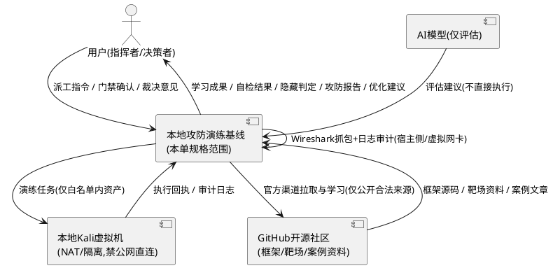
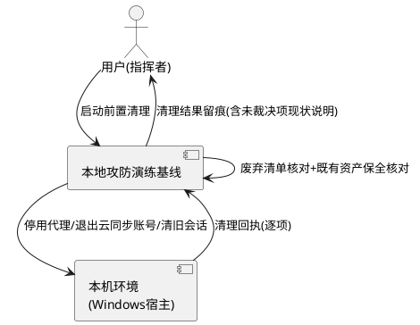
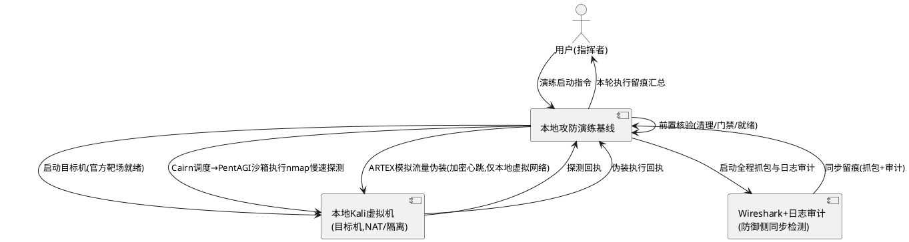
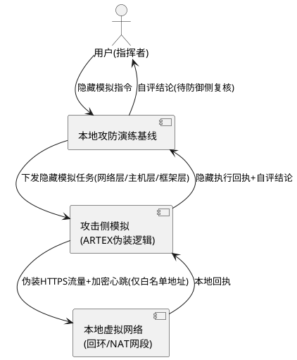
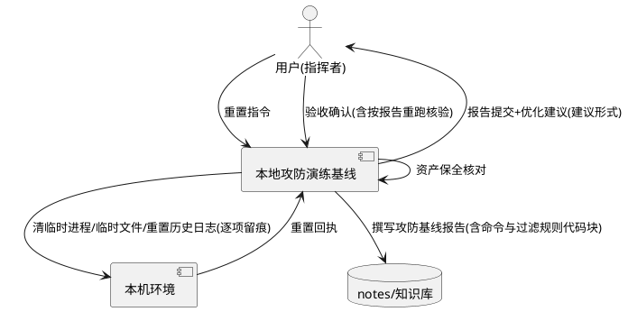
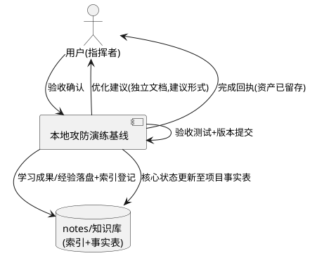

# 本地授权攻防红蓝演练基线需求规格（20261112_P003_local_redblue_drill_baseline）

> 本文档是通用工作流底座（device_workflow_api v2.0）攻防研究模拟类目下，派工单《本地授权攻防新基准派工单（ARTEX+PentAGI+Cairn + Wireshark检测）》的需求规格，采用 EARS 句式（When / While / Where / If + 系统应当）描述验收条件。全程简体中文，代码与命令命名英文。
>
> 阶段纪律：本阶段为需求规格阶段，文档落盘并经用户确认后即停；未获用户确认前禁止进入实现方案（design）、任务分解（tasks）与任何编码执行。
>
> 前置门禁纪律【v1.1】：进入实现方案（design）前另设前置门禁（见 5.3）：pre_check.md 须经用户审阅通过，且先学后干门禁（5.2）已通过；任一未满足前禁止生成 design.md，附录 A 维持暂挂。
>
> 版本：v1.0（2026-11-12 首版，依据派工单原文 + 用户语音补充 + 用户已裁决基线七条编制）。
> 版本：v1.1（2026-11-12，依据用户《P003 补充裁决：闭源拉取验证与码道模型解耦（前置门禁）》修订；修订纪律：只增不删、既有条款值不改写、受影响交叉引用联动更新并留指针）。
> v1.1 修订摘要：① 新增第 5.3 节"前置门禁：闭源拉取验证与码道模型解耦"（门禁 G-PC1~G-PC3，含门禁切分表 5.3.4）；② 原 5.3~5.8 章节序顺延为 5.4~5.9，受影响交叉引用联动更新（1.3-4、术语"隐藏判定"、5.2.1-1 注记、原 5.4.1-1/2、原 5.5.1-2/5、附录 B 条款列）；③ 附录 A 四项标注"暂挂（等 pre_check 门禁通过后一并裁决）"，内容未删除；④ 附录 B 新增交付物 12/13；⑤ 领域术语新增"前置门禁/pre_check.md/拆模型层/码道模型通道"；⑥ 1.1/1.2/1.3/1.4/3.2/6.6 联动增补，修订处均标【v1.1】。
> 版本：v1.2（2026-11-12，用户裁决附录 A 四项一次性拍板：A-1 Dev-Sidecar 停用搁置不卸载 / A-2 Cairn 以 MCP 接入 / A-3 复用现有 Kali 不新建 / A-4 nmap-msf 仅本机回环；全局注记口径，附录 A 暂挂解除，执行口径以 tasks.md【用户裁决 2026-11-12】注记为准；既有条款值不改写）。
> 版本：v1.3（2026-11-12，用户方案 D 裁决（Cairn 身份）：5.4 等处 Cairn"黑板机制（Fact/Intent/Hint）"描述性条款**直接废弃**——Cairn 定案=本地 xcosmosbox/Cairn（知识图谱工具，MCP 天然吻合，2026-11-08 退役资产重启复用）；oritera/Cairn 不采用、不补学、不额外调度；本特性回归初始需求最简落地=智能框架（ARTEX/PentAGI/Cairn）+检测工具（Wireshark/nmap），MCP 新方式智能体直接调用、仅本机回环、不越界不公网；G0 考核范围不含 oritera。全局注记口径，既有条款值不改写，执行以本注记为准）。

## 派工背景登记（如实登记，不得回潮）

1. **Cairn 退役与重启背景**：Cairn 曾于 2026-11-08 由用户裁决退役归档（MCP 注册已移除）。本单由用户重新发起拉取，属用户主动重启行为；重新接入一律按本单口径执行，本单不回溯、不推翻 2026-11-08 的退役裁决记录。重新接入方式（本地 CLI 直跑 vs 重新注册 MCP）列为待裁决项附录 A-2，裁决前禁自作主张。
2. **既有资产冲突背景**：Dev-Sidecar + Tor 双通道是 2026-11-11 刚建立并验收的既有资产（见 notes/DevSidecar+Tor攻防环境搭建笔记.md、notes/攻防环境优化建议.md，上游 spec 5.2-8/9 条亦将其登记为限定用途现成工具）。本单要求"废弃 Dev-Sidecar"，与既有资产状态冲突，列为待裁决项附录 A-1（废弃=停用进程+禁引用 还是 卸载），呈用户裁决，禁自作主张删除。Tor 资产未被本单点名废弃，演练期间按"禁用真实代理"口径停用其进程，资产本身处置随附录 A-1 一并裁决。
3. **废弃旧方案范围**：本单废弃对象包括 Dev-Sidecar、码道云同步（云同步账号退出并清理本地缓存，账号标识以派工单原文为准，正文不重复书写）、TAO 旧思路、公网 C2、外部跳板。全部为演练环境口径清理，均在本机范围内执行。

# **1. 组件定位**

## **1.1 核心职责**
本组件负责在纯本机闭环（Windows 宿主 + 本地 Kali 虚拟机，NAT/隔离、禁止公网直连）内组织"先学后干门禁 → 废弃清理 → 前置门禁核验（拉取实测与模型解耦评估，v1.1 新增，见 5.3）→ 三大框架本地部署 → 本地攻防演练 → 攻击侧 OPSEC 隐藏模拟 → 防御侧 Wireshark/SIEM 检测验证 → 清理重置 → 知识库沉淀与优化建议"的本地红蓝演练全流程，实现可重复验证、攻防配对产出的本地攻防基线。

## **1.2 核心输入**
1. **派工指令**：来自用户的本单派工原文、用户语音补充要点、用户已裁决基线七条（四不红线、禁公网外连、v2.0 本机直跑口径、官方靶场限定、AI 只评估、Cairn 重启背景、既有资产冲突待裁决、先学后干门禁）。
2. **门禁确认与裁决意见**：来自用户对各阶段产出、待裁决项（附录 A）的确认或驳回意见。
3. **官方公开材料**：来自 GitHub 官方仓库与官方文档的三大框架资料（Cairn、PentAGI、ARTEX）、官方开源靶场（如 DVWA）资料、公开合法来源的真实案例复盘文章（西工大被攻击事件、国家授时中心被攻击事件等正例，业余攻击者不藏行踪等反例）。
4. **执行回执与证据**：来自本地 Kali 虚拟机与宿主侧执行环境的任务回执、Wireshark 抓包证据、journalctl/Windows 事件查看器审计日志。
5. **用户补充裁决【v1.1】**：来自用户的《P003 补充裁决：闭源拉取验证与码道模型解耦（前置门禁）》（2026-11-12），含卡点 1 拉取可行性实测要求（ARTEX 闭源实测/PentAGI 与 Cairn 可拉取确认）、卡点 2 拆模型层强制接入码道模型要求（禁本地 Ollama）、前置门禁放行规则（pre_check.md 审阅通过才进 design）与附录 A 暂挂指令。

## **1.3 核心输出**
1. **学习成果笔记**：落盘 notes/学习成果-*.md 并登记 notes/知识库索引.md。
2. **框架部署就绪自检结果**：三大框架本地部署状态与缺失项补全记录。
3. **演练留痕记录**：攻击动作与隐藏痕迹的同步记录（攻击与检测双视角）。
4. **隐藏判定结论**：基于量化判定标准（见 5.7）的隐藏成功/失败结论及证据索引。
5. **本地攻防基线报告**：含框架拉取命令、Kali 本地命令、Wireshark 过滤规则（均以代码块留档）的可重复基线文档。
6. **优化建议**：基于演练结果与本单执行的改进建议（只建议、不直改规则文件）。
7. **事实表更新**：项目核心状态更新至 notes/项目事实表.md（单一事实源）。
8. **前置门禁核验报告 pre_check.md【v1.1】**：含《拉取可行性报告》（每框架：成功路径/失败证据/替代方案）与《模型解耦评估》（码道模型接入可行性），落盘本单 spec 目录，作为 design 前置材料提交用户审阅（见 5.3、附录 B-12）。
9. **模型解耦方案【v1.1】**：拆模型层实施后的交付文档（改了哪、如何接码道模型、Wireshark 验证无外连），见 5.3.1-8、附录 B-13。

## **1.4 职责边界**
1. **不做真实攻击**：一切动作目标仅限目标地址白名单（见 4.3.2）内资产；本机即靶场，禁止攻击任何他人机器，禁止真实外连公网。
2. **不写底层全量代码**：底层一律复用现成框架（Cairn/PentAGI/ARTEX/Kali 工具链），自研仅限接口层与适配层。
3. **不替用户做决策**：待裁决项一律呈报用户拍板；AI 只做评估对比，选哪个由用户定。
4. **不产出可照搬的真实攻击内容**：所有攻击侧产出必须与防御检测视角一一配对；禁止输出可直接照搬用于真实攻击的操作手册式内容。
5. **不触碰规则文件**：SKILL.md/.mdc 等规则文件人工终改，AI 仅建议；不删现有文件。
6. **不做定时任务与轮询**：全部步骤事件驱动（用户指令或回执事件触发），禁定时器、禁轮询。
7. **不落云盘、不写真实身份**：全部产物仅存本机仓库路径，禁止上传云盘/网盘/外部同步盘；文档与产物中不出现真实姓名、工号等真实身份信息。
8. **需求阶段即停**：本组件只产出 spec.md，不产出 design.md/tasks.md，不启动编码。
9. **不做多层嵌套隔离回归**：遵循 v2.0 本机直跑口径；本单本地 Kali 以单层虚拟机形态（NAT/隔离）承载，是否采用虚拟机形态及就绪方式按待裁决项附录 A-3 裁决，不构成多层嵌套回归。
10. **前置门禁产物边界【v1.1】**：本组件按用户补充裁决另产出前置门禁核验文档 pre_check.md（落盘本单 spec 目录），该文档属需求/核验阶段文档，不改变"需求阶段即停、不产出 design.md/tasks.md、不启动编码"边界；卡点 1/2 的实测执行（拉取实测、拆模型层改造、Wireshark 验证）属前置门禁放行路径上的受控执行动作，须按本规格红线实施；本规格阶段仅登记实测要求与评估框架，不虚构任何实测结论。

# **2. 领域术语**

**Cairn**
: 本地核心调度框架，采用黑板机制（Fact/Intent/Hint）组织探索调度与状态记录，在本单中负责演练任务的探索编排与状态登记。
: 备注：曾于 2026-11-08 退役归档（MCP 注册已移除），本单由用户重新发起拉取，重新接入方式待裁决（附录 A-2）。

**PentAGI**
: 沙箱执行层框架，负责在隔离环境中调用 Kali 工具（nmap/msf 等），是本单演练的执行载体。

**ARTEX**
: 具备指挥所逻辑（双图/子代理）的框架，本单仅用于在本地回环/虚拟网络内模拟"流量伪装与 C2 伪装"，不用于任何真实隐匿。

**黑板机制（Fact/Intent/Hint）**
: Cairn 的核心协作机制：Fact 记录已确认事实，Intent 表达待执行意图，Hint 提供探索提示；状态仅记录于本地，禁止写往本机仓库外的任何位置。

**本地 Kali 虚拟机**
: 运行于本机、以 NAT/隔离网络模式连接（禁止公网直连）的 Kali 环境，演练中作为目标机与渗透工具宿主。

**本地攻防基线（Local Red/Blue Drill Baseline）**
: 一套可重复执行的本地攻防演练流程与判定标准，任何人按同一文档重跑应得到可比较的结果（含隐藏成功/失败判定）。

**OPSEC 隐藏模拟（OPSEC Hiding Simulation）**
: 攻击侧在本地演练中模拟"隐藏行踪"行为的活动，仅限本机回环/虚拟网络内进行，目的是生成可供检测验证的隐藏痕迹样本，不是真实隐匿。

**流量伪装模拟（Traffic Camouflage Simulation）**
: 借 ARTEX 逻辑将演练流量模拟为正常 HTTPS 加密流量（含加密心跳）的活动，仅限本地虚拟网络，禁止真实代理与真实外连。

**加密心跳（Encrypted Heartbeat)**
: 攻击侧模拟的周期性加密保活流量；本单中由 ARTEX 逻辑在本地虚拟网络内模拟生成，用于训练防御侧识别"伪装成 HTTPS 的可疑心跳"的检测能力。

**Wireshark 全程抓包**
: 防御侧在演练全程对本地虚拟网卡/lo 进行的连续抓包活动，用于分析攻击侧隐藏效果是否泄漏真实特征。

**SIEM/EDR 模拟**
: 以 journalctl（Kali 侧）与 Windows 事件查看器（宿主侧）为载体的本地日志审计活动，模拟安全信息事件管理/终端检测响应平台对异常进程与连接的记录能力。

**隐藏判定（Hiding Verdict)**
: 依据量化判定标准（明文命中、公网 IP、异常外连、伪装有效性、日志审计五项，见 5.7）对攻击侧隐藏效果作出的成功/失败结论；判定失败时须调整框架配置后重跑。

**目标地址白名单（Target Whitelist)**
: 演练全部网络动作唯一允许的目的地址集合（逐条列明见 4.3.2）；白名单外目标一律拒绝，变更须用户拍板。

**先学后干门禁（learn-gate）**
: 学习型任务的强制前置关卡：学习材料清单完成学习、成果落盘 notes/学习成果-*.md、登记知识库索引、考核通过，四项全满足才放行后续编码/执行动作。

**学习成果（Learning Notes)**
: 按规约命名（学习成果-*.md）落盘于 notes/ 的结构化学习记录，是项目经验资产的一部分。

**知识库索引**
: notes/知识库索引.md，全库唯一登记与查重入口；新增/变更知识库文档须在该索引登记。

**项目事实表**
: notes/项目事实表.md，项目核心状态的单一事实源；演练关键状态变化须更新该表并刷新核验日期。

**官方开源靶场**
: 由官方开源社区维护、允许自由获取并可在本机离线部署的合法攻防练习靶场（如 DVWA）；本单靶场只用此类，禁私人/未知靶场。

**环境重置（Environment Reset)**
: 演练结束后清理演练产生的临时进程、临时文件与历史痕迹（bash_history/日志重置）的活动；性质是环境重置，非恶意擦痕，须如实标注。

**越界即停（Stop-on-Boundary)**
: 任一动作发现指向白名单外目标或真实资产时，立即终止当前动作、阻断一切外发、告警并留痕、等待用户裁决的强制语义；禁止自行继续或重试绕过。

**既有资产（Existing Assets)**
: 2026-11-11 建立的 Dev-Sidecar + Tor 双通道环境；其处置方式因与本单废弃口径冲突而待裁决（附录 A-1），裁决前保持现状、仅停用进程。

**前置门禁（Pre-check Gate）【v1.1】**
: 进入 design 前的第二道阶段门禁：实测三大框架拉取可行性并完成模型解耦评估，产出 pre_check.md 且经用户审阅通过、先学后干门禁（5.2）亦通过，两者均过才放行 design；与先学后干门禁可并行开展。
: 备注：门禁编号 G-PC1（拉取可行性核验）/G-PC2（模型解耦评估核验）/G-PC3（design 放行总门禁），见 5.3 与 5.3.4 门禁切分表。

**pre_check.md【v1.1】**
: 前置门禁核验报告文档，包含《拉取可行性报告》与《模型解耦评估》两部分，落盘本单 spec 目录；经用户审阅通过（G-PC3）是进入 design 的必要条件，也是解除附录 A 暂挂的前提。

**拆模型层（Model Layer Decoupling）【v1.1】**
: 剥离/屏蔽框架原生外部模型 API 调用逻辑（不删源码、以适配层方式实现），强制接入码道模型通道的改造活动；目标是框架调度逻辑不变、模型推理走码道通道、最终无公网模型外连。

**码道模型通道【v1.1】**
: 当前环境码道智能体自身模型能力（GLM-5.3-Flash 等内置能力），作为拆模型层后框架模型推理的唯一接入通道；禁用本地 Ollama，禁止公网模型 API。

# **3. 角色与边界**

## **3.1 核心角色**
- **用户（指挥者/决策者/拍板人）**：下达派工指令与裁决意见、审定学习成果与考核、拍板待裁决项、确认门禁；对一切方案取舍拥有最终决策权。

## **3.2 外部系统**
- **本地 Kali 虚拟机（目标机）**：演练的目标机与渗透工具宿主（nmap/msf 等），NAT/隔离网络，仅承载白名单内资产与官方开源靶场。
- **GitHub 开源社区**：三大框架（Cairn/PentAGI/ARTEX）、官方开源靶场、公开案例复盘文章的唯一合法来源渠道；评估引用其公开元数据。
- **AI 模型（仅评估）**：输出学习归纳、评估对比、判定建议；不直接执行、不直控执行环境、不替用户决策。
- **码道模型通道【v1.1】**：拆模型层后三大框架模型推理的唯一接入通道（GLM-5.3-Flash 等码道内置能力），仅承担框架内模型推理与评估输出；禁止直控执行环境、禁止公网模型 API 外连、禁用本地 Ollama。

## **3.3 交互上下文**



# **4. DFX约束**

## **4.1 性能**
以下均为本机仿真指标，非生产指标：
1. 事件驱动响应：用户指令或执行回执到达后，演练调度须在 5 秒内开始处理；禁止以定时任务、轮询方式驱动任何步骤。
2. 抓包连续性：Wireshark 抓包自演练开始至清理重置完成须全程连续，中断即判定该轮证据无效并重跑。
3. 单轮演练时长不设硬上限，但每轮须有明确起止记录（开始指令时间戳、重置完成时间戳）。

## **4.2 可靠性**
1. 任务成败只认执行回执，规划与模型意见不能替代回执；回执未到达前状态保持"执行中"，禁止凭猜测标记成功。
2. Kali 虚拟机或框架进程异常退出时，须如实标记中断并留痕，允许用户手动重启后重跑该轮；禁止自动静默重试。
3. 隐藏判定不悬空：每轮演练必须产出明确的成功/失败结论，无结论即视为该轮未完成。
4. 环境损坏风险自负口径：遵循 v2.0"弄坏重装风险自担"，不因怕损坏而擅自加隔离层或放弃执行。

## **4.3 安全性（安全合规红线，全文最高优先级约束）**

### 4.3.1 四不红线（源自通用工作流底座项目，原样承接）
1. **四不红线**：禁止真实入侵、禁止控制真实肉鸡、禁止混用真实虚拟币、禁止隐匿真实服务器；所有攻防动作一律在本机闭环内进行、模拟对象仅限本机自建资产，模型只评估不直控。
   - 验收条件：[任一演练场景] → [场景明确声明不涉及真实入侵、真实肉鸡、真实虚拟币、真实服务器隐匿四项；任一项涉及真实资产或真实行为即拒绝执行，且全程无模型直控通道]

### 4.3.2 禁真实外连公网红线与目标地址白名单（逐条列明）
1. **白名单唯一性规则**：演练全部网络动作（探测、访问、心跳、C2 模拟、靶场交互）的源与目的地址必须且只能落在以下白名单集合内；白名单之外一律拒绝。
   - **W1：127.0.0.0/8 全段**（本机 IPv4 回环，含 127.0.0.1）——宿主侧控制台、本地服务绑定地址。
   - **W2：::1（IPv6 回环）**——本机 IPv6 回环。
   - **W3：本地 Kali 虚拟机虚拟网卡所在 NAT 子网**（含 NAT 网关地址与虚拟机 IP；具体网段以任务配置时按实际虚拟网卡登记为准，仅限 NAT/隔离模式，禁止桥接公网）。
   - **W4：本机所在局域网内由用户自建并显式登记的资产**（默认为空集；逐条登记，须用户拍板后才可写入；禁止任何自动发现机制扩展此集合）。
   - **W5：官方开源靶场在本机部署后的服务地址**（必须落在 W1~W3 范围内才有效）。
   - 验收条件：[任务配置中出现白名单外目标地址] → [立即拒绝该任务并告警，记录拦截日志，不产生任何外发动作]
2. **越界即停规则**：While 任一演练动作执行中，If 发现任何指向白名单外目标、真实第三方资产或公网地址的连接尝试，系统应当立即终止当前动作、阻断一切外发、告警并留痕，等待用户裁决；禁止自行继续、禁止重试绕过。
   - 验收条件：[执行中捕获越界连接尝试] → [动作立即终止、外发被阻断、拦截留痕可见、状态转为"等待用户裁决"]
3. **公网暴露禁止规则**：三大框架与全部演练服务禁止在公网暴露任何端口；ARTEX 控制台仅绑定 127.0.0.1。
   - 验收条件：[任一框架/服务启动后] → [监听地址仅为本机回环或虚拟网卡地址；出现绑定 0.0.0.0 或外网可达端口即判不合规并阻断]

### 4.3.3 用途限定与攻防配对红线（承接上游 4.3-4/5 条）
1. **用途限定规则**：所有隐藏模拟手法仅以"隐藏特征样本生成 → 防御检测验证"用途呈现；禁止输出可直接照搬用于真实攻击隐匿的操作手册式内容。
   - 验收条件：[任一攻击侧产出] → [同时包含"特征分析"与"防御检测方法"两部分，缺防御部分视为不合规]
2. **攻防配对规则**：每个攻击模拟动作必须与检测验证动作同步覆盖（Wireshark 抓包 + 日志审计），不允许只攻不防。
   - 验收条件：[任一攻击动作执行] → [存在对应的抓包记录与日志审计记录]

### 4.3.4 资产与数据纪律
1. **本地闭环规则**：不落云盘、不写真实身份、全本地闭环；全部产物仅存本机仓库路径。
   - 验收条件：[任一产出落盘] → [落盘路径位于本机仓库内；无任何云盘/网盘/外部同步路径引用]
2. **资产保全规则**：不删现有文件；既有资产（Dev-Sidecar+Tor 双通道）处置仅按附录 A-1 裁决结果执行，裁决前禁自作主张删除。
   - 验收条件：[任一清理动作执行前] → [清理对象清单与附录 A-1 裁决结果一致；未裁决项保持现状]
3. **规则文件保护规则**：禁改规则文件（SKILL.md/.mdc 人工终改）；优化建议只以建议形式呈现。
   - 验收条件：[任一优化产出] → [以独立文档/报告呈现，规则文件零改动]

## 4.4 可维护性
1. 全程简体中文文档，代码与命令命名英文。
2. 若本单产出 Python 代码（仅限接口层/适配层），须通过 Ruff（v0.17.2，Scoop 安装）审查门禁后方可提交。
3. 项目核心状态（框架部署状态、演练轮次、判定结论、待裁决状态）更新至 notes/项目事实表.md 并刷新核验日期，单一事实源，其他文档活引用不抄死值。
4. 全部 EARS 验收条件须可在本机闭环内以可复现方式验证。

## 4.5 兼容性
1. 本单口径与上游 device_workflow_api v2.0 一致：本机直跑、轻量就绪校验、四不红线与禁公网外连原样保留。
2. 本单与上游 5.2-9 条（开发者边车登记为现成工具）的冲突（废弃 Dev-Sidecar）走待裁决流程（附录 A-1），不静默修改上游 spec。
3. 演练基线文档须支持按同一文档重复执行（可重复性是本单验收核心），重复执行结果可比较。

# **5. 核心能力**

## **5.1 废弃清理与环境口径切换**

### **5.1.1 业务规则**
1. **废弃清单规则**：When 演练前置清理启动，系统应当按废弃清单逐项执行：停用并清理 Dev-Sidecar 相关进程与配置引用（处置口径按附录 A-1 裁决）、码道云同步账号退出并清理本地缓存、清除 TAO 旧思路相关残留配置与旧会话；清理范围仅限本单废弃清单，禁止扩大到既有资产全量删除。
   - 验收条件：[前置清理完成] → [废弃清单逐项留痕（动作+结果），既有资产未裁决项保持现状]
2. **公网通道禁用规则**：When 演练进入执行阶段，系统应当禁用一切真实代理通道（Dev-Sidecar、Tor 进程停用），全部演练流量仅走本地虚拟网络；If 发现代理进程仍在运行，应当阻断演练启动并告警。
   - 验收条件：[演练启动前自检] → [真实代理进程存活检测通过（无存活代理）才放行；存在存活代理则拒绝启动]
3. **环境口径规则**：演练环境仅为本机 + 本地 Kali 虚拟机（NAT/隔离，禁止公网直连）；禁止外部跳板、禁止公网 C2、禁止任何形式的真实外连。
   - 验收条件：[演练环境自检] → [环境构成仅含本机与本地 Kali 虚拟机，网络模式为 NAT/隔离，无任何外部跳板/公网 C2 配置项]
4. **禁止项**：禁止以任何理由保留或重建指向公网的通道（包括旧方案 Dev-Sidecar 公网穿透用途、公网 C2、外部跳板）。
   - 验收条件：[任一演练配置] → [无公网指向配置项；出现即拒绝并告警]

### **5.1.2 交互流程**



### **5.1.3 异常场景**
1. **待裁决项未裁决**
   - 触发条件：附录 A 任一项在需要执行相关动作时仍未获用户裁决。
   - 系统行为：相关动作挂起，其余不依赖该项的清理动作可继续；挂起状态如实留痕。
   - 用户感知：提示"待裁决项 A-x 未裁决，相关动作已挂起，等待裁决"。
2. **代理进程无法停用**
   - 触发条件：演练启动自检发现真实代理进程停用失败。
   - 系统行为：阻断演练启动，留痕告警，等待用户处理。
   - 用户感知：提示"代理进程存活，演练已阻断"，并附进程识别信息。
3. **清理动作误伤风险**
   - 触发条件：清理项与"不删现有文件"约束冲突。
   - 系统行为：跳过该清理动作并呈报用户裁决，禁止先斩后奏。
   - 用户感知：提示冲突详情与两个处置选项（跳过/用户确认后执行）。

## **5.2 先学后干学习门禁（learn-gate）**

### **5.2.1 业务规则**
1. **门禁前置规则**：When 本单启动，系统应当先进入先学后干门禁；门禁未通过前，禁止放行任何框架拉取、部署与演练执行动作（学习材料获取本身除外）。
   - 验收条件：[门禁未通过时下达框架拉取/演练指令] → [指令被拒绝并提示"先学后干门禁未通过"]
   - 【v1.1 注记】本条禁令的例外：pre_check 前置门禁实测所需的框架拉取动作（目的限于拉取可行性验证与模型解耦评估，非正式部署）可与本门禁并行，见 5.3.1-11（用户 2026-11-12 补充裁决明示授权，如实登记）；正式部署仍须本门禁与前置门禁均通过。
2. **学习材料清单规则**：学习材料必须覆盖以下四类，且仅限公开合法来源（GitHub 官方仓库、官方文档、公开报道的安全事件复盘文章）：
   - **L1 三大框架官方文档**：Cairn、PentAGI、ARTEX 的官方仓库 README 与官方文档（含黑板机制、沙箱执行、双图/子代理逻辑的官方说明）。
   - **L2 真实案例正例**：西北工业大学被攻击事件、国家授时中心被攻击事件等公开报道复盘（路由出入口控制、内网潜伏、跳板肉鸡特征）。
   - **L3 真实案例反例**：业余攻击者不藏行踪、暴露特征等公开复盘案例（为什么会暴露 → 如何被检测）。
   - **L4 近 3 个月同类工具使用调研**：ARTEX/PentAGI/Cairn 类攻防编排框架近 3 个月公开使用情况调研（仅公开合法来源，标注检索日期与出处）。
   - 验收条件：[学习材料清单呈现] → [四类俱全且每条附公开来源出处；出现非公开/来源不明材料即剔除并告警]
3. **学习成果落盘规则**：When 学习完成，系统应当将学习成果按规约命名落盘 notes/学习成果-*.md（可拆多份，如：学习成果-三大框架官方文档.md、学习成果-真实案例正反例.md、学习成果-攻防框架近三月使用调研.md），并在 notes/知识库索引.md 完成登记（条目名/类别/路径/主题/最后核验日期/状态）。
   - 验收条件：[学习完成] → [notes/ 下存在对应学习成果文件且索引登记可查；未登记视为门禁未通过]
4. **考核放行规则**：When 学习成果落盘并登记完成，系统应当向用户提交考核（学习成果答辩/要点核验形式），仅当用户确认考核通过后才放行编码/执行；If 用户考核不通过，应当按用户意见补学后重新提交。
   - 验收条件：[考核未通过时请求放行] → [拒绝放行并记录补学意见；考核通过留痕后才开放后续阶段]
5. **禁止项**：禁止跳过学习直接动手（"未先学后干"是上轮已被问责的违规行为，本单红线重申）；禁止学习材料引用非公开合法来源。
   - 验收条件：[门禁通过留痕回查] → [存在完整的"学习→落盘→登记→考核通过"留痕链；任一环缺失即判定门禁违规]

### **5.2.2 交互流程**

```plantuml
@startuml
actor "用户(指挥者)" as User
component "本地攻防演练基线" as Drill
database "GitHub开源社区\n(公开合法来源)" as GH
database "notes/知识库" as KB

User --> Drill : 启动先学后干门禁
Drill --> GH : 收集 L1~L4 学习材料(仅公开来源)
Drill --> User : 学习材料清单(带出处)
User --> Drill : 确认学习开始
Drill --> KB : 学习成果落盘 notes/学习成果-*.md + 索引登记
Drill --> User : 提交考核
User --> Drill : 考核通过/不通过(附意见)
alt 通过
  Drill --> User : 门禁放行(开放框架拉取与演练)
else 不通过
  Drill --> User : 记录补学意见,重新学习提交
end
@enduml
```

### **5.2.3 异常场景**
1. **材料来源存疑**
   - 触发条件：某学习材料无法确认公开合法性。
   - 系统行为：剔除该材料并留痕，禁止引用；以其余合规材料继续，缺失类目如实标注。
   - 用户感知：提示剔除原因，材料清单可见合规状态。
2. **成果未登记索引**
   - 触发条件：学习成果落盘但知识库索引未登记。
   - 系统行为：门禁判定不通过，要求补登记后重新提交考核。
   - 用户感知：提示"成果未登记，门禁未通过"。
3. **考核连续不通过**
   - 触发条件：用户连续两次考核不通过。
   - 系统行为：暂停门禁流程，如实呈报差距清单，等待用户指示（补学方向/调整材料/其他）。
   - 用户感知：可见差距清单与待指示状态。

## **5.3 前置门禁：闭源拉取验证与码道模型解耦（v1.1 新增）**

> 章节登记【v1.1】：本节系依据用户《P003 补充裁决：闭源拉取验证与码道模型解耦（前置门禁）》（2026-11-12）新增，插入于先学后干学习门禁（5.2）之后、三大框架本地拉取与部署（5.4，原 5.3）之前；原 5.3~5.8 顺延为 5.4~5.9，受影响交叉引用已联动更新（见文档头部 v1.1 修订摘要）。

### **5.3.1 业务规则**

1. **原需求重申规则（不可妥协）**：前置门禁不放宽、不修改任何既有约束：先学后干门禁（5.2）、四不红线（4.3.1）、目标地址白名单与越界即停（4.3.2）、Wireshark 全程抓包与 SIEM 检测（5.7，原 5.6）、隐藏判定 J1~J5（5.7.1-3）全部维持 v1.0 原值；禁止瞎干、禁止虚构拉取、禁止公网外连。
   - 验收条件：[前置门禁任一动作] → [全部处于既有红线约束内；出现虚构拉取结果、公网外连或越界动作即判门禁违规并阻断]
2. **ARTEX 闭源实测规则**：When 前置门禁实测开展，系统应当实测 ARTEX 源码可获得性：尝试查找 fork、旧版本、归档镜像等获取路径；If 确认无源码可获得，系统应当在 pre_check.md 中明确登记"ARTEX 仅做逻辑模拟，不实际部署"，禁止出现"自动拉取成功"的表述。
   - 验收条件：[ARTEX 实测完成] → [结论三选一留痕：获取路径成功（附来源与证据）/ 确无源码并登记"仅逻辑模拟，不实际部署" / 实测失败（附失败证据与替代方案）；全文无"自动拉取成功"表述]
3. **PentAGI/Cairn 拉取实测规则**：When 前置门禁实测开展，系统应当实测 PentAGI 与 Cairn 的可拉取性（仅官方渠道）；When 拉取取得框架，系统应当自动检测缺失依赖并补全，且框架服务端口仅绑定回环地址。
   - 验收条件：[实测完成] → [每框架给出成功路径或失败证据；依赖补全记录留痕；监听核验仅回环]
4. **禁止虚构规则（禁止项）**：禁止虚构拉取结果、禁止以未经实测的内容充当实测证据、禁止为拉取实测发起公网外连或改用非官方渠道。
   - 验收条件：[pre_check.md 任一结论] → [均有对应实测证据或如实标注失败；发现虚构即推翻该项重测并告警]
5. **拉取可行性报告规则**：When 卡点 1 实测完成，系统应当产出《拉取可行性报告》（每个框架：成功路径/失败证据/替代方案三要素），并入 pre_check.md 作为 design 前置材料。
   - 验收条件：[报告并入 pre_check.md] → [三框架逐项覆盖且三要素俱全]
6. **拆模型层规则**：When 拉取实测确认框架可获得，系统应当实施拆模型层：剥离/屏蔽原框架的外部模型 API 调用逻辑（不删源码、以适配层方式实现），强制接入码道模型通道；框架调度逻辑保持不变，模型推理全部走码道模型通道；禁用本地 Ollama 方案（本机无法承载本地大模型，用户裁决给定）。
   - 验收条件：[拆模型层完成] → [原模型调用逻辑被适配层屏蔽且源码未删除；框架调度逻辑不变；模型推理全走码道通道；配置中无 Ollama 端点、无公网模型 API 端点]
7. **强耦合最小改造规则**：If 框架模型调用逻辑强耦合无法拆分，系统应当提出最小改造方案，确保最终无公网模型外连（判定对齐 J2 公网 IP=0、J3 异常外连=0，见 5.7.1-3）；方案是否采纳由用户拍板。
   - 验收条件：[强耦合确认] → [最小改造方案呈现，以"无公网模型外连"为验收底线；无用户拍板前不实施]
8. **模型解耦方案交付规则**：When 拆模型层（或最小改造）实施完成，系统应当交付《模型解耦方案》：改了哪（改动清单）、如何接码道模型（接入方式）、验证无外连（Wireshark 抓包证明，证据对齐 J2/J3）。
   - 验收条件：[方案交付] → [三要素俱全且含抓包证据索引；缺任一要素视为未交付]
9. **pre_check.md 产出规则**：When 卡点 1 与卡点 2 评估完成，系统应当产出 pre_check.md（拉取结果：ARTEX 成败/替代 + 模型解耦评估：码道模型接入可行性）落盘本单 spec 目录，提交用户审阅。
   - 验收条件：[文档落盘] → [两卡点内容俱全、实测证据可回查、审阅状态可见]
10. **门禁放行规则（G-PC3）**：When 用户审阅 pre_check.md 且明确通过，且先学后干门禁（5.2）已通过，系统应当放行进入 design 阶段，并解除附录 A 暂挂呈请用户一并裁决；If pre_check.md 审阅未通过，应当按用户驳回意见返工重测后重新提交；前置门禁未通过期间禁止生成 design.md。
    - 验收条件：[前置门禁未过时请求进入 design] → [拒绝并提示"前置门禁未通过（G-PC3 未放行）"；两门禁均过并留痕后才允许生成 design.md]
11. **与先学后干门禁并行规则**：前置门禁实测与先学后干学习门禁（5.2）可并行开展，两者均通过才进入 design；pre_check 实测所需的框架拉取动作是 5.2.1-1 禁令的显式例外（目的限于拉取可行性验证与模型解耦评估，非正式部署）；正式部署动作仍须两门禁均过。该并行关系系用户 2026-11-12 补充裁决明示，本条为如实登记，非 AI 自主变更。
    - 验收条件：[实测与学习并行开展] → [两门禁独立留痕互不阻塞；任一门禁未过均不放行 design]
12. **附录 A 暂挂规则**：While 前置门禁未通过，系统应当将附录 A 四项（A-1~A-4）维持"暂挂（等 pre_check 门禁通过后一并裁决）"状态；暂挂期间禁止催裁、禁止按默认选项执行、禁止删除任何待裁决内容。
    - 验收条件：[门禁未过期间任一 A-x] → [状态为"待裁决（暂挂）"且无裁决/默认执行动作发生]

### **5.3.2 交互流程**

```plantuml
@startuml
actor "用户(指挥者)" as User
component "本地攻防演练基线" as Drill
component "GitHub官方渠道\n(fork/旧版本/归档镜像)" as GH
component "本机实测环境\n(依赖补全/拆模型层/回环绑定)" as Host

User --> Drill : 补充裁决下达/启动前置门禁实测
Drill --> GH : ARTEX获取路径检索(fork/旧版本/归档镜像)
Drill --> GH : PentAGI/Cairn拉取实测(仅官方渠道)
GH --> Drill : 获取成功/失败结果
Drill --> Host : 依赖检测补全+拆模型层(适配码道模型通道)
Host --> Drill : 实测回执/核验结果
Drill --> Drill : 汇编pre_check.md(拉取可行性报告+模型解耦评估)
Drill --> User : 提交审阅(附录A维持暂挂)
alt 审阅通过且学习门禁已过
  User --> Drill : 放行确认(G-PC3)
  Drill --> User : 解除附录A暂挂,呈请一并裁决,放行design
else 审阅未通过
  User --> Drill : 驳回意见
  Drill --> Drill : 按意见返工重测,重新提交
end
@enduml
```

### **5.3.3 异常场景**
1. **ARTEX 确认无源码**
   - 触发条件：fork、旧版本、归档镜像等获取路径检索全部无果。
   - 系统行为：如实登记"ARTEX 仅做逻辑模拟，不实际部署"，按逻辑模拟替代方案推进，禁止虚构拉取成功。
   - 用户感知：可见"无源码结论 + 检索证据清单 + 替代方案"。
2. **框架强耦合无法拆**
   - 触发条件：模型调用逻辑与框架核心强耦合，适配层无法屏蔽。
   - 系统行为：产出最小改造方案呈报用户拍板，以无公网模型外连为底线；未拍板前不实施。
   - 用户感知：可见强耦合证据与最小改造方案选项。
3. **官方渠道拉取实测失败**
   - 触发条件：官方渠道不可达或实测环境受限导致拉取失败。
   - 系统行为：如实记录失败证据；禁止改用非官方渠道、禁止公网外连重试；呈报用户决策（等待/调整环境/调整范围）。
   - 用户感知：可见失败证据与决策选项。
4. **审阅连续未通过**
   - 触发条件：用户对 pre_check.md 连续两次审阅未通过。
   - 系统行为：暂停返工循环，如实呈报差距清单与可行路径选项，等待用户指示（补测方向/调整范围/其他）。
   - 用户感知：可见差距清单与待指示状态。

### **5.3.4 门禁切分表（G-PC，集中列管）**

| 门禁编号 | 门禁名称 | 放行条件（可判定验收形式） | 未过后果 | 承接条款 |
|---|---|---|---|---|
| G-PC1 | 拉取可行性核验（卡点 1） | 《拉取可行性报告》三框架逐项给出成功路径/失败证据/替代方案；ARTEX 若确无源码已登记"仅逻辑模拟，不实际部署"；全文无"自动拉取成功"表述；拉取部分经用户审阅认可 | 按驳回意见返工重测/补检索；拉取部分不认可则 G-PC3 不放行 | 5.3.1-2/3/4/5 |
| G-PC2 | 模型解耦评估核验（卡点 2） | 《模型解耦评估》给出拆模型层可行性结论（可拆/最小改造方案）；确认码道模型接入路径可行且无公网模型外连路径；解耦部分经用户审阅认可 | 按驳回意见返工重评；解耦部分不认可则 G-PC3 不放行 | 5.3.1-6/7/8 |
| G-PC3 | design 放行门禁（总门禁） | pre_check.md 整体经用户审阅明确通过（G-PC1+G-PC2 均过）且先学后干门禁（5.2）已通过 → 放行生成 design.md，解除附录 A 暂挂 | 禁止生成 design.md；附录 A 维持暂挂；按驳回意见返工后重新提交审阅 | 5.3.1-9/10/11/12 |

> 注【v1.1】：返工循环不设自动次数上限，连续两次审阅未过即暂停呈报（5.3.3-4），是否调整范围/终止由用户拍板；AI 禁止自主降级放行 design。

## **5.4 三大框架本地拉取与部署**

### **5.4.1 业务规则**
1. **本地部署规则**：When 门禁放行且用户下达框架拉取指令，系统应当以本地方式（Git/Docker）拉取 Cairn、PentAGI、ARTEX 三大框架至本机仓库路径，构建本地部署形态。
   - 验收条件：[拉取完成] → [三框架均可本机启动，部署路径留痕，来源均为官方渠道]
2. **缺失检测与补全规则**：When 框架拉取指令执行，系统应当自动逐项检测三框架在本机的存在性（本地仓库/本地镜像）；If 检测到缺失项，应当仅从官方渠道补全拉取，禁止改用非官方或来源不明渠道。
   - 验收条件：[存在缺失项] → [仅对缺失项从官方渠道补全；已有项不重复拉取；补全来源留痕]
3. **角色分工规则**：三框架部署后须按本单口径分工：Cairn 为本地核心（黑板机制 Fact/Intent/Hint，负责探索调度与状态记录）、PentAGI 为沙箱执行层（调用 Kali 工具 nmap/msf，隔离运行）、ARTEX 为指挥所逻辑（双图/子代理，仅用于本地回环/虚拟网络内模拟流量伪装与 C2 伪装）。
   - 验收条件：[部署自检] → [三框架角色分工声明可见且与本单口径一致；ARTEX 配置中出现任何指向公网的伪装目标即拒绝]
4. **端口绑定规则**：When 任一框架服务启动，系统应当将其控制台/接口仅绑定本机回环或虚拟网卡地址，禁止公网暴露端口；ARTEX 控制台必须仅绑定 127.0.0.1。
   - 验收条件：[任一框架启动后] → [监听地址核验通过；出现公网可达监听即阻断并告警]
5. **Cairn 重启登记规则**：When Cairn 重新拉取接入，系统应当在部署留痕与项目事实表中如实登记"2026-11-08 退役归档、本单由用户重启"的背景，接入方式按附录 A-2 裁决结果执行。
   - 验收条件：[Cairn 接入完成] → [退役/重启背景留痕可见；接入方式与裁决结果一致]
6. **部署就绪自检规则**：When 三框架部署完成，系统应当输出就绪自检结果（各框架来源、版本/提交标识、监听地址、角色分工、就绪状态）；就绪自检存在未通过项时对应演练任务禁止启动。
   - 验收条件：[演练任务启动前] → [依赖的框架就绪自检全部通过；存在未通过项则拒绝启动]

### **5.4.2 交互流程**

```plantuml
@startuml
actor "用户(指挥者)" as User
component "本地攻防演练基线" as Drill
component "GitHub官方渠道" as GH
component "本机部署环境" as Host

User --> Drill : 框架拉取指令
Drill --> Drill : 逐项检测Cairn/PentAGI/ARTEX存在性
alt 存在缺失项
  Drill --> GH : 官方渠道补全拉取(仅缺失项)
  GH --> Drill : 框架源码/镜像
end
Drill --> Host : 本地构建部署(角色分工/端口绑定回环)
Host --> Drill : 部署回执
Drill --> Drill : 就绪自检(来源/版本/监听/分工)
Drill --> User : 自检结果(通过项/未通过项)
@enduml
```

### **5.4.3 异常场景**
1. **官方渠道拉取失败**
   - 触发条件：某框架官方仓库不可达或拉取超时。
   - 系统行为：标记该框架部署失败并如实留痕，禁止改用非官方渠道；允许用户决策是否重试或等待。
   - 用户感知：提示"官方渠道获取失败+原因"，可见重试/等待选项。
2. **框架间版本不兼容**
   - 触发条件：三框架组合部署后联动异常。
   - 系统行为：留痕异常现象，呈报用户裁决处理方式（版本回退/配置调整），禁止擅自更换非官方分支。
   - 用户感知：可见异常现象与裁决选项。
3. **端口绑定冲突**
   - 触发条件：框架监听端口与本机既有服务冲突。
   - 系统行为：按"回环优先"原则调整绑定（仅限回环/虚拟网卡地址段内调整），调整留痕；无法调整则呈报用户。
   - 用户感知：可见调整结果或冲突详情。

## **5.5 本地攻防演练执行工作流**

### **5.5.1 业务规则**
1. **启动前置规则**：When 用户下达演练启动指令，系统应当先核验三项前置：废弃清理完成（5.1）、先学后干门禁通过（5.2）、三框架就绪自检通过（5.4）；任一项未满足则拒绝启动。
   - 验收条件：[任一前置未满足] → [拒绝启动并指明未满足项；三项全过才放行]
2. **环境启动规则**：When 前置核验通过，系统应当按序启动演练环境：本地 Kali 虚拟机（目标机，NAT/隔离）+ 宿主侧攻击机逻辑（Cairn+PentAGI+ARTEX），并启动 Wireshark 抓包与日志审计（5.7），抓包先于攻击动作开始。
   - 验收条件：[环境启动完成] → [Kali 与攻击机逻辑就绪，抓包与审计已处于记录状态，时间序可查]
3. **靶场限定规则**：When 演练需要靶场目标，系统应当仅使用官方开源合法靶场（如 DVWA）在本机离线部署；If 靶场为私人搭建或来源不明，应当拒绝启动相关任务。
   - 验收条件：[演练任务配置靶场] → [靶场来源为官方开源项目且本机离线运行；私人/未知靶场一律拒绝]
4. **攻击链事件驱动规则**：演练攻击链按"Cairn 调度 → PentAGI 沙箱执行 Kali 探测（nmap 慢速/msf 本地）→ ARTEX 模拟流量伪装"组织，全部步骤由用户指令或上一环回执事件触发，禁止定时任务与轮询驱动；nmap/msf 的使用范围按附录 A-4 裁决结果执行。
   - 验收条件：[任一攻击链步骤执行] → [触发源为用户指令或回执事件且留痕可查；出现定时器/轮询驱动即判不合规]
5. **目标白名单强制规则**：While 演练执行中，系统应当对全部网络动作实施目标地址白名单强制校验（4.3.2），越界即停。
   - 验收条件：[任一网络动作] → [目的地址在白名单内才执行；越界即停语义生效]
6. **同步检测规则**：While 攻击动作执行中，系统应当保持 Wireshark 抓包与本地日志审计同步记录（攻击痕迹与隐藏痕迹双留痕），不允许事后补录。
   - 验收条件：[任一攻击动作] → [存在时间序一致的抓包记录与审计记录]
7. **回执闭环规则**：演练每一步的成败只认执行回执；回执未到达前该步骤保持执行中，禁止凭猜测标记成功。
   - 验收条件：[任一步骤无回执] → [状态保持执行中并支持用户手动重查]

### **5.5.2 交互流程**



### **5.5.3 异常场景**
1. **前置核验失败**
   - 触发条件：清理/门禁/就绪三项中任一未通过。
   - 系统行为：拒绝启动，指明未满足项与补齐方式。
   - 用户感知：可见"哪项未过、如何补齐"。
2. **Kali 环境未就绪**
   - 触发条件：演练启动时本地 Kali 虚拟机未就绪（未创建/未启动/网络未通）。
   - 系统行为：拒绝启动；就绪方式按附录 A-3 裁决结果处理，切换与否由用户决策。
   - 用户感知：提示"Kali 未就绪+裁决选项"。
3. **回执超时**
   - 触发条件：某步骤长期执行中且回执未到达。
   - 系统行为：支持用户手动重查；重查无果则标记该轮中断并留痕，允许重跑。
   - 用户感知：任务状态可查、不悬空。
4. **越界连接尝试**
   - 触发条件：演练动作产生指向白名单外目标的连接。
   - 系统行为：越界即停（4.3.2-2），留痕并等待用户裁决。
   - 用户感知：明确告知越界详情与"等待裁决"状态。

## **5.6 攻击侧 OPSEC 隐藏模拟**

### **5.6.1 业务规则**
1. **网络层隐藏规则**：When 攻击侧执行隐藏模拟，系统应当在网络层执行：禁用真实代理，全部流量走本地虚拟网络；借 ARTEX 逻辑将演练流量模拟为正常 HTTPS（含加密心跳），禁止裸 TCP 明文通道。
   - 验收条件：[隐藏模拟执行] → [抓包中演练通道无裸 TCP 明文会话；心跳全部呈本地虚拟网络内 TLS 形态]
2. **主机层隐藏规则**：When 攻击侧执行主机层模拟，系统应当以"内存执行优先、无文件落盘"为模拟口径（模拟产物如学习成果/报告/留痕文档属于正常项目资产，不属于此口径约束对象）；演练结束后按 5.8 重置 bash_history/日志。
   - 验收条件：[主机层模拟执行] → [演练动作的执行载体与痕迹策略留痕可查；正常项目资产落盘不受影响]
3. **框架层隐藏规则**：When 框架层执行隐藏模拟，系统应当落实：Cairn 状态仅记录本地（不写外部）、PentAGI 沙箱隔离运行、ARTEX 控制台仅绑 127.0.0.1。
   - 验收条件：[框架层自检] → [三项落实情况逐项可查；任一项不满足即判不合规]
4. **用途限定规则（禁止项）**：隐藏模拟产出仅可用于"特征分析 → 检测验证"用途；禁止输出可直接照搬用于真实攻击隐匿的操作手册式内容。
   - 验收条件：[任一隐藏模拟产出] → [包含特征分析+对应检测方法配对；无照搬式攻击隐匿步骤]
5. **隐藏效果自证规则**：攻击侧每轮隐藏模拟完成，系统应当基于抓包与审计证据先出"自评结论"（预判隐藏成功/失败），再交防御侧判定（5.7）复核；自评与判定差异须如实呈现。
   - 验收条件：[一轮隐藏模拟完成] → [存在自评结论与防御判定，两者差异可见]

### **5.6.2 交互流程**



### **5.6.3 异常场景**
1. **伪装通道降级**
   - 触发条件：ARTEX 伪装逻辑异常，演练流量退化为裸 TCP 明文。
   - 系统行为：留痕该现象（这本身就是检测样本），标记本轮自评为"预判隐藏失败"，交防御侧判定。
   - 用户感知：可见降级现象与自评结论。
2. **越界伪装目标**
   - 触发条件：伪装配置中出现白名单外目标地址。
   - 系统行为：拒绝执行并告警（4.3.2），禁止放行。
   - 用户感知：提示目标越界详情。
3. **模拟与真实边界混淆**
   - 触发条件：产出内容出现可直接照搬的真实攻击隐匿步骤。
   - 系统行为：判定不合规，改写为特征分析+检测方法配对形式后重新提交。
   - 用户感知：产出始终为攻防配对形式。

## **5.7 防御侧检测验证与隐藏判定**

### **5.7.1 业务规则**
1. **Wireshark 全程抓包规则**：When 演练开始，系统应当启动 Wireshark 全程抓包，监听本地虚拟网卡/lo；抓包自演练开始持续至清理重置完成，全程不允许中断。
   - 验收条件：[演练任一轮] → [抓包时间覆盖该轮全流程；中断即该轮证据无效并重跑]
2. **SIEM/EDR 模拟审计规则**：When 演练开始，系统应当同步启用本地日志审计：Kali 侧 journalctl、宿主侧 Windows 事件查看器，记录异常进程与连接，全程留痕。
   - 验收条件：[演练任一轮] → [双侧审计记录与攻击动作时间序一致]
3. **隐藏判定标准规则（可量化）**：When 一轮演练进入判定，系统应当逐项核验以下五项量化标准并出具结论：
   - **J1 明文命中=0**：明文协议过滤器（http、ftp、telnet、smtp 等明文族）对该轮演练通道的命中计数为 0。
   - **J2 公网 IP=0**：捕获中任一包的源/目的 IP 属于白名单外地址（非 RFC1918 私有段、非 127.0.0.0/8、非 W3 虚拟网段）的计数为 0。
   - **J3 异常外连=0**：白名单外连接尝试（含异常 DNS 解析指向、非白名单域名请求）计数为 0。
   - **J4 伪装有效**：模拟心跳全部呈现为本地虚拟网络内标准 TLS 会话（握手完整、应用层负载加密无可读明文），无裸 TCP 明文通道。
   - **J5 日志干净**：SIEM/EDR 模拟审计中未登记的异常进程/连接计数为 0。
   - 验收条件：[J1~J5 全部满足] → [判定"隐藏成功"；任一不满足] → [判定"隐藏失败"，须调整框架配置后重跑，失败证据留痕]
4. **失败整改规则**：If 判定为隐藏失败，系统应当定位失败项（非伪装流量/异常 DNS/心跳异常），调整框架配置后重跑该轮，重跑记录与失败原因一并留痕；禁止在失败未整改的情况下直接进入下一轮。
   - 验收条件：[判定失败] → [失败项定位可见、整改重跑留痕；未整改直接开下一轮被拒绝]
5. **真实特征泄漏检测规则**：防御侧检测应当显式核查"是否泄漏真实特征"（真实 IP、真实身份信息、真实证书指纹等出现在演练流量中即视为泄漏）。
   - 验收条件：[任一轮抓包复核] → [真实特征泄漏专项核查结论可见；发现泄漏即判失败并告警]

### **5.7.2 交互流程**

```plantuml
@startuml
actor "用户(指挥者)" as User
component "本地攻防演练基线" as Drill
component "Wireshark抓包\n(本地虚拟网卡/lo)" as Cap
component "SIEM/EDR模拟\n(journalctl+事件查看器)" as Log

Drill --> Cap : 演练开始,全程抓包
Drill --> Log : 同步日志审计
Cap --> Drill : 抓包证据(按过滤器核验)
Log --> Drill : 审计证据(异常进程/连接)
Drill --> Drill : J1~J5逐项核验
alt J1~J5全过
  Drill --> User : 判定"隐藏成功"+证据索引
else 任一失败
  Drill --> User : 判定"隐藏失败"+失败项定位
  User --> Drill : 裁决整改
  Drill --> Drill : 调整配置重跑
end
@enduml
```

### **5.7.3 异常场景**
1. **抓包中断**
   - 触发条件：抓包过程意外停止。
   - 系统行为：标记该轮证据无效，整轮重跑（抓包先于攻击动作重新开始）。
   - 用户感知：提示"抓包中断，该轮重跑"。
2. **判定项证据缺失**
   - 触发条件：某判定项（J1~J5）无法取得证据。
   - 系统行为：该轮判定记为"证据不足、不予通过"，按失败流程整改重跑。
   - 用户感知：可见缺失证据项与补齐要求。
3. **审计工具不可用**
   - 触发条件：journalctl 或事件查看器访问异常。
   - 系统行为：阻断演练判定（J5 无法核验），修复审计通道后才可判定；留痕故障详情。
   - 用户感知：提示审计通道故障与修复要求。
4. **判定争议**
   - 触发条件：用户对 AI 判定结论有异议。
   - 系统行为：呈现原始证据（抓包文件+审计摘录）供用户复核，最终结论由用户拍板。
   - 用户感知：证据可回查，结论以用户拍板为准。

## **5.8 清理重置与攻防报告**

### **5.8.1 业务规则**
1. **环境重置规则**：When 一轮演练（含判定）完成，系统应当执行环境重置：清理演练产生的临时进程与临时文件、重置 bash_history 与相关日志；重置动作性质须标注为"环境重置，非恶意擦痕"，并逐项留痕。
   - 验收条件：[重置完成] → [清理清单逐项留痕且性质标注正确；正常项目资产（notes/、报告等）完好无损]
2. **资产保全规则**：While 重置执行中，系统应当确保不删除既有项目文件（notes/ 全部文档、specs/ 全部文档、既有资产裁决前保持现状）。
   - 验收条件：[重置完成] → [既有项目文件清单核对无缺失]
3. **攻防报告规则**：When 全部演练轮次完成，系统应当产出本地攻防基线报告，报告必须包含：框架拉取命令、Kali 本地命令（均以代码块留档）、Wireshark 抓包过滤规则（代码块）、各轮判定结果、可重复执行步骤说明（他人按文档重跑可得到可比较结果）。
   - 验收条件：[报告完成] → [三类代码块俱全、判定结果完整、重跑步骤明确可执行]
4. **基线可重复规则**：本地攻防基线须满足可重复性：同一文档在不同时间重跑，判定标准与流程一致，结果可比较；差异须可归因（环境差异/配置差异）。
   - 验收条件：[按报告重跑一轮] → [流程与判定标准一致，结果可比较，差异可归因]

### **5.8.2 交互流程**



### **5.8.3 异常场景**
1. **重置误伤资产**
   - 触发条件：重置清单包含正常项目资产。
   - 系统行为：跳过该项并呈报用户，禁止执行删除。
   - 用户感知：可见跳过原因与裁决选项。
2. **报告要素缺失**
   - 触发条件：报告缺少命令代码块/过滤规则/判定结果任一要素。
   - 系统行为：判定报告不合格，补齐后重新提交。
   - 用户感知：可见缺失要素清单。
3. **重跑结果不可比**
   - 触发条件：按报告重跑得到无法归因的差异结果。
   - 系统行为：标记基线不可重复，定位差异原因后修订报告。
   - 用户感知：可见差异分析。

## **5.9 知识库沉淀与优化建议**

### **5.9.1 业务规则**
1. **知识库沉淀规则**：When 本单任一阶段产出学习价值内容（框架经验、案例归纳、检测思路、教训复盘），系统应当将其落盘 notes/学习成果-*.md（或更新对应既有文档）并在 notes/知识库索引.md 登记；登记字段符合索引契约（条目名/类别/路径/主题/最后核验日期/状态）。
   - 验收条件：[任一有价值产出] → [notes/ 落盘且索引登记可查]
2. **事实表更新规则**：When 项目核心状态变化（框架部署状态、演练轮次与判定、待裁决项状态），系统应当更新 notes/项目事实表.md 并刷新核验日期；其他文档活引用事实表，不抄死值。
   - 验收条件：[任一核心状态变化] → [事实表同步更新且核验日期刷新]
3. **优化建议规则**：When 本单全部任务完成，系统应当产出优化建议（基于演练结果与本单执行教训），仅以建议形式呈现于独立文档；AI 不直改规则文件（SKILL.md/.mdc 人工终改）。
   - 验收条件：[优化建议产出] → [独立文档呈现，规则文件零改动]
4. **测试与提交规则**：When 本单全部任务完成且用户确认验收后，系统应当执行验收测试并做版本提交以留存项目资产（按用户既定偏好：全部任务完成后测试 + 版本提交）。
   - 验收条件：[验收确认] → [验收测试执行留痕 + 版本提交完成]
5. **禁止项**：禁止知识库文档引用云盘/外部路径；禁止在知识库写入真实身份信息。
   - 验收条件：[任一知识库文档] → [路径全部为本机仓库路径，无真实身份信息]

### **5.9.2 交互流程**



### **5.9.3 异常场景**
1. **索引登记冲突**
   - 触发条件：新增条目与既有条目重名或主题重复。
   - 系统行为：按知识库维护机制查重，合并或改名后登记，禁止重复条目。
   - 用户感知：可见查重处理结果。
2. **事实表更新遗漏**
   - 触发条件：核心状态已变化但事实表未更新。
   - 系统行为：补更新并刷新核验日期；其他文档引用处不回改。
   - 用户感知：事实表状态与实际一致。

# **6. 数据约束**

## **6.1 目标地址白名单配置**
1. **W1**：127.0.0.0/8 全段（本机 IPv4 回环，含 127.0.0.1），必选、不可移除。
2. **W2**：::1（本机 IPv6 回环），必选、不可移除。
3. **W3**：本地 Kali 虚拟机虚拟网卡所在 NAT 子网（含网关地址与虚拟机 IP），具体网段以任务配置时按实际虚拟网卡登记；网络模式必须为 NAT/隔离，禁止桥接公网。
4. **W4**：本机所在局域网内用户自建资产，默认空集；逐条显式登记，须经用户拍板；禁止自动发现扩展。
5. **W5**：官方开源靶场服务地址，必须落在 W1~W3 范围内才有效。
6. **白名单变更**：任何增删改须用户拍板并留痕；白名单外目标一律拒绝。

## **6.2 演练任务配置**
1. **任务标识**：全局唯一、非空。
2. **目标范围**：引用白名单条目（W1~W5），禁止出现白名单外地址。
3. **触发方式**：必须为"用户指令"或"上一环回执事件"之一；出现定时/轮询触发即判不合规。
4. **工具范围**：引用 nmap/msf 时必须标注使用范围（按附录 A-4 裁决结果）。
5. **靶场来源**：引用靶场时必须标注官方开源项目名称与本机离线部署状态。

## **6.3 学习成果条目**
1. **成果命名**：必须符合"学习成果-*.md"规约，落盘于 notes/。
2. **来源标注**：每条学习内容必须标注公开来源出处（官方仓库/官方文档/公开报道），禁止无出处内容。
3. **索引登记**：必须在 notes/知识库索引.md 登记，字段符合索引契约。
4. **考核状态**：必须为"待考核/已通过/未通过"之一；放行后续阶段仅认"已通过"。

## **6.4 抓包证据记录**
1. **证据文件**：抓包原始文件（pcapng 等）存于本机临时证据目录（temp/ 下，按轮次归档），判定结论与关键摘录入报告（notes/）。
2. **覆盖区间**：必须记录该轮起止时间戳，覆盖全流程。
3. **过滤器留痕**：判定使用的过滤规则须以代码块形式在报告中留档。

## **6.5 隐藏判定记录**
1. **判定项**：必须逐项记录 J1~J5 五项的核验值与结论。
2. **判定结论**：仅允许"隐藏成功/隐藏失败/证据不足不予通过"三种取值。
3. **失败处置**：判定失败时必须记录失败项定位与整改重跑留痕。
4. **自评差异**：必须记录攻击侧自评与防御判定差异（如有）。

## **6.6 待裁决项记录**
1. **裁决状态**：仅允许"待裁决/已裁决/已搁置"三种取值；"待裁决"期间相关动作禁止执行。
2. **裁决原文**：已裁决项必须记录用户裁决原文与日期。
3. **冲突登记**：涉及既有资产冲突的裁决（附录 A-1）必须记录冲突背景（2026-11-11 资产验收 vs 本单废弃要求）。
4. **暂挂登记【v1.1】**：When pre_check 前置门禁（5.3）未通过，系统应当将附录 A 四项登记为"待裁决（暂挂：等 pre_check 门禁通过后一并裁决）"；暂挂属于"待裁决"的显式受限状态，暂挂期间禁止催裁与默认执行；G-PC3 放行后解除暂挂、呈请一并裁决。

## **6.7 交付物清单条目**
1. **落盘路径**：每项交付物必须登记本机仓库内落盘路径（见附录 B）。
2. **完整性状态**：每项必须标注"已完成/进行中/未开始"。
3. **验收关联**：每项必须关联对应验收条款编号。

# **附录 A 待裁决项（呈用户裁决，裁决前禁自作主张）**

> 【v1.1 暂挂声明】本附录四项（A-1~A-4）全部标注暂挂：等 pre_check 前置门禁（5.3）经用户审阅通过（G-PC3 放行）后，再呈请用户一并裁决；暂挂期间禁止催裁、禁止按默认选项执行；本附录内容不删除。

## A-1 Dev-Sidecar 废弃口径（含 Tor 资产处置）
- **冲突背景**：Dev-Sidecar + Tor 双通道是 2026-11-11 刚建立并验收的既有资产（上游 spec 5.2-9 条登记为限定用途现成工具）；本单要求废弃 Dev-Sidecar。
- **待裁决选项**：
  1. 废弃=停用进程+禁引用（保留安装，演练期停用，资产留档）；
  2. 废弃=完全卸载（移除程序与配置，保留卸载记录）。
- **连带问题**：Tor 资产（未被本单点名废弃）是否随演练期"禁用真实代理"一并停用进程、资产保留还是卸载。
- **约束**：裁决前保持现状仅停用进程；无论哪种选项均不删 notes/ 既有记录文档。
- **暂挂状态【v1.1】**：暂挂（等 pre_check 门禁通过后一并裁决）。

## A-2 Cairn 重新接入方式
- **背景登记**：Cairn 曾于 2026-11-08 由用户裁决退役归档（MCP 注册已移除）；本单用户重新发起拉取。
- **待裁决选项**：
  1. 本地 CLI 直跑（不经 MCP，作为本地核心框架直接调用）；
  2. 重新注册 MCP（恢复 2026-11-08 移除前的接入形态）。
- **约束**：无论哪种方式，均按本单口径执行（本地闭环、不写外部、四不红线）。
- **暂挂状态【v1.1】**：暂挂（等 pre_check 门禁通过后一并裁决）。

## A-3 Kali 虚拟机就绪方式
- **待裁决选项**：
  1. 用户已有现成 Kali 环境（本机已有虚拟机或本机直装的 Kali，直接复用并按 NAT/隔离口径配置网络）；
  2. 需新建本地 Kali 虚拟机（从官方渠道获取 Kali 镜像，本机新建，网络配置为 NAT/隔离）。
- **口径说明**：单层 Kali 虚拟机不构成 v2.0"多层嵌套隔离"回归；是否采用虚拟机形态以本项裁决为准。
- **暂挂状态【v1.1】**：暂挂（等 pre_check 门禁通过后一并裁决）。

## A-4 nmap/msf 在 Kali 内的使用范围
- **待裁决选项**（可多选）：
  1. nmap 仅限对白名单内资产慢速扫描（速率上限数值由用户定）；
  2. msf 仅限本地模块（auxiliary/scanner 类本地探测），载荷（payload）回连地址仅限 127.0.0.0/8 与 W3 虚拟网段；
  3. msf 利用（exploit）模块仅限对官方开源靶场（DVWA 等）本机部署实例使用；
  4. 禁止任何模块加载非 Kali 官方仓库来源的第三方模块。
- **约束**：范围外使用一律拒绝并告警。
- **暂挂状态【v1.1】**：暂挂（等 pre_check 门禁通过后一并裁决）。

# **附录 B 交付物清单（每项带落盘路径）**

| # | 交付物 | 落盘路径 | 状态 | 关联验收条款 |
|---|--------|----------|------|--------------|
| 1 | 需求规格文档（本文档） | .codeartsdoer/specs/20261112_P003_local_redblue_drill_baseline/spec.md | 已完成（v1.1） | 全文 |
| 2 | 学习成果-三大框架官方文档 | notes/学习成果-三大框架官方文档.md | 未开始 | 5.2.1-2/3 |
| 3 | 学习成果-真实案例正反例 | notes/学习成果-真实案例正反例.md | 未开始 | 5.2.1-2/3 |
| 4 | 学习成果-攻防框架近三月使用调研 | notes/学习成果-攻防框架近三月使用调研.md | 未开始 | 5.2.1-2 L4 |
| 5 | 框架部署留痕与就绪自检记录 | notes/学习成果-三大框架本地部署留痕.md | 未开始 | 5.4.1-2/5/6 |
| 6 | 演练轮次留痕与隐藏判定记录 | temp/p003_drill/（原始证据，按轮归档）+ 判定结论入交付物 7 | 未开始 | 5.7.1-3/4 |
| 7 | 本地攻防基线报告（含框架拉取命令、Kali 命令、Wireshark 过滤规则代码块，可重复步骤） | notes/本地攻防基线报告-P003.md | 未开始 | 5.8.1-3/4 |
| 8 | 攻防演练优化建议（独立建议文档） | notes/攻防演练优化建议-P003.md | 未开始 | 5.9.1-3 |
| 9 | 项目事实表更新（框架状态/演练轮次/判定/裁决状态） | notes/项目事实表.md（原地更新） | 未开始 | 5.9.1-2 |
| 10 | 知识库索引登记（交付物 2~8 全部条目） | notes/知识库索引.md（原地登记） | 未开始 | 5.9.1-1 |
| 11 | 验收测试留痕 + 版本提交记录 | 版本提交（git）+ 测试留痕入交付物 7 报告附章 | 未开始 | 5.9.1-4 |
| 12 | 前置门禁核验报告 pre_check.md（含《拉取可行性报告》+《模型解耦评估》）【v1.1 新增】 | .codeartsdoer/specs/20261112_P003_local_redblue_drill_baseline/pre_check.md | 进行中（v0.1 评估框架已落盘，实测项待填，待用户审阅） | 5.3.1-5/9；G-PC1/G-PC2/G-PC3 |
| 13 | 模型解耦方案（改了哪/如何接码道模型/Wireshark 无外连验证）【v1.1 新增】 | notes/模型解耦方案-P003.md | 未开始（依赖 G-PC3 放行后实施） | 5.3.1-7/8 |

> 备注：交付物 6 原始抓包证据存 temp/（可按重置口径清理），判定结论与关键摘录永久留档于交付物 7 报告，符合"全本地闭环、不落云盘"纪律。
> 【v1.1 增补】交付物 12 落盘本单 spec 目录，属前置门禁核验文档，其审阅通过（G-PC3）是生成 design.md 的前置；交付物 13 落盘 notes/ 后须按索引契约登记知识库索引（联动交付物 10）。条款列编号已随 v1.1 章节顺延联动更新。