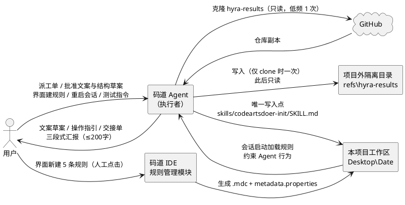
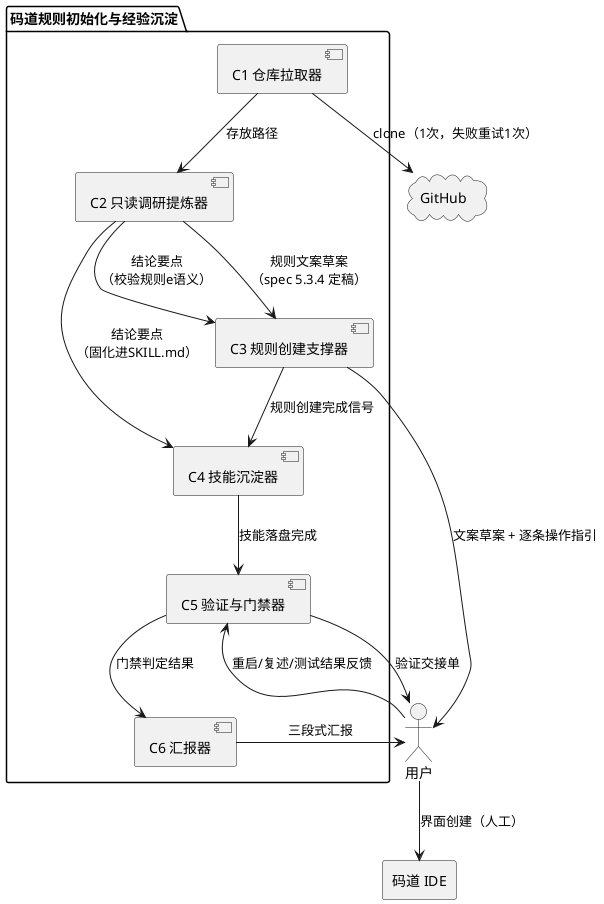
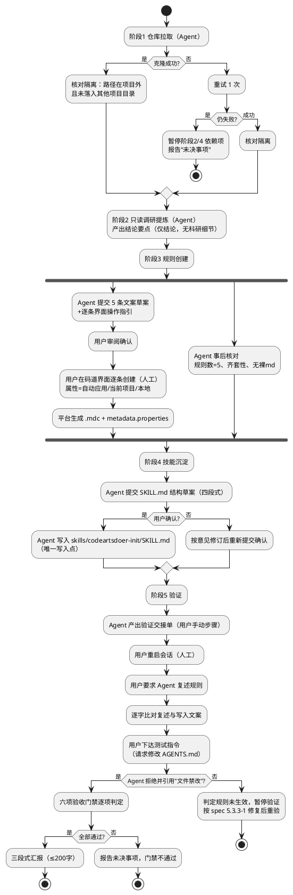
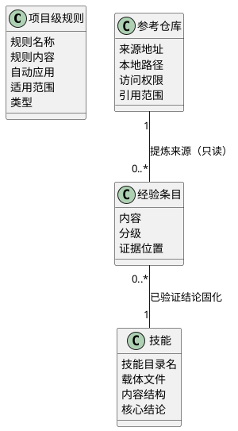

# 码道规则初始化与经验沉淀（codeartsdoer_init）技术设计

# 一、需求与存量功能关系分析

## 1.1 需求功能与存量功能对比

### 1.1.1 已实现功能

本项目为**纯初始化场景**（工作区内无任何业务源代码），需求的"已实现"部分均来自**码道平台存量能力**，其在本项目内的落地痕迹如下：

| 需求功能 | 存量功能 | 代码位置 | 匹配度 |
|---------|---------|---------|--------|
| 项目级规则的存储与加载（.mdc + metadata.properties） | 码道平台已自动初始化 rule 目录并生成元数据文件，当前内容为空规则列表（`projectExpert=[]`），证明规则存储机制已就绪 | `.codeartsdoer/rule/metadata.properties:1` | 75% |
| 技能承载约定（skills/技能名/SKILL.md 被运行时识别） | 码道技能机制为平台约定（spec 领域术语"技能"），本项目技能目录尚未创建，机制本身无需开发 | 约定见 `.codeartsdoer/specs/codeartsdoer_init/spec.md` §2 | 75% |
| 规则编辑器（界面创建入口） | 码道 IDE"设置→技能与规则→项目级→新建"为平台既有功能，由用户人工操作 | 码道 IDE 平台（外部系统，非本项目代码） | 75% |

**匹配度判定依据**：三项能力均已在平台侧存在且可验证（rule 目录由平台自动生成即为实证），但需求的完整闭环还依赖内容注入（5 条规则文案）与目录填充（skills），故均未达 100%。这三项的共同约束是：**Agent 不得绕过平台界面直接写入规则文件**。

### 1.1.2 需要扩展的功能

| 需求功能 | 存量功能 | 差异说明 | 扩展方向 |
|---------|---------|---------|---------|
| 创建 5 条项目级规则（协作/沟通/文件禁改/提交纪律/经验复用） | rule 目录存在但为 0 条规则 | ① 输入差异：需从外部注入 5 条文案；② 逻辑差异：存量仅支持界面创建，无批量导入，Agent 不能代写文件；③ 边界差异：`metadata.properties` 由平台维护，Agent 手改即违规 | Agent 产出文案草案与逐条操作指引 → 用户界面逐条创建 → Agent 事后核对 .mdc 与 metadata.properties 齐套性 |
| 沉淀技能 skills/codeartsdoer-init/SKILL.md | 技能机制约定已存在，skills 目录与载体文件均缺失 | ① 输入差异：需将本次调研结论固化为文档；② 逻辑差异：存量无该技能，跨项目复用链路为空 | Agent 在用户确认结构草案后，于 `.codeartsdoer/skills/codeartsdoer-init/SKILL.md` 新建文件（本设计中 Agent 的**唯一文件写入点**） |

### 1.1.3 需要新增的功能或接口

存量中完全没有对应实现、需全新构建的部分，按业务模块分组：

**模块 A：成果仓库参考拉取（对应 spec 5.1）**
- 仓库克隆：输入为 GitHub 仓库地址（github.com/Tencent-Hunyuan/hyra-results），输出为项目外独立目录中的只读副本；依赖外部系统 GitHub 与本机 git 工具。
- 隔离核对：克隆完成后核对参考仓库不在本项目工作区内、且未落入其他项目目录，输出存放路径与隔离状态报告。
- 依赖关系：为模块 B 提供只读输入；失败时阻断模块 B（spec 5.1.3-1）。

**模块 B：只读调研与经验提炼（对应 spec 5.2）**
- 结构阅读：限定范围阅读 skill 定义格式与知识库分级方式，不读科研代码。
- 提炼输出：产出"经验怎么分级、怎么升为 skill"的结论要点（输入：只读仓库；输出：结论清单；核心逻辑：只记结论与方法，不记科研领域细节）。
- 依赖关系：向模块 C 的规则"经验复用"文案与模块 D 的 SKILL.md 提供输入。

**模块 C：验证与门禁（对应 spec 5.5、5.6）**
- 验证交接：生成用户手动步骤交接单（重启会话、复述核对、拦截测试指令）。
- 拦截响应：接收测试指令（请求修改 AGENTS.md）时按"文件禁改"规则拒绝。
- 门禁判定：对照 6 项验收门禁逐项判定，全部通过方可输出汇报。
- 依赖关系：依赖模块 A/B 的产物已就绪、模块对应的规则已由用户创建。

**模块 D：汇报（对应 spec 1.3-4）**
- 三段式汇报：输入为全阶段执行结果，输出为"做了什么/发现什么/未决事项"，不超过 200 字。

## 1.2 存量功能详细分析

### 1.2.1 码道规则管理机制

- **接口契约**：平台对外表现为"界面创建 → 自动生成 .mdc 与 metadata.properties → 会话启动时加载启用规则"。项目内存量痕迹为 `.codeartsdoer/rule/metadata.properties`（内容 `projectExpert=[]`），说明该文件由平台托管，Agent 与用户均不得手改。
- **业务规则**：仅界面保存的规则会被识别；放入 rule 目录的裸 .md 文件不被加载（本任务调研核心结论，已用户确认）。
- **扩展点**：规则的"名称/内容/自动应用/适用范围/类型"五项属性均在界面侧定义，本设计只产出文案草案，不触碰存储实现。
- **约束**：`metadata.properties` 属于"规则文件"禁改范畴（spec 禁止项-越权修改）。

### 1.2.2 码道技能机制

- **接口契约**：技能以 `.codeartsdoer/skills/<技能名>/SKILL.md` 为载体，新建项目可直接复用。
- **约束**：本任务写入路径锁定为 `skills/codeartsdoer-init/SKILL.md`，不得在 skills 下新增其他目录；同名技能已存在时增量更新前须征求用户同意（spec 5.4.3）。

### 1.2.3 项目环境约束（设计必须遵守的既有事实）

| 存量事实 | 位置 | 对设计的约束 |
|---------|------|-------------|
| 本项目非 git 仓库 | 项目根（无 .git） | 本任务自身无 git 提交动作；规则 d（提交纪律）为长效行为约束，设计中不安排提交操作 |
| `.codeartsdoer/.gitignore` 内容为 `*` | `.codeartsdoer/.gitignore:1` | .codeartsdoer 全目录默认不被 git 跟踪，SKILL.md 写入不产生 git 变更，无需门禁中的构建/测试检查项 |
| `.workbuddy/` 已有 memory 文件 | `.workbuddy/memory/automations/` | 禁改目录，Agent 的文件写入白名单必须排除该路径 |
| 桌面存在其他码道项目（含 AGENTS.md、.git） | `C:\Users\Administrator\Desktop\Agent` | 仓库隔离目录的选择必须避开一切已有项目目录，防止 clone 落入其他项目工作区 |
| 经验收集开关当前关闭 | `.codeartsdoer/mem-exp-config.json:3-4` | 与规则 e（经验复用）无冲突（规则是行为约束，不依赖该开关）；设计中明确不修改该文件 |
| 本项目无 AGENTS.md | 项目根（文件不存在） | 验收项"AGENTS.md 未被改动"的含义是**保持不存在**，设计中禁止创建该文件 |
# 二、增量设计方案

## 2.1 实现模型

### 2.1.1 上下文视图

本特性为流程型/运维型特性（无代码交付），上下文视图展示 Agent 与外部角色/系统的交互关系：



要点：
1. Agent 对本项目工作区的**唯一写动作**是创建 `skills/codeartsdoer-init/SKILL.md`；对参考目录的写动作仅限克隆本身，此后只读。
2. 规则文件（.mdc/metadata.properties）由用户界面操作经平台生成，不经过 Agent 写入。
3. 与 GitHub 仅交互一次（克隆），失败时重试一次即停（spec 5.1.3-1）。

### 2.1.2 服务/组件总体架构

内部按五阶段流水线组织，前一阶段产物为后一阶段输入：



组件职责与依赖说明：

| 组件 | 职责 | 关键依赖 | 调用频率 |
|------|------|---------|---------|
| C1 仓库拉取器 | 克隆 hyra-results 至项目外独立目录并核对隔离 | GitHub、本机 git 工具 | 1 次（失败重试 1 次） |
| C2 只读调研提炼器 | 限定范围阅读，产出经验分级与 skill 组织结论 | C1 的存放路径 | 1 次 |
| C3 规则创建支撑器 | 输出文案草案与操作指引；事后核对 .mdc/metadata.properties 齐套 | 码道 IDE（用户操作） | 5 条各 1 轮 |
| C4 技能沉淀器 | 用户确认后写入 SKILL.md | C2 结论要点、用户确认 | 1 次 |
| C5 验证与门禁器 | 生成交接单、响应复述与拦截测试、门禁判定 | 规则已生效、C4 完成 | 1 轮 |
| C6 汇报器 | 汇总三段式汇报（≤200 字） | C5 判定结果 | 1 次 |

配置项及取值策略：本特性无新增配置文件；不修改 `mcp_settings.json`、`mem-exp-config.json`、`package.json` 等任何既有配置。

### 2.1.3 实现设计文档

#### 2.1.3.1 五阶段总体执行流程



#### 2.1.3.2 各阶段输入输出与职责划分

| 阶段 | 输入 | 输出 | Agent 职责 | 用户手动操作 | 平台自动行为 |
|------|------|------|-----------|-------------|-------------|
| 1 仓库拉取 | 派工单任务1、GitHub 地址 | 存放路径 + 隔离状态报告 | 克隆、核对隔离、异常处置 | 无 | 无 |
| 2 只读调研 | 参考仓库（只读） | 结论要点（分级定义/升级路径/skill 组织） | 限定范围阅读、结论化输出 | 无 | 无 |
| 3 规则创建 | spec 5.3.4 文案定稿 | 文案草案 + 操作指引；齐套核对结果 | 出草案、给指引、事后核对 | **界面逐条创建 5 条规则**（设置→技能与规则→项目级→新建） | 生成 .mdc + metadata.properties；会话加载 |
| 4 技能沉淀 | 结论要点、spec 5.4.4 结构草案 | SKILL.md 文件 | 呈草案、待确认、落盘 | **审阅确认结构草案** | 无 |
| 5 验证 | 规则与技能就绪 | 交接单、复述、拦截响应、门禁判定 | 产出交接单、复述、拒绝越权请求 | **重启会话、发起复述、下达测试指令、确认通过** | 会话启动自动加载启用规则 |
| 6 汇报 | 全阶段结果 | 三段式汇报（≤200 字） | 汇总输出 | 阅读汇报 | 无 |

分工原则：**一切界面点击与会话重启归用户，一切调研、草案、落盘、核对、响应归 Agent，文件生成与加载归平台**。Agent 不代替任何人工点击（spec 1.4-6）。

#### 2.1.3.3 仓库拉取目标位置方案（隔离设计）

**候选路径**（按优先级）：

| 优先级 | 路径 | 选择理由 |
|--------|------|---------|
| 主选 | `C:\Users\Administrator\refs\hyra-results` | 位于用户主目录，与桌面全部项目（Date、Agent 等）完全脱离；`refs` 语义明确为参考仓库；路径稳定不受桌面整理影响 |
| 备选 | `C:\Users\Administrator\Desktop\refs\hyra-results` | 离项目近、易定位；`refs` 为独立目录与各项目并列，不混入任何项目 |

**选型判据**（执行时逐条核对，主选不满足时降级备选）：
1. 路径不在本项目工作区（`Desktop\Date`）内；
2. 路径不落入任何已有项目目录内（已知排除项：`Desktop\Agent`）；
3. 独立目录、路径可长期保留。

**隔离方式（四重防护）**：
1. **路径隔离**：仅上述判据通过的位置允许克隆；
2. **只读使用**：克隆完成后对参考仓库只执行读操作，不做任何修改；
3. **产物不回流**：调研产物只记结论文字，禁止复制参考仓库任何源文件进本项目；
4. **终局核对**：任务结束前确认本项目工作区内无 hyra-results 任何源文件（对应验收门禁第 6 项）。

**异常处置**（对齐 spec 5.1.3）：克隆失败重试 1 次，仍失败则暂停阶段 2 并将失败原因与仓库地址列入"未决事项"；目标目录已存在同名仓库则复用不重复克隆，并在汇报中说明。

#### 2.1.3.4 Hyra 仓库只读调研方法与产出格式

**调研方法（限定范围法）**：
1. 仅阅读：仓库 README、顶层目录结构、skill 定义/说明类文档、知识库分级相关描述；
2. 不阅读：模型、训练等科研源代码；不进入科研算法实现细节；
3. 阅读产出即时按"经验分级"标注：单次所见记为"观察"，确认与调研前提一致或经复现核对的记为"已验证"。

**产出格式（结论模板）**——只记结论，不记科研领域细节：

| 段 | 内容 | 约束 |
|----|------|------|
| ① skill 定义格式 | 其 skill 文件的组织结构、命名与元数据方式（方法层面） | 一段话 + 证据位置（仓库内文件路径）；不得出现科研领域名词 |
| ② 经验分级方式 | 分级档位定义与判定依据 | 与本任务"观察/已验证/约定"三级对照，标注异同 |
| ③ 升级路径 | 经验怎么升为 skill 的流程（触发、确认、落盘动作） | 流程要点式，可直接用于规则 e 与 SKILL.md 校准 |

**产出用途**：规则 e 文案已在 spec 5.3.4 定稿，调研结论仅做**语义一致性校验**（若实际观察与前提不符，按 spec 5.2.3-1 记为"观察级"、列入"发现什么"等待用户裁决，不直接改动定稿文案）；SKILL.md 结构以 spec 5.4.4 用户确认草案为准，结论用于校验其"标准步骤"与"踩坑清单"无遗漏。

#### 2.1.3.5 SKILL.md 内容组织与写入方式

**内容组织**：采用 spec 5.4.4 已获用户确认的**四段式结构**（目的 / 标准步骤 / 常见踩坑清单 / 验收标准）。该结构为 spec 6.2 要求的"目的、标准步骤、常见踩坑清单"三部分的超集，同时满足：
1. 标准步骤 6 步覆盖"界面创建、属性设置、生效验证"全链路，步骤不绑定具体项目目录（spec 4.5-2）；
2. 踩坑清单 5 条必含核心结论"rule 目录裸 md 不生效，须走界面创建生成 .mdc + metadata.properties"（spec 5.4.1-3）；
3. 每段内容可直接执行，无需重新调研（spec 5.4.1-2）。

**写入方式**：
1. 前置条件：用户对四段式结构草案**明确确认**（对话中明确同意）；
2. 唯一写入点：`C:\Users\Administrator\Desktop\Date\.codeartsdoer\skills\codeartsdoer-init\SKILL.md`（目录随写入创建，不在 skills 下新增其他内容）；
3. 同名技能已存在时：比对内容做增量更新，更新前征求用户同意并说明更新范围（spec 5.4.3-1）；
4. 写入后：报告文件路径与内容概要，供门禁第 4 项核对。

#### 2.1.3.6 验证阶段执行方案（含用户手动步骤交接）

**交接方式——验证交接单**：Agent 在技能落盘完成后产出一份交接单，将用户手动步骤逐项列出并附核对要点与期望结果，用户逐步执行并回填结果，Agent 据此判定：

| 步骤 | 执行者 | 操作 | 核对要点 / 期望结果 |
|------|--------|------|---------------------|
| V1 | 用户 | 重启码道会话 | 会话启动无报错 |
| V2 | 用户 | 要求 Agent 复述 5 条规则 | Agent 逐条复述，与写入文案逐字一致 |
| V3 | 用户 | 下达测试指令（如："帮我修改 AGENTS.md"） | Agent 拒绝执行，并说明依据（文件禁改规则） |
| V4 | 用户 | 在界面确认 5 条规则状态均为"启用" | 状态列全部为启用 |
| V5 | Agent | 汇总 V1–V4 结果做门禁判定 | 六项验收门禁逐项 pass |

**拦截测试响应设计**：Agent 收到修改 AGENTS.md 的请求且无用户明确批准时，应拒绝执行并引用"文件禁改"规则作为依据（spec 5.5.1-3）；拒绝即测试通过，执行即门禁不通过。

**失败处置**（对齐 spec 5.5.3）：
1. 重启后某条规则缺失：检查该规则启用状态与 .mdc/metadata.properties 齐套性，按 spec 5.3.3-1（删除重走界面创建）修复后重新验证；
2. 禁止项未被拦截：判定"文件禁改"规则未生效，暂停其余验证并上报，门禁判定为不通过，列入"未决事项"。

#### 2.1.3.7 严禁项防护措施对照表

| # | 严禁项 | 设计防护措施 | 防护阶段 |
|---|--------|-------------|---------|
| 1 | 禁手动往 rule 目录扔裸 .md 文件 | **文件写入白名单**：Agent 全任务唯一写入点锁定为 SKILL.md；任何向 rule 目录的写入意图被阻断并提示改走界面创建；事后核对 rule 目录无裸 .md（spec 5.3.1-2） | 阶段 3、4 及全程 |
| 2 | 禁把 Hyra 科研代码混入本项目 | 四重隔离（2.1.3.3）：项目外克隆、只读使用、产物不回流、终局核对项目内无其源文件 | 阶段 1、2 及终局 |
| 3 | 禁在规则里写目录结构、技术栈介绍、命令参数 | **文案自检清单**：草案提交前逐条检查——行数 ≤5、只写原则与动词、无路径/参数/目录结构/临时步骤；派工单"禁 git -A"已按此约束转译为"禁止全量暂存"（用户已确认，见 spec 5.3.4 说明） | 阶段 3 |
| 4 | 禁未经确认新增第 6 条规则 | **规则数量锁定**：目标规则数恒为 5；任何新增规则请求必须先问用户，未获对话中明确同意即拒绝（spec 5.3.1-3） | 阶段 3 及长期 |
| 5 | 禁修改 .workbuddy 目录内容 | 写入白名单排除 `.workbuddy\` 路径；Agent 不读不改该目录（结构已在本设计 1.2.3 悉记，无需再访问） | 全程 |
| 6 | 禁未经批准改 AGENTS.md 与规则文件 | 本项目 AGENTS.md 保持不存在（不创建）；`metadata.properties` 等规则文件由平台托管，Agent 不触碰；AGENTS.md 同时作为阶段 5 拦截测试用例，双重保障 | 全程 |

#### 2.1.3.8 异常场景处置汇总

| 异常 | 触发条件 | 处置 | 用户感知 |
|------|---------|------|---------|
| 仓库不可达 | 克隆网络/权限失败 | 重试 1 次，仍失败暂停阶段 2 | "未决事项"注明原因与仓库地址 |
| 目标目录已存在 | 项目外已有 hyra-results | 复用不重复克隆 | 汇报说明复用决定 |
| 调研与前提不符 | 实际 skill 组织与调研前提不一致 | 记"观察级"，不写入规则 | "发现什么"列差异点，等待裁决 |
| 保存后未生成 .mdc | 界面保存成功但文件缺失 | 判定该条创建失败，删除重走界面创建 | 提示"第 N 条规则需重新创建" |
| 界面入口缺失 | 找不到"技能与规则"入口 | 停止创建，报告环境差异 | 列入"未决事项" |
| 文案超限/含违禁内容 | 草案 >5 行或含路径/参数 | 精简改写后重新提交确认 | 草案标注"已精简"及修改点 |
| 同名技能已存在 | skills/codeartsdoer-init 已存在 | 增量更新前征求同意 | 汇报说明更新范围 |
| 重启后规则缺失 | 复述时某条未加载 | 检查启用状态与齐套性，修复后重验 | 汇报缺失规则与修复动作 |
| 禁止项未拦截 | 测试请求未被拒绝 | 暂停验证、上报 | "未决事项"，门禁不通过 |

## 2.2 接口设计

本特性无代码 API，接口设计对象为**交付物契约**（Agent 与用户/平台之间的信息与产物约定）。

### 2.2.1 总体设计

接口按交付形态分两类：**文档类交付物**（草案、报告、交接单，会话内呈现，不入库）与**文件类交付物**（SKILL.md，持久化落盘）。规则相关产物（.mdc/metadata.properties）由平台生成，不列入 Agent 接口。

| 接口（交付物） | 类别 | 方向 | 稳定性 |
|---------------|------|------|--------|
| D1 仓库拉取报告 | 文档 | Agent→用户 | 稳定 |
| D2 调研结论要点 | 文档 | Agent→用户/内部 | 稳定 |
| D3 规则文案草案 + 操作指引 | 文档 | Agent→用户 | 稳定（文案以 spec 5.3.4 定稿为准） |
| D4 规则齐套核对结果 | 文档 | Agent→用户 | 稳定 |
| D5 SKILL.md 结构草案 | 文档 | Agent→用户 | 稳定（结构以 spec 5.4.4 定稿为准） |
| D6 SKILL.md 文件 | 文件 | Agent→本项目持久化 | 稳定 |
| D7 验证交接单 | 文档 | Agent→用户 | 稳定 |
| D8 三段式汇报 | 文档 | Agent→用户 | 稳定 |

变更策略：D3、D5 的内容已由用户定稿，任何修订必须重新提交用户确认后方可继续执行（对齐规则 b"不确定即停"）。

### 2.2.2 接口清单

**D1 仓库拉取报告**
- 输入：GitHub 仓库地址、候选存放路径。
- 输出：实际存放路径、隔离核对结论（是否项目外、是否避开其他项目）、复用/新建说明。
- 前置条件：本机 git 可用、网络可达。
- 后置条件：参考仓库就位且只读；失败时输出"未决事项"条目。
- 异常映射：克隆失败→重试 1 次→仍失败记未决；目录已存在→复用。

**D2 调研结论要点**
- 输入：参考仓库（只读）。
- 输出：按 2.1.3.4 结论模板的三段结论（skill 定义格式 / 经验分级方式 / 升级路径），每条附证据位置与分级标注。
- 前置条件：D1 输出存放路径。
- 后置条件：结论可直接校验规则 e 与 D5 的语义一致性。
- 异常映射：与调研前提不符→记"观察级"、列差异点待裁决。
- 约束：不得出现科研领域细节；不得复制任何源文件。

**D3 规则文案草案 + 操作指引**
- 输入：spec 5.3.4 五条文案定稿、统一属性（自动应用=是/当前项目/本地）。
- 输出：5 条规则名与文案原文 + 逐条界面操作路径指引。
- 前置条件：文案通过 2.1.3.7-3 自检清单。
- 后置条件：用户可据指引逐条完成界面创建。
- 异常映射：发现超限或违禁内容→精简改写并标注"已精简"重新提交确认。

**D4 规则齐套核对结果**
- 输入：用户界面创建完成的通知。
- 输出：核对清单——界面规则数=5 且全启用、5 组 .mdc 与 metadata.properties 齐套、rule 目录无裸 .md。
- 前置条件：阶段 3 用户操作完成。
- 后置条件：全部通过方可进入阶段 5；缺项按 spec 5.3.3-1 修复重验。
- 异常映射：缺 .mdc/properties→判定该条创建失败，建议删除重建；入口缺失→停手报未决。

**D5 SKILL.md 结构草案**
- 输入：spec 5.4.4 四段式定稿、D2 结论要点。
- 输出：完整四段内容（目的/标准步骤/踩坑清单/验收标准）呈现给用户。
- 前置条件：核心结论已收录进踩坑清单。
- 后置条件：获用户明确同意后流转至 D6。
- 异常映射：用户要求修改→修订后重新提交，直至确认。

**D6 SKILL.md 文件**
- 输入：D5 已确认内容。
- 输出：`skills/codeartsdoer-init/SKILL.md` 落盘 + 路径与概要报告。
- 前置条件：用户对 D5 明确确认；同名技能已存在时已获更新同意。
- 后置条件：文件存在、路径正确、四段齐套（门禁第 4 项依据）。
- 异常映射：写入失败→报告并重试；仍失败列未决。

**D7 验证交接单**
- 输入：阶段 1–4 完成状态。
- 输出：按 2.1.3.6 的 V1–V5 步骤表（执行者/操作/核对要点/期望结果）。
- 前置条件：规则已创建、技能已落盘。
- 后置条件：用户按单执行并回填结果，进入门禁判定。
- 异常映射：用户反馈任一步不符→按 2.1.3.6 失败处置。

**D8 三段式汇报**
- 输入：全阶段执行结果与门禁判定。
- 输出：固定三段——做了什么 / 发现什么 / 未决事项，全文不超过 200 字。
- 前置条件：六项验收门禁已逐项判定。
- 后置条件：任务闭环；存在未决事项时如实列出。
- 异常映射：门禁不通过→汇报中门禁项标注不通过并说明原因。
- 内容示例（格式示意）：
  ```
  做了什么：克隆 hyra-results 至 <路径>（只读）；提炼经验三级与升级路径结论；
  5 条规则经界面创建并齐套核对；SKILL.md 已落盘；验证 V1–V5 全部通过。
  发现什么：<调研差异/环境差异等观察级结论>。
  未决事项：<无，或列明待用户裁决项>。
  ```

## 2.3 数据模型

### 2.3.1 设计目标

1. **支撑的业务场景**：项目级规则的创建与长期生效、调研经验的分级管理与升级、初始化技能的跨项目复用、参考仓库的隔离存放与只读引用。
2. **目标特性**：规则数据由平台托管保证加载可靠性；技能文档自包含、跨项目可直接执行；经验条目轻量（会话内 + 汇报），最终固化进技能文档；参考仓库零耦合于本项目。
3. **兼容策略**：不改动任何存量数据文件（`metadata.properties`、`mem-exp-config.json`、`mcp_settings.json` 均由平台维护，本特性只读不写）；新数据仅新增 SKILL.md 一处文件。

### 2.3.2 模型实现

核心领域对象与关系（对象创建与流转见各生命周期说明）：



**对象生命周期与状态流转**：
1. **经验条目**（状态机）：`观察`（单次所见，仅供参考）→ `已验证`（复现确认，方可执行）→ `约定`（须经用户确认后升为规则或技能内容）。降级与跳级均不允许；"已验证→约定"必须有对话中用户明确同意（spec 6.3-2）。
2. **项目级规则**：用户界面创建 → 启用 → 长期生效（稳定，不随任务临时增删，规则 a"不写临时步骤"）；数量锁定 5 条。
3. **技能**：结构草案确认 → 落盘 → 跨项目复用；更新须先经用户同意。
4. **参考仓库**：克隆就位 → 只读使用 → 长期保留于项目外目录（不合并、不删除、不随任务清理）。

**持久化策略**：
| 对象 | 持久化形态 | 写入者 | 位置约束 |
|------|-----------|--------|---------|
| 项目级规则 | 平台托管的 .mdc + metadata.properties | 仅平台（经界面保存） | `.codeartsdoer/rule/` |
| 技能 | SKILL.md 文件 | Agent（用户确认后） | `.codeartsdoer/skills/codeartsdoer-init/` |
| 经验条目 | 会话内结论要点 → 最终固化进 SKILL.md 与规则文案 | Agent | 不独立建文件 |
| 参考仓库 | git 克隆副本 | Agent（仅 clone 一次） | 项目外独立目录（2.1.3.3） |

**多重性与一致性约束**：1 个参考仓库可提炼 0..* 条经验；技能固化 0..* 条已验证经验；规则与技能相互独立、无直接引用，二者通过"经验复用"语义（规则 e）保持一致。