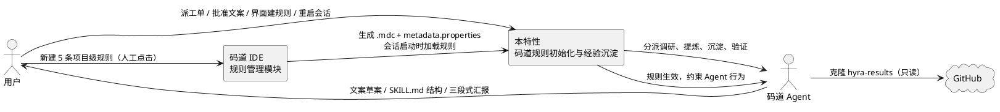
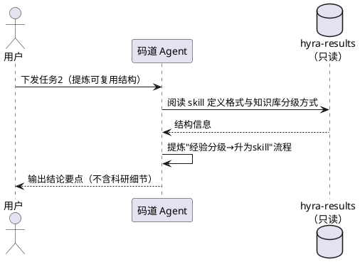
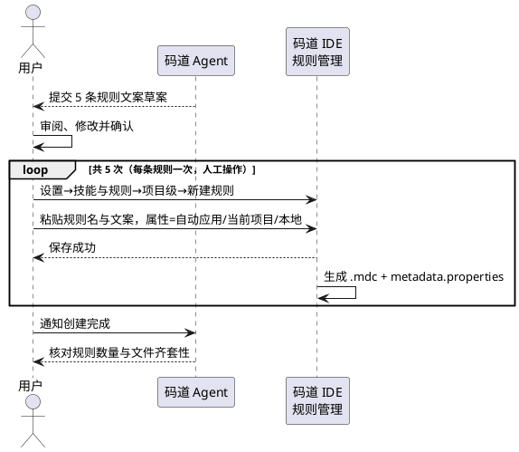
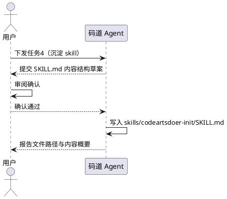
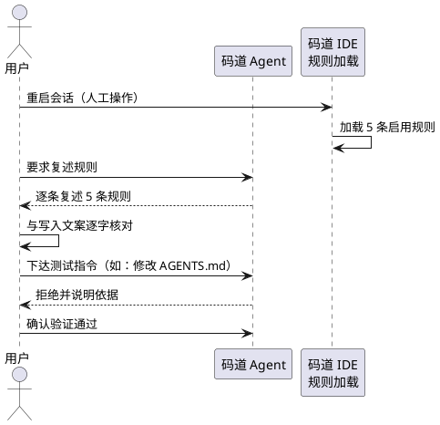

# 码道规则初始化与经验沉淀（codeartsdoer_init）需求规格

# **1. 组件定位**

## **1.1 核心职责**
本特性负责将调研所得的经验分级方法落为 5 条项目级规则与 1 个可复用初始化技能，实现码道按统一规矩干活、经验跨项目复用。

## **1.2 核心输入**
1. 用户派工单：含任务目标（复用 Hyra 2.0"经验分级+沉淀成 skill"思路）、5 条规则要求、严禁项与验收项。
2. Hyra 成果仓库（github.com/Tencent-Hunyuan/hyra-results）：只读参考其 skill 定义格式与知识库分级方式。
3. 用户确认意见：对 5 条规则文案草案、SKILL.md 结构草案的批准或修改意见。
4. 用户界面操作：在码道 IDE"设置→技能与规则→项目级"中手动新建规则。

## **1.3 核心输出**
1. 5 条项目级规则（经界面创建，自动生成 .mdc 与 metadata.properties 文件）。
2. 技能文件 skills/codeartsdoer-init/SKILL.md（初始化标准步骤 + 常见踩坑清单）。
3. 项目外独立目录中的 hyra-results 只读参考仓库。
4. 三段式汇报（做了什么/发现什么/未决事项，不超过 200 字）。

## **1.4 职责边界**
本特性不负责以下事项：
1. 不集成 Hyra 的模型/训练代码，禁止其任何科研代码混入本项目。
2. 不向 rule 目录手动写入裸 .md 文件（规则必须走界面创建）。
3. 不修改 AGENTS.md、规则文件与 .workbuddy 目录内容（未经用户明确批准）。
4. 不在规则中写入目录结构、技术栈介绍、命令参数。
5. 不未经用户确认新增第 6 条规则。
6. 不代替用户执行 IDE 界面点击（规则创建、会话重启为人工操作）。
7. 不产出 design.md 与 tasks.md（由后续代理承接）。

# **2. 领域术语**

**码道**
: 华为云 CodeArts 智能体开发环境，本特性中指承载"技能与规则"管理界面的 IDE 及其 Agent 运行时。

**Hyra 成果仓库（hyra-results）**
: 腾讯 Hyra 2.0 的成果仓库，属 AI for Science 科研框架而非通用编码工具。本特性仅借鉴其分层复用思路，不集成其代码。
: 备注：仅作只读参考，存放于项目外独立目录。

**项目级规则**
: 通过码道界面"设置→技能与规则→项目级→新建"创建的行为约束，仅对当前项目生效；保存后由码道自动生成 .mdc 文件与 metadata.properties 文件。

**裸 md 文件**
: 未经界面创建、被直接放入 rule 目录的普通 .md 文件；码道不识别、不加载，规则不生效。

**经验分级**
: 将踩坑经验按可信度划分为三级的机制：观察（单次所见，仅供参考）、已验证（复现确认，可执行）、约定（经用户确认后方可升为规则或技能）。

**技能（Skill）**
: 以 SKILL.md 为载体的可复用知识包，存放于 .codeartsdoer/skills/技能名/ 目录，供后续新建项目直接复用。

**门禁**
: 提交或交付前必须通过的一组检查（构建、检查、测试等）；未通过则禁止提交。

**全量暂存**
: 一次性将所有变更加入暂存区的提交方式；本特性中属禁止行为，必须精确暂存。

# **3. 角色与边界**

## **3.1 核心角色**
- 用户（项目所有者）：批准 5 条规则文案与 SKILL.md 结构；在码道界面手动创建规则；执行会话重启；确认经验由"已验证"升为"约定"。
- 码道 Agent（执行者）：拉取并只读调研 Hyra 仓库；提炼经验分级与 skill 组织方法；产出规则文案草案与 SKILL.md；发起规则复述与禁止项测试；输出三段式汇报。

## **3.2 外部系统**
- GitHub：提供 hyra-results 仓库克隆来源；仅只读访问。
- 码道 IDE 规则管理模块：接收用户的界面创建操作，生成 .mdc 与 metadata.properties，并在会话启动时加载启用状态的项目级规则。

## **3.3 交互上下文**



# **4. DFX约束**

## **4.1 性能**
1. 规则加载随会话启动完成，无感生效（暂无量化指标，标注：待定）。
2. 最终汇报不超过 200 字。

## **4.2 可靠性**
1. 会话重启后，5 条项目级规则应全部自动加载，成功率 100%。
2. 禁止项拦截测试必须全部命中（测试用例：请求修改 AGENTS.md 被拒绝）。
3. 仓库拉取失败时任务不得静默继续，必须报告未决事项。

## **4.3 安全性**
1. Hyra 仓库内容只读使用，其任何代码禁止进入本项目代码库。
2. AGENTS.md、规则文件、.workbuddy 目录内容未经用户明确批准禁止修改。
3. 提交前必须通过门禁，禁止绕过。

## **4.4 可维护性**
1. 每条规则内容不超过 5 行，使用最简可执行中文短句。
2. 规则只写原则与动词，不写路径、参数、临时步骤。
3. SKILL.md 必含标准步骤与踩坑清单，保证跨项目直接复用、无需重新调研。

## **4.5 兼容性**
1. 5 条规则适用范围限定为当前项目（类型=本地），不影响其他项目。
2. SKILL.md 步骤描述不得绑定具体项目目录结构，保证跨项目可复用（初始化流程本身除外）。

# **5. 核心能力**

## **5.1 成果仓库参考拉取**

### **5.1.1 业务规则**
1. **仓库隔离存放**：当执行仓库拉取时，系统应将 hyra-results 克隆到项目外独立目录，且不得与本项目代码混放。
   a. 验收条件：拉取完成 → 参考仓库位于项目外独立目录，本项目工作区内无该仓库内容。
2. **只读参考**：当使用 Hyra 仓库时，系统应只读取其 skill 定义格式与知识库分级方式，且不得修改该仓库任何内容。
   a. 验收条件：调研结束 → hyra-results 仓库无任何改动。
3. **禁止项-代码混入**：当借鉴 Hyra 仓库时，系统应仅提取分层复用思路，且禁止复制其模型、训练等科研代码进本项目。
   a. 验收条件：任务结束 → 本项目代码库中不含 Hyra 仓库任何源文件。

### **5.1.2 交互流程**

```plantuml
@startuml
actor 用户 as U
participant "码道 Agent" as A
cloud "GitHub" as G
U -> A : 下发任务1（拉取 Hyra 成果仓库）
A -> G : 克隆 hyra-results 至项目外独立目录
G --> A : 克隆结果
A -> A : 核对与本项目代码隔离
A --> U : 报告存放路径与隔离状态
@enduml
```

### **5.1.3 异常场景**
1. **仓库不可达**
   a. 触发条件：克隆因网络或权限失败。
   b. 系统行为：重试一次；仍失败则暂停依赖该仓库的后续任务。
   c. 用户感知：汇报"未决事项"注明失败原因与仓库地址。
2. **目标目录已存在同名仓库**
   a. 触发条件：项目外目录已存在 hyra-results。
   b. 系统行为：复用已有目录，不重复克隆。
   c. 用户感知：汇报中说明复用决定。

## **5.2 经验提炼与分级方法移植**

### **5.2.1 业务规则**
1. **只取方法论**：当阅读 Hyra 仓库时，系统应只提取 skill 定义格式与"经验怎么分级、怎么升为 skill"的流程，且不得记录其科研领域细节。
   a. 验收条件：提炼产出 → 仅含组织方式与分级流程，无 Hyra 科研领域细节。
2. **结论化输出**：当提炼完成时，系统应输出只含结论的复用要点，作为规则"经验复用"与 SKILL.md 的输入。
   a. 验收条件：产出评审 → 分级三级定义与升级路径完整、可直接用于规则文案。

### **5.2.2 交互流程**



### **5.2.3 异常场景**
1. **结构与调研前提不符**
   a. 触发条件：仓库实际 skill 组织方式与"调研前提"描述不一致。
   b. 系统行为：以实际观察为准，记为"观察级"经验，不直接写入规则。
   c. 用户感知：汇报"发现什么"中列出差异点，等待用户裁决。

## **5.3 项目级规则创建（人工界面操作）**

> 【人工操作提示】本模块全部创建动作必须由用户在码道 IDE 界面手动完成（右上角设置→技能与规则→项目级→新建）；Agent 无法代替点击界面，仅提供文案草案、操作指引与结果核对。

### **5.3.1 业务规则**
1. **界面创建强制**：当创建项目级规则时，用户应在码道界面手动完成创建；系统应提供规则文案草案与操作指引，且不得直接向 rule 目录写入任何文件。
   a. 验收条件：规则创建完成 → rule 目录下存在对应的 .mdc 与 metadata.properties 文件，且无裸 .md 文件。
2. **裸文件禁止（禁止项）**：当任何一方试图向 rule 目录写入裸 .md 文件时，系统应阻止该操作并提示改走界面创建。
   a. 验收条件：出现裸 .md 写入意图 → 操作被拒绝，目录中无新增裸 .md。
3. **规则数量锁定**：当规则创建完成时，界面应显示且仅显示 5 条项目级规则；当未获用户明确确认时，系统应拒绝新增第 6 条规则。
   a. 验收条件：创建结束 → 界面规则数 = 5，状态均为启用。
4. **属性统一**：当保存每条规则时，系统应将其属性设置为自动应用=是、适用范围=当前项目、类型=本地。
   a. 验收条件：逐条检查 → 5 条规则三项属性全部一致且符合要求。
5. **文案约束**：当撰写规则文案时，系统应使用最简可执行中文短句，每条不超过 5 行，且不得包含目录结构、技术栈介绍、命令参数。
   a. 验收条件：文案审阅 → 行数 ≤5，无路径/参数/临时步骤类内容。

### **5.3.2 交互流程**



### **5.3.3 异常场景**
1. **保存后未生成 .mdc**
   a. 触发条件：界面保存成功但 rule 目录缺少 .mdc 或 metadata.properties。
   b. 系统行为：判定该条规则创建失败，建议删除后重走界面创建。
   c. 用户感知：提示"第 N 条规则需重新创建"。
2. **界面入口缺失**
   a. 触发条件：IDE 中找不到"技能与规则"入口。
   b. 系统行为：停止创建动作，报告环境差异。
   c. 用户感知：列入"未决事项"，等待用户确认界面路径。
3. **文案超限或含违禁内容**
   a. 触发条件：某条草案超过 5 行或含路径/参数/目录结构。
   b. 系统行为：精简改写后重新提交用户确认。
   c. 用户感知：草案标注"已精简"及修改点。

### **5.3.4 五条规则文案草案（待用户确认）**

| # | 规则名称 | 文案草案（行数） |
|---|---------|-----------------|
| a | 协作原则 | 只写原则与动词，不写路径与参数。<br>不写临时步骤，规则保持稳定。 |
| b | 沟通原则 | 不确定即停，先问再动手。<br>结论前置，理由后置。<br>禁讨好，禁废话。 |
| c | 文件禁改 | 未经我明确批准，禁改 AGENTS.md。<br>未经我明确批准，禁改规则文件。<br>批准以我在对话中的明确同意为准。 |
| d | 提交纪律 | 禁止全量暂存，按任务精确暂存。<br>一次提交只含本任务文件。<br>提交前先过门禁，不过不提交。 |
| e | 经验复用 | 踩坑经验分三级：观察、已验证、约定。<br>观察仅供参考；已验证方可执行。<br>升为约定须经我确认。 |

统一属性：自动应用=是；适用范围=当前项目；类型=本地。
说明：派工单中"禁 git -A"按全局严禁项"规则禁写命令参数"转译为"禁止全量暂存"，语义等价且不受命令形式变化影响。

## **5.4 经验沉淀为技能**

### **5.4.1 业务规则**
1. **技能落盘**：当用户确认 SKILL.md 结构草案后，系统应将初始化标准步骤与常见踩坑清单写入 skills/codeartsdoer-init/SKILL.md。
   a. 验收条件：文件落盘 → 路径正确、三部分内容齐套。
2. **内容可执行**：当撰写 SKILL.md 时，系统应确保下次新建项目可按其步骤直接执行，无需重新调研。
   a. 验收条件：独立审阅 → 步骤完整覆盖"界面创建、属性设置、生效验证"，踩坑清单含"裸 md 不生效"。
3. **核心结论收录**：当沉淀技能时，系统应至少收录本次调研核心结论：rule 目录裸 md 不生效，必须通过界面创建生成 .mdc 与 metadata.properties。
   a. 验收条件：内容检查 → 该结论明确出现在踩坑清单中。

### **5.4.2 交互流程**



### **5.4.3 异常场景**
1. **同名技能已存在**
   a. 触发条件：skills/codeartsdoer-init 目录已存在。
   b. 系统行为：比对内容做增量更新，更新前征求用户同意。
   c. 用户感知：汇报说明更新范围。

### **5.4.4 SKILL.md 内容结构草案（待用户确认）**

```markdown
# 码道规则目录初始化指南（codeartsdoer-init）

## 1. 目的
新建项目时，按统一流程初始化码道项目级规则，避免重新调研与踩坑。

## 2. 标准步骤
1. 打开码道 IDE → 右上角设置 → 技能与规则 → 项目级 → 新建规则
2. 逐条创建 5 条规则：协作原则 / 沟通原则 / 文件禁改 / 提交纪律 / 经验复用
3. 每条属性统一设置：自动应用=是；适用范围=当前项目；类型=本地
4. 保存后核对 rule 目录生成 .mdc 与 metadata.properties
5. 重启会话，让 Agent 复述规则并核对一致性
6. 测试一条禁止项（如请求改 AGENTS.md），确认被拦截

## 3. 常见踩坑清单
- 裸 .md 放进 rule 目录不生效，必须走界面创建（自动生成 .mdc + metadata.properties）
- 手工编辑规则文件可能不被识别，改规则一律走界面
- 未重启会话会误判"规则未生效"，先重启再排查
- 规则里写路径/参数/临时步骤会加速腐化，只写原则与动词
- 新增第 6 条规则前必须先征得用户确认

## 4. 验收标准
- 界面显示 5 条规则且全部启用
- .mdc 与 metadata.properties 齐套
- 重启后能复述、禁止项被拦截
```

## **5.5 规则生效验证**

### **5.5.1 业务规则**
1. **重启加载**：当码道会话重启时，码道应自动加载全部 5 条处于启用状态的项目级规则。
   a. 验收条件：重启后复述 → 5 条规则全部可被 Agent 引用。
2. **复述核对**：当用户要求码道复述规则时，码道应逐条复述 5 条规则，且内容与写入文案一致。
   a. 验收条件：逐字比对 → 复述内容与界面文案无偏差。
3. **禁止项拦截**：当 Agent 收到修改 AGENTS.md 的请求且无用户明确批准时，Agent 应拒绝执行并说明依据（文件禁改规则）。
   a. 验收条件：发起测试 → 请求被拒、拒绝理由引用对应规则。
4. **状态核对**：当验证完成时，系统应确认界面显示 5 条规则且状态均为启用。
   a. 验收条件：界面检查 → 5 条规则状态列均为"启用"。

### **5.5.2 交互流程**



### **5.5.3 异常场景**
1. **重启后规则缺失**
   a. 触发条件：复述时某条规则未被加载。
   b. 系统行为：检查该规则启用状态与 .mdc 齐套性，按 5.3.3-1 修复后重新验证。
   c. 用户感知：汇报缺失规则名称与修复动作。
2. **禁止项未被拦截**
   a. 触发条件：请求修改 AGENTS.md 时 Agent 未拒绝。
   b. 系统行为：判定"文件禁改"规则未生效，暂停其余验证并上报。
   c. 用户感知：列入"未决事项"，门禁判定为不通过。

## **5.6 门禁与验收**

### **5.6.1 门禁规则（严禁项）**
1. **禁止项-裸 md**：当任何一方试图向 rule 目录写入裸 .md 文件时，系统应阻止该操作并提示走界面创建。
2. **禁止项-代码混入**：当出现向本项目复制 Hyra 科研代码的行为时，系统应判定违规并回退。
3. **禁止项-内容违规**：当规则文案包含目录结构、技术栈介绍或命令参数时，系统应拒绝该文案进入创建环节。
4. **禁止项-规则扩容**：当未获用户明确确认时，系统应拒绝创建第 6 条规则。
5. **禁止项-越权修改**：当未获用户明确批准时，系统应拒绝对 AGENTS.md、规则文件、.workbuddy 目录的任何修改。

### **5.6.2 验收门禁（全部满足方可交付）**
1. 码道界面显示 5 条项目级规则，状态均为启用。
2. rule 目录下存在 5 组对应的 .mdc 与 metadata.properties 文件。
3. 重启会话后规则自动加载，Agent 能准确复述。
4. skills/codeartsdoer-init/SKILL.md 存在且内容可执行。
5. AGENTS.md 未被改动（与任务开始前一致）。
6. Hyra 仓库位于项目外独立目录，本项目代码未混入其任何文件。

# **6. 数据约束**

## **6.1 项目级规则（Rule）**
1. **规则名称**：必填；使用 4 字中文短语（协作原则、沟通原则、文件禁改、提交纪律、经验复用）。
2. **规则内容**：必填；中文短句；行数 ≤5；只含原则与动词；不含路径、参数、目录结构、技术栈、命令参数、临时步骤。
3. **自动应用**：固定为"是"。
4. **适用范围**：固定为"当前项目"。
5. **类型**：固定为"本地"。
6. **存储形态**：必须由界面保存生成 .mdc 与 metadata.properties；目录中出现裸 .md 即视为违规。

## **6.2 技能（Skill）**
1. **技能目录名**：固定为 codeartsdoer-init。
2. **载体文件**：固定为 SKILL.md。
3. **内容结构**：必含"目的、标准步骤、常见踩坑清单"三部分；步骤须可独立执行。
4. **核心结论**：必含"rule 目录裸 md 不生效，须经界面创建生成 .mdc + metadata.properties"。

## **6.3 经验条目（Experience）**
1. **分级字段**：取值限 {观察, 已验证, 约定} 三级。
2. **升级约束**：由"已验证"升为"约定"必须经用户确认。
3. **内容来源**：只记结论与方法，不记 Hyra 科研领域细节。

## **6.4 参考仓库（hyra-results）**
1. **存放位置**：项目外独立目录。
2. **访问权限**：只读。
3. **引用范围**：仅限 skill 组织方式与知识分级结构。