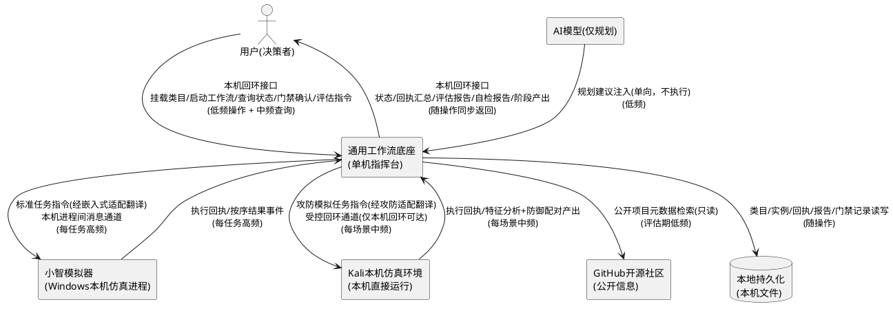
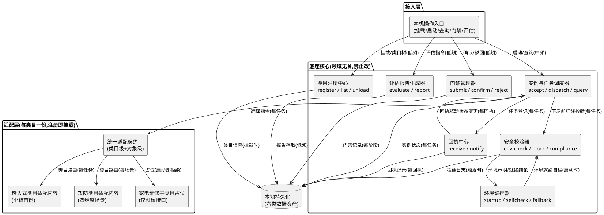
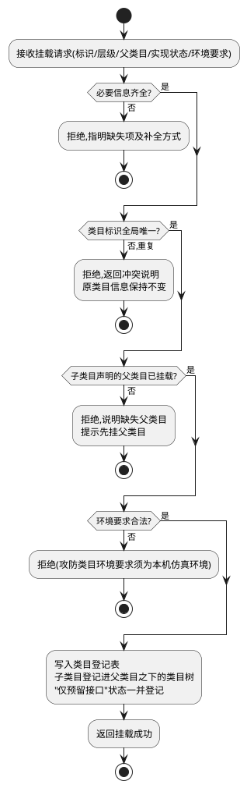
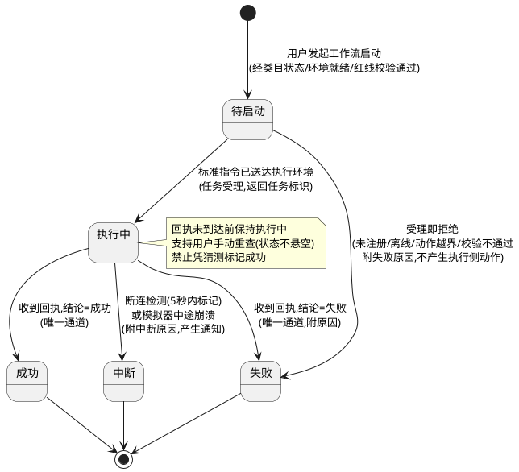
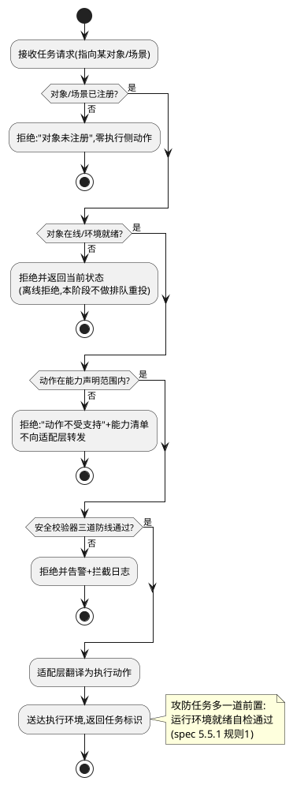
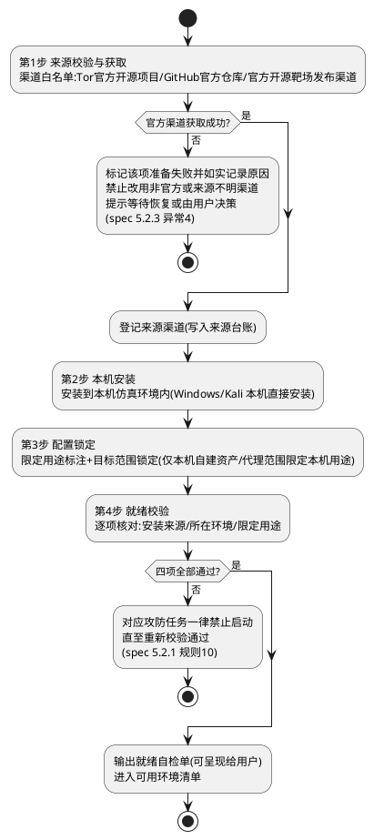
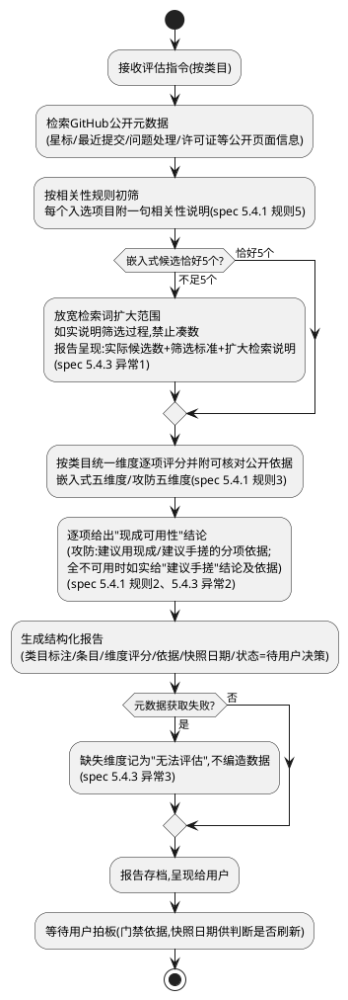
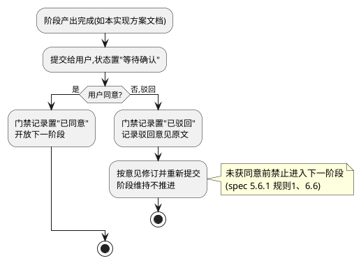

# 通用工作流底座技术实现方案（device_workflow_api）

> 本文档是 `device_workflow_api` 的技术实现方案（design.md），唯一需求来源为同目录 `spec.md`（v2.0，已获用户确认）。
>
> 修订记录：v2.0 环境约束全面放宽——取消多层嵌套隔离，Windows/Kali 本机直接运行；原"隔离仿真环境/隔离声明/隔离校验"体系按本机直跑口径重构为"本机仿真环境/就绪状态/就绪校验"轻量口径；Tor 与开发者边车改为本机直接安装（定位与限定用途不变）；官方开源靶场改为本地离线部署；"四不红线"与"禁止真实外连公网目标"红线原样保留并可验收。spec 与本文档同步修订（spec 同版升 v2.0）。
>
> 阅读口径声明：
> 1. 全文使用大白话描述思路与结构，只讲"架构分层、模块职责、数据流、接口契约语义"，不编写任何具体代码实现，不出现函数名与代码片段；文中出现的英文模块代号为"命名约定"（对应 spec 4.4.1 代码命名用英文的约束），仅是设计层面的称呼，不代表已写代码。
> 2. 底座核心、适配层的全部内容均为自研范围；底层执行能力一律复用现成开源方案（spec 1.4.1、5.7.1 规则 3）。凡涉及"具体选哪个开源项目"，本文只定义"评估怎么选、选完怎么接"，不替用户拍板（spec 1.4.6、5.4.1 规则 4）。
> 3. 接口契约版本：v1（spec 4.4.2）。全部设计满足"新增类目零改底座核心"（spec 4.4.3、4.5.1、5.1.1 规则 4）。
> 4. 安全红线（spec 4.3，全文最高优先级约束）在本文中以"工程化防线"方式落实，见 2.1.3 第 7 节。

# 一、需求与存量功能关系分析

## 1.0 存量现状总判断

对工作目录 `C:\Users\Administrator\Desktop\Date` 的实际盘点结果：

| 盘点对象 | 盘点结果 | 对本需求的意义 |
|---------|---------|--------------|
| 本仓库业务代码 | 不存在。目录内除 `.codeartsdoer` 规格资产、Git 内部文件外，仅有一个与本需求无关的临时音视频转写脚本（位于 temp 临时目录） | 本项目是**绿地开发**：不存在"在旧代码上改造"的任何对象，全部功能为新增 |
| 规格存量产物 | `.codeartsdoer/specs/device_workflow_api/spec.md`（v2.0，含 EARS 条款、DFX 约束、数据约束） | 唯一需求来源，本文全部设计逐条承接，并以第三章追溯表保证零遗漏 |
| 可复用外部存量 | 小智开源生态、官方开源靶场（DVWA、WebGoat 为例）、Tor 洋葱浏览器官方开源项目、开发者边车 GitHub 官方仓库、Kali 自带工具链、Python 3.11 标准生态 | 这些是 spec 明确要求的"现成底层"（spec 1.4.1、3.2），属于本项目的真实"存量资产"——但**具体选型尚未发生**，须先经 5.4 的评估对比流程由用户拍板 |

**结论**：需求与存量的关系不是"新需求 vs 旧代码"，而是"自研的接口层/适配层（全新）"+"被复用的现成开源能力（外部存量）"两部分。因此本章的对比分析以"现成开源能力能否覆盖需求"为主线，自研部分全部归入 1.1.3 新增清单。

## 1.1 需求功能与存量功能对比

### 1.1.1 可直接复用的现成能力

说明：本仓库无既有代码，故本表"存量功能"均指外部开源生态中已存在、可被适配层直接复用的能力类别。匹配度的判定依据是"该能力类别在公开开源生态中的存在确定性与形态契合度"，**不构成选型结论**（具体项目以选型评估报告为准）。

| 需求功能 | 存量功能（外部现成生态） | 代码位置 | 匹配度 |
|---------|---------|---------|--------|
| 小智作为嵌入式首例被接入，"注册—下发—执行—回执"闭环（spec 5.3） | 小智官方开源生态：开源语音交互项目含设备端固件、消息协议与配套服务端，其"指令接收/结果上报"通信形态与工作流底座的标准指令—回执模型同构 | 外部 GitHub 开源生态（具体项目以嵌入式评估报告为准） | 75%（通信形态同构，但原生面向真实硬件，需按 spec 5.2.1 规则 1 以 Windows 仿真形态运行，需自研一层薄适配） |
| 攻防模拟的靶场环境（spec 5.2.1 规则 6、术语"官方开源靶场"） | DVWA、WebGoat 等官方开源合法靶场：设计目标即"本地离线部署的安全练习环境"，天然适配本机离线部署约束 | 官方开源项目发布渠道 | 100%（能力形态完全匹配，仅剩部署配置工作） |
| 通讯隐匿维度的原理演示环境（spec 5.2.1 规则 8、5.5.1 规则 5） | Tor 洋葱浏览器官方开源项目：通信隐匿原理的成熟开源实现 | Tor 官方开源项目渠道 | 100%（工具本体现成；"如何在本机直跑且不真实外连的前提下做原理演示"是本方案要设计的工程问题，见 2.1.3 第 6 节） |
| 本地代理前置条件（spec 5.2.1 规则 9） | 开发者边车：GitHub 官方仓库的开源本地代理工具 | GitHub 官方仓库 | 100%（工具本体现成，定位即本地代理，与"禁公网穿透"限定天然一致） |
| 攻防类目的 Kali 本机仿真主用环境（spec 5.2.1 规则 3） | Kali 发行版自带大量防御/检测类现成工具 | Kali 官方发行版 | 75%（环境与工具现成；"工具→底座回执"的封装需自研适配） |
| 底座运行时（Python 主栈，spec 4.4.1） | Python 3.11 标准库与本机既有 Python 环境 | 本机（Windows 10 + Python 3.11.9） | 100%（进程管理、本地回环通信、数据序列化、持久化等基础能力标准库齐备） |

### 1.1.2 需要扩展的功能

本仓库无既有代码，"扩展"的对象是**现成开源方案的使用方式**，而非本仓库代码：

| 需求功能 | 存量功能 | 差异说明 | 扩展方向 |
|---------|---------|---------|---------|
| 小智在 Windows 无硬件仿真（spec 5.2.1 规则 1、5.3） | 小智开源生态原生面向真实硬件设备 | 输入输出差异：真实场景靠硬件麦克风/扬声器与无线通信，仿真场景要求同一套"指令—回执"消息在本机进程间流转；业务逻辑差异：真实设备的会话管理被替换为"模拟器进程注册/在线声明"；边界条件差异：无硬件后不存在真实音频通路，验证点落在消息闭环而非音质 | 不改小智开源项目源码，通过"模拟器宿主"方式运行其可仿真部分（或以协议对等的方式模拟其指令接收与结果上报行为），在嵌入式适配层完成消息格式到标准指令/回执的翻译；模拟器形态与真实硬件形态共用同一套适配契约，为后续真实设备接入留位（spec 5.3.1 规则 10）。具体可行性在选型评估报告中对候选项目逐一核验 |
| 攻防现成工具本机安装与就绪（spec 5.2.1 规则 7-10） | Tor、开发者边车、官方靶场均原生假定可访问网络 | 差异：Tor 默认会尝试连接公网目录与中继，官方靶场默认假定部署环境可达；而红线要求模拟目标仅限本机自建资产、禁止真实外连公网目标（spec 4.3.2、4.3.3） | 在"环境准备流程"中把"来源校验→本机安装→配置锁定→就绪校验"做成标准四步（见 2.1.3 第 6 节），并配"目标与用途越界阻断"：模拟任务配置中任何指向真实公网目标的请求被目标范围校验拒绝并告警（spec 5.2.3 异常 5），工具本身零改动 |

### 1.1.3 需要新增的功能或接口

全部自研范围（接口层 + 适配层）按模块分组如下。每个功能点标注输入、输出、核心逻辑与依赖关系；模块详细设计见第二章。

**A. 底座核心（领域无关，永不因类目而改动）**

| 功能点 | 输入 | 输出 | 核心逻辑 | 依赖 |
|-------|------|------|---------|------|
| 类目注册中心 | 类目挂载请求（标识、层级、父类目、实现状态、环境要求） | 挂载成功/失败结果、类目树 | 唯一性校验、父类目存在性校验、"仅预留接口"状态登记与启动拒绝（spec 5.1.1 规则 1-3、5、6.1） | 持久化存储 |
| 实例与任务调度器 | 工作流启动/查询请求、模型规划建议（仅参考） | 任务受理结果、任务标识、任务状态 | 能力范围校验→在线校验→适配层翻译→指令下发；任务状态机五种取值，成败只由回执驱动（spec 5.3.1 规则 2、5-8、5.7、6.2） | 类目注册中心、适配层、回执中心 |
| 回执中心 | 执行环境回执 | 任务状态变更、按序结果事件流 | 回执与实例关联校验、结论完整性校验、接收时统一打时间戳、按序回传用户（spec 5.3.1 规则 8-9、6.3） | 实例与任务调度器 |
| 环境编排器 | 环境启动/回退请求、环境自检结果 | 自检报告（Python 版本/环境类型/类目清单/就绪状态）、回退指引 | Windows 优先、Kali 回退的路由决策；断连检测与 5 秒中断标记；自检项管理（spec 4.2.2、5.2.1 规则 1-4） | 安全校验器、持久化存储 |
| 安全校验器 | 任何任务下发请求、任何环境准备请求 | 放行/拒绝结论 + 告警与拦截日志 | 三道防线：环境就绪校验→真实目标/用途越界阻断→合规完整性校验（spec 4.3 全部、5.5.1 规则 1-2、8） | 环境编排器、拦截日志存储 |
| 评估报告生成器 | 评估任务指令、GitHub 公开元数据 | 选型评估对比报告（嵌入式恰好 5 条/攻防不限） | 统一维度打分、相关性说明、快照日期标注、"待用户决策"状态强制（spec 5.4 全部、6.4） | GitHub 公开信息检索 |
| 门禁管理器 | 用户对阶段产出的同意/驳回意见 | 门禁状态记录（等待确认/已同意/已驳回 + 驳回意见原文） | 未确认前禁止越阶段；驳回后修订重提不推进（spec 5.6 全部、6.6） | 持久化存储 |

**B. 适配层（每个领域类目一份"适配内容"，以注册方式挂载，底座核心零改动）**

| 功能点 | 输入 | 输出 | 核心逻辑 | 依赖 |
|-------|------|------|---------|------|
| 统一适配契约（两级） | 类目级注册信息、对象级注册信息（含能力声明三要素） | 注册成功/失败结果 | 类目适配器声明"本类目怎么接"；对象适配器声明"本对象支持什么"（spec 5.3.1 规则 1、4） | 类目注册中心 |
| 嵌入式类目适配内容 | 小智注册信息、标准任务指令 | 小智可执行的动作、标准化回执 | 能力声明校验、指令翻译、回执归一（spec 5.3） | 统一适配契约、小智模拟器 |
| 攻防类目适配内容 | 模拟场景定义（维度/案例归属/目标范围/防御配对） | 场景任务、特征分析与防御配对产出 | 场景四要素完整性校验、维度归属校验、防御配对强制（spec 5.5、6.5） | 统一适配契约、Kali 本机仿真环境、安全校验器 |
| 家电维修子类目占位 | 子类目挂载请求（父类目=嵌入式） | 登记成功 + "仅预留接口"状态 | 只登记不实现，启动一律拒绝（spec 5.1.1 规则 2-3、1.4.5） | 类目注册中心 |

**C. 数据资产（与 spec 第 6 章数据约束一一对应，见 2.3）**

类目注册信息、工作流实例信息、执行回执、选型评估报告、攻防模拟场景信息、门禁状态记录六类数据的结构定义与持久化策略。

## 1.2 存量功能详细分析

### 1.2.1 本仓库存量

仅存在规格文档 spec.md（v1.1）与其增量修订记录。需要重点承接的存量约束：

1. **门禁与产出形式约束**（spec 5.6.1 规则 2-3、6.6）：本设计文档本身即"实现方案"阶段产出，落盘于规格同目录，纯文档、无代码产出；获用户确认前不进入任何后续阶段。
2. **口径锁定**（spec 修订记录 v1.1、v2.0）：四大类目口径（三大类目 + 门禁）、Tor/开发者边车补入、官方靶场优先、四不红线重申，以及 v2.0 的"本机直跑、环境简化、风险自担 + 四不红线保留"环境约束放宽，均已是确认口径，本文直接承接，不重开讨论。
3. **无开放裁决项**：spec v1.1/v2.0 全部条款已获用户确认，不存在"待裁决预设承接"问题；设计中若发现条款间执行冲突，按承接纪律登记为设计风险回呈用户，不静默偏离。

### 1.2.2 外部现成开源能力详细分析

以下分析只描述"能力类别、接入契约、约束与扩展点"，用于界定适配层要做什么；不指定具体项目（选型归评估报告与用户拍板）。

**（1）小智开源生态（嵌入式首例的被接入对象）**
- **接口契约**：对外暴露"指令接收"与"结果上报"两类交互；设备侧有上线声明与会话概念。底座需要的对等契约是：上线声明 → 在线状态登记；接收标准指令 → 返回成功/失败回执；连续产生结果 → 按序上报事件。
- **约束**：原生绑定真实硬件（音频通路、无线通信）；部分组件依赖服务端配合。仿真形态必须让"指令—回执"在本机闭环，不依赖真实硬件与真实外网。
- **扩展点**：其消息协议是公开的，适配层可按协议对等方式构造模拟器；这正是"有现成用现成"的落点——模拟器尽量复用开源项目自带的可仿真部分，不足处才以协议对等方式补齐。
- **对本设计的传导**：统一适配契约的对象级"能力声明"三要素（动作清单、参数范围、可上报结果类型，spec 6.2.3）必须能无损映射小智的指令集与上报事件；翻译失败的兜底路径是"任务标记失败 + 适配翻译失败原因"（spec 5.3.3 异常 4）。

**（2）官方开源靶场（DVWA、WebGoat 为例）**
- **接口契约**：以本地服务形态部署于本机，供模拟场景作为"本机自建资产"使用；自带合法的漏洞练习功能与练习数据。
- **约束**：必须本机离线部署、不接触真实外网资产（spec 术语备注）；来源必须为官方开源项目，私人/来源不明靶场一律拒绝（spec 5.2.1 规则 6）。
- **对本设计的传导**：攻防场景配置中的"环境标识 + 目标范围"字段（spec 6.5.4）在启动前由安全校验器逐项核对；靶场来源登记进入就绪自检项。

**（3）Tor 洋葱浏览器（通讯隐匿维度限定工具）**
- **接口契约**：本机代理形态的通信工具；其原理演示价值在于多层加密与多跳转发的结构。
- **约束**：默认行为会尝试连接公网目录与中继节点——与"禁止真实外连公网目标"（spec 术语备注、5.2.1 规则 8）直接冲突，这是本机直跑后必须靠"用途与演示方式限定"解决的核心工程点：本机直接安装后，原理演示方式限定为本地离线/本地结构演示（演示步骤不含任何真实外连），模拟任务层面则由目标范围校验兜底（任务配置中出现指向真实公网目标的请求即拒绝）。
- **对本设计的传导**：Tor 的"来源=官方开源项目、所在环境=本机仿真环境、限定用途=通信隐匿原理演示"三项必须登记为就绪自检项（spec 6.5.7）；模拟任务配置中任何指向真实公网目标的请求触发"目标与用途越界阻断"（spec 5.2.3 异常 5）。

**（4）开发者边车（本地代理前置条件）**
- **接口契约**：本地 HTTP 代理形态，服务本机请求。
- **约束**：仅作攻防类目本地代理前置条件，禁止真实公网穿透（spec 5.2.1 规则 9、6.5.7）；来源必须为 GitHub 官方仓库。
- **对本设计的传导**：与 Tor 同套就绪自检与越界阻断机制；其代理范围在配置锁定时限定为本机本地用途，禁止真实公网穿透。

**（5）Kali 工具链（攻防主用环境）**
- **接口契约**：发行版自带大量防御/检测工具，可由攻防适配层以"执行封装"方式调用并回收结果。
- **约束**：攻防任务主用 Kali 本机仿真环境运行（Kali 本机直接安装运行），Windows 本机仿真为允许的等效环境（spec 5.2.1 规则 3）；Kali 未就绪时拒绝启动，是否切换等效环境由用户决策（spec 5.2.3 异常 2）。
- **对本设计的传导**：底座与 Kali 之间需要一条"指令进、回执出"的受控通道（本机回环通信；若 Kali 以本机子系统/虚拟机形态承载，则为本地受控通道，仅回环地址可达，spec 4.3.6）；通道纳入环境就绪校验范围。

### 1.2.3 存量约束对本设计的整体传导

| 存量约束（出处） | 设计落点 |
|----------------|---------|
| 只做接口层/适配层，底层复用现成方案（spec 1.4.1、5.7.1 规则 3） | 自研模块清单收敛为 1.1.3 的 A/B 两组；一切执行能力来自外部现成组件，底座只做"翻译、调度、校验、记录" |
| 模型只规划不直控，执行靠回执（spec 1.4.2、5.7） | 调度器只接受"经确认的规划建议"；任务成败唯一判据为回执（见 2.1.3 第 4 节） |
| Python 主栈、命名英文、文档中文（spec 4.4.1、派工硬约束②） | 全部自研模块以 Python 生态实现；2.2 接口清单附英文命名约定表；本文与其余文档为简体中文 |
| 契约版本化与向后兼容（spec 4.4.2、4.5.3） | 接口契约整体版本号 v1；不兼容变更升版本（见 2.2.1） |
| 接口仅本机回环可用、预留鉴权扩展点（spec 4.3.6、4.3.8） | 底座对外接口默认绑定本机回环；接口处理链预留鉴权插件位（见 2.2.1） |
| 全局唯一标识（spec 4.3.7、6.1.1、6.2.1、6.5.1） | 类目标识、实例标识、场景标识三类唯一性校验收敛在类目注册中心与调度器统一实现 |
| 仿真性能指标（spec 4.1） | 指令下发到开始处理 ≤1 秒、状态查询 ≤500 毫秒——均由本机内存态调度 + 本地回环通信保证；验收仅本机指标口径 |
| 可靠性四条（spec 4.2） | 类目/实例故障隔离（调度器按实例隔离处理）、断连 5 秒标记中断、手动重查防状态悬空、类目信息重启可恢复（恢复边界见 2.3.2 持久化策略） |
# 二、增量设计方案

## 2.1 实现模型

### 2.1.1 上下文视图

底座是一台"单机指挥台"：它自己不动手干任何领域的活，只做"登记、翻译、转发、核对、记账"。它与外部世界的全部往来如下（通信协议为大白话描述，实现层均为本机回环或本地受控通道）：



上下文要点：
1. **所有执行侧连接都是"指令进、回执出"**：底座对小智模拟器、Kali 环境没有任何"边执行边干预"的通道——这是"模型只规划不直控、执行靠回执"（spec 5.7）在物理结构上的保证。
2. **对 GitHub 只读不写**：评估信息只来自公开页面，禁止抓取需登录的私有数据（spec 4.3.9）。
3. **对用户的呈现与对执行侧的调度走同一条回环约束**：底座接口仅在本机回环地址可用（spec 4.3.6），本方案把它落实为"底座全部对外监听一律绑定回环地址"。
4. **执行通道是受控窄门**：通道仅从底座指向执行侧的接收端，且整条通道纳入环境就绪校验范围；就绪状态不可见时该通道不通（spec 5.2.3 异常 3）。

### 2.1.2 服务/组件总体架构

底座内部分为三层：**接入层**（对用户）、**底座核心**（领域无关的七个模块）、**适配层**（每个类目一份"适配内容"，注册即挂载）。加上贯穿性的"本地持久化"。



**模块职责与依赖规则**：
1. **底座核心七模块互相之间只允许"箭头所示的少量依赖"**，且全部是领域无关语义——任何模块里出现"小智""攻防"等字样即视为违反领域无关规则（spec 5.1.1 规则 4）。
2. **适配层只有"注册进来的适配内容"**，底座核心对适配层的全部认知收敛在"统一适配契约"一处；新增类目 = 新写一份适配内容 + 注册，核心零改动（spec 4.5.1）。
3. **安全校验器是唯一"放行权"持有者**：调度器下发任何任务前必须先过它；环境编排器启动任何环境前必须先过它。红线逻辑集中一处，可审计（spec 4.3 是最高优先级约束）。
4. **配置项与取值策略**：契约版本号（固定 v1）、监听地址（固定回环）、环境声明清单（注册时登记）、断连判定时限（5 秒）、回执重查方式（手动触发）——均为配置数据，不写死在逻辑里。

### 2.1.3 实现设计文档

#### （一）关键设计决策清单

| 编号 | 决策 | 理由 |
|------|------|------|
| D1 | **插件式挂载**：类目以"注册信息 + 适配内容"的清单形式登记进类目注册中心，核心按清单路由；新增类目只加清单项 | "新增类目不改核心"（spec 4.4.3、4.5.1、5.1.1 规则 4）最直接的工程形态：核心代码里没有类目清单，清单本身是数据不是代码 |
| D2 | **两级适配契约**：类目级适配器声明"本类目怎么接"（环境要求、回执语义）；对象级适配器声明"本对象支持什么"（能力声明三要素） | 类目与对象职责分离：小智是嵌入式类目下的一个对象，未来机械臂/水下机器人是同对象级的并行项，互不影响；家电维修子类目只需类目级登记（spec 5.1.1 规则 2-3、5.3.1 规则 4） |
| D3 | **回执驱动状态机**：任务状态五种取值，只有回执能触发"执行中→成功/失败"，只有断连检测能触发"→中断" | "执行靠回执"（spec 5.3.1 规则 8、5.7.1 规则 2、6.2.4）的直接落点；禁止凭猜测标记成功在结构上不可发生 |
| D4 | **安全校验器独立成模块、三道防线串联** | 红线是全文最高优先级约束（spec 4.3），散落在各业务模块会被"新增类目"绕过；集中一处才可验证"新增类目不改核心且不破坏红线" |
| D5 | **环境准备四步流水线**：来源校验→本机安装→配置锁定→就绪校验 | 与 spec 5.2.1 规则 7 的四类动作（获取、安装、配置、就绪校验）逐字对应，多一步"攻击动作"都不属于准备阶段 |
| D6 | **评估报告是结构化数据资产**：条目、维度评分、依据、快照日期、"待用户决策"状态全部为可校验字段 | spec 6.4 的每条数据约束都可机器自查（嵌入式恰好 5 条、无替用户决策表述等），而非靠人工自觉 |
| D7 | **单机进程内架构**：七模块同一进程内的分工，不拆服务 | 仿真阶段性能指标是本机口径（spec 4.1）；"不做云端业务系统"（spec 1.4.7）；单机形态让"回环监听、就绪校验"都可在仿真环境可复现验证（spec 4.4.4） |
| D8 | **本地文件持久化**：六类数据资产落本机文件 | 单机、无数据库依赖、重启后类目信息可恢复（spec 4.2.4）；任务执行状态不要求恢复，恢复边界清晰（见 2.3.2） |
| D9 | **鉴权以扩展点预留**：接入层每个入口的处理链上留一个鉴权插件位，本阶段空置 | spec 4.3.8"本阶段可不启用，但必须可插入"；插件位在后，不占用当前实现工作量 |

#### （二）类目挂载机制（新增类目不改核心的实现方式）

**大白话思路**：底座核心里只认"一张类目登记表"和"一套适配契约"。任何人要挂新类目，交两样东西——①登记信息（标识、层级、父类目、实现状态、环境要求）；②适配内容（按统一适配契约写好）。注册中心校验通过后写进登记表，调度器从此按表路由。核心代码从头到尾没有被碰过。

**挂载校验链**（顺序执行，任一步失败即拒绝且不影响已挂载类目，spec 5.1.3 异常场景 1-3）：



**领域无关性的结构保证**：登记表里没有业务字段，适配内容在注册前必须通过"契约符合性校验"（对照统一适配契约逐项核对），不合规的适配内容拒绝挂载——这样"领域逻辑只能活在适配层"就不是口号，而是挂载门禁本身。

#### （三）统一适配契约（设备/类目适配器的统一契约）

契约分两级，契约本身带版本号（v1，spec 4.4.2）：

| 契约层级 | 声明方 | 必须声明的内容 | 底座如何使用 |
|---------|-------|--------------|------------|
| 类目级适配契约 | 每个主类目/子类目 | 类目标识、归属、实现状态、运行环境类型（Windows 本机仿真 / Kali 本机仿真）、环境要求、回执语义说明（本类目回执如何对应"成功/失败"）、类目级红线声明（攻防类目必须含四不红线声明模板） | 挂载校验、环境路由（把任务派到正确环境）、就绪校验时的环境声明来源 |
| 对象级适配契约 | 类目下每个具体对象（如小智） | 对象标识、所属类目、能力声明三要素（支持的动作清单、每动作参数范围、可上报结果类型）、在线/离线状态、指令翻译规则说明、回执归一规则说明 | 对象注册校验（缺能力声明即拒绝，spec 5.3.1 规则 4）、任务路由前的能力范围校验（spec 5.3.1 规则 5-6）、适配层翻译 |

**翻译方向**（适配层唯一的两项工作）：
- **正向**：标准任务指令（底座语义）→ 该对象可执行的动作（对象语义）。翻译不了 → 任务失败 + "适配翻译失败"原因（spec 5.3.3 异常 4），底座其他功能不受影响。
- **反向**：对象的原始结果上报 → 标准化回执（结论必须为成功/失败之一、关联实例、内容可文本序列化，spec 6.3）。

**兼容性红线**：契约 v1 的字段只增不改；不兼容变更必须升版本号并保留 v1 通道（spec 4.5.3）。

#### （四）调度与回执闭环（任务状态机）

实例状态机五种取值（spec 6.2.4），**每一根箭头都标了"谁能拉这根弦"**——只有回执和断连检测能改变执行结果类状态，规划建议、用户期望、模型意见都没有这根弦：



**调度受理链**（下发一个任务时按序发生，spec 5.3.1 规则 2、5-8 + 5.5.1 规则 1-2）：



**事件按序回传**：回执中心按产生顺序向用户回传标准化结果（N 个结果按序到 N 次，spec 5.3.1 规则 9）；顺序号由回执中心在登记时分配，不依赖执行环境自觉。
#### （五）仿真环境策略（Windows 优先 / Kali 回退）

**大白话思路**：环境编排器手里有两张"环境卡片"——Windows 本机仿真环境、Kali 本机仿真环境。每份类目级适配契约声明了"本类目在哪个环境跑"。编排器据此路由，并提供回退与自检；回退后**业务行为必须一致**（spec 5.2.1 规则 2），所以"挂载、下发、回执"的闭环判据被定义为环境无关的事件序列，验证口径不随主路线漂移。

| 类目 | 主环境 | 回退规则 | 禁止项 |
|------|-------|---------|--------|
| 嵌入式开发（小智首例） | Windows 本机仿真（Windows 10 + Python 3.11，本机直接启动，不强制 Linux） | Windows 某依赖无法落地时切 Kali 等效方案，记录失败原因并给出回退指引（spec 5.2.3 异常 1） | 不得依赖真实硬件或本机自建资产之外的真实目标（spec 5.2.1 规则 5） |
| 攻防研究模拟 | Kali 本机仿真环境（Kali 本机直接运行，主用；Windows 本机仿真为允许的等效环境，按类目适配声明路由） | Kali 未就绪时拒绝启动；是否切换 Windows 等效环境由用户决策，切换后业务行为一致（spec 5.2.3 异常 2） | 就绪自检未通过时一律拒绝放行（spec 5.2.3 异常 3） |
| 家电维修（子类目占位） | 无（未实现） | 无 | 启动请求一律拒绝："仅预留接口，未实现"（spec 5.1.1 规则 3） |

**环境自检四项**（启动完成时逐项输出通过/失败结论，spec 5.2.1 规则 4）：Python 版本、环境类型（Windows/Kali）、已挂载类目清单、运行环境类型与就绪状态（攻防环境必须输出，输出不出即视为未就绪）。

**断连与可靠性**：环境编排器持续观测执行环境心跳；断连后 5 秒内将相关实例标记为中断并产生通知（spec 4.2.2）；单个类目/实例故障不影响其他类目/实例的处理（调度器按实例隔离处理，一个实例的异常只终结该实例）。

#### （六）环境准备流水线（Tor / 开发者边车 / 官方靶场）

**大白话思路**：把"准备"做成一条四步流水线，每一步都有"来源登记 + 用途登记 + 校验关卡"。流水线只允许发生四类动作——获取、安装、配置、就绪校验（spec 5.2.1 规则 7），流水线尽头出一份"就绪自检单"；没有就绪自检单，任何依赖该环境的攻防任务都不放行。



**三个准备对象的限定差异**：

| 准备对象 | 来源白名单 | 限定用途 | 配置锁定的关键动作 |
|---------|-----------|---------|------------------|
| Tor 洋葱浏览器 | Tor 官方开源项目渠道 | 通信隐匿原理演示 | 演示方式限定为本地离线/本地结构演示（演示步骤不含任何真实外连）；模拟任务配置中任何指向真实公网目标的请求被目标范围校验拒绝并告警（spec 5.2.1 规则 8） |
| 开发者边车 | GitHub 官方仓库 | 本地代理前置条件 | 代理范围限定为本机本地用途，任何真实公网穿透用途的使用请求被拒绝并告警（spec 5.2.1 规则 9） |
| 官方开源靶场（DVWA、WebGoat 为例） | 官方开源项目发布渠道 | 本机本地部署的合法攻防练习资产 | 本地离线部署；来源非官方或不明一律拒绝启动相关任务（spec 5.2.1 规则 6） |

**目标与用途越界阻断**（spec 5.2.3 异常 5）：目标范围校验作为兜底闸门——模拟任务配置中出现指向真实第三方目标的连接请求时立即拒绝并告警、记录拦截日志；相关环境标记为不合规，须重新走就绪校验才可继续使用。就绪自检单上的三项信息同时写入攻防场景数据（spec 6.5.7），保证"工具来源与限定"随场景可查。

#### （七）安全红线工程化（三道防线 + 四不红线声明）

**大白话思路**：红线不能靠"记得别越界"，要靠机器守门。方案把 spec 4.3 的全部红线拆成三道串联防线，全部收在安全校验器一个模块里；任何一道不通过，任务零动作拒绝。

| 防线 | 守什么 | 触发时机 | 判定依据 | 不通过的后果 |
|------|-------|---------|---------|------------|
| 第一道：环境就绪校验 | 攻防活动只能在本机仿真环境内进行且环境就绪（spec 4.3.1、5.5.1 规则 1） | 任一攻防任务启动前 | 类目级契约登记的环境声明 + 环境编排器的实时就绪自检结果 | 任务拒绝启动，零执行动作 |
| 第二道：目标与用途越界阻断 | 模拟对象只能是本机自建资产（spec 4.3.2、5.5.1 规则 2）；连接目标禁止指向真实公网（spec 4.3.3）；工具用途不越界（spec 5.2.1 规则 8-9） | 任务配置解析时（目标地址白名单核对） | 目标范围字段比对 + 目标地址白名单（仅本机回环/本机局域网自建资产） | 立即拒绝并告警，记录拦截日志 |
| 第三道：合规完整性校验 | 四不声明齐全（spec 4.3.10）、场景四要素完整、防御配对齐全、工具来源台账齐全（spec 6.5、5.5.1 规则 5-6） | 任务启动前 + 场景标记完成前 | 场景数据完整性核对 + 来源台账核对 | 拒绝启动 / 场景判定不合规，要求补齐 |

**四不红线的落实方式**（spec 4.3.10）：每个攻防模拟场景在**场景定义时**就必须附带"四不声明"——明确声明本场景不涉及真实入侵、真实肉鸡、真实虚拟币、真实服务器隐匿四项；安全校验器逐项核对，任一项涉及真实资产或真实行为即拒绝执行。同时"无模型直控通道"由结构保证：调度受理链上根本没有"模型指令直达执行环境"这条通路（见 2.1.3 第 4 节受理链），模型建议只能从"规划建议注入"入口进入、经确认后转为标准调度（spec 5.7）。

**防御并列的工程化落实**（spec 4.3.4-5、5.5.1 规则 3-6、6.5.5）：场景数据结构中"防御配对"是必填字段；场景标记完成的校验规则里，"无配对防御产出不得标记完成"是硬条件——不合规场景不计入验收（spec 5.5.3 异常 3）。产出内容的合规口径：攻击侧只到"特征归纳/暴露特征分析"层面，配对产出必须是"检测方法/加固建议"。

**其余安全项的落点**：接口仅绑定本机回环（spec 4.3.6，接入层配置）；类目/实例/场景标识全局唯一（spec 4.3.7，注册中心与调度器校验）；鉴权扩展点（spec 4.3.8，D9 插件位）；评估信息仅公开页面（spec 4.3.9，评估报告生成器只检索公开元数据）。

#### （八）评估报告产出流程

**大白话思路**：评估是"检索公开信息 → 按统一维度打分 → 生成结构化报告 → 存档待拍板"的一条只读流水线。报告永远停在"待用户决策"状态，用户拍板前底座不引入任何依赖（spec 5.4.1 规则 4）。



**条目数量的机器自查**：嵌入式报告落库前校验条目数恰好等于 5（不多不少，spec 5.4.1 规则 1、6.4.2）；攻防报告可为 0 条但必须附"无可行现成方案"的筛选依据。**决策归属的机器自查**：报告生成器拒绝写入任何"已选定某项"表述，状态字段固定"待用户决策"（spec 6.4.4）。

#### （九）模型规划边界与阶段门禁流程

**模型规划边界**（spec 5.7）：
- 模型建议从专用入口进入，入口即做"越权剥离"：建议中含直接执行动作内容的，剥离执行部分、只留规划语义（spec 5.7.3 异常 1）。
- 规划建议进入调度流程前存在确认/校验环节（spec 5.7.1 规则 1）：本阶段为用户确认形态——用户看过建议并确认后，才转为标准任务走受理链。
- 回执权威：回执结果与规划预期不一致时，以回执为准更新状态，并把差异标记给用户看（spec 5.7.3 异常 2）。
- 底层复用禁止项：底层能力来源必须为现成方案复用；自研代码只允许出现在接口层/适配层（spec 5.7.1 规则 3）——1.1.3 的模块清单即边界清单。

**阶段门禁流程**（spec 5.6）：



**本设计文档自身的门禁状态**：本文档即"实现方案"阶段的产出，提交用户审阅，等待确认；确认前不进入任务分解、不写任何代码（spec 5.6.1 规则 2）。产出形式自查：全文大白话、无函数名、无代码片段、模块英文名仅为命名约定（spec 5.6.1 规则 3、5.6.3 异常 2）。
## 2.2 接口设计

### 2.2.1 总体设计

**接口分类依据**：按"谁在调用"分三组，组内接口共享同一套安全与版本策略——

| 接口组 | 调用方 | 承载方式 | 稳定性等级 | 包含接口 |
|-------|-------|---------|-----------|---------|
| 用户操作组 | 用户（决策者） | 本机回环接口（仅回环地址可访问，spec 4.3.6） | 稳定（挂载/调度/回执/门禁）；实验（评估/环境准备，随类目评估结论可能调整字段） | 类目管理、工作流启动与查询、评估请求、门禁确认、场景定义、环境准备与自检 |
| 执行环境回传组 | 小智模拟器 / Kali 本机仿真环境接收端 | 受控本地消息通道（指令进、回执出，无反向干预） | 稳定（回执契约是闭环唯一判据，最严禁改动） | 执行回执上报、结果事件按序上报、上线声明、心跳 |
| 内部协作组 | 底座核心模块之间 | 进程内调用（不对外暴露） | 内部（不属于对外契约，但受领域无关规则约束） | 红线校验、就绪校验、契约路由、规划建议注入 |

**接口继承体系**：无继承；统一适配契约（类目级/对象级）是"声明式契约"而非可继承接口——每个类目按契约清单填自己的适配内容，避免继承链带来的核心耦合。

**版本与变更策略**（spec 4.4.2、4.5.3）：全部对外接口整体挂契约版本号，当前 v1；字段只增不改；不兼容变更必须升版本号并保留 v1 通道并行运行；接口处理链上预留鉴权扩展点（spec 4.3.8，本阶段空置但可插入，见决策 D9）。

**命名约定表**（满足 spec 4.4.1"代码命名用英文"；下表英文名为设计层面的约定称呼，非代码）：

| 模块 | 命名约定 | 接口前缀约定 |
|------|---------|------------|
| 类目注册中心 | CategoryRegistry | category |
| 实例与任务调度器 | TaskScheduler | workflow / task |
| 回执中心 | ReceiptCenter | receipt / event |
| 环境编排器 | EnvironmentOrchestrator | env |
| 安全校验器 | SecurityGate | security（内部） |
| 评估报告生成器 | EvaluationReporter | evaluation |
| 门禁管理器 | GateManager | gate |
| 统一适配契约 | AdapterContract | adapter（内部） |
| 嵌入式/攻防适配内容 | EmbeddedAdapter / SecurityAdapter | —（随注册进入契约） |

### 2.2.2 接口清单

以下逐接口给出契约语义。按用户口径，接口签名以"中文字段表"呈现契约（入参/出参/语义），不写代码。

#### 接口 1：挂载类目（category.register）— 稳定

| 项目 | 内容 |
|------|------|
| 业务说明 | 用户提交新类目（含子类目）的挂载请求，走 2.1.3 第（二）节校验链；家电维修以"仅预留接口"形态由此接口登记 |
| 入参 | 类目标识（全局唯一、非空）、类目层级（主类目/子类目）、父类目标识（子类目必填）、实现状态（已实现/仅预留接口）、环境要求（Windows 本机仿真/Kali 本机仿真；攻防主用 Kali）、适配内容引用 |
| 出参 | 挂载结果（成功/失败）、失败时含缺失项或冲突说明、成功时含类目树位置 |
| 前置条件 | 调用方为本机用户；适配内容已通过契约符合性校验 |
| 后置条件 | 成功：类目登记表新增条目并持久化；失败：登记表无任何变化（原类目不受影响） |
| 异常映射 | 标识重复 → CATEGORY_DUPLICATE；父类目不存在 → PARENT_NOT_FOUND；信息不全 → REGISTER_INCOMPLETE；环境要求非法 → ENV_REQUIREMENT_INVALID；适配内容不合规 → CONTRACT_VIOLATION |
| 调用时序 | 用户 → 接入层 → 类目注册中心校验链 → 持久化 → 返回结果（同步） |

#### 接口 2：查看类目树（category.list）— 稳定

| 项目 | 内容 |
|------|------|
| 业务说明 | 呈现主类目/子类目层级与实现状态；扩展接入点（机械臂、水下机器人等）在此可见并标注"后续阶段"（spec 5.3.1 规则 10） |
| 入参 | 无必填（可按状态过滤） |
| 出参 | 类目树（每节点：标识、层级、父类目、实现状态、环境要求、扩展标注） |
| 前置条件 | 无 |
| 后置条件 | 无状态变化 |
| 异常映射 | 查询失败 → QUERY_FAILED（持久化读取异常时） |

#### 接口 3：注册对象（adapter.register_object）— 稳定

| 项目 | 内容 |
|------|------|
| 业务说明 | 类目下注册具体对象（如小智），必须携带能力声明三要素（spec 5.3.1 规则 4、6.2.3） |
| 入参 | 对象标识（全局唯一）、所属类目（须已挂载且状态"已实现"）、能力声明（动作清单、每动作参数范围、可上报结果类型）、运行环境、翻译规则说明 |
| 出参 | 注册结果；失败时附缺失项说明 |
| 前置条件 | 所属类目已挂载且非"仅预留接口" |
| 后置条件 | 成功：对象进入实例列表等待上线声明；失败：无变化 |
| 异常映射 | 缺能力声明 → CAPABILITY_MISSING；类目未实现 → CATEGORY_NOT_IMPLEMENTED；对象标识重复 → OBJECT_DUPLICATE |

#### 接口 4：启动工作流（workflow.start）— 稳定

| 项目 | 内容 |
|------|------|
| 业务说明 | 对已注册在线对象下发工作流任务，或启动攻防模拟场景；内部依次经过 2.1.3 第（四）节受理链五道校验 |
| 入参 | 目标对象标识/场景标识、动作（须在能力声明范围内）、动作参数（须在参数范围内）、任务说明（规划建议来源标注，如有） |
| 出参 | 受理结果与任务标识；拒绝时附原因与能力清单/维度清单 |
| 前置条件 | 对象/场景已注册且在线（或环境就绪）；攻防任务须其依赖的环境准备项就绪自检全部通过（spec 5.2.1 规则 10） |
| 后置条件 | 受理：实例状态"执行中"，任务标识返回；拒绝：零执行侧动作，状态"待启动"不变或直接失败落库 |
| 异常映射 | 对象未注册 → OBJECT_NOT_FOUND；离线 → OBJECT_OFFLINE（附当前状态，本阶段不排队重投）；动作越界 → ACTION_NOT_SUPPORTED（附能力清单）；维度未定义 → DIMENSION_UNDEFINED（附当前支持的维度清单，spec 5.5.3 异常 4）；红线拦截 → SECURITY_BLOCKED（附拦截日志引用）；仅预留类目 → CATEGORY_RESERVED |
| 调用时序 | 用户 → 接入层 → 调度器（校验链）→ 适配层翻译 → 执行环境；返回任务标识（同步受理、异步执行） |

#### 接口 5：查询任务状态（task.query / task.recheck）— 稳定

| 项目 | 内容 |
|------|------|
| 业务说明 | 查询实例状态与失败原因；回执超时时用户手动重查（spec 4.2.3、5.3.3 异常 3），重查仍无结果则提示回执缺失——保证状态不悬空 |
| 入参 | 任务标识 |
| 出参 | 实例状态（五取值之一）、失败/中断原因、已按序收到的结果事件列表 |
| 前置条件 | 任务标识存在 |
| 后置条件 | 手动重查会触发一次对执行环境的状态核对；无结果时状态保持"执行中"并记录重查痕迹 |
| 异常映射 | 任务不存在 → TASK_NOT_FOUND |

#### 接口 6：上报执行回执（receipt.submit）— 稳定（执行环境回传组，闭环唯一判据）

| 项目 | 内容 |
|------|------|
| 业务说明 | 执行环境完成（或失败）一个任务后上报回执；回执中心做关联与结论校验后驱动状态机（spec 6.3） |
| 入参 | 关联任务标识、结果结论（成功/失败之一，禁止空结论）、结果内容（可文本序列化）、事件顺序号（可选，多结果时由底座补序） |
| 出参 | 回执受理确认 |
| 前置条件 | 关联任务存在且状态为"执行中" |
| 后置条件 | 实例状态变更为成功/失败（由回执驱动）；结果按序进入用户事件流；回执记录持久化并打上底座接收时间戳 |
| 异常映射 | 关联实例不存在 → RECEIPT_ORPHAN（记录并告警，不驱动任何状态）；空结论 → RECEIPT_INVALID |

#### 接口 7：上线声明与心跳（env.declare_online / env.heartbeat）— 稳定（执行环境回传组）

| 项目 | 内容 |
|------|------|
| 业务说明 | 执行环境声明上线；心跳用于断连检测——心跳停止 5 秒内相关实例标记中断并通知（spec 4.2.2、5.3.3 异常 2） |
| 入参 | 对象标识/环境标识、环境类型声明（Windows 本机仿真/Kali 本机仿真）、就绪状态声明（攻防环境必附） |
| 出参 | 登记确认 |
| 前置条件 | 对象已注册 |
| 后置条件 | 对象在线状态生效；环境声明进入安全校验器的声明台账 |
| 异常映射 | 对象未注册 → OBJECT_NOT_FOUND |

#### 接口 8：定义攻防模拟场景（security.define_scenario）— 稳定

| 项目 | 内容 |
|------|------|
| 业务说明 | 定义一个攻防研究模拟场景，字段对齐 spec 6.5 全部七项；"防御配对"与"四不声明"为完成前置 |
| 入参 | 场景标识（全局唯一）、所属维度（通讯隐匿/服务器隐匿/资金安全/Tor 浏览器测试之一）、案例归属（正例/反例 + 公开案例名称）、环境标识（必须为本机仿真环境）与目标范围（仅本机自建资产）、防御配对引用、实现方式（复用现成/自行搭建 + 依据）、引用工具的来源与限定用途标注、四不声明 |
| 出参 | 定义结果；不合规时附缺项说明 |
| 前置条件 | 攻防类目已挂载；引用工具已有来源台账记录 |
| 后置条件 | 场景进入场景清单，可被 workflow.start 调度 |
| 异常映射 | 维度未定义 → DIMENSION_UNDEFINED；缺防御配对 → DEFENSE_PAIRING_MISSING；缺四不声明 → REDLINE_DECLARATION_MISSING；目标范围越界 → TARGET_OUT_OF_SCOPE（同时触发告警与拦截日志） |

#### 接口 9：环境启动与自检（env.startup / env.selfcheck）— 实验

| 项目 | 内容 |
|------|------|
| 业务说明 | 按类目路由启动对应仿真环境（Windows 本机/Kali 本机直接运行），启动完成后输出四项自检结论（Python 版本/环境类型/类目清单/就绪状态，spec 5.2.1 规则 4） |
| 入参 | 目标环境类型、关联类目 |
| 出参 | 自检报告（逐项通过/失败 + 结论）、Windows 不可行时的回退指引（失败原因 + Kali 等效方案说明） |
| 前置条件 | 关联类目已挂载 |
| 后置条件 | 环境状态更新；就绪状态进入声明台账；自检报告持久化 |
| 异常映射 | 就绪状态无法确认 → READY_UNKNOWN（依赖该环境的攻防类任务一律拒绝放行，spec 5.2.3 异常 3）；依赖缺失 → DEPENDENCY_MISSING（触发回退评估） |

#### 接口 10：执行环境准备（env.prepare_component / env.readiness）— 实验

| 项目 | 内容 |
|------|------|
| 业务说明 | 对 Tor/开发者边车/官方靶场执行四步准备流水线（来源校验→本机安装→配置锁定→就绪校验），产出就绪自检单（spec 5.2.1 规则 7-10） |
| 入参 | 准备对象（Tor/开发者边车/官方靶场）、目标仿真环境标识 |
| 出参 | 就绪自检单（安装来源/所在环境/限定用途三项结论）；失败时附如实原因 |
| 前置条件 | 目标仿真环境已声明且自检可见 |
| 后置条件 | 通过：进入可用环境清单；失败：标记准备失败并记录原因（禁止改用非官方渠道，spec 5.2.3 异常 4） |
| 异常映射 | 官方渠道获取失败 → SOURCE_UNAVAILABLE；用途越界 → USAGE_VIOLATION（阻断 + 告警 + 拦截日志 + 环境标记不合规，spec 5.2.3 异常 5） |

#### 接口 11：发起评估（evaluation.request）— 实验

| 项目 | 内容 |
|------|------|
| 业务说明 | 按类目发起开源方案评估对比，产出结构化报告（嵌入式恰好 5 条/攻防不限，spec 5.4、6.4） |
| 入参 | 目标类目（嵌入式/攻防）、评估维度补充要求（可选） |
| 出参 | 评估报告引用（含快照日期、条目清单、维度评分、依据、相关性说明、"现成可用性"结论、状态=待用户决策） |
| 前置条件 | 目标类目已挂载 |
| 后置条件 | 报告存档；决策状态锁定为"待用户决策"（机器自查，禁止"已选定"表述） |
| 异常映射 | 条目数校验失败 → REPORT_COUNT_INVALID（嵌入式必须恰好 5）；元数据缺失 → METADATA_INCOMPLETE（缺失维度记"无法评估"） |

#### 接口 12：门禁提交与裁决（gate.submit / gate.confirm / gate.reject）— 稳定

| 项目 | 内容 |
|------|------|
| 业务说明 | 阶段产出提交、用户同意/驳回；记录对齐 spec 6.6 |
| 入参 | 阶段名称（需求规格/实现方案/后续阶段）、产出物引用；裁决接口：确认意见或驳回意见原文 |
| 出参 | 门禁状态记录（等待确认/已同意/已驳回 + 意见原文） |
| 前置条件 | 产出物引用指向已完成的产出 |
| 后置条件 | "已同意"前下一阶段禁止启动（越阶段请求被拒绝，spec 5.6.3 异常 1）；驳回后修订重提、阶段不推进 |
| 异常映射 | 越阶段请求 → GATE_NOT_PASSED；产出引用无效 → OUTPUT_NOT_FOUND |

#### 接口 13：规划建议注入（plan.inject）— 内部（AI 模型 → 底座，单向）

| 项目 | 内容 |
|------|------|
| 业务说明 | 模型输出任务分解与执行步骤建议；入口即剥离越权执行部分（spec 5.7.3 异常 1） |
| 入参 | 建议内容（任务分解、步骤顺序、预期结果）、来源标注 |
| 出参 | 建议受理确认（建议仅进入"待确认规划池"，等待用户确认后转标准调度） |
| 前置条件 | 无（模型无权要求任何执行侧动作） |
| 后置条件 | 建议处于"待确认"状态；无任何执行侧副作用 |
| 异常映射 | 含直接执行内容 → PLAN_OVERREACH（剥离执行部分，仅保留规划语义并告知差异） |

## 2.3 数据模型

### 2.3.1 设计目标

1. **业务场景支撑**：承载六类数据资产——类目注册信息、工作流实例信息、执行回执、选型评估报告、攻防模拟场景信息、门禁状态记录（spec 第 6 章），支撑"挂载—调度—回执—评估—门禁"全链路的记录与查询。
2. **性能目标**：本机内存态持有热数据（实例状态、类目表），落盘为异步追加写——支撑指令下发 ≤1 秒、状态查询 ≤500 毫秒（spec 4.1）。
3. **扩展性目标**：数据结构对类目无感知（无业务字段），新增类目不需要改任何数据结构；对象能力声明用"清单"表达，天然可扩展到机械臂、水下机器人。
4. **兼容策略**：落盘格式带版本号；字段只增不改，不兼容变更升版本（spec 4.5.3）；存量落盘文件可被新版本读取。
5. **恢复边界**（spec 4.2.4）：重启后类目信息、场景定义、评估报告、门禁记录**恢复**；任务执行状态**不恢复**（重启后执行中的任务标记为中断，附"底座重启"原因）——边界在此明示。

### 2.3.2 模型实现

核心领域对象类图如下（只列业务属性与方法语义；技术字段如内部主键、创建时间不在图中；关系线标注多重性）：

```plantuml
@startuml
class CategoryCategory ["类目"] {
  类目标识
  层级(主/子)
  实现状态(已实现/仅预留接口)
  环境要求
  适配内容引用
  +登记()
  +查询类目树()
}
class WorkflowObject ["工作流对象"] {
  对象标识
  能力声明(动作清单/参数范围/结果类型)
  在线状态
  +登记()
  +声明上线()
}
class WorkflowInstance ["工作流实例"] {
  实例标识(底座生成)
  实例状态(五取值)
  失败原因
  +受理()
  +按回执闭环()
}
class ExecutionReceipt ["执行回执"] {
  结果结论(成功/失败)
  结果内容(可文本序列化)
  接收时间戳(底座打标)
  顺序号
  +登记()
}
class AttackDefenseScenario ["攻防模拟场景"] {
  场景标识
  所属维度(四维度之一)
  案例归属(正例/反例+案例名)
  目标范围(仅环境内自建资产)
  实现方式(复用现成/自行搭建)
  四不声明
  +定义()
  +完成校验()
}
class DefenseDeliverable ["防御视角产出"] {
  产出类型(检测方法/加固建议)
  内容
  +配对()
}
class EvaluationReport ["选型评估报告"] {
  所属类目
  条目清单(项目名/仓库地址/维度评分/依据/相关性)
  快照日期
  决策状态(待用户决策)
  +生成()
}
class GateRecord ["门禁状态记录"] {
  阶段名称
  产出物引用
  确认状态(三取值)
  驳回意见原文
  +提交()
  +裁决()
}
class EnvironmentRecord ["环境记录"] {
  环境标识
  环境类型
  就绪状态声明
  就绪自检单
  +自检()
}

CategoryCategory "1" o-- "0..*" WorkflowObject : 类目下挂对象
WorkflowObject "1" -- "0..*" WorkflowInstance : 对象的任务运行
WorkflowInstance "1" *-- "1..*" ExecutionReceipt : 回执驱动闭环
CategoryCategory "1" -- "0..*" AttackDefenseScenario : 攻防类目下建场景
AttackDefenseScenario "1" *-- "1" DefenseDeliverable : 防御配对(必填,无则不可完成)
CategoryCategory "1" -- "0..2" EvaluationReport : 按类目出报告
GateRecord "0..*" --> "1" EvaluationReport : 产出物引用
EnvironmentRecord "1" -- "0..*" WorkflowInstance : 任务运行于环境
@enduml
```

**对象关系与生命周期说明**：
1. **类目 → 对象 → 实例**是"挂载—接入—运行"的级联链：类目"仅预留接口"时对象不可注册、实例不可创建（家电维修占位即停在这一层）。
2. **实例与回执是组合关系**：实例存在期间持续吸收回执；成败变更只能由回执驱动（spec 6.2.4）。回执一旦受理不可修改，只追加。
3. **场景与防御产出是组合关系**：防御产出是场景的组成部分而非附属物——缺配对防御产出的场景在结构上就"完成不了"（spec 6.5.5 的结构化表达）。
4. **环境记录**承载环境声明与就绪自检单，是安全校验器第一道、第三道防线的数据来源；环境记录与场景/任务通过标识关联，不重复存业务字段。
5. **创建与销毁策略**：类目/对象/场景/报告/门禁记录创建后持久保存（本期无删除语义，卸载为后续扩展点）；实例与回执全量留存供排查。

**持久化策略**（不含表结构，按 spec 4.2.4 与 2.3.1 恢复边界）：
- 本地文件落盘（决策 D8），六类数据资产各成一份可序列化文本记录，落盘带格式版本号；
- 写入时机：挂载/注册/回执/报告/门禁/场景定义等"状态迁移点"即时落盘（追加写），执行中的中间态不落盘（重启即中断，符合恢复边界）；
- 读路径：启动时从落盘重建类目表、场景清单、报告库、门禁台账、环境声明台账（环境实时状态需重新自检，声明台账仅作校验基准）。
# 三、需求-设计追溯表（spec 条款 → 设计章节）

> 本章按承接纪律建立，保证 spec v2.0 全部条款在设计中有落位、零遗漏；表上无空行即承接完整。条款要点为摘要，完整口径以 spec.md 原文为准。

## 3.1 组件定位与职责边界（spec 第 1 章）

| spec 条款 | 条款要点 | 设计落位 | 承接方式 |
|-----------|---------|---------|---------|
| 1.1 核心职责 | 通用工作流底座：挂载、调度、回执回收、扩展接口 | 2.1.2 | 三层架构 + 核心七模块职责划分 |
| 1.2 核心输入 | 五类输入（用户指令/注册信息/环境回执/开源信息/模型建议） | 2.1.1 | 上下文视图逐条对应外部交互 |
| 1.3 核心输出 | 五类输出（调度指令/回执汇总/评估报告/阶段产出/注册结果） | 2.1.1、2.2.2 | 接口 1/4/11/12 分别承载 |
| 1.4.1 不写底层全量代码 | 底层复用现成方案 | 1.1.3（模块边界清单）、2.1.3（九） | 自研范围收敛为接口层/适配层清单 |
| 1.4.2 不直控模型 | 模型只规划、执行靠回执 | 2.1.3（九）、接口 13 | 越权剥离 + 规划建议池 + 回执权威 |
| 1.4.3 不触碰真实第三方目标 | 仅本机仿真环境内研究模拟 | 2.1.3（七） | 第二道防线目标越界阻断 |
| 1.4.4 不做真机联调 | 全部基于仿真环境 | 2.1.3（五） | Windows/Kali 双环境仿真策略 |
| 1.4.5 家电维修不实现 | 仅预留子类目接口 | 1.1.3（B 组占位）、2.1.3（五） | 占位登记 + 启动一律拒绝 |
| 1.4.6 不替用户决策 | 选型/方案/阶段推进由用户拍板 | 2.1.3（八）、1.2.1 | 报告锁定"待用户决策" + 门禁流程 |
| 1.4.7 不做云端业务系统 | 账号/计费/多租户不属本组件 | 决策 D7 | 单机架构，无云端组件 |

## 3.2 DFX 约束（spec 第 4 章）

| spec 条款 | 条款要点 | 设计落位 | 承接方式 |
|-----------|---------|---------|---------|
| 4.1.1 | 下发到开始处理 ≤1 秒 | 2.3.1、决策 D7 | 内存态调度 + 本地回环，本机指标口径 |
| 4.1.2 | 状态查询 ≤500 毫秒 | 2.3.1 | 热数据内存持有 |
| 4.1.3 | 多类目同时挂载（验收仅 1 实例） | 决策 D1、2.1.3（二） | 登记表多条目并存；验收门槛按 spec 5.3.1 规则 3 |
| 4.2.1 | 单类目/实例故障不扩散 | 2.1.3（五） | 调度器按实例隔离处理 |
| 4.2.2 | 断连 5 秒内标记中断并通知 | 2.1.3（四）（五）、接口 7 | 心跳检测 + 状态机"中断"迁移 |
| 4.2.3 | 手动重查、状态不悬空 | 接口 5 | 重查接口 + 重查痕迹记录 |
| 4.2.4 | 重启后类目信息可恢复 | 2.3.1（恢复边界）、2.3.2 | 状态迁移点落盘；执行态不恢复（边界明示） |
| 4.3.1 本地运行红线 | 攻防仅限本机仿真环境 | 2.1.3（七）第一道防线 | 启动前就绪校验，不通过零动作拒绝 |
| 4.3.2 真实目标红线 | 禁触碰真实第三方目标 | 2.1.3（七）第二道防线 | 目标范围比对 + 拦截告警 |
| 4.3.3 基础设施红线 | 禁构建对外攻击基础设施 | 2.1.3（六）（七） | 目标地址白名单仅本机自建资产，真实公网目标配置拒绝 |
| 4.3.4 用途限定红线 | 禁操作手册式产出，攻防必含防御部分 | 2.1.3（七）、2.3.2 | 产出合规口径 + 防御配对组合关系 |
| 4.3.5 白客并列红线 | 不允许只攻不防 | 2.3.2、接口 8 | 防御配对必填，缺则不可标记完成 |
| 4.3.6 | 接口仅本机回环 | 2.2.1 | 全部对外监听绑定回环地址 |
| 4.3.7 | 全局唯一标识校验 | 2.1.3（二）（四） | 注册中心/调度器唯一性校验 |
| 4.3.8 | 鉴权扩展点预留 | 决策 D9、2.2.1 | 处理链鉴权插件位，本阶段空置 |
| 4.3.9 | 评估信息仅公开页面 | 2.1.3（八） | 只读检索公开元数据 |
| 4.3.10 四不红线 | 禁真实入侵/肉鸡/虚拟币/服务器隐匿 | 2.1.3（七）、接口 8 | 场景定义强制四不声明 + 逐项核对 |
| 4.4.1 | Python 主栈、命名英文、文档中文 | 2.2.1 命名约定表、全篇 | 设计层命名约定 + 本文档中文大白话 |
| 4.4.2 | 契约带版本号（v1） | 2.2.1、决策 D2 | 整体版本号 + 字段只增不改 |
| 4.4.3 | 新类目只加适配内容、禁改核心 | 2.1.3（二）、决策 D1 | 插件式挂载 + 契约符合性门禁 |
| 4.4.4 | 验收条件可仿真复现 | 2.1.3 各节验收口径 | 闭环判据环境无关、本机可观测 |
| 4.5.1 | 新类目只能走统一挂载接口 | 2.1.3（二） | 挂载校验链为唯一入口 |
| 4.5.2 | 机械臂/水下机器人/家电维修零改接入 | 2.1.3（三）、2.3.2 | 两级契约 + 数据结构无业务字段 |
| 4.5.3 | 契约向后兼容、不兼容升版本 | 2.2.1、2.3.1 | 版本策略 + 落盘格式版本 |

## 3.3 核心能力（spec 第 5 章）

| spec 条款 | 条款要点 | 设计落位 | 承接方式 |
|-----------|---------|---------|---------|
| 5.1.1 规则 1 | 统一挂载、不改核心 | 2.1.3（二）、接口 1 | 挂载校验链 |
| 5.1.1 规则 2 | 子类目归属登记 | 2.1.3（二）、2.3.2 | 类目树父子关系 |
| 5.1.1 规则 3 | 仅预留接口状态、拒绝启动 | 2.1.3（五）、接口 4 | CATEGORY_RESERVED 拒绝 |
| 5.1.1 规则 4 | 底座禁止内嵌领域逻辑 | 2.1.2、2.1.3（二） | 领域无关性结构保证 + 契约符合性门禁 |
| 5.1.1 规则 5 | 重复标识拒绝且不覆盖 | 接口 1 | CATEGORY_DUPLICATE，原类目不变 |
| 5.1.2 交互流程 | 挂载请求→校验→结果→类目树 | 接口 1、接口 2 | 同步返回 + 类目树查询 |
| 5.1.3 异常 1-3 | 重复挂载/父类目缺失/信息不全 | 接口 1 异常映射 | 校验链三分支，失败不影响已挂载类目 |
| 5.2.1 规则 1 | Windows 优先（嵌入式） | 2.1.3（五）、接口 9 | 本机直接启动流程，不强制 Linux |
| 5.2.1 规则 2 | Kali 回退（嵌入式）、行为一致 | 2.1.3（五）、接口 9 | 回退指引 + 环境无关闭环判据 |
| 5.2.1 规则 3 | Kali 主用（攻防，本机直跑）、Windows 等效 | 2.1.3（五） | 类目环境路由表 |
| 5.2.1 规则 4 | 环境自检四项 | 2.1.3（五）、接口 9 | 逐项通过/失败结论输出 |
| 5.2.1 规则 5 | 禁依赖本机自建资产之外的真实目标 | 2.1.3（五）、1.2.2 | 环境卡片约束 + 目标地址白名单 |
| 5.2.1 规则 6 | 官方靶场优先（本地离线部署）、私人靶场拒绝 | 2.1.3（六）、接口 10 | 来源白名单 + 拒绝规则 |
| 5.2.1 规则 7 | 环境准备仅四类动作 | 2.1.3（六） | 四步流水线，无攻击动作位 |
| 5.2.1 规则 8 | Tor 来源/本机安装/限定用途 | 2.1.3（六）、接口 10 | 三准备对象限定差异表 |
| 5.2.1 规则 9 | 开发者边车来源/限定 | 2.1.3（六）、接口 10 | 同上 |
| 5.2.1 规则 10 | 就绪自检未过则任务禁启 | 2.1.3（六）（七）第三道防线 | 就绪自检单为启动前置 |
| 5.2.2 交互流程 | 环境启动→自检→连通验证 | 接口 9 | 自检报告输出 |
| 5.2.3 异常 1 | Windows 启动失败→Kali 回退 | 接口 9 异常映射 | DEPENDENCY_MISSING 触发回退评估 |
| 5.2.3 异常 2 | Kali 不可用→拒绝、切等效需用户决策 | 2.1.3（五） | 攻防回退需用户决策、行为一致 |
| 5.2.3 异常 3 | 就绪校验未通过→拒绝放行 | 接口 9 异常映射 | READY_UNKNOWN |
| 5.2.3 异常 4 | 官方渠道获取失败→如实记录 | 接口 10 异常映射 | SOURCE_UNAVAILABLE，禁换非官方渠道 |
| 5.2.3 异常 5 | 用途越界→阻断告警 | 2.1.3（六）、接口 10 | USAGE_VIOLATION + 环境标记不合规 |
| 5.3.1 规则 1 | 仅经注册完成接入、不改底座 | 2.1.3（三）、接口 3 | 对象级契约注册 |
| 5.3.1 规则 2 | 注册+下发+回执=跑通闭环 | 2.1.3（四）状态机 | 最小闭环事件序列 |
| 5.3.1 规则 3 | 单实例验收、多实例留后续 | 4.1.3 落位、2.1.3（四） | 验收门槛仅小智 1 实例 |
| 5.3.1 规则 4 | 能力声明缺失拒绝注册 | 接口 3 | CAPABILITY_MISSING |
| 5.3.1 规则 5 | 能力范围内+在线才受理 | 2.1.3（四）受理链 | 逐道校验后翻译下发 |
| 5.3.1 规则 6 | 越界动作拒绝、不转发适配层 | 接口 4 | ACTION_NOT_SUPPORTED 附能力清单 |
| 5.3.1 规则 7 | 离线拒绝、不排队重投 | 接口 4 | OBJECT_OFFLINE 附当前状态 |
| 5.3.1 规则 8 | 回执唯一成败判据、禁猜测成功 | 2.1.3（四）状态机、接口 6 | 状态机迁移权限收敛 |
| 5.3.1 规则 9 | 结果按序回传 | 接口 6 | 底座统一分配顺序号 |
| 5.3.1 规则 10 | 机械臂/水下机器人仅留接入点 | 接口 2、2.1.3（三） | 类目树扩展标注"后续阶段" |
| 5.3.2 交互流程 | 注册→上线→下发→回执→闭环 | 接口 3/4/6/7 | 四接口串联即全流程 |
| 5.3.3 异常 1 | 对象未注册拒绝、零执行动作 | 接口 4 | OBJECT_NOT_FOUND |
| 5.3.3 异常 2 | 模拟器崩溃→5 秒中断+通知 | 2.1.3（四）（五） | 断连检测驱动"中断" |
| 5.3.3 异常 3 | 回执超时可重查、不悬空 | 接口 5 | 手动重查 + 缺失原因提示 |
| 5.3.3 异常 4 | 适配翻译失败→任务失败、底座可用 | 2.1.3（三）、接口 4 | 翻译失败兜底路径 |
| 5.4.1 规则 1 | 嵌入式恰好 5 个项目 | 2.1.3（八）、接口 11 | REPORT_COUNT_INVALID 机器自查 |
| 5.4.1 规则 2 | 攻防评估不限量、现成/手搓依据 | 2.1.3（八） | "现成可用性"分项结论 |
| 5.4.1 规则 3 | 嵌入式五维度/攻防五维度评分 | 2.1.3（八） | 统一维度打分 + 公开依据 |
| 5.4.1 规则 4 | 禁替用户决策 | 2.1.3（八）、2.3.2 | 决策状态字段锁定"待用户决策" |
| 5.4.1 规则 5 | 相关性说明禁凑数 | 2.1.3（八） | 逐项相关性说明必填 |
| 5.4.2 交互流程 | 评估→检索→报告→用户拍板 | 接口 11 | 只读流水线 |
| 5.4.3 异常 1 | 候选不足 5→放宽检索、如实说明 | 2.1.3（八）流程分支 | 报告呈现筛选过程 |
| 5.4.3 异常 2 | 全不可用→如实"建议手搓" | 2.1.3（八） | 分项不可用原因 |
| 5.4.3 异常 3 | 元数据缺失→记"无法评估" | 接口 11 | METADATA_INCOMPLETE，不编造 |
| 5.4.3 异常 4 | 时效风险→快照日期标注 | 2.3.2、接口 11 | 快照日期字段 |
| 5.5.1 规则 1 | 就绪前置校验 | 2.1.3（七）第一道防线 | 启动前环境就绪核对 |
| 5.5.1 规则 2 | 目标只能本机自建资产 | 第二道防线、接口 8 | TARGET_OUT_OF_SCOPE |
| 5.5.1 规则 3 | 正例：特征复盘→防御检测点 | 2.1.3（七）、接口 8 | 场景产出合规口径（正例） |
| 5.5.1 规则 4 | 反例：暴露特征→检测规则思路 | 2.1.3（七）、接口 8 | 场景产出合规口径（反例） |
| 5.5.1 规则 5 | 四维度覆盖、场景标注维度 | 接口 8 | 所属维度四选一校验 |
| 5.5.1 规则 6 | 攻防一一配对 | 接口 8、2.3.2 | 防御配对组合必填 |
| 5.5.1 规则 7 | 现成优先、手搓受红线约束 | 接口 8 | 实现方式字段（复用现成/自行搭建+依据） |
| 5.5.1 规则 8 | 禁对外基础设施 | 2.1.3（六）（七） | 目标地址白名单仅本机自建资产 |
| 5.5.1 规则 9 | 攻防独立主类目 | 2.1.3（三）、2.1.2 | 独立类目级契约，平级挂载 |
| 5.5.1 规则 10 | 现成工具清单含 Tor/边车及标注 | 接口 8、2.1.3（六） | 来源台账 + 限定用途标注 |
| 5.5.2 交互流程 | 红线校验→执行/拒绝→配对产出 | 接口 4/8 | 受理链 + 场景校验串联 |
| 5.5.3 异常 1 | 环境未就绪→立即拒绝 | 2.1.3（七）第一道防线 | 零动作拒绝 |
| 5.5.3 异常 2 | 误配真实目标→阻断告警 | 第二道防线 | 拦截日志 |
| 5.5.3 异常 3 | 防御产出缺失→场景不合规 | 2.3.2、2.1.3（七） | 完成校验硬条件 |
| 5.5.3 异常 4 | 越出四维度→拒绝并给维度清单 | 接口 4 | DIMENSION_UNDEFINED |
| 5.6.1 规则 1 | 阶段产出等待确认、未确认禁推进 | 2.1.3（九）、接口 12 | 门禁状态机 |
| 5.6.1 规则 2 | 规格未同意前零代码产出 | 本文档门禁声明 | 本设计文档即当前阶段产出 |
| 5.6.1 规则 3 | 文档大白话、无函数名/文件名/代码 | 全篇口径声明 | 英文名仅为命名约定（见 3.4 风险登记） |
| 5.6.1 规则 4 | 驳回→修订重提、不推进 | 2.1.3（九）、接口 12 | 驳回意见原文记录 |
| 5.6.2 交互流程 | 提交→同意/驳回分支 | 接口 12 | 门禁流程图 |
| 5.6.3 异常 1 | 越阶段请求→拒绝 | 接口 12 | GATE_NOT_PASSED |
| 5.6.3 异常 2 | 文档混入代码→不合格改写 | 全篇口径声明 | 产出形式自查项 |
| 5.7.1 规则 1 | 模型只规划、执行前有确认环节 | 2.1.3（九）、接口 13 | 待确认规划池 |
| 5.7.1 规则 2 | 回执权威、成败只认回执 | 2.1.3（四）、接口 6 | 状态机迁移权限收敛 |
| 5.7.1 规则 3 | 禁重写底层、自研限接口层/适配层 | 1.1.3、2.1.3（九） | 模块边界清单即自研边界 |
| 5.7.2 交互流程 | 模型建议→确认→调度→回执 | 接口 13 → 接口 4 → 接口 6 | 链路串联 |
| 5.7.3 异常 1 | 模型越权→剥离执行部分 | 接口 13 | PLAN_OVERREACH |
| 5.7.3 异常 2 | 回执与预期不符→以回执为准+差异标记 | 2.1.3（九） | 差异呈现给用户 |

## 3.4 设计风险与待确认项登记

| 编号 | 风险/待确认项 | 说明 | 处置 |
|------|-------------|------|------|
| R1 | spec 5.6.1 规则 3（文档禁函数名/文件名/代码片段）与设计文档需要"接口可核对"之间的张力 | 本方案的处理：接口用中文契约表呈现、英文接口名/模块名仅为"命名约定"（对应 spec 4.4.1），无任何代码片段与函数定义 | 已按此口径成文；如用户认为英文命名约定也越界，可整体替换为纯中文代号，不影响设计实质 |
| R2 | 小智仿真形态的可行性依赖选型评估结论 | 小智开源生态中"哪些部分可直接以仿真形态运行"须在嵌入式评估报告中对候选项目逐一核验；本设计只锁定适配契约与模拟器宿主方式，不预设选型 | 按 spec 5.4 流程产出评估报告后由用户拍板；拍板前不引入依赖 |
| R3 | Tor 在本机直跑环境下做"原理演示"的具体演示形态与真实外连的边界 | 设计已锁定"本地离线/本地结构演示（演示步骤不含真实外连）+ 模拟任务目标范围校验兜底"的方向；演示脚本的详细形态属实现期细化。本机直跑后底座无法在网络层强制阻断 Tor 进程自身的自发连接，此边界以"用途限定 + 任务配置校验"口径守住 | 实现期按红线约束细化演示方式（优先离线/本地结构演示，作为建议项）；任何指向真实公网目标的任务配置被拒绝（结构保证，不依赖实现自觉） |

# 四、收工自查

1. 追溯表（第三章）覆盖 spec 第 1、4、5、6 章全部条款，无空行——承接零遗漏。
2. v2.0 环境约束放宽已同步落实：全文"隔离仿真环境/隔离声明/隔离校验"已按本机直跑口径重构为"本机仿真环境/就绪状态/就绪校验"；四不红线与"禁止真实外连公网目标"红线条款原样保留且验收条件完整。
3. 全文无代码片段、无函数定义；英文接口名/模块名均声明为命名约定（R1 已登记）。
4. 全部关键设计决策（D1–D9）附理由；全部方案选择已收敛，无"罗列多方案不选择"。
5. 设计落点与 spec 条款冲突项：无（R1–R3 均为口径澄清或实现期细化，不构成条款冲突）。
6. 本文档自身处于"实现方案"门禁的"等待确认"状态：获用户确认前，不进入任务分解、不写任何代码。