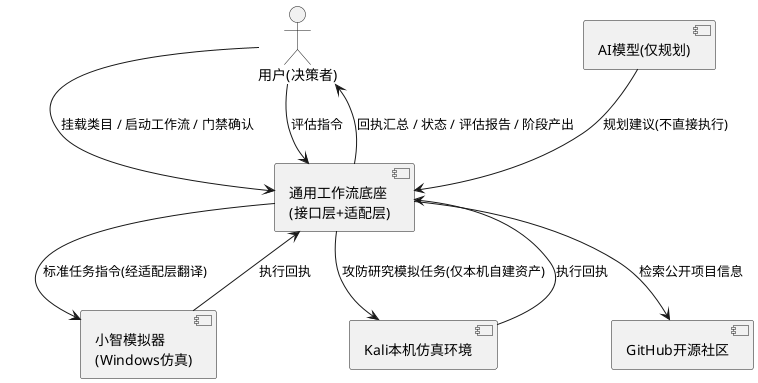
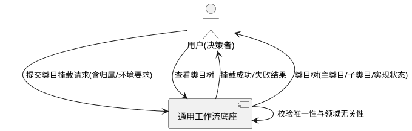
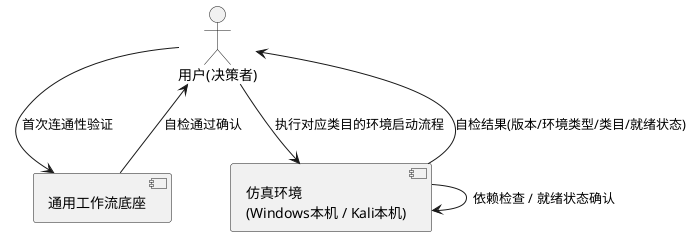
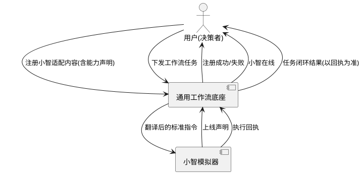
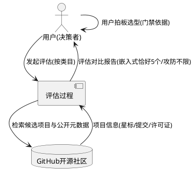
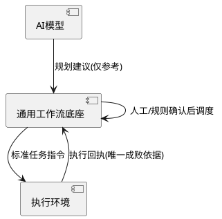

# 通用工作流底座需求规格（device_workflow_api）

> 本文档是"通用工作流底座 + 三类目（嵌入式含家电维修子类、攻防研究模拟）+ 小智首例跑通"的需求规格，采用 EARS 句式（When / While / Where / If + 系统应当）描述验收条件。全文使用大白话，不出现函数名、文件名、代码。本阶段为需求规格阶段，用户同意前不进入实现方案、不写任何代码。
>
> 版本说明：本文档在上一版"通用设备工作流接口"规格基础上重做扩展，定位由"设备接口层"升级为"多领域工作流底座"。
>
> 增量修订记录：
> - v1.1 原地增量补充（不打回重做）——① 攻防现成工具补入 Tor 洋葱浏览器与开发者边车（2、5.5）；② 隔离环境说明补入"优先使用官方开源靶场（DVWA、WebGoat 举例）"（2、5.2）；③ 新增攻防环境准备动作条款（仅下载与配置，不含任何攻击执行动作）（2、5.2）；④ 安全性章节重申"四不红线"（4.3）。
> - v2.0 环境约束全面放宽——① 取消多层嵌套隔离，Windows/Kali 本机直接运行，"隔离仿真环境"全面改称"本机仿真环境"（2、3、5.2、5.5、6）；② 隔离声明前置校验重构为轻量就绪校验（工具/服务就绪即可跑）（4.3.1、5.2.1、5.5.1）；③ Tor 与开发者边车改为本机直接安装，定位与限定用途不变（2、5.2）；④ 官方开源靶场改为本地离线部署（2、5.2）；⑤ "四不红线"与"禁止真实外连公网目标"红线原样保留并继续可验收（4.3）。

# **1. 组件定位**

## **1.1 核心职责**
本组件负责提供通用工作流底座，把不同领域（嵌入式开发、攻防研究模拟等）的工作流按统一方式挂载、调度并回收执行回执，实现"接口层与适配层自研、底层复用现成方案、新类目即插即用"的可扩展运行框架。

## **1.2 核心输入**
1. **用户操作指令**：来自用户（决策者）的类目挂载请求、工作流启动/暂停/查询请求、评估任务指令、阶段门禁确认或驳回意见。
2. **类目与工作流定义信息**：来自各领域类目接入方的注册信息，包括类目归属、能力声明、执行环境要求。
3. **执行环境回执**：来自仿真环境（Windows 本机仿真或 Kali 本机仿真环境）的任务执行结果通知，底座不直接控制执行过程。
4. **开源候选项目信息**：来自 GitHub 等公开渠道的项目清单与元数据，用于选型评估对比。
5. **模型规划建议**：来自 AI 模型的任务规划建议（仅建议，不直接执行）。

## **1.3 核心输出**
1. **调度指令**：经适配层翻译后送达执行环境的标准化任务指令。
2. **回执汇总与状态呈现**：向用户呈现工作流实例的执行进度、结果与失败原因。
3. **选型评估报告**：面向各领域类目的开源方案对比评估文档，供用户拍板。
4. **阶段产出交付**：按门禁流程向用户提交各阶段文档产出（含本规格文档），等待确认。
5. **类目注册结果**：新类目挂载成功/失败的明确反馈。

## **1.4 职责边界**
1. **不写底层全量代码**：底层能力一律复用现成开源方案，本组件只构建接口层与适配层；任何具体领域的底层实现都不属于本组件。
2. **不直控模型**：AI 模型只负责输出规划建议，禁止由模型直接操控执行；一切执行必须经底座调度并靠回执确认。
3. **不触碰真实第三方目标**：攻防类目仅限本机仿真环境内的研究模拟（模拟对象仅限本机自建资产），本组件不提供、不协助构建任何对外真实攻击基础设施。
4. **不做真机联调**：本阶段无真实硬件，全部验证基于仿真环境；真实设备接入属后续阶段。
5. **家电维修本阶段不实现**：仅作为嵌入式类目的子类目预留挂载接口，不实现任何具体功能。
6. **不替用户做决策**：开源选型、方案取舍、阶段推进均由用户拍板，底座只提供评估材料与执行能力。
7. **不做云端业务系统**：账号体系、计费、多租户等不属于本组件。

# **2. 领域术语**

**工作流底座（Workflow Base）**
: 承载各领域工作流的公共运行框架，提供类目挂载、任务调度、回执回收与扩展接口，自身不含任何特定领域的业务逻辑。

**领域类目（Category）**
: 挂在底座上的一个业务领域分支，本阶段共两个主类目：嵌入式开发、黑客与白客攻防研究。新类目以后可直接挂载。

**子类目（Sub-Category）**
: 挂在某主类目之下的二级领域分支，如"家电维修"归属"嵌入式开发"之下。

**工作流实例（Workflow Instance）**
: 某个类目下的一次具体任务运行过程，例如"小智仿真跑通"是嵌入式类目下的第一个工作流实例。

**适配层（Adapter Layer）**
: 连接底座标准指令与底层现成方案之间的转换层；每个领域类目对应自己的适配内容，底座核心不因类目不同而改变。

**执行回执（Receipt）**
: 执行环境完成（或失败）一个任务后返回给底座的结果通知，是判定任务闭环的唯一依据。

**仿真环境（Simulation Environment）**
: 在无真实硬件、无真实网络目标的条件下模拟任务执行的本地运行环境。分两种：Windows 本机仿真环境（嵌入式类目首选，攻防类目允许的等效环境）和 Kali 本机仿真环境（攻防类目主用、嵌入式回退可用）；两者均为本机直接运行，不强制虚拟机嵌套隔离。

**小智（XiaoZhi）**
: 小智 AI 语音终端，本项目第一个接入的示例对象，本阶段以仿真形态在 Windows 上跑通"注册—下发—执行—回执"全流程。

**攻防研究模拟（Security Research Simulation）**
: 在本机仿真环境内，对真实公开案例的特征进行复盘式研究，并同步产出防御检测思路的活动；只做研究模拟，不是玩具，更不是真实攻击。

**正例案例（Positive Case）**
: 攻防研究中用来学习攻击路径特征的成熟真实案例，本阶段指西北工业大学被攻击事件、国家授时中心被攻击事件中公开报道的特征（路由出入口控制、内网潜伏、跳板肉鸡）。

**反例案例（Negative Case）**
: 攻防研究中用来学习"为什么会被发现"的失败案例，本阶段指业余肉鸡控制、不藏行踪等暴露特征案例。

**白客防御视角（Defender Perspective)**
: 与攻击模拟并列产出的防御方分析，包括检测方法、加固建议；每个攻击模拟场景必须配对一个防御产出。

**选型评估报告（Evaluation Report）**
: 对候选开源方案按统一维度对比打分的结构化文档，只含对比结论与推荐理由，不含最终决策。

**门禁（Gate）**
: 用户设置的阶段确认关卡；每个阶段的产出必须经用户同意才能进入下一阶段，未过门禁时禁止任何越阶段动作。

**模型规划（Model Planning）**
: AI 模型输出的任务分解与执行步骤建议；仅作为调度参考，不具备直接执行权力。

**官方开源靶场（Official Open-source Range）**
: 由官方开源社区维护、允许自由获取并可在本机离线部署的合法攻防练习靶场，本阶段以 DVWA、WebGoat 为典型示例。
: 备注：攻防模拟只允许使用这类靶场；禁止使用私人靶场或来源不明的靶场，不接触真实外网资产。

**环境准备动作（Environment Preparation）**
: 攻防类目中仅为"从官方渠道获取安装包或源码仓库、在本机完成安装配置并校验就绪"的下载与配置类动作。
: 备注：环境准备阶段禁止执行任何攻击动作；就绪校验通过只是"可以开始模拟"的前置条件，不是攻击授权。

**Tor 洋葱浏览器（Tor Browser）**
: 从 Tor 官方开源项目渠道获取的通信隐匿工具，在本机直接安装后仅用于通信隐匿原理演示（演示方式不含任何真实外连步骤）。
: 备注：禁止真实外连公网目标；本阶段不真实外连任何公网资产。

**开发者边车（dev-sidecar）**
: 从 GitHub 官方仓库获取的开源本地代理工具，在本机直接安装后仅作为攻防类目本地代理的前置条件。
: 备注：禁止用于真实公网穿透。

# **3. 角色与边界**

## **3.1 核心角色**
- **用户（决策者/拍板人）**：下发各类操作指令、审阅评估报告并拍板选型、审阅阶段产出并通过门禁；对一切方案取舍拥有最终决策权。

## **3.2 外部系统**
- **小智模拟器（仿真设备）**：模拟语音终端的指令接收与结果上报行为，是嵌入式类目的首个被接入对象。
- **Kali 本机仿真环境**：攻防类目的主用运行环境，也是嵌入式类目在 Windows 方案不可行时的回退环境；本机直接运行，模拟目标仅限本机自建资产。
- **GitHub 开源社区**：候选开源方案、现成底层组件、官方开源合法靶场（如 DVWA、WebGoat）与攻防现成工具（Tor 官方开源项目、开发者边车官方仓库）的来源，评估引用其公开元数据。
- **AI 模型**：仅提供任务规划建议，不执行、不直控。
- **现成开源底层组件**：被适配层复用的各类现成方案，底座不重写其内部实现。

## **3.3 交互上下文**



# **4. DFX约束**

## **4.1 性能**
以下指标均为仿真环境本机指标，非生产指标：
1. 标准任务从底座下发到执行环境开始处理的端到端时延 ≤ 1 秒。
2. 状态查询响应 ≤ 500 毫秒。
3. 底座须支持多个类目同时挂载运行（本阶段验收仅要求嵌入式 1 个实例跑通）。

## **4.2 可靠性**
1. 单个类目或单个工作流实例故障不得影响底座对其他类目/实例的处理。
2. 执行环境断连后，底座须在 5 秒内将相关实例标记为中断并产生通知。
3. 回执未按时到达时，须支持用户手动重查任务状态，不允许任务状态永久悬空。
4. 底座进程重启后，已挂载类目信息须可恢复（任务执行状态不要求恢复，恢复边界须在文档中标注）。

## **4.3 安全性（安全合规红线，全文最高优先级约束）**
1. **本地运行红线**：攻防类目的全部活动仅限本机仿真环境（Windows 或 Kali 本机直接运行，不强制虚拟机嵌套隔离）内进行。
   - 验收条件：[启动任一攻防模拟任务] → [底座先校验运行环境就绪自检通过（工具/服务就绪），校验通过才放行]
2. **真实目标红线**：禁止触碰任何真实第三方目标；模拟对象只能是本机仿真环境内自建的资产（本机回环或本机局域网内自建服务）。
   - 验收条件：[任务指令中出现任何外部真实目标] → [立即拒绝并告警，不产生任何外发动作]
3. **基础设施红线**：禁止构建对外的真实攻击基础设施。
   - 验收条件：[任一攻防模拟场景配置] → [其网络连接目标仅覆盖本机自建资产，禁止任何指向真实公网目标的连接]
4. **用途限定红线**：所有攻击手法仅以"案例特征研究 → 防御检测"用途呈现；禁止输出可直接照搬用于真实攻击的操作手册式内容。
   - 验收条件：[任一攻击模拟场景产出] → [同时包含"特征分析"与"防御检测方法"两部分，缺防御部分视为不合规]
5. **白客并列红线**：白客防御视角必须与攻击模拟并列覆盖，不允许只攻不防。
   - 验收条件：[每个攻击模拟场景完成] → [存在一一对应的防御视角产出（检测方法/加固建议）]
6. 本阶段底座接口仅在本机回环地址可用，禁止默认监听外部网卡。
7. 类目与实例注册必须携带全局唯一标识，底座须校验唯一性。
8. 接口契约须预留鉴权扩展点（本阶段可不启用，但必须可插入）。
9. 评估报告引用的信息须来自公开页面，禁止抓取需登录的私有数据。
10. **四不红线（安全红线重申）**：禁止真实入侵、禁止控制真实肉鸡、禁止混用真实虚拟币、禁止隐匿真实服务器；所有攻防动作一律在本机仿真环境内进行、模拟对象仅限本机自建资产，模型只规划不直控。
   - 验收条件：[任一攻防模拟场景] → [场景明确声明不涉及真实入侵、真实肉鸡、真实虚拟币、真实服务器隐匿四项；任一项涉及真实资产或真实行为即拒绝执行，且全程无模型直控通道]

## **4.4 可维护性**
1. 代码主栈为 Python（项目无 Java 环境），代码命名使用英文，文档使用简体中文。
2. 接口契约必须带版本号；本阶段为 v1。
3. 新类目接入只允许"新增适配内容"，禁止修改底座核心；此约束须可在仿真环境验证。
4. 所有限制性验收条件（EARS 条款）须可在仿真环境中以可复现方式验证。

## **4.5 兼容性**
1. 新领域类目必须且只能通过统一挂载接口接入，禁止为接入新类目而修改底座核心或既有类目。
2. 后续机械臂、水下机器人、家电维修等新对象接入时，底座核心零改动。
3. 接口契约变更必须向后兼容；不兼容变更必须升版本号。

# **5. 核心能力**

## **5.1 类目挂载与扩展注册（底座扩展机制）**

### **5.1.1 业务规则**
1. **统一挂载规则**：When 用户提交新类目的挂载请求，系统应当通过统一挂载接口完成注册，且全程不修改底座核心。
   - 验收条件：[挂载一个新类目] → [类目出现在类目列表中，底座核心零改动]
2. **子类目归属规则**：Where 类目声明了父类目，系统应当将其登记为该父类目之下的子类目。
   - 验收条件：[家电维修声明归属嵌入式开发] → [类目树中家电维修显示为嵌入式的子类目]
3. **仅预留接口规则**：When 类目声明为"仅预留接口"形态，系统应当只登记其挂载信息并标记为未实现状态，拒绝任何针对它的启动请求。
   - 验收条件：[启动家电维修子类目的工作流] → [拒绝并提示"本阶段仅预留接口，未实现"]
4. **领域无关规则（禁止项）**：底座禁止内嵌任何特定领域的业务逻辑；领域差异只允许存在于适配层。
   - 验收条件：[接入全新领域类目] → [无需修改底座，仅新增适配内容即可完成挂载]
5. **标识唯一规则**：If 挂载请求携带的类目标识与已挂载类目重复，系统应当拒绝该请求并返回冲突说明，不得覆盖既有类目。
   - 验收条件：[重复类目标识挂载] → [挂载失败，原类目信息保持不变]

### **5.1.2 交互流程**



### **5.1.3 异常场景**
1. **重复挂载冲突**
   - 触发条件：类目标识与已挂载类目重复。
   - 系统行为：拒绝新挂载，返回冲突。
   - 用户感知：提示标识已存在，引导换标识或先卸载。
2. **归属父类目不存在**
   - 触发条件：子类目声明的父类目尚未挂载。
   - 系统行为：拒绝挂载并说明缺失的父类目。
   - 用户感知：提示先挂载父类目再挂载子类目。
3. **挂载信息不全**
   - 触发条件：挂载请求缺少归属、环境要求等必要信息。
   - 系统行为：拒绝挂载，已挂载类目不受影响。
   - 用户感知：错误信息指明缺失项及补全方式。

## **5.2 仿真环境管理（Windows 优先 / Kali 分工）**

### **5.2.1 业务规则**
1. **Windows 优先规则（嵌入式）**：When 嵌入式类目工作流在 Windows 本机运行（Windows 10 + Python 3.11），系统应当提供本机直接启动仿真环境的完整流程，且不得强制要求 Linux。
   - 验收条件：[Windows 本机执行启动流程] → [小智模拟器与底座成功启动并通过自检]
2. **Kali 回退规则（嵌入式）**：If Windows 原生方案存在不可逾越的兼容性障碍，系统应当提供 Kali 本机环境中的等效方案，且两套方案的业务行为一致。
   - 验收条件：[Windows 某依赖无法落地] → [Kali 内等效流程跑通同样的挂载与任务下发]
3. **Kali 主用规则（攻防）**：When 攻防类目工作流启动，系统应当主用 Kali 本机仿真环境运行（本机直接运行，不再强制虚拟机嵌套隔离），Windows 本机仿真环境为允许的等效环境（按类目适配声明路由）。
   - 验收条件：[启动攻防模拟任务] → [任务实际运行环境为已就绪的本机仿真环境（Kali 主用/Windows 等效），且环境自检结果可见]
4. **环境自检规则**：When 仿真环境启动完成，系统应当输出自检结果，覆盖：Python 版本、环境类型（Windows/Kali）、已挂载类目清单、运行环境类型与就绪状态（攻防环境必须输出）。
   - 验收条件：[启动完成] → [自检逐项给出通过/失败结论]
5. **禁止项**：禁止将仿真任务的执行依赖建立在本机自建资产之外的真实目标上（工具与依赖的官方渠道获取除外）。
   - 验收条件：[全新机器仅装 Python 后按文档执行] → [嵌入式仿真环境可独立启动；攻防仿真环境在本机独立启动]
6. **官方靶场优先规则（攻防）**：When 攻防模拟需要靶场环境，系统应当优先使用官方开源合法靶场（如 DVWA、WebGoat）在本机离线部署；If 靶场为私人搭建或来源不明，系统应当拒绝启动相关任务。
   - 验收条件：[攻防模拟任务配置靶场] → [靶场来源为官方开源项目且本机离线运行；私人靶场或来源不明靶场一律拒绝]
7. **环境准备定位规则（禁止项）**：攻防类目的环境准备动作仅限"从官方渠道获取安装包或源码仓库、在本机完成安装、完成配置并校验就绪"四类下载与配置动作；环境准备阶段禁止执行任何攻击动作。
   - 验收条件：[环境准备阶段执行] → [仅发生获取、安装、配置、就绪校验动作，无任何攻击执行动作]
8. **Tor 获取与限定规则**：When 攻防类目准备通信隐匿原理演示环境，系统应当从 Tor 官方开源项目渠道获取安装包并在本机直接安装，且 Tor 仅用于通信隐匿原理演示，禁止真实外连公网目标。
   - 验收条件：[Tor 环境准备完成] → [来源为官方开源项目、安装在本机、用途标注为原理演示且演示方式不含任何真实外连步骤；模拟任务配置中出现任何指向真实公网目标的连接请求被拒绝并告警]
9. **开发者边车获取与限定规则**：When 攻防类目准备本地代理前置条件，系统应当从 GitHub 官方仓库获取开发者边车项目并在本机直接安装，且仅作为攻防类目本地代理的前置条件，禁止用于真实公网穿透。
   - 验收条件：[开发者边车环境准备完成] → [来源为 GitHub 官方仓库、安装在本机、用途标注为本地代理前置条件；任何真实公网穿透用途的使用请求被拒绝并告警]
10. **环境就绪校验规则**：When 攻防类目环境准备完成，系统应当输出就绪自检结果（安装来源、所在环境、限定用途），且就绪校验存在未通过项时对应的攻防任务一律禁止启动。
    - 验收条件：[任一攻防任务启动前] → [其依赖的环境准备项就绪自检全部通过；存在未通过项则拒绝启动]

### **5.2.2 交互流程**



### **5.2.3 异常场景**
1. **Windows 方案启动失败（嵌入式）**
   - 触发条件：某依赖在 Windows 上无法安装或运行异常。
   - 系统行为：记录失败原因，切换至 Kali 等效方案，行为保持一致。
   - 用户感知：提示"Windows 方案不可用原因 + 回退方案执行指引"。
2. **Kali 环境不可用（攻防）**
   - 触发条件：攻防任务启动时 Kali 本机仿真环境未就绪。
   - 系统行为：拒绝启动任务；是否切换至 Windows 本机等效环境由用户决策，切换后业务行为保持一致。
   - 用户感知：提示"Kali 环境未就绪，任务已拒绝；可按用户决策切换等效环境"。
3. **就绪校验未通过**
   - 触发条件：环境自检无法确认工具/服务就绪状态。
   - 系统行为：依赖该项的攻防类任务一律拒绝放行。
   - 用户感知：提示"环境未就绪，任务已拒绝"，并指明未就绪项及补齐方式。
4. **官方渠道获取失败**
   - 触发条件：Tor 安装包或开发者边车仓库无法从官方渠道获取。
   - 系统行为：标记该项环境准备失败并如实记录原因，禁止改用非官方或来源不明的替代渠道。
   - 用户感知：提示"官方渠道获取失败 + 具体原因"，等待官方渠道恢复或由用户决策是否调整。
5. **准备工具用途越界**
   - 触发条件：Tor 出现指向公网目标的真实连接请求，或开发者边车出现真实公网穿透行为。
   - 系统行为：立即阻断并告警，记录拦截日志，相关环境标记为不合规。
   - 用户感知：明确提示用途越界已阻断；环境需重新校验通过后才可继续使用。

## **5.3 小智仿真实例跑通（嵌入式类目首例）**

### **5.3.1 业务规则**
1. **适配接入规则**：Where 类目提供适配内容，系统应当仅通过注册适配内容完成对象接入，接入过程不得修改底座既有部分。
   - 验收条件：[小智模拟器 + 小智适配内容注册] → [小智出现在实例列表，底座核心零改动]
2. **跑通闭环规则**：When 小智模拟器完成注册且在线，系统应当支持对其下发至少一个完整工作流任务并收到执行回执（本阶段"跑通"的验收标准）。
   - 验收条件：[注册成功 + 下发一个任务] → [模拟器执行并回传成功/失败回执，闭环完成]
3. **单实例规则**：本阶段只要求跑通 1 个工作流实例（小智仿真）；底座具备多实例能力，但多实例验证留待后续阶段。
   - 验收条件：[本阶段验收] → [小智 1 个实例全流程闭环即达标，不以多实例为验收门槛]
4. **能力声明规则**：对象注册时必须提交能力声明（支持的动作清单、参数范围、可上报事件类型）；缺失则拒绝注册。
   - 验收条件：[注册请求缺能力声明] → [拒绝注册并返回缺失项说明]
5. **任务路由规则**：When 用户提交指向已注册在线对象的任务，系统应当校验任务动作在该对象能力声明范围内，再经适配层送达执行环境。
   - 验收条件：[动作在能力范围内 + 对象在线] → [任务受理并返回任务标识]
6. **越界拒绝规则**：If 任务动作超出对象能力声明，系统应当拒绝该任务且不得向适配层转发。
   - 验收条件：[向小智下发能力之外的动作] → [拒绝并返回"动作不受支持"及能力清单]
7. **离线拒绝规则**：If 目标对象离线，系统应当拒绝任务下发并返回离线错误（本阶段不做排队重投）。
   - 验收条件：[对象离线时下发任务] → [立即返回失败，错误含对象当前状态]
8. **回执闭环规则（执行靠回执）**：While 任务处于执行中，系统应当以执行环境返回的回执作为任务成败的唯一判定依据；回执未到达前任务保持"执行中"状态，禁止凭猜测标记成功。
   - 验收条件：[执行环境未返回回执] → [任务状态保持执行中并支持手动重查]
9. **事件回传规则**：系统应当将执行环境产生的标准化结果按产生顺序回传给用户。
   - 验收条件：[模拟器连续产生 N 个结果] → [用户按序收到 N 个结果]
10. **后续扩展预留规则**：机械臂、水下机器人等对象本阶段不实现，仅依赖 5.1 的统一挂载机制预留接入点。
    - 验收条件：[查看类目树] → [扩展接入点存在且标注为后续阶段]

### **5.3.2 交互流程**



### **5.3.3 异常场景**
1. **目标对象不存在**
   - 触发条件：任务指向未注册的对象标识。
   - 系统行为：拒绝任务，不产生任何执行侧动作。
   - 用户感知：错误指明"对象未注册"。
2. **模拟器中途崩溃**
   - 触发条件：小智模拟器在任务执行中异常退出。
   - 系统行为：5 秒内标记中断并产生通知；进行中任务标记为失败；底座其他功能不受影响。
   - 用户感知：收到中断通知与任务失败原因。
3. **回执超时**
   - 触发条件：任务长期处于执行中且回执未到达。
   - 系统行为：允许用户手动重查；重查仍无结果时提示回执缺失。
   - 用户感知：任务状态可查、不悬空，缺失原因可见。
4. **适配翻译失败**
   - 触发条件：适配层无法将标准任务翻译为执行动作。
   - 系统行为：任务标记失败并记录原因，底座保持可用。
   - 用户感知：收到失败及"适配翻译失败"原因。

## **5.4 开源方案评估对比（选型支持）**

### **5.4.1 业务规则**
1. **嵌入式数量规则**：本阶段嵌入式类目的评估交付必须覆盖恰好 5 个最相关的 GitHub 开源项目，不多不少。
   - 验收条件：[嵌入式评估报告完成] → [恰好 5 个项目，每个附仓库地址与评估数据]
2. **攻防评估规则**：攻防类目必须同步评估现成可用方案（有现成用现成、没现成手搓），评估数量不限于 5 个；评估结论须给出"建议用现成 / 建议手搓"的分项依据。
   - 验收条件：[攻防评估报告完成] → [每个评估对象附"现成可用性"结论；若整体倾向手搓，须说明筛选后无可用的依据]
3. **评估维度规则**：嵌入式评估维度至少包括：① 对象抽象与适配模式成熟度；② Python 生态契合度；③ 社区活跃度（星标、最近提交、问题处理）；④ 向机械臂/水下机器人等扩展的可行性；⑤ 许可证与商用限制。攻防评估维度至少包括：① 与 Kali 生态契合度；② 本地离线可部署性；③ 社区活跃度；④ 防御工具覆盖度；⑤ 许可证。
   - 验收条件：[任一项目条目] → [所属类目的各维度均有评分与可核对的公开依据]
4. **决策归属规则（禁止项）**：评估产出禁止包含替用户做出的最终选型决定；报告只能给出对比结论与推荐理由，用户拍板前禁止引入任何依赖。
   - 验收条件：[报告完成] → [无"已选定某项"表述；存在"待用户决策"的明确标注]
5. **相关性规则**：入选项目必须与对应类目目标直接相关，禁止凑数无关项目。
   - 验收条件：[每个入选项目] → [附一句与本项目目标的相关性说明]

### **5.4.2 交互流程**



### **5.4.3 异常场景**
1. **嵌入式候选不足 5 个**
   - 触发条件：严格相关性筛选后候选不足 5 个。
   - 系统行为：放宽检索词并扩大范围，如实说明筛选过程，禁止凑数。
   - 用户感知：报告呈现"实际候选数 + 筛选标准 + 扩大检索说明"。
2. **攻防方案全不可用**
   - 触发条件：攻防现成方案筛选后均不满足本地部署与合规要求。
   - 系统行为：报告如实给出"建议手搓"结论及依据，不硬凑推荐。
   - 用户感知：可见逐项不可用原因。
3. **元数据获取失败**
   - 触发条件：某候选仓库不可访问或数据不全。
   - 系统行为：标注缺失项，不编造数据，缺失维度记为"无法评估"。
   - 用户感知：报告中该维度显示缺失原因。
4. **评估时效风险**
   - 触发条件：报告完成后较长时间未决策。
   - 系统行为：报告标注数据快照日期供判断是否刷新。
   - 用户感知：报告首页可见快照日期。

## **5.5 攻防研究模拟（独立类目，防御导向）**

### **5.5.1 业务规则**
1. **就绪前置校验规则**：When 任一攻防模拟任务启动，系统应当先校验其运行环境已完成就绪自检（工具/服务就绪即可跑，不再强制虚拟机嵌套隔离），校验不通过一律拒绝。
   - 验收条件：[环境未就绪或就绪状态未知] → [任务拒绝启动，零执行动作]
2. **目标范围规则**：模拟对象必须且只能是本机仿真环境内自建的资产；系统应当拒绝任何指向真实第三方目标的任务。
   - 验收条件：[任务配置中出现外部真实目标] → [拒绝并告警，记录拦截日志]
3. **案例特征研究规则（正例）**：When 用户发起正例案例研究，系统应当以"特征复盘 → 防御检测点提炼"的方式组织模拟，覆盖公开报道的特征要素（路由出入口控制、内网潜伏、跳板肉鸡），不还原可直接复用的攻击操作。
   - 验收条件：[正例模拟完成] → [产出为案例特征归纳与对应防御检测点，无可直接照搬的攻击步骤]
4. **暴露特征研究规则（反例）**：When 用户发起反例案例研究，系统应当以"为什么会暴露 → 如何被检测"的方式组织模拟，覆盖业余肉鸡控制、不藏行踪等暴露特征。
   - 验收条件：[反例模拟完成] → [产出为暴露特征清单与对应检测规则思路]
5. **四维度覆盖规则**：攻防类目的模拟场景必须覆盖四个维度：通讯隐匿（如电报式沟通）、服务器隐匿（非中心服务器、工业互联网方案）、资金安全（虚拟币混币的原理层面研究）、Tor 浏览器测试（本机环境内的行为特征测试，仅限本地演示）。
   - 验收条件：[攻防类目验收] → [四个维度各有至少一个模拟场景，且场景标注所属维度]
6. **防御并列规则**：每个攻击模拟场景必须一一配对产出防御视角内容（检测方法、加固建议），白客防御与攻击模拟同等覆盖。
   - 验收条件：[任一攻击模拟场景] → [存在对应防御产出；缺失即判定不合规]
7. **现成优先规则**：When 某模拟维度存在现成可用方案，系统应当优先复用现成方案；If 无现成可用，才允许在本机环境内自行搭建，且搭建产物仍受红线约束。
   - 验收条件：[任一模拟维度] → [报告标明"复用现成/自行搭建"及依据]
8. **基础设施禁止规则（禁止项）**：禁止构建任何对外的真实攻击基础设施；模拟所需的全部资源（网络、服务、数据）仅存在于本机自建范围内。
   - 验收条件：[任一模拟场景的资源配置] → [连接目标仅覆盖本机自建资产；出现指向真实第三方目标的配置即拒绝并告警]
9. **独立类目规则**：攻防类目作为独立主类目接入底座，享受与嵌入式类目同等的挂载、调度、回执机制，不与嵌入式类目共享业务逻辑。
   - 验收条件：[查看类目树] → [攻防为独立主类目，与嵌入式平级]
10. **现成工具清单规则**：When 攻防类目呈现现成工具清单或开展环境准备，系统应当将 Tor 洋葱浏览器与开发者边车纳入现成工具清单，并逐项标注来源渠道与限定用途。
    - 验收条件：[攻防现成工具清单呈现] → [包含 Tor（来源：Tor 官方开源项目，限定用途：通信隐匿原理演示）与开发者边车（来源：GitHub 官方仓库，限定用途：本地代理前置条件），且来源与限定用途标注可见]

### **5.5.2 交互流程**

```plantuml
@startuml
actor "用户(决策者)" as User
component "通用工作流底座" as Base
component "本机仿真环境\n(Kali主用/Windows等效)" as SecEnv

User --> Base : 发起攻防研究模拟(指定案例/维度)
Base --> Base : 红线校验(就绪状态/目标范围/用途限定)
alt 校验通过
  Base --> SecEnv : 模拟任务(仅本机自建资产)
  SecEnv --> Base : 执行回执
  Base --> User : 案例特征分析 + 配对防御检测产出
else 校验失败
  Base --> User : 拒绝(原因:环境未就绪/目标越界/用途不符)
end
@enduml
```

### **5.5.3 异常场景**
1. **环境未就绪**
   - 触发条件：攻防任务启动时目标环境就绪自检未通过。
   - 系统行为：立即拒绝，不产生任何动作。
   - 用户感知：提示"按安全红线拒绝，请先完成环境就绪校验"。
2. **误配真实目标**
   - 触发条件：模拟任务配置中出现真实第三方目标。
   - 系统行为：阻断任务并告警，记录拦截日志。
   - 用户感知：明确提示目标越界，禁止放行。
3. **防御产出缺失**
   - 触发条件：某攻击模拟场景完成但未产出对应防御内容。
   - 系统行为：判定该场景不合规，要求补齐后才计入验收。
   - 用户感知：提示"防御视角缺失，场景验收不通过"。
4. **模拟任务越出四维度**
   - 触发条件：用户发起的模拟不属于四个既定维度。
   - 系统行为：提示该维度暂未定义，拒绝执行或引导先补充维度定义。
   - 用户感知：可见当前支持的维度清单。

## **5.6 阶段门禁与产出交付**

### **5.6.1 业务规则**
1. **门禁确认规则**：When 任一阶段产出完成，系统应当呈现给用户并明确等待确认；未获用户同意前，禁止进入下一阶段。
   - 验收条件：[阶段产出完成] → [处于"等待用户确认"状态，下一阶段任务不启动]
2. **零代码门禁规则**：本阶段（需求规格阶段）在用户同意本规格前，绝对不写任何实现代码、不生成任何代码文件。
   - 验收条件：[规格未获同意] → [仅存在文档类产出，无任何代码产出]
3. **产出形式规则**：各阶段文档产出必须使用大白话，禁止出现函数名、文件名、代码片段。
   - 验收条件：[任一阶段文档] → [通篇无函数名/文件名/代码]
4. **驳回处理规则**：If 用户驳回某阶段产出，系统应当按驳回意见修订后重新呈现，修订期间维持当前阶段不推进。
   - 验收条件：[用户提出修改意见] → [修订并重新提交确认，阶段不越界推进]

### **5.6.2 交互流程**

```plantuml
@startuml
actor "用户(决策者)" as User
component "通用工作流底座(流程控制)" as Base

Base --> User : 提交阶段产出(如本需求规格)
User --> Base : 同意/驳回(附意见)
alt 同意
  Base --> Base : 开放下一阶段(进入实现方案)
else 驳回
  Base --> Base : 按意见修订并重新提交(不推进)
end
@enduml
```

### **5.6.3 异常场景**
1. **越阶段请求**
   - 触发条件：用户未确认前一阶段即要求开始下一阶段。
   - 系统行为：拒绝并提示先完成当前阶段确认。
   - 用户感知：明确提示当前门禁未通过。
2. **文档混入代码内容**
   - 触发条件：文档产出中出现函数名、文件名或代码片段。
   - 系统行为：视为不合格产出，改写为纯大白话后重新提交。
   - 用户感知：收到的文档始终为纯业务描述。

## **5.7 模型规划与回执边界**

### **5.7.1 业务规则**
1. **模型只规划规则**：When AI 模型给出任务规划建议，系统应当将其仅作为调度参考；模型禁止直接操控任何执行环境。
   - 验收条件：[模型输出规划建议] → [建议进入人工/底座调度流程，执行前存在确认或校验环节]
2. **回执权威规则**：任务成败判定只认执行环境返回的回执，规划、指令、模型意见都不能替代回执。
   - 验收条件：[任何任务] → [只有收到回执才标记成功/失败]
3. **底层复用规则（禁止项）**：禁止重写底层现成方案的内部实现；自研范围限定在接口层与适配层。
   - 验收条件：[任一底层能力] → [来源为现成方案复用，自研代码仅出现在接口层/适配层]

### **5.7.2 交互流程**



### **5.7.3 异常场景**
1. **模型建议越权**
   - 触发条件：模型输出包含直接执行动作的内容。
   - 系统行为：剥离执行部分，仅保留规划建议进入调度流程。
   - 用户感知：执行始终经过底座调度，无直控通道。
2. **回执与预期不符**
   - 触发条件：回执结果与规划预期不一致。
   - 系统行为：以回执为准更新任务状态，标记差异供用户查看。
   - 用户感知：看到真实结果与差异说明，不被规划误导。

# **6. 数据约束**

## **6.1 类目注册信息**
1. **类目标识**：全局唯一、非空，同一生命周期内不可复用给不同类目。
2. **类目层级**：必须标明主类目或子类目；子类目必须指明所属父类目，且父类目须已挂载。
3. **实现状态**：仅允许"已实现 / 仅预留接口"两种取值；"仅预留接口"的类目禁止启动工作流。
4. **环境要求**：必须标明运行环境类型（Windows 本机仿真 / Kali 本机仿真）；攻防类目主用 Kali 本机仿真，Windows 本机仿真为允许的等效环境。

## **6.2 工作流实例信息**
1. **实例标识**：由底座生成，全局唯一。
2. **所属类目**：必须指向已挂载且状态为"已实现"的类目。
3. **能力声明**：注册时必填，至少包含动作清单、每动作参数范围、可上报结果类型三项。
4. **实例状态**：仅允许"待启动 / 执行中 / 成功 / 失败 / 中断"五种取值；成败只能由回执驱动变更。
5. **失败原因**：状态为失败或中断时必须附带原因说明。

## **6.3 执行回执**
1. **关联实例**：必须指向一个已存在的工作流实例。
2. **结果结论**：必须为成功或失败之一，禁止空结论。
3. **时间戳**：由底座在接收回执时统一打标（仿真阶段为本地时钟）。
4. **内容载体**：回执内容必须可序列化为文本格式，便于呈现与排查。

## **6.4 选型评估报告**
1. **类目标注**：每份报告必须标明所属类目（嵌入式 / 攻防）。
2. **条目数量**：嵌入式类目报告条目数必须恰好为 5；攻防类目报告条目数不限（可为 0 条，但须附"无可行现成方案"的筛选依据）。
3. **条目内容**：每条必须包含项目名、仓库地址、所属类目的各维度评分、各维度依据与相关性说明。
4. **决策状态**：必须为"待用户决策"，禁止出现替用户确定的最终选型结论。
5. **快照日期**：必须标注评估数据采集日期。

## **6.5 攻防模拟场景信息**
1. **场景标识**：全局唯一、非空。
2. **所属维度**：必须属于四个既定维度之一（通讯隐匿 / 服务器隐匿 / 资金安全 / Tor 浏览器测试）。
3. **案例归属**：必须标明正例或反例及其对应公开案例名称。
4. **环境标识**：必须为"本机仿真环境"（Windows/Kali 本机直接运行），且标注目标范围为"仅本机自建资产"。
5. **防御配对**：必须关联一个防御视角产出（检测方法或加固建议）；无配对防御产出的场景不得标记为完成。
6. **实现方式**：必须标明"复用现成 / 自行搭建"及依据。
7. **工具来源与限定**：场景引用的现成工具必须标注来源渠道（官方开源项目 / GitHub 官方仓库）与限定用途；Tor 限通信隐匿原理演示，开发者边车限本地代理前置条件；未标注或越界引用的场景不得标记为完成。

## **6.6 门禁状态记录**
1. **阶段名称**：必须为既定阶段之一（需求规格 / 实现方案 / 后续阶段）。
2. **产出物引用**：必须指向已完成的阶段产出文档。
3. **确认状态**：仅允许"等待确认 / 已同意 / 已驳回"三种取值；"已同意"前下一阶段禁止启动。
4. **驳回意见**：状态为已驳回时必须记录用户的修改意见原文。