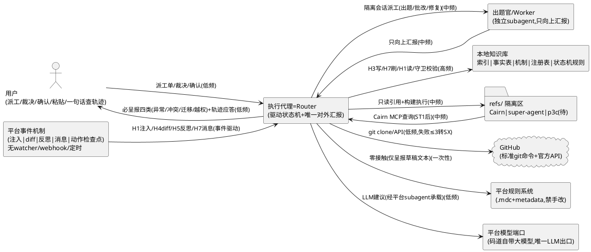
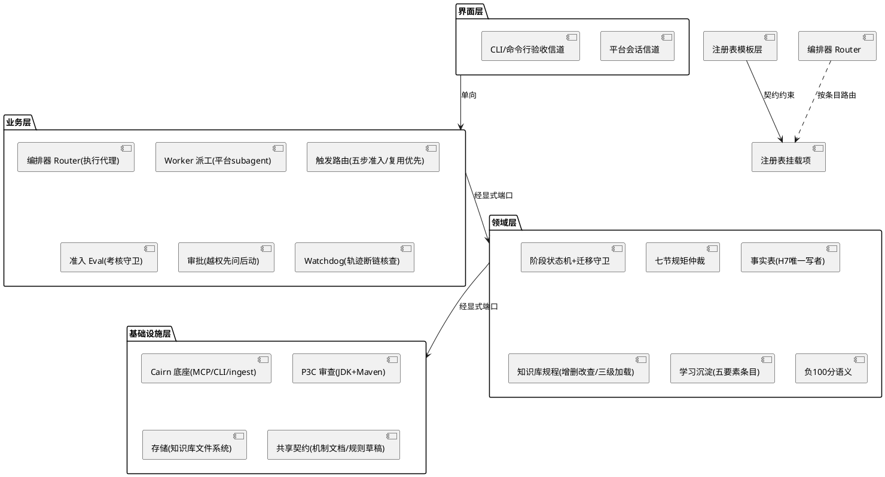
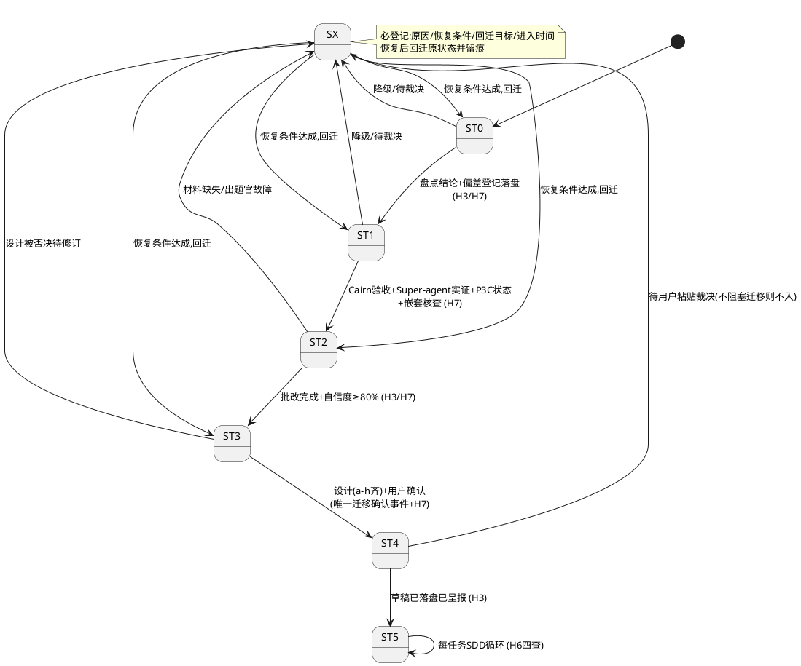
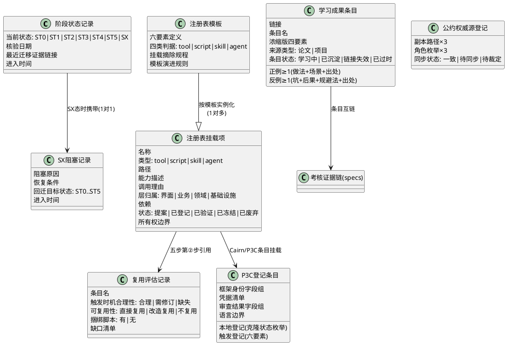

# 技术设计：kb_arch_foundation（前置治理：阶段状态机、学习沉淀、注册表架构与执行可查）

> 版本：v1（2026-11-06）。上游产物：`.codeartsdoer/specs/kb_arch_foundation/spec.md`（v4，1367 行）。
> 仲裁依据：规则文件（七节公约）> spec v4 > 本设计 > 记忆偏好 > 自行推断。
> 本设计为 spec 阶段到任务拆解之间的技术方案载体；tasks.md 由 spec-task-agent 承接，本文不含代码实现。

## 0. 预检结论（动笔前核对，2026-11-06 磁盘实查）

### 0.1 已否决方案回潮检查（5 项，全部未回潮）

| 已否决项 | 核对位置 | 结论 |
|---------|---------|------|
| M1–M7 门禁链 | spec.md L15（裁决表标"弃"）；全文正文仅 ST0–ST5+SX（L458–468） | 未回潮 |
| cairnd 轮询 | spec.md L122（#7 不采用）、L285（边界 10）、L595（规则 11） | 未回潮 |
| 自建定时任务 | spec.md L278（边界 3）、L1316（约束 8"定时任务为禁用值"） | 未回潮 |
| Agent 自改规则文件 | spec.md L432（4.3 条款 1）、L866–871（零改动红线） | 未回潮 |
| 删用户文件 | spec.md L1003（零删除）；p3c .git 删除收窄为仅该仓库的用户明确授权（L590、L1363） | 未回潮（授权边界未扩大） |

### 0.2 已确认事项固化检查（13 项，全部在案）

| 已确认事项 | spec 固化位置 | 磁盘实况核对 |
|-----------|--------------|-------------|
| refs/ 隔离与嵌套防护 | L577、L587–590（规则 2/7/8） | Desktop/refs/ 下 Cairn、deepseek-super-agent 实存，p3c 不存在（与"克隆未达成"登记一致） |
| 学习材料门槛 | L669–675（规则 3 项目=大厂高引用框架 / 规则 4 论文=近 1 年智能体方向） | — |
| SDD 强制 | L901–914（§5.8） | — |
| 规则草稿 8+2 条候选 | L1286–1294（§6.2 固定 10 条，第 10 条候选） | `规则草稿-永久生效.md` 实存 10 条，头部标注第 10 条候选待裁决，逐条一致 |
| 状态机选型 | L11–19（v2 重构说明第一节，"状态机+迁移守卫"选定） | — |
| 注册表两级结构 | L802（§5.6.1 规则 3(c)）、L1318（约束 10） | — |
| Cairn 7 类接入（MCP 主） | L112–122（v3 第五节清单） | refs/Cairn HEAD=2ae4eef 在库 |
| Super-agent 模型剔除 9 处 | L124–145（v3 第六节清单+剔除/旁路方案） | refs/deepseek-super-agent HEAD=e705e87 在库 |
| 公约三副本分层权威 | L1095–1112（§5.12）、L1342–1348（§6.7） | 三路径均实存（v3 已逐字实查） |
| 新功能五步接入 | L1043–1058（§5.11） | — |
| 执行轨迹三问三答 | L946–961（§5.9）、L1333–1340（§6.6） | — |
| p3c 克隆 3 次失败列 ST1 | L597–604（规则 12–15）、L1305（§6.3 条款 8）、L1363（§6.9 条款 3） | refs/p3c 不存在，与降级登记一致 |
| hyra-results 未实证项 | L233（v4 第四节偏差登记） | 磁盘实查无该名称（与登记一致） |

**预检总判定**：spec v4 与磁盘实况、既有知识库机制基线（notes/知识库维护机制.md §1–§9、notes/项目事实表.md、notes/知识库索引.md）无矛盾，已否决方案零回潮，已确认事项零缺漏，可展开增量设计。

### 0.3 本设计的裁定项与新建载体清单（供用户确认 design 时一并裁决）

| # | 裁定/新建项 | 内容 | 性质 |
|---|------------|------|------|
| 1 | H6 扩展为四查 | 三查（测试/清单/敏感）+G4 审查结果查；P3C 未就绪时 G4=呈报未就绪+登记卡点，用户明示豁免方可提交 | 本设计裁定（spec L216/L1167 授权 design.md 裁定） |
| 2 | notes/阶段状态机运行规则.md 新建 | 七态枚举+准出条件检查单+呈报分级（§2.1.3-A） | 新建笔记条目（走 H3 增规程） |
| 3 | notes/注册表.md 新建 | 模板层+挂载项两级单文件承载（§2.2/§2.3） | 新建笔记条目（走 H3 增规程） |
| 4 | notes/复用评估表.md 新建 | v4 基线落盘为独立可增量更新条目（§2.3） | 新建笔记条目（走 H3 增规程） |
| 5 | notes/档案区/kb_arch_foundation/ 新建 | 派工单档案三件套（沿 kb_maintenance 既有模式） | 新建目录（沿既有档案模式，属框架必需；在此显式列出待用户确认） |
| 6 | 事实表新增"阶段状态"区 | ST0–ST5/SX+核验日期+证据链接+SX 阻塞记录（§2.3） | 扩展既有文件（H7 维护） |
| 7 | 索引新增"公约权威源"唯一登记条目 | 三路径+角色+同步状态（§2.3） | 扩展既有文件（H3 登记） |

---

# 一、需求与存量功能关系分析

## 1.1 需求功能与存量功能对比

### 1.1.1 已实现功能

判定依据说明：以下各项的"存量实现"均经本次磁盘实读核对（非照抄 spec），匹配度按"需求语义被存量机制覆盖的程度"四档评估。

| 需求功能 | 存量功能 | 代码位置 | 匹配度 |
|---------|---------|---------|--------|
| 变更日志留痕（H3 写后记日志，轨迹"做了什么"作答） | 增删改查四操作规程"增：写后记索引变更日志"+索引变更日志区（日期/条目/动作/触发来源四字段契约） | notes/知识库维护机制.md:22–28；notes/知识库索引.md:77–85 | 100% |
| 事实表单一事实源与 H7 刷新 | 项目事实表已建成（四区结构），H7 on_fact_change 钩子已定义并自检通过 | notes/项目事实表.md:1–5,16–41；notes/知识库维护机制.md:89,91 | 100%（本需求仅新增"阶段状态"字段，见 1.1.2） |
| 执行轨迹"产物在哪"作答 | 知识库索引字段契约（条目名/类别/路径/主题/最后核验日期/状态），specs 产物层/笔记层/档案区三层登记齐备 | notes/知识库索引.md:3–5,38–54 | 100% |
| 三级渐进加载（学习成果用时按需读取、不塞上下文） | 三级渐进加载机制（索引第一层→浓缩版第二层→原文第三层），浓缩版四要素契约已定 | notes/知识库维护机制.md:30–41 | 100% |
| H1 会话启动自检 | H1 钩子：平台注入后首动作读索引（缺失则重建上报） | notes/知识库维护机制.md:83 | 100%（本需求扩展为"读索引+读事实表当前状态"，见 1.1.2） |
| SKILL 元数据自我介绍（五步接入第③步的自动触发语义） | 5 个 project 技能 frontmatter 实装（name 与目录一致、description 含"当…时触发"且≤1024 字）+bp0010 三要素与三层架构 | .codeartsdoer/skills/skill-writer/SKILL.md:1–4；docs/官方最佳实践-如何写好一个Skill-bp0010.md（索引:12 登记） | 100% |
| SDD 四阶段流程载体 | specs/ 流水线产物层惯例（spec/design/tasks 同目录三件套，4 个特性 11 件产物在册）+平台 SDD 技能组（managing-spec/design/tasks-document 等） | notes/知识库索引.md:38–54；spec.md:175–186（v4 盘点清单） | 100% |
| 档案三件套模式（轨迹"档案模式"） | notes/档案区/kb_maintenance/ 既有模式（工单原文+执行记录+结果产物索引） | notes/知识库索引.md:32–37 | 100%（本需求仅按同模式扩展新目录，见 1.1.2） |
| 规则草稿落盘与呈报（ST4 草稿侧） | 规则草稿-永久生效.md 已落盘 10 条（第 10 条候选标注在案），粘贴裁决权在用户 | .codeartsdoer/specs/kb_arch_foundation/规则草稿-永久生效.md:1–16 | 100%（粘贴生效为用户异步动作，spec 已定不阻塞） |
| H6 提交三查门禁（轨迹守卫底座） | H6：提交前 G1 测试/G2 清单/G3 敏感三查，任一不过阻塞提交呈报 | notes/知识库维护机制.md:88 | 75%（需扩展 G4 审查查，见 1.1.2） |
| 复用评估表数据基线 | v4 修订说明第一节评估表（5 本地技能+平台相关项逐项三列评估结论已实证） | spec.md:161–189、L1349–1357 | 75%（数据在 spec 内，需落盘为可增量更新的独立条目，见 1.1.2） |
| 经验沉淀平台侧承接 | experience-collect/experience-refine 平台技能（正反例维护承接） | spec.md:182（v4 盘点） | 100% |

### 1.1.2 需要扩展的功能

| 需求功能 | 存量功能 | 差异说明 | 扩展方向 |
|---------|---------|---------|---------|
| 阶段状态可查（"做到哪/卡在哪"一句话作答） | 事实表现有四区：git 状态/机制状态/环境状态/未决事项指针（notes/项目事实表.md:7–41） | 输入输出差异：现无 ST/SX 字段，"做到哪"只能靠翻产物文件推断；业务逻辑差异：spec §6.6 条款 2–3 要求阶段状态字段由 H7 维护、全库唯一权威，SX 需四字段（原因/恢复条件/回迁目标/进入时间）；边界差异：状态与证据不符时须以证据实况回退（spec §5.1.3 异常 1） | 事实表新增"阶段状态（kb_arch_foundation）"区（字段设计见 §2.3）；H7 扩展职责=状态变化后同步刷新该区+证据链接 |
| H1 自检范围扩展 | H1 首动作读索引（notes/知识库维护机制.md:83） | 业务逻辑差异：状态机要求启动时同时获知"当前阶段"；边界差异：索引与事实表任一缺失均触发重建/上报 | H1 动作序列扩展为"读索引→读事实表阶段状态区→二者一致性核对"，缺失/矛盾按机制 §4 异常处置 |
| H4 公约①②同步核对 | H4：session-rules diff→立即采用+与知识库一致性检查，冲突标记待修订呈报（notes/知识库维护机制.md:86） | 输入差异：diff 命中对象新增"公约内容"；业务逻辑差异：需逐行比对①docs 最终稿与②.mdc，产出"一致/待同步"状态；边界差异：③metadata.properties 平台自动重写不算违规、唯一恢复路径=用户重新定稿+重新粘贴 | H4 处理序列追加公约核对分支（状态流转见 §2.1.3-B）；核对结论写入索引"公约权威源"条目同步状态字段 |
| H6 三查→四查 | H6 三查：G1 测试/G2 清单/G3 敏感（notes/知识库维护机制.md:88） | 输入差异：新增审查结果输入；业务逻辑差异：G4=审查通过留痕方可过；边界差异：P3C 未就绪时 G4 不得虚假通过（spec §5.13.3 异常 1）——呈报未就绪+登记卡点，豁免权在用户 | 本设计裁定并入四查（裁定理由见 §2.1.3-B）；增量审查挂编码检查点、全量审查挂 G4，未就绪降级语义一并固化 |
| 复用评估表独立承载 | v4 评估基线在 spec 修订说明内（spec.md:161–189） | 差异：spec 是需求文档，任务完结归档后不便增量更新；spec §5.14 规则 3 要求"后续盘点增量更新此表" | 落盘 notes/复用评估表.md（基线=spec v4 表逐行迁入），登记索引，后续走 H3 增改规程（格式见 §2.3） |
| 学习成果条目集承载 | 笔记层现行条目 4 篇，无学习成果类条目（notes/知识库索引.md:15–23） | 输入输出差异：五要素条目（链接/条目名/浓缩版四要素/正例/反例）为新增条目形态；边界差异：禁入 docs/与 specs/（spec §6.5 条款 9），同主题禁重复条目 | ST2 起每篇论文/项目学习完成即新建 notes 条目（落盘格式见 §2.3），浓缩版按既有同名惯例处理 |
| 档案区扩展 | 档案区仅 kb_maintenance 一个子目录（notes/知识库索引.md:32–37） | 差异：本特性派工单档案无承载目录 | 沿既有模式新建 notes/档案区/kb_arch_foundation/（三件套同构）；新建目录已列入 §0.3 清单待用户确认 |
| 越权拦截呈报通道 | 既有"归属两可/异常处置"呈报规程（notes/知识库维护机制.md:42–53） | 差异：状态机语境下的越权（改规则/删文件/新建非必需目录/守卫拒绝）需统一呈报格式与留痕位置 | 并入状态机运行规则条目的呈报分级清单（§2.1.3-A），留痕走变更日志 |

### 1.1.3 需要新增的功能或接口

**（1）流程管控模块**——依赖：事实表（状态存取）、索引（留痕）、维护机制（异常处置规程）

| 功能点 | 输入 | 输出 | 核心逻辑 |
|-------|------|------|---------|
| 阶段状态机运行规则条目 | spec §5.1 七态定义与八条业务规则 | notes/阶段状态机运行规则.md（七态枚举表+各状态准出检查单+呈报/静默分级清单） | 状态唯一权威=事实表阶段状态字段；迁移三要素（条件+证据+留痕）齐备方有效 |
| 迁移守卫检查单 | 当前动作+目标状态 | 放行 / 拒绝+缺失条件清单 | 动作内嵌检查点：发起跨状态动作前逐项核对准出条件与证据文件存在性（§2.1.3-A） |
| SX 阻塞登记 | 降级原因或裁决等待 | 事实表 SX 四字段记录 | 任意状态可进入；禁无恢复条件挂起；恢复后回迁原状态并留痕 |

**（2）注册表模块**——依赖：知识库索引（查重）、码道技能体系（SKILL.md/listSkills）、Cairn（挂载底座）

| 功能点 | 输入 | 输出 | 核心逻辑 |
|-------|------|------|---------|
| 注册表模板层 | spec §6.4 六要素/四类型/两级结构约束 | notes/注册表.md 模板层区（六要素定义、四类判据、挂载/摘除规程、模板演进规则） | 能力契约与登记规范；模板演进须经用户裁决 |
| 注册表挂载项 | 具体功能实例（tool/script/skill/agent） | 按模板实例化的条目记录 | 六要素齐全+三问自检通过方可登记；先登记后使用 |
| 新功能五步准入 | 新功能提案 | 已登记条目+变更日志行 | 五步缺一即未准入（§2.1.3-F） |

**（3）环境就绪模块（ST1）**——依赖：GitHub（标准命令）、refs/ 隔离目录、事实表（登记）

| 功能点 | 输入 | 输出 | 核心逻辑 |
|-------|------|------|---------|
| Cairn Windows 修复与验收 | refs/Cairn（HEAD=2ae4eef） | 构建产物+验收命令与结果原文 | 诊断先行→修复留痕→make verify 通过为准；接入方式 7 类清单登记（MCP 主） |
| Cairn MCP 服务接入 | cairn-mcp 构建产物 | MCP 链路可用+验收原文 | stdio 传输；平台 MCP 注册能力 ST1 实证，不可用退 CLI 备用并登记偏差 |
| Super-agent 实证登记升级 | refs/deepseek-super-agent（HEAD=e705e87） | 实证登记（七层/双角色/M0–M11/9 处模型配置点核对+剔除义务声明） | 9 处模型配置点逐项核对；#1–#6 不进入实施范围、#7/#9 走原生零模型路径（§2.1.3-D） |
| P3C 拉取与配置 | 标准 git clone 命令 | refs/p3c+验收原文（或降级登记） | ST1 重试≤3 次；成功后按授权删 .git；JDK/Maven 检查；样例审查跑通为准（§2.1.3-E） |

**（4）学习考核模块（ST2）**——依赖：学习材料获取链、出题官 subagent、知识库笔记层

| 功能点 | 输入 | 输出 | 核心逻辑 |
|-------|------|------|---------|
| 学习材料清单（5 论文+5 项目） | 选取标准（spec §5.4.1 规则 2–4） | 材料清单（名称/角度/途径/质量评估结论） | 项目过"大厂高引用框架"门槛、论文过"近 1 年智能体"门槛；评估结论落盘后方可入选 |
| 考核证据链 | 出题官出题与批改 | specs 产物（题目/作答/批改/自信度） | 出题官独立性；100% 作答；≥80% 准出；<80% 冻结补学循环 |
| 学习成果条目集 | 每项材料学习完成 | 五要素条目（notes 层） | 事件驱动即时登记，禁批量补记 |

**（5）审查模块（ST5 起长期生效）**——依赖：P3C（refs/p3c）、JDK+Maven、平台模型端口

| 功能点 | 输入 | 输出 | 核心逻辑 |
|-------|------|------|---------|
| 编码必审检查点 | 编码动作事件（ST5 编码内嵌检查点） | 审查报告+留痕（命令+结果原文） | 增量优先、全量挂 H6-G4；静态结论为准，LLM 建议须复核留痕 |
| 审查命令封装脚本 | 变更文件清单 | 审查执行命令+结果 | script 类条目走五步准入，捆绑脚本一并交付（缺口①补齐，§2.1.3-F） |

## 1.2 存量功能详细分析

### 1.2.1 事件钩子 H1–H7（机制 §9）——本设计的触发载体底座

**接口契约**：每钩子为"事件→检测→仲裁→修正"四段式；失败登记未决不卡死（notes/知识库维护机制.md:75–91）。

**业务规则与平台支持性**（spec v3 修订说明第一节 L38–74 实证，本设计直接沿用）：

| 钩子 | 平台支持性 | 真实触发通道 | 现有动作（机制 §9） |
|------|-----------|-------------|--------------------|
| H1 会话启动 | 平台原生 | 会话启动注入 | 首动作读索引，缺失重建上报 |
| H2 采信记忆前 | 纪律钩子 | 动作内嵌检查点+内容级命中 | 与知识库核验日期比对，T2 冲突走仲裁 |
| H3 写知识库前/后 | 纪律钩子 | 动作内嵌检查点 | 查重→归属判定→写后记索引变更日志 |
| H4 规则变化 | 平台原生 | session-rules diff | 立即采用+一致性检查+冲突呈报 |
| H5 经验提炼/反思 | 平台原生 | 反思窗口（00:00–06:00，事实表:33） | 记忆 vs 知识库一致性+记忆收敛为指针 |
| H6 门禁执行 | 纪律钩子 | 动作内嵌检查点 | G1/G2/G3 三查，任一不过阻塞呈报 |
| H7 事实变更 | 纪律钩子 | 动作内嵌检查点+消息事件（裁决到达） | 更新事实表→刷新核验日期→记变更日志 |

**扩展点**：H1/H4/H6/H7 四钩子的动作序列存在文档化扩展空间（机制文档 notes 类可改，改后刷核验日期）；本设计对四钩子的扩展均为"追加分支/字段"，不改既有动作语义——满足 spec §4.5 兼容性条款 2"不新增钩子机构"。

**约束**：①平台原生回调仅 H1/H4/H5，H2/H3/H6/H7 的有效性以变更日志留痕为审计口径（做了即有痕，无痕即违规，spec L54）；②多维度并发命中幂等去重、先到先处理（spec §5.1.3 异常 4）；③禁定时触发（机制 §9 原则行与 spec 边界 3 同源）。

### 1.2.2 事实表（单一事实源）——阶段状态的唯一权威载体

**接口契约**：现行四区（git 状态:7–15 / 机制状态:16–25 / 环境状态:26–35 / 未决指针:36–41），每字段含值+核验日期两列；表头声明"核心状态唯一存放处、活引用不抄值、H7 更新"（notes/项目事实表.md:1–5）。

**业务规则**：任何核心状态只改这一处；更新动作记入索引变更日志（表头第 4 行声明）。

**扩展点**：允许新增区（既有四区本身即增量演化产物——建表时由 kb_maintenance 任务 12 新建）；本设计新增"阶段状态"区即沿此扩展路径，不动既有四区。

**约束**：H7 为唯一写者（写者唯一语义与 spec §6.4 条款 4"领域状态必须有唯一写者"同构）；核验日期必刷。

### 1.2.3 知识库索引——登记与查重唯一入口

**接口契约**：字段契约六字段（条目名/类别/路径/主题/最后核验日期/状态，notes/知识库索引.md:3）；类别枚举 9 类（官方参考文档/定稿规范/工作笔记/机制文档/索引/浓缩版/档案/流水线产物/技能，:4）；变更日志行四字段（日期/条目/动作/触发来源，:79）。

**业务规则**：全库唯一登记与查重入口；增操作先查重（机制 §2）；查操作只加载索引+被命中条目，禁全量扫描（机制 §2/§4.1 条款 2 加载上限"索引+事实表+至多 2 个命中条目"）。

**扩展点**：条目可增、类别枚举已有 §6 扩展先例（机制文档:60 记录 6→9 类扩展）；本设计新增条目均沿用现行 9 类（学习成果/复用评估表/注册表/状态机规则=工作笔记或机制文档类），**不新增类别枚举**。

**约束**：登记条目与实际文件必须一致（异常处置清单:47"索引未覆盖实存文档→以磁盘实查为准修正"）。

### 1.2.4 码道技能体系——注册表 skill 类条目的物理承载

**接口契约**：SKILL.md frontmatter 两必填字段——name（与目录一致）、description（含"当…时触发"，≤1024 字）；正文=操作手册（激活后按需加载）；三层渐进加载第一层=frontmatter 常驻视野（.codeartsdoer/skills/skill-writer/SKILL.md:1–4 实装验证；bp0010 契约）。

**业务规则**：智能体激活技能的唯一判断依据=description（bp0010 原文，spec L88 实证引用）——description 常驻即"天然自我介绍+自动触发"，无需额外常驻提示词。

**扩展点**：.codeartsdoer/skills/\<id\>/ 目录可增（技能=码道运行时约定位置，机制 §1 判定表:14），其内可捆绑 scripts/（bp0010 第三层）——新技能目录不属"新建系统目录"红线（既有 5 技能同形态）。

**约束**：技能禁扩权（spec §6.4 条款 3）；平台侧 listSkills（49 技能清单）为对账源，与磁盘 5 技能核对一致（v4 实证）。

### 1.2.5 增删改查与归档规程——新增条目的合规通道

**接口契约**：增=查重→新建/增量更新→索引登记；改=notes 可改+刷核验日期；docs 只增不改；删=逐条用户批准；查=定位后按需加载（notes/知识库维护机制.md:22–28）。

**约束汇总（本设计全程受制）**：①docs 层只增不改；②.codeartsdoer/rule/ 全区禁改；③零删除文件（p3c .git 为唯一例外且有授权留痕义务）；④新建目录仅限框架必需（specs 功能目录/refs 隔离目录/沿既有模式档案目录——后者列入 §0.3 待确认）；⑤加载范围恒为"索引+事实表+至多 2 条目"；⑥禁定时任务；⑦网络失败原文呈报→同命令≤3 次→降级登记。
---

# 二、增量设计方案

## 2.1 实现模型

### 2.1.1 上下文视图



要点：①对用户通道实行"必呈报四类+其余静默留痕"（spec §5.1.1 条款 8）；②模型调用经平台模型端口（执行代理自身+平台 subagent 即其物理承载），无任何独立供应商配置；③refs/ 为唯一项目外隔离目录，只读引用；④一切触发走平台既有五通道，禁定时。

### 2.1.2 服务/组件总体架构

四层分层定稿（spec §6.4 条款 1，层名与职责映射固定），注册表两级结构纵贯各层：



各层归属条目清单（回答 spec §5.6.1 规则 3(a)）：

| 层 | 归属条目（注册表四类型标注） |
|----|------------------------------|
| 界面层 | 平台会话信道（agent）、CLI 验收信道（tool：java/mvn/make/git/go 命令面） |
| 业务层 | 编排器 Router（agent=执行代理本人）、Worker 派工（agent=平台 subagent：出题官/修复 worker）、触发路由（skill：find-skills 衔接）、准入 Eval（skill：grill-me 复用）、审批（流程内嵌，非独立条目）、Watchdog（轨迹核查，流程内嵌） |
| 领域层 | 状态机+守卫（skill 待建：状态机运行规则承载）、仲裁（机制文档）、事实表（数据载体+H7）、知识库规程（机制文档）、学习沉淀（skill 待建条目+notes 条目）、负 100 分语义（规则候选已落盘第 2 条） |
| 基础设施层 | Cairn（tool：MCP 服务 mcp__cairn__*；script：cairn-ingest/cairn-incremental；备选 tool：cairn CLI）、P3C（script：审查封装脚本+tool：pmd 命令面）、存储（知识库文件系统，非条目）、共享契约（规则草稿/机制文档，文档非条目） |

层间不松散的保证：**架构不变量机器检查**（回答 3(e)，验证方式逐条见 §2.2.2 接口清单 IX）+ 依赖方向单向（界面→业务→领域→基础设施）+ 层间显式端口 + 领域状态唯一写者（H7）。

### 2.1.3 实现设计文档

#### A. 阶段状态机实现（要求 1 覆盖）

**状态存取**：当前状态唯一存放于事实表新增"阶段状态（kb_arch_foundation）"区（字段设计见 §2.3）。存取规则三条：
1. **读**：H1 会话启动自检读一次；任何守卫校验前读一次；轨迹"做到哪"问句应答读一次——读取即从事实表取值，禁止从记忆或会话历史推断状态。
2. **写**：仅 H7 链路可写（动作内嵌检查点：状态迁移动作完成后立即落盘"新状态+核验日期+证据链接"）；写后必记索引变更日志一行。
3. **一致性守卫**：状态字段与磁盘证据矛盾时以证据实况为准回退状态并登记偏差（spec §5.1.3 异常 1），H7 修正留痕。

**迁移守卫实现方式**：动作内嵌检查点（纪律钩子，非平台回调、非定时巡检、非独立门机构）。落地形态=状态机运行规则条目中的**准出条件检查单**：发起任何跨状态动作前，执行代理读事实表当前状态→对照目标动作所需的准出检查单→逐项核对证据文件存在性与内容→全部满足放行并呈报迁移（附证据链接），任一不满足拒绝并呈报"当前状态+缺失条件清单"。七态检查单要点：

| 状态 | 准出条件检查单（迁移至下一状态） |
|------|--------------------------------|
| ST0→ST1 | 盘点结论已呈报；偏差项（含证据）已落盘（索引+变更日志可查） |
| ST1→ST2 | Cairn 验收证据（构建+make verify 命令与结果原文）在档；Super-agent 实证登记完整（七层/双角色/M0–M11/9 处配置点核对+剔除义务声明）；接入方式 7 类清单登记；嵌套核查记录在档；P3C 状态=已验收 或 已登记降级且用户裁决可带缺口推进 |
| ST2→ST3 | 出题官批改完成留痕；综合自信度 ≥80% 留痕；学习成果条目与考核产物互链完整 |
| ST3→ST4 | 设计文档含 §5.6.1 (a)–(h) 全部硬性交付项；**用户明确确认**留痕（唯一用户迁移事件） |
| ST4→ST5 | 草稿已落盘已呈报（已达成）；粘贴状态不阻塞（用户异步动作） |
| ST5（终态循环） | 每任务 spec→design→tasks→implementation 四阶段文档与确认留痕齐备；H6 四查通过 |
| SX 进入/恢复 | 进入：登记原因+恢复条件+回迁目标状态+进入时间（缺恢复条件=无效挂起）；恢复：恢复条件达成证据+回迁留痕 |

**状态机图**：



**迁移留痕**：三件套缺一即无效迁移（spec §5.1.1 条款 2）——①准出条件满足（检查单逐项核对结论）；②证据链接呈报（呈报=单向送达，附文件路径）；③变更日志留痕（索引变更日志一行）+事实表状态刷新（H7）。审计口径：纪律钩子执行有效性以留痕为准，无痕即违规。

#### B. 钩子四维触发落地（要求 2 覆盖）

每钩子的触发通道、四维标注、执行方式与分级固化如下（平台支持性结论沿用 spec v3 第一节实证，不虚构平台能力）：

| 钩子 | 触发通道（落地执行方式） | 维度 | 呈报/静默分级（执行动作） |
|------|--------------------------|------|--------------------------|
| H1 | 会话启动注入完成后，首动作序列=读索引→读事实表阶段状态区→一致性核对 | 会话级 | 正常=静默（仅读）；索引/事实表缺失或矛盾=必须呈报+重建/修正 |
| H2 | 采信记忆动作内部自检：与知识库核验日期比对；记忆断言特征（数字/状态/结论）命中即触发比对 | 动作级+内容级 | 比对通过=静默留痕；仲裁冲突（T2）=必须呈报 |
| H3 | 写知识库动作序列内嵌步骤：写前查重→归属判定→写→记索引变更日志 | 动作级 | 查重通过/登记完成=静默（日志即痕）；归属两可=必须呈报裁决 |
| H4 | session-rules 注入内容 diff（平台原生）；diff 命中公约内容→追加①②逐行比对分支 | 会话级+内容级 | 新规则立即采用=静默；公约①②不一致=标记"待同步"必须呈报 |
| H5 | 平台反思窗口执行：记忆 vs 知识库一致性+记忆收敛为指针 | 会话级 | 检查通过=静默；发现矛盾=必须呈报 |
| H6 | 提交动作前置四查（动作内嵌检查点）+迁移守卫门级校验 | 动作级+门级 | 四查任一不过=必须呈报+阻塞；全部通过=静默留痕 |
| H7 | 状态变化后同步落盘（动作内嵌检查点）+裁决到达消息事件 | 动作级+内容级 | 常规刷新=静默（日志即痕）；裁决驱动的状态迁移=必须呈报（附证据链接） |

**H6 四查裁定（本设计裁定项 #1，spec L216/L1167 授权）**：**采纳"三查→四查"扩展**。G4=审查结果查：本次提交涉及 Java 编码→P3C 审查通过留痕方可过（增量审查已在编码检查点完成，G4 执行提交前全量审查）；P3C 未就绪→G4 呈报"审查能力未就绪"并登记卡点，**用户明示豁免并留痕豁免记录后方可提交**（禁虚假通过）。裁定理由：①编码必审（草稿第 10 条）需提交前兜底闭环；②与 spec §5.13 规则 4"全量审查挂 H6"语义一致；③未就绪降级语义与 §5.13.3 异常 1 吻合，不产生虚假通过路径。G4 未就绪时的呈报不阻塞 G1–G3 的执行与呈报。

**多维度并发去重**：同一钩子被多维度同时命中→先到先处理一次，其余命中登记为"重复命中"不做二次动作（spec §5.1.3 异常 4）；去重失败导致重复落盘→按轨迹断链处置（§5.9.3）。

**四维标注登记**：随状态机运行规则条目落盘（每钩子一行：通道+维度+分级），满足 §6.6 条款 6 字段约束。

#### C. Cairn 接入主备方案实施（要求 5 覆盖）

**主路线：注册表 MCP 服务链路（#1）**，实施步骤（每步意图+命令+结果原文留痕）：

1. **构建环境诊断**：go version 核验（环境预装 Go 1.26.5）；检查 refs/Cairn 内 Makefile 目标与 make 可用性——Windows+PowerShell 下 make 若缺失，按 Makefile 目标改直调 go build（与 Makefile 等价），差异留痕。
2. **构建三件套**：core 共享库→build 流水线（cairn-ingest/cairn-incremental/cairn-rebalance）→service（cairn-mcp 与 cairn CLI）。候选风险点（实查为准，禁臆断结论）：Windows 构建常见阻点=CGO 与 SQLite 驱动（core 依赖 SQLite+FTS5，spec L121 实证）；若报 CGO 相关错误→诊断先行（读原文报错定位驱动），修复选项=启用 CGO 所需工具链或改用纯 Go 驱动（后者属代码改动，须呈报裁决，禁擅自改 refs 只读仓库——修正方向=配置构建环境而非改仓库源码）。
3. **架构不变量验收**：make verify 通过（层间禁令机器检查：查询端禁 import LLM 包/禁写图谱结构/演化层禁引入 embedding）——作为 ST1 准出证据原文留痕。
4. **MCP 接入**：cairn-mcp 以 stdio 传输注册为码道 MCP 服务；**平台 MCP 自定义服务注册能力未实证——ST1 实证**：可用→注册并验收；不可用→如实登记偏差，启用备用路线 #2（cairn CLI 只读查询：find/impact/show/status/why/timeline/sentinel），注册表 Cairn 条目状态保持"已登记"并附偏差说明，主路线恢复条件登记 U 编号。
5. **蒸馏更新机制**：弃用 cairnd 轮询（spec 边界 10）；文档变更事件触发 cairn-incremental 单次命令（钩子/人工触发），全量重建用 cairn-ingest。
6. **验收标准**：以一条已知查询（如对已蒸馏知识库 find 查询）返回正确结果+命令与结果原文为验收证据。

**备用路线优先级**：#2 CLI 查询（轻量单次）> #3 build 流水线 CLI（蒸馏必需，非查询）> #4 REST（程序化批量，免鉴权仅限本机）> #5 graph-viewer（人工核查）> #6 core 库直调（成本最高，原则上不用）。#7 cairnd 不采用（已裁决）。

#### D. Super-agent 模型剔除 9 处实施（要求 6 覆盖）

实施性质=**配置豁免+架构不变量+编排骨架保留**，非代码改造（refs 只读；运行验收待做按 spec §1.3 输出 2 登记）：

| # | 配置点 | 实施处置 |
|---|-------|---------|
| 1 | 模型工厂 createModelFromEnv（gateway→live→Mock 链） | 不配置任何 DS_AGENT_* 环境变量→链路自然落到 Mock/空态；实施范围外登记 |
| 2 | HTTP 模型调用 HttpOpenAI | 不配置 OPENAI_BASE_URL/DEEPSEEK_API_BASE 等→不激活 |
| 3 | 角色分模型 roleModelsFromEnv | DS_AGENT_ROUTER_MODEL/WORKER_MODEL/WATCHDOG_MODEL 一律不设 |
| 4 | Provider 解析 resolveLiveApi+PROVIDER_PRESETS | DS_AGENT_API_BASE/KEY/PROVIDER/MODEL 不设 |
| 5 | 本地网关 gateway/* | gateway.config.json 不创建、DS_AGENT_GATEWAY_* 不设 |
| 6 | Runtime 注入 opts.model/models | Router=执行代理本人（平台模型）、Worker=平台 subagent（平台模型）——运行时模型实例由平台承载，不注入独立供应商实例 |
| 7 | Slow Path 语义策略 | 不设 DS_AGENT_SLOW_PATH=model，采用默认 rules 确定性零模型路径（框架原生） |
| 8 | 触发过滤/Eval（filterTrigger/assessWithMainAgent） | 语义由执行代理（Router 判断）与平台 subagent（评估）承接=平台模型端口语义；不配置独立模型 |
| 9 | 语义召回 EmbeddingPort | 保留默认 HashedEmbedding 离线零模型实现（框架原生） |

**编排骨架保留清单**：Router（序点/分派/唯一对外汇报）/Worker（隔离会话、只向上汇报、WorkerPorts 受限能力）/triggers（Trigger 批处理）/Watchdog（旁挂监督）/审批（申请者不能批准自己的申请）——全部保留为架构参照与 ST5 编排对接设计基线。

**对接码道模型端口的落地语义**：平台模型端口在物理上=执行代理自身 LLM 能力+平台 subagent 能力；架构上固化为一条**架构不变量**（见 §2.2.2 接口清单 IX）：目标架构任何组件不得引入独立模型供应商配置（API key/base/provider/网关/角色分模型的环境变量或配置文件均禁）。ST1 实证登记动作：按 9 处清单逐项核对 refs/deepseek-super-agent 实况（上游可能变更），偏差以实况为准更新清单（spec §5.3.3 异常 6）。

#### E. P3C 拉取与配置实施（要求 7 覆盖）

1. **ST1 重试策略**：ST1 阶段执行标准命令 `git clone --depth 1 https://github.com/alibaba/p3c.git`（目标 Desktop/refs/p3c）；本轮 3 次失败原文已留痕（Connection was reset ×2、port 443 connect fail ×1），ST1 重启新一轮≤3 次；仍失败→转 SX 登记 U 编号+恢复条件（网络通道可用），呈报换源裁决选项（gitee 镜像等须用户裁决，禁擅自换源）；ST1 其余工作并行推进不阻塞。
2. **克隆成功后 .git 删除授权执行**（仅限 refs/p3c，用户 2026-11-06 明确授权）：删除前留痕目录状态（Get-ChildItem refs/p3c -Force 输出原文）→删除 .git 子目录→登记删除动作+取舍（删后无法 git pull，更新须重新克隆）于 §6.9 登记条目与变更日志。其他仓库（Cairn/Super-agent）.git 保持原样。
3. **JDK/Maven 环境检查**：`java -version` 与 `mvn -version` 原文留痕；缺失或版本不符→按仓库 pom 实证版本要求诊断（克隆成功后读 pom.xml 确认最低版本），安装/调整属环境变更动作留痕呈报；版本要求以 pom 实证为准，禁凭印象断言。
4. **配置跑通验收**：对一段样例 Java 代码执行一次 PMD 规约审查（审查入口与命令行以仓库 README/pom 实证为准，禁凭空构造命令），产出 violation 报告=验收证据（命令+结果原文留痕）；登记克隆状态枚举推进（未达成→已克隆→已配置→已验收）。
5. **编码检查点挂接**：ST5 编码动作内嵌检查点（编码必审：增量优先）+H6-G4（提交前全量，裁定见 §2.1.3-B）；触发维度=动作级；注册表登记六要素（能力=P3C 静态规约审查/调用理由=编码任务事件触发/层归属=基础设施层/依赖=JDK+Maven+refs/p3c/状态=提案→ST1 验收后推进已登记→已验证/所有权边界=只读引用 refs 仓库、审查报告归执行轨迹）。
6. **模型配置剔除差异登记**：P3C 天然零模型配置点（纯静态规约），剔除方案=天然满足；与 Super-agent 9 处剔除的差异说明随 §6.9 条目登记（spec L211 要求）。

#### F. 新功能五步接入可执行化（要求 4 与要求 11 缺口补齐覆盖）

五步流程每步的可执行载体（输入→判定→输出→守卫）：

| 步 | 执行内容 | 输入 | 输出 | 守卫（不满足即停） |
|----|---------|------|------|--------------------|
| ① 提出 | 功能提案登记（能力/场景/预期） | 派工单/任务事件 | 提案记录（变更日志行） | — |
| ② 评估归类 | 先查复用评估表（复用优先纪律）：已有可复用条目→直接/改造复用并登记引用；确无覆盖→四类判据判定（tool/script/skill/agent，判据见 §2.2.2 接口清单 I）+层归属判定（四层枚举） | 提案+复用评估表 | 归类结论（含复用引用或新建理由） | 两可→停止准入呈报裁决；未查评估表→退回（禁绕过） |
| ③ 生成 SKILL | 仅 skill 类：.codeartsdoer/skills/\<id\>/SKILL.md；name=动词+名词且与目录一致；description=当…时触发+适用场景+不适用场景（≤1024 字）；script 类同步交付捆绑脚本（脚本落位=所属技能目录 scripts/ 或登记路径） | 归类结论 | SKILL.md（script 类另含脚本文件本体） | description 模糊=退回重写（元数据不达标禁登记）；用 skill-writer 做合规核对 |
| ④ 注册表登记 | 按模板填六要素+三问自检（第一人称：我有什么能力/为什么调用我/我属于哪一层） | ③产物 | notes/注册表.md 挂载项新行 | 六要素缺一=登记无效；三问空泛=退回 |
| ⑤ 留痕 | H3 链路：索引登记（新文件/新技能）+变更日志一行+复用评估表增量更新（如适用） | ④完成 | 日志行+索引条目 | 禁先使用后补登记；未准入功能禁入调用链 |

**3 项脚本缺口补齐方案**（复用评估表缺口清单的落地）：
- 缺口①审查命令封装脚本缺失：新建 **script 类条目**（P3C 审查封装，PowerShell 脚本封装"定位变更 Java 文件→调用 PMD 审查→输出报告"流程），走五步准入，捆绑脚本一并交付；ST1 P3C 验收后该条目状态推进为已验证。此脚本同时是 ST5 编码检查点与 H6-G4 的执行载体。
- 缺口②bug-fix 族执行代理不可直接调用：在注册表 bug-fix 族相关条目的"所有权边界"字段标注"经 Worker（平台 subagent）派工调用，执行代理不直接调用"；修复链=Router 派工 subagent（spec L183 边界登记的承接）。
- 缺口③脚本资源为零：随缺口①交付后增量更新复用评估表脚本资源行（0→1，附新证据），禁无据改写其他行。

#### G. 公约三副本去重落地（要求 8 覆盖）

1. **权威源分层固化**（登记载体=索引"公约权威源"唯一条目）：生效权威源=②.mdc（triggerType=always，运行时唯一生效）；内容权威源=①docs/项目协作公约-最终稿.md（语义裁定文本）；③metadata.properties=平台派生缓存（永不参与仲裁、禁手改）。仲裁应用：运行时按②；语义争议以①裁定并呈报同步；③永不参与。
2. **指针化改法（零删除）**：全库排查既有公约引用形态（specs/notes/docs 现存文本实查——既有 spec/design 引用均为路径指针或摘要，无全文抄录的"第四副本"；浓缩版/项目协作公约-最终稿.md 为摘要形态属既有登记条目，保留）；本设计生效后**增量规则**：任何笔记/规格/草稿/条目引用公约只存路径指针+角色标注（形如"见公约权威源条目（notes/知识库索引.md）"），禁抄录七节全文；既有三副本+浓缩版全部保留不动，零删除、零改写。
3. **H4 扩展分支执行**：diff 命中公约内容→读①与②逐行比对→一致=静默留痕（同步状态=一致）；不一致=索引条目同步状态置"待同步"+呈报差异对照与恢复指引（唯一恢复=用户重新定稿+平台界面重新粘贴；②③平台托管禁手改）；平台自动重写③触发 diff→正常核对流程，非违规（spec §5.12.3 异常 3）。

#### H. 规则草稿 10 条最终版核对与未决事项更新（要求 12/13 覆盖）

**草稿核对结论**（磁盘实查 `.codeartsdoer/specs/kb_arch_foundation/规则草稿-永久生效.md`，2026-11-06）：10 条全部落盘，与 spec §6.2 十条名称逐条对应一致（1 SDD 强制 / 2 学不会禁开工 / 3 学习材料门槛 / 4 参考仓库隔离 / 5 规矩层冻结 / 6 禁定时任务 / 7 事实表单一源 / 8 仲裁顺序 / 9 新功能准入 / 10 编码必审）；文件头 triggerType=always 标注在案；第 10 条候选标注在案。**第 9 条状态=已落盘已呈报待粘贴裁决；第 10 条状态=候选（裁决建议=要，v4 理由三条在案：对抗注释反例实证/确定性成本可控实证/与第 9 条准入+质检闭环）**。design 阶段对草稿文件零改动；ST4 准出条件已达成（落盘+呈报），粘贴为用户异步动作。

**未决事项清单更新**（沿索引未决事项登记区追加，U1–U8 已用）：

| 新编号 | 事项 | 状态与恢复条件 |
|-------|------|----------------|
| U9 | hyra-results 名称未实证：用户点名 .git 保持原样条款收窄适用对象之一，磁盘实查（Desktop 全树+notes/docs 检索）无该名称 | 条款收窄已按用户指令落实；实体待用户澄清名称后登记 |
| U10 | p3c 克隆未达成：3 次失败原文留痕 | ST1 执行项；恢复条件=git 协议通道可用；禁盲目重试（新一轮≤3）、禁擅自换源 |
| U11 | 平台 MCP 自定义服务注册能力未实证 | ST1 实证；不可用则主路线退 CLI 备用（#2）并登记偏差，恢复条件=平台支持或用户指定接入通道 |
| U12 | Cairn Windows 构建阻点未实证（CGO/SQLite 驱动/make 可用性为候选风险） | ST1 诊断实证；修复≤3 次转 SX 呈报完整错误链 |
| U13 | JDK/Maven 本机版本与 p3c pom 要求匹配性未实证（克隆未达成，pom 不可读） | ST1 克隆成功后以 pom 实证并更新凭据清单 |

既有 U8（Super-agent 目标框架≠学习清单成员）维持"登记在册待用户追认"。以上 U9–U13 在 tasks 阶段随执行进展回写索引登记区（H3/H7）。

## 2.2 接口设计

### 2.2.1 总体设计

本特性为流程治理型，无运行时代码 API；"接口"=**文档契约与流程协议**，按稳定性分三级：

| 分类 | 接口（协议） | 类型 | 稳定性 |
|------|-------------|------|--------|
| 契约类 | I 注册表模板契约（条目字段/四类判据） | 文档契约 | 稳定（模板演进须经用户裁决） |
| 契约类 | II 注册表挂载/摘除规程 | 流程契约 | 稳定 |
| 契约类 | III 三问三答轨迹查询协议 | 流程契约 | 稳定（字段沿既有契约） |
| 契约类 | IV 迁移守卫检查单协议 | 流程契约 | 稳定（状态集固定） |
| 契约类 | V 编码必审调用契约 | 流程契约 | 实验（P3C 未就绪，验收后转稳定） |
| 契约类 | VI Cairn 查询契约（MCP 主/CLI 备） | 外部接口 | 实验（依赖 ST1 实证） |
| 契约类 | VII 公约权威源核对协议 | 流程契约 | 稳定 |
| 契约类 | VIII 学习成果条目契约 | 文档契约 | 稳定（字段=spec §6.5） |
| 机器检查 | IX 架构不变量清单 | 校验协议 | 稳定 |

变更策略：字段新增走模板演进（用户裁决）；枚举值禁删（冻结语义）；实验级接口转稳定须附验收证据。

### 2.2.2 接口清单

**I. 注册表模板契约**（承载：notes/注册表.md 模板层区）

```
条目字段（挂载项每行必含，缺一即登记无效）：
  名称        字符串，与功能实例名一致（技能类=SKILL 目录名）
  类型        枚举 tool|script|skill|agent（且仅标注一类）
  路径        字符串，功能实例物理位置（技能=.codeartsdoer/skills/<id>/SKILL.md）
  能力描述    字符串（三问①：我有什么能力）
  调用理由    字符串，须含路由判据（三问②：为什么调用我、何时路由到我）——泛化表述无效
  层归属      枚举 界面层|业务层|领域层|基础设施层（三问③）
  依赖        字符串列表，依赖的条目与端口
  状态        枚举 提案|已登记|已验证|已冻结|已废弃
  所有权边界  字符串，拥有的文件与接口+禁谁改动
四类型判据：
  tool   有可直接调用的原子能力入口（MCP 工具/CLI 命令面）；登记路径=入口说明
  script 流程化可执行文件本体存在（.ps1/.py 等）；登记路径=脚本文件路径
  skill  .codeartsdoer/skills/<id>/SKILL.md 存在且 frontmatter 合规（name+description）
  agent  Router/Worker 角色或 subagent 定义文档存在；登记路径=定义所在
```

调用示例（技能类条目登记，三问由 frontmatter+条目分层承载）——以既有 skill-writer 为例：名称=skill-writer、类型=skill、路径=.codeartsdoer/skills/skill-writer/SKILL.md、能力与调用理由="当新建、修改、评审码道技能时触发"（frontmatter description 实录，即五步第③步合规核对器）、层归属=业务层、依赖=bp0010 文档、状态=已验证（既有 5 技能经 kb_maintenance 审查+测试双报告验证）、所有权边界=仅其技能目录内文件。

**II. 注册表挂载/摘除规程**：挂载=走五步准入（§2.1.3-F）→状态 提案→已登记（⑤留痕完成）→已验证（验收证据留痕后推进）；摘除=状态置"已废弃"（**禁删行禁删文件**，废弃原因+替代指针留痕）；冻结=临时禁用（原因+恢复条件）。模板层修改=模板演进，须经用户裁决并记变更日志。

**III. 三问三答轨迹查询协议**（承载：索引+事实表+状态机规则条目）

```
问"做了什么"   → 变更日志作答：按日期/条目/动作/触发来源四字段逐行检索
问"做到哪/卡在哪" → 事实表作答：阶段状态区当前值+SX 阻塞四字段+未决 U 编号
问"产物在哪"   → 索引作答：条目路径（specs 产物层/笔记层/档案区/技能层）
返回格式：当前状态+最近动作+卡点(如有)+产物路径，全部附证据链接
加载上限：索引+事实表+至多 2 个命中条目；超出→返回路径清单+前 2 展开，其余二次查询
```

**IV. 迁移守卫检查单协议**：输入=拟发起动作；处理=读事实表状态→查该状态准出检查单（§2.1.3-A 表）→逐项核对证据文件；输出=放行（附证据链接呈报迁移）/拒绝（呈报当前状态+缺失条件清单）。用户要求跳状态→呈报状态与被跳条件，明示豁免方可迁移并留痕豁免记录（spec §5.1.3 异常 3）。

**V. 编码必审调用契约**（P3C 验收后生效）：输入=变更文件清单（增量）或全量 Java 文件（G4）；执行=审查封装脚本（script 条目）调用 PMD 规约审查；输出=审查报告（发现项数/严重级别/结果原文路径）；留痕字段按 §6.9 条款 6（范围/发现项/严重级/复核状态/命令与结果原文链接）；"已复核留痕"前禁计入准出；LLM 解释/修复建议走平台模型端口且复核留痕后采信。

**VI. Cairn 查询契约**：主=MCP 工具调用（mcp__cairn__\*，stdio 传输，ST1 注册后可用）；备=CLI 命令（cairn find/impact/show/status/why/timeline/sentinel，只读）；蒸馏更新=cairn-ingest（全量）/cairn-incremental（增量），事件触发禁轮询。

**VII. 公约权威源核对协议**：触发=H4 diff 命中公约内容；执行=读①与②逐行比对；输出=同步状态（一致/待同步/待裁定）写索引唯一条目；待同步必附差异对照+恢复指引；③永不读为裁定依据。

**VIII. 学习成果条目契约**：见 §2.3.2 落盘格式。

**IX. 架构不变量清单**（仿 Cairn make verify，验证方式注明）：

| # | 不变量 | 验证方式 |
|---|-------|---------|
| 1 | 界面层禁直接依赖基础设施层实现 | 条目层归属核对+调用链核对（每次注册表变更时人工核对，留痕） |
| 2 | 领域层禁含进程 I/O 义务（进程 I/O 归基础设施层条目） | 同上 |
| 3 | 依赖方向单向：界面→业务→领域→基础设施，反向禁 | 注册表条目依赖字段核对 |
| 4 | 领域状态唯一写者=H7（事实表） | 变更日志审计：非 H7 来源的事实表改动即违规 |
| 5 | 禁独立模型供应商配置（API key/base/provider/网关/角色分模型的 env 或配置文件） | 越权拦截清单核对+ST1 实证登记核对 |
| 6 | 禁定时任务与 cairnd 轮询 | 设计产物检索"定时/轮询"字样+触发类型枚举核对（spec §6.4 条款 8） |
| 7 | 未准入功能禁入调用链 | 注册表状态字段核对（先登记后使用） |
| 8 | refs/ 参考仓库零污染本项目（无 submodule/无内嵌/无复制入内） | ST1 嵌套核查命令（git 状态+目录核对）留痕 |

ST3 设计文档须引用本清单并逐条注明验证证据位置（spec §6.4 条款 5：无不变量清单的设计不得呈报确认——本节即该清单）。

## 2.3 数据模型

### 2.3.1 设计目标

1. **业务场景支撑**：状态随时可查（"做到哪"）、轨迹随时可溯（三问三答）、学习成果按需加载（不塞上下文）、功能准入可控（先登记后使用）、审查结果可信留痕（静态为底+复核）。
2. **兼容目标**：既有三库分工、9 类索引枚举、H1–H7 钩子、事实表四区、浓缩版同名惯例全部不动，仅做追加式扩展（零删除、零改写既有字段）。
3. **容量与扩展性**：条目均为 Markdown 表格/结构化段落，平铺承载（notes/ 不新建子目录，档案区按既有模式除外）；增量更新沿 H3 查重规程，同主题禁重复条目。

### 2.3.2 模型实现

**领域对象关系图**：



（注：对象键不含技术主键字段，唯一性由"同主题禁重复条目+索引查重"保证，沿机制 §2。）

**落盘格式与目录（逐文件）**：

| 文件（新建/扩展） | 位置与形态 | 条目格式要点 |
|-------------------|-----------|--------------|
| notes/阶段状态机运行规则.md（新建） | 笔记层，类别=机制文档 | ①七态枚举表（状态/名称/准出条件/迁移载体）②七张准出检查单 ③逐钩子四维触发标注表（通道/维度/分级）④呈报四类清单+静默清单 ⑤SX 纪律——表头含最后核验日期，登记索引 |
| notes/项目事实表.md（扩展） | 新增"## 5. 阶段状态（kb_arch_foundation）"区 | 字段行：当前状态（枚举 ST0..ST5/SX）/核验日期/最近迁移证据链接；SX 时追加阻塞记录四字段行（原因/恢复条件/回迁目标/进入时间）；由 H7 维护 |
| notes/注册表.md（新建） | 笔记层，类别=机制文档 | 两个一级区：模板层区（契约文本=§2.2.2 接口 I）+挂载项区（每条目一行表格：名称/类型/路径/能力/调用理由/层归属/依赖/状态/所有权边界）；首批预挂载=既有 5 技能+平台相关组（按复用评估表）+Cairn/P3C 提案条目 |
| notes/复用评估表.md（新建） | 笔记层，类别=工作笔记 | 基线=v4 spec 评估表逐行迁入（5 本地技能+平台相关组+脚本资源行）；字段=条目名/触发时机合理性/可复用性/缺口清单/捆绑脚本；增量更新附新证据 |
| notes/知识库索引.md（扩展） | ①新增"公约权威源"唯一登记条目（笔记层区，三路径+角色+同步状态，全库仅此 1 条登记实体信息）②上述新文件各登记 1 条 ③kb_arch_foundation spec/design 登记流水线产物层 ④未决区追加 U9–U13 ⑤变更日志逐动作记行 | 沿现行六字段契约与 9 类枚举（不新增类别） |
| notes/学习成果条目（ST2 起逐条新建） | notes/ 平铺单文件（条目名=与原文同名或主题-类型-编号），**不在 notes/ 下新建子目录**；浓缩版语义由条目文件"浓缩版四要素"节承载（原文在 docs 时按同名惯例拆至 notes/浓缩版/） | 五要素顺序：链接→条目名→浓缩版（原文路径/核心要点/关键结论/最后核验日期）→正例（三段）→反例（四段，无则显式"未发现反例"+排查范围）；附加字段：来源类型/踩坑分级/条目状态 |
| 考核证据链产物（ST2 起新建） | .codeartsdoer/specs/kb_arch_foundation/ 内（清单.md/题目/作答/批改/自信度，命名沿 specs 惯例） | 论文清单 6 字段、项目清单 7 字段、题目每角度 10 题唯一编号、作答 100% 对应、批改含出题官判定、自信度历史值保留 |
| 审查封装脚本（ST1 后新建） | script 类条目捆绑：所属技能目录 scripts/ 下（如 .codeartsdoer/skills/\<review-id\>/scripts/），注册表登记路径 | 五步准入交付；脚本名=动词+名词；输出报告归执行轨迹 |
| notes/档案区/kb_arch_foundation/（派工单完结时新建） | 三件套：工单原文+执行记录+结果产物索引 | 沿 kb_maintenance 同构模式（目录新建已列入 §0.3 待确认清单） |

**与知识库索引/浓缩版的衔接**：学习成果条目登记于索引笔记层（第一层常驻摘要=索引主题列一句话）；需要细节读条目文件（第二层）；确需全文按链接/refs 路径读原文（第三层）——与既有三级渐进加载同构，零新机制。

**持久化策略**：全部为普通 Markdown 文件落盘（禁二进制/禁数据库引入——Cairn 自身 SQLite 图谱属其框架内部实现，经 MCP/CLI 访问，不在本项目持久化范围）；写入一律走 H3/H7 链路（查重→写→日志），禁会话内存态驻留为唯一副本（轨迹断链即违规）。

---

**设计自检结论**：本文档已覆盖 spec §5.1–§5.14 全部能力与 §6.1–§6.9 全部数据约束；13 项设计要求对应关系——①§2.1.3-A ②§2.1.3-B ③§2.2.2-I/II+§2.3.2 ④§2.1.3-F ⑤§2.1.3-C ⑥§2.1.3-D ⑦§2.1.3-E ⑧§2.1.3-G ⑨§2.3.2 ⑩§2.2.2-III+§2.1.3-A ⑪§2.1.3-F+§2.3.2 ⑫§2.1.3-H ⑬§2.1.3-H；§5.6.1 硬性交付 (a)–(h)——(a)§2.1.2 归属清单 (b)§2.1.2+§2.2.2-IX (c)§2.2.2-I/II (d)§2.2.2-I 四类判据 (e)§2.2.2-IX (f)§2.1.2 编排映射（Router=执行代理/Worker=subagent 已写明）(g)§2.1.3-C+§2.2.2-VI (h)§2.1.3-D；未决项 U9–U13 已如实登记（禁猜禁编），无虚构实证。