# 需求规格：kb_arch_foundation（前置治理：阶段状态机、学习沉淀、注册表架构与执行可查）

> 版本：**v4（2026-11-06 三项修订版：复用性盘点/阿里代码质量审查框架接入/多方调研建议）**。v1→v2：同日用户裁决"规划不合格，重新规划"（语音四质疑：①门禁概念与更优方案 ②学习成果沉淀 ③编排器/Worker/注册表架构细化 ④执行过程可查），v2 重构落实并保留全部已确认事实基线。v2→v3：同日用户语音七项修改意见（钩子平台支持性再调研/注册表抽象模板层/新功能标准接入流程/公约三副本去重/Cairn 多接入方式调研/Super-agent 模型配置剔除/规则草稿同步），全部纳入，v2 既有基线全部保留（见 v3 修订说明第八节逐项声明）。v3→v4：同日用户语音三项新要求（①现有工具/skills 复用性盘点 ②阿里代码质量审查框架接入 ③多方调研与建议收集），全部纳入，v3 既有基线零删改（见 v4 修订说明第五节逐项声明）。用户称本轮为"倒数第二轮"：本轮确认后进入下一阶段。
> 仲裁依据：规则文件（七节公约）> 本规格 > 记忆偏好 > 自行推断。
> SDD 声明：本文件为 spec 阶段产物；design.md / tasks.md 由后续阶段代理承接，本文不含技术实现细节。

## v2 重构说明

>（v3 保留本节全部内容，作为 v2 阶段调研基线，未作改动。）

### 一、流程管控选型对比（质疑 1 裁决依据）

| 候选 | 机制概述 | 优势 | 劣势 | 裁决 |
|------|---------|------|------|------|
| A 串行门禁链（v1 原方案） | 每阶段设 M 门，验收 100% 留痕后开门 | 直观、防跳步 | 与既有 H6 提交门禁、H1/H3/H7 事件钩子重复建设；"门"是拉式检查，与用户已确认的事件驱动架构（推式）异构；M 编号是流程概念不是业务概念 | 弃 |
| B 检查点事件化 | 把阶段准入条件挂到既有 H1–H7 钩子 | 零新增机构，与既有机制同构 | 只解决"挂哪里"，缺状态权威——无显式状态集时"做到哪"仍靠翻文件（不满足质疑 4） | 并入选定方案（作为触发载体） |
| C 状态机驱动（含里程碑回执、依赖图变体） | 显式状态枚举 + 迁移条件（EARS 化）+ 迁移事件挂既有钩子 + 状态落事实表 | 状态唯一可查（"做到哪"一句话查事实表）；迁移条件即验收标准（防跳步等价保留）；触发载体即既有钩子（吸收 B 全部优点）；不新增"门"机构 | 需一次性定义状态集与迁移表（本规格 §5.1 承担）；里程碑回执与依赖图 DAG 对本串行流程属过度设计，不采用 | **选定：阶段状态机 + 迁移守卫** |

**选型理由（一句话）**：用户已确认"禁定时任务、事件驱动"，v1 门禁链是全项目唯一非事件驱动的流程机构，重构为状态机+钩子后机制同构，且状态机天然回答质疑 4 的"做到哪"。

### 二、本轮调研实证（v2 输入基线，来源=本地磁盘实查）

1. **Cairn 本地实证达成**：浅克隆至 `Desktop/refs/Cairn`（HEAD=2ae4eef，2026-10-29，903 文件），README 全文已读。Go 项目，三件套（构建端 build / 查询端 service·MCP / 可视化 graph-viewer），物理四目录 `core/(共享库) → build/(流水线) → service/(只读查询) → graph-viewer/(前端)`；**层间隔离靠 `make verify` 架构不变量机器检查**（查询端禁 import LLM 包、禁写图谱结构、演化层禁引入 embedding——原文"这些是设计约束，不是风格偏好"）。v1 记录的"README 级实证缺失"已消除。
2. **Super-agent 本地实证达成**：GitHub 官方 API 检索（72 结果）命中 **LofiSu/deepseek-super-agent**（12⭐、MIT、TypeScript、2026-11-06 仍活跃），描述精确匹配既有实证特征"Router/Worker, triggers, Watchdog"，为 v1 记录的"方向命中"仓库；非 DeepSeek 官方产品，公开源头=DeepSeek 微信文章《Super-agent 设计探索》§2–§6 与 deepseek-ai/dsh-superagent-prototype（Trigger→Eval→Ticket→Assignment）。第 1 次克隆连接超时（原文错误已留痕：Connection timed out after 300028 milliseconds），第 2 次成功，本地 `Desktop/refs/deepseek-super-agent`（HEAD=e705e87，2026-11-05）。已读：README.zh-CN.md、docs/MODULES.md（M0–M11 模块参考）、docs/zh/architecture.md（七层职责表）、docs/AGENT_REGISTRY.md（执行协调登记+所有权边界）。
3. **网络怪癖再证**：同日 Cairn 克隆一次成功、super-agent 第 1 次超时第 2 次成功——"原文错误呈报→同命令重试≤3 次→降级"纪律保持必要。
4. **规则草稿实况修正**：磁盘实存 `规则草稿-永久生效.md` 为 **8 条**（v1 误记 7 条），本规格 §6.2 以磁盘实况为准。

### 三、U8 风险固化（学习材料门槛与目标框架选型的边界）

deepseek-super-agent 为个人维护（12⭐）独立实现，作为**目标接入框架**与用户基线一致，但其引用度不满足学习材料"大厂高引用框架"门槛。v2 固化区分：**目标框架 ≠ 学习清单成员**——deepseek-super-agent 不因被接入而自动进入 5 项目学习清单；5 项目学习材料须另行通过质量门槛（§5.4.1）。此区分登记为未决事项 U8 供用户追认。

---

## v3 修订说明（2026-11-06 语音七项意见落实）

> 用户 2026-11-06 语音提出七项修改意见，全部纳入本版；全部调研结论来源=本地磁盘与 refs 仓库源码实查（无猜测项）。

### 一、意见 1：钩子平台支持性再调研（逐钩子真实通道 + 多维度触发 + 呈报分级）

**平台事实基线（v2 §3.2 不变，已验证）**：无文件 watcher/webhook；可用通道=消息事件/会话启动注入/session-rules diff/动作内嵌检查点/后台任务；禁定时任务。

**逐钩子真实触发通道标注**（直接回答用户质疑"到底支不支持、为什么要跟我沟通"）：

| 钩子 | 平台支持性 | 真实触发通道 | 触发维度 |
|------|-----------|-------------|---------|
| H1 会话启动 | **平台原生** | 会话启动注入（规则+记忆+经验注入完成后） | 会话级 |
| H2 采信记忆前 | **非平台回调（纪律钩子）** | 动作内嵌检查点（采信记忆动作内部自检）+ 内容级（记忆断言特征命中） | 动作级+内容级 |
| H3 写知识库前/后 | **非平台回调（纪律钩子）** | 动作内嵌检查点（写动作序列内嵌步骤） | 动作级 |
| H4 规则变化 | **平台原生** | session-rules 注入内容 diff | 会话级+内容级 |
| H5 经验提炼/反思 | **平台原生** | 平台反思窗口 | 会话级 |
| H6 门禁执行 | **非平台回调（纪律钩子）** | 动作内嵌检查点（提交动作前置三查）+ 门级（迁移守卫） | 动作级+门级 |
| H7 事实变更 | **非平台回调（纪律钩子）** | 动作内嵌检查点（状态变化后同步落盘）+ 消息事件（裁决到达） | 动作级+内容级 |

**结论（如实标注，不虚构平台能力）**：平台原生回调仅 H1/H4/H5 三处；H2/H3/H6/H7 依赖"动作内嵌检查点"——由 Agent 行为纪律执行、迁移守卫校验与执行轨迹留痕（§5.9/§5.10）兜底，其可靠性不来自平台保证。审计口径：纪律钩子的执行有效性以变更日志留痕为准（做了即有痕，无痕即违规）。

**多维度触发模型（"多翻几层、多分几个维度"，同一钩子可由多种事件源触发）**：

| 维度 | 定义 | 覆盖钩子 |
|------|------|---------|
| 会话级 | 会话生命周期事件（启动注入、规则 diff、反思窗口） | H1、H4、H5 |
| 动作级 | Agent 动作序列内嵌检查点（写前写后/提交前/采信前/变更后） | H2、H3、H6、H7 |
| 内容级 | 被处理内容特征命中（记忆断言、diff 特征、事实字段变化、消息事件内容） | H2、H4、H7 |
| 门级 | 状态机迁移守卫校验（ST 准出条件判定） | H6、迁移守卫 |

规则：每钩子至少标注一个维度；任一维度命中即激活钩子逻辑；多维度并发命中幂等去重、先到先处理（§5.1.3 异常 4）。

**呈报/静默分级（回答"为什么要跟我沟通"）**——**呈报≠确认**：呈报是单向信息送达（不阻塞、不需答复），确认才阻塞（仍仅 §5.1.1 条款 6 三类确认点）：

| 分级 | 枚举 |
|------|------|
| 必须呈报用户 | H6 三查任一不过；H2 仲裁冲突（T2）；H4 规则冲突待修订；状态迁移完成（附证据链接）；迁移守卫拒绝；SX 进入/恢复；越权拦截 |
| 静默执行+留痕 | H1 正常读索引；H2 比对通过；H3 查重通过/登记；H5 检查通过；H7 常规刷新；多源并发去重 |

判定原则一句话：**异常、冲突、迁移、越权必呈报；正常通过静默留痕。**

### 二、意见 2：注册表=抽象模板层（两级结构固化）

结构语义：**注册表=抽象模板层+具体功能挂载点**。

- **模板层**：定义能力契约与登记规范——条目六要素、四类判据（tool/script/skill/agent）、挂载与摘除规程、模板演进规则（模板演进须经用户裁决）；
- **挂载项**：具体功能实例（工具/脚本/技能/代理）按模板登记，实现"同一模板挂任意功能"；
- 固化落点：§5.6.1 规则 3(c)、§6.4 约束 10、新术语"注册表模板层"（§2）。

### 三、意见 3：新功能标准接入流程（五步固化）与第 9 条裁决建议

**标准流程（§5.11 固化）**：新功能提出 → 评估归类（四类判据+层归属） → 生成 SKILL（frontmatter：name 动词+名词、description 触发条件+适用场景+不适用场景） → 注册表按模板登记六要素（三问自我介绍：能力+调用理由+层归属） → 变更日志留痕。

**"功能脚本自我介绍"实现机制（复用码道技能体系，实证 bp0010）**：SKILL 渐进式加载第一层=元数据（name+description）**常驻智能体视野**；智能体激活技能的唯一判断依据=description（bp0010 原文实证）——即 **description 常驻=天然自我介绍+自动触发**，无需额外常驻提示词；SKILL 正文=操作手册，激活后按需加载。

**"需不需要生成一条这样的规矩"——裁决建议：要。** 理由：①既有 8 条草稿全管"人怎么干活"（SDD/考核/隔离/仲裁），无一管"功能怎么进门"，准入纪律存在缺口；②用户明示未来场景（嵌入式开发、逆向工程、黑白攻防等）将持续新增功能，无规矩则功能绕过注册表散落，模板层与三问语义形同虚设；③与第 1 条（SDD）、第 5 条（规矩层冻结）形成闭环。**已按授权将第 9 条写入草稿文件（新功能准入），粘贴裁决权在用户**（§6.2）。

### 四、意见 4：公约三副本实查与唯一权威源方案（先实查后定稿，已固化 §5.12）

**实查清单（2026-11-06 逐字实查，用户线索核实无误）**：

| 副本 | 路径 | 形态 | 约束 | 实查结论 |
|------|------|------|------|---------|
| ① 定稿证据 | docs/项目协作公约-最终稿.md | 7 条 Markdown | 用户定稿证据；docs 层只增不改 | 存在，7 条 |
| ② 生效载体 | .codeartsdoer/rule/项目协作公约.mdc | 7 条 | 平台托管，Agent 禁改 | 存在，与①逐行一致 |
| ③ 派生缓存 | .codeartsdoer/rule/metadata.properties 内嵌 content | JSON 转义全文+name/description/triggerType/source/absolutePath 元数据 | 平台注册自动生成，禁手改 | 存在，content 与①②实质一致 |

**方案（唯一权威源分层+指针化，零删除）**：

- **生效权威源=②.mdc**（运行时唯一生效，triggerType=always）；**内容权威源=①docs/最终稿**（语义裁定文本；内容变更须经用户重新定稿+经平台界面重新粘贴才回到生效）；**③metadata.properties=平台派生缓存**（非维护源，永不参与仲裁）；
- **指针化**：知识库索引登记唯一"公约权威源"条目（三路径+角色+同步状态）；此后任何笔记/规格/草稿引用公约**只存路径指针，禁止抄录全文**——消除"第 4 处、第 5 处"重复的产生（既有三副本为历史+平台事实，保留不动）；
- **同步核对**：H4 扩展职责——diff 命中公约内容即核对①②一致性，不一致标记"待同步"呈报用户（唯一恢复路径=用户重新粘贴，因②③禁手改）；
- **仲裁应用**：运行时以②为准；语义争议以①为裁定文本并呈报同步；③永不参与；
- **零删除**：三副本全部保留，本机制不产生任何删除事项，无需删除批准。

### 五、意见 5：Cairn 接入方式清单（refs/Cairn HEAD=2ae4eef，README 组件表+配置节实证）

**回答用户**：不是只有 worker→注册表一种进入方式。共 **7 类接入途径**，注册表 MCP 链路为主路线，其余储备：

| # | 接入方式 | 载体（实证） | 适用场景 | 定位 |
|---|---------|-------------|---------|------|
| 1 | 注册表 MCP 服务链路 | cairn-mcp：stdio/SSE/REST 三传输、catalog 自动热更新 | Agent 运行时按需查询图谱 | **主路线** |
| 2 | CLI 只读查询 | cairn：find/impact/show/status/why/timeline/sentinel | 轻量单次查询、ST1 验收命令 | 储备 |
| 3 | build 流水线 CLI | cairn-ingest（全量）/ cairn-incremental（增量）/ cairn-rebalance（重整） | 技能文档蒸馏建库与更新 | 储备（注册表蒸馏） |
| 4 | REST API | HTTP /api/search（免鉴权） | 程序化批量查询 | 储备 |
| 5 | graph-viewer | 浏览器拖入 knowledge.db（Vite+React） | 人工核查图谱质量 | 储备 |
| 6 | core 库直调 | Go import：storage(SQLite+FTS5)/kbbundle/githubapp/metrics/evolve/dktypes/dkconfig | 深度嵌入开发（成本最高） | 储备 |
| 7 | cairnd 守护进程 | 轮询源仓库→构建→PR→发布 Bundle→提升 stable | 持续构建 | **不采用**：轮询与"禁定时任务"硬约束冲突（§1.4 边界 10）；蒸馏改用 #3 单次命令+事件驱动触发 |

### 六、意见 6：Super-agent 模型配置点清单与剔除/旁路方案（refs/deepseek-super-agent HEAD=e705e87 源码实证）

**模型配置点清单（9 处，源码实证）**：

| # | 配置点 | 源码位置 | 内容 |
|---|-------|---------|------|
| 1 | 模型工厂 | harness/model.ts `createModelFromEnv` | gateway→live→Mock 优先级链 |
| 2 | HTTP 模型调用 | harness/model.ts `HttpOpenAI` | OpenAI 兼容 /chat/completions + Bearer |
| 3 | 角色分模型 | harness/model.ts `roleModelsFromEnv` | DS_AGENT_ROUTER/WORKER/WATCHDOG_MODEL |
| 4 | Provider 解析 | harness/providers.ts `resolveLiveApi` + PROVIDER_PRESETS | DS_AGENT_API_BASE/KEY/PROVIDER/MODEL、OPENAI_BASE_URL、DEEPSEEK_API_BASE 等 |
| 5 | 本地网关 | gateway/*（server/embedded/config） | gateway.config.json、DS_AGENT_GATEWAY_*、多 provider BYOM/别名路由 |
| 6 | Runtime 注入 | runtime.ts `opts.model/models` | Router/Worker/Watchdog 三角色模型实例注入 |
| 7 | Slow Path 语义策略 | runtime.ts + ingress/policy.ts | DS_AGENT_SLOW_PATH=model 为可选；**默认 rules 确定性零模型** |
| 8 | 触发过滤/Eval | runtime.ts `filterTrigger` / `assessWithMainAgent` | 用模型做触发准入与评估 |
| 9 | 语义召回 | memory/embedding.ts `EmbeddingPort` | **默认离线 HashedEmbedding，零模型** |

**剔除/旁路方案（业务要求固化，实现细节留 design.md）**：

- **保留**：Router/Worker/triggers/Watchdog/审批等编排骨架全部保留；
- **旁路**：模型调用层收敛为"平台模型端口"单一出口——Router=执行代理本人（平台模型）、Worker=平台 subagent、Slow Path 默认走 rules 确定性模式、EmbeddingPort 保留默认离线实现（#7/#9 均为框架原生零模型路径，实证）；
- **剔除**：模型供应商配置义务整体剔除（API key/base/provider/网关/角色分模型均不配置，#1–#6 不进入实施范围），模型调用一律对接码道平台自带大模型能力；
- **义务不变**：Windows 可运行义务不变；不申请任何外部 API key。

### 七、意见 7：规则草稿同步（已执行）

按授权更新 `规则草稿-永久生效.md`：8 条→**9 条**，新增第 9 条"新功能准入"（最简单的话、一行、总量维持 300 字级）；草稿仍仅呈报由用户粘贴，Agent 零改规则文件。

### 八、基线保留声明（v2→v3 未改动项）

以下 v2 基线全部原样保留：状态机 ST0–ST5+SX 与选型理由（§5.1、v2 重构说明第一节）、学习沉淀五要素（§5.5/§6.5）、执行轨迹三问三答（§5.9/§6.6）、网络降级纪律（§5.3/§5.10 规则 8）、refs 隔离与嵌套防护（§5.3 规则 7/8）、学习材料质量门槛（§5.4 规则 3/4）、SDD 强制（§5.8）、负 100 分纠偏语义（§5.10 规则 1）、执行层禁反问与三类确认点（§5.10 规则 2、§5.1.1 条款 6）。

---

## v4 修订说明（2026-11-06 语音三项意见落实：复用盘点/审查框架/调研建议）

> 用户 2026-11-06 语音提出三项新要求（自评"倒数第二轮"，本轮无问题即进入下一阶段），全部纳入本版。全部调研结论来源=本地磁盘实查 + GitHub 官方 API + arXiv 官方 API 实证（无猜测项；git clone 未达成项按降级纪律原文留痕）。

### 一、意见 1：现有工具/skills 复用性盘点（复用评估表，v4 实证完成）

**盘点范围与实查基线（2026-11-06 实查：磁盘 + ProjectSkillStatus.txt + listSkills 平台清单）**：

1. **本地 5 个 project 技能**（磁盘实查 5 个 SKILL.md 全部存在，状态全部 enabled，与平台清单核对一致）：

| 技能 | 触发时机（description 实录要点） | 触发时机合理性 | 可复用性 | 捆绑脚本（bp0010 第三层） |
|------|------------------------------|----------------|----------|--------------------------|
| find-skills | 用户问"有没有技能能…/找个技能"，或疑似已有技能未加载 | 合理（技能发现入口覆盖完整） | 直接复用（ST3 注册表"技能发现"衔接点；平台无匹配时提示市场检索，与"先复用后新建"纪律一致） | 无 |
| grill-me | 用户说"先别写/帮我理清需求"或任务模糊多解 | 合理（需求澄清前置） | 改造复用（"单轮最多 5 问+每问附候选答案"机制可被规格阶段确认点复用；与 §5.1.1 条款 6 三类确认点互补不冲突） | 无 |
| lazy-exec | 用户要求最小改动/极简实现/能跑就行 | 合理（改动收敛） | 直接复用（其第 1 条"动手前先盘点现有代码与文件，优先复用，禁止重复造轮子"与本节复用评估先行纪律互为印证） | 无 |
| ruleinit | 新项目首次配置规则/规则丢失重建/跨项目迁移 | 合理（规则初始化专用） | 直接复用（ST4 规则交付的用户粘贴流程指引；其"禁改 metadata.properties"红线与 §4.3 一致） | 无 |
| skill-writer | 新建/修改/评审 SKILL.md | 合理（技能合规门槛） | 直接复用（§5.11 五步流程第③步"生成 SKILL"的合规核对器；name/description/frontmatter/三层渐进加载标准齐备） | 无 |

2. **平台 49 技能中与本特性相关项**（listSkills 实查：49 个=44 system + 5 project，全部 enabled；14 个鸿蒙 cloud_enterprise 技能与本特性无关联不列入）：

| 平台技能组 | 与本特性的关系 | 可复用性 | 缺口 |
|-----------|---------------|----------|------|
| managing-spec/design/tasks-document + creating-sdd-directory | SDD 四阶段文档管理（§5.8 载体） | 直接复用（触发时机合理：SDD 文档操作即触发） | 无 |
| doc-expert / prd | 技术文档/PRD 生成 | 改造复用（spec/design 撰写辅助） | 无 |
| codeartsagent-doc-guide | 平台官方文档检索 | 直接复用（平台能力调研权威信息源） | 无 |
| experience-collect / experience-refine | 经验沉淀与生命周期管理 | 直接复用（§5.5 学习沉淀与正反例维护的平台侧承接） | 无 |
| bug-fix 族（codebase-structure / issue-analysis / issue-reproduction / static·dynamic-root-cause-localization / patch-generation / fix-build-command） | 缺陷定位与修复流水线 | 改造复用（审查发现项的修复承接链） | 触发范围限定 bug-fix subagent，执行代理不可直接调用（边界登记，缺口②） |
| UT 族（generate-ut-for-{java,cpp,go,python,ts} / fix-java-ut / improve-java-ut-coverage / java-assertion-validity-review / java-test-report） | 单测生成与测试质量报告 | 直接复用（编码必审的配套质量面：P3C 审规约 + UT 族审测试，互补不重叠） | 无 |
| 其余（ide-tool / goal-prompt-builder / i18n-integration / frontend-design / data-analysis / document-explorer / pptx 等） | 通用效率类 | 与本特性无直接关联 | 不列入评估 |

3. **现有脚本资源盘点结论**：项目内**零可复用脚本**（docs/ 仅 3 篇文档、notes/ 共 10 篇笔记、.codeartsdoer/ 递归实查无 .ps1/.py/.cmd/.bat/.sh/.js/.ts 任何脚本文件）。**bp0010 三层架构第三层"捆绑资源：脚本"确认：本地 5 技能全部仅 SKILL.md 单文件、捆绑脚本列全部"无"**（用户预判"本地技能普遍无捆绑脚本"实证成立）。
4. **缺口清单（复用评估产物）**：① 审查命令封装脚本缺失（P3C/PMD 调用须新建 script 类条目走 §5.11 五步准入，捆绑脚本一并交付）；② bug-fix 族技能执行代理不可直接调用（触发范围受限，修复链须经 subagent 派工）；③ 脚本资源为零，"对应脚本能否用上"的现状答案=无可复用脚本，全部须新建并登记。
5. **复用评估表固化**：字段与枚举约束见 §6.8；ST3 注册表条目设计须引用本表结论（§5.14 规则 5）；后续盘点增量更新、禁推翻无新证据结论。

### 二、意见 2：阿里代码质量审查框架接入（P3C 实证 + 接入设计）

**a. 框架身份调研（GitHub API 实证，2026-11-06）**：

| 候选 | 实证元数据（API 实测） | 门槛判定（大厂/高引用/实战多年/框架非工具） | 结论 |
|------|----------------------|---------------------------------------------|------|
| **alibaba/p3c** | 30,856 stars、7,949 forks、Apache-2.0、创建 2017-06-23、语言 Kotlin、未 archived、最后 push 2024-08-06；官方描述"Alibaba Java Coding Guidelines pmd implements and IDE plugin" | 阿里出品✓；30.8k 引用✓（用户预估 24k+，实测 30.8k）；2017 开源实战多年✓；PMD 规约实现+IDE 插件=规约框架非工具✓ | **首推** |
| CodeFuse 系列（蚂蚁，备选方向） | codefuse-ai 组织 30 仓库实查：代码审查/质量方向候选=CodeFuse-Query（361⭐，Java，Query-Based Code Analysis Engine）、CodeFuse-CGM（534⭐，NeurIPS 2025，图式 LLM 软件工程框架）、SWE-CARE（12⭐）、codefuse-hqcm（3⭐，ASE'24）、CodeFuse-CommitEval（2⭐）；组织最高 3.4k⭐（Awesome-Code-LLM，清单类不计；次高 muAgent 777⭐ 为 Agent 框架非审查方向） | 蚂蚁大厂背书✓；引用度低于 p3c 一个量级✗；多为研究/评测型仓库，非"实战多年"审查框架✗ | 备选储备，不作首推 |

**判定依据一句话**：按既有门槛（大厂/高引用/实战多年/框架非工具）四项全满足者仅 p3c，证据足以唯一定位，**不设 ST1 前确认点**；用户预判"纯静态规约无模型配置"与官方描述实证一致。若用户否决首推，则转入 CodeFuse 候选清单二次裁决（属门禁确认，非反问）。

**b. 拉取与配置（降级登记）**：

- 标准命令 `git clone --depth 1 https://github.com/alibaba/p3c.git` 至 `Desktop/refs/p3c`，**3 次全部失败，原文错误留痕**：第 1/2 次 `fatal: unable to access 'https://github.com/alibaba/p3c.git/': Recv failure: Connection was reset`；第 3 次 `fatal: unable to access 'https://github.com/alibaba/p3c.git/': Failed to connect to github.com port 443 after 21108 ms: Could not connect to server`。按降级纪律停止重试、**禁擅自换源**（gitee 等镜像站须用户裁决），克隆动作转为 ST1 执行项（§6.3 登记）。
- 网络实证补充：同日 GitHub API 通道（api.github.com 元数据查询）全程可用，git 协议通道（clone）被重置——与 v2"网络怪癖"实证一致，"原文呈报→同命令重试≤3→降级"纪律保持必要。
- **.git 删除授权（用户本轮明确授权，仅限该仓库）**：ST1 克隆成功后执行——若仓库含 .git 文件夹则删除以防仓库嵌套；**取舍记录：删后该仓库无法 git pull 更新，更新须重新克隆**。v3"参考仓库 .git 保持原样"条款相应收窄为对 Cairn/Super-agent/hyra-results 适用（hyra-results 为用户点名仓库，磁盘实查未命中该名称，登记为未实证偏差项，见第四节）。
- **凭据/钥匙盘点清单（呈报）**：P3C 为纯静态规约工具，运行仅需构建工具链：JDK + Maven（具体版本要求 ST1 克隆成功后以仓库 pom 实证）；**零 API key、零账号、零模型配置**——无任何凭据缺口。

**c. 模型配置剔除方案（与 Super-agent 同逻辑）**：

- 实证差异：Super-agent 存在 9 处模型配置点须逐项剔除；**P3C 为纯静态规约引擎，天然零模型配置点**——剔除方案=天然满足（无配置义务可剔除），无需编排骨架改造，此差异如实登记。
- 桥接语义不变：若未来对 P3C 发现项做 LLM 解释/修复建议，调用一律走平台模型端口（§2/§6.4 约束 11），禁止为 P3C 引入任何独立模型供应商配置。

**d. 触发接入与注册表登记**：

- 触发时机：**只要编码时就调用该框架**——挂状态机 ST5（SDD 收束）编码动作内嵌检查点（纪律钩子，v3 实证此类钩子以轨迹留痕兜底）；H6 提交守卫"三查"扩展为"四查"（+审查结果）为候选方案，是否并入由 design.md 裁定（spec 仅定语义，§5.8 规则 5）。
- 注册表登记（多维度）：能力=P3C 静态规约审查 / 调用理由=编码任务事件触发 / 层归属=基础设施层（工具链执行）/ 依赖=JDK+Maven+refs/p3c / 状态=提案（ST1 就绪后推进已登记→已验证）/ 所有权边界=只读引用 refs 仓库、审查报告产出物归执行轨迹。
- **"需不需要立规矩（编码必审）"裁决建议：要。** 理由：①论文反例实证纯 LLM 审查可被对抗注释攻击（arXiv:2607.24964 ALIBI）且存在"貌似合理但无效"审查结论（arXiv:2609.37216 CRJudgeBench）——静态规约确定性打底+复核为必要底线；②OpenCodeReview（arXiv:2608.09290）实证确定性优先于非确定性的成本可控性；③与第 9 条（新功能准入）形成"准入+质检"闭环；④平台 UT 族技能与审查互补，编码质量面完整。**已按 v3 先例将第 10 条候选写入草稿文件（编码必审），粘贴裁决权在用户**（§6.2）。

### 三、意见 3：多方调研与建议（输入实证，正式产出=§5.13）

1. **码道编辑器现有能力适配/冲突点**：适配=SDD 三件套/experience 族/UT 族/bug-fix 族均与审查链衔接（第一节清单）；冲突=平台无"编码完成"原生事件（编码必审只能挂动作内嵌检查点=纪律钩子，可靠性以留痕兜底，v3 已实证此取舍）；平台无文件 watcher → 审查触发无法文件级自动感知，须任务事件驱动。
2. **候选框架横向对比**：见第二节 a 表（p3c 首推 + CodeFuse 备选；p3c 补充优势=PMD 生态成熟、规约+IDE 插件双形态）。
3. **现有能力衔接缺口**：①审查命令封装脚本缺失（须新建 script 条目）；②bug-fix 族不可由执行代理直接调用；③审查结果与考核/轨迹的挂钩字段未定义（§6.9 补齐）。
4. **大厂公开方案**：p3c 本身=阿里实战多年的规约治理方案（本方案即采用）；Ericsson 工业实证（arXiv:2609.15877）=智能体上下文化多方代码审查在电信大厂的落地（正例参照）。
5. **论文正反例（近 1 年，arXiv 官方 API 实证，真实出处，沿用 §5.4.1 论文门槛）**：
   - 正例：arXiv:2610.33509《Can Agentic Code Review Catch Vulnerabilities Before They Are Merged?》（2026-10-24）；arXiv:2610.21914《CodeHealth Predicts the Token Cost of Agentic Code Review》（2026-10-15，465 个智能体 PR 预注册实证）；arXiv:2608.09290《OpenCodeReview: Determinism over Non-Determinism for Cost-Effective Agent-Based Code Review》（2026-08-10）；arXiv:2609.15877《Using Agentic AI for contextualized and multifaceted code review at Ericsson》（2026-09-14）。
   - 反例：arXiv:2607.24964《ALIBI: Adaptive Agentic Attacks on LLM-Based Vulnerability Detectors via Adversarial Code Comments》（2026-07-27）；arXiv:2609.37216《CRJudgeBench: Can AI Detect Plausible but Invalid Code Reviews?》（2026-09-29）；arXiv:2610.36010《CIVER: Causal Intervention Verification for Reliable Code Review》（2026-10-26）。
   - 其余命中（arXiv:2611.05251 / 2611.02566 / 2610.27383 / 2608.18167 / 2608.12440）登记备查，不列考核正反例。

### 四、盘点偏差登记（禁猜禁编）

1. **hyra-results 未命中**：用户点名"v3 的 .git 保持原样条款收窄为对 Cairn/Super-agent/hyra-results 适用"——磁盘实查（Desktop 全树目录 + notes/docs 全文检索）无该名称目录或记录，v1–v3 规格与事实表亦无此名。**登记为未实证项**：条款收窄照用户指令落实（§5.3 规则 8），hyra-results 实体待用户澄清名称后登记。
2. **p3c stars 预估偏差**：用户预估"24k+ stars 量级"，API 实测 30,856——以实测为准。
3. **p3c 克隆未达成**：3 次失败降级（第二节 b），不得虚构本地实证。

### 五、基线保留声明（v3→v4 未改动项）

以下 v3 基线全部原样保留：钩子平台支持性逐条标注、四维触发模型与呈报/静默分级（v3 修订说明第一节）、注册表两级结构（§5.6.1 规则 3(c)、§6.4 约束 10）、新功能五步准入（§5.11）、公约三副本唯一权威源（§5.12/§6.7）、Cairn 七类接入清单（v3 修订说明第五节）、Super-agent 模型配置 9 处清单与剔除/旁路方案（v3 修订说明第六节）、规则草稿第 1–9 条（§6.2；第 10 条为 v4 新增候选，不影响既有 9 条）、状态机 ST0–ST5+SX（§5.1，ST1 准出条件为 v4 语义扩展非删改）、学习沉淀/考核/轨迹/硬约束全部条款。**仅一处条款修订（用户授权）**：§5.3 规则 8 与 §2"隔离存放"术语中"参考仓库 .git 保持原样"收窄适用范围——Cairn/Super-agent/hyra-results 保持原样；P3C 仓库按授权删除 .git。

---

# **1. 组件定位**

## **1.1 核心职责**

本组件负责执行"负 100 分纠偏"前置治理：以**阶段状态机**（状态存事实表、迁移挂既有事件钩子）驱动盘点核实、环境就绪、强制学习考核、架构设计与规则交付全程；将学习成果与执行轨迹按需沉淀进既有知识库；并以**注册表（抽象模板层+功能挂载点）条目规范**约束目标架构四层分层设计，实现"学不会禁开工、过程可查、全程 SDD"。

## **1.2 核心输入**

1. **用户派工单与裁决**：2026-11-06 负 100 分纠偏单全文；同日"重新规划"裁决四质疑要点（v2 已纳入）；同日语音七项修改意见（v3 已全部纳入，见 v3 修订说明）。
2. **本地知识库**：notes/知识库索引.md（唯一入口）、notes/项目事实表.md（单一事实源）、notes/知识库维护机制.md（§1–§9 含事件钩子 H1–H7）、docs/ 3 篇定稿、notes/档案区/kb_maintenance/ 历史档案。
3. **既有执行环境事实 + 调研实证**（见 v2 重构说明第二节与 v3 修订说明第一、四、五、六节）：Cairn 与 deepseek-super-agent 本地克隆实证、Cairn 接入方式清单、Super-agent 模型配置点清单、公约三副本实查、平台无文件 watcher/webhook、禁定时任务。
4. **出题官/批改官 subagent** 的出题与批改结果。
5. **网络资源**：GitHub 仓库（Cairn、deepseek-super-agent、p3c【v4 新增】）、论文与参考项目（仅标准命令获取；GitHub 官方 API 与 arXiv 官方 API 用于元数据/论文实证）。
6. **【v4 新增】本地技能与平台技能清单**：.codeartsdoer/skills/ 下 5 个 project 技能（磁盘实查）、平台 49 技能清单（listSkills 实查）、GitHub API 元数据（p3c/CodeFuse）、arXiv API 论文数据——复用性盘点与框架选型的输入。

## **1.3 核心输出**

1. **阶段状态机运行痕迹**：状态迁移记录（事实表阶段状态字段 + 变更日志），任意状态可回溯至证据文件。
2. **可用的本地环境**：Cairn 修复至 Windows 正常使用并验收通过；deepseek-super-agent 本地实证登记（克隆已达成，运行验收待做）。
3. **考核证据链**：5 论文清单（含角度）、5 项目清单（含正反例）、每角度 10 题、作答、出题官批改结果、综合自信度分值。
4. **学习成果条目集**【v2 新增】：每篇论文/每个项目学习完成即登记（链接+条目+浓缩版+正反例），入知识库笔记层并在索引登记，用时按需读取不塞上下文。
5. **架构设计文档**（ST3 产物）：四层分层 + 注册表两级结构（模板层+挂载项）条目（六要素）+ 端口式层间组织 + 架构不变量清单 + 模型适配旁路方案，经用户确认后才实施。
6. **永久规则草稿**：9 条已落盘（`规则草稿-永久生效.md`，第 9 条 v3 新增，待用户裁决粘贴），粘贴生效由用户经平台界面执行。
7. **执行轨迹记录**【v2 新增】：变更日志行 + 事实表状态 + 档案，支撑"一句话定位任意任务执行轨迹"。
8. **平台支持性与接入调研产物**【v3 新增】：钩子逐条真实触发通道标注（含呈报/静默分级）、Cairn 接入方式清单（7 类，1 类不采用）、Super-agent 模型配置点清单（9 处）与剔除/旁路方案、公约唯一权威源登记——作为 ST3 架构设计的输入基线。
9. **【v4 新增】复用评估表**：现有工具/skills 逐项三列评估（触发时机合理性/可复用性/缺口清单）+ 捆绑脚本标注（bp0010 第三层），字段固化 §6.8，盘点基线见 v4 修订说明第一节。
10. **【v4 新增】代码质量审查框架接入产物**：P3C 框架身份实证登记（GitHub API 元数据）、克隆状态登记（3 次失败原文留痕，降级转 ST1）、凭据盘点清单（零 key）、触发接入设计（ST5 编码检查点 + 注册表六要素登记）、规则草稿第 10 条候选。
11. **【v4 新增】框架选型与建议清单**：§5.13 不合理点+建议清单（含候选框架横向对比、码道平台适配/冲突点、衔接缺口、大厂方案、论文正反例真实出处）。

## **1.4 职责边界**

本特性**不负责**以下事项：

1. **不修改任何规则文件**：七节公约 .mdc 与 metadata.properties 零改动，Agent 只产出草稿，粘贴由用户执行。
2. **不在设计确认前实施**：状态机未达"ST3 设计已确认"前禁止任何代码/配置实施动作。
3. **不使用定时任务**：动态触发仅限事件/监听/轮询；状态迁移与执行轨迹落盘走既有钩子，禁止定时轮询状态或批量补记。
4. **不删除文件、不新建目录**（除框架必需：specs 功能目录、refs 隔离存放目录——后者本轮已建立并登记事实表）。
5. **不产出 design.md 与 tasks.md**：由 spec-design-agent 与 spec-task-agent 分别承接。
6. **不虚构学习材料**：论文/项目获取失败时降级登记，禁猜禁编。
7. **不重复集成 Obsidian vault**（事实表已记录用户手动集成生效）。
8. **【v2 新增】不混淆目标框架与学习材料**：deepseek-super-agent 是用户指定的接入方向（基线），其引用度不构成更换理由；反向亦不自动获得学习清单席位（须过 §5.4.1 质量门槛）。
9. **【v2 新增】不做流程机构重复建设**：一切阶段管控走状态机+既有钩子（H1/H3/H6/H7），禁止新增独立"门"机构、检查脚本或定时盘点。
10. **【v3 新增】不采用 cairnd 轮询守护进程**：Cairn 的 cairnd 为"轮询源仓库"持续构建模式（README 实证），与"禁定时任务"硬约束冲突；蒸馏更新改用 cairn-ingest/cairn-incremental 单次命令、事件驱动触发。
11. **【v3 新增】不启用模型供应商配置**：deepseek-super-agent 的模型供应商配置义务（API key/base/provider/网关/角色分模型）整体剔除，模型调用一律对接码道平台自带大模型能力（平台模型端口）；不申请任何外部 API key。
12. **【v4 新增】不虚构审查就绪**：P3C 克隆未达成（3 次降级，v4 修订说明第二节）期间禁止宣称审查能力可用；编码任务不因审查缺位而虚假通过（§5.13.3 异常 1）。
13. **【v4 新增】不擅自换源**：p3c 克隆失败不得自行改用镜像站或其他非标准方式拉取，须呈报用户裁决（§5.3 规则 3 降级纪律适用）。

# **2. 领域术语**

**负 100 分纠偏**
: 用户设定的考核起点语义：执行代理的一切自我评估默认不可信，任何"学会/完成/通过"结论必须附带可验证证据与旁人（独立 subagent）批改，不得自判。

**阶段状态机**【v2 新增，替代 v1"M 级门禁"】
: 本特性流程的唯一管控模型：显式状态集（ST0–ST5、SX）+ 状态间迁移条件 + 迁移触发载体（既有事件钩子）。当前状态唯一存放于事实表，迁移必须留痕。
: 备注：v1 的 M1–M7 门禁链是本术语的前身；"门禁"降格为"迁移守卫"，不再是独立机构。

**迁移守卫**
: 挂在既有事件钩子（H1 启动自检、H6 提交前、H7 落盘）上的状态检查逻辑：动作发起时校验当前状态的准出条件，不满足则拒绝动作并呈报缺失清单，替代 v1 门禁的"关门"语义。

**SX 阻塞态**
: 状态机的挂起状态：任一阶段因降级（网络/环境失败）或用户裁决等待而无法推进时进入，必须登记阻塞原因与恢复条件，恢复后回迁原状态。被 SX 挂起的任务在事实表中"做到哪/卡在哪"随时可查。

**七节公约**
: .codeartsdoer/rule/项目协作公约.mdc 中的 7 条项目级协作规则（协作/沟通/文件禁改/提交纪律/经验复用/网络操作/优先级），triggerType=always 生效，本特性中作为锚点严禁改动，只允许追加新文件/新内容。

**事实表（单一事实源）**
: notes/项目事实表.md，项目核心状态（git/机制/环境/阶段状态/未决指针）的唯一存放处；任何核心状态只改这一处，知识库文档活引用，记忆层只存指针。

**Cairn**
: GitHub 开源框架（xcosmosbox/Cairn，本地 refs/Cairn，HEAD=2ae4eef），核心能力为把 Skill 文档蒸馏成双层知识图谱（Domain→Subdomain 结构层 + Entity/Concept 内容层）、结构化回写、不可变 Bundle 分发、MCP 服务接入 AI agent；本特性中作为基础设施层底座，须修复至 Windows 正常使用。
: 备注：其 `make verify` 架构不变量机器检查是本项目"层间不松散"的工程参照（实证，README 原文）；其接入方式共 7 类（v3 实证清单见 v3 修订说明第五节），cairnd 轮询模式不采用。

**Super-agent**
: 目标框架 deepseek-super-agent（LofiSu/deepseek-super-agent，本地 refs/deepseek-super-agent，HEAD=e705e87）：TypeScript super-agent harness，Router/Worker 双角色、Trigger→Eval→Ticket→Assignment 主链、Watchdog 旁挂；对 DeepSeek 公开设计（《Super-agent 设计探索》与 dsh-superagent-prototype）的独立实现。用于业务层编排与路由的架构参照。
: 备注：其技能按需加载模式（skills/\<id\>/SKILL.md 索引≤2000 字符 + read_skill 用时读正文）是学习成果沉淀机制的直接参照（实证，MODULES.md）；其模型供应商配置义务被 v3 剔除（9 处配置点清单见 v3 修订说明第六节），模型调用对接平台模型端口。

**编排器（Router）**【v2 新增】
: 业务层序点角色：保持连续性、与用户对话、负责分派（Trigger 批处理 → Eval → Ticket → Assignment）；保持轻量。本项目中由执行代理承担 Router 角色（实证：deepseek-super-agent 领域命名，Router=Main Agent）。

**Worker**【v2 新增】
: 业务层执行角色：在隔离会话（Session）中持完整工具集独立执行具体工作，**只向上汇报**、禁对外说话、禁持有编排权（实证：Worker 只持有能力受限的 WorkerPorts 而非 Engine）。本项目中 worker 由独立 subagent 承担。

**注册表条目**【v2 新增】
: 目标架构中每个可登记单元（工具/脚本/技能/代理）在注册表中的"自我推销式"登记记录，必含六要素：能力描述、调用理由、层归属、依赖、状态、所有权边界（§6.4 字段约束）。

**注册表模板层**【v3 新增】
: 注册表两级结构中的上层抽象模板：定义能力契约与登记规范（条目六要素、四类判据、挂载与摘除规程）；具体功能作为挂载项按模板实例化登记，实现"同一模板挂任意功能"。
: 备注：v2 的"注册表条目六要素"即模板层的核心契约；模板演进须经用户裁决（§5.6.1 规则 3(c)、§6.4 约束 10）。

**触发维度**【v3 新增】
: 同一钩子的多种事件源分类：会话级（会话启动注入/规则 diff/反思窗口）、动作级（动作序列内嵌检查点）、内容级（被处理内容特征命中）、门级（状态迁移守卫校验）；同一钩子可被多维度独立触发，命中即激活、多源并发幂等去重。

**平台模型端口**【v3 新增】
: 目标架构中模型调用的唯一出口：一切 LLM 调用对接码道平台自带大模型能力，禁止独立模型供应商配置（API key/base/provider/网关/角色分模型）；Super-agent 接入时"编排骨架保留、模型配置义务剔除"即指此语义。

**架构不变量**【v2 新增】
: 可机器验证的层间禁令（参照 Cairn make verify 模式），如"界面层禁直接依赖基础设施实现""领域层禁含进程 I/O"；违反即验收失败，属设计约束而非风格偏好。

**端口**【v2 新增】
: 层间通信的显式受限接口：上层只经由下层暴露的端口调用能力（实证：deepseek-super-agent 的 WorkerPorts、EmbeddingPort、M0 shared "No Node I/O and no imports from higher modules"）。

**学习成果条目**【v2 新增】
: 论文/项目学习完成后的沉淀记录：链接 + 条目名 + 浓缩版 + 正反例，登记进既有知识库（索引唯一入口），用时按三级渐进加载按需读取（§5.5、§6.5）。

**正例 / 反例**【v2 新增】
: 学习成果条目的两类经验字段：正例=可复用做法（做法+适用场景+出处）；反例=踩坑教训（坑+后果+规避法+出处）。踩坑分级（观察/已验证/约定）沿项目协作规则，约定级须用户确认。

**执行轨迹**【v2 新增】
: 任一任务从派工到完结的可查记录链：变更日志（做了什么）+ 事实表阶段状态与 SX 阻塞记录（做到哪/卡在哪）+ 索引条目路径（产物在哪）。随动作即时落盘，禁事后批量补记。

**出题官**
: 独立 subagent 角色，依据学习材料从每个角度出 10 道题并批改作答；与执行代理相互独立，满足"旁人出题、禁自判学会"约束。

**综合自信度**
: 出题官对执行代理全部考核作答给出的综合掌握度百分比（0–100%）；达到 80% 及以上才允许迁移至 ST3 架构设计。

**降级**
: 网络或环境操作失败后的处置路径：报原文错误 → 同命令重试上限 3 次 → 停止盲目重试、禁自作主张换源 → 转降级方案并登记未决事项，呈报用户。

**隔离存放**
: 参考项目（Cairn、deepseek-super-agent、论文、项目案例）存放于项目外独立目录（Desktop/refs/，已实存），禁止进入项目根目录；只读引用，参考仓库 .git 保持原样。
: 备注【v4 收窄，用户授权】："参考仓库 .git 保持原样"适用范围收窄为 Cairn/Super-agent/hyra-results（hyra-results 磁盘实查未命中该名称，登记为未实证项待澄清，v4 修订说明第四节）；refs/p3c 按用户本轮明确授权在克隆成功后删除 .git（防仓库嵌套；取舍=删后无法 git pull 更新，更新须重新克隆）。

**P3C（阿里代码质量审查框架）**【v4 新增】
: GitHub 开源框架 alibaba/p3c（30,856 stars、7,949 forks、Apache-2.0、2017-06-23 创建、Kotlin，GitHub API 2026-11-06 实测），官方描述"Alibaba Java Coding Guidelines pmd implements and IDE plugin"：阿里 Java 编码规约的 PMD 静态实现+IDE 插件，本特性中作为"编码必审"的确定性审查底座。
: 备注：纯静态规约、天然零模型配置点（与 Super-agent 9 处剔除不同，P3C 无配置点可剔除，v4 修订说明第二节 c）；本地克隆未达成（3 次失败原文留痕，ST1 执行项）；备选储备=蚂蚁 CodeFuse 系列（引用度低一量级，不首推）；语言覆盖仅 Java（非 Java 审查能力缺口如实登记，§5.13 规则 2）。

**复用评估表**【v4 新增】
: 对现有工具/skills 逐项评估的固定三列表：触发时机合理性（合理/需修订/缺失）、可复用性（直接复用/改造复用/不复用）、缺口清单；技能类条目另标注捆绑脚本有无（bp0010 三层架构第三层契约）。
: 备注：v4 基线=5 个本地 project 技能全部启用、全部无捆绑脚本、触发时机全部合理；项目内零可复用脚本；字段约束 §6.8，复用优先纪律 §5.14。

**编码必审**【v4 新增】
: 只要发生编码动作即调用质量审查框架（P3C 静态规约为底）的纪律：审查未过不完工、结果必留痕、LLM 参与的建议须经复核后采信；触发挂 ST5 编码动作内嵌检查点（纪律钩子），增量审查优先、全量审查挂 H6 提交守卫。
: 备注：规则草稿第 10 条候选承载（粘贴裁决权在用户）；裁决建议=要（理由见 v4 修订说明第二节 d）；审查能力未就绪时如实呈报、禁虚假通过。

**SDD（规范驱动开发）**
: spec → design → tasks → implementation 四阶段流程，每阶段文档呈报并经用户确认修改后才进入下一阶段；先写规范再动代码/配置，永久生效。

# **3. 角色与边界**

## **3.1 核心角色**

- **用户（派工人/唯一裁决者）**：下发派工单；裁决状态机阻塞（SX 恢复条件）；确认架构设计（ST3 唯一用户迁移事件）；确认并自行粘贴规则草稿；裁决模板层演进与公约同步事项；验收最终产物；一句话查询任意任务执行轨迹。
- **执行代理（Agent = 编排器/Router 承担者）**：本特性执行主体：驱动状态机迁移、盘点、拉取修复、学习、作答、分派 worker、草稿产出、设计呈报、执行轨迹落盘；受全部硬约束与迁移守卫限制。
- **出题官（独立 subagent = Worker）**：从学习材料各角度出题（每角度 10 题）、批改作答、给出综合自信度；在隔离会话中执行、只向上汇报；独立于执行代理，禁止执行代理自判。

## **3.2 外部系统**

- **GitHub**：通过标准 git 命令拉取仓库及论文/项目材料；存在连接重置与超时风险（本轮实证：同日一次成功一次超时 300 秒）。
- **平台规则系统**：规则文件仅可经平台界面创建/生效；Agent 只产草稿文本（含 triggerType=always），粘贴由用户完成。
- **平台事件机制**：无文件 watcher/webhook；可用通道为消息事件/会话启动注入/session-rules diff/动作内嵌检查点/后台任务；禁定时任务。**本特性的一切流程管控与轨迹落盘只依赖此通道。【v3 实证标注】七个钩子中平台原生回调仅 H1（会话启动注入）/H4（session-rules diff）/H5（反思窗口）三处；H2/H3/H6/H7 为动作内嵌检查点实现的纪律钩子（Agent 行为自律+迁移守卫校验+轨迹留痕兜底），非平台自动触发——逐钩子标注见 v3 修订说明第一节。**

## **3.3 交互上下文**

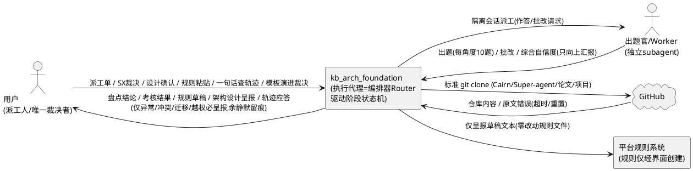

# **4. DFX 约束**

## **4.1 性能**

- 待定：本特性为流程治理型，无吞吐量/响应时间硬指标；架构实施阶段再定义。本阶段两条可验证项：
  1. 每次状态迁移判定必须在呈报时同步给出证据链接，不允许无证据口头迁移。
  2. **【v2 新增】轨迹查询的上下文加载范围恒为"索引 + 事实表 + 至多 2 个被命中条目"**，禁止为查询目的全量扫描（沿机制文档 §2 查规程）。

## **4.2 可靠性**

1. **失败处置可恢复**：网络/环境操作失败必须报原文错误，同命令重试上限 3 次，之后转降级并登记未决事项（SX 阻塞态 + U 编号），项目状态不得因单点失败而失真。
2. **状态可追溯**：盘点结论、修复动作、考核结果、状态迁移全部留痕（变更日志 + 事实表指针），任何迁移结论可回溯到证据文件。
3. **一致性**：核心状态变化由 H7 on_fact_change 钩子更新事实表并刷新核验日期；【v2 新增】阶段状态字段由同一钩子维护，保证"状态与事实永不分离"；【v3 新增】纪律钩子（H2/H3/H6/H7）的有效性以变更日志留痕为审计口径，无痕即违规。

## **4.3 安全性**

1. **规则文件零改动**：.codeartsdoer/rule/ 下所有文件（含 metadata.properties）为 Agent 禁改区；违规即迁移守卫失败。
2. **文件安全**：全程零删除文件；除框架必需外零新建目录；提交禁全量暂存、精确暂存、提交前过门禁（H6 三查不变）。
3. **越权拦截**：用户未批准的操作（改规则、删文件、新建非必需目录）必须先问后动（沿 deepseek-super-agent 审批语义实证：申请者不能批准自己的申请）。
4. **【v3 新增】无密钥义务**：不申请、不配置、不存储任何外部模型 API key（平台模型端口语义，§2）；参考仓库密钥配置文件一律不进入本项目。

## **4.4 可维护性**

1. 考核证据链、环境验收结果、学习成果条目、规则草稿状态登记入 notes/知识库索引.md（对应层 + 变更日志）。
2. 本 spec.md 登记 .codeartsdoer/specs/ 流水线产物层（v2 重构版随本版登记）。
3. 未决事项（材料获取降级、U8 边界等）登记 U 编号，附降级原因与恢复条件。
4. **【v2 新增】执行轨迹即时落盘**：每动作完成即触发 H3（记变更日志）/H7（刷事实表），禁止"做完一批再补记"。
5. **【v3 新增】公约权威源唯一登记**：知识库索引登记唯一"公约权威源"条目（三副本路径+角色+同步状态），此后引用公约只存指针禁抄全文（§5.12）。

## **4.5 兼容性**

1. 七节公约锚点与其平台托管方式（triggerType=always + metadata.properties）保持不变；规则变更只允许追加。
2. 既有知识库三库分工、事件钩子 H1–H7、三级渐进加载、仲裁顺序（规则文件 > 知识库最新文档 > 记忆偏好 > 自行推断）保持不变；**【v2】阶段状态机不新增钩子，只复用 H1/H3/H6/H7 承载；【v3】多维度触发为既有钩子的事件源标注与扩展，不新增钩子机构**。
3. specs 流水线产物目录结构与登记惯例沿用既有功能文件夹形态。
4. **【v3 新增】参考框架接入兼容约束**：Cairn 接入不采用 cairnd 轮询模式（与禁定时任务冲突），蒸馏走单次命令+事件驱动；Super-agent 接入剔除模型供应商配置义务，编排骨架（Router/Worker/triggers/Watchdog/审批）保留，模型调用对接平台模型端口；Windows 可运行义务不变。

# **5. 核心能力**

## **5.1 阶段状态机与迁移守卫（流程总纲，v2 重构核心）**

### **5.1.1 业务规则**

**状态枚举**（7 态）：

| 状态 | 名称 | 准出条件（迁移至下一状态的必要充分条件） | 迁移载体 |
|------|------|------------------------------------------|----------|
| ST0 | 盘点核实 | 盘点结论呈报 + 偏差项登记（含证据）落盘 | H3 落盘、H7 刷事实表 |
| ST1 | 环境就绪 | Cairn Windows 验收通过（命令+结果原文）+ deepseek-super-agent 实证登记完整（含 v3 模型配置点清单与接入方式清单登记）+【v4 扩展】P3C 拉取与配置跑通验收（§5.3 规则 12–14；克隆未达成期间以降级登记推进——SX/U 编号留痕，经用户裁决可带缺口推进，禁虚假就绪） | H7 |
| ST2 | 学习考核 | 出题官批改完成且综合自信度 ≥80% 留痕 | H3/H7 |
| ST3 | 架构设计 | 设计文档呈报且含 §5.6.1 全部硬性交付项（a–h），**用户明确确认** | 用户确认事件 + H7 |
| ST4 | 规则交付 | 草稿 9 条已落盘、已呈报（已达成）；粘贴生效为用户异步动作，不阻塞 | H3 |
| ST5 | SDD 收束 | 终态循环：每任务走 spec→design→tasks→implementation | H6 提交守卫 |
| SX | 阻塞 | ——（挂起态：降级或等待裁决时从任意状态进入，登记恢复条件，恢复后回迁原状态） | H7 |

1. **状态唯一权威**
   a. 验收条件：[任何时刻查询当前阶段] → [仅以事实表阶段状态字段为准，其他文档活引用不抄值]
2. **迁移三要素**
   a. 验收条件：[执行状态迁移] → [准出条件满足 + 证据链接呈报 + 变更日志留痕，三者齐备方为有效迁移；缺一即无效]
3. **非法迁移拒绝**
   a. 验收条件：[当前状态准出条件不满足而发起后续状态的动作] → [拒绝执行，呈报当前状态 + 缺失条件清单；语义等价 v1"门禁保持关闭"，但无独立门机构]
4. **迁移载体限定与多维度触发（v3 扩展）**
   a. 验收条件：[状态自检/守卫/落盘] → [仅挂 H1（会话启动自检当前状态）、H6（提交前守卫含状态检查）、H7（迁移后刷事实表）；禁止新增钩子或定时巡检]
   b. 验收条件：[同一钩子的事件源] → [按四维触发维度标注（会话级/动作级/内容级/门级，见 v3 修订说明第一节），多维度命中彼此独立、先到先处理、幂等去重；维度标注随钩子登记]
5. **SX 阻塞纪律**
   a. 验收条件：[任一阶段因降级或裁决等待无法推进] → [立即进入 SX 并登记：阻塞原因+恢复条件+回迁目标状态；禁止无恢复条件的挂起]
6. **确认点枚举（v2 重组）**
   a. 验收条件：[需要用户确认的场景] → [仅三类：本 spec 确认（进行中）、架构设计确认（ST3 准出）、越权事项先问后动（贯穿）；规则粘贴为用户动作非确认；执行层其余决策自主留痕，禁反问]
7. **禁止项**：禁止新增独立门禁机构、门禁脚本或定时状态巡检
   a. 验收条件：[发现"M 门"式新机构或轮询状态的行为] → [视为流程违规，动作作废并记录]
8. **钩子呈报/静默分级（v3 新增）**
   a. 验收条件：[钩子或守卫触发] → [异常/冲突/迁移/越权四类必呈报用户（附证据链接；呈报=单向信息送达，不阻塞、不需答复，区别于条款 6 的确认）；正常通过一律静默执行+留痕（H3/H7 日志），禁向用户转发正常过程信息；分级枚举见 v3 修订说明第一节]

### **5.1.2 交互流程**

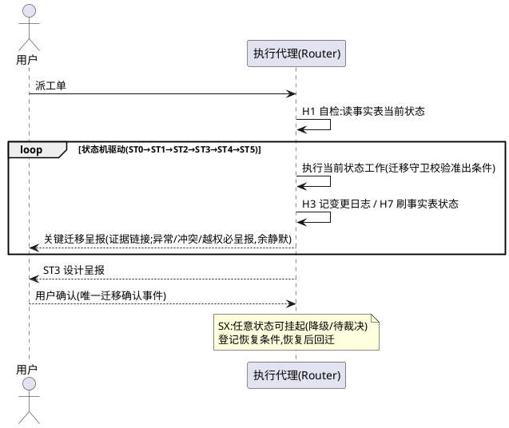

### **5.1.3 异常场景**

1. **状态字段与磁盘证据不符**
   a. 触发条件：事实表阶段状态与证据文件矛盾（如状态=ST2 但无考核证据）
   b. 系统行为：以证据实况为准，回退状态并登记偏差（H7 修正），禁维护虚假状态
   c. 用户感知：偏差报告+修正后状态
2. **迁移条件长期无法满足**
   a. 触发条件：准出条件因外部因素（网络/材料/裁决）持续不满足
   b. 系统行为：转 SX 登记恢复条件呈报，禁空转重试
   c. 用户感知：阻塞原因+恢复条件+已尝试记录
3. **用户指令要求跳过状态**
   a. 触发条件：用户要求越过当前状态直取后续产物
   b. 系统行为：呈报当前状态与被跳过的准出条件，经用户明示豁免方可迁移并留痕豁免记录
   c. 用户感知：状态+缺失条件+豁免选项
4. **多维度并发触发同一钩子**【v3 新增】
   a. 触发条件：同一钩子被多个维度事件源同时命中（如 H7 同时被动作内嵌检查点与裁决消息事件触发）
   b. 系统行为：幂等去重，先到先处理一次，其余命中登记为重复命中不做二次动作
   c. 用户感知：无感知（静默）；仅当去重失败导致重复落盘时按轨迹断链处置

## **5.2 ST0 盘点核实**

### **5.2.1 业务规则**

1. **盘点只读**
   a. 验收条件：[执行本地盘点时] → [仅读取不修改，产出盘点结论后才允许其他动作]
2. **复用既有知识库**
   a. 验收条件：[盘点启动] → [以 notes/知识库索引.md 为唯一入口，引用事实表与维护机制，禁止绕过索引另建清单]
3. **增量核实**
   a. 验收条件：[对派工单"已核实事实"及 v2/v3 调研实证逐项核对] → [每项标注：实查一致 / 实查偏差（附证据），不得照抄不做核实]
4. **偏差登记**
   a. 验收条件：[发现记忆/工单/规格与磁盘实况不符（如 v1 误记规则草稿 7 条实存 8 条；v3 实查公约三副本文本一致）] → [登记偏差与实查证据，修正后以磁盘实况为准]
5. **禁止项**：禁止在盘点结论产出前修改文件或执行拉取动作
   a. 验收条件：[盘点未完成即发起其他动作] → [迁移守卫拒绝，动作作废并记录]

### **5.2.2 交互流程**

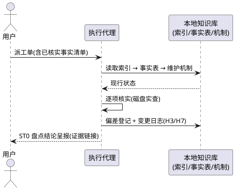

### **5.2.3 异常场景**

1. **知识库条目与磁盘实况不符**
   a. 触发条件：索引登记的文件缺失、路径变更或状态过期
   b. 系统行为：以磁盘实况为准登记偏差，更新索引条目与事实表指针（H7），不臆测缺失内容
   c. 用户感知：盘点结论中标注偏差项与处置方式
2. **工单事实无法核实**
   a. 触发条件：某项事实缺乏本地证据
   b. 系统行为：标记"未实证，待 ST1/ST2 补全"，降级登记
   c. 用户感知：盘点结论中明确列出未实证项

## **5.3 ST1 环境就绪（Cairn 修复 + Super-agent 实证）**

### **5.3.1 业务规则**

1. **标准工具拉取**
   a. 验收条件：[执行拉取] → [仅使用标准 git clone 命令，禁止自造 HTTP 请求或网页抓取]
2. **隔离存放**
   a. 验收条件：[clone 目标] → [项目外独立目录 Desktop/refs/，项目根目录与既有文件零污染（refs/Cairn 与 refs/deepseek-super-agent 已实存并登记事实表）]
3. **失败处置**
   a. 验收条件：[clone 或构建命令失败] → [先呈报原文错误 → 同一命令重试上限 3 次 → 仍失败转降级（SX）并登记未决事项，禁止盲目重试或自作主张换源]
4. **Windows 修复义务（Cairn）**
   a. 验收条件：[Cairn 在 Windows 端跑不起] → [必须诊断修复至正常使用；每次修复动作（意图+命令+结果原文）留痕；禁止未诊断就换方案]
5. **修复验收标准**
   a. 验收条件：[宣称修复完成] → [以框架可运行的启动/自检验证命令执行成功为准（Cairn 参照：make build 产出二进制 + make verify 架构不变量检查通过），附命令与结果原文]
6. **Super-agent 实证登记（v3 扩展）**
   a. 验收条件：[ST1 收尾] → [deepseek-super-agent 实证从"元数据级"升级为"本地实证级"：七层职责表（Channel/Ingress/Engine/Harness/Store/Env/Watchdog）、Router/Worker 双角色、模块登记 M0–M11、技能按需加载模式逐项核对登记；【v3 新增】模型配置点清单（9 处，v3 修订说明第六节）逐项核对登记，并登记剔除/旁路义务声明（#1–#6 供应商配置不作为实施范围，#7/#9 确定性零模型默认路径为旁路依据）]
7. **仓库嵌套防护**
   a. 验收条件：[拉取参考仓库] → [整库存放于项目外隔离目录，与本项目（Date/.git）物理隔离；禁止 git submodule；禁止将参考仓库及其任何部分放入本项目目录内；禁止在参考仓库内再嵌套任何 git 操作]
8. **只读引用与嵌套验收**
   a. 验收条件：[引用/使用参考仓库] → [仅限只读（读文件提炼知识），参考仓库 .git 保持原样；ST1 验收时须核查本项目 git 仓库内无参考仓库痕迹（无 submodule、无内嵌仓库、无复制入内的参考仓库文件）]
   b. 验收条件【v4 收窄，用户授权】：[.git 保持原样条款适用范围] → [仅适用于 Cairn/Super-agent/hyra-results（hyra-results 磁盘未命中待澄清，v4 修订说明第四节）；refs/p3c 按用户明确授权在克隆成功后删除 .git（防仓库嵌套），删除前留痕目录状态，取舍（删后无法 git pull 更新，更新须重新克隆）随登记留痕（规则 12）]
9. **禁止项**：禁止在 Cairn 验收通过前开始学习考核环节的"开工"动作
   a. 验收条件：[Cairn 自检未通过] → [ST1 准出条件不满足，迁移守卫拒绝，仅允许修复动作]
10. **Cairn 接入方式实证登记（v3 新增）**
    a. 验收条件：[ST1 收尾] → [以 refs/Cairn 源码与 README 实证为准登记接入方式清单（7 类：注册表 MCP 服务链路/CLI 只读查询/build 流水线 CLI/REST API/graph-viewer/core 库直调/cairnd 守护进程），标注主路线（#1 注册表 MCP 链路）与储备定位（#2–#6）；cairnd（#7）标注"不采用"并附冲突理由（轮询 vs 禁定时任务）]
11. **禁止项（v3 新增）**：禁止采用 cairnd 轮询守护进程作为蒸馏更新机制
    a. 验收条件：[出现蒸馏更新需求] → [改用 cairn-ingest/cairn-incremental 单次命令、由文档变更事件触发（钩子/人工），禁轮询]
12. **P3C 拉取与 .git 删除授权（v4 新增）**
    a. 验收条件：[执行 P3C 拉取] → [仅用标准 git clone 至 refs/p3c（本轮 3 次失败原文已留痕：Connection was reset ×2、port 443 connect fail ×1，已按降级纪律停手转 ST1 执行项）；克隆成功后按用户授权删除 .git 文件夹（防仓库嵌套），删除前留痕目录状态；取舍（删后无法 git pull，更新须重新克隆）登记于 §6.9]
13. **P3C 凭据盘点（v4 新增）**
    a. 验收条件：[P3C 配置前] → [呈报凭据/钥匙盘点清单：零 API key、零账号、零模型配置；构建依赖=JDK+Maven（版本以仓库 pom 实证后更新清单）；清单呈报后才进入配置动作]
14. **P3C 配置跑通验收（v4 新增）**
    a. 验收条件：[宣称 P3C 配置完成] → [以实际运行一次规约审查（对样例代码产出审查结果）成功为准，附命令+结果原文；模型配置剔除方案=天然满足（纯静态零模型配置点，v4 修订说明第二节 c），登记与 Super-agent 剔除方案的差异说明；框架身份元数据以 §6.9 字段为准登记]
15. **框架身份锁定（v4 新增）**
    a. 验收条件：[涉及代码质量审查框架] → [首选=alibaba/p3c（四项门槛全满足，判定依据见 v4 修订说明第二节 a）；备选储备=蚂蚁 CodeFuse 系列；更换首推须经用户裁决，禁自行更换]

### **5.3.2 交互流程**

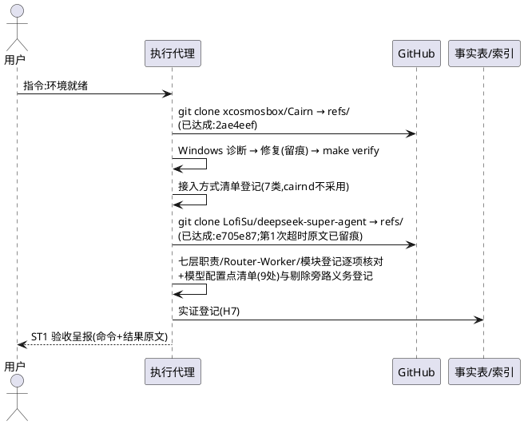

### **5.3.3 异常场景**

1. **git clone 超时/连接重置**
   a. 触发条件：网络波动（本轮实证：超时 300 秒一次、成功一次）
   b. 系统行为：报原文错误；同一标准命令重试≤3 次；超限停手降级（SX），禁换源禁自造拉取
   c. 用户感知：收到原文错误+已尝试次数+降级方案
2. **依赖/构建失败**
   a. 触发条件：修复过程中依赖安装、构建或自检命令报错
   b. 系统行为：诊断先行（读报错原文定位），修复动作逐条留痕；3 次修复未通过则停止转 SX，呈报完整错误链
   c. 用户感知：诊断结论+修复尝试清单+原文错误，等待裁决
3. **仓库方向不符**
   a. 触发条件：仓库内容与 deepseek-super-agent 实证特征（Router/Worker、triggers、Watchdog）不符
   b. 系统行为：如实登记差异，禁编造相符结论，呈报用户裁决
   c. 用户感知：差异清单+原文证据
4. **参考仓库嵌套进本项目**
   a. 触发条件：发现参考仓库（或其任何部分）出现在本项目 git 仓库内，或参考仓库 .git 被改动
   b. 系统行为：立即停止相关动作，登记违规证据（路径+git 状态）；涉及删除/清理的操作一律呈报用户裁决（零删除约束不变）
   c. 用户感知：违规证据清单+处置选项，等待裁决
5. **cairnd 轮询模式与禁定时任务冲突**【v3 新增】
   a. 触发条件：Cairn 修复或使用过程中需要持续构建（cairnd 默认轮询源仓库）
   b. 系统行为：弃用 cairnd 轮询，改用单次构建命令+事件驱动触发；如实登记差异与替代方案
   c. 用户感知：差异登记+单次命令清单
6. **模型配置点核对偏差**【v3 新增】
   a. 触发条件：模型配置点实查结果与 v3 修订说明第六节清单不符（如上游代码变更）
   b. 系统行为：以 refs 实况为准登记偏差，更新清单与剔除/旁路义务声明（H7），不臆测
   c. 用户感知：偏差报告+更新后清单
7. **P3C 克隆连续失败**【v4 新增】
   a. 触发条件：clone 3 次失败（本轮实证：Connection was reset ×2、port 443 connect fail ×1）
   b. 系统行为：停手降级，登记 U 编号与恢复条件；禁擅自换源（镜像站等须用户裁决）；ST1 其余工作不受阻并行推进，审查能力未就绪状态如实呈报
   c. 用户感知：3 次原文错误+已尝试记录+换源裁决选项
8. **P3C 仓库结构与预期不符**【v4 新增】
   a. 触发条件：克隆成功后发现仓库内容与官方描述不符（无 PMD 实现/非规约框架）
   b. 系统行为：如实登记差异，禁编造相符结论，呈报用户裁决（可转备选 CodeFuse 候选清单二次裁决）
   c. 用户感知：差异清单+原文证据

## **5.4 ST2 强制学习与出题考核**

### **5.4.1 业务规则**

1. **学习材料构成**
   a. 验收条件：[启动学习] → [材料=5 篇论文（多角度）+5 个项目（含正反例），逐项登记名称、角度/正反例属性、获取途径、质量评估结论]
2. **材料选取标准**
   a. 验收条件：[选取论文/项目] → [主题须与考核目标直接相关：agent 架构与分层（含 Router/Worker 编排）、知识图谱/技能蒸馏（Cairn 同类）、动态触发与路由（Super-agent 同类）、SDD 方法论、事件驱动机制；5 个项目中成功案例与失败/反面案例合计至少各 1 个]
3. **项目类质量门槛（永久生效）**
   a. 验收条件：[选取学习项目] → [仅限大厂出品、引用程度非常高的框架类项目（明确是框架而非开发工具），禁止 hello world 类垃圾项目；学习前必须完成质量评估（引用度/维护活跃度/大厂背书）与相关性评估，评估结论落盘后方可列入学习清单]
   b. 备注【v2 固化 U8】：deepseek-super-agent 为目标接入框架（用户基线），不因被接入而自动入清单；其是否作为学习材料同样必须过本门槛。
4. **论文类质量门槛（永久生效）**
   a. 验收条件：[选取学习论文] → [仅限最近 1 年内（2025-11 之后优先）智能体（agent）相关论文，禁止陈旧知识；保真度必须准：论文信息须来自可信源（arXiv/顶会官网），标注真实标题与出处，禁止编造]
5. **获取途径与降级**
   a. 验收条件：[材料获取] → [顺序：本地已有文档 → 标准 git clone → 官方 API 元数据 → 失败按 3 次上限转降级（SX）；禁止虚构材料内容顶替；参考仓库仅限只读引用]
6. **出题人独立性**
   a. 验收条件：[出题与批改] → [由独立 subagent（Worker）出题官执行，每个角度 10 题，共覆盖全部选取角度；执行代理禁止自出题、自批改、自判学会]
7. **作答要求**
   a. 验收条件：[收到题目] → [每题必须作答，100% 覆盖，不得弃答]
8. **批改与自信度守卫**
   a. 验收条件：[出题官批改完成] → [给出逐题结果与综合自信度（0–100%）；自信度≥80% ST2 准出达成，<80% 保持 ST2 并安排补学重考]
9. **禁止项**：禁止自信度未达 80% 时迁移至 ST3 或任何实施动作
   a. 验收条件：[自信度<80%] → [仅允许"补学→重新出题→重考"循环，其他动作全部冻结]
10. **结果留痕**
    a. 验收条件：[每轮考核结束] → [题目、作答、批改、自信度登记入知识库，形成证据链；每轮学习完成同步触发 §5.5 学习成果沉淀]

### **5.4.2 交互流程**

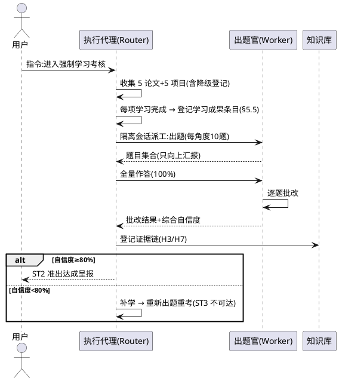

### **5.4.3 异常场景**

1. **综合自信度不达标**
   a. 触发条件：出题官判定 <80%
   b. 系统行为：冻结 ST3 迁移，定位薄弱角度定向补学，重新走"出题→作答→批改"流程
   c. 用户感知：薄弱点报告+新一轮考核计划
2. **材料获取失败**
   a. 触发条件：论文/项目拉取 3 次失败或本地无源
   b. 系统行为：降级登记（含原文错误），以已获取材料继续考核，缺失角度在题目中标注"材料缺失，按既有本地文档出题"
   c. 用户感知：材料缺口清单+替代方案
3. **出题官 subagent 不可用**
   a. 触发条件：独立出题官无法启动或无法产出题目
   b. 系统行为：停手呈报（SX），由用户指定替代出题人；禁止执行代理自行顶替出题
   c. 用户感知：故障说明+等待裁决
4. **学习内容与实证不符**
   a. 触发条件：学习中发现材料描述与 Cairn/Super-agent 本地实况矛盾
   b. 系统行为：以本地实况为准登记差异（入学习成果条目反例），出题官可据此追加辨析题
   c. 用户感知：差异记录留痕
5. **材料质量评估不达标**
   a. 触发条件：候选项目非框架类/无大厂背书/引用度低/维护停滞，或候选论文超出窗口/出处不可信/信息存疑
   b. 系统行为：不列入学习清单，评估结论（含淘汰原因）落盘登记；入选材料不足时按降级流程登记缺口
   c. 用户感知：质量评估清单（入选+淘汰及原因）

## **5.5 学习成果沉淀（v2 新增能力，ST2 起长期生效）**

### **5.5.1 业务规则**

1. **登记时机（事件驱动）**
   a. 验收条件：[每篇论文/每个项目考核相关学习完成] → [即时登记学习成果条目（H3 链路：写前查重→登记→记变更日志）；禁止"学完一批再批量补记"或定时汇总]
2. **条目载体与入口**
   a. 验收条件：[登记条目] → [笔记层承载（notes/ 或 notes/浓缩版/，浓缩版与原文同名存放），以 notes/知识库索引.md 为唯一登记入口；写前查重：同主题已存在则增量更新原条目并刷新核验日期，禁止另起新文件重复承载同主题]
3. **条目必含要素（五要素）**
   a. 验收条件：[产出条目] → [① 链接（原文 URL 或 refs 本地路径）② 条目名（与原文同名或主题-类型-编号规范命名）③ 浓缩版（必含：原文路径/核心要点/关键结论/最后核验日期）④ 正例≥1 ⑤ 反例≥1；无反例时显式标注"未发现反例"并说明排查范围]
4. **正反例格式**
   a. 验收条件：[写正例] → [固定三段：做法+适用场景+出处（章节/链接）]
   b. 验收条件：[写反例] → [固定四段：坑+后果+规避法+出处；踩坑分级（观察/已验证/约定）沿项目协作规则，约定级须用户确认后生效]
5. **用时按需加载（不塞上下文）**
   a. 验收条件：[后续任务需引用学习成果] → [默认仅加载索引一句话摘要（第一层）；需要细节读浓缩版（第二层）；确需全文且有明确理由时按链接/路径读原文（第三层）——即"弄个链接，用的时候再读这篇文章"；禁止将原文全文抄入条目或常驻上下文]
6. **与考核证据链的衔接**
   a. 验收条件：[登记学习成果] → [学习成果条目（知识库笔记层）与考核产物题目/作答/批改（specs 流水线产物层）以条目互链，职责不混放：沉淀复用经验进知识库，考核证据进 specs]
7. **长期维护**
   a. 验收条件：[条目维护] → [走既有增删改查四操作规程（机制文档 §2）；原文变更后同步更新浓缩版，冲突以原文为准；过时条目标记状态并保留链接]
8. **禁止项**：禁止无索引登记、禁止条目替代原文（条目是浓缩+链接，不是复制）、禁止把条目写入 docs/（官方原文层）
   a. 验收条件：[发现条目缺索引/含全文复制/落入 docs/] → [登记违规，条目整改为合规形态并记录]

### **5.5.2 交互流程**

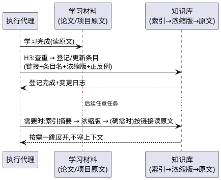

### **5.5.3 异常场景**

1. **同主题条目冲突**
   a. 触发条件：新学习结论与既有条目结论矛盾
   b. 系统行为：暂停写入，列差异交用户裁决（机制 §4 既有规程）
   c. 用户感知：差异对照+裁决请求
2. **原文链接失效**
   a. 触发条件：URL 不可达或 refs 本地路径变更
   b. 系统行为：条目标记"链接失效"，尝试官方 API 元数据核验存续；无法恢复时登记降级，浓缩版结论仍可用（标注已失源）
   c. 用户感知：失效清单+处置状态
3. **学习完成但无反例可提取**
   a. 触发条件：材料确无踩坑点
   b. 系统行为：显式登记"未发现反例"+排查范围说明，禁止为凑数编造反例
   c. 用户感知：条目中显式标注

## **5.6 ST3 架构设计（含注册表硬性交付，v2 重写 / v3 扩展）**

### **5.6.1 业务规则**

1. **前序守卫**
   a. 验收条件：[发起架构设计] → [ST0–ST2 全部准出且留痕，任一不满足即拒绝]
2. **设计范围固定**
   a. 验收条件：[产出设计] → [覆盖：四层分层定稿、注册表机制（两级结构）、编排链（派工单→编排器 Router→Worker）、动态触发（事件/监听/轮询，禁定时任务）、层间组织与架构不变量、模型适配旁路]
3. **注册表条目规范（硬性交付，设计文档必须逐一回答）**
   a. 验收条件：[交付设计] → [以下 a–h 逐项有明确答案，缺一即设计不完整，不得呈报确认：
      (a) 四层边界与条目归属清单——基础设施层（Cairn 底座/存储/沙箱/进程/共享契约）、领域层（七节规矩仲裁/事实表/知识库规程/学习沉淀/负 100 语义）、业务层（编排器 Router/Worker/触发路由/准入 Eval/审批/Watchdog）、界面层（CLI/面板/平台会话信道/可视化），每层列出归属条目；
      (b) 每层组织方式——接口/端口/设计模式选型及组合（参照实证：deepseek-super-agent 端口模式+单一写者+M0 shared 禁向上依赖；Cairn 架构不变量机器检查），并说明层间为何不松散；
      (c) 注册表形态（两级结构，v3 固化）——**注册表=抽象模板层+具体功能挂载点**：模板层定义能力契约与登记规范（六要素定义、四类判据、挂载/摘除规程、模板演进规则=演进须经用户裁决），挂载项=具体功能实例按模板登记；承载文件、条目六要素（能力描述/调用理由/层归属/依赖/状态/所有权边界）逐字段落定；
      (d) 类型区分判据——工具 tool（原子可执行能力，MCP/命令级）/脚本 script（流程化可执行文件）/技能 skill（SKILL.md 操作手册，索引+按需加载正文，禁扩权）/代理 agent（Router/Worker 角色或 subagent 定义）四类枚举，每类给出判据与登记路径（实证参照：MCP 工具命名 mcp__server__tool、技能 skills/\<id\>/SKILL.md、代理 .claude/agents/*.md+配置文件分离）；
      (e) 架构不变量清单——可机器验证的层间禁令逐条列出（仿 Cairn make verify），注明验证方式；
      (f) 编排映射——编排器=Router 的角色确认：本项目执行代理承担 Router（序点/分派/唯一对外汇报），worker=subagent（隔离会话、只向上汇报、禁持有编排权），与四层的映射逐条写清；
      (g) 注册表挂载点——"方法挂注册表、注册表挂 Cairn 框架"的具体衔接方式（含 MCP 服务链路，主路线见 v3 修订说明第五节接入清单），与既有知识库三级加载的衔接；
      (h) 模型适配旁路方案（v3 新增）——模型调用层对接平台模型端口（§2）的设计：编排骨架保留清单（Router/Worker/triggers/Watchdog/审批）、供应商配置义务剔除清单（对应 v3 修订说明第六节 #1–#6）、确定性零模型路径采用（#7/#9）]
4. **"自我推销式"登记语义**
   a. 验收条件：[设计注册表条目模板] → [每条目以第一人称回答三问：我有什么能力（能力描述）、为什么调用我（调用理由/何时路由到我）、我属于哪一层（层归属）；三问答案缺失即条目无效；技能类条目的"自我介绍"由 SKILL frontmatter description 常驻元数据层天然承载（v3 实证 bp0010，见 §5.11）]
5. **SDD 顺序**
   a. 验收条件：[进入设计] → [本 spec.md 已确认，设计以 design.md 承载，先规范后实施]
6. **用户确认门（唯一用户迁移事件）**
   a. 验收条件：[设计产出] → [呈报设计摘要，经用户明确确认后 ST3 准出；确认前零实施]
7. **禁止项**：禁止在设计未经确认时实施；禁止注册表条目缺任一要素；禁止把设计内容混入本 spec；禁止设计含独立模型供应商配置
   a. 验收条件：[发现实施先于确认或条目缺要素或含供应商配置] → [动作作废，回退到确认环节并记录违规]

### **5.6.2 交互流程**

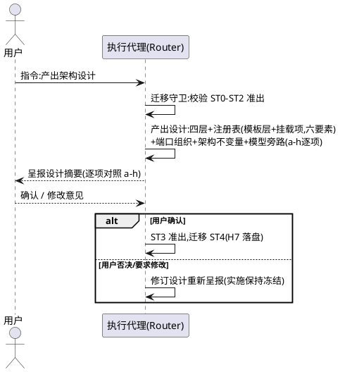

### **5.6.3 异常场景**

1. **用户否决设计**
   a. 触发条件：用户不接受呈报的设计
   b. 系统行为：按修改意见修订并重新呈报，实施冻结不解除
   c. 用户感知：修订版摘要+与上版差异说明
2. **前序状态未准出即被催促设计**
   a. 触发条件：ST0–ST2 有未达成项
   b. 系统行为：拒绝并呈报当前状态与缺失条件清单
   c. 用户感知：明确进度与卡点
3. **设计需求超出本 spec 范围**
   a. 触发条件：设计中出现本规格未约定的能力
   b. 系统行为：先修订 spec（走用户确认），再进设计，禁止无规格实施
   c. 用户感知：spec 变更预览请求
4. **注册表条目三问答案空泛**
   a. 触发条件：条目"调用理由"写成"实现某功能"类泛化表述，无路由判据
   b. 系统行为：视为缺要素退回补写，禁空泛条目入库
   c. 用户感知：不合格条目清单+补写要求
5. **设计未回答模型旁路**【v3 新增】
   a. 触发条件：设计文档缺 (h) 模型适配旁路方案，或出现独立模型供应商配置（API key/base/provider/网关/角色分模型）
   b. 系统行为：视为设计不完整退回补写，禁呈报确认
   c. 用户感知：缺失项清单+补写要求

## **5.7 ST4 永久规则交付（草稿已达成，粘贴由用户）**

### **5.7.1 业务规则**

1. **草稿现状基线（磁盘实况，v3 更新为 9 条）**
   a. 验收条件：[核对本状态] → [规则草稿-永久生效.md 已落盘：9 条（SDD 强制/学不会禁开工/学习材料门槛/参考仓库隔离/规矩层冻结/禁定时任务/事实表单一源/仲裁顺序/新功能准入），每条一行，triggerType=always 标注于文件头；第 9 条为 v3 新增（新功能标准接入流程，裁决建议与理由见 v3 修订说明第三节），随本版呈报待用户裁决粘贴]
2. **零改动红线**
   a. 验收条件：[任何时点] → [七节公约 .mdc 与 metadata.properties 内容零变化；规则文件夹只追加新文件/新内容，严禁改动既有锚点]
3. **交付方式**
   a. 验收条件：[交付草稿] → [草稿文件供用户复制并经平台界面手动粘贴生效；Agent 全程零接触规则文件，状态只推进到"已呈报"]
4. **禁止项**：禁止 Agent 直接写入、修改、删除任何规则文件
   a. 验收条件：[用户要求 Agent 代改规则] → [拒绝并仅提供草稿，引用"无权自作主张改规则"条款]

### **5.7.2 交互流程**

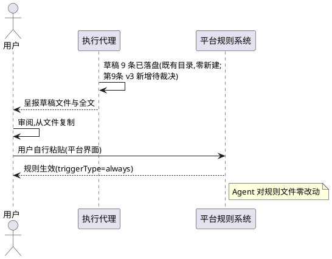

### **5.7.3 异常场景**

1. **用户要求 Agent 代改规则文件**
   a. 触发条件：用户指令与零改动红线冲突
   b. 系统行为：拒绝执行，重复提供草稿文本并说明边界
   c. 用户感知：草稿+边界说明
2. **草稿被驳回**
   a. 触发条件：用户对措辞/条目不满意
   b. 系统行为：按意见修订草稿重新呈报，仅草稿层面循环
   c. 用户感知：修订版草稿

## **5.8 ST5 SDD 永久生效**

### **5.8.1 业务规则**

1. **四阶段强制**
   a. 验收条件：[任何新任务] → [按 spec → design → tasks → implementation 顺序执行，禁跳阶段、禁倒置]
2. **阶段确认**
   a. 验收条件：[每阶段文档完成] → [呈报文档摘要，获用户确认修改意见闭环后才进下一阶段]
3. **先规范后动作**
   a. 验收条件：[涉及代码/配置变更] → [对应 spec 条款先行存在并经确认]
4. **永久生效载体**
   a. 验收条件：[规则草稿经用户粘贴] → [SDD 强制成为 triggerType=always 永久规则，此后所有任务默认适用；粘贴前以本 spec 与用户派工单为临时依据]
5. **编码必审（v4 新增，规则草稿第 10 条候选）**
   a. 验收条件：[任何编码动作（implementation 阶段）发生] → [触发 P3C 质量审查（ST1 就绪后）：增量审查（变更文件范围）优先、全量审查挂 H6 提交守卫；审查未过不完工、结果必留痕（命令+结果原文）；LLM 参与的解释/修复建议一律走平台模型端口且经复核留痕后采信；审查能力未就绪时如实呈报、禁虚假通过（§5.13）]

### **5.8.2 交互流程**

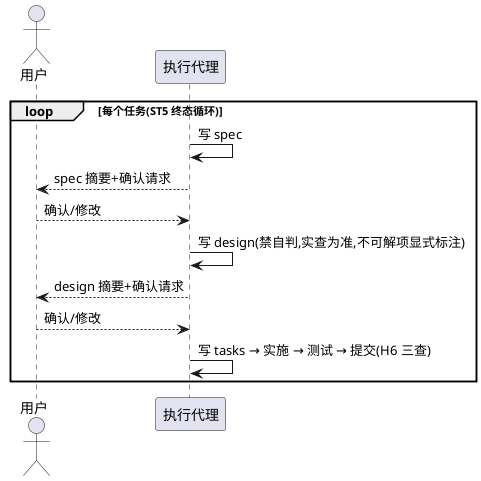

### **5.8.3 异常场景**

1. **用户跳过阶段指令**
   a. 触发条件：用户要求直接实施
   b. 系统行为：说明 SDD 永久规则约束，请求确认是否豁免；未经确认不跳阶段
   c. 用户感知：阶段状态+豁免请求
2. **实施中发现 spec 缺口**
   a. 触发条件：实现时遇到规格未覆盖情形
   b. 系统行为：停手，修订 spec 并走确认，再回实施
   c. 用户感知：spec 修订预览

## **5.9 执行轨迹可查（v2 新增贯穿能力）**

### **5.9.1 业务规则**

1. **三问三答协议**
   a. 验收条件：[用户问"做了什么"] → [变更日志作答：日期+条目+动作+触发来源逐行检索]
   b. 验收条件：[用户问"做到哪/卡在哪"] → [事实表作答：阶段状态字段当前值 + SX 阻塞记录（原因/恢复条件）+ 未决事项 U 编号]
   c. 验收条件：[用户问"产物在哪"] → [知识库索引作答：条目路径（specs 产物层/笔记层/档案区）]
2. **即时落盘（事件驱动）**
   a. 验收条件：[任一动作完成] → [即时触发 H3（写后记变更日志）与 H7（状态变化刷事实表）；禁止事后批量补记、禁止定时汇总落盘]
3. **档案模式**
   a. 验收条件：[派工单级任务完结] → [按 notes/档案区/kb_maintenance/ 既有模式归档：工单原文+执行记录+结果产物索引三件套]
4. **查询协议（一句话定位）**
   a. 验收条件：[收到任意任务的轨迹查询] → [读索引定位 → 按需读事实表/档案/产物；返回：当前状态+最近动作+卡点（如有）+产物路径，全部附证据链接；加载范围恒为索引+事实表+至多 2 个命中条目，禁全量扫描]
5. **禁止项**：禁止轨迹信息只存在于会话记忆或层层规划文件中
   a. 验收条件：[某动作的记录仅可在历史对话中找到] → [视为落盘违规，即时补登并记录违规]

### **5.9.2 交互流程**

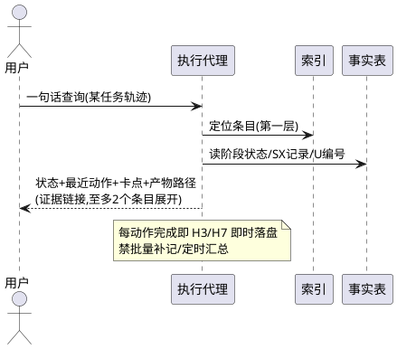

### **5.9.3 异常场景**

1. **轨迹断链**
   a. 触发条件：变更日志缺失某时段记录或事实表状态无对应证据
   b. 系统行为：以磁盘产物实查重建记录，标注"重建"字样与重建依据，登记断链偏差
   c. 用户感知：断链说明+重建记录
2. **查询命中过多条目**
   a. 触发条件：任务涉及条目超过加载上限
   b. 系统行为：返回路径清单+前 2 个条目展开，其余按需二次查询，禁一次性全量加载
   c. 用户感知：分层应答+继续查询入口

## **5.10 全程硬约束合规（贯穿）**

### **5.10.1 业务规则**

1. **负 100 分纠偏语义**
   a. 验收条件：[任何"学会/完成/通过"自评] → [无效；必须替换为证据+独立批改结论；初始信任分为 -100，仅凭验收证据逐项回升]
2. **不许反问（限执行层）**
   a. 验收条件：[盘点、核实、材料选取、修复方案等执行层决策] → [按偏好自主读盘决策并留痕，禁止反复拉扯式反问；反问仅保留 §5.1.1 条款 6 枚举的三类确认点]
3. **不自判学会**
   a. 验收条件：[学习完成宣称] → [唯一有效判据为出题官批改结果与 80% 自信度，执行代理无自判权]
4. **不瞎干**
   a. 验收条件：[任一动作启动] → [先诊断分析，行动方向引用此前分析结论；无分析依据的动作视为违规]
5. **零删除文件**
   a. 验收条件：[全程] → [不删除任何既有文件；清理需求转登记呈报]
6. **目录管控**
   a. 验收条件：[需新建目录] → [仅允许框架必需两类：specs 功能目录、参考项目隔离存放目录（refs/ 已建立）；其余一律先呈报批准]
7. **状态守卫**
   a. 验收条件：[推进流程] → [按 §5.1 状态机：严格 ST0→ST1→ST2→ST3→ST4→ST5；考核与环境未准出不进设计；设计未经确认不实施]
8. **重试纪律**
   a. 验收条件：[任一失败] → [原文错误呈报 → 同法重试≤3 次 → 转降级（SX）；禁盲目重试、禁擅自换源]

### **5.10.2 交互流程**

```plantuml
@startuml
actor 用户 as U
participant "执行代理" as A

U -> A : 任何执行层指令
A -> A : 诊断分析(先分析后行动)
A -> A : H1 自检当前状态+迁移守卫校验
alt 守卫允许
  A -> A : 执行并即时落盘(H3/H7)
  A --> U : 结果呈报(证据链接)
else 守卫拒绝
  A --> U : 拒绝+当前状态+缺失条件清单
end
note bottom of A : 越权事项(改规则/删文件/新建目录)一律先问后动
@enduml
```

### **5.10.3 异常场景**

1. **指令与硬约束冲突**
   a. 触发条件：用户新指令触碰红线（改规则、删文件等）
   b. 系统行为：执行红线优先，先呈报冲突再等裁决
   c. 用户感知：冲突说明+两条路径选项
2. **多轮失败**
   a. 触发条件：同一问题 3 次尝试未成功
   b. 系统行为：停止尝试，转 SX 登记恢复条件，呈报全部原文错误与诊断结论
   c. 用户感知：失败链+恢复条件+建议决策点

## **5.11 新功能标准接入流程（v3 新增贯穿能力，ST5 起长期生效）**

### **5.11.1 业务规则**

1. **五步固定流程**
   a. 验收条件：[新增任何功能] → [按序完成：① 新功能提出（含场景与预期）② 评估归类（四类判据 tool/script/skill/agent + 四层归属判定）③ 生成 SKILL（.codeartsdoer/skills/\<id\>/SKILL.md，frontmatter 含 name+description 触发条件）④ 注册表按模板登记六要素（挂载项）⑤ 记变更日志（H3）；五步缺一即功能未准入]
2. **SKILL 元数据标准（复用码道技能体系，实证 bp0010 渐进式加载第一层）**
   a. 验收条件：[生成 SKILL] → [name 用"动词+名词"命名（如 review-code；禁 helper/tool1 类模糊名，bp0010 原文）；description 写清触发条件+适用场景+不适用场景——description 常驻元数据层（始终在智能体视野内），即**天然自我介绍+自动触发**（智能体激活技能的唯一判断依据=description，bp0010 原文实证）；SKILL 正文=操作手册，激活后按需加载；禁模糊 description]
3. **登记三问（与 §5.6.1 规则 4 同语义）**
   a. 验收条件：[注册表登记] → [条目以第一人称回答：我有什么能力/为什么调用我/我属于哪一层；答案空泛即登记无效退回；技能类条目三问中的"能力+调用理由"由 SKILL description 承载，"层归属"由注册表条目承载]
4. **先登记后使用**
   a. 验收条件：[功能被调用] → [该功能已完成五步且处于"已登记"状态；未准入功能禁止进入调用链]
5. **禁止项**：禁止先使用后补登记、禁止绕过注册表私挂功能
   a. 验收条件：[发现未登记功能被调用] → [阻断+补走五步+记违规]
6. **适用范围**：未来所有新功能场景（嵌入式开发、逆向工程、黑白攻防等）一律适用，无默认豁免；豁免须经用户明示并留痕
7. **规则固化**：本流程第 9 条草稿已随 v3 落盘呈报（§6.2），经用户粘贴后升级为永久规则

### **5.11.2 交互流程**

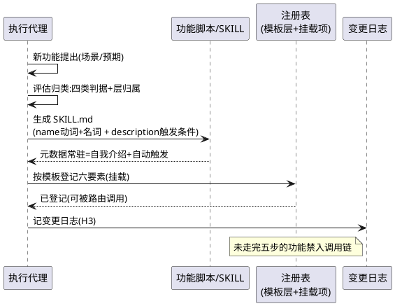

### **5.11.3 异常场景**

1. **归类两可**
   a. 触发条件：功能同时符合多类判据或层归属不清
   b. 系统行为：停止准入，列两可原因呈报用户裁决（禁猜禁编）
   c. 用户感知：两可说明+选项
2. **description 触发条件写不清**
   a. 触发条件：SKILL description 模糊（无场景、无边界），无法支撑自动激活判断
   b. 系统行为：退回重写（description 模糊等于白写，bp0010 原文）；正文可后置，元数据不达标禁登记
   c. 用户感知：不合格元数据+重写要求
3. **未登记功能被发现已调用**
   a. 触发条件：调用链中出现未准入功能
   b. 系统行为：立即阻断调用，补走五步，记违规
   c. 用户感知：违规记录+补登记结果

## **5.12 公约唯一权威源与指针化（v3 新增贯穿能力）**

### **5.12.1 业务规则**

1. **副本实查清单（固化，2026-11-06 逐字实查）**
   a. 验收条件：[涉及公约内容] → [仅承认以下三副本，文本实质一致：① docs/项目协作公约-最终稿.md（用户定稿证据）② .codeartsdoer/rule/项目协作公约.mdc（生效载体，与①逐行一致）③ .codeartsdoer/rule/metadata.properties 内嵌 content（JSON 转义全文+平台元数据，注册自动生成）；实查明细见 v3 修订说明第四节]
2. **权威源分层**
   a. 验收条件：[判定公约内容] → [生效权威源=②.mdc（运行时唯一生效，triggerType=always）；内容权威源=①docs/最终稿（语义裁定文本，变更须经用户重新定稿+经平台界面重新粘贴才回到生效）；③=平台派生缓存（非维护源，永不参与仲裁）；任何"第四副本"不承认]
3. **指针化义务（消除增量重复）**
   a. 验收条件：[任何笔记/规格/草稿/条目需引用公约] → [只存路径指针+角色标注，禁止抄录七节公约全文；知识库索引登记唯一"公约权威源"条目（三路径+角色+同步状态，字段约束 §6.7），全库仅此一处登记实体信息；既有三副本保留不动（零删除）]
4. **同步核对（H4 扩展职责）**
   a. 验收条件：[H4 规则 diff 命中公约内容] → [核对①②文本一致性；一致则静默留痕；不一致标记"待同步"呈报用户——唯一恢复路径=用户重新定稿+经平台界面重新粘贴（②③平台托管禁手改）]
5. **仲裁顺序应用**
   a. 验收条件：[副本内容冲突] → [运行时以②为准（规则文件最高仲裁位）；语义争议以①为裁定文本并呈报同步；③永不参与仲裁；裁决后按 H4 流程更新同步状态登记]
6. **零删除**
   a. 验收条件：[治理动作全程] → [三副本全部保留，零删除；本机制不产生任何删除事项，无需删除批准]
7. **禁止项**：禁止手改②③（平台托管）；禁止在副本之外再产生公约全文副本
   a. 验收条件：[发现手改或第四副本] → [登记违规，整改为路径指针形态并记录]

### **5.12.2 交互流程**

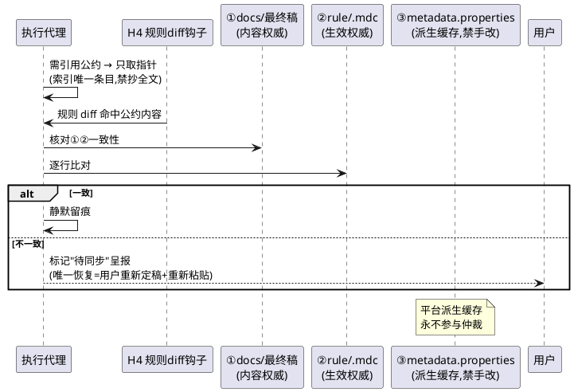

### **5.12.3 异常场景**

1. **①②内容不一致**
   a. 触发条件：用户更新了 docs/ 定稿但未重新粘贴平台，或反向
   b. 系统行为：标记"待同步"呈报；运行时暂按②执行并注明争议
   c. 用户感知：差异对照+同步指引（重新粘贴路径）
2. **发现第四副本**
   a. 触发条件：任何文件出现公约全文抄录
   b. 系统行为：登记违规，整改为路径指针，记录于变更日志
   c. 用户感知：违规清单+整改结果
3. **平台重新生成③**
   a. 触发条件：用户经平台界面变更规则触发③自动重写
   b. 系统行为：H4 diff 正常触发，按规则 4 核对同步，非违规
   c. 用户感知：同步状态更新

## **5.13 框架选型与建议（v4 新增贯穿能力，多方调研产出，呈用户审阅）**

> 本章为用户点名"收集你的意见"的正式产出：每条含不合理点+建议+依据；调研输入实证见 v4 修订说明第三节。用户明示本轮意见收集后进入下一阶段。

### **5.13.1 业务规则**

1. **框架选型结论固化**
   a. 验收条件：[涉及代码质量审查框架选型] → [首选=alibaba/p3c（GitHub API 实证：30,856⭐/Apache-2.0/2017 开源/PMD 规约框架，四项门槛全满足）；备选储备=蚂蚁 CodeFuse 系列（大厂背书但引用度低一量级，研究型仓库为主）；更换首推须经用户裁决，禁自行更换]
2. **语言边界如实登记（不合理点 1）**
   a. 验收条件：[非 Java 代码产生审查需求] → [P3C 仅覆盖 Java 规约，非 Java 语言审查能力缺口如实登记，按 §5.11 五步流程按需引入其他语言审查工具；禁止虚构 P3C 多语言能力]
   b. 依据：官方描述"Alibaba Java Coding Guidelines"（API 实证，规约对象为 Java）
3. **上游维护状态取舍（不合理点 2）**
   a. 验收条件：[评估 P3C 最后 push 2024-08-06 的维护活跃度] → [接受版本固化取舍（静态规约内容稳定、不依赖上游演进），登记于 §6.9 登记条目；不构成更换框架理由]
   b. 依据：规约类框架价值在规则集稳定性而非功能迭代；仓库未 archived、issues 仍活跃（updated_at 2026-11-06）
4. **审查执行策略：增量优先、全量挂门禁（不合理点 3）**
   a. 验收条件：[编码任务触发审查] → [增量审查（变更文件范围）优先，全量审查挂 H6 提交守卫；具体策略实现留 design.md]
   b. 依据：arXiv:2608.09290 OpenCodeReview 实证"确定性优先于非确定性"的成本可控性；避免每次编码全量跑 PMD 的高成本
5. **审查结论可信底线：静态为底、LLM 复核（不合理点 4/5）**
   a. 验收条件：[任何审查结论采信] → [静态规约（P3C）结论为确定性依据；LLM 参与的解释/修复建议一律走平台模型端口且经执行代理复核留痕后方可计入准出]
   b. 依据：arXiv:2607.24964 ALIBI 实证对抗注释可攻击 LLM 审查器；arXiv:2609.37216 CRJudgeBench 实证 AI 审查存在"貌似合理但无效"结论——纯 LLM 审查不可单独作为准出依据
6. **审查结果与轨迹衔接（建议）**
   a. 验收条件：[审查发现项] → [未过项进变更日志+事实表卡点（SX 语义），修复后复检留痕；审查通过结论同样留痕（静默级）；字段约束 §6.9 条款 6]
7. **大厂方案参照边界（建议）**
   a. 验收条件：[审查流水线设计引用大厂方案] → [仅引用有真实出处方案：p3c（阿里实战多年，本方案即采用）与 Ericsson 工业实证（arXiv:2609.15877，上下文化多方审查）；禁编造无出处的大厂做法]
8. **平台适配取舍固化（建议）**
   a. 验收条件：[编码必审触发机制设计] → [接受"平台无编码完成原生事件、无文件 watcher"现实：触发挂 ST5 编码动作内嵌检查点+任务事件；不新增钩子机构、不引入轮询（禁定时任务不变）]
9. **禁止项**：禁止以任何理由虚构审查通过结论
   a. 验收条件：[宣称"审查通过"] → [必须附审查命令+结果原文留痕，无痕即违规]

### **5.13.2 交互流程**

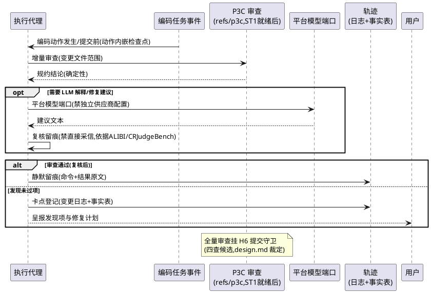

### **5.13.3 异常场景**

1. **P3C 本地未就绪即遇编码任务**
   a. 触发条件：克隆未达成（本轮 3 次失败降级）或配置未跑通
   b. 系统行为：如实呈报"审查能力未就绪"，编码任务不因审查缺位而虚假通过；登记卡点，ST1 恢复后补审
   c. 用户感知：未就绪说明+卡点登记
2. **审查工具运行失败**
   a. 触发条件：PMD/JDK/Maven 环境报错
   b. 系统行为：报原文错误→诊断修复留痕→3 次上限转 SX
   c. 用户感知：错误原文+修复尝试清单
3. **审查结论与用户判断冲突**
   a. 触发条件：用户认可某写法而 P3C 规约报 violation
   b. 系统行为：按仲裁顺序（规则>推断）呈报差异；用户明示豁免则留痕豁免记录
   c. 用户感知：violation 详情+豁免选项

## **5.14 现有工具/skills 复用性盘点（v4 新增贯穿能力）**

### **5.14.1 业务规则**

1. **盘点范围固定**
   a. 验收条件：[执行复用性盘点] → [范围=本地 5 个 project 技能（find-skills/grill-me/lazy-exec/ruleinit/skill-writer）+ 平台 49 技能中与本特性相关项 + 现有脚本资源；范围变更须用户裁决]
2. **评估维度固定（复用评估表）**
   a. 验收条件：[逐项评估] → [三列必填：触发时机合理性（合理/需修订/缺失）、可复用性（直接复用/改造复用/不复用）、缺口清单（有/无+内容）；技能类另标注捆绑脚本有无（bp0010 第三层契约）；枚举与字段约束 §6.8]
3. **盘点基线（v4 实证固化）**
   a. 验收条件：[引用盘点结论] → [以 v4 修订说明第一节评估表为基线：5 本地技能全部启用、全部无捆绑脚本、触发时机全部合理；平台相关项=SDD 三件套/experience 族/bug-fix 族/UT 族等；脚本资源=零可复用；后续盘点增量更新此表，禁止推翻无新证据的结论]
4. **复用优先纪律**
   a. 验收条件：[新功能接入（§5.11 五步第②步评估归类）] → [先查复用评估表：已有可复用条目禁止新建重复功能；触发时机"需修订"项走 skill-writer 合规修订 description，禁直接弃用重建]
5. **评估结论引用义务**
   a. 验收条件：[ST3 注册表条目设计] → [每条目须引用复用评估结论（复用自何条目或新建理由），无引用即设计不完整退回]
6. **禁止项**：禁止绕过评估表直接新建功能
   a. 验收条件：[发现未查评估表的新建条目] → [退回补评估并记违规]

### **5.14.2 交互流程**

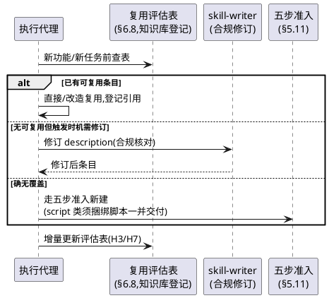

### **5.14.3 异常场景**

1. **评估表与磁盘实况不符**
   a. 触发条件：表登记的技能/脚本状态与磁盘不一致（如技能被禁用/删除）
   b. 系统行为：以磁盘实况为准增量更新并记偏差
   c. 用户感知：偏差登记
2. **多技能触发时机重叠**
   a. 触发条件：两个技能 description 覆盖同一场景
   b. 系统行为：按既有 description 不适用场景划分裁定（实证：find-skills 明确"不适用于技能编写归 skill-writer"）；无边界则退回 skill-writer 修订
   c. 用户感知：边界裁定记录

# **6. 数据约束**

## **6.1 考核记录**

1. **论文清单**：固定 5 篇；每篇必须含字段：名称、角度归属、获取途径（本地/clone/API/降级）、状态（已获取/降级缺失）、发表时间与可信出处（须为最近 1 年内智能体相关论文，出处限 arXiv/顶会官网，禁编造）。
2. **项目清单**：固定 5 个；仅限大厂出品、引用程度非常高的框架类项目（非开发工具，禁 hello world 类垃圾项目）；每个必须含字段：名称、获取途径、正例/反例属性（正反例合计至少各 1）、与考核目标的关联点、质量评估结论（引用度/维护活跃度/大厂背书）与相关性评估结论（评估结论落盘后方可列入清单）。
3. **题目**：每个学习角度 10 题；题目总数=角度数×10；每题有唯一编号。
4. **作答**：与题目一一对应，覆盖率必须 100%，不得弃答。
5. **批改结果**：批改人必须为出题官（独立 subagent）；含逐题判定与依据。
6. **综合自信度**：取值 0–100 的百分比；准出阈值 80%；每轮考核产生一个新值，历史值保留。
7. **考核轮次状态**：枚举（未开始/学习中/已出题/已作答/已批改/通过/未通过）；状态判定只认最新轮次。

## **6.2 规则草稿（v4 更新：10 条，第 10 条为候选）**

1. **草稿条数**：固定 **10 条**【v4 新增第 10 条"编码必审"（候选状态：裁决建议=要，理由见 v4 修订说明第二节 d；随本版写入草稿文件呈报，粘贴裁决权在用户）；v3 为 9 条（第 9 条"新功能准入"）；v2 为 8 条（v2 曾依磁盘实况修正 v1 的 7 条误记）】，内容对应已落盘文件 `规则草稿-永久生效.md`（SDD 强制/学不会禁开工/学习材料门槛/参考仓库隔离/规矩层冻结/禁定时任务/事实表单一源/仲裁顺序/新功能准入/编码必审）。
2. **草稿体量**：每条一行内，总字数控制在对上下文友好的量级（300 字级）。
3. **triggerType**：草稿文件头必须标注 always。
4. **交付载体**：草稿文件落盘于既有目录内（不新建目录），供用户复制粘贴；Agent 只推进到"已落盘/已呈报"。
5. **草稿状态**：枚举（起草/已落盘/已呈报/用户已确认/用户已粘贴生效）；Agent 只能推进到"已呈报"，后续状态由用户动作决定。
6. **粘贴执行者**：固定为用户，Agent 权限=零（不读写规则文件）。
7. **【v3】草稿增删依据**：草稿条目的新增/修订由 spec 修订驱动并呈报用户裁决，禁止无规格依据随意增删。

## **6.3 环境登记**

1. **隔离目录**：Desktop/refs/（已实存并登记事实表）；所有参考仓库必须置于其下。
2. **Cairn 本地版本**：refs/Cairn，HEAD=2ae4eef（2026-10-29，浅克隆）；安装/构建路径不得指向项目根目录内部。
3. **deepseek-super-agent 本地版本**：refs/deepseek-super-agent，HEAD=e705e87（2026-11-05，浅克隆）；同上隔离要求。
4. **验收命令与结果**：必须留存原文（命令行+输出），作为 ST1 准出证据。
5. **修复留痕**：每次修复动作含意图、命令、结果三要素。
6. **嵌套核查记录**：ST1 验收必须包含嵌套核查结果（本项目 git 仓库内无参考仓库痕迹、参考仓库 .git 保持原样）。
7. **【v3】接入与配置清单登记**：Cairn 接入方式清单（7 类，含 cairnd 不采用标注）与 Super-agent 模型配置点清单（9 处，含剔除/旁路义务声明）作为 ST1 实证登记的固定组成部分，随 ST1 验收留痕。
8. **【v4】P3C 本地登记**：refs/p3c（目标路径）；克隆状态枚举（未达成/已克隆/已配置/已验收），当前=**未达成**（标准 git clone 3 次失败原文留痕：Connection was reset ×2、Failed to connect to github.com port 443 after 21108 ms ×1；已按降级纪律停手，登记未决事项，禁盲目重试、禁擅自换源）；克隆成功后按用户授权删除 .git（取舍=无法 git pull 更新，更新须重新克隆，删除动作与取舍随登记留痕）。

## **6.4 架构设计产物（逻辑约束）**

1. **分层枚举（v2 定稿）**：固定四层——基础设施层 / 领域层 / 业务层 / 界面层【v1"前端层"更名为"界面层"，实证依据：Cairn graph-viewer 与 deepseek-super-agent Channel/CLI 均为人机接口职责而非纯前端】；层名与职责映射固定，禁止增删层或跨层混用。
2. **注册表条目六要素**：能力描述（我有什么能力）/ 调用理由（为什么调用我、何时路由到我）/ 层归属（四层枚举之一）/ 依赖（依赖的条目与端口）/ 状态（提案/已登记/已验证/已冻结/已废弃）/ 所有权边界（拥有的文件与接口、禁谁改动）；缺任一要素的条目无效。
3. **条目类型枚举**：tool（工具，原子可执行能力）/ script（脚本，流程化可执行文件）/ skill（技能，SKILL.md 手册、索引+按需加载正文、禁扩权）/ agent（代理，Router/Worker 角色或 subagent 定义）；每条目必标注且仅标注一类。
4. **层间组织约束**：依赖方向单向（界面→业务→领域→基础设施），上层可依赖下层、反向禁止；层间通信必须经显式端口；领域状态必须有唯一写者。
5. **架构不变量**：设计必须给出逐条可机器验证的层间禁令清单（仿 Cairn make verify），并注明验证方式；无不变量清单的设计不得呈报确认。
6. **注册表挂载点**：注册表挂 Cairn 框架；方法→注册表→框架的两级挂载关系固定；与既有知识库三级渐进加载的衔接方式必须写明。
7. **路由链**：派工单→编排器（Router）→业务→领域→基础设施 的单向调用链；Worker 只向上汇报。
8. **触发类型枚举**：事件/监听/轮询 三种；"定时任务"为禁用值，任何设计产物不得包含。
9. **设计确认状态**：枚举（起草/已呈报/用户已确认/已否决）；仅"用户已确认"状态允许实施。
10. **【v3】注册表两级结构**：模板层+挂载层固定；模板层承载能力契约与登记规范（六要素定义、四类判据、挂载/摘除规程），挂载项=具体功能实例按模板登记；模板演进须经用户裁决；挂载项六要素不全即登记无效。
11. **【v3】平台模型端口**：目标架构中一切 LLM 调用收敛为平台模型端口单一出口（对接码道平台自带大模型能力）；禁止出现独立模型供应商配置（API key/base/provider/网关/角色分模型）；确定性零模型路径优先（实证：Slow Path 默认 rules、EmbeddingPort 默认离线）。

## **6.5 学习成果条目（v2 新增）**

1. **链接**：非空；取值=原文 URL 或 refs 下本地相对路径。
2. **条目名**：与原文同名（浓缩版同名对应）或按"主题-类型-编号"规范命名；同主题禁止重复条目。
3. **浓缩版四要素**：原文路径 / 核心要点 / 关键结论 / 最后核验日期；缺一不完整。
4. **正例**：≥1 条；固定三段：做法+适用场景+出处。
5. **反例**：≥1 条；固定四段：坑+后果+规避法+出处；确无反例时显式登记"未发现反例"+排查范围。
6. **踩坑分级**：观察/已验证/约定 三级；约定级条目必须经用户确认后生效。
7. **来源类型枚举**：论文 / 项目。
8. **条目状态枚举**：学习中 / 已沉淀 / 链接失效 / 已过时；"已过时"须附原文变更线索。
9. **存放位置**：笔记层（notes/）或浓缩版层（notes/浓缩版/）；禁止写入 docs/ 与 specs/。

## **6.6 执行轨迹记录（v2 新增）**

1. **变更日志行字段**（既有契约沿用）：日期 / 条目 / 动作 / 触发来源；每动作完成即记，禁批量补记。
2. **阶段状态字段**（事实表新增）：取值=ST0/ST1/ST2/ST3/ST4/ST5/SX + 核验日期；由 H7 维护，全库唯一权威。
3. **SX 阻塞记录字段**：阻塞原因 / 恢复条件 / 回迁目标状态 / 进入时间；缺恢复条件的 SX 记录无效。
4. **档案目录三件套**（沿 kb_maintenance 模式）：工单原文 + 执行记录 + 结果产物索引。
5. **轨迹完整性约束**：任何产物（specs 文档/知识库条目/验收证据）必须能经"索引 → 变更日志 → 事实表"三查定位到其产生动作；定位失败即为轨迹断链，按 §5.9.3 处置。
6. **【v3】触发维度标注字段**：钩子登记条目须含触发维度标注（会话级/动作级/内容级/门级，至少一项）与呈报/静默分级标注，随 v3 修订说明第一节清单登记。

## **6.7 公约副本登记（v3 新增）**

1. **副本路径枚举**：仅 3 处固定路径（§5.12.1 清单：docs/项目协作公约-最终稿.md、.codeartsdoer/rule/项目协作公约.mdc、.codeartsdoer/rule/metadata.properties）；出现第 4 路径即违规。
2. **角色枚举**：生效权威源（②.mdc）/ 内容权威源（①docs/最终稿）/ 平台派生缓存（③metadata.properties）；一一路径对应，不得混标。
3. **同步状态枚举**：一致 / 待同步 / 待裁定；"待同步"必须附差异对照与恢复指引（用户重新定稿+重新粘贴）。
4. **登记实体唯一性**：公约权威源登记条目全库仅 1 条（知识库索引承载）；其余引用一律路径指针。
5. **禁存正文**：登记条目与指针只存路径+角色+状态，禁止存公约正文文本。
## **6.8 复用评估表（v4 新增）**

1. **盘点范围枚举**：本地 project 技能 5 个（固定：find-skills/grill-me/lazy-exec/ruleinit/skill-writer）；平台技能相关项（从 49 个中筛选，v4 基线=SDD 三件套+creating-sdd-directory、doc-expert/prd、codeartsagent-doc-guide、experience-collect/experience-refine、bug-fix 族 7 项、UT 族 8 项）；脚本资源（v4 基线=0 个可复用脚本）。
2. **触发时机合理性枚举**：合理 / 需修订 / 缺失；"需修订"必须附修订方向（走 skill-writer 合规修订）。
3. **可复用性枚举**：直接复用 / 改造复用 / 不复用；"改造复用"必须附改造点；"不复用"必须附理由。
4. **捆绑脚本字段**：技能条目必标注 有/无（bp0010 三层架构第三层契约）；v4 基线=5/5 无。
5. **缺口清单字段**：每缺口含 缺口内容+补齐路径（新建 script/SKILL/规则候选）；v4 基线缺口=①审查命令封装脚本缺失 ②bug-fix 族执行代理不可直接调用 ③脚本资源为零。
6. **落盘位置**：评估表本体与后续增量更新登记知识库笔记层+索引条目（H3/H7）；ST3 设计引用义务见 §5.14 规则 5。
7. **唯一性**：同技能仅一条评估记录，增量更新禁重复条目；结论变更须附新证据，禁无据推翻。

## **6.9 代码质量审查框架登记（v4 新增）**

1. **框架身份字段**：名称（alibaba/p3c）/ 官方描述（"Alibaba Java Coding Guidelines pmd implements and IDE plugin"）/ 许可证（Apache-2.0）/ stars（30,856，2026-11-06 API 实测）/ forks（7,949）/ 创建时间（2017-06-23）/ 语言（Kotlin）/ 实现方式（PMD 规约实现+IDE 插件）/ 最后 push（2024-08-06）/ archived（否）；引用时以最近一次 API 核验为准。
2. **备选储备字段**：CodeFuse 系列候选清单（CodeFuse-Query 361⭐ / CodeFuse-CGM 534⭐[NeurIPS 2025] / SWE-CARE 12⭐ / codefuse-hqcm 3⭐[ASE'24] / CodeFuse-CommitEval 2⭐）与不首推理由（引用度低一量级、研究/评测型仓库为主）。
3. **本地登记字段**：refs/p3c；克隆状态枚举（未达成/已克隆/已配置/已验收），当前=未达成（3 次失败原文留痕，禁盲目重试、禁擅自换源）；**.git 删除授权记录**=仅限本仓库（用户 2026-11-06 明确授权），取舍=删后无法 git pull 更新、更新须重新克隆。
4. **凭据清单**：零 API key、零账号、零模型配置；构建依赖=JDK+Maven（版本 ST1 克隆成功后以仓库 pom 实证更新）。
5. **触发登记字段**：触发时机（编码任务事件→ST5 编码动作内嵌检查点；全量审查挂 H6 为候选）/ 注册表六要素（能力=P3C 静态规约审查、调用理由=编码任务事件触发、层归属=基础设施层、依赖=JDK+Maven+refs/p3c、状态=提案、所有权边界=只读引用 refs、报告归执行轨迹）/ 规则候选（草稿第 10 条"编码必审"，状态=候选待用户裁决粘贴）。
6. **审查结果字段**：审查范围（增量/全量）/ 发现项数 / 严重级别 / 复核状态（未复核/已复核留痕/已豁免留痕）/ 命令与结果原文链接；"已复核留痕"前禁止计入准出（§5.13 规则 5）。
7. **语言边界字段**：审查能力覆盖语言（v4 基线=仅 Java）；非 Java 需求按 §5.11 五步流程另行引入并增量登记本条目。