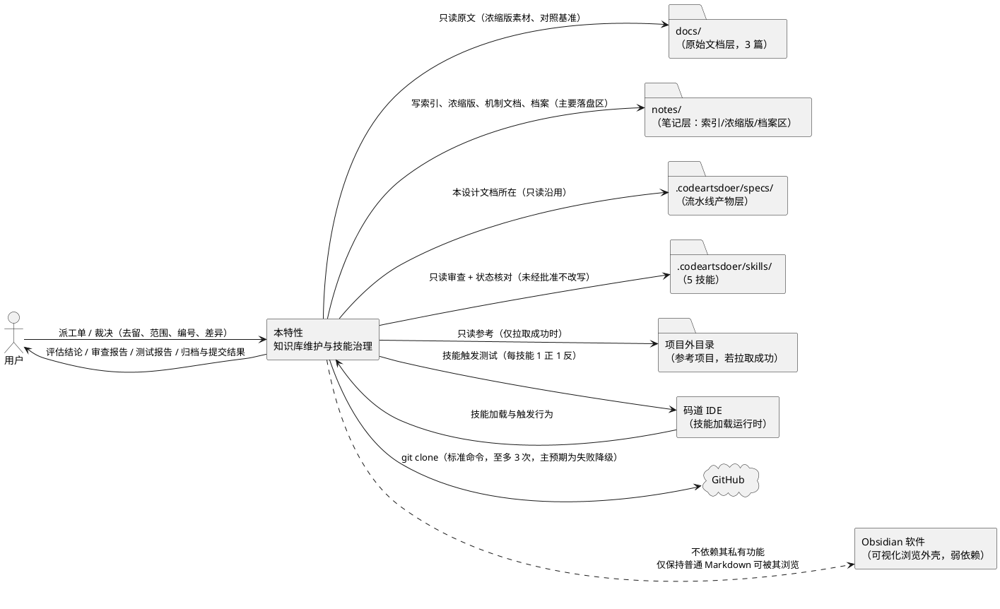
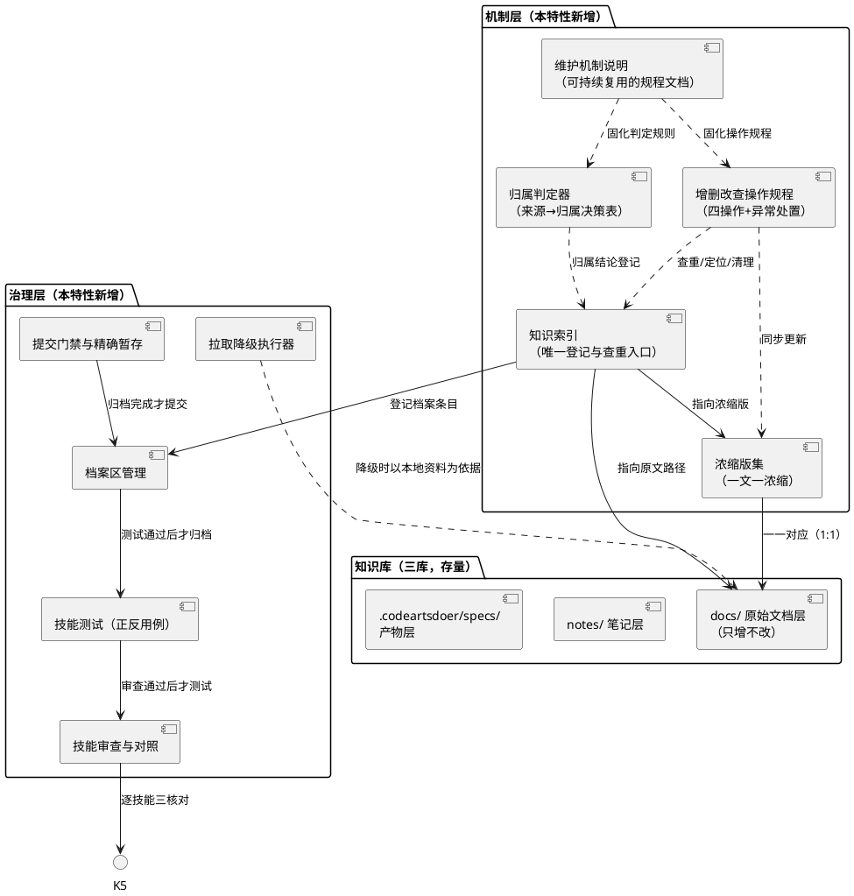
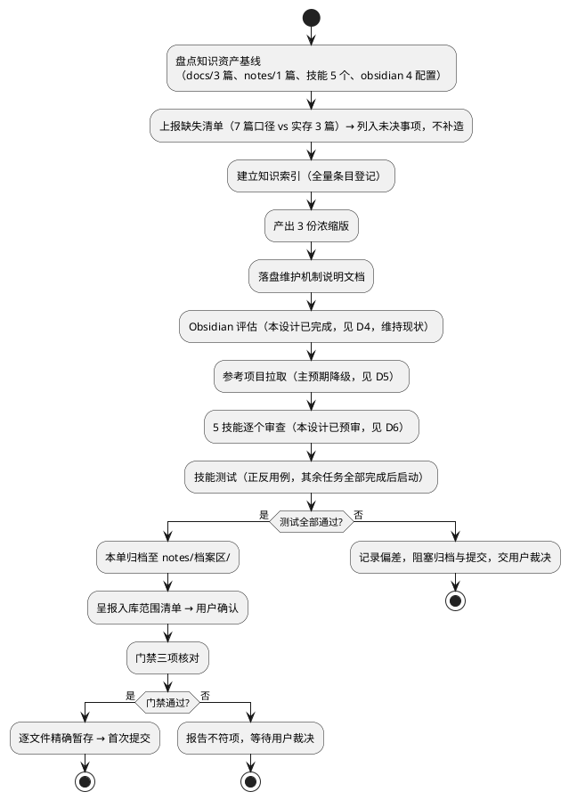
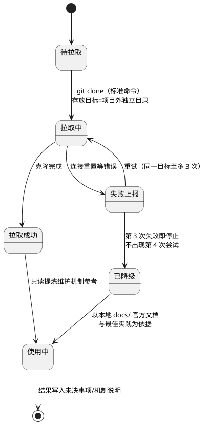
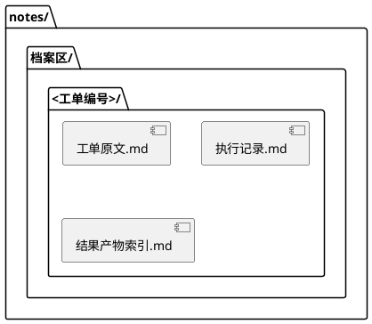
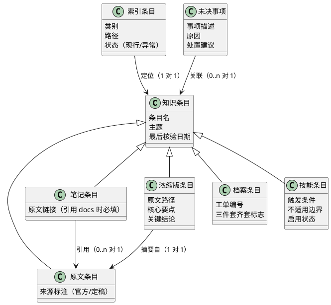

# 知识库维护与技能治理（kb_maintenance）技术设计

> 设计基线：`.codeartsdoer/specs/kb_maintenance/spec.md`（2026-11-06 修订版）
> 证据采集：2026-11-06 对 docs/、notes/、.obsidian/、.codeartsdoer/ 全量实查
> 环境：Windows + PowerShell，工作目录 `C:\Users\Administrator\Desktop\Date`，`.git/` 已 init 无提交

---

# 一、需求与存量功能关系分析

## 1.1 需求功能与存量功能对比

### 1.1.1 已实现功能

| 需求功能 | 存量功能 | 代码位置 | 匹配度 |
|---------|---------|---------|--------|
| vault 集成生效（不重复集成） | 用户已手动完成 vault 指向 Date 项目目录，4 个配置文件齐套 | `.obsidian/`（app.json、appearance.json、core-plugins.json、workspace.json） | 100% |
| 三库分工基础约定 | "notes/ 存笔记；docs/ 存官方参考文档；specs/ 存规范流水线产物"三条使用约定已写明 | `notes/知识库初始化.md:8` | 75% |
| 技能启用状态登记 | 5 条记录全部 `=true`，与 5 个技能目录一一对应 | `.codeartsdoer/skills/ProjectSkillStatus.txt:1-5` | 100% |
| 技能规范载体（frontmatter 齐备） | 5 个 SKILL.md 均含 name（与目录名一致）与 description（含"当…时触发"+不适用边界） | `.codeartsdoer/skills/{find-skills,grill-me,lazy-exec,ruleinit,skill-writer}/SKILL.md` | 100% |
| 官方对照基准可查 | 官方最佳实践与热门 Skills 清单两篇官方文档在库 | `docs/官方最佳实践-如何写好一个Skill-bp0010.md`、`docs/官方文档-码道热门Skills清单-desktop0003.md` | 100% |
| 项目协作公约可依 | 7 条公约已定稿归档于 docs/ | `docs/项目协作公约-最终稿.md:1-7` | 100% |
| git 仓库初始化 | `.git/` 已 init、零提交，处于待首提状态 | `.git/` | 100% |

匹配度判定依据：
- 75% 项：三库分工仅存"一句约定"，无判定流程、无索引支撑、无单一权威源执行细则，属"有约定、无机制"，故非 100%。
- 其余 100% 项：存量产物与需求描述逐字段一致（如 ProjectSkillStatus.txt 5 条记录与 5 个目录实测一一对应，无孤儿记录）。

### 1.1.2 需要扩展的功能

| 需求功能 | 存量功能 | 差异说明 | 扩展方向 |
|---------|---------|---------|---------|
| 三库分工机制化（spec 5.1） | `notes/知识库初始化.md:8` 三条使用约定 | 输入差异：现仅"目录→内容类型"的静态映射；缺"来源→归属"判定流程、混放拦截动作、同主题双处存在时的单一权威源执行细则。边界差异：归属两可、重复副本两个异常场景无处置路径 | 将三条约定升级为机制文档（含判定决策表），新增索引文件作为登记与查重入口；不改 docs/ 既有 3 篇 |
| 技能触发审查与原版对照（spec 5.6） | 5 个 SKILL.md 触发条件已写就 | 输入输出差异：现无任何审查结论、对照表、合理性判定等产物。逻辑差异：现仅"可触发"，未验证"触发条件与实际任务类型匹配"。边界差异：5 技能均不在热门清单 15 个内置技能之列，原版出处不可从官方文档直接确认 | 以官方最佳实践（bp0010）为对照基准逐技能产出三核对项结论+对照表；原版出处不可考项标注"推断"交用户裁决 |
| 首次版本提交（spec 5.9） | 仅 `git init`，零提交 | 输入差异：现无入库范围清单、无排除清单。逻辑差异：现无门禁检查动作。边界差异：`.obsidian/`、`.workbuddy/`、`temp/`、`turbocontext.db/`、`.codebase/` 等本地状态/缓存类内容的去留未定 | 建立入库范围清单（逐文件）+ 排除清单（逐项附理由）+ 三项门禁，逐文件精确暂存 |

### 1.1.3 需要新增的功能或接口

**A. 知识索引模块（全新）**
- 功能点：知识库总索引文件——全库条目（docs 原文、notes 笔记、浓缩版、档案区、技能）的唯一登记与查重入口。
- 输入：知识库磁盘实查结果；输出：结构化索引条目清单。
- 核心逻辑：新增查重、查询定位、异常条目标记（指向不存在原文的条目）。
- 依赖：docs/、notes/ 磁盘实态；被增删改查全流程依赖。

**B. 浓缩版模块（全新）**
- 功能点：docs/ 每篇 Wiki 文档对应一份浓缩版（现存 3 篇 → 3 份浓缩版）。
- 输入：docs/ 原文；输出：含原文路径、核心要点、关键结论、最后核验日期的浓缩版文件。
- 核心逻辑：一文一浓缩、原文变更同步更新、冲突以原文为准。
- 依赖：docs/ 原文；被按需加载流程依赖。

**C. 维护机制说明文档（全新）**
- 功能点：将分工、增删改查、加载顺序、异常处置固化为可持续复用的机制文档。
- 输入：本设计的机制规则；输出：机制说明文档落盘知识库。
- 核心逻辑：不依赖会话记忆，后续会话凭此文档即可执行维护。
- 依赖：知识索引模块（相互引用）。

**D. 派工单档案区（全新）**
- 功能点：notes/ 下按工单编号分文件夹的归档结构，含工单原文、执行记录、结果产物索引三部分。
- 输入：已完成的派工单及其记录；输出：档案文件夹。
- 核心逻辑：一单一目录、编号唯一、临时内容不入档。
- 依赖：技能测试通过（归档时机前置条件）。

**E. 参考项目拉取与降级流程（全新）**
- 功能点：git clone 标准命令拉取 + 失败如实上报 + 重试上限 3 次 + 降级路径（以本地 docs/ 为依据）。
- 输入：参考仓库地址（若有）；输出：拉取结果或降级说明。
- 核心逻辑：历史 4 次克隆全部连接重置，降级路径为主预期路径。
- 依赖：网络可达性（不可假设）；项目外独立目录。

**F. Obsidian 评估流程（全新，本设计已完成评估，见 2.1.3-D4）**
- 功能点：vault 现状、依赖程度、撤销影响三点评估，结论明确。
- 依赖：.obsidian/ 磁盘实况（已实查）。

**G. 技能测试与门禁（全新）**
- 功能点：5 技能各 1 正 1 反用例测试；提交前三项门禁（测试通过、范围核对一致、敏感临时内容排查）。
- 依赖：其余全部任务完成（测试时机约束）。

## 1.2 存量功能详细分析

### 1.2.1 三库分工约定的存量载体（notes/知识库初始化.md）

- **接口契约**：文件自身即"约定声明"，无程序接口；第 3 行记录 vault 集成生效事实（2026-11-06），第 4 行声明用途（可视化知识库入口），第 8 行声明三库分工。
- **业务规则**：三条使用约定是 spec 5.1.1.1 的直接来源，本设计将其原样固化、不改变语义。
- **扩展点**：该文件保持现状不动；机制细则外置到新增的机制文档，避免往既有笔记中堆叠内容。
- **约束**：该文件是 vault 集成的验证性产物，属"已验证约定"级证据（公约第五条分级），修改它会破坏证据链，禁改。

### 1.2.2 .obsidian/ 配置实况（Obsidian 评估的关键证据）

| 文件 | 实查内容（2026-11-06） | 判定 |
|------|----------------------|------|
| app.json | `{}`（1 行，空对象） | 零自定义设置 |
| appearance.json | `{}`（1 行，空对象） | 零主题定制 |
| core-plugins.json | 33 项核心插件开关，全部为 Obsidian 出厂默认组合 | 无第三方插件——目录中不存在 community-plugins.json，可确认社区插件为零 |
| workspace.json | 默认工作区布局（文件列表/搜索/书签/反链/出链/标签/大纲）；`lastOpenFiles` 仅含 `notes/知识库初始化.md` | vault 集成后仅做过一次验证性打开 |

- **业务规则**：4 个文件全部是 Obsidian 软件自动生成的默认状态，用户未投入任何定制。
- **约束**：workspace.json 随软件运行持续变动（机器相关布局状态），不宜作为版本化资产；`.obsidian/` 整体属"软件可重建的本地配置"。
- **扩展点**：无。该目录既不被维护机制读取，也无需被机制修改。

### 1.2.3 5 个技能 SKILL.md 结构预查

| 技能 | 字节数 | frontmatter | 触发条件表述 | 不适用边界表述 | 正文步骤 |
|------|-------|-------------|-------------|---------------|---------|
| find-skills | 576B | 合规（name 与目录一致） | "当用户问'有没有技能能…/找个技能/该用什么技能'，或当前任务疑似已有技能覆盖但未加载时触发" | "不适用于技能的编写与评审（归 skill-writer）" | 4 步，引用 listSkills 工具 |
| grill-me | 514B | 合规 | "当用户说'先别写/帮我理清需求'，或任务描述模糊、存在多种解读时触发" | "不适用于需求已明确、可直接执行的任务" | 4 步 |
| lazy-exec | 601B | 合规 | "当用户要求'最小改动、极简实现、懒人方案、能跑就行'，或任务范围明确且改动应当收敛时触发" | "不适用于需要完整重构、系统性设计或多方案对比的任务" | 4 步 |
| ruleinit | 572B | 合规 | "当新项目首次配置码道规则、现有规则丢失需重建、或跨项目迁移通用准则时触发" | "不适用于技能(SKILL.md)编写" | 3 条指令 + 1 行历史备注 |
| skill-writer | 813B | 合规 | "当新建、修改、评审码道技能（SKILL.md）时触发" | "不适用于规则(.mdc)初始化" | 引用 bp0010（路径实存）为必读基准 |

- **边界互补性预查**：grill-me（模糊输入→澄清）与 lazy-exec（明确范围→最小实现）触发条件互斥，无重叠；ruleinit（管 .mdc 规则）与 skill-writer（管 SKILL.md）边界互补，无重叠；find-skills（找技能）与 skill-writer（写技能）职责分离，无重叠。本地 5 技能与热门清单 15 个内置技能标识零重叠，无内置技能竞争同一触发场景。
- **约束**：spec 5.6.1.5 要求审查阶段 SKILL.md 逐字不变；ruleinit 第 9 行"（已移除原技能参考，仅保留规则操作）"为历史备注行，不属执行指令，不影响触发与合规。

### 1.2.4 docs/ 三篇存量文档概要（浓缩版对象与对照基准）

| 文档 | 行数 | 内容主题 | 在本特性中的角色 |
|------|------|---------|----------------|
| 官方文档-码道热门Skills清单-desktop0003.md | 135 | 15 个内置技能（文档办公/创意设计/写作内容/开发工具/研究检索五类）的清单与使用场景 | 浓缩版对象；技能原版对照的排除性证据（证明本地 5 技能均非内置技能） |
| 官方最佳实践-如何写好一个Skill-bp0010.md | 67 | Skill 三要素（name/description/instructions）、触发条件写法、渐进式加载三层架构、三类可附带资源 | 浓缩版对象；技能审查对照基准（原版出处不可考时的推断基准） |
| 项目协作公约-最终稿.md | 7 | 7 条项目级规则 | 全程行为约束；浓缩版对象 |

### 1.2.5 .codeartsdoer/ 顶层盘点（提交范围预判基础）

| 顶层条目 | 实查性质 | 入库预判 |
|---------|---------|---------|
| skills/（5 目录 + ProjectSkillStatus.txt） | 知识资产 | 入库 |
| specs/（codeartsdoer_init、kb_maintenance、pd003_exec） | 流水线产物 | 入库 |
| rule/（项目协作公约.mdc + metadata.properties） | 规则文件（公约第三条禁改，但不禁提交） | 入库（原样） |
| docs 之外：package.json、.gitignore、mem-exp-config.json | 配置类 | 执行阶段逐文件实查后归类，呈用户裁决 |
| agent-team/、agents/、experience-reuse/、mcp/ | 未实查内容的目录 | 执行阶段逐目录实查后归类，呈用户裁决 |
| temp/ | 临时目录（公约"干完即弃"） | 建议排除 |
| .codebase/、turbocontext.db/ | 码道本地索引与本地数据库 | 建议排除 |
| .workbuddy/、.obsidian/、.git/（根目录） | 本地工具状态 | 建议排除（最终用户裁决，见 2.4-U3） |

- **根目录约束核对**：现行根目录顶层为 `.codeartsdoer/`、`.git/`、`.obsidian/`、`.workbuddy/`、`docs/`、`notes/` 六项。`.git/`、`.obsidian/`、`.workbuddy/` 为既有事实，非本特性创建；spec 5.5.1.5 约束的对象是"参考项目拉取不得在项目根新增系统文件夹"，本特性全程不新增根目录顶层条目，约束可满足。

### 1.2.6 存量约束与历史风险汇总

1. 公约七条 → 设计中的落点：第一条（禁猜禁编）→ 缺失 4 篇不补造、技能审查不改写；第二条（结论前置）→ 所有产物结论前置；第三条（禁改）→ AGENTS.md 与 rule/ 原样入库不改；第四条（提交纪律）→ 门禁+精确暂存设计；第五条（经验分级）→ 本设计所有结论标注来源分级；第六条（网络操作）→ 拉取降级流程设计；第七条（优先级）→ 机制文档中声明本项目无云端规则、冲突以本地项目级为准。
2. 历史风险：GitHub 克隆 4 次全部失败（连接重置）→ 降级路径按主预期路径设计，非兜底附赠。
3. 用户裁决基线：浓缩版 80 行上限已废除；缺失 4 篇不补造；Obsidian 与技能触发条件由本设计依实查自定（分别见 2.1.3-D4、D6）。
---

# 二、增量设计方案

## 2.1 实现模型

### 2.1.1 上下文视图

要点：码道 Agent 是唯一执行主体；notes/ 是本特性新增产物的集中落盘区；GitHub 与 Obsidian 均为弱依赖（GitHub 主预期走降级，Obsidian 仅作浏览外壳）。

### 2.1.2 服务/组件总体架构

模块职责与依赖频率：索引是全机制最高频组件（增删改查每次触达）；浓缩版次之（加载与同步）；归属判定器与机制文档为低频（建立一次、异常时复核）；治理层组件按"审查→测试→归档→提交"单向串行，频率各一次。配置项策略：机制不引入任何配置文件，全部规则以文档内约定呈现，保证跨项目可复用（spec 4.5.3）。

### 2.1.3 实现设计文档

#### 2.1.3-A 总体执行流程

#### 2.1.3-D1 三库归属判定决策表（spec 5.1）

| 内容来源 | 归属目录 | 类型标注 | 判定依据 |
|---------|---------|---------|---------|
| 官方文档（外部官方来源） | docs/ | 官方参考文档 | 命名规则"类型-主题-编号.md"，须可识别官方来源 |
| 用户定稿规范（公约类） | docs/ | 定稿规范 | 须可识别用户定稿身份 |
| 工作过程笔记、索引、浓缩版、档案 | notes/ | 工作笔记/索引/档案区 | 派生内容，非官方原文 |
| 规范流水线产物（spec/design/tasks） | .codeartsdoer/specs/ | 流水线产物 | 先例 codeartsdoer_init 既有约定 |
| 技能知识包 | .codeartsdoer/skills/ | 技能 | 码道运行时约定位置 |

执行规则：归属两可 → 停止归档，呈报两可原因请裁决（禁猜禁编）；发现同主题双处存在 → 盘点差异后交用户裁决保留方；官方文档不得写入 notes/，临时过程记录不得写入 docs/，意图出现即拒绝并给出归属建议。单一权威源：同主题笔记与 Wiki 并存时，docs/ 原文为权威，notes/ 侧只存摘要与原文链接。

#### 2.1.3-D2 增删改查操作流程（spec 5.2）

- **增**：查索引确认同主题是否已存在 → 已存在则增量更新原条目并刷新核验日期，不存在则新建并在索引登记；全程禁止另起新文件重复承载同主题。
- **删**：逐条目获用户明确批准 → 删除正文 → 同步清理索引条目与对应浓缩版 → 复查无残留引用；无批准不发生任何删除。
- **改**：docs/ 官方原文只增不改（仅可追加核验批注，不篡改正文）；notes/ 笔记类可改，改后同步更新最后核验日期。
- **查**：从索引定位 → 只加载索引与被命中条目；禁止为查询目的全量扫描或全量加载。
- 任何维护动作的上下文加载范围恒为"索引 + 本次涉及的目标条目"。

#### 2.1.3-D3 三级渐进加载机制（spec 5.3）

与官方最佳实践（bp0010）的"渐进式加载三层架构"同构，映射关系如下（依据：docs/官方最佳实践-如何写好一个Skill-bp0010.md:58-62，已验证）：

| 加载层级 | 承载物 | 何时进入上下文 | 体量特征 |
|---------|-------|--------------|---------|
| 第一层：常驻元数据 | 知识索引条目（名称/主题/路径） | 会话需要调用知识库时即加载 | 极轻量 |
| 第二层：按需摘要 | 对应浓缩版 | 索引定位后加载 | 中等，不设行数上限 |
| 第三层：深读原文 | docs/ 原文 | 仅当浓缩版不足以支撑当前任务，且有明确理由时 | 全量 |

约束：浓缩版必含原文路径、核心要点、关键结论、最后核验日期四要素；原文变更后同步更新浓缩版，冲突以原文为准；浓缩版脱离原文标注不得存在；浓缩版指向的原文不存在时，该条目标记为异常并暂停依赖它的任务。

#### 2.1.3-D4 Obsidian 评估结论（spec 5.4 核心交付②）

**结论：弱依赖、维持现状、不撤销、不冗余。**

评估三要求逐项对应（spec 5.4.1.1）：

1. **vault 现状**：已由用户手动集成生效（notes/知识库初始化.md:3 记录，2026-11-06）；4 个配置文件实况见 1.2.2——app.json 与 appearance.json 均为空对象，core-plugins.json 全为出厂默认且无社区插件，workspace.json 为默认布局且 lastOpenFiles 仅含一次验证性打开记录。用户未投入任何定制。
2. **机制对 Obsidian 私有功能的依赖程度**：**零依赖**。本设计全部机制（索引、浓缩版、增删改查、档案区）基于普通 Markdown、目录约定与相对路径链接实现，不使用 wikilink、双链、callout、图形视图等任何 Obsidian 私有功能；notes/ 现有内容（1 篇 8 行）亦为零私有语法的纯标准 Markdown。不存在 spec 5.4.3.1 所述"必须依赖 Obsidian 私有功能"的环节。
3. **撤销对可视化浏览的影响**：仅失去可视化浏览入口，机制本身不受任何影响。

维持现状的理由（四点）：
- (a) **撤销收益趋零**：.obsidian/ 仅 4 个文件且全部为软件可重建的默认状态，删除不释放实质资源，却需占用一次用户裁决与执行动作；
- (b) **保留成本趋零**：该目录不参与维护机制读写，建议排除出首次提交（见 2.4-U3），不产生版本化负担；
- (c) **保留有实值**：维持用户已验证生效的可视化知识库入口（notes/知识库初始化.md:4 自述用途），后续产物在 notes/ 落盘后用户可继续用 Obsidian 浏览；
- (d) **符合约束**：spec 4.5.1 禁止重复集成或改动 vault 指向，"维持现状"是约束内的最小动作；不撤销即不请求批准，减少一次不必要的决策负担。

冗余性判定：vault 内容（notes/ 1 篇验证笔记）与 Wiki（docs/ 3 篇）主题零重叠，不存在重复副本；未来索引与浓缩版落 notes/ 属分工设计（单一权威源在 docs/，notes/ 存摘要与链接，对应 spec 5.1.1.4），不构成冗余。

**决策权移交说明**：本结论为"弱依赖"，按 spec 5.4.1.2 本应呈报撤销方案待批；因维持现状与撤销相比无净损失，本设计**不发起撤销请求**，仅将"如用户主动要求撤销"的限定方案（仅删 .obsidian/ 4 文件，notes/ 逐文件原样保留，恢复方式=用户在软件中重新指向 vault）记录于机制文档备查，不进入执行清单。

#### 2.1.3-D5 参考项目拉取与降级状态机（spec 5.5 核心交付，主预期路径）

要点：
- **存放隔离**：拉取成功时仓库存放于项目外独立目录（建议 `C:\Users\Administrator\Desktop\kb-refs\<仓库名>\`，与 Date 项目平级），保证项目根目录不新增系统文件夹；目标位置已存在同名仓库则复用不重复克隆。
- **降级内容**：维护机制的依据标注为本地资料（bp0010 的渐进式加载架构 + 三要素规范 + 公约七条），机制完整性不受影响；拉取失败原文错误与重试次数记入未决事项。
- **只读红线**：无论成功与否，参考项目内容禁止混入本项目，参考仓库禁止修改。
- **本设计阶段不执行拉取**，仅固化流程；实现阶段是否执行、目标仓库地址，见未决事项 2.4-U2。

#### 2.1.3-D6 技能触发条件审查结论（spec 5.6 核心交付③）

对照基准说明：热门清单（desktop0003）所列 15 个内置技能与本地 5 技能标识零重叠，故"原版对照"基准取官方最佳实践（bp0010）的触发条件写法与三要素规范；无法从官方文档确认的原版出处逐项标注"推断"（对应 spec 5.6.3.1）。

| 技能 | 核对项 1：触发条件+不适用边界 | 核对项 2：触发场景与任务类型匹配 | 核对项 3：正文步骤可执行性 | 与其他技能边界 | 结论 |
|------|---------------------------|------------------------------|--------------------------|---------------|------|
| find-skills | 明确：用户话语（"有没有技能能…/找个技能/该用什么技能"）+场景（疑似覆盖未加载）；边界清晰（编写评审归 skill-writer） | 匹配：找技能是本项目高频真实需求（审查、测试环节均需盘点技能） | 可执行：4 步，引用 listSkills 工具（运行时实存该工具） | 与 skill-writer 职责分离无重叠 | **保留，不调整** |
| grill-me | 明确：话语触发（"先别写/帮我理清需求"）+状态触发（模糊/多解读）；边界清晰（需求已明确不触发） | 匹配：spec 流水线本身依赖需求澄清前置 | 可执行：4 步，"只问不写+单轮 5 问+候选答案+复述确认"闭环完整 | 与 lazy-exec 互斥（其边界明确排除需求已明确的任务） | **保留，不调整** |
| lazy-exec | 明确：话语触发（"最小改动/极简实现/懒人方案/能跑就行"）+状态触发（范围明确应收敛）；边界清晰（重构/系统设计/多方案对比不触发） | 匹配：与本特性"最小动作"执行风格一致（如 D4 维持现状决策） | 可执行：4 步，含完成判据与最小改动汇报要求 | 与 grill-me 互斥 | **保留，不调整** |
| ruleinit | 明确：场景触发（首次配置/规则丢失重建/跨项目迁移）；边界清晰（不适用 SKILL.md 编写） | 匹配：项目规则（.mdc）建立与迁移是真实场景 | 可执行：3 条指令均在 8 行内，符合先例约束；第 9 行为历史备注非执行指令 | 与 skill-writer 互补无重叠 | **保留，不调整** |
| skill-writer | 明确：动作触发（新建/修改/评审 SKILL.md）；边界清晰（不适用 .mdc 初始化） | 匹配：本特性技能审查环节直接适用 | 可执行：必读基准 bp0010 路径实存，三步核对法明确 | 与 ruleinit、find-skills 互补 | **保留，不调整** |

**总体结论：5 个技能触发条件全部维持原状，无冲突，无需修改。** 依据：
1. 5 个 frontmatter 均合规——name 与目录一致、description 均含"当…时触发"式触发条件与不适用边界（与 bp0010 触发条件写法一致，与 spec 6.5.1 一致）；
2. 触发边界两两互斥或互补（grill-me↔lazy-exec 互斥、ruleinit↔skill-writer 互补、find-skills 与其余二者分离），无 spec 5.6.3.2 所述边界重叠场景；
3. 正文步骤均可直接执行，引用的工具（listSkills）与文档（bp0010）均实存；
4. 状态一致性预查通过：目录 5 个 = ProjectSkillStatus.txt 5 条 =true，无孤儿记录或未登记目录（spec 5.6.1.4 验收条件满足）。

执行阶段动作：按 spec 5.6.1 逐技能产出正式审查结论与对照表（含"推断"标注），以本表为预审基线；**审查阶段不改写任何 SKILL.md**（spec 5.6.1.5），无修改建议清单需要呈批。

#### 2.1.3-D7 档案区结构（spec 5.8）

规则：一单一目录，编号唯一可检索；归档时机=技能测试通过后（含本单自身归档）；只归档工单原文与结果性记录，临时步骤内容按公约"干完即弃"不入档；工单编号缺失时向用户申请，禁止自行编造。

#### 2.1.3-D8 提交门禁设计（spec 5.9）

| 门禁项 | 检查内容 | 不通过处置 |
|-------|---------|-----------|
| G1 测试通过 | 5 技能正反用例全部符合预期，无未修复偏差 | 阻塞归档与提交 |
| G2 范围核对 | 实际暂存内容与用户确认的入库清单逐项一致，无多入无遗漏 | 停止提交，列出差异 |
| G3 敏感与临时排查 | temp/、turbocontext.db/、.codebase/、.workbuddy/ 等本地缓存与数据库类未混入；无一次性中间文件 | 停止提交，列出不符项 |

提交流程：汇总入库范围清单（逐文件）+排除清单（逐项附理由）→ 呈用户确认 → 逐文件精确暂存（禁全量暂存）→ 过门禁 → 提交。AGENTS.md 与 rule/ 规则文件原样入库、零改动（公约第三条）。资产完整要求：工作区每个顶层目录在入库清单或排除清单中有唯一归属，不允许"既未入库也未说明"的遗漏项。

## 2.2 接口设计

本特性为文档治理类特性，无程序 API；"接口"即**文件契约与操作规程**——后续会话、后续代理凭这些契约可直接读写知识库，无需会话记忆。

### 2.2.1 总体设计

| 接口（契约/规程） | 类别 | 消费方 | 稳定性 |
|-----------------|------|-------|--------|
| 知识索引文件格式 | 文件契约 | 增删改查全流程、按需加载 | 稳定 |
| 浓缩版文件格式 | 文件契约 | 按需加载、同步更新 | 稳定 |
| 维护机制说明文档 | 文件契约 | 后续会话（复用入口） | 稳定 |
| 档案区目录结构 | 目录契约 | 归档流程 | 稳定 |
| 增/删/改/查四操作规程 | 操作规程 | 一切维护动作 | 稳定 |
| 技能审查结论格式 | 产物格式 | 用户裁决 | 实验（首次使用） |
| 测试报告格式 | 产物格式 | 门禁 G1、用户验收 | 实验（首次使用） |
| 入库范围清单格式 | 产物格式 | 门禁 G2、用户确认 | 实验（首次使用） |

接口变更策略：稳定类契约一经本特性落盘，后续变更按 spec 5.2 修改约束执行（改后同步核验日期与索引）；实验类契约在本单首次使用后，随执行记录归档固化。

### 2.2.2 接口清单

**（1）知识索引文件（notes/知识库索引.md）**

前置条件：磁盘实查完成。后置条件：全库条目均有登记，无孤儿文档。异常映射：索引指向不存在的条目 → 标记"异常"状态并上报；索引未覆盖实存文档 → 以磁盘实查为准重建并上报修正说明。

条目字段契约：

| 字段 | 必填 | 说明 |
|------|------|------|
| 条目名 | 是 | 文档名（含编号），与磁盘文件名一致 |
| 类别 | 是 | 枚举：官方参考文档 / 定稿规范 / 工作笔记 / 索引 / 浓缩版 / 档案 |
| 路径 | 是 | 相对项目根的路径，可直接定位 |
| 主题 | 是 | 一句话主题描述 |
| 最后核验日期 | 是 | 日期格式 YYYY-MM-DD |
| 状态 | 是 | 枚举：现行 / 异常（附异常原因） |

**（2）浓缩版文件（notes/浓缩版/）**

前置条件：对应原文存在于 docs/。后置条件：一文一浓缩成立，四要素齐套。异常映射：浓缩版结论与原文不一致 → 以原文为准修正并记录修正。

文件结构契约（必含四要素，不设行数上限）：

| 要素 | 说明 |
|------|------|
| 原文路径 | 指向 docs/ 原文的相对路径（标注来源） |
| 最后核验日期 | YYYY-MM-DD |
| 核心要点 | 原文的结构化要点提炼 |
| 关键结论 | 原文可直接引用的结论清单 |

**（3）维护机制说明文档（notes/知识库维护机制.md）**

前置条件：D1 决策表、D2 四操作、D3 加载机制已在设计定稿。后置条件：后续会话仅凭该文档+索引即可执行维护。内容必含：三库分工决策表、四操作规程、三级加载顺序、异常处置清单、本项目规则优先级声明（无云端规则，冲突以本地项目级为准——公约第七条）。

**（4）档案区目录契约（notes/档案区/<工单编号>/）**

前置条件：技能测试通过 + 工单编号已获用户确认。后置条件：档案三件齐套，索引同步登记。异常映射：编号缺失 → 向用户申请，禁自造；同编号已存在 → 同单则增量更新，异单则上报冲突。

**（5）技能测试报告**

前置条件：其余全部任务完成（spec 5.7.1.1 时机约束）。后置条件：门禁 G1 有据可查。内容契约：每技能至少 2 条用例（1 正 1 反），每条含场景、预期、实际、偏差、状态；未通过项阻塞归档与提交。

正向用例取自各技能 description 触发话语造句，反向用例取自各技能"不适用边界"场景（5 组正反用例已在 D6 表中预置边界依据）。

**（6）入库范围清单**

前置条件：全部产物落盘完成。后置条件：门禁 G2、G3 有据可查。内容契约：逐文件列示（禁目录级通配）；排除项逐条附理由；清单与实际暂存双向一致。

## 2.3 数据模型

### 2.3.1 设计目标

1. 支撑业务场景：知识资产的登记、查重、按需加载、归档、提交全链路可追溯。
2. 性能与容量目标：单次操作上下文加载范围为"索引 + 目标条目"；索引单文件承载百级条目无压力。
3. 兼容策略：完全基于存量目录结构增量扩展（notes/ 下新增 3 个子项），不迁移、不重命名任何既有文件；纯 Markdown + 相对路径，不引入任何专用格式或工具依赖。

### 2.3.2 模型实现

关系说明：浓缩版与原文严格 1:1（spec 6.3.3）；索引条目与知识条目 1:1（每条目唯一登记）；未决事项可关联零到多个条目（如缺失 4 篇仅关联"口径差异"本身）。

**落盘位置与命名方案（核心交付①）**：

| 产物 | 落盘位置 | 命名规则 | 对应关系 |
|------|---------|---------|---------|
| 知识库索引 | `notes/知识库索引.md` | 固定名，全库唯一 | 全库条目登记 |
| 维护机制说明 | `notes/知识库维护机制.md` | 固定名，全库唯一 | 固化 D1/D2/D3 规则 |
| 浓缩版（3 份） | `notes/浓缩版/` | **与原文同名**（如 `notes/浓缩版/官方最佳实践-如何写好一个Skill-bp0010.md`） | 与 docs/ 3 篇一一对应，同名即对应 |
| 档案区 | `notes/档案区/<工单编号>/` | 目录名=工单编号（归档前向用户确认） | 一单一目录，三件套 |
| 本设计文档 | `.codeartsdoer/specs/kb_maintenance/design.md` | 流水线约定 | 沿用既有 specs/ 位置 |

命名方案依据：目录与文件采用中文名，与项目现有命名风格一致（docs/ 与 notes/ 既有文件全中文命名，Windows + PowerShell 实测可用）；浓缩版与原文同名使"一文一浓缩"的对应关系零维护成本（无需映射表）。

生命周期与持久化策略：全部产物为纯 Markdown 文件，随首次提交持久化；索引与浓缩版的更新随维护动作即时落盘（无缓存层）；档案条目创建后只增不改（历史档案不可变）。

## 2.4 未决事项清单（核心交付④）

| 编号 | 事项 | 原因与现状 | 处置建议 |
|------|------|-----------|---------|
| U1 | **缺失 4 篇 Wiki 文档**（口径 7 篇，实存 3 篇） | 不补造【用户裁决 2026-11-06】。原因：缺失的 4 篇无源文件可回溯——docs/ 实存仅 desktop0003、bp0010、项目协作公约最终稿 3 篇；specs/ 下 3 个目录为流水线产物而非 Wiki 源；任何存量文件中均无这 4 篇的编号或主题线索，补造即编造，违反公约第一条"禁猜禁编" | 仅在索引中登记"口径 7 篇 vs 实存 3 篇"差异本身；如用户日后找到源文件，按新增流程（查重→登记→补浓缩版）自然入库 |
| U2 | **参考项目目标仓库地址未指定** | spec 未给出参考项目地址；历史 GitHub 克隆 4 次全部连接重置 | 实现阶段若用户给出地址，按 D5 执行（标准命令、3 次上限、项目外存放）；未给出则直接降级——维护机制依据为本地 docs/ 资料，机制完整性不受影响 |
| U3 | **.obsidian/ 是否入库** | 建议排除：4 个文件全为软件可重建的默认状态，workspace.json 随软件运行持续变动（机器相关布局），属本地编辑器状态类 | 首次提交时建议排除（或排除后加入 .gitignore），最终由用户在入库范围确认环节裁决 |
| U4 | **本单工单编号待确认** | 档案区命名需要编号，spec 5.8.3.1 禁止自行编造 | 归档前向用户申请编号（或确认沿用"kb_maintenance"作为档案目录名） |
| U5 | **.codeartsdoer/ 下 9 个顶层条目待归类** | agent-team/、agents/、experience-reuse/、mcp/、.codebase/、turbocontext.db/、temp/、mem-exp-config.json、package.json、.gitignore 在设计阶段未逐文件实查内容 | 实现阶段逐条目实查后，按"知识资产入清单 / 本地缓存类入排除清单"分类，随入库范围清单一并呈用户确认 |
| U6 | **技能原版出处不可考** | 本地 5 技能均非热门清单 15 个内置技能，"原版"无法从官方文档确认 | 原版对照基准按官方最佳实践（bp0010）执行，审查产物中逐项标注"推断"（对应 spec 5.6.3.1），交用户确认对照基准 |

## 2.5 设计自检：spec 六大能力覆盖对照

| spec 能力 | 覆盖章节 |
|----------|---------|
| 5.1 内容分工与分流 | D1 判定决策表、2.3.2 落盘位置表、1.2.5 根目录约束核对 |
| 5.2 增删改查 | D2 四操作规程、2.2.2-(1) 索引契约、D2 异常处置 |
| 5.3 浓缩版索引与按需加载 | D3 三级渐进加载、2.2.2-(2) 浓缩版契约、2.3.2 命名方案 |
| 5.4 Obsidian 评估与撤销 | D4 评估结论（弱依赖、维持现状、不撤销、不冗余） |
| 5.5 参考项目拉取降级 | D5 拉取降级状态机、2.4-U2 未决事项 |
| 5.6–5.7 技能审查与测试 | D6 逐技能审查结论（5 个全保留）、2.2.2-(5) 测试报告契约 |
| 5.8 派工单归档 | D7 档案区结构、2.2.2-(4) 档案契约、2.4-U4 编号确认 |
| 5.9 首次提交与门禁 | D8 门禁设计、2.2.2-(6) 入库清单契约、1.2.5 提交范围预判、2.4-U3/U5 |
| DFX 约束（4.1–4.5） | 上下文加载范围（D2/D3）、浓缩版无行数上限（D3）、禁改红线（D6/D8）、核验日期（2.3.2）、vault 现状维持（D4）、Windows 可用（2.3.2 命名方案）、机制可复用（2.2.1 稳定性策略） |
---

# 十、三层协同机制（规矩/记忆/知识库）——执行阶段追加章节

> 追加依据：用户派工 2026-11-06（入库流程冻结期间追加）。本章节只新增不删改既有内容；规则文件只引用不改动。仲裁规则由用户定稿写死。

## 10.1 现状盘点（先读后写，2026-11-06 实查）

### 10.1.1 规矩层（规则文件）

| 文件 | 实查状态 | 说明 |
|------|---------|------|
| .codeartsdoer/rule/项目协作公约.mdc | 七节生效稿：协作/沟通/文件禁改/提交纪律/经验复用/网络操作/优先级 | triggerType=always 全程自动应用 |
| .codeartsdoer/rule/metadata.properties | 平台托管注册（projectExpert 非空，source=project） | 只读引用；规则创建/修改只能走平台界面，Agent 只出文案草稿【依据记忆 rule-creation-via-ui】 |

### 10.1.2 记忆层（平台记忆库）

- **结构**：按工作目录隔离，本项目记忆库 = `C:\Users\Administrator\.codeartsdoer\memory\C--Users-Administrator-Desktop-Date\`（9 篇记忆 + MEMORY.md 索引 + 4 个状态文件）。**无独立"个人级"目录**——平台记忆按项目路径隔离，个人级信息（用户偏好/反馈）以 user/feedback 类型条目存在于项目记忆库中。
- **接口实查**：平台无独立"记忆列表"接口工具（tool_search 实查确认）；文件式记忆库即权威源，会话启动由平台自动注入 MEMORY.md 索引与相关记忆详情。
- **9 篇记忆清单**（类型/主题/时效判定）：

| # | 记忆 | 类型 | 主题 | 时效判定 |
|---|------|------|------|---------|
| 1 | obsidian-vault-integration | project | vault 已由用户手动集成生效，勿重复集成 | 现行 |
| 2 | kb-maintenance-spec-execution | project | git f6ed489 已存在、.codeartsdoer/.gitignore 为 * | 现行 |
| 3 | collab-rules-and-m1-ruling | project | M1 裁决 + 协作规则演进 | **部分过时**：其中"七节稿待粘贴、五条仍生效"已失效——实查 .mdc 与 metadata.properties 均为七节生效版【待修正】 |
| 4 | learn-before-claim-failure | feedback | 先学后做，禁没学就宣称干不了 | 现行（长期有效） |
| 5 | rule-creation-via-ui | feedback | 规则只能平台界面创建 | 现行（长期有效） |
| 6 | no-log-directory | feedback | 不建 log 目录，会话内汇报 | 现行 |
| 7 | windows-tool-network-quirks | feedback | Start-Process 吞输出/Doom Loop 保护/GitHub 仅 api.github.com 可达 | 现行（环境级） |
| 8 | hyra-results-reference-repo | project | hyra-results 参考仓库已克隆至 refs 隔离目录 | 现行 |
| 9 | framework-verification-cairn-super-agent | project | Cairn/Super-agent 调研结论：不必集成 | 现行 |

- 另有平台自动化记忆：.workbuddy/memory/automations/.../memory.md（已入库 f6ed489）。

### 10.1.3 知识库层

| 分区 | 条目数 | 内容 |
|------|-------|------|
| docs/（原始文档层） | 3 | 官方参考 ×2（desktop0003/bp0010）+ 定稿规范 ×1（项目协作公约-最终稿） |
| notes/（笔记层） | 9 | 初始化 1 + 索引 1 + 机制 1 + 浓缩版 3 + 档案区 3 |
| specs/kb_maintenance/（产物层） | 5 | spec/design/tasks/skill-review/skill-test-report |
| experience-reuse/experiences/（经验库） | 19 | index + 18 篇经验（检索走 experience_retrieve hook） |
| 索引 | 1 | notes/知识库索引.md（全库唯一登记入口） |

## 10.2 冲突检测设计

### 10.2.1 矛盾判定标准（四类）

| 编号 | 类型 | 判定标准 | 实例 |
|------|------|---------|------|
| T1 | 规则 vs 知识库 | 知识库文档/流程要求与 .mdc 条文同主题反向 | 知识库旧 spec"维护走 spec 流程" vs 规则假设新增"禁自启 spec" |
| T2 | 记忆 vs 知识库 | 记忆断言与知识库文档当前状态同主题反向；子类 **T2a 记忆过时**：记忆时间戳早于知识库最后核验日期且主题相同 | 记忆"七节稿待粘贴" vs .mdc 实查七节已生效 |
| T3 | 记忆 vs 规则 | 记忆记录的"做法"与规则条文反向 | 记忆"失败自动重试 5 次" vs 规则第六条"禁盲目重试" |
| T4 | 知识库内部 | 新旧文档、索引与正文、浓缩版与原文反向 | 旧 spec"零提交"假设 vs 执行记录"f6ed489 已存在" |

### 10.2.2 检测触发点（四个）

1. **任务启动**：读 notes/知识库索引.md + 平台注入记忆索引时，同主题条目双向比对。
2. **引用记忆决策前**：记忆断言先与知识库现状（索引 + 相关文档核验日期）比对，不直接采信。
3. **知识库更新时**：新文档落盘前后与既有记忆/文档比对（新增查重已内建于机制文档 §2）。
4. **规则变更时**：用户经界面改规则后，下次会话首查规则与知识库一致性。

### 10.2.3 检测输出

矛盾清单（编号/类型/双方来源路径+断言/冲突点/建议处置）→ 进 10.3 仲裁；任何一方不被静默修改。

## 10.3 优先级仲裁规则（用户写死）

**裁决顺序：规则文件 > 知识库最新文档 > 记忆偏好 > Agent 自行推断。**

理由（用户定稿）：规则最硬（用户手动经界面创建）；知识库次之（有文件可追溯）；记忆最软（自动提炼可能过时）。

执行细则：

| 场景 | 处置 |
|------|------|
| "最新"判定 | 最后核验日期新者胜；同日以档案区执行记录为准 |
| T1 命中 | 行为服从规则；冲突知识库文档标记"与规则冲突待修订"呈报，等用户修订规则或明确豁免；Agent 不改规则、不静默改文档 |
| T2 命中 | 信知识库；记忆条目进过时清理流程（10.5） |
| T3 命中 | 服从规则；记忆条目标记过时 |
| T4 命中 | 以第三层原文为权威（机制文档 §3 既有：冲突以原文为准） |
| 仲裁记录 | 写入当次执行记录；重大矛盾登记索引未决事项 |
| 兜底 | 仲裁后仍无法执行（如规则自身互相冲突）→ 公约第一条"不确定就停"，呈报用户裁决 |

## 10.4 知识库增删改查机制（触发条件导向）

引用：notes/知识库维护机制.md §2 四操作规程仍生效，本节补齐"何时触发"。核心约束：**禁止"一次性倒完就不管"，全流程增量更新。**

| 操作 | 触发条件 | 动作序列 |
|------|---------|---------|
| **增** | ①新派工单完结 ②新裁决/门禁结果产生 ③新事实推翻旧认知（如环境状态变化） ④官方新文档入库 | 查索引查重 → 新建（官方入 docs/、过程入 notes/、产物入 specs/）→ 索引登记 → 浓缩版（仅 docs/ 原文需要）→ 变更日志记一行 |
| **删** | ①被新文档完全替代 ②确认失效（指向不复存在的流程/事实） ③用户点名 | Agent 出删除建议清单（逐条附理由）→ **用户逐条批准**（公约+spec 5.2.1.4 硬约束）→ 删正文 → 清理索引条目与浓缩版 → 索引记录替代关系 |
| **改** | ①代码/配置变更致文档描述失真 ②决策变更推翻旧结论 ③docs/ 原文变更（浓缩版强制同步） | 修正文 → 刷新最后核验日期 → 同步浓缩版 → 变更日志记一行 |
| **查** | 每次任务启动 / 执行中需要知识支撑 | 三级渐进加载（索引 → 浓缩版 → 原文），禁止全量加载（机制文档 §3） |

**增量更新保障（三项）**：
1. notes/知识库索引.md 末尾设"变更日志"区：每次增删改必须记一行（日期+条目+动作+触发来源）——本章节落地时即建（见知识库索引已追加的变更日志区）。
2. 最后核验日期字段强制：所有条目必填，无日期即视为待核验异常。
3. 会话间接力靠"索引 + 变更日志 + 档案区"，不靠会话记忆（公约第一条：临时步骤只活在当前派工单）。

## 10.5 记忆维护机制

### 10.5.1 过时清理

- **触发**：冲突检测 T2/T3 命中，或用户点名。
- **流程**：记忆标记过时 → 与知识库现状核验 → **修正优先、删除次选**（记忆是跨会话资产，修正保留历史脉络）→ MEMORY.md 索引同步更新。
- **本次盘点实查的待办**：collab-rules-and-m1-ruling 中"七节稿待粘贴、五条仍生效"已过时（实查 .mdc 七节生效 + metadata.properties 平台注册）→ 修正方向："七节公约已生效（2026-11-06 粘贴生效）"。已在本章节呈报，待用户确认后执行修正。

### 10.5.2 让位原则（记忆 vs 知识库重叠）

- **记忆只保留"人"层面**：用户偏好/反馈/协作习惯（feedback 类）、跨项目环境怪癖、外部参考指针。
- **项目事实/决策/状态/流程全归知识库**：记忆与知识库重叠时，记忆改写为指针（指向知识库路径），不重复存内容。
- **判据一句话**：该条目换个项目还成立吗？成立 → 留记忆；不成立 → 归知识库。
- 现状核验：9 篇记忆中 8 篇符合让位原则；#2 kb-maintenance-spec-execution 与 #3 collab-rules 的项目状态细节属知识库范畴（档案区/specs 已有对应记录），可在下次反思时收敛为指针。

### 10.5.3 定期去重 + 一致性检查

- 复用现有半夜反思窗口（experience-refine + 记忆系统 reflection 机制）。
- **新增检查项：记忆 vs 知识库一致性**——逐条比对 project 类记忆断言与索引条目状态/最后核验日期；发现 T2 矛盾 → 按 10.3 仲裁 → 按 10.5.1 清理。
- 频率：随反思窗口例行；重大派工完结后追加一次。

### 10.5.4 用户举例核对（如实记录）

用户举例"记忆有'Obsidian 没配好'这条已过时"——实查结论：记忆 obsidian-vault-integration 现行内容已是"vault 已由用户手动集成生效，勿重复集成"（2026-11-06 用户集成后即更新），**不存在"没配好"的现行断言**，该条目已处于正确状态无需清理；其中"自动化 3 次失败"作为历史事实记录保留。

## 10.6 极端测试（仲裁规则验证，本 Agent 自跑）

### 场景 A：记忆"用户不爱长文档" vs 知识库 spec"详细展开"

| 环节 | 内容 |
|------|------|
| 输入 | 任务要求按 spec 产出详细文档；记忆偏好"用户不爱长文档"（feedback 类，跨任务统计倾向） |
| 检测过程 | T2 类矛盾：同主题（文档详细度）反向断言。层级比对——spec=知识库层（用户对该任务的定稿要求，文件可追溯、带核验日期）；记忆=无任务级绑定的一般倾向 |
| 仲裁结果 | **知识库最新文档 > 记忆偏好** → 按 spec 详细展开 |
| 最终行为 | 产出详细文档满足 spec 验收；同时在文档头部做结论前置/摘要压缩阅读成本——吸收记忆的合理内核（降低阅读负担）而不违反 spec 详细性要求。若事后确认 spec"详细展开"系用户笔误，由用户修订 spec，Agent 不擅自降格 |

### 场景 B：规则"禁自启 spec"（假设）vs 知识库旧 spec"知识库维护走 spec"

| 环节 | 内容 |
|------|------|
| 输入 | 假设用户经界面新增规则"禁自启 spec 流程"；知识库存量 spec 记载维护流程走 spec 三代理。**标注：当前规则库实无此条，本场景为假设性验证** |
| 检测过程 | T1 类矛盾：知识库流程要求与规则条文同主题反向 |
| 仲裁结果 | **规则文件 > 知识库** → 不自启 spec |
| 最终行为 | 知识库维护改走轻量流程（直接派工单 + 档案区记录）；旧 spec 标记"与规则冲突待修订"呈报；待用户修订规则或明确豁免后按最新规则执行。Agent 不静默改 spec、不违抗规则 |

### 场景 C：记忆"上次 Obsidian 失败" vs 知识库最新"Obsidian 已可用"

| 环节 | 内容 |
|------|------|
| 输入 | 记忆含"自动化配置 3 次失败"历史断言；知识库（机制文档 §7 + 记忆 obsidian-vault-integration 现行）状态为"vault 已生效" |
| 检测过程 | T2/T2a：记忆时间戳早于知识库核验日期。实查 .obsidian/ 配置 + notes/知识库初始化.md 证据链 → 知识库状态为最新事实 |
| 仲裁结果 | **知识库最新文档 > 记忆** → 信"已可用" |
| 最终行为 | 不重复做 vault 集成、不改 .obsidian/ 配置、以 vault 已生效为前提开展笔记工作。**本场景非假想：2026-11-06 本单实际发生并按此仲裁执行（评估结论=弱依赖维持现状）**【已验证】 |

### 10.6.4 测试结论

三个场景仲裁路径全部符合写死顺序（规则 > 知识库 > 记忆 > 推断）；场景 C 为实战已验证案例；场景 A/B 为推演验证（假设成分已标注）。**仲裁规则有效。**