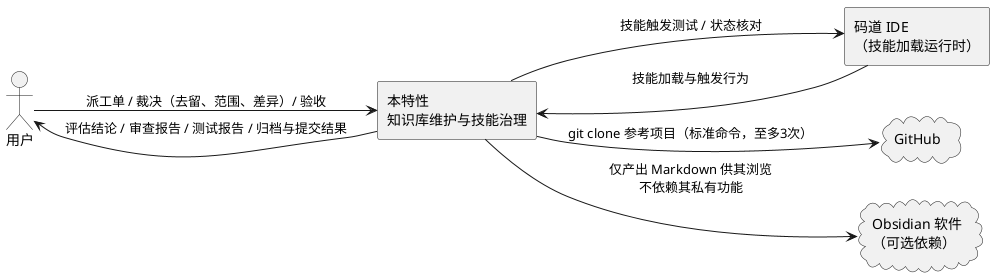
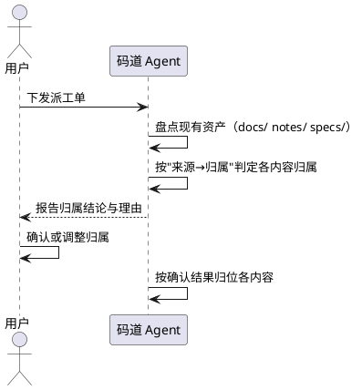
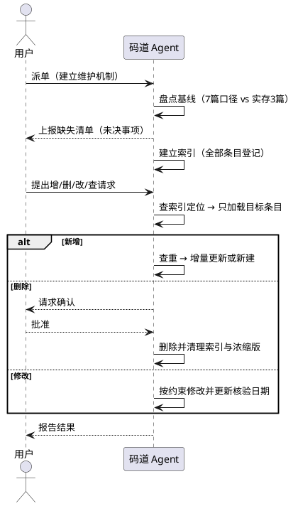
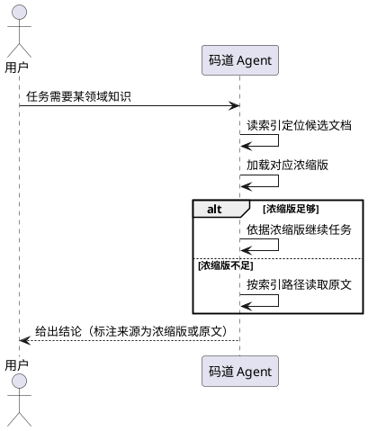
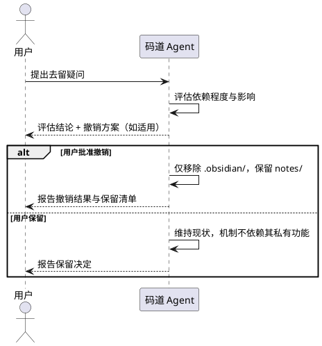
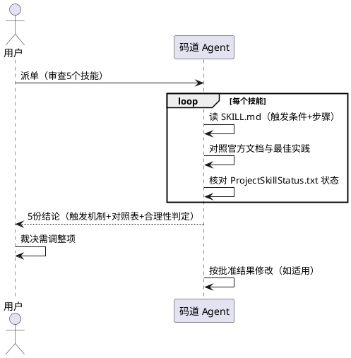
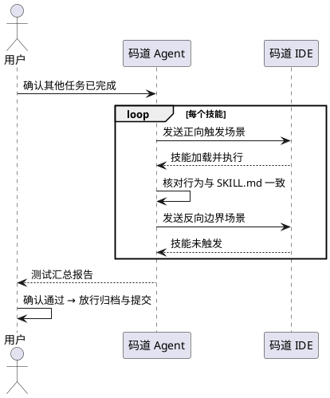
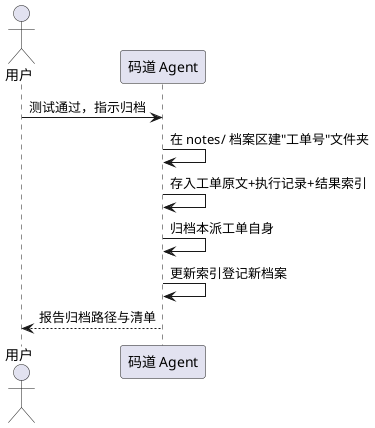
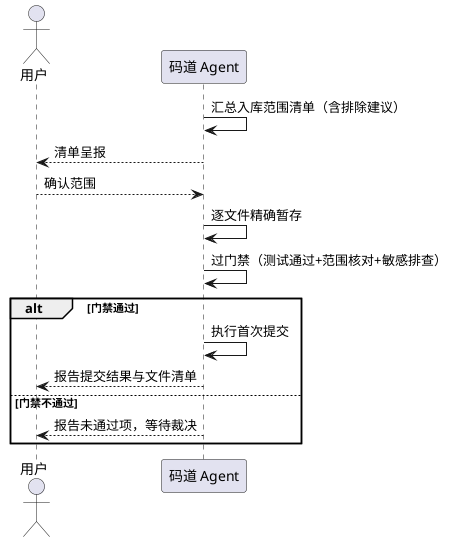

# 知识库维护与技能治理（kb_maintenance）需求规格

# **1. 组件定位**

## **1.1 核心职责**
本特性负责为项目知识库（Wiki 文档库 + Obsidian 笔记库）建立内容分工、增量维护与浓缩版加载机制，并完成 Obsidian 去留评估、参考项目拉取降级、5 个技能审查测试、派工单归档与首次版本提交，使知识资产可查、可控、可复用。

## **1.2 核心输入**
1. 用户派工单：本特性的任务目标、约束与验收要求（6 大任务项）。
2. 现有知识资产（2026-11-06 实查）：docs/ 下 3 篇 Wiki 文档、notes/ 下 1 篇初始化笔记、.obsidian/ 配置目录、.codeartsdoer/skills/ 下 5 个技能（find-skills、grill-me、lazy-exec、ruleinit、skill-writer）及 ProjectSkillStatus.txt、.codeartsdoer/specs/ 产物。
3. 项目协作公约：7 条项目级规则（协作、沟通、文件禁改、提交纪律、经验复用、网络操作、优先级）。
4. 参考项目（若拉取成功）：作为知识库维护机制的外部依据。
5. 用户裁决意见：Obsidian 去留、缺失文档处理、技能差异取舍、首次提交入库范围。

## **1.3 核心输出**
1. 知识库维护机制说明：三库分工规则 + 增删改查规则 + 浓缩版加载规则（落为文档，供后续会话复用）。
2. 浓缩版索引：docs/ 每篇 Wiki 文档对应一份浓缩版。
3. Obsidian 评估结论；若用户批准撤销，则执行限定范围的撤销动作。
4. 参考项目拉取结果或拉取失败降级说明。
5. 5 个技能的审查结论与测试报告。
6. 派工单档案区：notes/ 下按派工单分文件夹的归档结构，并完成本单归档。
7. 首次版本提交：精确暂存的提交及入库范围清单。

## **1.4 职责边界**
本特性不负责以下事项：
1. 不重复执行 Obsidian vault 集成（已由用户手动集成生效）。
2. 不代用户做最终决策：Obsidian 撤销、删除知识条目、技能差异取舍、入库范围均须用户裁决。
3. 不产出 design.md 与 tasks.md（由后续代理承接）。
4. 不修改 AGENTS.md 与规则文件（未经用户明确批准）。
5. 不安装任何新软件或工具（含 Obsidian 软件）。
6. 不将参考项目任何代码混入本项目。
7. 不凭空补造用户口径中缺失的 4 篇 Wiki 文档内容（禁猜禁编，仅盘点上报）。
8. 不编写业务功能代码：本特性落点为文档、索引与 git 提交等治理类产物。

# **2. 领域术语**

**Wiki 文档库（docs/）**
: 项目根目录下存放官方参考文档与定稿规范文档的目录，是知识库的原始文档层，对应"Wiki 生成文档"的存放位置。

**Obsidian 笔记库（notes/）**
: 项目根目录下存放工作笔记、索引与档案的目录，被用户的 Obsidian vault 指向，提供可视化浏览入口。

**vault**
: Obsidian 软件打开的笔记仓库，本项目中 vault 已由用户手动指向 Date 项目目录并集成生效。

**浓缩版**
: 一篇 Wiki 原始文档的摘要产物，必含原文路径、核心要点与关键结论，供加载进上下文使用，避免全量加载原文。

**索引**
: 知识库条目的清单文件，记录每篇文档的名称、归属、主题与路径，是增删改查与按需加载的唯一入口。

**派工单**
: 用户以结构化形式下发的任务工单，含任务清单、红线（禁止事项）与输出格式要求。

**执行记录**
: 派工单执行过程中留存的记录，含执行步骤、结果汇报与未决事项。

**档案区**
: notes/ 下按派工单编号分文件夹存放工单原文与执行记录的归档区域。

**技能（Skill）**
: 以 SKILL.md 为载体、存放于 .codeartsdoer/skills/技能名/ 目录的可复用知识包，通过 description 中的触发条件被码道加载。

**触发条件**
: 技能 description 中"当…时触发"的描述，决定技能在何种任务场景下被激活。

**原版对照**
: 将本地自建技能与官方参考来源（docs/ 官方文档、官方最佳实践）在功能定位上的逐项比对。

**系统文件夹**
: 项目根目录下承载系统级功能的顶层目录；本项目的约束为根目录有且仅有 .codeartsdoer/ 一个系统文件夹。

**降级路径**
: 外部依赖（如参考项目拉取）失败时，改用本地已有资料继续推进并上报未决事项的替代方案。

**门禁**
: 提交或交付前必须通过的一组检查；未通过则禁止提交。

**精确暂存**
: 逐文件指定加入暂存区的提交方式；全量暂存（一次加入全部变更）属禁止行为。

# **3. 角色与边界**

## **3.1 核心角色**
- 用户（项目所有者）：下发派工单；裁决 Obsidian 去留、缺失文档处理、技能差异取舍、入库范围；批准或拒绝撤销与删除动作；验收最终成果。
- 码道 Agent（执行者）：盘点知识资产基线；建立并执行维护机制；评估 Obsidian；执行拉取与降级；审查与测试 5 个技能；归档派工单；执行精确暂存与首次提交。

## **3.2 外部系统**
- GitHub（参考项目托管平台）：git clone 的潜在来源；历史记录显示此前 4 次克隆全部失败（连接重置），其可达性不可假设。
- Obsidian 软件（可选依赖）：用户侧的可视化笔记工具；是否继续作为知识库组件由评估结论与用户裁决决定。
- 码道 IDE：技能的加载与触发运行时，ProjectSkillStatus.txt 记录技能启用状态。

## **3.3 交互上下文**



# **4. DFX约束**

## **4.1 性能**
1. 单次知识库维护或查询动作只加载"索引 + 目标条目（含浓缩版）"，禁止为单次操作全量读入知识库。
2. 浓缩版不设行数上限，按需撰写，内容完整优先【来源：用户裁决 2026-11-06，废除原 80 行推断值】。
3. 最终汇报不超过 200 字【来源：先例 codeartsdoer_init】。

## **4.2 可靠性**
1. 同一外部拉取目标重试至多 3 次，仍失败即停止并转降级路径【来源：用户偏好"先诊断分析再行动"】。
2. 任何知识条目的删除动作 100% 经用户确认后方可执行，禁止静默删除。
3. 提交完成后，入库范围清单与实际暂存内容必须逐项一致，无遗漏资产、无多入文件。

## **4.3 安全性**
1. AGENTS.md 与规则文件未经用户明确批准禁止修改【来源：项目协作公约第三条】。
2. 参考项目只读使用，任何内容禁止混入本项目代码库。
3. 提交前必须排查临时文件、本地缓存、本地数据库类内容，未经用户确认禁止入库。

## **4.4 可维护性**
1. 每篇知识条目须标注最后核验日期。
2. 索引与浓缩版必须与原文同步更新，任何原文变更后须核对对应浓缩版。
3. 维护机制本身须落为文档存放于知识库，供后续会话直接复用，不依赖会话记忆。

## **4.5 兼容性**
1. 保持用户已集成的 vault 现状，禁止重复集成或改动 vault 指向【来源：已验证事实】。
2. 所有机制与规则须在 Windows + PowerShell 环境下可用。
3. 机制规则不绑定具体工具版本或目录细节，保证后续项目可复用。

# **5. 核心能力**

## **5.1 知识内容分工与分流**

### **5.1.1 业务规则**
1. **三库分工固化**：当知识内容产生或归档时，系统应按既定分工放置——docs/ 存官方参考文档与定稿规范（原始文档层）；notes/ 存工作笔记、索引与档案区（笔记层）；.codeartsdoer/specs/ 存规范流水线产物。
   a. 验收条件：任一新文档落盘 → 其所在目录与内容类型匹配三库分工定义。
   【来源：notes/知识库初始化.md 已验证约定，本条将其固化为机制】
2. **归档判定**：当无法直接判断新内容归属时，系统应按内容来源判定——官方原文或用户定稿归 docs/，过程笔记与索引归 notes/，规范产物归 specs/。
   a. 验收条件：判定过程 → 每条内容有明确归属结论，无"两处都放"的重复副本。
3. **禁止混放**：当出现官方文档写入 notes/ 或临时过程记录写入 docs/ 的意图时，系统应拒绝该操作。
   a. 验收条件：混放意图出现 → 操作被拒绝并说明归属建议。
4. **单一权威源**：当同一主题同时存在笔记与 Wiki 文档时，系统应以 docs/ 原文为权威版本，notes/ 仅存摘要与链接。
   a. 验收条件：同主题双处存在 → 笔记侧含原文链接，且内容与原文不冲突。

### **5.1.2 交互流程**



### **5.1.3 异常场景**
1. **归属两可**
   a. 触发条件：某内容既可视为官方原文又可视为过程笔记。
   b. 系统行为：暂停归档，向用户说明两可原因并请裁决。
   c. 用户感知：收到归属选项与建议，等待确认。
2. **发现重复副本**
   a. 触发条件：同主题内容在两库均存在且无链接关系。
   b. 系统行为：盘点差异后交用户裁决保留哪一处。
   c. 用户感知：收到重复清单与保留建议。

## **5.2 知识库增量维护（增删改查）**

### **5.2.1 业务规则**
1. **基线盘点**：当维护机制建立时，系统应先盘点知识库基线，并将用户口径（Wiki 生成过 7 篇文档）与实存数量（docs/ 现存 3 篇）的差异列为未决事项。
   a. 验收条件：盘点完成 → 缺失清单（仅列编号与已知线索）上报用户，无任何凭记忆补造的文档内容。
   【来源：2026-11-06 实查 + 项目协作公约第一条"禁猜禁编"；用户裁决 2026-11-06：缺失 4 篇不补造，列入未决事项，原因——口径 7 篇实存 3 篇，缺失的 4 篇无源文件可回溯，补造即编造】
2. **新增查重**：当新增知识条目时，系统应先查索引确认同主题是否已存在；已存在则增量更新原条目，禁止另起新文件。
   a. 验收条件：新增完成 → 索引中同主题仅一个条目，原条目更新时间被刷新。
3. **修改约束**：当修改官方参考文档时，系统应保持原文只增不改（如追加核验批注而不篡改正文）；当修改笔记类条目时，系统应同步更新其最后核验日期。
   a. 验收条件：修改完成 → docs/ 原文正文与官方来源一致；笔记侧日期已更新。
4. **删除确认**：当删除任何知识条目时，系统应先获得用户对该条目的明确批准，再执行删除并同步清理索引与浓缩版。
   a. 验收条件：删除执行 → 有用户批准记录；索引与浓缩版中无残留引用。
5. **查询走索引**：当查询知识库时，系统应从索引定位目标，禁止为查询目的全量扫描或全量加载。
   a. 验收条件：查询完成 → 上下文中仅出现索引与被命中的条目内容。
6. **增量维护不塞上下文**：当执行任一维护动作时，系统应只加载索引与本次涉及的目标条目，禁止为一次更新读入全部知识库内容。
   a. 验收条件：维护动作执行 → 会话加载范围为"索引 + 目标条目"，无全量读取行为。

### **5.2.2 交互流程**



### **5.2.3 异常场景**
1. **索引缺失或过期**
   a. 触发条件：索引未覆盖实际存在的文档，或索引指向已不存在的条目。
   b. 系统行为：以磁盘实查为准重建或修正索引，修正结果上报。
   c. 用户感知：收到索引修正说明。
2. **同主题冲突**
   a. 触发条件：新增内容与既有条目主题相同但结论冲突。
   b. 系统行为：暂停写入，列出双方差异交用户裁决。
   c. 用户感知：收到冲突对照与建议。
3. **未批准的删除请求**
   a. 触发条件：删除动作未获得用户对具体条目的批准。
   b. 系统行为：拒绝执行并说明需逐条确认。
   c. 用户感知：收到"待确认条目清单"。

## **5.3 浓缩版索引与按需加载**

### **5.3.1 业务规则**
1. **一文一浓缩**：当 docs/ 存在一篇 Wiki 文档时，系统应为其建立一份对应浓缩版，必含原文路径、核心要点与关键结论。
   a. 验收条件：核对 docs/ 全部文档 → 每篇均有浓缩版，三要素齐套。
2. **加载顺序**：当会话需要调用知识库内容时，系统应先加载索引与浓缩版，仅当浓缩版不足以支撑当前任务时按需读取对应原文。
   a. 验收条件：调用过程 → 上下文先出现浓缩版内容；读原文前有"浓缩版不够用"的明确理由。
3. **同步约束**：当原文发生变更时，系统应同步更新对应浓缩版；当两者内容冲突时，以原文为准。
   a. 验收条件：任一原文变更后 → 浓缩版已更新；冲突场景 → 结论以原文为据。
4. **浓缩版标注**：当生成浓缩版时，系统应标注其来源原文路径与最后核验日期，禁止浓缩版脱离原文独立存在。
   a. 验收条件：任一浓缩版 → 可凭标注直接定位原文。

### **5.3.2 交互流程**



### **5.3.3 异常场景**
1. **浓缩版失真**
   a. 触发条件：浓缩版结论与原文实际内容不一致。
   b. 系统行为：以原文为准修正浓缩版并记录修正。
   c. 用户感知：收到修正说明。
2. **原文缺失但浓缩版存在**
   a. 触发条件：索引或浓缩版指向的原文不存在。
   b. 系统行为：标记该条目为异常，暂停依赖该条目的任务并上报。
   c. 用户感知：收到缺失条目清单。

## **5.4 Obsidian 必要性评估与撤销**

### **5.4.1 业务规则**
1. **评估先行**：当讨论 Obsidian 去留时，系统应先产出评估结论，至少覆盖三点——vault 已集成生效的现状、知识库维护机制对 Obsidian 私有功能的实际依赖程度、撤销后对用户可视化浏览的影响；不得未经评估直接撤销。
   a. 验收条件：评估产出 → 三点齐套且结论明确（需要/不需要/仅弱依赖）。
2. **决策权在用户**：当评估结论为"不需要"或"弱依赖"时，系统应将撤销方案（范围、步骤、影响）呈报用户，仅在获得明确批准后执行。
   a. 验收条件：撤销执行前 → 存在用户批准记录；无批准 → 不发生任何删除。
3. **撤销范围限定**：当用户批准撤销时，系统应仅移除 Obsidian 软件依赖项（.obsidian/ 配置目录），notes/ 全部笔记内容必须原样保留为普通 Markdown 目录。
   a. 验收条件：撤销完成 → .obsidian/ 已移除；notes/ 内容与撤销前逐文件一致。
4. **禁止重复集成**：当执行本特性任务时，系统应保持 vault 现状，禁止重复执行 vault 集成或改动 vault 指向。
   a. 验收条件：任务全程 → vault 配置未被触碰（除非用户批准撤销）。
   【来源：已验证事实"vault 已由用户手动集成生效"】
5. **不安装不升级**：当评估涉及 Obsidian 软件本身时，系统应仅评估其现状价值，禁止安装、升级或配置 Obsidian 软件。
   a. 验收条件：任务全程 → 未发生任何软件安装或配置变更。

### **5.4.2 交互流程**



### **5.4.3 异常场景**
1. **评估发现强依赖**
   a. 触发条件：维护机制中存在必须依赖 Obsidian 私有功能（如双链解析）的环节。
   b. 系统行为：结论定为"需要保留"，并将该依赖点列入维护机制说明。
   c. 用户感知：收到依赖点清单。
2. **撤销后用户反悔**
   a. 触发条件：撤销 .obsidian/ 后用户要求恢复。
   b. 系统行为：说明 .obsidian/ 为 Obsidian 软件可重建的配置目录，由用户在软件中重新指向 vault 即可恢复，无需项目侧动作。
   c. 用户感知：收到恢复指引。

## **5.5 参考项目拉取与降级**

### **5.5.1 业务规则**
1. **标准命令拉取**：当需要拉取参考项目时，系统应使用标准工具命令（git clone）执行，禁止自造 HTTP 请求或网页拉取。
   a. 验收条件：拉取动作 → 仅出现标准命令调用记录。
   【来源：项目协作公约第六条】
2. **失败如实上报**：当拉取失败时，系统应先报告原始错误信息，禁止盲目重试或擅自更换源。
   a. 验收条件：失败发生 → 用户收到原文错误；未获用户同意 → 不出现换源行为。
   【来源：项目协作公约第六条】
3. **重试上限**：当同一拉取目标反复失败时，系统应最多重试 3 次即停止，转入降级路径。
   a. 验收条件：失败计数 → 第 3 次失败后无第 4 次尝试。
   【来源：用户偏好"先诊断分析再行动"】
4. **降级路径**：当拉取未成功时，系统应不阻塞主线，改以本地已有资料（docs/ 官方文档与官方最佳实践）作为维护机制依据，并将"参考项目未拉取"列入未决事项交用户裁决。
   a. 验收条件：降级生效 → 维护机制说明中标注依据来源为本地资料；未决事项含拉取失败详情。
5. **存放隔离**：当拉取成功时，系统应将参考项目存放于项目外独立目录，保证项目根目录有且仅有 .codeartsdoer/ 一个系统文件夹。
   a. 验收条件：拉取完成 → 项目根目录无新增系统文件夹；参考仓库位于项目外。
   【来源：用户要求 + 先例 codeartsdoer_init 的隔离存放约定】
6. **只读参考**：当使用参考项目时，系统应只读取其维护机制相关内容，禁止修改该仓库、禁止复制其代码进本项目。
   a. 验收条件：任务结束 → 参考仓库无改动；本项目无其源文件。

### **5.5.2 交互流程**

```plantuml
@startuml
actor 用户 as U
participant "码道 Agent" as A
cloud "GitHub" as G
U -> A : 派单（拉取参考项目作依据）
A -> G : git clone（第1次）
alt 拉取成功
  G --> A : 克隆完成
  A -> A : 核对隔离存放（项目外目录）
  A -> A : 只读提炼维护机制参考
  A --> U : 报告存放路径与提炼结论
else 失败（至多重试3次）
  G --> A : 失败（连接重置等）
  A --> U : 报告原文错误
  A -> A : 转降级：以本地 docs/ 资料为依据
  A --> U : 报告降级决定 + 未决事项
end
@enduml
```

### **5.5.3 异常场景**
1. **网络不可达（历史已知风险）**
   a. 触发条件：克隆出现连接重置等网络错误（此前 4 次克隆均如此失败）。
   b. 系统行为：报告原文错误，按重试上限执行后转降级路径。
   c. 用户感知：收到错误原文、重试次数、降级说明。
2. **用户指定换源或换目标**
   a. 触发条件：用户在失败后明确指示更换源或目标仓库。
   b. 系统行为：按新指示重新计数执行标准命令拉取。
   c. 用户感知：收到新目标与执行结果。
3. **项目外目录已存在同名仓库**
   a. 触发条件：目标存放位置已有同名目录。
   b. 系统行为：复用已有目录，不重复克隆。
   c. 用户感知：收到复用说明。

## **5.6 技能触发审查与原版对照**

### **5.6.1 业务规则**
1. **逐技能审查**：当开展技能审查时，系统应对 5 个技能（find-skills、grill-me、lazy-exec、ruleinit、skill-writer）逐一核对三项——description 是否含明确触发条件与不适用边界、触发场景与实际任务类型是否匹配、正文步骤是否可执行。
   a. 验收条件：审查产出 → 5 份逐技能结论，每份含三核对项结果。
2. **原版对照**：当核对功能是否与原版相近时，系统应以 docs/ 官方文档（热门 Skills 清单、官方最佳实践）为对照基准，逐技能建立"功能定位 / 与基准的差异 / 差异取舍"对照表。
   a. 验收条件：对照完成 → 5 张对照表齐套；无法从官方文档确认的"原版"信息标注为推断并交用户裁决。
   【来源：官方文档在 docs/ 可查；5 技能均非热门清单内置技能，对照基准推断为官方最佳实践】
3. **触发合理性结论**：当审查完成时，系统应对每个技能给出触发机制是否合理的明确结论（合理 / 需调整 + 调整建议），不混入无依据的优化建议。
   a. 验收条件：结论列表 → 每技能一条明确判定，建议项均有依据。
4. **状态一致性核对**：当审查完成时，系统应核对技能目录与 ProjectSkillStatus.txt 的记录一致（5 个技能均为启用）。
   a. 验收条件：核对完成 → 目录数 = 状态记录数 = 5，无孤儿记录或未登记目录。
5. **禁擅自改写**：当审查发现技能需要修改时，系统应仅输出修改建议清单，未经用户批准不改动任何 SKILL.md。
   a. 验收条件：审查阶段 → SKILL.md 与审查前逐字一致。

### **5.6.2 交互流程**



### **5.6.3 异常场景**
1. **原版信息不可考**
   a. 触发条件：某技能的原版出处无法从官方文档确认。
   b. 系统行为：对照表标注"原版信息缺失，本行为推断"，交用户确认对照基准。
   c. 用户感知：收到标注推断的对照项。
2. **触发边界重叠**
   a. 触发条件：两个技能的触发条件覆盖同一任务场景（如需求澄清类任务同时命中 grill-me 与 lazy-exec 的边界描述）。
   b. 系统行为：列出重叠场景与优先级建议，交用户裁决。
   c. 用户感知：收到重叠清单。

## **5.7 技能测试验证**

### **5.7.1 业务规则**
1. **测试时机**：当本派工单全部其他任务完成时，系统应启动技能测试，禁止在其他任务未完成时提前测试。
   a. 验收条件：测试启动 → 其余任务项均有完成记录。
   【来源：用户要求"以上所有任务干完之后测试一下"】
2. **正反用例**：当测试每个技能时，系统应至少执行 1 条正向触发用例（应触发且确实触发）与 1 条反向边界用例（不应触发且确实未触发）。
   a. 验收条件：测试报告 → 每技能 ≥2 条用例且正反结果均符合预期。
3. **行为核对**：当技能被触发时，系统应核对其执行行为与 SKILL.md 描述步骤一致。
   a. 验收条件：每次触发 → 实际行为可逐条对应 SKILL.md 步骤，偏差项记录在案。
4. **测试报告汇总**：当全部测试完成时，系统应输出汇总报告（每技能用例、结果、偏差与修复状态），测试不通过项禁止进入归档与提交环节。
   a. 验收条件：报告产出 → 存在未通过项时，归档与提交动作被阻塞。

### **5.7.2 交互流程**



### **5.7.3 异常场景**
1. **技能未按预期触发**
   a. 触发条件：正向用例中技能未被加载。
   b. 系统行为：核对启用状态与触发条件描述，定位原因后上报，不擅自改写。
   c. 用户感知：收到原因分析与修复建议。
2. **触发后行为偏离**
   a. 触发条件：技能执行与 SKILL.md 步骤不一致。
   b. 系统行为：记录偏差，生成修改建议，阻塞后续环节直至用户裁决。
   c. 用户感知：收到偏差清单与裁决请求。

## **5.8 派工单与执行记录归档**

### **5.8.1 业务规则**
1. **一单一目录**：当归档派工单时，系统应在 notes/ 下档案区为每个派工单建立独立文件夹，内含工单原文、执行记录与结果产物索引。
   a. 验收条件：任一归档完成 → 文件夹内三部分齐套，可直接凭文件夹了解该单全貌。
2. **可检索命名**：当建立档案文件夹时，系统应使用含派工单编号的命名，保证按编号可唯一定位。
   a. 验收条件：按编号检索 → 精确命中唯一文件夹，无歧义。
3. **归档时机**：当技能测试通过后，系统应执行归档（含本派工单自身的归档），禁止在测试未通过前归档。
   a. 验收条件：归档发生 → 测试汇总报告为通过状态。
   【来源：用户要求"测试完了之后归档"】
4. **归档位置一致**：当放置档案时，系统应遵循三库分工，将档案区置于 notes/，禁止写入 docs/。
   a. 验收条件：归档完成 → 档案区位于 notes/ 下，docs/ 无档案类文件。
5. **临时步骤不留存**：当整理执行记录时，系统应只归档工单原文与结果性记录，临时性步骤内容按公约"干完即弃"不进入档案。
   a. 验收条件：档案内容检查 → 无临时脚本、无一次性中间文件。
   【来源：项目协作公约第一条】

### **5.8.2 交互流程**



### **5.8.3 异常场景**
1. **工单编号缺失**
   a. 触发条件：待归档派工单无明确编号。
   b. 系统行为：向用户申请编号或确认命名，不得自行编造编号。
   c. 用户感知：收到命名确认请求。
2. **同名文件夹已存在**
   a. 触发条件：档案区已有同编号文件夹。
   b. 系统行为：核对是否为同一工单；同一则增量更新内容，不同则上报冲突。
   c. 用户感知：收到更新或冲突说明。

## **5.9 首次版本提交与门禁**

### **5.9.1 业务规则**
1. **精确暂存**：当执行首次提交时，系统应逐文件精确暂存，禁止全量暂存（一次性加入全部变更）。
   a. 验收条件：提交完成 → 暂存记录为逐文件指定，无全量暂存行为。
   【来源：项目协作公约第四条】
2. **入库范围确认**：当确定提交内容时，系统应先列出入库范围清单（docs/、notes/、.codeartsdoer/ 下 skills/specs/rule 等资产，及建议排除项如临时目录、本地缓存、本地数据库）呈用户确认，未经确认不得提交。
   a. 验收条件：提交前 → 存在用户确认的入库范围清单，且实际暂存内容与之逐项一致。
3. **门禁前置**：当执行提交时，系统应先通过门禁（技能测试通过、入库范围核对一致、敏感与临时内容已排查），任一项不通过即禁止提交。
   a. 验收条件：提交发生 → 门禁三项均有通过记录。
4. **资产完整**：当首次提交完成时，系统应保证全部知识资产已入库或已明确记录排除理由，不允许"既未入库也未说明"的遗漏项。
   a. 验收条件：提交后核对 → 工作区每个顶层目录在入库清单或排除清单中有唯一归属。
   【来源：用户要求"把所有的东西保存好，这些都是资产"】
5. **禁改约束延续**：当提交涉及规则与配置时，系统应保持 AGENTS.md 与规则文件未被我方改动（与任务开始前一致）。
   a. 验收条件：提交内容核对 → AGENTS.md 与规则文件无本任务产生的变更。
   【来源：项目协作公约第三条】

### **5.9.2 交互流程**



### **5.9.3 异常场景**
1. **范围清单被拒**
   a. 触发条件：用户对入库范围提出修改意见。
   b. 系统行为：按意见修订清单后重新呈报，未获确认不暂存。
   c. 用户感知：收到修订后清单。
2. **门禁中途失败**
   a. 触发条件：范围核对或敏感排查发现不符项。
   b. 系统行为：停止提交流程，列出不符项，等待用户处理指示。
   c. 用户感知：收到不符项清单与建议。

# **6. 数据约束**

## **6.1 Wiki 文档条目（docs/）**
1. **文件命名**：必含类型前缀与编号（沿用现名规则"类型-主题-编号.md"，如 官方文档-码道热门Skills清单-desktop0003.md）。
2. **来源标注**：官方文档须可识别其官方来源；定稿规范须可识别用户定稿身份。
3. **正文约束**：官方参考文档正文只增不改；追加内容限于核验批注类。
4. **核验日期**：每篇须有最后核验日期记录。

## **6.2 笔记条目（notes/）**
1. **类型归属**：每条笔记须属于工作笔记、索引、档案区三类之一。
2. **链接关系**：引用 docs/ 内容时须含原文路径或链接。
3. **内容形态**：保持普通 Markdown 可读性，不依赖 Obsidian 私有语法方可理解。

## **6.3 浓缩版条目**
1. **必含要素**：原文路径、核心要点、关键结论、最后核验日期。
2. **篇幅约束**：不设行数上限，按需撰写，内容完整优先【来源：用户裁决 2026-11-06，废除原 80 行推断值】。
3. **对应关系**：与 docs/ 原文一一对应，一份原文至多一份现行浓缩版。

## **6.4 派工单档案条目（notes/ 档案区）**
1. **编号唯一**：每个派工单文件夹以唯一工单编号命名。
2. **内容齐套**：工单原文、执行记录、结果产物索引三部分必备。
3. **无临时内容**：档案内不得含临时脚本与一次性中间文件。

## **6.5 技能条目（.codeartsdoer/skills/）**
1. **frontmatter 必备**：name 与目录名一致；description 含"当…时触发"的触发条件与不适用边界。
2. **状态一致**：目录存在性与 ProjectSkillStatus.txt 记录一一对应。
3. **正文约束**：步骤可直接执行，单条指令不超过 8 行【来源：先例约束】。

## **6.6 版本提交清单条目**
1. **逐文件列示**：入库清单逐文件列出，不含目录级通配。
2. **排除有据**：每个排除项须附排除理由。
3. **双向一致**：清单与实际暂存内容逐项一致，无多余、无遗漏。