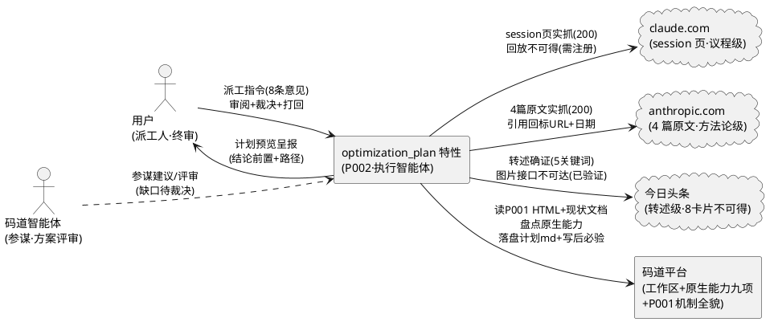
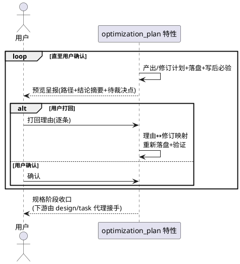

# optimization_plan 需求规格（v3 重构版）

> **派工单编号：P002**（全局递增不重复；P001 已交付）。本规格及后续 design.md、tasks.md、优化计划文档均须标注 P002。
> 版本：v3（重构版）｜日期：2026-11-07｜状态：待用户审阅
> 修订背景：v2 被用户二轮打回，共 8 条意见：①信源唯一性存疑，用户已提供官方一手信源（claude.com/code-with-claude/session/ldn-the-prompting-playbook）；②要求完整读透 P001 产物 sdd-workflow-visual.html，掌握系统机制全貌；③要求核实 SDD 流程（需求规格/实现方案）在当前环境的真实实现状态（动态实现与否）；④新增核心需求——设计"任务完成定义（DoD）统一验收接口"，解决"什么叫完/什么叫成"无统一标准问题；⑤人机协作部分推倒重新规划（原标准不好）；⑥盘点平台（CodeArts 智能体）原生能力，避免重复造轮子；⑦整体重新出方案；⑧沿用约束：只写计划不写代码、编号 P002、落盘写后必验。
> v2 状态说明：v2 的 4 篇官方文章考证成果、落盘验证纪律、公约校验框架**全部继承**；v3 在其基础上扩展四大新模块（三级信源链/SDD 状态核实/DoD 统一验收接口/人机协作规划），非推倒重建。

---

# **1. 组件定位**

## **1.1 核心职责**

本特性负责：基于**三级信源链**（官方 session 页→头条转述→官方工程文章原文）、**P001 系统机制全貌**与**项目现状实查**，产出一份**优化计划 md 文档**，内含五块交付内容——SDD 实现状态核实报告、DoD 统一验收接口设计、人机协作机制规划（三人团队口径）、优化项清单（含公约校验）、待补充材料清单——落盘至计划文件夹供用户审阅裁决，实现"有据可查、来源可溯、验收有据、协作有谱、可打回迭代"的计划制定能力。**只写计划，不写代码。**

## **1.2 核心输入**

1. **用户派工指令（v3 二轮）**：8 条修改意见原文（见头部修订背景）；其中第 ④ 条为核心新增需求——"咱们团队 3 个人要统一一个标准，定义一个接口：什么叫成功/什么叫完，干一个活得有验收标准"（用户声明其举例不必当真，只取方向）。
2. **官方一手信源（新增，HTTP 200 实抓）**：https://claude.com/code-with-claude/session/ldn-the-prompting-playbook ——页面标题 "The prompting playbook | Session | Code w/ Claude 2026"；描述 "How to apply core prompting principles to agentic systems that plan, act, and adapt."；讲者 Margot van Laar（Anthropic 工程师）；London, UK；2026-05-19；16:50–17:35。页面含 on-demand 回放入口但**需表单注册**，回放内容不可自动获取（已实测）。
3. **Anthropic 官方工程文章 4 篇（v2 继承，均 HTTP 200 实抓）**：《Building effective agents》（2024-12-19）、《Writing tools for agents》（2025-09-11）、《Claude Code best practices》（2025-04-18，页面注明已迁移至 code.claude.com/docs/en/best-practices 现行维护）、《Demystifying evals for AI agents》（2026-01-09）。作为方法论**原文级**依据。
4. **头条转述级信源（v2 继承）**：微头条 1881093151345672；头图 OCR 确证 "Code w/ Claude: The Prompting Playbook"；文案 5 关键词=任务评测、指令整理、工具调用、复杂任务拆分、从零搭建更稳定的 AI Agent（共称 8 个技巧）。8 技巧卡片逐条原文不可得结论维持（多方已验证）。
5. **P001 系统机制全貌（新增核心输入）**：`.codeartsdoer/specs/20261107_P001_spec_workflow_visual/sdd-workflow-visual.html`（425 行，已全文读透），含：SDD 四阶段主链路（需求规格→实现方案→编码任务→任务执行→核验收尾，禁跳阶段）；门禁机制（每阶段落盘→结论前置呈报+询问是否修改；自信度≥80% 过 ST2→ST3→ST4→ST5；全权授权自行判定+豁免留痕；唯一可中断呈报=事实性阻塞）；派工单生命周期状态机（下发→ST2 规格中→ST3 设计中→ST4 任务分解中→ST5 执行中→审查中→交付终态，四查未过返工≤3 次，编号终态不复用）；编队 1 主控+2 持久+4 运行时；编码必审四查；公约 6 条；注册表两口径（派工单 19 vs 事实源 11 已仲裁）；知识库三级加载；已关闭特性区 subagent-team-design（10 文件只读）。
6. **"什么叫完"现状盘点结论（主控实查）**：已有分散机制但无统一接口——①编码/HTML 类：四查+git 提交链；②阶段迁移：自信度≥80%+迁移三要素（准出条件满足+证据链接+变更日志留痕）；③交付终态：TASK.md 补齐+交活≤300 字结论前置；④调研类：实证等级标注（元数据级/README 级）诚实降级。**缺口：没有覆盖全部任务类型（文档/调研/设计/规划/编码/知识库维护）的统一 DoD 接口，各任务类型验收标准散落且口径不一。**
7. **平台原生能力盘点（用户截图设置面板）**：智能体（项目级存 `.codeartsdoer/agents/*.md`，已有 grader/examiner 等）、技能与规则、经验与记忆、代码库索引、知识库、MCP 工具、代码补全、安全策略、实验室特性。规划须区分"平台原生已提供"与"需项目自建"，已提供的不重复建设。
8. **三人团队口径（新增）**：用户=派工人（把握方向、终审）；码道智能体=参谋（出主意、方案评审）；执行智能体=干活（SDD 全链执行）。需与既有编队口径（1 主控+2 持久+4 运行时）兼容说明：3 人=宏观分工层，编队=执行层内部编排，两层不冲突。
9. **项目现状文档**：notes/项目事实表.md（单一事实源）、notes/知识库索引.md、notes/注册表.md 及其引用的机制文档。
10. **2026-11-06 框架调研结论（继承，不推翻）**：不必集成 Cairn/Super-agent；优化项优先级=经验与记忆（最优先）、代码库索引（次优先）。

## **1.3 核心输出**

1. **本规格文档**：`.codeartsdoer/specs/optimization_plan/spec.md`（v3 重构版，即本文档，标注 P002）。
2. **优化计划 md 文档（最终交付物）**：落盘至 `.codeartsdoer/specs/optimization_plan/`，标注 P002，内容含五块——①三级信源链考证呈现；②SDD 流程实现状态核实报告（逐环节标注已实现/部分实现/未实现+证据）；③DoD 统一验收接口设计（按任务类型分类的验收标准清单+统一判定流程，收编既有四查/门禁/迁移三要素机制）；④人机协作机制规划（三人团队×平台原生能力盘点）；⑤优化项清单（优先级+依据+公约校验）——外加待补充材料清单与呈请裁决项。
3. **审阅呈报**：向用户提供计划文档预览（含文件路径，结论前置），用户打回时按理由逐条修订迭代。

## **1.4 职责边界**

本特性**不负责**以下事项（禁止项）：

1. **不实施任何优化**：不写任何业务代码、不改任何机制文档正文、不动知识库三层任何现行条目；DoD 接口与人机协作机制在本轮只做**设计进计划**，落地执行属后续独立派工。
2. **不改规矩层**：项目公约（6 条）零改动；机制文档（阶段状态机运行规则、知识库维护机制、注册表抽象模板层）正文零改动。
3. **不产出 design.md / tasks.md**：由 spec-design-agent、spec-task-agent 在用户确认本规格后接手。
4. **不补造不可得的材料**：8 技巧卡片逐条原文、session 回放视频内容均不可得即如实声明，禁止编造、禁止用其他材料冒充。
5. **不集成 Cairn/Super-agent**：继承 2026-11-06 调研结论，二者维持只读参考仓状态。
6. **不新建定时任务**：一切触发走事件（公约红线）。
7. **不推翻既有验收机制**：DoD 接口设计必须**收编**四查/门禁/迁移三要素/实证等级标注等既有分散机制，禁止推倒重来造成口径断裂。
8. **不重复建设平台原生能力**：平台设置面板已提供的能力（智能体/技能/知识库/经验记忆等）在规划中只做"启用与对接"，不另起炉灶自建平行体系。
9. **不依赖 v1/v2 被打回部分的内容**：v2 中人机协作相关结论按用户意见作废重建；其余继承部分以本轮实查复核为准。

---

# **2. 领域术语**

**优化计划**
: 本特性的最终交付物，一份 markdown 文档，内容为三级信源链考证、SDD 实现状态核实、DoD 统一验收接口设计、人机协作规划与优化项清单的合集，落盘至计划文件夹供用户审阅裁决。
: 备注：易混淆项——优化计划≠优化实施；本特性只产计划文档，实施另行走派工。

**三级信源链**
: 本轮确立的证据分级体系：第一级=官方 session 页（claude.com 议程级信息，已实抓 200）；第二级=头条文案（转述级，5 关键词）；第三级=官方工程文章（方法论原文级，4 篇已实抓 200）。计划文档引用经验依据时必须标注其处于哪一级。
: 备注：v2 的"原文考证"升级版；等级之间不得互相冒充——议程级信息不得写成方法论原文，转述级不得标成官方原文。

**DoD（任务完成定义，Definition of Done）**
: 判定"一个任务是否做完/做成功"的统一验收标准体系，按任务类型分类定义必查项与证据要求，是本特性核心新增设计对象。
: 备注：DoD 回答"什么叫完"，不回答"怎么实现"——实现细节属 design.md 范畴。

**统一验收接口**
: 所有任务类型在完结声明前必须经过的单一判定流程入口：按任务类型加载验收清单→逐项判定→证据链接→结论前置呈报。既有四查、门禁、迁移三要素、实证等级标注均被收编为该接口下对应任务类型的子项，不另立平行流程。

**收编（不推翻）**
: DoD 接口设计的方法论约束：将既有分散验收机制（编码四查/阶段门禁/迁移三要素/实证等级）映射为统一接口的组成部分并保持其原有判定逻辑不变。
: 备注：与"推倒重来"相对；收编后各机制在新接口中的位置与触发时机必须可追溯。

**SDD 实现状态三级标注**
: 对 SDD 流程各环节（需求规格/实现方案/编码任务/任务执行/门禁机制/DoD 接口）在当前环境真实实现程度的标注体系：已实现（有运行实证）/部分实现（有机制但存在缺口）/未实现（无机制无实证）。

**三人团队口径**
: 宏观分工层：用户=派工人（把握方向、终审裁决）；码道智能体=参谋（出主意、方案评审）；执行智能体=干活（SDD 全链执行）。
: 备注：与编队口径（1 主控+2 持久+4 运行时）分层不冲突——3 人是"谁和谁协作"，编队是"执行体内部怎么编排"。

**平台原生能力**
: CodeArts 智能体平台设置面板已内置提供的能力项：智能体（agents/*.md）、技能与规则、经验与记忆、代码库索引、知识库、MCP 工具、代码补全、安全策略、实验室特性。
: 备注：规划原则——原生已提供的只做启用与对接，不自建平行体系；原生缺失的才列为自建优化项。

**派工单编号**
: 本项目派工任务的全局唯一递增编号；P001 已交付，本轮为 **P002**，规格、设计、任务、计划文档均须携带。

**计划文件夹**
: 用户截图指定的 `.codeartsdoer/specs/optimization_plan/` 目录，本特性全部产出文档统一落盘于此。

**写后必验**
: 任何文档落盘后必须立即以读文件或列目录方式验证"文件存在且内容非空"的强制纪律；v1 即因缺失此纪律导致落盘失败未被发现。

**公约校验**
: 对每个优化项逐条核对项目公约约束：新流程须分装技能并走五步准入、禁自建定时任务、一切触发走事件、refs 只读隔离、单一事实源。
: 备注：未通过校验的优化项不得进入计划，或须以"改造为合规形态"的方式进入。

**待补充材料清单**
: 计划文档中的固定章节，登记本轮不可得但有恢复条件的材料（8 技巧卡片逐条原文、session 回放内容）及其不可得原因与恢复条件。

---

# **3. 角色与边界**

## **3.1 核心角色（三人团队口径）**

- **用户（派工人）**：把握方向、终审裁决。提供派工指令与打回理由；审阅优化计划与 DoD 接口设计；裁决优化项取舍与优先级；确认计划后授权进入后续阶段。对应编队时序图中的"派工人"泳道（事件源+终审）。
- **码道智能体（参谋）**：出主意、方案评审。在宏观分工中承担建议与评审职能；当前编队中该职能分散于门禁呈报环节（"是否修改"询问）与 2 持久角色（知识维护），无独立席位——此缺口在本轮计划中如实呈现，是否设独立参谋席位属用户裁决项。
- **执行智能体（干活）**：SDD 全链执行。对应编队中的 1 主控+2 持久+4 运行时全体，本规格阶段的执行体为 spec-requirement-agent。

## **3.2 外部系统**

- **Claude 官方站（claude.com）**：官方一手信源新增入口（session 页已抓取 200；回放需表单注册，内容不可自动获取）。
- **Anthropic 官网（anthropic.com）**：方法论原文级信源，4 篇文章已抓取（HTTP 200）；引用时须回标 URL 与发布日期。
- **今日头条平台**：转述级信源（微头条 1881093151345672）；其图片接口受 JSVM 反爬保护，8 卡片原图经此路径不可达。
- **码道平台（CodeArts 智能体，本地工作区）**：承载计划文件夹、SDD 流水线与平台原生能力（设置面板九项）；本特性的落盘、验证、原生能力对接均发生于其上。

## **3.3 交互上下文**



---

# **4. DFX 约束**

## **4.1 性能**

1. 信源抓取类动作失败时重试至多 **3 次**，仍失败则降级并如实标注（对齐用户既有授权模式）；claude.com session 页与 anthropic.com 4 篇均已验证可达（HTTP 200），无额外性能红线。
2. 本特性为单用户单会话文档型任务，不适用吞吐量/并发指标：**不适用**（理由：无服务化部署形态）。

## **4.2 可靠性**

1. **写后必验为最高可靠性红线**：任何文档落盘动作未经验证（文件存在且非空）不得宣称完成——v1 落盘失败未被发现即违反本条的直接教训。
2. 落盘失败时重试至多 3 次；3 次仍失败则呈报用户（含具体路径与错误信息），不得静默继续。
3. 结论与证据一致性：计划文档中每条结论必须能回溯到三级信源链之一（含等级+URL/日期）或项目现状实查（含路径），出现无源结论即视为缺陷。
4. 状态核实结论可复核性：SDD 实现状态三级标注（已实现/部分实现/未实现）每条必须附可验证证据（文件路径/运行实证/实查结果），禁止凭印象标注。

## **4.3 安全性**

1. refs 只读隔离：D:\refs\ 下参考仓库只读引用，禁改源码、禁 submodule/嵌套/复制入本项目。
2. 规矩层冻结：公约与机制文档正文零改动。
3. 计划文档中不得写入任何凭据、密钥、token 等敏感信息；session 回放注册表单所需个人信息一律不代填、不自动注册。

## **4.4 可维护性**

1. 来源标注规范（三级升级）：计划文档全部结论按三级信源链标注——**官方·议程级**（session 页）、**官方·原文级**（4 篇工程文章，附 URL+发布日期）、**转述级**（头条文案）与**推断**（附置信依据）四档；禁止"看起来像官方实为推断"的模糊表述。
2. 结论前置：计划文档采用结论前置结构，用户扫读即可获取核心裁决点。
3. 变更留痕：本规格及后续计划的每次修订在文档头部版本区记录修订原因（v1 落盘失败事故、v2 二轮打回、v3 八条意见均留痕）。
4. DoD 接口可演进性：验收标准清单按任务类型分节组织，后续新增任务类型时可按同一模式扩展条目，不破坏既有条目。

## **4.5 兼容性**

1. 派工单编号全局递增唯一：本轮固定为 P002，与既有档案（P001、kb_maintenance、pd003、kb_arch_foundation、subagent-team-design、codeartsdoer_init）不冲突。
2. 继承性：2026-11-06 框架调研结论（不集成 Cairn/Super-agent；经验与记忆最优先、代码库索引次优先）作为既定基线继承；如分析中发现需修正，须作为"呈请裁决项"显式列出，不得擅自推翻。
3. 机制兼容性：DoD 接口设计必须与既有四查/门禁/迁移三要素/TASK.md 留痕机制兼容（收编不推翻）；人机协作规划必须与既有编队口径（1 主控+2 持久+4 运行时）兼容（分层不冲突）。
4. 文档语言：简体中文，技术名词保留英文（EARS、DoD、CLAUDE.md、P002、ST2–ST5 等）。
5. 内容完整性优先于篇幅：文档不设行数上限，宁全勿简。

---

# **5. 核心能力**

## **5.1 三级信源链考证与保真引用**

### **5.1.1 业务规则**

1. **R1.1【无约束】系统必须以三级信源链作为优化计划的证据体系，且每一级信息只承载该级可信度的结论。**
   a. 验收标准：计划文档含"三级信源链"专节 → 三级各自列出：官方 session 页（议程级：标题/讲者/时间/地点）、头条文案（转述级：5 关键词）、官方工程文章（原文级：4 篇方法论）；无跨级冒用（如把议程描述当成方法论原文引用）。
2. **R1.2【无约束】系统必须将官方 session 页登记为第一级信源并如实记录其可达性与限制。**
   a. 验收标准：session 页条目 → 含 URL、页面标题（The prompting playbook | Session | Code w/ Claude 2026）、讲者（Margot van Laar）、时间地点（London, 2026-05-19, 16:50–17:35）；并标注"on-demand 回放需表单注册，内容不可自动获取（已实测）"。
3. **R1.3【事件驱动】WHEN 计划文档引用任一官方文章 THEN 系统必须同时标注该文 URL 与发布日期。**
   a. 验收标准：4 篇文章引用点逐处检查 → 每处均有 URL+日期双要素（如 Building effective agents（2024-12-19））。
4. **R1.4【异常处理】IF 8 技巧卡片逐条原文与 session 回放内容均不可得 THEN 系统必须在计划文档中如实声明，并列入待补充材料清单。**
   a. 验收标准：待补充材料清单 → 至少含两条：8 卡片逐条原文（原因：YouTube 被墙/B 站无搬运/头条 JSVM 反爬/搜索引擎无转载；恢复条件：用户人工提供卡片原图）、session 回放内容（原因：需表单注册；恢复条件：用户注册后人工提供回放要点）。
5. **R1.5【无约束】系统必须对"卡片↔官方文章对应关系"及一切非官方直接证实内容逐条标注"推断"及置信依据。**
   a. 验收标准：5 关键词与 4 篇文章的对应表逐行检查 → 每行有"推断"标记与置信依据；全文无非官方内容冒充官方的表述。
6. **R1.6【无约束·禁止项】禁止将推断内容、转述内容伪装成官方原文或卡片原文。**
   a. 验收标准：计划文档全文检索 → 不存在"卡片原文"字样的直接引用；转述级内容均带"转述"标记。
7. **R1.7【事件驱动】WHEN 官方页面本身标注了状态变化（如已迁移、已演变）THEN 计划文档必须如实转述该状态。**
   a. 验收标准：Building effective agents 条目 → 标注"工具生态已演变，现行为 Claude Managed Agents"；Claude Code best practices 条目 → 标注"已迁移至 code.claude.com/docs/en/best-practices 现行维护"。

### **5.1.2 交互流程**

```plantuml
@startuml
actor 用户 as User
participant "optimization_plan 特性" as F
cloud "claude.com session页" as S
cloud "anthropic.com 4篇" as A
cloud "今日头条" as T

User -> F : 派工+官方session信源
F -> S : 实抓session页(200)
S --> F : 议程级信息\n(标题/讲者/时间/回放需注册)
F -> A : 4篇原文(已抓,200)
A --> F : 方法论要点+URL+日期
F -> T : 转述确证(已完成)
T --> F : 5关键词+8卡片不可得
F -> F : 建立三级信源链\n(逐条标注等级+推断)
F --> User : 考证成果进入计划文档
@enduml
```

### **5.1.3 异常场景**

1. **session 回放诱惑性获取**
   a. 触发条件：回放入口存在但需表单注册（已实测）。
   b. 系统行为：不代填个人信息、不自动注册；登记至待补充材料清单，恢复条件=用户注册后人工提供。
   c. 用户感知：计划文档待补充材料清单该条目+呈报说明。
2. **原文抓取失败**
   a. 触发条件：官方页面 URL 不可达（本轮已排除）。
   b. 系统行为：重试至多 3 次；仍失败则该文相关优化项标注"依据缺失"并降级或移出计划。
   c. 用户感知：待补充材料清单登记+呈报说明。
3. **三级信源冲突**
   a. 触发条件：不同等级信源对同一事实表述不一致。
   b. 系统行为：按公约第 6 条仲裁链（规则>知识库>记忆>推断）执行——官方原文级>官方议程级>转述级>推断，裁决并报告。
   c. 用户感知：计划文档冲突说明+裁决依据。

## **5.2 SDD 流程实现状态核实**

### **5.2.1 业务规则**

1. **R2.1【无约束】系统必须对 SDD 流程各环节在当前环境的真实实现状态逐项核实，并以三级标注呈现。**
   a. 验收标准：计划文档含"实现状态核实报告"专节 → 覆盖至少六个环节：需求规格（ST2）/实现方案（ST3）/编码任务（ST4）/任务执行（ST5）/门禁机制/DoD 统一接口；每条标注"已实现/部分实现/未实现"之一，不得留空。
2. **R2.2【无约束】每条状态标注必须附可验证证据。**
   a. 验收标准：核实报告逐条检查 → 每条含证据项（文件路径/本轮运行实证/HTML 事实源/实查结果）；如"需求规格=已实现，证据：本轮 P002 spec.md 正在运行产出+P001 spec.md 存量实存"。
3. **R2.3【无约束】核实必须回答用户"是否动态实现"的疑问。**
   a. 验收标准：核实报告 → 含"动态性结论"小节，说明 SDD 四阶段由对应子代理（spec/design/task）在运行时按状态机调起、非静态文档模板，附 P001 HTML 时序图与状态图证据（SKILL.md:9-12、st-spec→st-exec 状态流转）。
4. **R2.4【异常处理】IF 某环节核实结论为"部分实现"或"未实现" THEN 系统必须列出缺口明细并转化为优化项或呈请裁决项。**
   a. 验收标准：部分实现/未实现条目 → 每条有缺口说明；缺口全部出现在优化项清单或呈请裁决项中（如"门禁自信度≥80% 为自评口径、无量化度量工具"→ 列为优化项候选）。
5. **R2.5【无约束·禁止项】禁止将"机制文档已写"等同于"机制已实现"——核实以运行实证为准。**
   a. 验收标准：核实报告 → "已实现"标注均有运行实证（如本轮门禁呈报实际发生）；仅有文档无实证的标注为"部分实现"并说明缺什么实证。

### **5.2.2 交互流程**

```plantuml
@startuml
participant "optimization_plan 特性" as F
rectangle "P001 HTML\n(机制全貌)" as H
rectangle "specs/ 目录实查" as D
rectangle "本轮运行实证" as R

F -> H : 读取四阶段/门禁/状态机定义
F -> D : 实查 spec/design/tasks 存量
F -> R : 回看本轮 P002 实际运行\n(spec代理被调起/门禁呈报)
F -> F : 逐环节比对\n(定义 vs 实证)
F -> F : 三级标注\n(已实现/部分实现/未实现)+缺口
F --> F : 缺口转优化项/呈请裁决项
@enduml
```

### **5.2.3 异常场景**

1. **定义与实证矛盾**
   a. 触发条件：机制文档声称某环节存在，但目录实查与运行回看均无证据。
   b. 系统行为：按公约第 6 条仲裁（事实源优先），标注"部分实现/未实现"，缺口列明。
   c. 用户感知：核实报告矛盾说明+仲裁依据。
2. **核实手段不可用**
   a. 触发条件：某环节无法取得运行实证（如历史会话不可回放）。
   b. 系统行为：以存量文件实证替代；仍不足则标注"部分实现（缺运行实证）"并诚实降级。
   c. 用户感知：核实报告证据栏如实标注取证方式与局限。

## **5.3 任务完成定义（DoD）统一验收接口设计**

### **5.3.1 业务规则**

1. **R3.1【无约束】系统必须在优化计划文档中给出 DoD 统一验收接口的完整设计，覆盖全部六类任务类型。**
   a. 验收标准：计划文档 DoD 专节 → 含六类任务的验收标准清单：文档类/调研类/设计类/规划类/编码类/知识库维护类；每类列必查项与证据要求；无遗漏类型、无空节。
2. **R3.2【无约束】DoD 接口必须包含统一判定流程，作为一切任务完结声明前的唯一入口。**
   a. 验收标准：DoD 专节 → 判定流程至少含五步：①任务完结声明前触发（事件驱动，非定时）→②按任务类型加载对应验收清单→③逐项判定（通过/不通过）→④证据链接（指向具体产物/实查结果）→⑤结论前置呈报；流程图可查。
3. **R3.3【无约束】DoD 接口必须收编既有分散验收机制，保持其判定逻辑不变。**
   a. 验收标准：DoD 专节含"既有机制收编映射表" → 编码四查+git 提交链→编码类子项；阶段门禁+迁移三要素（准出条件+证据链接+变更日志）→设计类/规划类子项；TASK.md 补齐+交活≤300 字→交付环节子项；实证等级标注→调研类子项；映射后各机制原判定逻辑描述不变。
4. **R3.4【无约束】每类任务的验收标准必须可判定、可举证，禁止模糊表述。**
   a. 验收标准：验收清单逐条检查 → 每条为可执行判定（如"落盘后读文件确认存在且非空"），无"尽量/适当/原则上"类词汇。
5. **R3.5【事件驱动】WHEN 判定存在未通过项 THEN 系统必须走返工回路（至多 3 次），仍败则降级并报告未决项。**
   a. 验收标准：DoD 专节 → 判定结果三态定义明确：通过（全过）/返工（≤3 次重做）/降级报告（列未决项交用户裁决）；与派工单状态机"四查未过返工≤3 次"口径一致。
6. **R3.6【状态驱动】WHILE DoD 设计处于"计划文档"形态 THEN 系统禁止将其直接付诸实施。**
   a. 验收标准：本轮产出 → 仅计划文档中的设计章节；无任何机制文件/技能/规则被实际修改；实施属后续独立派工。
7. **R3.7【事件驱动】WHEN DoD 设计被纳入计划 THEN 系统必须对其执行公约校验并记录结论。**
   a. 验收标准：DoD 专节 → 含公约校验结论：触发走事件（✔ 声明前触发）、禁定时任务（✔）、新流程分装技能五步准入（标注：落地时须走）、单一事实源（✔ 判定结果存事实表一处）。
8. **R3.8【无约束】DoD 接口必须回答三人团队的"统一标准"诉求——同一任务在派工人/参谋/执行体三方眼中"完没完"只有一个判定来源。**
   a. 验收标准：DoD 专节 → 含"三方口径对齐"说明：判定主体=执行体（自检）+派工人（终审），参谋可对判定提出异议但无改判权；判定依据=验收清单+证据链接，三方查阅同一份清单。

### **5.3.2 交互流程**

```plantuml
@startuml
actor 用户 as User
participant "optimization_plan 特性" as F
rectangle "既有验收机制\n(四查/门禁/三要素/实证等级)" as M

F -> M : 盘点分散机制与口径缺口
F -> F : 设计六类任务验收清单\n(每类必查项+证据要求)
F -> F : 设计统一判定流程五步\n(声明前触发→加载→判定→证据→呈报)
F -> F : 收编映射表\n(既有机制→子项,逻辑不变)
F -> F : 公约校验+三方口径对齐
F --> User : DoD 设计进计划文档\n(待裁决,不实施)
User --> F : 裁决取舍
@enduml
```

### **5.3.3 异常场景**

1. **某任务类型无既有机制可收编**
   a. 触发条件：某类任务（如知识库维护类）现状盘点发现无成文验收机制。
   b. 系统行为：该类型标注"新建"并说明现状缺口，验收标准从既有类似类型推导并标注推断依据。
   c. 用户感知：DoD 专节该类型标注"新建（现状无机制）"+推导依据。
2. **验收标准与既有门禁冲突**
   a. 触发条件：新设计的判定项比既有门禁更严或口径不一。
   b. 系统行为：以既有门禁为基底收编，更严项作为"增强建议"单列呈请裁决，不静默覆盖既有口径。
   c. 用户感知：DoD 专节冲突说明+呈请裁决项条目。
3. **判定主体缺位**
   a. 触发条件：参谋角色对判定结果有异议但当前编队无独立参谋席位。
   b. 系统行为：DoD 专节"三方口径对齐"中明确异议通道（呈报时提出，由派工人终审）；席位设置属人机协作规划裁决项。
   c. 用户感知：DoD 与人机协作两专节交叉引用同一裁决项。

## **5.4 人机协作机制规划（三人团队×平台原生能力）**

### **5.4.1 业务规则**

1. **R4.1【无约束】系统必须以三人团队口径为宏观分工框架重新规划人机协作机制。**
   a. 验收标准：计划文档人机协作专节 → 三角色职责表：用户=派工人（派工/终审/裁决）、码道智能体=参谋（建议/评审）、执行智能体=干活（SDD 全链）；每角色含输入/输出/边界；v2 版人机协作内容按用户意见作废，本节为全新规划。
2. **R4.2【无约束】人机协作规划必须与既有编队口径兼容并给出两层映射说明。**
   a. 验收标准：人机协作专节 → 含"两层口径对照表"：宏观 3 人层（谁和谁协作）↔ 执行编队层（1 主控+2 持久+4 运行时，怎么编排）；映射关系逐行说明（如用户↔派工人泳道；执行智能体↔主控+持久+运行时全体；参谋↔现无独立席位，职能分散于门禁呈报与知识维护）。
3. **R4.3【无约束】系统必须盘点平台原生能力九项，并区分"已提供"与"需自建"。**
   a. 验收标准：人机协作专节 → 含"平台原生能力盘点表"：智能体/技能与规则/经验与记忆/代码库索引/知识库/MCP 工具/代码补全/安全策略/实验室特性；每项标注状态（已启用/未启用/部分启用）与项目对接现状（如智能体：agents/*.md 已有 grader/examiner）。
4. **R4.4【无约束·禁止项】禁止为平台原生已提供的能力规划自建平行体系。**
   a. 验收标准：优化项清单逐项检查 → 涉及原生已提供能力的项均为"启用/对接/配置"形态，无重复造轮子项；原生缺失项才允许"自建"并注明缺口。
5. **R4.5【事件驱动】WHEN 规划提出协作机制变更（如设独立参谋席位） THEN 系统必须将其列为呈请裁决项，不得径行写入执行规则。**
   a. 验收标准：人机协作专节 → 机制变更建议单列"呈请裁决项"（含建议内容/理由/影响面）；现行协作机制描述保持原样。
6. **R4.6【无约束】人机协作规划必须与 DoD 接口衔接——协作分工以"谁判定、谁终审"落到 DoD 判定流程上。**
   a. 验收标准：两专节交叉引用 → 人机协作专节的三方职责与 DoD 判定流程三态（执行体自检/参谋异议/派工人终审）口径一致，无两张皮。

### **5.4.2 交互流程**

```plantuml
@startuml
actor 用户 as User
participant "optimization_plan 特性" as F
rectangle "平台设置面板\n(原生能力九项)" as P
rectangle "既有编队口径\n(1主+2持久+4运行时)" as T

User -> F : 三人团队口径\n(派工人/参谋/执行体)
F -> P : 逐项盘点原生能力\n(启用状态+对接现状)
F -> T : 读取编队口径
F -> F : 两层口径对照映射\n(3人层↔编队层)
F -> F : 识别缺口\n(参谋席位/原生未启用项)
F -> F : 规划协作机制\n(变更项→呈请裁决)
F --> User : 人机协作规划进计划文档
@enduml
```

### **5.4.3 异常场景**

1. **宏观口径与编队口径出现映射缺口**
   a. 触发条件：三人团队中的某角色在编队中无对应席位（如参谋）。
   b. 系统行为：如实标注缺口并给出现状承接方式（职能分散于何处）；设独立席位作为呈请裁决项。
   c. 用户感知：两层对照表缺口行+呈请裁决项条目。
2. **原生能力启用状态无法核实**
   a. 触发条件：某原生能力（如代码库索引）项目内无对接痕迹，无法确认启用状态。
   b. 系统行为：标注"未启用（无对接痕迹）"而非臆断；对应优化项（启用建议）标注推断依据。
   c. 用户感知：盘点表该行状态标注+推断说明。
3. **协作机制建议与公约冲突**
   a. 触发条件：某建议（如定时汇报）触碰公约红线。
   b. 系统行为：改造为事件触发合规形态后进入计划，或标记"待用户裁决"；不出现未处理的冲突项。
   c. 用户感知：公约校验结论栏+冲突说明。

## **5.5 优化空间差距分析与优化项清单**

### **5.5.1 业务规则**

1. **R5.1【无约束】系统必须逐项对照三级信源链要点、系统机制全貌与项目现状，产出差距分析。**
   a. 验收标准：计划文档每个优化项 → 均含"现状依据"（项目事实表/知识库索引/注册表/HTML 事实源路径）与"信源依据"（三级链中哪一级哪篇哪要点）两个维度。
2. **R5.2【无约束】优化项优先级必须继承 2026-11-06 框架调研结论：经验与记忆=最优先，代码库索引=次优先；本轮新增 DoD 统一验收接口按用户指令列为最高优先级新增项。**
   a. 验收标准：计划文档优先级排序区 → DoD 接口（用户新增指令）与经验与记忆并列最优先档、代码库索引次位；排序依据注明"用户 2026-11-07 二轮指令"。
3. **R5.3【状态驱动】WHILE "不集成 Cairn/Super-agent"基线未被用户推翻 THEN 计划文档不得包含二者的集成类优化项。**
   a. 验收标准：优化项清单 → 零集成 Cairn/Super-agent 条目；二者仅以"只读参考"身份出现。
4. **R5.4【事件驱动】WHEN 提出任一优化项 THEN 系统必须对该项执行公约校验并记录结论。**
   a. 验收标准：每个优化项 → 附"公约校验结论"字段，覆盖四查：新流程是否分装技能（五步准入）/是否零定时任务/触发是否走事件/是否遵守 refs 只读隔离与单一事实源。
5. **R5.5【异常处理】IF 某优化项与公约冲突 THEN 系统必须将其改造为合规形态后方可进入计划，或显式标记"待用户裁决"。**
   a. 验收标准：存在冲突项时 → 无"未处理的冲突项"；所有冲突项二选一（合规化改造/呈请裁决）。
6. **R5.6【事件驱动】WHEN 分析结论需修正既有基线 THEN 系统必须以"呈请裁决项"形式列出，禁止擅自推翻。**
   a. 验收标准：如有修正建议 → 单列"呈请裁决项"章节并说明修正理由与证据；基线章节原文保持不变。
7. **R5.7【无约束】计划文档必须为每个优化项划定实施边界（做什么/明确不做什么）。**
   a. 验收标准：每个优化项 → 含"实施建议"小节，边界描述与 §1.4 职责边界及公约一致。

### **5.5.2 交互流程**

```plantuml
@startuml
actor 用户 as User
participant "optimization_plan 特性" as F
rectangle "项目现状\n(事实表/HTML/实查)" as Cur
cloud "三级信源链" as Src

F -> Src : 提取要点清单(三级分档)
F -> Cur : 读取现状+机制全貌
F -> F : 逐项差距分析\n(现状依据+信源依据)
F -> F : 优先级排序\n(继承基线+用户新增指令)
F -> F : 逐项公约校验(四查)
F --> User : 优化项清单(含裁决项)
User --> F : 裁决取舍(审阅环节)
@enduml
```

### **5.5.3 异常场景**

1. **优化项与既有基线冲突**
   a. 触发条件：分析发现基线结论可能不再最优。
   b. 系统行为：不改基线，写入"呈请裁决项"章节，附证据。
   c. 用户感知：呈请裁决项章节+预览呈报时显式提示。
2. **现状已达标**
   a. 触发条件：某信源要点项目已具备等价机制。
   b. 系统行为：列为"已达标，无需优化"并注明等价机制位置，不硬凑优化项。
   c. 用户感知：计划文档"已达标项"清单，避免无效派工。
3. **信源要点超出本项目适用范围**
   a. 触发条件：某要点依赖本项目不具备的运行形态（如 Claude Managed Agents）。
   b. 系统行为：标注"适配改造"或"不适用"及理由，禁止生搬硬套。
   c. 用户感知：计划文档逐项标注适用性结论。

## **5.6 计划文档产出与落盘验证**

### **5.6.1 业务规则**

1. **R6.1【无约束】优化计划文档必须落盘至计划文件夹 `.codeartsdoer/specs/optimization_plan/`。**
   a. 验收标准：用户在资源管理器中查看该目录 → 计划 md 文件实存。
2. **R6.2【无约束】优化计划文档、spec.md、design.md、tasks.md 必须标注派工单编号 P002。**
   a. 验收标准：四类文档头部 → 均含"派工单编号：P002"字样；编号与既有档案无重复。
3. **R6.3【事件驱动】WHEN 任一文档落盘完成 THEN 系统必须立即执行写后必验：以读文件或列目录方式确认文件存在且内容非空。**
   a. 验收标准：每次落盘后有对应验证动作留痕（读取返回非空内容/目录列出该文件）→ 验证未通过不得宣称"已落盘"。
4. **R6.4【异常处理】IF 落盘或验证失败 THEN 系统必须重试至多 3 次，仍失败则向用户呈报具体路径与错误信息。**
   a. 验收标准：失败场景 → 无静默放弃、无"声称成功实为失败"；呈报含路径+错误详情+已尝试动作。
5. **R6.5【无约束】计划文档必须为简体中文、结论前置、来源标注（官方·议程级/官方·原文级/转述级/推断四档）、内容完整性优先于篇幅。**
   a. 验收标准：计划文档 → 头部含结论摘要区；全文来源标注可逐条核验；无自设篇幅压缩导致的要点缺失。

### **5.6.2 交互流程**

```plantuml
@startuml
actor 用户 as User
participant "optimization_plan 特性" as F
rectangle "计划文件夹\n(.codeartsdoer/specs/optimization_plan/)" as Dir

F -> F : 汇编计划文档\n(P002+五块内容+结论前置)
F -> Dir : 写入计划 md
Dir --> F : 写入结果
F -> Dir : 写后必验(读文件/列目录)
Dir --> F : 存在且非空=通过
F --> User : 预览呈报(含文件路径)
note right : 验证不通过→重试≤3次\n仍失败→呈报路径与错误
@enduml
```

### **5.6.3 异常场景**

1. **落盘静默失败（v1 事故模式）**
   a. 触发条件：写文件调用返回成功但文件系统实际未写入（或调用本身失败但未上抛）。
   b. 系统行为：写后必验拦截——读取实查发现目录为空/文件缺失 → 重试至多 3 次 → 换写法（分块写、bash 写）再验 → 仍失败则呈报。
   c. 用户感知：呈报含"落盘失败+路径+错误+已尝试修复动作"；绝不出现"已生成文档"的虚假汇报。
2. **文件写入成功但内容不完整**
   a. 触发条件：写入过程截断（超时、编码异常）。
   b. 系统行为：写后必验除存在性外抽查内容完整性（首尾结构核对）→ 不完整即重写。
   c. 用户感知：用户读到的文档结构完整（头部元信息+尾部章节俱全）。

## **5.7 计划审阅与打回迭代**

### **5.7.1 业务规则**

1. **R7.1【事件驱动】WHEN 计划文档落盘验证通过 THEN 系统必须向用户提供预览（含文件路径）并请求审阅裁决。**
   a. 验收标准：每次产出 → 呈报含文件绝对路径+核心结论摘要+待裁决点清单，结论前置。
2. **R7.2【事件驱动】WHEN 用户打回 THEN 系统必须逐条解析打回理由，修订计划后重新落盘并重新执行写后必验。**
   a. 验收标准：打回理由逐条 → 修订说明逐条对应（理由↔修订动作映射可见）；新版本落盘验证通过。
3. **R7.3【状态驱动】WHILE 用户未确认计划 THEN 系统禁止进入任何下游动作（design.md/tasks.md/实施）。**
   a. 验收标准：用户确认前 → 无 design/tasks/代码类产物出现在计划文件夹。
4. **R7.4【无约束】计划版本演进必须留痕：每版在文档头部版本区记录版本号、日期、修订原因。**
   a. 验收标准：计划文档版本区 → v1 落盘失败事故、v2 一轮打回修订、v3 二轮打回重构均有记录，可追溯。

### **5.7.2 交互流程**



### **5.7.3 异常场景**

1. **打回理由含模糊项**
   a. 触发条件：某条打回理由存在多种理解（如本轮"举例不必当真，只取方向"）。
   b. 系统行为：先按最合理理解修订并在呈报中说明理解口径，请求用户校正；不因模糊而中断整体修订。
   c. 用户感知：修订说明中该条标注"按 XX 理解修订，如偏差请指正"。
2. **修订后再次落盘失败**
   a. 触发条件：重写过程遇文件系统异常。
   b. 系统行为：走 §5.6.3 场景 1 的重试与呈报链。
   c. 用户感知：如实呈报，不虚假宣称成功。

---

# **6. 数据约束**

## **6.1 优化计划文档**

1. **派工单编号**：必填；固定值 P002；全局唯一。
2. **标题与版本区**：必填；含版本号、日期、修订原因；需记录 v1 落盘失败事故与 v2/v3 两轮打回修订。
3. **结论摘要区**：必填；置于文档头部；列出五块交付内容核心结论与优先级，供用户扫读裁决。
4. **三级信源链章节**：必填；三档信源各自登记（官方·议程级 session 页/官方·原文级 4 篇/转述级头条）；每条含 URL、日期（如页面有）、等级标注、限制说明（如回放需注册）。
5. **实现状态核实报告章节**：必填；逐环节三级标注（已实现/部分实现/未实现）+证据+缺口明细+动态性结论。
6. **DoD 统一验收接口设计章节**：必填；六类任务验收标准清单+统一判定流程五步+既有机制收编映射表+判定三态定义+三方口径对齐+公约校验结论。
7. **人机协作规划章节**：必填；三角色职责表+两层口径对照表+平台原生能力盘点表（九项逐项）+缺口与呈请裁决项。
8. **优化项清单**：必填；每项含字段——名称、优先级、现状依据、信源依据（三级链定位）、公约校验结论（四查逐项）、实施建议与边界、适用性结论（适配改造/不适用/已达标）。
9. **待补充材料清单**：必填章节；至少含 8 技巧卡片逐条原文、session 回放内容两条；每条含材料名、不可得原因、恢复条件。
10. **呈请裁决项**：按需章节；机制变更建议（如参谋席位）、基线修正建议、DoD 冲突项均入此章；每项含建议、理由、证据。
11. **语言与格式**：简体中文；markdown；技术名词保留英文；无篇幅上限。

## **6.2 信源引用条目**

1. **等级**：必填；四选一——官方·议程级/官方·原文级/转述级/推断；不得混用。
2. **URL**：必填（推断档除外）；必须为官方域名（claude.com/anthropic.com）或头条原始链接。
3. **发布日期**：原文级四篇必填且与官方页面一致（2024-12-19 / 2025-09-11 / 2025-04-18 / 2026-01-09）；session 页标注活动日期（2026-05-19）。
4. **页面状态转述**：必填（如页面有标注）；"已迁移/已演变"须原文转述。
5. **对应头条关键词**：必填（原文级条目）；对应关系为推断时必须带"推断+置信依据"标记。
6. **限制说明**：session 页条目必填——"on-demand 回放需表单注册，内容不可自动获取（已实测）"。

## **6.3 DoD 验收标准条目**

1. **任务类型**：必填；六选一——文档类/调研类/设计类/规划类/编码类/知识库维护类。
2. **必查项**：必填；每类至少 3 条；每条为可执行判定，禁止模糊词汇（尽量/适当/原则上）。
3. **证据要求**：必填；每条必查项对应证据形态（文件路径/实查结果/提交链/清单核对记录）。
4. **收编来源**：必填（有既有机制的类型）；指向被收编机制的原文位置（如"公约第 6 条四查""SKILL.md:21-25 门禁"）。
5. **判定三态**：通过/返工（≤3 次）/降级报告未决项；返工上限与派工单状态机口径一致（≤3 次）。
6. **新建标注**：无既有机制的类型必填——"新建（现状无机制）"+推导依据（推断标注）。

## **6.4 协作角色条目**

1. **角色名**：必填；三人团队口径三角色（派工人/参谋/执行体）。
2. **职责**：必填；输入/输出/边界三要素齐全。
3. **编队映射**：必填；指向编队层对应席位（主控/持久/运行时/派工人泳道）；无对应席位的标注"缺口"及现状承接方式。
4. **原生能力对接**：必填（执行体相关角色）；列出使用的平台原生能力项。

## **6.5 平台原生能力盘点条目**

1. **能力名**：必填；九项之一（智能体/技能与规则/经验与记忆/代码库索引/知识库/MCP 工具/代码补全/安全策略/实验室特性）。
2. **启用状态**：必填；三选一——已启用/未启用/部分启用；判定依据为项目内对接痕迹实查，无痕迹标"未启用"不臆断。
3. **项目对接现状**：必填；如智能体——"` .codeartsdoer/agents/*.md` 已有 grader/examiner 等"。
4. **规划结论**：必填；三选一——直接使用/启用并对接/自建补缺（仅限原生缺失项）。

## **6.6 SDD 实现状态条目**

1. **环节名**：必填；至少六环节（ST2/ST3/ST4/ST5/门禁机制/DoD 统一接口）。
2. **状态标注**：必填；三选一——已实现/部分实现/未实现。
3. **证据**：必填；文件路径/运行实证/HTML 事实源/实查结果至少一项；仅文档无实证的标"部分实现"。
4. **缺口明细**：状态为部分实现/未实现时必填；缺口须能对应到优化项或呈请裁决项。
5. **动态性结论**：必填（核实报告级字段）；说明四阶段子代理运行时调起的动态实现属性及证据。

## **6.7 待补充材料条目**

1. **材料名**：必填；如"8 技巧卡片逐条原文（第 N 张）""session 回放内容要点"。
2. **不可得原因**：必填；逐条注明验证过的具体原因（YouTube 被墙/B 站无搬运/JSVM 反爬/搜索引擎无转载/回放需表单注册）。
3. **恢复条件**：必填；如"用户人工提供卡片原图""用户注册后人工提供回放要点"。

---

## 附一：本规格与 v3 打回意见的逐条对应

| # | 用户 v3 意见 | 对应需求条目 |
|---|-------------|-------------|
| 1 | 信源不确定→官方 session 页已提供 | §1.2 输入 2、R1.1–R1.2（三级信源链第一级）、§6.2 条目 6 |
| 2 | 读透 P001 HTML 掌握系统机制 | §1.2 输入 5（机制全貌八项）、§5.2（核实依据）、R5.1（现状依据含 HTML 事实源） |
| 3 | 核实 SDD 动态实现状态 | §5.2 全模块（R2.1–R2.5，含动态性结论 R2.3）、§6.6 |
| 4 | 新增 DoD 统一验收接口 | §5.3 全模块（R3.1–R3.8）、§6.3 |
| 5 | 人机协作重新规划 | §5.4 全模块（R4.1–R4.6，v2 内容作废重建）、§6.4 |
| 6 | 盘点平台原生能力 | R4.3–R4.4（九项盘点+禁重复造轮子）、§6.5 |
| 7 | 整体重新出方案 | 本 v3 全文重构（头部修订背景+§1.1 职责扩为五块交付） |
| 8 | 沿用约束（只写计划/P002/写后必验） | §1.4 禁止项、R6.1–R6.4、头部编号区 |

## 附二：DoD 六类任务与既有机制收编映射（概要）

| 任务类型 | 收编的既有机制 | 现状口径 |
|---------|--------------|---------|
| 编码类 | 编码必审四查（交互功能/断网自包含/控制台无报错/内容覆盖度+性能）+git 提交链 | 有机制，收编 |
| 设计类 | 阶段门禁+迁移三要素（准出条件+证据链接+变更日志） | 有机制，收编 |
| 规划类 | tasks 门禁+EARS 验收对照表 | 有机制，收编 |
| 交付环节 | TASK.md 补齐+交活≤300 字结论前置 | 有机制，收编 |
| 调研类 | 实证等级标注（元数据级/README 级）诚实降级 | 有机制，收编 |
| 文档类 | 写后必验（存在+非空+首尾结构核对） | 有纪律，收编 |
| 知识库维护类 | （现状无成文机制）索引同步+事实表一致性 | 缺口，新建并标注推断 |

## 附三：v1 落盘失败事故记录（写后必验依据）

- 现象：v1 声称已落盘 `spec.md`，用户实测目录为 0 文件。
- 实查：2026-11-07 v2 开工前读取该目录，entries=0，确认落盘失败。
- 对策：R6.3 写后必验（本规格 v3 落盘后已执行验证：列目录+读文件确认存在且非空）。

## 附四：v2→v3 继承与作废清单

- **继承**：4 篇官方文章考证成果及全部引用元数据；落盘写后必验纪律（R6.3/R6.4）；公约校验框架（R5.4/R5.5）；审阅打回迭代流程（§5.7）；2026-11-06 基线与禁止项清单。
- **作废**：v2 中人机协作相关表述（用户裁定"标准不好"），由 §5.4 全新规划替代；v2 的两级来源标注（官方/推断）升级为四级（官方·议程级/官方·原文级/转述级/推断），旧两档标注不再使用。
- **升级**：§5.1 由"原文考证"升级为"三级信源链考证"（新增 session 页第一级）；§5.5 差距分析输入扩充（新增 P001 机制全貌+平台能力盘点+DoD 现状缺口）。