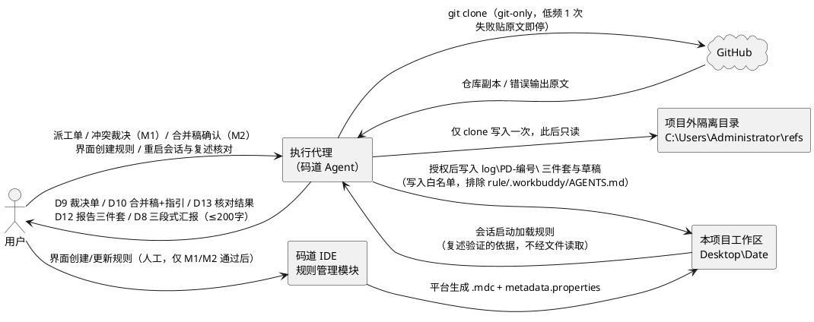
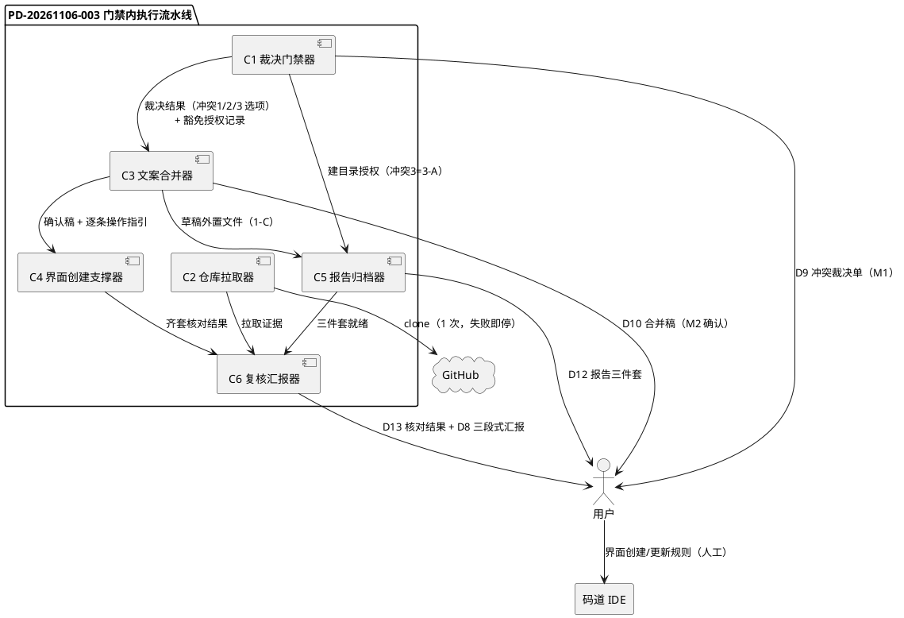
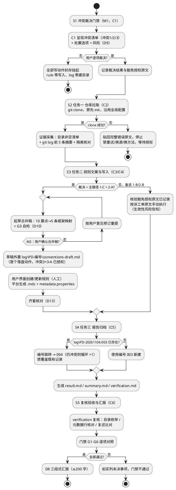
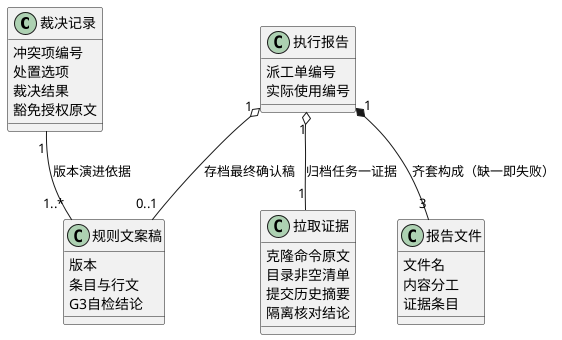

# 派工单 PD-20261106-003 门禁内执行（pd003_exec）技术设计

> 上游依据：`.codeartsdoer/specs/codeartsdoer_init/`（spec / design / tasks，均已用户确认；门禁 G1–G6、5 条定稿规则、界面创建约束、SKILL.md 唯一写入点继续有效）。
> 需求依据：`.codeartsdoer/specs/pd003_exec/spec.md`（冲突 1/2/3 用户尚未逐项裁决）。
> 设计基线（执行前已核实）：`C:\Users\Administrator\refs\hyra-results` 不存在；`.codeartsdoer\rule\` 仅含 `metadata.properties`（内容 `projectExpert=[]`）；项目根无 `log\` 目录；本项目无业务源代码，属流程执行型特性。

# 一、需求与存量功能关系分析

## 1.1 需求功能与存量功能对比

本特性的"存量"有两类：**码道平台既有机制**（rule 目录、metadata.properties、界面创建通道、git 全局配置）与**已确认规格 codeartsdoer_init 的执行框架**（五阶段流水线、交付物契约 D1–D8、门禁 G1–G6、既有任务 1.1/1.2 方案）。

### 1.1.1 已实现功能

| 需求功能 | 存量功能 | 代码位置 | 匹配度 |
|---------|---------|---------|--------|
| 任务一：git 直连克隆 hyra-results 至 `C:\Users\Administrator\refs\hyra-results` | 既有任务 1.1 克隆方案已定稿：同一路径为主选、三项选型判据、四重隔离防护 | `.codeartsdoer/specs/codeartsdoer_init/tasks.md:44-51`（任务 1.1）、`design.md` §2.1.3.3 | 100%（唯一差异为失败口径收紧，见 1.1.2） |
| 任务一：沿用 git 全局配置、禁止先 init | git clone 本身默认读取全局配置（user/email/代理），且直接生成完整本地仓库，无需 init | git 工具既有行为（本机环境，非项目文件） | 100% |
| 任务三：编号冲突禁覆盖 | 原规格"目标目录已存在则复用不重复克隆、不覆盖"的防御性处置思路 | `.codeartsdoer/specs/codeartsdoer_init/spec.md` 5.1.3-2 | 75%（处置模式同向，但报告编号机制本身需新建） |
| 任务三/收尾：三段式汇报 ≤200 字 | D8 三段式汇报契约已定稿且用户确认 | `.codeartsdoer/specs/codeartsdoer_init/design.md` §2.2.2 D8 | 100% |

**匹配度判定依据**：任务一的命令、路径、隔离要求与既有任务 1.1 完全一致，差异仅在失败处置口径（重试 1 次 → 失败即停），属口径收紧而非功能缺口，执行方案可直接复用故计 100%；编号跳转的"遇冲突不覆盖"原则与存量同向，但存量不存在报告目录编号机制，需全新实现，故计 75%。

### 1.1.2 需要扩展的功能

| 需求功能 | 存量功能 | 差异说明 | 扩展方向 |
|---------|---------|---------|---------|
| 任务二：建立并写入项目规则 | 界面创建通道（平台生成 .mdc + metadata.properties）；5 条规则文案定稿（codeartsdoer_init spec 5.3.4） | ① 输入差异：派工单给三组 10 要点，与 5 条定稿数量、文案均不一致；② 逻辑差异：派工单要求手动写 rule 目录并手改 metadata.properties，与 G1/G6 门禁及"裸文件不生效"调研结论正面冲突；③ 边界差异：写入后免自验（派工单任务二第 4 条），复核职责移交任务三 | 主路径按推荐裁决 **1-C+2-A**：Agent 出合并稿文案、草稿外置报告目录、用户界面粘贴创建、平台托管元数据；备选 1-B/2-B 原样手动执行，须用户明确豁免 G1/G4/G6（见 §2.1.3.5） |
| 任务一：失败处置 | 克隆失败重试 1 次，仍失败暂停（codeartsdoer_init spec 5.1.3-1） | 新口径更严：贴完整错误原文、禁自动重试、禁换源、禁换方法、等授权（spec 差异 4 已标注收紧覆盖） | 以本派工单口径覆盖原口径；原任务 1.1 的其余判据（路径、隔离）照常复用 |
| 任务三：齐套核对机制 | D4 齐套核对（界面规则数=5、.mdc 与 properties 齐套、无裸 .md） | ① 时机差异：复核从"创建完成通知后"移至任务三 verification.md 环节；② 方法差异：任务二写入后免自验，Agent 不得读回规则文件自证；③ 内容差异：新增"规则能否被复述"验证项 | 复用 D4 三项核对框架，扩展为 verification.md 验证项表；"可复述"证据改由会话复述 + 报告内存档确认稿比对产出（见 §2.1.3.7） |
| 交付物承接 | D1 仓库拉取报告（原设计 §2.2.2 D1，因上轮克隆失败从未产出） | 本派工单不再单独输出 D1，其内容（路径、隔离结论、复用说明）并入任务三 result.md 证据章节 | D1 职能并入 D12 三件套（§2.2.1） |

### 1.1.3 需要新增的功能或接口

存量中完全没有对应实现、需全新构建的部分，按业务模块分组：

**模块 A：冲突裁决门禁（对应 spec 5.1）**
- 冲突呈现：输入为派工单原文 + 已确认规格，输出为冲突清单（冲突 1/2/3）、处置选项与风险说明（D9）；核心逻辑为逐项呈现、不代决。
- 封存控制：裁决前任务二零写动作（不建 .mdc、不改 metadata.properties）、任务三零建目录；未裁决默认封存；部分裁决仅执行已裁决部分。
- 边界执行：裁决后实际动作集合 ⊆ 所选选项允许的动作集合；豁免（1-B/2-B）授权原文必须记录。
- 依赖关系：为模块 B 提供建目录授权（冲突 3=3-A）、为模块 C 提供文案路线授权（冲突 1/2）。

**模块 B：报告三件套归档（对应 spec 5.4）**
- 目录管理：输入为编号 PD-20261106-003，输出为 `log\PD-20261106-003\`（冲突时跳 004）；核心逻辑为编号自检、禁覆盖既有记录。
- 三件套生成：result.md（动作与产物）、summary.md（三段式汇报）、verification.md（验证记录）；缺一份即判任务失败；上游失败不豁免。
- 依赖关系：建目录以冲突 3 裁决为授权前提；证据来自模块 A/C 的裁决记录与执行结果。

**模块 C：规则文案合并稿产出（对应 spec 5.3 主路径）**
- 要点映射：输入为 spec 5.3.4 五条定稿 + 派工单 10 要点，输出为"10 要点 → 5 条框架"映射表与合并稿；核心逻辑为重复要点吸收措辞、增量要点插入对应条目、保留提交纪律/经验复用防丢失。
- 自检与外置：合并稿过 G3 自检（≤5 行、只写原则与动词），经用户确认（M2 门禁）后草稿外置至报告目录供界面粘贴。
- 依赖关系：前置冲突 1/2 裁决；产出供模块 B 归档与用户界面创建。

## 1.2 存量功能详细分析

### 1.2.1 码道规则管理机制（任务二的约束来源）

- **接口契约**：界面创建 → 平台自动生成 .mdc 与 metadata.properties → 会话启动加载启用规则。项目内存量痕迹：`.codeartsdoer/rule/metadata.properties`（1 行，`projectExpert=[]`，本设计执行前已复核）。
- **业务规则**：仅界面保存的规则被平台识别加载；直接放入 rule 目录的裸文件不生效（调研结论，用户已确认，已固化进 G1 与 SKILL.md 踩坑清单）。
- **扩展点**：规则五属性（名称/内容/自动应用/适用范围/类型）均在界面侧定义；本设计只产出文案与指引，不触碰存储实现。
- **约束**：metadata.properties 由平台托管（codeartsdoer_init design §1.2.1），Agent 手改即触 G6——这是冲突 1 的根源，也是主路径（1-C）选择"草稿外置 + 平台托管更新"的直接依据。

### 1.2.2 既有任务 1.1/1.2 与本次任务一的衔接约束

- **复用项**：任务 1.1 已定稿主选路径 `C:\Users\Administrator\refs\hyra-results`、三项选型判据（不在本项目工作区、不落入其他项目目录、独立可长期保留）、四重隔离防护；本次任务一路径一致，判据与防护照常适用。
- **承接项**：任务 1.2 的 D1 报告职责（存放路径、隔离结论、复用说明）由本次任务三 result.md 证据章节承接，不再单独输出。
- **覆盖项**：原 1.1"失败重试 1 次"被本派工单"失败即停、禁重试"覆盖（spec 差异 4）；衔接执行时以新口径为准。
- **范围差异**：本次任务一不含原阶段 2 的只读调研（原调研结论已在 5 条定稿时消化）；仓库就位即止，原依赖链（2.x 调研 → 规则/技能）的恢复留待后续派工单。

### 1.2.3 门禁 G1–G6 存量约束（本设计逐条遵守的既有事实）

| 门禁 | 内容 | 与本需求的关系 |
|------|------|---------------|
| G1 | 禁手动往 rule 目录扔裸文件 | 冲突 1 正面相撞：主路径 1-C 绕开；备选 1-B 须豁免 |
| G2 | 禁 Hyra 科研代码混入本项目 | 任务一 clone 至项目外目录即天然满足；全程只读 |
| G3 | 规则文案禁路径/参数/目录结构/临时步骤 | 冲突 2 的文案自检维度：合并稿过 G3 自检 |
| G4 | 规则数量锁定 5 条 | 冲突 2 正面相撞：主路径 2-A 保持 5 条；备选 2-B 须解锁 |
| G5 | 禁改 .workbuddy 目录 | 本设计写入白名单明确排除 |
| G6 | 禁未经批准改 AGENTS.md 与规则文件 | 冲突 1 正面相撞（metadata.properties 属规则文件范畴）；本项目 AGENTS.md 保持不存在 |

门禁未豁免前对所有派工单持续生效；冲突 1/2 的存在即因派工单字面动作与 G1/G4/G6 正面相撞，故设计将"用户裁决"设为任务二/任务三的执行前置门禁节点（§2.1.3.1 的 M1/M2）。
# 二、增量设计方案

## 2.1 实现模型

### 2.1.1 上下文视图

本特性为流程执行型（无代码 API），上下文视图展示执行代理与外部角色/系统的交互关系：



要点：
1. 执行代理对 GitHub 仅交互一次（clone），失败即贴原文停止，不重试不换源。
2. 执行代理对本项目工作区的写入白名单为 `log\PD-编号\` 目录（三件套 + 1-C 草稿外置文件），**主路径下对 rule 目录与 metadata.properties 零写入**（均由平台经界面生成/托管更新）。
3. 规则生效验证走"平台加载 → 会话复述"链路，不依赖读回规则文件。

### 2.1.2 服务/组件总体架构

内部按五阶段流水线组织，前一阶段产物为后一阶段输入：



| 组件 | 职责 | 关键依赖 | 调用频率 |
|------|------|---------|---------|
| C1 裁决门禁器 | 呈现冲突清单与选项、接收裁决、封存控制、记录豁免授权 | spec 5.1.2 冲突清单 | 1 轮（部分裁决时局部重开） |
| C2 仓库拉取器 | 执行 git-only clone、失败贴原文停、成功证据采集 | GitHub、本机 git 全局配置 | 1 次（不自动重试） |
| C3 文案合并器 | 10 要点→5 条框架映射、G3 自检、草稿外置 | C1 裁决结果、spec 5.3.4 定稿 | 1 轮（M2 未过则修订重提） |
| C4 界面创建支撑器 | 输出逐条界面操作指引、事后齐套核对 | C3 确认稿、码道 IDE（用户操作） | 1 轮 |
| C5 报告归档器 | 编号自检、三件套生成、证据落盘 | C1 授权、C2/C3/C6 证据 | 1 次（编号冲突时 +1） |
| C6 复核汇报器 | verification 复核设计执行、门禁对照、D8 汇报 | C5 三件套、用户复述配合 | 1 轮 |

配置项及取值策略：无新增配置文件；不修改 `mcp_settings.json`、`mem-exp-config.json`、`package.json` 等任何既有配置；metadata.properties 由平台托管，主路径零手改。

### 2.1.3 实现设计文档

#### 2.1.3.1 五阶段执行流水线（含门禁节点）

五阶段与派工单三任务的映射：S2↔任务一、S3↔任务二、S4↔任务三；S1（裁决门禁）与 S5（复核汇报）为贯穿骨架。**M1/M2 两个门禁节点均置于一切写动作之前**：M1（冲突 1/2/3 裁决）先于任务二/三的任何落盘；M2（合并稿确认）先于草稿外置与界面创建。任务一无冲突，不依赖 M1（派工单本身即授权），可在裁决期间先行执行。



#### 2.1.3.2 各阶段输入输出与职责划分

| 阶段 | 对应派工单任务 | 输入 | 输出 | Agent 职责 | 用户手动操作 | 平台自动行为 |
|------|--------------|------|------|-----------|-------------|-------------|
| S1 裁决门禁 | （前置门禁） | 派工单原文、已确认规格 | D9 冲突裁决单、裁决记录、豁免授权原文 | 呈现冲突与风险、记录裁决、封存控制 | **逐项裁决冲突 1/2/3**（备选分支另须明确豁免授权） | 无 |
| S2 仓库拉取 | 任务一 | GitHub 地址、目标路径 | 拉取证据（目录清单、git log 前 5 条、隔离结论）或错误原文 | 执行 clone、证据采集、失败即停 | 无（失败时提供恢复授权） | 无 |
| S3 规则写入 | 任务二 | spec 5.3.4 定稿、派工单 10 要点、裁决结果 | D10 合并稿+指引、D11 草稿外置文件、D13 齐套核对结果 | 映射合并、G3 自检、草稿外置、齐套核对 | **M2 确认合并稿；界面创建/更新规则（粘贴）** | 生成 .mdc + metadata.properties；会话加载 |
| S4 报告归档 | 任务三 | 全阶段执行结果与证据 | D12 三件套（result/summary/verification.md） | 编号自检、三件套生成、证据落盘 | 无 | 无 |
| S5 复核汇报 | 收尾 | 三件套、裁决记录 | 复核结论、门禁判定、D8 汇报 | 执行复核比对、门禁对照、输出汇报 | **重启会话、要求复述、界面状态核对** | 会话启动自动加载启用规则 |

分工原则沿用既有设计：**一切界面点击、会话重启、冲突裁决与合并稿确认归用户；一切调研落盘、文案产出、证据采集、归档、核对、响应归 Agent；规则文件生成与加载归平台**。Agent 不代替任何人工点击与裁决。

#### 2.1.3.3 任务一：git clone 执行方案

**执行设计（无冲突，按已确认口径直接执行）**：
1. **前置核对**：确认 `C:\Users\Administrator\refs\hyra-results` 不存在（已核实）；若存在则复用不重复克隆，报告注明（防御性条款，对齐原规格 5.1.3-2）。
2. **执行方式**：PowerShell 中单条命令 `git clone https://github.com/Tencent-Hunyuan/hyra-results.git C:\Users\Administrator\refs\hyra-results`——直接 clone、禁先 init、不附加任何参数、不改任何 git 配置（user/email/代理沿用全局设置）。
3. **失败即停处置流**：命令失败 → 完整捕获 stderr/stdout → **错误原文逐字贴回用户** → 声明"停止，等待授权" → 挂起任务二/三推进请示（是否继续/终止由用户决定）→ 禁止自动重试、换源、换方法。与既有任务 1.1 的衔接：除失败口径由"重试 1 次"收紧为"失败即停"外，路径判据与隔离防护照常适用（§1.2.2）。
4. **成功证据采集**（三项，均进报告）：
   - 目录非空核对：枚举目标目录顶层条目，输出清单原文；
   - 历史可见：在该仓库目录内执行 `git log -n 5 --oneline`，输出前 5 条 commit 摘要原文；
   - 隔离核对：确认路径位于本项目工作区（`Desktop\Date`）之外、未落入任何已有项目目录。
5. **证据落点**：result.md 任务执行清单与命令输出原文；summary.md"拉取结果"段；verification.md 验证项 1。
6. **范围边界**：仓库就位即止，不做只读调研（不在本次派工单范围）；Hyra 内容全程只读，其任何源文件不回流本项目（G2）。

#### 2.1.3.4 任务二主路径（1-C + 2-A）：文案合并方案

**路线组合**：冲突 1 选 **1-C（Agent 出文案、用户界面粘贴创建，草稿外置报告目录）** + 冲突 2 选 **2-A（保持 5 条框架增量合并，合并稿重提用户确认）**。

**裁决门禁位置**：M1（冲突 1/2/3 裁决）置于任务二一切写动作之前——未裁决则 rule 目录与 metadata.properties 封存（逐字节不变）；M2（合并稿确认）置于草稿外置与界面创建之前——因 2-A 合并稿是对 spec 5.3.4 定稿的修订，须"裁决 + 确认"双重授权（spec 4.5-2）。log 目录的最早落盘动作发生在 M2 之后（草稿外置时），其授权来自 M1 中冲突 3=3-A。

**10 要点 → 5 条框架映射表**：

| # | 派工单要点 | 归入条目 | 合并方式 | 净行数变化 |
|---|-----------|---------|---------|-----------|
| 1 | 协作-不确定就停、禁猜禁编、禁虚构接口与路径 | b 沟通原则（行 1） | 与定稿"不确定即停，先问再动手"合并强化措辞 | 0（行 1 改写） |
| 2 | 协作-未经批准禁改 AGENTS.md 与规则文件 | c 文件禁改 | 与定稿完全重复，无增量 | 0 |
| 3 | 协作-能程序化的规矩一律进代码与配置 | a 协作原则（新增行 3） | 新增 | a +1 |
| 4 | 协作-临时事项只活在当次派工单、干完即弃、不落持久文件不进长期记忆 | a 协作原则（新增行 4） | 新增；措辞区分"临时事项"与"派工单明确要求的报告归档产物"（后者为正式产物非临时事项），化解与任务三的语义张力 | a +1 |
| 5 | 沟通-给刚好够的信息，不多不少 | b 沟通原则（行 2） | 与"结论前置，理由后置"合并 | 0 |
| 6 | 沟通-结论前置、禁讨好废话客套 | b 沟通原则（行 3） | 与"禁讨好，禁废话"合并 | 0 |
| 7 | 沟通-只围绕当前任务、上下文断了先问清 | b 沟通原则（新增行 4） | 新增（与行 1"先问"呼应） | b +1 |
| 8 | 纪律-操作前说明意图、越权事项先问后动 | c 文件禁改（行 3 扩展） | 并入定稿"批准以我在对话中的明确同意为准"，扩展为"任何越权操作先问后动，批准以对话中明确同意为准" | 0 |
| 9 | 纪律-外部仓库必须走 git 命令、禁自造拉取 | a 协作原则（新增行 5） | 新增；"git 命令"为工具名的原则性动词表述而非命令参数，G3 自检时标注说明，是否保留由用户确认合并稿时裁定 | a +1 |
| 10 | 纪律-网络失败先报原文错误、禁盲目重试或自作主张换源 | b 沟通原则（新增行 5） | 新增（对上轮克隆失败的针对性修正，与任务一新口径同源） | b +1 |

**行数预算（G3 ≤5 行校验）**：a 协作原则 2+3=5 行（满）；b 沟通原则 3+2=5 行（满）；c 文件禁改 3 行（行 3 微扩）；d 提交纪律 3 行不变；e 经验复用 3 行不变。全部 ≤5 行，**5 条框架不变，G4 合规**；提交纪律、经验复用两条已确认规则原样保留、零丢失。

**备选安置**（供用户确认合并稿时调整）：要点 8/10 也可集中并入 a（a 满员需置换措辞）；若用户认为执行纪律三点不宜拆分，可提出"新增第 6 条（执行纪律）"提案——该提案触发 G4，必须用户明确解锁后方可采用，本设计默认不采用。

**G3 自检清单（合并稿提交前逐条执行并记录）**：
1. 每条规则 ≤5 行；
2. 只写原则与动词；
3. 无路径、无命令参数、无目录结构、无技术栈介绍、无临时步骤；
4. "git 命令"表述专项标注（工具名 ≠ 命令参数），存疑处提交用户裁定；
5. 自检记录随 D10 呈现，作为 M2 确认的附件依据。

**"六条"口径歧义消解**：派工单自述"只写以下六条"与实际 10 要点不一致；主路径 2-A 下歧义自然消解（收敛为 5 条框架），报告中仍如实标注口径差异；若裁决 2-B 则按三组 10 要点原文写入并在报告标注（§2.1.3.5）。

**后续动作链（M2 通过后）**：草稿外置 `log\PD-编号\conventions-draft.md`（含 5 条规则名、文案、统一属性"自动应用=是/当前项目/本地"、逐条界面操作指引）→ 用户在码道界面逐条粘贴创建/更新 → 平台生成 .mdc 与 metadata.properties → Agent 齐套核对（D13：界面规则数=5 且启用、.mdc 与 properties 齐套、rule 目录无裸文件）。写入后 Agent 不读回规则文件自验（派工单任务二第 4 条），复核移交任务三（§2.1.3.7）。规范文件创建后任何修改须重新获用户授权，禁止自行增删条目（对齐 G6 与派工单任务二第 5 条）。

#### 2.1.3.5 任务二备选分支（1-B / 2-B）：执行前提与风险标注

| 分支 | 执行内容 | 执行前提（缺一不执行） | 风险标注（须随授权一并告知用户） |
|------|---------|----------------------|--------------------------------|
| 1-B 原样手动执行 | Agent 按派工单原文手动创建 `.codeartsdoer\rule\project-conventions.mdc` 并手改 metadata.properties 的 projectExpert 指向该文件 | 用户在对话中**明确豁免 G1/G6 一次**；授权原文记录进 result.md；验收口径同步确认 | ① 手动 .mdc 可能不被平台加载（调研结论"裸文件不生效"），"规则生效"不可证；② metadata.properties 手改可能被平台覆盖或引发识别异常；③ 豁免授权仅为一次性，后续修改仍须再授权 |
| 2-B 按 10 要点原样写入 | Agent 按三组 10 要点写入规则内容 | 用户**明确批准解锁 G4** 并视为对 spec 5.3.4 定稿的修订（先修订规格、再执行，双重授权）；"提交纪律/经验复用"两条已确认规则的去向明确（移除即丢失，或另行保存方案经用户确认）；授权原文记录进 result.md | ① 丢失"提交纪律/经验复用"两条已确认规则（若整体替换）；② 10 要点中多条含场景化描述，G3 自检通过难度高；③ 数量从 5 条变更为 10 要点，与既有验收门禁"界面规则数=5"冲突，验收口径须同步调整 |

备选分支在任何情况下**不默认执行**：Agent 仅在 M1 呈现风险，裁决权在用户；用户拒绝备选分支时回落主路径或 2-C（暂缓任务二，任务一/三照常，验收第 2/3 项标记"未决"）。

#### 2.1.3.6 任务三：log 三件套产物契约

**目录与编号自检逻辑**：
1. 检查 `log\` 是否存在，不存在则创建（授权依据：M1 冲突 3=3-A，用户确认本规格即视为授权；若冲突 3 裁决为 3-B 则整项挂起，不建目录，报告标注"待裁决"）。
2. 检查 `log\PD-20261106-003\` 是否存在：不存在 → 使用编号 003 新建；存在 → 按派工单口径跳转编号 **PD-20261106-004** 重建（防御性扩展：004 亦存在则循环 +1 直至首个可用编号，报告中注明）。
3. **禁覆盖铁律**：对任何既有编号目录零写入、零改名、零删除；实际使用编号如实写入三件套与报告。

**三份文件结构模板与证据要求**：

`result.md`（实际动作与产物）：
```
# PD-20261106-003 执行记录
## 1. 任务执行清单
| 任务 | 动作 | 结果 | 产物路径 | 证据编号 |
| 任务一 | git clone …（完整命令） | 成功/失败 | C:\Users\Administrator\refs\hyra-results | E1 |
| 任务二 | （按裁决记录：主路径/备选/挂起） | … | … | E2 |
| 任务三 | 三件套生成 | … | log\PD-实际编号\ | E3 |
## 2. 关键命令与输出原文（E1–En 逐条粘贴，不摘要替代原文）
## 3. 裁决与豁免授权记录（冲突项 / 所选选项 / 授权原文 / 时间；无豁免则记"无"）
## 4. 越权动作自查（rule 目录手动写入记录：无/仅平台生成；metadata.properties 手改记录：无；AGENTS.md、.workbuddy：未触碰）
```

`summary.md`（三段式汇报归档版）：
```
# PD-20261106-003 三段式汇报
## 一、拉取结果（成功：路径 + 前 5 条 commit 摘要；失败：错误原文 + 等待授权状态）
## 二、规则写入结果（主路径：合并稿确认 + 界面创建 + 齐套结论；备选：豁免记录 + 生效性风险；挂起：待裁决项）
## 三、发现的问题（口径差异、环境差异、未决事项，逐条可回溯证据）
（文末附 D8 同源浓缩版，≤200 字）
```

`verification.md`（验证记录）：
```
# PD-20261106-003 验证记录
| # | 验证项 | 方法 | 结果 | 证据 |
| 1 | refs\hyra-results 非空且 git log 可见历史 | 目录枚举 + git log -n 5 | pass/fail | 输出原文 |
| 2 | 规范文件是否存在 | rule 目录枚举（不读内容）+ 界面显示核对 | pass/fail/未决 | 清单原文 |
| 3 | metadata.properties 是否已更新 | 只读 projectExpert 行 | pass/fail/未决 | 行原文 vs 基线 projectExpert=[] |
| 4 | 规则能否被复述 | 重启会话 → Agent 复述 → 与存档确认稿逐字比对 | pass/fail/未决 | 比对结论 |
| 5 | 未触发任何越权修改 | 写入白名单自查（result.md §4） | pass/fail | 自查记录 |
结论：三件套齐套性自检（本文件 + result.md + summary.md 均存在且非空）
```

**证据强制要求**：每个结论均可回溯至证据条目（命令输出原文、文件路径、关键内容摘要）；禁止空话；失败与挂起场景如实入档，不豁免、不美化。三件套全部生成且非空方算任务结束，缺一份即判本派工单任务失败。

**与既有 D8 汇报的关系**：会话内 D8 三段式汇报（≤200 字）**保留**，作为收尾出口；summary.md 三段（拉取结果/规则写入结果/发现的问题）与 D8 三段（做了什么/发现什么/未决事项）内容同源、口径一致，D8 为 summary.md 的会话内浓缩版，两者并存、互为印证。

#### 2.1.3.7 verification.md 复核设计（免读约束下的"可复述"证据）

**约束溯源**：派工单任务二第 4 条"写入后不要手动去读文件验证，由任务三的复核环节负责"——含义是**任务二执行方不做读回自验**，任务三为复核责任方（spec 4.4-2 同义）。据此三项验证的证据产出方式：

| 验证项 | 方法（不读规则文件内容） | 证据形态 | 失败处置 |
|--------|------------------------|---------|---------|
| 规范文件是否存在 | 目录枚举 `Get-ChildItem .codeartsdoer\rule`（仅文件名清单）+ 界面显示核对（用户反馈） | 清单原文 | 缺失 → 按原规格 5.3.3-1 建议删除重走界面创建，列未决 |
| metadata.properties 是否已更新 | 读取该元数据文件 projectExpert 行（**只读一行**；属任务三复核授权范围，非任务二自验，不违反免读约束） | 行原文 + 与基线 `projectExpert=[]` 的差异对照 | 仍为空数组 → 判定平台未生成，列未决，禁手改 |
| 规则能否被复述 | 用户重启会话（平台加载规则）→ 用户要求复述 → Agent **凭平台加载复述**（不经文件读取）→ 与报告中存档的最终确认稿（D11/D12 内文案）逐字比对 | 复述文本与确认稿的比对结论 | 复述缺失或偏差 → 判定未生效/未加载，如实记录"未生效"，列未决，**不自行返工换方法** |

设计要点：
1. **比对基准外置**：确认稿文案在报告目录存档（conventions-draft.md / result.md 引用），复述比对在"报告文本 ↔ 会话复述"之间进行，全程无需读 rule 目录下任何文件内容；
2. **复核主体分离**：任务二（写入方）零读回；任务三（复核方）仅枚举与元数据行只读，规则文件内容验证一律经由平台加载通道（复述）完成；
3. **未决不掩盖**：任一验证项为"未决/失败"时，verification.md 如实标注并同步进 summary.md"发现的问题"与 D8"未决事项"，不静默降级。

#### 2.1.3.8 严禁项防护对照表（G1–G6）

| # | 门禁 | 本设计防护措施 | 防护阶段 |
|---|------|---------------|---------|
| 1 | G1 禁手动往 rule 目录扔裸文件 | **主路径 1-C 下 Agent 对 rule 目录零写入**：草稿外置至 log 报告目录，创建动作由用户界面完成、文件由平台生成；齐套核对确认 rule 目录无裸文件。备选 1-B 仅在用户明确豁免并记录授权原文后执行 | S1/S3/S5 及全程 |
| 2 | G2 禁 Hyra 科研代码混入本项目 | clone 落于项目外 `C:\Users\Administrator\refs\hyra-results`；全程只读；本次不含调研；终局核对本项目工作区内无 hyra-results 任何源文件 | S2/S5 |
| 3 | G3 禁规则文案含路径/参数/目录结构/临时步骤 | 合并稿提交前过 G3 自检清单（≤5 行、原则动词、无违禁内容），自检记录随 D10 呈现；"git 命令"专项标注交用户裁定 | S3 |
| 4 | G4 规则数量锁定 5 条 | 主路径 2-A 保持 5 条框架，增量以行级合并吸收；"新增第 6 条"提案默认拒绝，须用户明确解锁（2-B 同样须解锁 + 定稿修订双重授权） | S1/S3 |
| 5 | G5 禁改 .workbuddy 目录 | 写入白名单 = `log\PD-编号\`（三件套 + 草稿）+ `.codeartsdoer\specs\`（平台流程管理）；白名单明确排除 `.workbuddy\` | 全程 |
| 6 | G6 禁未经批准改 AGENTS.md 与规则文件 | AGENTS.md 保持不存在（不创建）；metadata.properties 平台托管，主路径零手改；规则文件变更以 M2 确认稿为唯一内容来源、经界面通道生效；创建后再修改须重新授权 | 全程 |

主路径下 Agent 的全部落盘动作清单（可核对）：`log\PD-编号\` 下 conventions-draft.md（1-C）、result.md、summary.md、verification.md——**不包含 rule 目录任何文件与 metadata.properties**。

#### 2.1.3.9 异常场景处置表

| 异常 | 触发条件 | 处置动作 | 用户感知 |
|------|---------|---------|---------|
| 克隆失败（Connection reset/超时/代理认证错） | clone 非零退出或错误输出 | 完整贴回错误原文 → 停止 → 禁重试/换源/换方法 → 请示后续（继续/终止由用户定） | 错误原文 + "等待授权"状态 |
| 界面入口缺失 | 码道 IDE 找不到"技能与规则"入口 | 停止创建动作，报告环境差异，规则文案留置报告目录待用 | 列入"未决事项" |
| log 编号冲突 | `log\PD-20261106-003\` 已存在 | 跳 004（仍冲突循环 +1），禁覆盖，报告注明实际编号 | 报告注明实际使用编号 |
| 裁决缺失 | 冲突清单呈现后未答复 | 全部写动作封存（rule 零写入、log 零建目录），仅保留等待态 | 等待裁决提示，零文件变更 |
| 部分裁决 | 仅裁决部分冲突点 | 仅执行已裁决部分，未裁决项封存并标注"待裁决" | 报告列明未裁决项与对应挂起任务 |
| 用户裁决拒绝备选/选主路径 | 未豁免 1-B/2-B | 回落主路径 1-C+2-A 或 2-C 暂缓；不执行任何 rule 写入 | 主路径流程或"任务二挂起"标注 |
| 合并稿被否（M2 未过） | 用户不认可 2-A 合并稿 | 修订重提直至确认；期间 rule 目录零写入 | 修订说明与差异点 |
| 生效性存疑（备选 1-B 特有） | 手动文件复述验证失败 | verification.md 如实记"未生效"，列未决，不自行返工 | 调研预判风险兑现告警 |
| 六条口径歧义 | "只写六条"与 10 要点不一致 | 主路径下歧义消解（5 条框架）；备选下按原文写入并标注差异 | 报告标注口径差异 |
| 上游失败或挂起 | 任务一失败/任务二封存 | 授权恢复后三件套照常齐套生成，失败原因、错误原文、未决事项如实入档 | summary"发现的问题"与 D8"未决事项"承载 |
| 三件套生成中断 | 磁盘/权限异常致文件缺失 | 补齐重试一次；仍缺则判定任务失败并如实上报 | 失败状态与缺失文件名 |
## 2.2 接口设计

本特性无代码 API，接口设计对象为**交付物契约**（Agent 与用户/平台之间的信息与产物约定）。沿用既有 D1–D8 编号体系续编：D1（仓库拉取报告）职能并入 D12，不再单独输出；D8（三段式汇报）保留。

### 2.2.1 总体设计

接口按交付形态分两类：**文档类交付物**（裁决单、合并稿、核对结果、汇报，会话内呈现）与**文件类交付物**（草稿外置文件、报告三件套，持久化落盘至 `log\PD-编号\`）。规则相关产物（.mdc/metadata.properties）由平台生成，不列入 Agent 接口。

| 接口（交付物） | 类别 | 方向 | 稳定性 |
|---------------|------|------|--------|
| D9 冲突裁决单 | 文档 | Agent→用户（裁决结果回传） | 稳定（清单与选项以 spec 5.1.2 为准） |
| D10 规则文案合并稿 + 操作指引 | 文档 | Agent→用户（M2 确认） | 稳定（映射与行数预算以 §2.1.3.4 为准） |
| D11 草稿外置文件 conventions-draft.md | 文件 | Agent→报告目录→用户粘贴 | 稳定（仅 1-C 生效；1-A 时退化为会话内交付） |
| D12 报告三件套 | 文件 | Agent→`log\PD-编号\` 持久化 | 稳定（结构模板以 §2.1.3.6 为准） |
| D13 齐套核对结果 | 文档 | Agent→用户 | 稳定（复用原 D4 三项框架） |
| D8 三段式汇报 | 文档 | Agent→用户 | 稳定（≤200 字，与 summary.md 同源） |

变更策略：D10 的合并稿属对 spec 5.3.4 定稿的修订产物，任何修订必须重新提交用户确认（M2）后方可流转至 D11/界面创建；D9 的裁决结果一经回传即构成授权边界，Agent 不得自行扩大执行范围（spec 5.1.1-3）。

### 2.2.2 接口清单

**D9 冲突裁决单**
- 输入：派工单原文、已确认规格（G1–G6、5 条定稿、界面创建约束）。
- 输出：冲突 1/2/3 逐项呈现（派工单要求 vs 已确认规格 vs 冲突性质）+ 处置选项 + 风险说明；任务一按差异 4 口径说明（无冲突、不待裁决）。
- 前置条件：冲突比对完成；任务二/三尚未产生任何写动作。
- 后置条件：用户逐项裁决 → 记录裁决与豁免授权原文；未答复 → 全部写动作封存。
- 异常映射：部分裁决 → 仅执行已裁决部分并标注"待裁决"；拒绝备选 → 回落主路径或 2-C。
- 呈现约束：只列选项与风险，不代决、不替用户选择（spec 1.4-3）。

**D10 规则文案合并稿 + 操作指引**
- 输入：spec 5.3.4 五条定稿、派工单 10 要点、冲突 2 裁决=2-A。
- 输出：10 要点→5 条框架映射表、合并稿全文（a–e 五条，逐条 ≤5 行）、G3 自检记录、统一属性（自动应用=是/当前项目/本地）、逐条界面操作指引。
- 前置条件：冲突 2 裁决为 2-A；映射方案与行数预算通过 §2.1.3.4 校验。
- 后置条件：用户 M2 确认 → 流转 D11/界面创建；被否 → 修订重提直至确认。
- 异常映射：自检发现超限或违禁内容 → 精简改写并标注"已精简"后重新提交；用户要求改走备选 2-B → 转 §2.1.3.5 前提核验。
- 内容红线：只写原则与动词；提交纪律/经验复用原样保留零丢失。

**D11 草稿外置文件（conventions-draft.md）**
- 输入：M2 已确认的合并稿。
- 输出：`log\PD-实际编号\conventions-draft.md`，含 5 条规则名、确认稿文案、统一属性、界面粘贴指引。
- 前置条件：M2 通过；冲突 1 裁决=1-C；冲突 3 裁决=3-A（log 目录授权）。
- 后置条件：用户据其完成界面创建；文件归档作为复述比对基准（§2.1.3.7）。
- 异常映射：冲突 3 裁决=3-B（不落盘）→ D11 退化为会话内交付，界面创建照常；写目录失败 → 补齐重试一次，仍失败列未决。
- 路径纪律：仅落报告目录，禁止落入 rule 目录（G1）。

**D12 报告三件套**
- 输入：全阶段执行结果、裁决记录、豁免授权原文、拉取证据、核对结果、复核结论。
- 输出：`log\PD-实际编号\` 下 result.md、summary.md、verification.md 三份齐套文件（结构模板见 §2.1.3.6）。
- 前置条件：编号自检完成（冲突跳转，禁覆盖）；证据条目齐备。
- 后置条件：三件套齐套且非空 → 任务三完成；缺任一份 → 判定本派工单任务失败。
- 异常映射：上游失败/挂起 → 三件套照常生成并如实记录（spec 4.2-3）；生成中断 → 补齐重试一次，仍缺判失败。
- 证据纪律：结论逐条可回溯至证据条目（命令输出原文、文件路径、关键内容摘要），禁止空话。

**D13 齐套核对结果**
- 输入：用户界面创建/更新完成的通知。
- 输出：核对清单——界面规则数=5 且全部启用、.mdc 与 metadata.properties 齐套、rule 目录无裸文件（主路径下变化均来自平台生成）。
- 前置条件：M2 已通过且用户完成界面操作。
- 后置条件：全部通过 → 进入 S4/S5；缺项 → 按原规格 5.3.3-1 建议删除重走界面创建，列未决。
- 异常映射：界面入口缺失 → 停止创建动作，报告环境差异，文案留置报告目录待用。

**D8 三段式汇报（保留）**
- 输入：全阶段执行结果、门禁 G1–G6 判定、verification 复核结论。
- 输出：会话内三段——做了什么 / 发现了什么 / 还有什么没解决，全文 ≤200 字。
- 前置条件：门禁逐项判定完成；三件套齐套（或失败态如实呈现）。
- 后置条件：任务闭环；未决事项如实列出。
- 异常映射：门禁不通过 → 对应项标注不通过并说明原因；与 summary.md 同源浓缩，两版口径一致。

## 2.3 数据模型

### 2.3.1 设计目标

1. **支撑的业务场景**：冲突裁决留痕可追溯、仓库拉取证据可核对、规则文案版本可控（定稿→合并稿→确认稿）、执行报告持久归档可复核。
2. **目标特性**：裁决与豁免授权全程留痕；报告三件套自包含（任何结论可在文件内找到证据）；规则文案的最终生效形态由平台托管，Agent 侧只持有文案版本链；编号目录单调递增、零覆盖。
3. **兼容策略**：不改动任何存量数据文件（metadata.properties 由平台托管、mem-exp-config.json、mcp_settings.json 只读不写）；新增数据仅落在 `log\PD-编号\` 一处目录；沿用既有 5 条定稿作为文案版本链的基线版本。

### 2.3.2 模型实现

核心领域对象与关系：



**对象生命周期与状态流转**：
1. **裁决记录**（状态机）：`未呈现` → `已呈现`（M1 等待用户）→ `已裁决`（含豁免授权原文）/ `挂起`（未答复，写动作封存）；`已裁决` → `执行中` → `已执行`（实际动作集合 ⊆ 选项允许集合）。
2. **规则文案稿**（版本链）：`定稿`（存量 spec 5.3.4 基线）→ `合并稿`（10 要点映射合并，待 M2）→ `确认稿`（M2 通过，外置 D11 存档）→ `平台生成`（主路径终态，形态为平台托管的 .mdc）；备选路径终态为 `手动写入`（豁免态，生效性不可证）。
3. **执行报告**：`编号确定`（自检通过或跳转）→ `生成中` → `齐套`（三文件存在且非空）→ `归档`。
4. **拉取证据**：clone 即时采集 → 随 D12 归档；失败时仅含错误原文与等待状态。

**持久化策略**：

| 对象 | 持久化形态 | 写入者 | 位置约束 |
|------|-----------|--------|---------|
| 裁决记录 | 会话内记录 + result.md §3 存档（含豁免授权原文） | Agent | `log\PD-编号\result.md` |
| 拉取证据 | 命令输出原文 | Agent | result.md §2 / verification.md |
| 规则文案稿 | conventions-draft.md（确认稿）+ 会话内（合并稿） | Agent | 仅报告目录，禁入 rule 目录 |
| 执行报告 | 三件套文件 | Agent | `log\PD-实际编号\` |
| 项目级规则 | 平台托管的 .mdc + metadata.properties | 仅平台（经界面保存） | `.codeartsdoer/rule/`（主路径 Agent 零写入） |

**多重性与一致性约束**：1 份裁决记录可驱动 1..* 个版本的规则文案稿（被否重提即产生新版本，旧版本作废留痕于会话记录）；1 份执行报告固定聚合 3 份报告文件（result/summary/verification，缺一即失败）；最终确认稿至多 1 份归档入报告，作为复述比对的唯一基准；项目级规则与文案稿的对应关系由平台生成结果兑现，Agent 不维护第二份持久副本（报告内存档文案仅为比对基准）。