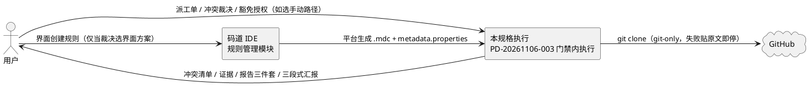
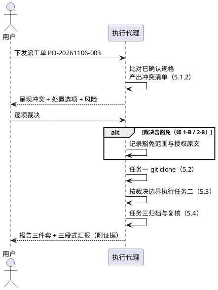
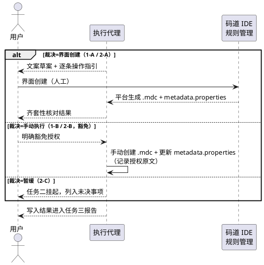
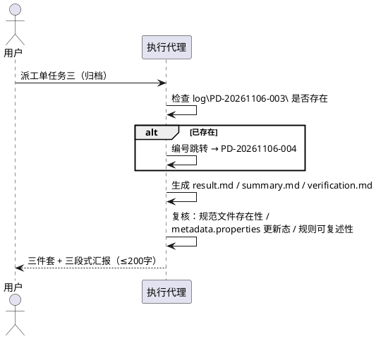

# 派工单 PD-20261106-003 门禁内执行（pd003_exec）需求规格

> 上游依据：`.codeartsdoer/specs/codeartsdoer_init/`（spec / design / tasks，均已用户确认）。
> 本规格性质：对派工单 PD-20261106-003 的需求分析与冲突裁决载体。**裁决完成前，任务二不产生任何写动作、任务三不创建任何目录；任务一按 5.2 执行（其本身即对上一轮未决事项的授权重试）。**
> 现场基线（已核实）：`C:\Users\Administrator\refs\hyra-results` 不存在；`.codeartsdoer\rule\` 目录存在且仅有 `metadata.properties`（内容 `projectExpert=[]`）；项目根无 `log\` 目录。

# **1. 组件定位**

## **1.1 核心职责**
本规格负责界定派工单 PD-20261106-003（仓库重拉、规则写入、执行反馈报告）与已确认规格门禁的冲突边界，实现"先裁决冲突、再门禁内执行、留可核对证据"。

## **1.2 核心输入**
1. 派工单 PD-20261106-003 原文：三任务、验收标准、汇报要求。
2. 已确认规格 codeartsdoer_init：G1–G6 门禁（tasks 0.3）、5 条规则文案定稿（spec 5.3.4）、六项验收门禁（spec 5.6.2）。
3. 上一轮执行状态：任务 1.1 克隆失败（Connection was reset，首次 + 重试 1 次），依赖链暂停，等待用户裁决。
4. 用户裁决结果：对本规格 5.1.2 冲突清单的逐项选择（待获得）。

## **1.3 核心输出**
1. 裁决前：冲突清单与处置选项（本规格 5.1.2），供用户裁决。
2. 裁决后执行产物（按裁决范围）：hyra-results 本地仓库副本；规则文件（写入方式与内容视裁决而定）；`log\PD-20261106-003\` 下报告三件套。
3. 三段式汇报：做了什么 / 发现了什么 / 还有什么没解决，不超过 200 字。

## **1.4 职责边界**
本规格覆盖的执行不负责以下事项：
1. 不在用户裁决前执行任务二的任何写动作（不建 .mdc、不改 metadata.properties）。
2. 不修改已确认规格 codeartsdoer_init 的定稿内容；如需修订 5 条规则定稿或任一门禁，必须走规格变更并获用户确认。
3. 不自行选择冲突处置选项，不替用户做决定。
4. 任务一失败时不使用 git 以外的任何拉取方法，不换源，不盲目重试。
5. 不覆盖 log 目录下任何既有编号记录。
6. 不改动 AGENTS.md、.workbuddy 目录（沿用 G5/G6；本项目 AGENTS.md 保持不存在）。

# **2. 领域术语**

**派工单**
: 用户下发的单次任务指令，含任务边界、验收标准与汇报要求；本规格对象为 PD-20261106-003。

**裁决**
: 用户针对已识别冲突，在给出的处置选项中做出的明确选择；裁决以对话中的明确答复为准。

**门禁（G1–G6）**
: 已确认规格 tasks 0.3 定义的贯穿全程的严禁项检查点，未豁免前对所有派工单持续生效（G1 裸文件、G4 规则数量锁定、G6 越权修改等）。

**裸文件**
: 未经码道界面创建、被直接放入 rule 目录的文件；调研已核实且经用户确认——其不被平台识别加载，规则不生效。手动创建的 .mdc 属于此类。

**平台托管文件**
: 由码道平台自动生成与维护的文件（如 `.codeartsdoer\rule\metadata.properties`）；手改即违反 design §1.2.1 约束与 G6。

**报告三件套**
: 派工单任务三要求的三份归档文件：result.md（实际动作与产物）、summary.md（三段式汇报）、verification.md（验证记录）。

**编号跳转**
: 当目标派工单编号目录已存在时，报告目录编号自动 +1 并重建子文件夹，禁止覆盖既有记录。

**git-only 拉取**
: 外部仓库获取仅允许使用 git 命令克隆；禁止 curl、网页请求或其他自造方法。

# **3. 角色与边界**

## **3.1 核心角色**
- 用户（裁决人 / 验收人）：对本规格 5.1.2 冲突清单逐项裁决；如选择界面创建方案则执行界面操作；审阅报告三件套与最终汇报。
- 执行代理（码道 Agent）：按裁决结果在门禁内执行；产出证据（命令输出原文、文件路径、关键内容摘要）与报告三件套；未获裁决或授权即停。

## **3.2 外部系统**
- GitHub：hyra-results 克隆来源，只读访问。
- 码道 IDE 规则管理模块：规则唯一合法生成通道（界面创建 → 平台生成 .mdc 与 metadata.properties）。

## **3.3 交互上下文**



# **4. DFX约束**

## **4.1 性能**
1. 最终三段式汇报不超过 200 字（沿用原规格 D8 约束）。

## **4.2 可靠性**
1. 当任务一 clone 失败时，执行应立即停止并等待授权；不得自动重试、换源或更换方法（较原规格 spec 5.1.3-1"重试 1 次"收紧，以本派工单为准）。
2. 报告三件套必须齐套，缺任何一份判定本派工单任务失败。
3. 任务三报告必须如实记录失败与未决事项；任务一/二失败或挂起不豁免任务三。

## **4.3 安全性**
1. 未经用户裁决或明确豁免，禁止触发以下动作（触犯即门禁不通过）：
   a. 向 rule 目录写入任何文件（G1，含手动创建 .mdc）；
   b. 手改 metadata.properties（G6 + design §1.2.1 平台托管约束）；
   c. 按三组 10 要点写入规则内容（G4 数量锁定 + spec 5.3.4 定稿的未授权修订）。
2. AGENTS.md、.workbuddy 目录全程零触碰（沿用 G5/G6）。
3. Hyra 仓库只读，其代码不回流本项目（沿用 G2）。

## **4.4 可维护性**
1. 报告必须附可核对证据：命令输出原文、文件路径、关键内容摘要；禁止空话。
2. 规范文件写入后不由执行方读文件自验，复核交由任务三环节负责（职责分离，与派工单任务二第 4 条一致）。

## **4.5 兼容性**
1. 报告目录编号冲突时自动跳转，禁止覆盖既有记录。
2. 本派工单不改变已确认规格 codeartsdoer_init 的定稿内容；一切规则文案或数量变更须经"裁决 + 规格修订"双重确认。

# **5. 核心能力**

## **5.1 冲突识别与裁决（先裁决，后执行）**

### **5.1.1 业务规则**
1. **裁决前置**：当派工单与已确认规格存在冲突时，系统应在执行任何受影响动作前逐项呈现冲突、处置选项与风险，并等待用户裁决。
   a. 验收条件：冲突清单呈现 → 裁决前任务二零写动作、任务三零建目录。
2. **未裁决默认封存**：当用户未对冲突 1（写入方式）与冲突 2（规则文案与数量）做出裁决时，系统应保持 rule 目录与 metadata.properties 零改动，任务二整体挂起。
   a. 验收条件：挂起期间 rule 目录无新增文件、metadata.properties 内容不变（与任务开始前逐字节一致）。
3. **裁决后按边界执行**：当用户对每个冲突点给出明确选择时，系统应仅按所选选项的边界执行，且不得自行扩大范围。
   a. 验收条件：实际执行动作集合 ⊆ 所选选项允许的动作集合。

### **5.1.2 冲突清单与处置选项（供用户裁决，不代决）**

**冲突 1：任务二的规则文件写入方式**

| 项 | 内容 |
|---|---|
| 派工单要求 | 手动创建 `.codeartsdoer\rule\project-conventions.mdc`；手动将 metadata.properties 的 `projectExpert=[]` 改为指向该文件 |
| 已确认规格 | G1 禁手动往 rule 目录扔裸文件（tasks 0.3）；G6 禁未经批准改规则文件；调研已核实（用户确认）："rule 目录裸 md 不生效，须走界面创建生成 .mdc + metadata.properties，metadata.properties 由平台托管"（spec 5.3.1-1/2、5.6.1-1/5，design §1.2.1） |
| 冲突性质 | 门禁冲突（G1/G6）+ 生效性风险（手动文件可能不被平台加载） |

处置选项：
- **选项 1-A（走界面创建，合规优先）**：规则经用户在码道界面创建，平台生成 .mdc 与 metadata.properties；执行代理提供文案与操作指引、事后核对齐套性。风险：最低；但派工单字面验收"文件名=project-conventions.mdc"可能无法满足（文件名由平台生成规则决定），需同步确认验收口径调整。
- **选项 1-B（原样手动执行，需豁免授权）**：用户明确批准豁免 G1/G6 一次，执行代理按派工单原文手动创建并手改。风险：较高——手动 .mdc 可能不被平台加载（调研结论），metadata.properties 手改可能被平台覆盖或引发识别异常；验收"projectExpert 非空"可达，但"规则生效"不可证。
- **选项 1-C（折中，草稿外置）**：执行代理将文案草稿写入报告目录（log\PD-…\）供用户界面创建时粘贴；metadata.properties 由平台托管更新。风险：低；同样需确认验收口径。

**冲突 2：任务二的规则内容（三组 10 要点）与数量**

| 项 | 内容 |
|---|---|
| 派工单要求 | 写入三组原则（协作 4 点、沟通 3 点、执行纪律 3 点，共 10 要点）；派工单自述"只写以下六条"与实际要点数不一致（待澄清） |
| 已确认规格 | 规则数量锁定 5 条（G4）；文案以 spec 5.3.4 定稿为准（协作原则/沟通原则/文件禁改/提交纪律/经验复用） |
| 冲突性质 | 门禁冲突（G4）+ 定稿修订冲突（改规则内容须经授权，G6 引申） |

逐条映射（供裁决参考）：

| 新派工单要点 | 与已定稿 5 条的关系 |
|---|---|
| 协作-不确定就停禁猜禁编，禁虚构接口与路径 | ≈ 已定稿"沟通原则：不确定即停，先问再动手"（重复） |
| 协作-未经批准禁改 AGENTS.md 与规则文件 | ≈ 已定稿"文件禁改"（重复） |
| 协作-能程序化的规矩一律进代码与配置 | 新增，已定稿无 |
| 协作-临时事项不落持久文件、不进长期记忆 | 新增，已定稿无；与任务三"报告持久归档"存在语义张力，需一并澄清 |
| 沟通-给刚好够的信息，不多不少 | 新增细化 |
| 沟通-结论前置，禁讨好废话客套 | ≈ 已定稿"沟通原则"（重复） |
| 沟通-只围绕当前任务，断上下文先问清 | ≈ 已定稿"沟通原则"（交叉） |
| 纪律-操作前说明意图，越权先问后动 | 新增细化 |
| 纪律-外部仓库必须走 git 命令，禁自造拉取 | 新增 |
| 纪律-网络失败先报原文，禁盲目重试换源 | 新增（对上一轮失败的针对性修正） |
| ——（无对应） | 已定稿"提交纪律"（禁全量暂存/精确暂存/过门禁）：新文案未覆盖，若整体替换将丢失 |
| ——（无对应） | 已定稿"经验复用"（三级分级/升级须确认）：新文案未覆盖，若整体替换将丢失 |

处置选项：
- **选项 2-A（保持 5 条 + 合并增量）**：将不重复的增量要点合并进既有 5 条对应条目（保留提交纪律、经验复用），合并稿重新提交用户确认后走界面创建/更新。风险：低；部分条目行数可能逼近 5 行上限（DFX 4.4-1 原 spec 约束），需精简措辞。
- **选项 2-B（按 10 要点原样写入）**：需用户批准解锁 G4，并视为对 spec 5.3.4 定稿的修订（先改规格再执行，双重授权）。风险：中——"提交纪律/经验复用"两条已确认规则的去向需明确（移除或另行保存），且须先修订 spec 5.3.4。
- **选项 2-C（本次暂缓任务二）**：先执行任务一与任务三，规则文本留待用户线下斟酌。风险：最低；派工单任务二挂起，验收第 2/3 项标记"未决"。

**冲突 3：任务三新增 log 目录与报告三件套**

| 项 | 内容 |
|---|---|
| 派工单要求 | 项目根建 log 目录；`log\PD-20261106-003\` 下生成 result.md / summary.md / verification.md；编号冲突自动跳转 004 |
| 已确认规格 | 核心输出仅会话内三段式汇报（D8，≤200 字，spec 1.3-4）；Agent 对本项目工作区唯一写入点为 SKILL.md（design §2.2.1、tasks §0.4-2） |
| 冲突性质 | 非门禁冲突（log 不在 rule 下，不涉 G1/G4/G6）；属设计约束"唯一写入点"的范围扩展，需规格增补 |

处置选项：
- **选项 3-A（按派工单照做 + 规格增补）**：以本规格 5.4 作为增补依据，用户确认本规格后即视为授权。风险：低。
- **选项 3-B（不做落盘，维持会话内 D8 汇报）**：风险：违背本次派工单明确要求，不推荐但列出供选。

**差异 4（非冲突，口径确认）：任务一与上一轮执行状态的衔接**

| 项 | 内容 |
|---|---|
| 关系判定 | 任务一实质是对上一轮未决事项（任务 1.1 两次克隆失败）的授权重试，依赖链据此恢复 |
| 原规格口径 | spec 5.1.3-1：克隆失败重试 1 次，仍失败暂停并报未决 |
| 新派工单口径 | 直连失败贴完整错误原文、禁止换源、等待授权；结合任务二新文案"禁止盲目重试"，理解为失败即报、不再自动重试 |
| 处置 | 按新派工单收紧口径执行（本规格 5.2 已按此编写），原 spec 5.1.3-1 在本派工单范围内被收紧口径覆盖 |

### **5.1.3 交互流程**



### **5.1.4 异常场景**
1. **裁决缺失**
   a. 触发条件：冲突清单呈现后用户未答复。
   b. 系统行为：全部写动作挂起（含任务三建目录），仅保留等待状态。
   c. 用户感知：等待裁决提示，无任何文件变更。
2. **部分裁决**
   a. 触发条件：用户仅裁决部分冲突点。
   b. 系统行为：仅执行已裁决部分，未裁决部分维持封存，并在报告"发现的问题"中标注"待裁决"。
   c. 用户感知：报告中列明未裁决项与对应挂起任务。

## **5.2 任务一：hyra-results 仓库重拉（git-only）**

### **5.2.1 业务规则**
1. **git-only**：当执行仓库拉取时，系统应仅使用 git clone 命令，且不得使用 curl、网页请求或其他自造方法。
   a. 验收条件：拉取动作仅由 `git clone https://github.com/Tencent-Hunyuan/hyra-results.git C:\Users\Administrator\refs\hyra-results` 构成。
2. **禁止先 init**：当创建目标仓库时，系统应直接 clone，且不得先 git init 再拉取。
   a. 验收条件：目标目录为 clone 直接产物，自带完整提交历史。
3. **沿用全局配置**：当执行 clone 时，系统应沿用本项目已配置的 git 全局设置（user、email、代理等），且不做额外配置。
   a. 验收条件：clone 前后无任何 git 配置修改动作。
4. **成功证据**：当 clone 成功时，系统应确认目标目录非空，并输出 git log 前 5 条 commit 摘要作为证据。
   a. 验收条件：目录非空 + 前 5 条 commit 摘要进入报告。
5. **失败即停**：当 clone 失败时，系统应将 git 报告的完整错误原文贴回并停止，且不得自行更换方法或换源，等待用户授权。
   a. 验收条件：失败 → 错误原文完整出现在汇报中 → 无替代拉取动作、无自动重试。
6. **目录冲突复用**：当目标目录已存在同名仓库时，系统应复用已有目录不重复克隆，并在报告中说明（沿用原规格 5.1.3-2）。
   a. 验收条件：目录已存在 → 不执行第二次 clone，报告注明复用（当前核查：目录不存在，此条为防御性条款）。
7. **隔离不变**：当 clone 完成时，系统应保持参考仓库位于项目外独立目录（沿用 G2 与原规格主选路径）。
   a. 验收条件：`C:\Users\Administrator\refs\hyra-results` 位于本项目工作区（Desktop\Date）之外。

### **5.2.2 交互流程**

```plantuml
@startuml
actor 用户 as U
participant "执行代理" as A
cloud "GitHub" as G
U -> A : 授权重试（派工单任务一）
A -> G : git clone → C:\Users\Administrator\refs\hyra-results
alt clone 成功
  G --> A : 完整仓库（含历史）
  A -> A : 核对目录非空 + 项目外隔离
  A --> U : git log 前 5 条摘要（证据）
else clone 失败
  G --> A : 错误输出
  A --> U : 贴回完整错误原文，停止并等待授权
end
@enduml
```

### **5.2.3 异常场景**
1. **网络失败（如 Connection was reset）**
   a. 触发条件：clone 过程连接被重置或超时。
   b. 系统行为：立即停止，完整贴回 git 错误原文；不重试、不换源、不换方法。
   c. 用户感知：错误原文 + "等待授权"状态。
2. **代理或凭据异常**
   a. 触发条件：git 报代理、认证类错误。
   b. 系统行为：同上，原文贴回等待授权。
   c. 用户感知：同上。
3. **目标目录已存在**
   a. 触发条件：`C:\Users\Administrator\refs\hyra-results` 已存在。
   b. 系统行为：复用不重复克隆，报告说明。
   c. 用户感知：报告中"复用"标注。

## **5.3 任务二：项目规则写入（受门禁约束，执行条目均为裁决后条件生效）**

> 裁决前系统维持封存态（5.1.1-2）。本节按裁决分支编写，未选分支一律不生效。

### **5.3.1 业务规则**
1. **封存态（默认）**：当用户未批准豁免时，系统应保持 rule 目录零写入、metadata.properties 零改动。
   a. 验收条件：挂起期间两处与任务开始前逐字节一致（基线：`projectExpert=[]`）。
2. **界面创建路径（若裁决 1-A / 2-A）**：当用户选择界面创建时，系统应产出文案草案（定稿或合并稿）与逐条操作指引，且不得直接向 rule 目录写入任何文件；界面创建由用户执行，平台生成 .mdc 与 metadata.properties。
   a. 验收条件：rule 目录变化仅来自平台生成；事后核对齐套（沿用原规格 5.3.3 核对机制）。
3. **手动执行路径（若裁决 1-B / 2-B，需豁免）**：当用户明确批准豁免 G1/G6（及必要时 G4）时，系统应按派工单原文手动创建 project-conventions.mdc 并将 metadata.properties 的 projectExpert 更新为指向该文件，且应将豁免授权原文记录进报告。
   a. 验收条件：写入动作与派工单原文一致；报告含豁免授权记录与生效性风险告知。
4. **草稿外置路径（若裁决 1-C）**：当用户选择折中方案时，系统应将文案草稿写入报告目录供界面粘贴，且不触碰 rule 目录。
   a. 验收条件：草稿仅存在于报告目录，rule 目录无手动新增文件。
5. **修改再授权**：当规范文件创建后需要修改时，系统应重新走用户授权，且不得自行增删条目（与派工单任务二第 5 条一致，与 G6 同向）。
   a. 验收条件：任何修改前存在用户新授权记录。
6. **写入后免自验**：当规范文件写入完成后，系统应不做手动读文件自验，复核交由任务三环节负责（与派工单任务二第 4 条一致）。
   a. 验收条件：任务二无读回验证动作；verification.md 由任务三产出。

### **5.3.2 交互流程**



### **5.3.3 异常场景**
1. **生效性存疑（手动路径特有风险）**
   a. 触发条件：选择 1-B 后，手动文件无法被平台加载（复述验证失败）。
   b. 系统行为：verification.md 如实记录"未生效"结论，列未决事项；不自行返工换方法。
   c. 用户感知：验收第 2/3 项部分达成，调研预判的风险兑现告警。
2. **派工单"六条"口径歧义**
   a. 触发条件：文案实际要点数（10）与"只写以下六条"表述不一致。
   b. 系统行为：若裁决原样执行，按"三组 10 要点"原文写入，差异点列入报告"发现的问题"；不自行取舍或合并。
   c. 用户感知：报告中标注口径差异，待澄清。

## **5.4 任务三：执行反馈报告**

### **5.4.1 业务规则**
1. **log 目录创建**：当开始归档时，系统应在项目根创建 log 目录（若不存在）。
   a. 验收条件：`log\` 存在（当前核查：不存在，将新建）。
2. **编号跳转**：当 `log\PD-20261106-003\` 已存在时，系统应自动改用编号 PD-20261106-004 并创建对应子文件夹，且不得覆盖任何既有记录。
   a. 验收条件：既有目录内容逐字节不变，新目录编号 +1。
3. **三件套齐套**：当生成报告时，系统应在编号子文件夹中齐套生成 result.md、summary.md、verification.md 三份文件；当缺任何一份时，系统应判定本派工单任务失败。
   a. 验收条件：三文件齐套存在且非空。
4. **内容分工**：当撰写报告时，系统应按派工单定义分工——result.md 记实际动作与产物位置；summary.md 记三段式汇报（拉取结果 / 规则写入结果 / 发现的问题）；verification.md 记验证项（规范文件是否存在、metadata.properties 是否已更新、规则能否被复述）。
   a. 验收条件：三文件内容与分工一一对应，无空段。
5. **证据强制**：当撰写报告时，系统应附可核对证据（命令输出原文、文件路径、关键内容摘要），且不得写空话。
   a. 验收条件：每个结论均可回溯至证据条目。
6. **失败不豁免**：当任务一或任务二失败、挂起时，系统应仍生成齐套的三件套并如实记录失败原因、错误原文与等待状态。
   a. 验收条件：上游失败场景下三件套仍齐套，未决事项如实呈现。
7. **最终汇报**：当全部任务收尾时，系统应输出三段话汇报（做了什么 / 发现了什么 / 还有什么没解决），不超过 200 字（与 D8 同构）。
   a. 验收条件：三段齐备、字数 ≤200。

### **5.4.2 交互流程**



### **5.4.3 异常场景**
1. **编号冲突**
   a. 触发条件：`log\PD-20261106-003\` 已存在。
   b. 系统行为：跳转 PD-20261106-004 重建，禁止覆盖。
   c. 用户感知：报告中注明实际使用编号。
2. **上游任务失败或挂起**
   a. 触发条件：任务一失败，或任务二封存/失败。
   b. 系统行为：三件套照常齐套生成，失败原因、错误原文、未决事项如实入档。
   c. 用户感知：summary.md"发现的问题"与"还有什么没解决"承载未决项。

## **5.5 验收与门禁对照**

### **5.5.1 与已确认规格一致、可直接采纳的部分**
1. 任务一全部约束：git-only、禁止先 init、沿用 git 全局配置、成功后输出目录非空 + git log 前 5 条证据——与原规格 spec 5.1 同向，可直接执行。
2. 任务一失败处置"贴原文、等授权、禁换源"——较原 spec 5.1.3-1 收紧，按新派工单口径采纳（差异 4 已标注）。
3. 任务二第 4 条（写入后免自验、复核交任务三）——职责分离，与原规格齐套核对机制兼容，可采纳。
4. 任务二第 5 条（规范文件修改须再授权、禁自行增删条目）——与 G6 同向，可采纳。
5. 任务三编号跳转禁覆盖、证据强制、三段式汇报 ≤200 字——与 D8 同构，可采纳。
6. 验收第 5 项"未触发任何越权修改"——与 G 系门禁同向，全程生效。

### **5.5.2 派工单验收标准逐条对照**

| # | 派工单验收项 | 对照结论 |
|---|---|---|
| 1 | `C:\Users\Administrator\refs\hyra-results` 目录非空，git log 可见历史 | 与已确认规格一致，可直接采纳（EARS 5.2.1-1/4/7） |
| 2 | `.codeartsdoer\rule\project-conventions.mdc` 存在且内容为"六条" | **与 G1/G4/G6 冲突**，须先完成冲突 1/2 裁决方可执行 |
| 3 | metadata.properties 的 projectExpert 不再为空数组 | **与 G6 及平台托管约束冲突**，须豁免授权；若走界面创建（1-A）则由平台更新达成 |
| 4 | `log\PD-20261106-003\` 下三份文件齐全 | 非门禁冲突，属设计约束范围扩展（本规格 5.4 为增补载体），用户确认本规格即授权 |
| 5 | 未触发任何越权修改 | 与 G 系门禁同向，全程生效 |

### **5.5.3 未经二次确认即违禁的动作清单（红线提示）**

| 动作 | 触犯门禁/约束 | 后果 |
|---|---|---|
| 手动创建 `.codeartsdoer\rule\project-conventions.mdc` | **G1** + 调研结论（裸文件不生效） | 门禁不通过；规则可能不被加载 |
| 手改 metadata.properties | **G6** + design §1.2.1 平台托管约束 | 门禁不通过；可能被平台覆盖或引发识别异常 |
| 按三组 10 要点写入规则内容（替代 5 条定稿） | **G4** + spec 5.3.4 定稿修订须授权 | 门禁不通过；丢失"提交纪律/经验复用"两条已确认规则 |
| 任务三建 log 目录与三件套 | 不违 G 门禁；超出"唯一写入点=SKILL.md"设计约束 | 需本规格（5.4）经用户确认后执行 |

# **6. 数据约束**

## **6.1 参考仓库（hyra-results）**
1. **存放位置**：`C:\Users\Administrator\refs\hyra-results`（项目外独立目录，与原规格主选路径一致）。
2. **生成方式**：仅允许 git clone 一次性生成；禁止先 init 再拉取、禁止分步拼装。
3. **访问权限**：只读。
4. **成功证据**：目录非空；git log 前 5 条 commit 摘要存档于报告。

## **6.2 规范文件（project-conventions.mdc，待裁决态）**
1. **位置**：派工单口径为 `.codeartsdoer\rule\`；界面创建路径下实际文件名与位置由平台生成，需验收口径确认。
2. **内容范围**：只写原则与动词；不写路径、命令参数、技术栈介绍、临时步骤。
3. **内容基准**：裁决 2-A 时为"已定稿 5 条 + 增量合并稿"；裁决 2-B 时为派工单三组 10 要点原文；两者均须用户确认后方可写入。
4. **修改纪律**：创建后任何修改须重新获用户授权；禁止自行增删条目。
5. **生效前提**：仅平台经界面生成的规则可保证被加载；手动文件存在不生效风险（调研已核实结论）。

## **6.3 元数据（metadata.properties）**
1. **当前基线**：`projectExpert=[]`（写入前状态，报告须记录原文）。
2. **合法变更来源**：平台托管更新（界面创建/修改规则时）；手动变更仅在用户明确豁免授权后允许。
3. **验收口径**：projectExpert 非空数组且指向已创建的规范文件。

## **6.4 执行报告（log\PD-编号\）**
1. **目录命名**：`log\PD-20261106-003\`；编号冲突时依次 +1 跳转，禁止覆盖既有记录。
2. **文件齐套性**：result.md、summary.md、verification.md 三份必齐，缺一即任务失败。
3. **内容约束**：附命令输出原文、文件路径、关键内容摘要；如实记录失败与未决；禁止空话。
4. **豁免记录**：如发生门禁豁免（1-B / 2-B），授权原文必须存档于 result.md。