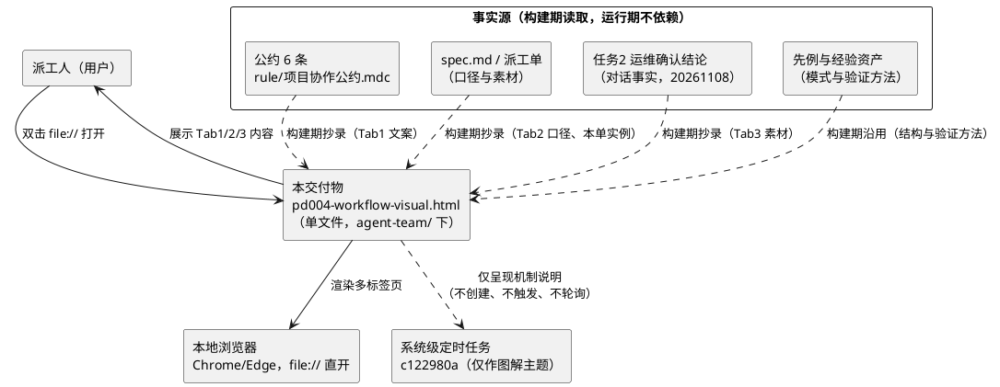
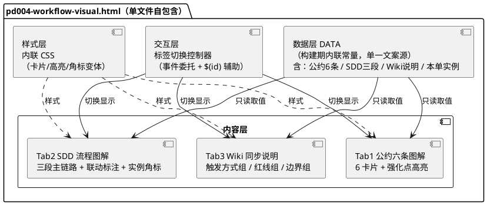
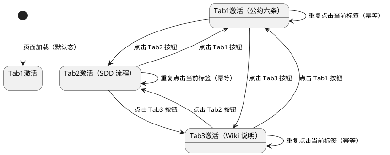
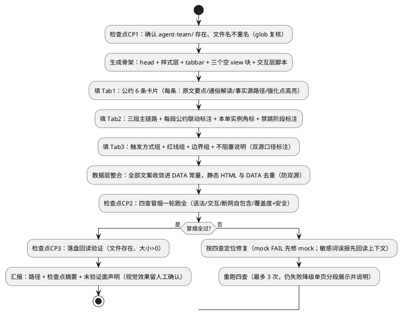
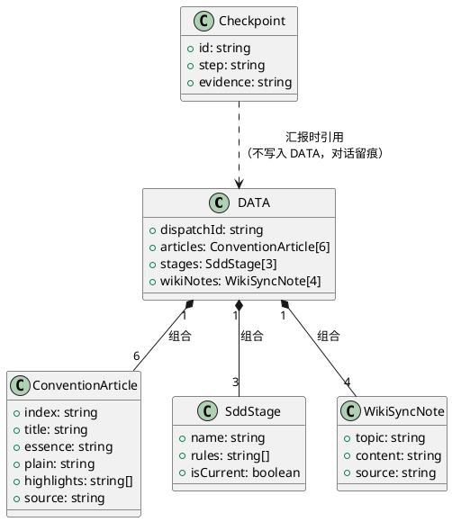

# 工作流 HTML 可视化（pd004_html_viz）技术设计

> 上游规格：`.codeartsdoer/specs/pd004_html_viz/spec.md`（派工单 TASK-20261108-004，EARS 验收条件 40 余条）
> 设计范围：仅覆盖任务3（唯一编码交付物）；任务1/2 为非编码确认类任务，设计中仅作为素材引用（见 1.1.3、2.3）
> 事实源基线（20261108 实查）：公约 6 条原文已读取（`.codeartsdoer/rule/项目协作公约.mdc`）；`.codeartsdoer/agent-team/` 目录已存在且为空；先例产物仅一处（`specs/20261107_P001_spec_workflow_visual/sdd-workflow-visual.html`）

# 一、需求与存量功能关系分析

## 1.1 需求功能与存量功能对比

### 1.1.1 已实现功能

存量中不存在本次交付物本体，但存在**经过实战验证的同形态先例与高等级经验资产**，其技术模式与本次需求高度匹配，可直接沿用模式（沿用模式 ≠ 复制文件，内容与文件名全新）。

| 需求功能 | 存量功能 | 代码位置 | 匹配度 |
|---------|---------|---------|--------|
| 多标签页（Tab）即时切换交互 | 先例页 `data-tab` + `.view.active` 标签切换机制（原生 JS 事件委托，无框架、无刷新） | `.codeartsdoer/specs/20261107_P001_spec_workflow_visual/sdd-workflow-visual.html:14-23`（tabbar 样式与 view 显隐结构） | 90% |
| 单文件自包含 HTML、file:// 双击直开、断网可用 | 先例页为 42KB 单文件，内联 CSS/JS，零外部依赖，冒烟 19/19 通过 | 同上：`sdd-workflow-visual.html:1-67`（`<!DOCTYPE html>` 起全程内联，`meta` 注明"单文件自包含 · 零外部依赖 · 断网可用"） | 100%（形态目标一致） |
| 页面数据固化（公约原文、任务2 结论、流程口径） | 经验资产：file:// 下运行期 fetch 被 CORS 拦截，数据须构建期内联为单一数据层常量并标注来源 | `experience-reuse/experiences/coding-pattern/2026-11-07-file-protocol-fetch-cors-build-time-inline.md`（tier A，Approach 全节） | 100%（约束直接适用） |
| 交付前功能验证（控制台无报错、切换生效） | 经验资产：四查冒烟流水线（语法编译 / Node vm DOM mock 交互 / 断网自包含正则 / 覆盖度+安全扫描） | `experience-reuse/experiences/agent-ops/2026-11-07-headless-html-verify-node-vm-dom-mock.md`（tier S，Approach 全节） | 100%（验证方法直接适用） |
| 落盘目录管理（创建目录、检查不重名） | 目录操作能力（本次实查：`agent-team/` 已存在且为空，无冲突） | 实查记录 20261108（glob `**/*.html` 全工作区仅命中先例 1 个 HTML） | 75%（能力具备，需按规格 5.1 流程执行检查点） |

**匹配度判定依据**：先例 HTML 与两条经验均产自本项目 20261107 的同类交付（P001 SDD 流程可视化），交付环境（file:// 直开、无 GUI 回读、无构建链）与本次完全相同，故模式匹配度高；内容体系（公约六条图解 vs 三图流程）完全不同，故整体为"新内容 + 复用形态模式"。

### 1.1.2 需要扩展的功能

| 需求功能 | 存量功能 | 差异说明 | 扩展方向 |
|---------|---------|---------|---------|
| Tab1 公约六条图解（逐条 + 新规强化点高亮） | 先例页有卡片组件（`.card`：标题/列表/来源标注区），但无"逐条公约 + 强化点视觉区分"的内容模式 | ①输入差异：先例内容源为 SDD 流程说明，本次为公约 6 条原文（事实源 `.mdc` 文件）；②输出差异：需"显著视觉区分"的高亮样式（spec 5.2.1-3），先例仅 badge 标注；③边界差异：每条必须标注事实源路径（spec 4.4-2），先例仅部分卡片标注 | 沿用卡片结构，新增"强化点高亮"样式变体与统一来源标注区；内容构建期从公约 `.mdc` 抄录内联 |
| Tab2 SDD 流程图解（主链路 + 公约联动 + 本单实例标注） | 先例页流程图为 SVG 节点图（`#tabbar` 含"流程图"标签），但呈现对象是 P001 的三图体系，非"规格→动作→验证"主链路 | ①业务逻辑差异：需呈现阶段节点与公约约束的关联标注（spec 5.3.1-2）；②边界条件差异：需"本单当前处于规格阶段"的实例化标注（spec 5.3.1-3），且禁止呈现跳过验证的捷径路径（spec 5.3.1-4） | 重画主链路图形（HTML/CSS 节点卡 + 箭头，非 SVG 亦可——内容为线性三段，卡片流足够）；新增"公约联动标注"与"本单实例"角标组件 |
| Tab3 Wiki 同步与定时说明（外部事件口径） | 先例页无此主题；存量机制（repo-wiki-update-execution 技能 + 系统级定时）仅有文档形态 | ①输入差异：需吸收任务2 运维确认结论（外部事件/系统级定时、每日 1 次）；②输出差异：需"禁自建定时/禁轮询"与"不阻塞常规派工"两组说明（spec 5.4.1-1/3）及任务2 边界说明（spec 5.4.1-2） | 全新内容模块；素材双源并示（公约第 4 条口径 + 任务2 运维确认事实），标注口径来源 |
| 双口径并示与冲突裁决标注 | 先例页无口径冲突场景；经验资产有"来源分层标注"纪律（source-tier-labeling） | 差异：本次 Tab2 阶段口径可能存在"派工单口径 vs 事实源口径"并示需求（spec 5.3.3-1） | 新增"双口径并示"展示组件：同区块内两个口径各自标注来源层级 |

### 1.1.3 需要新增的功能或接口

**模块 A：交付落盘管理（对应 spec 5.1）**
- 功能点 A1：向已存在的 `.codeartsdoer/agent-team/` 落盘新文件 `pd004-workflow-visual.html`（输入：设计定的文件名与内容；输出：真实可访问的文件路径；核心逻辑：落盘后立即回读验证存在性与大小 >0，防伪完成）。依赖：无（目录已就绪）。
- 功能点 A2：文件名冲突守卫（输入：候选文件名；输出：最终文件名；核心逻辑：先例 `sdd-workflow-visual.html` 已被 glob 确认唯一存在，本名不冲突；若执行期发现冲突则追加区分段换名并报告）。依赖：A1。

**模块 B：Tab1 公约六条图解（对应 spec 5.2）**
- 功能点 B1：6 个公约条目卡片（输入：公约 6 条原文构建期内联；输出：每条含原文要点 + 通俗解读 + 事实源路径标注；依赖：模块 D 数据层、模块 E 交互层）。
- 功能点 B2：新规强化点高亮（动态学习/遇阻即学、20 分钟熔断、中断优先、落盘判定+伪完成违规、禁自建定时/Wiki 外挂、单一事实源仲裁+编码必审），以高亮样式变体呈现（依赖 B1）。

**模块 C：Tab2 SDD 流程图解（对应 spec 5.3）**
- 功能点 C1：三段主链路节点（规格→动作→验证），含"禁跳阶段"标注（依赖模块 D）。
- 功能点 C2：每阶段节点的公约联动标注（遇阻即学、≤20 分钟预算、落盘判定、编码必审）。
- 功能点 C3：本单实例标注（"TASK-20261108-004 当前处于规格阶段"角标）。

**模块 D：Tab3 Wiki 同步与定时说明（对应 spec 5.4）**
- 功能点 D1：触发方式说明组（每日 1 次、外部事件/系统级定时触发），素材双源：公约第 4 条 + 任务2 运维确认事实（任务 ID `c122980a`、cron `30 7 * * *`、recurring/durable=true，来源标注为"对话运维确认 20261108"）。
- 功能点 D2：红线说明组（禁自建定时、禁轮询）+ 边界说明（任务2 由外部机制承接，本页不执行配置）+ 不阻塞说明（事件驱动、并行派工）。

**模块 E：页面运行时交互（对应 spec 5.6）**
- 功能点 E1：标签切换控制器（≥3 个标签，点击切换、其余隐藏、无刷新；默认 Tab1）。
- 功能点 E2：验证接口（对外不可见）：供四查冒烟脚本以 `$(id)` 辅助函数 + mock DOM 方式驱动（依赖模块 E1 的 DOM 契约稳定）。

**素材引用边界（对应 spec 5.7，不做实现）**：任务1 体验反馈结论（新规改进点）仅作为 Tab1 文案素材来源；任务2 定时配置结论仅作为 Tab3 素材来源；二者本体为对话交付，不在本交付物范围内复现。

## 1.2 存量功能详细分析

### 1.2.1 先例 HTML（`sdd-workflow-visual.html`，425 行）

- **接口契约**：纯静态文件，无对外 API；页面内契约为一组 DOM id（`tabbar`、`zoombar`、各 `.tab`/`.view`）与 `data-tab` 属性驱动的切换协议。入口为浏览器 file:// 直开，无构建、无服务端。
- **业务规则**：标签按钮持有 `data-tab` 值，点击后对应 `.view` 加 `active` 类、其余移除；`.view` 默认 `display:none`，`active` 时 `display:block`。交互全部原生 JS，事件监听在脚本尾部统一绑定。
- **扩展点**：tabbar 为并列按钮结构，增删标签仅需加按钮 + 加视图块各一处，无需改动切换逻辑——满足 spec 4.4-1"标签页结构可独立扩展"的可维护性要求。
- **约束与依赖**：①全部样式内联于 `<style>`、脚本内联于 `<script>`，无 `<link>` 外链——这是 file:// 断网可用的前提；②系统字体栈（Segoe UI/Microsoft YaHei）不加载网络字体；③先例中 SVG 缩放条（zoombar）为图形内容服务，本次内容以卡片/说明为主，若无 SVG 图则该扩展点不需要引入。
- **本次引用方式**：只借鉴结构与交互模式，**不复制文件、不覆盖先例**（spec 1.4-4 红线），新文件落盘至不同目录（`agent-team/`）且不同名。

### 1.2.2 经验资产一：file:// 数据通道决策（tier A，2026-11-07）

- **核心约束**：file:// 页面 origin 为 null，运行期 `fetch`/`XMLHttpRequest` 读本地相对路径被同源策略默认拦截（规范行为，非 bug）。因此本次页面**运行期零文件读取**：公约原文、任务2 结论、流程口径等全部事实源内容在构建期（写页面时）抄录内联。
- **对本设计的强制约束**：内联数据收敛为单一数据层常量对象，渲染逻辑只从该对象取值，不与静态文案形成双源；每个数据块标注来源文件路径与快照时点（spec 4.4-2 事实源标注由此落实）；交付前检查 `fetch(`、`XMLHttpRequest`、动态 `import(` 零命中。

### 1.2.3 经验资产二：无 GUI 回读验证流水线（tier S，2026-11-07）

- **核心约束**：本环境内置 browser 工具只受理打开请求、无内容/控制台/DOM 回读，"打开成功 ≠ 验证成功"。运行时验证必须以"静态可判定"替代：四查流水线（语法编译 / Node vm + mock DOM 交互冒烟 / 断网自包含正则 / 覆盖度+安全扫描）一轮跑完。
- **配套纪律（对执行阶段的约束）**：mock 报 null 异常先修 mock（补预注册页面真实 id）再判页面缺陷；敏感词正则初报 FAIL 先回读命中上下文判误报（`DOMTokenList` 类 API 标识符为高频误报源）；临时验证脚本 `_*.js` 跑完即删不入库；页面 DOM 取用统一走 `$(id)` 辅助函数以保持 mock 可驱动。
- **边界**：冒烟通过 ≠ 视觉正确，布局配色只能 CSS 静态审查 + 人工查看兜底；该"未验证面"须在汇报中显式标注。

### 1.2.4 存量约束汇总（对设计的硬性限制）

1. 目录红线：写入范围仅限 `agent-team/`（HTML 交付物）与 `specs/pd004_html_viz/`（SDD 文档），禁止其他业务文件变更（spec 5.1.1-5）。
2. 先例保护：禁止覆盖/改写 `specs/` 下既有目录与文件（spec 1.4-4）。
3. 规矩层冻结：公约 6 条零改动，页面只做图解呈现，且文案不得与公约原文冲突（spec 5.2.1-4）。
4. 执行预算：单任务 ≤20 分钟硬预算、超线暂停出原因码、子步写检查点（spec 5.6.1-5）——设计须支持"分块生成、分块验证"的执行切分。
# 二、增量设计方案

## 2.1 实现模型

### 2.1.1 上下文视图

交付物为一次性落盘的静态文件，运行时零外部依赖；所有上游事实源在**构建期**（页面编写时）单向抄录内联，运行期不回读任何文件。



要点：与 CodebaseWiki 同步机制之间**零运行时连线**——Tab3 只呈现其说明，本交付物不创建定时、不发轮询（公约第 4/5 条红线，spec 5.4.1-4）。

### 2.1.2 组件总体架构

单文件内部按"数据层 → 内容层 → 交互层"三层组织，层间单向依赖，杜绝双源文案。



- **模块划分**：数据层（唯一文案源，标注来源路径与快照时点）；内容层（三个 Tab 视图块，彼此独立、可单独修订——满足 spec 4.4-1）；交互层（一个切换控制器，状态最小化：仅"当前激活标签"一项）；样式层（含"新规强化点高亮"与"双口径并示"两个专用视觉变体）。
- **依赖关系**：内容层只依赖数据层与样式层，不横向依赖；交互层只操作 DOM 类名，不感知内容语义——增删 Tab 不改控制器逻辑。
- **配置项**：无运行时配置（静态页面）；唯一"配置"为文件头注释区的数据快照时点声明。

### 2.1.3 实现设计文档

**（1）标签切换状态机**

页面运行时唯一状态为当前激活标签，状态机如下：



状态迁移规则：任意时刻有且仅有一个 `.view` 持有 `active` 类（`display:block`），其余隐藏；切换 = "移除旧 active + 设置新 active"两步，无中间态；重复点击当前标签为幂等操作，不产生副作用。该状态机仅 3 状态 + 6 迁移，可用 Node vm DOM mock 完整驱动验证（先例已验证此法可行）。

**（2）内容渲染流程（构建期，分块生成以适配 20 分钟预算）**



**（3）降级与异常链**

| 异常 | 处理策略 | 用户感知 |
|------|---------|---------|
| 目录创建失败 | 最多重试 3 次，仍失败降级落盘至 `specs/pd004_html_viz/`（spec 5.1.3-1） | 汇报实际落盘路径 |
| 文件名冲突 | 追加区分段自动换名（如 `-2`），禁止覆盖（spec 5.1.3-2） | 返回最终路径 + 换名依据 |
| 冒烟发现切换失效 | 最多重试 3 次修复，仍失败降级为单页纵向分段展示（spec 5.6.3-1） | 汇报降级形态与原因 |
| 超 20 分钟预算 | 立即暂停，输出原因码（如 `OVERTIME-CODEGEN`）与进度快照，待续作指令（spec 5.6.3-3） | 汇报含进度与续作建议 |
| 事实源读取失败 | 对应条目按"来源不可达"呈现，不虚构（spec 5.2.3-1） | 汇报标注该条目事实源缺失 |

**（4）关键设计决策与理由**

| 决策 | 选择 | 理由 |
|------|------|------|
| 技术栈 | 原生 HTML/CSS/JS，零框架零构建 | file:// 直开 + 断网可用 + 2 秒首屏（spec 4.1/4.3/4.5）；先例已验证该栈在本环境全链路可行 |
| 数据通道 | 构建期内联单一数据层，运行期零文件读取 | file:// 下 fetch 被 CORS 拦截（tier A 经验，规范行为）；数据通道错则全盘返工 |
| 图形方案 | 卡片流 + CSS 箭头，不引入 SVG 图 | 本次内容为"逐条说明 + 线性三段链路"，卡片流承载足够且利于无 GUI 冒烟断言；避免为图形引入缩放等额外交互面 |
| Tab4 派工单示例 | 本次不实现，仅保留结构扩展位 | spec 5.5 缺省规则：派工人未要求则不强制，Tab 数以 3 个为准；tabbar 并列结构保证后续可一处增补 |
| 文件名 | `pd004-workflow-visual.html` | 符合命名规则（小写+连字符）；与先例 `sdd-workflow-visual.html` 明显不同名；pd004 段呼应派工编号（spec 5.1.1-3） |

## 2.2 接口设计

### 2.2.1 总体设计

接口按"对外契约 / 页面内部契约 / 验证契约"三类划分。对外契约交付即冻结（静态文件）；页面内部契约服务于可验证性与可扩展性；验证契约供执行阶段冒烟脚本使用。

| 接口 | 类别 | 说明 | 稳定性 |
|------|------|------|--------|
| 文件路径契约 | 对外 | 交付物唯一入口：`agent-team/pd004-workflow-visual.html`，file:// 直开 | 稳定 |
| 标签切换契约（data-tab 协议） | 页面内部 | tabbar 按钮与 view 块的映射协议 | 稳定（沿用先例验证过的模式） |
| 数据层 DATA 常量 | 页面内部 | 唯一文案源，渲染层只读取值 | 稳定 |
| `$(id)` DOM 辅助 | 页面内部 | 统一 DOM 取用入口，保证 mock 可驱动 | 稳定 |
| 四查冒烟断言清单 | 验证 | 执行期临时脚本（`_*.js`，用后即删）依据 | 稳定 |

接口变更策略：三类接口在本次交付内冻结；后续公约/流程更新时只改数据层与对应 view 内容，接口不动（与 spec 4.4-1 一致）。

### 2.2.2 接口清单

**接口一：文件路径契约（对外）**

- 签名（路径形态）：`.codeartsdoer/agent-team/pd004-workflow-visual.html`
- 业务说明：派工人双击或浏览器 file:// 打开的唯一交付入口；路径在汇报中返回。
- 前置条件：`agent-team/` 目录存在（已实查就绪）；文件名经不重名检查。
- 后置条件：文件落盘、大小 >0、回读可访问；`specs/` 既有产物零变更。
- 异常映射：目录不可写 → 降级路径（见 2.1.3-3 降级链）；名称冲突 → 自动换名后重发契约。

**接口二：标签切换契约（页面内部）**

- 签名（DOM 协议形态）：

```html
<button class="tab" data-tab="convention">公约六条</button>
<button class="tab" data-tab="sdd">SDD 流程</button>
<button class="tab" data-tab="wiki">Wiki 同步</button>
<section class="view" id="view-convention">…</section>
<section class="view" id="view-sdd">…</section>
<section class="view" id="view-wiki">…</section>
```

- 业务说明：`data-tab` 值与 view 块 `id` 的 `view-` 前缀映射是切换控制器的唯一约定；点击按钮即切换。
- 前置条件：每个 `data-tab` 值有且仅有一个对应 view 块。
- 后置条件：目标 view 持 `active` 类，其余 view 移除该类；无页面刷新。
- 异常映射：`data-tab` 无对应 view → 冒烟查二断言拦截（交付前必清零）；运行期理论上不可达（静态页面无动态标签）。

**接口三：数据层 DATA 常量（页面内部）**

- 签名（结构契约，JSDoc 形态，非实现）：

```js
/**
 * @typedef {Object} ConventionArticle  公约条目（Tab1）
 * @property {string} index    条目序号（'1'~'6'）
 * @property {string} title    条目短名（如 '全程SDD'）
 * @property {string} essence  原文要点（构建期从 .mdc 抄录）
 * @property {string} plain    通俗解读
 * @property {string[]} highlights  新规强化点关键词（触发高亮样式）
 * @property {string} source   事实源路径 + 快照时点
 */
/**
 * @typedef {Object} SddStage  SDD 阶段节点（Tab2）
 * @property {string} name      阶段名（规格/动作/验证）
 * @property {string[]} rules   本阶段公约联动约束
 * @property {boolean} isCurrent  本单是否处于该阶段（仅规格为 true）
 */
/**
 * @typedef {Object} WikiSyncNote  Wiki 同步说明块（Tab3）
 * @property {string} topic    主题（触发方式/红线/边界/不阻塞）
 * @property {string} content  说明文案
 * @property {string} source   口径来源（公约第4条 / 运维确认 20261108）
 */
/** 全部文案唯一来源：渲染函数只从此对象取值 */
const DATA = { articles: [...], stages: [...], wikiNotes: [...], dispatchId: 'TASK-20261108-004' };
```

- 业务说明：把"内容覆盖度验收"收敛为对 DATA 的计数断言（6 条 articles、3 段 stages、4 组 wikiNotes），覆盖度检查由此可离线判定。
- 前置条件：所有文案构建期抄录完成且标注来源；`fetch(` / `XMLHttpRequest` / `import(` 零出现。
- 后置条件：页面渲染与 DATA 一致，无双源文案。
- 异常映射：文案与事实源冲突 → 按"规则 > 知识库 > 记忆 > 推断"裁决后回填 DATA（spec 4.2-3）。

**接口四：`$(id)` DOM 辅助（页面内部）**

- 签名：`function $(id: string): HTMLElement`
- 业务说明：全部脚本内 DOM 取用经此函数，等价 `document.getElementById`；使冒烟脚本能以同一个 mock 函数替换并驱动全部交互。
- 前置条件：引用的 id 均真实存在于静态 HTML。
- 后置条件：无（纯取用）。
- 异常映射：id 不存在 → 冒烟查二报 null，先修 mock 预注册再判页面缺陷（tier S 经验纪律）。

**接口五：四查冒烟断言清单（验证契约，执行期）**

- 签名（断言项形态）：`check1_syntax: vm.Script 可编译`；`check2_interaction: 切换后 view 可见性类名断言 ×N`；`check3_offline: fetch(/XMLHttpRequest/import(/<link>/@import 零命中`；`check4_content_security: 覆盖度计数（6+3+4+关键文案串）+ 敏感词扫描`
- 业务说明：一轮批量跑全，pass/fail 计数收尾；临时脚本 `_pd004check.js` 用后即删。
- 前置条件：HTML 已完整生成；mock 预注册页面全部真实 id。
- 后置条件：全过方可进入落盘回读检查点（防伪完成）。
- 异常映射：FAIL → 按 2.1.3-2 修复纪律处理；3 轮仍失败 → 降级单页展示并汇报。

## 2.3 数据模型

### 2.3.1 设计目标

1. **支撑场景**：公约条目的逐条呈现与追溯、SDD 阶段与公约约束的关联表达、Wiki 同步口径的双源标注、本单实例的阶段定位。
2. **质量目标**：文案单一源（防双源漂移）；每个领域对象携带来源元数据（可审计）；结构可扩展（Tab4 增补不动既有对象）。
3. **兼容策略**：无存量数据迁移问题（全新文件）；领域对象命名与 spec.md 第 2 节术语严格对齐（公约六条/熔断/落盘判定/伪完成/外部事件触发/单一事实源/五步准入/SDD 流程/多标签页/派工编号）。

### 2.3.2 模型实现



- **对象职责**：`ConventionArticle`（每条公约一个，`source` 字段落实 spec 4.4-2 事实源标注；`highlights` 驱动强化点高亮，落实 spec 5.2.1-3）；`SddStage`（三段固定，`rules` 落实公约联动，`isCurrent` 落实本单实例标注且仅"规格"为 true——快照时点语义，页面须标注"以生成时点为准"）；`WikiSyncNote`（四组固定：触发方式/红线/边界/不阻塞，`source` 字段承载双口径来源分层）。
- **关系**：DATA 与三个内容对象为组合关系（同生命周期——随本次交付物落盘而固化，不独立持久化）；`Checkpoint` 为执行期汇报对象，仅存在于对话与检查点记录中，不进入页面（读动作禁写自传，公约第 3 条）。
- **生命周期与持久化**：全部领域对象随页面构建期一次性固化，运行期只读；后续公约/流程更新 = 构建期重抄录对应对象，对象结构不变（与接口变更策略一致）。
- **显式排除**：不设计定时字段、轮询开关或任何自动触发相关属性（spec 5.4.1-4 红线）；不设计敏感信息字段（spec 4.3-2）。