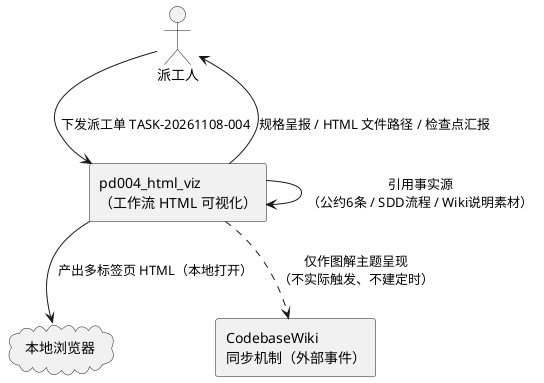
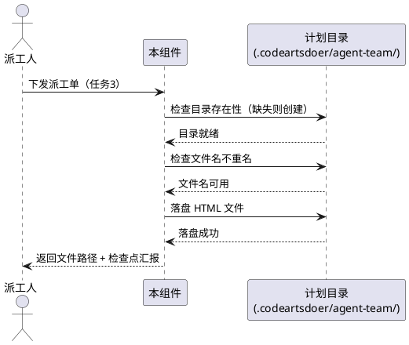
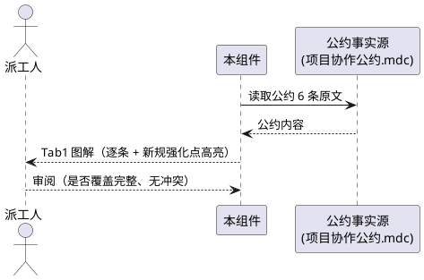
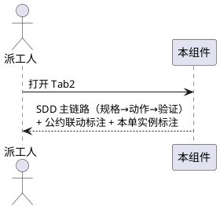
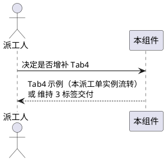
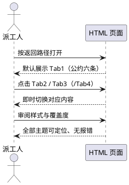
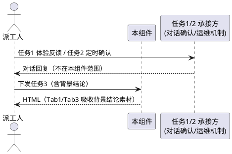

# 派工单 TASK-20261108-004 工作流HTML可视化（pd004_html_viz）需求规格

> 上游依据：派工单 TASK-20261108-004；项目协作公约 6 条（295 字极简版，事实源：`.codeartsdoer/rule/项目协作公约.mdc`）。
> 规格重点：任务3（生成工作流 HTML 可视化网页文件）为唯一编码交付物，本规格以其为主体；任务1（新规体验确认）与任务2（Wiki 每日定时配置）为非编码运维确认类任务，仅作为背景约束在规格中体现（见 1.4、5.7）。
> 现场基线（已核实，20261108）：公约 6 条原文可读；`.codeartsdoer/specs/` 下存在 `pd003_exec`（派工 003）与先例目录 `20261107_P001_spec_workflow_visual`（内含旧版 `sdd-workflow-visual.html`）；`.codeartsdoer/agent-team/` 目录当前不存在，需由执行创建。
> 验收条件格式：EARS 中文式（当[触发]时，系统应当[响应]）。

# **1. 组件定位**

## **1.1 核心职责**
本组件负责将新规 6 条公约与 SDD 流程的干活方式转化为多标签页 HTML 可视化网页并落盘交付，实现工作流透明化。

## **1.2 核心输入**
1. **派工单 TASK-20261108-004**：来源为派工人（用户），含任务列表、派工约束（公约红线 6 条）与交付物要求；任务3 为本组件主要输入。
2. **项目协作公约 6 条**：来源为 `.codeartsdoer/rule/项目协作公约.mdc`（全程 SDD / 学习材料 / 仓库只读隔离 / 规矩层冻结 / 执行节制 / 单一事实源），是 Tab1 图解的事实源。
3. **SDD 流程上下文**：来源为规格→动作→验证的标准推进方式与既有先例目录 `20261107_P001_spec_workflow_visual/`，是 Tab2 图解的事实源。
4. **Wiki 同步机制说明素材**：来源为公约第 4 条（Wiki 同步走外部事件、禁自建定时）与任务2 的运维确认结论，是 Tab3 图解的事实源。
5. **任务1 体验反馈结论**：来源为派工人对话确认的新规改进点（遇阻即学、≤20 分钟硬预算、伪完成违规、禁自建定时等），作为可视化内容素材。

## **1.3 核心输出**
1. **HTML 可视化文件**：单文件多标签页网页，落盘至智能体计划文件夹（`.codeartsdoer/agent-team/` 或约定计划目录），向派工人返回文件路径。
2. **执行检查点记录**：子步检查点与最终简要汇报（对话中回复）。
3. **目录与文件创建**：计划目录与唯一文件名的建立（不与既有目录/文件重名）。

## **1.4 职责边界**
本组件**不负责**：
1. **不执行任务1 的执行动作**：新规体验反馈属于对话确认类任务，本组件仅将其结论作为可视化素材引用，不产生其反馈本身。
2. **不执行任务2 的配置动作**：Wiki 每日定时配置属于运维确认类任务（走外部事件/系统级定时），本组件禁止自建定时与轮询，仅在 Tab3 中呈现其触发方式说明。
3. **不修改规矩层**：公约 6 条零改动（规矩层冻结），本组件仅做图解呈现。
4. **不覆盖既有产物**：禁止覆盖、改写 `specs/` 下既有目录（含 `pd003_exec`、`20261107_P001_spec_workflow_visual`）及其中的 `sdd-workflow-visual.html`。
5. **不接入外部网络**：HTML 不引入外部 CDN、脚本、字体、遥测（纯本地静态展示）。
6. **不代替 design/tasks 决策**：本规格只约束"做什么"（内容覆盖度、标签结构、交付位置），不约束"怎么做"（技术选型、样式实现由 design.md 决定）。

# **2. 领域术语**

**新规六条（项目协作公约）**
: 本项目当前生效的 6 条协作公约（295 字极简版），事实源为 `.codeartsdoer/rule/项目协作公约.mdc`；内容为全程 SDD、学习材料、仓库只读隔离、规矩层冻结、执行节制、单一事实源。

**熔断（20 分钟硬预算）**
: 公约第 5 条定义的执行节制红线：单任务执行默认不超过 20 分钟，超线必须暂停并给出原因码。

**落盘判定**
: 公约第 3 条定义的完成判定标准：写动作必须落盘文件并同步事实表，无落盘不得宣称完成。

**伪完成**
: 未落盘即宣称完成的行为；按公约第 3 条判定为违规。

**外部事件触发**
: 公约第 4 条定义的 Wiki 同步驱动方式：同步由外部事件/系统级定时触发，禁止智能体自建定时或轮询。

**单一事实源**
: 公约第 6 条定义的状态管理原则：状态只存事实表一处，冲突按 规则 > 知识库 > 记忆 > 推断 裁决。

**五步准入**
: 规矩层冻结后新流程登记的唯一通道：新流程一律分装技能登记，禁止直接修改公约。

**SDD 流程**
: 规范驱动开发流程：先规格（需求规格）后动作（设计/任务/执行），全程含验证；禁跳阶段、遇阻即学。

**多标签页（Tab）**
: HTML 页面内通过标签切换展示多组内容的组织形式；本交付物以 Tab 组织公约图解、SDD 流程、Wiki 说明等内容。

**派工编号**
: 派工单的唯一标识，格式 TASK-YYYYMMDD-NNN（如 TASK-20261108-004）；编号在本项目中全局递增，不重复使用。

# **3. 角色与边界**

## **3.1 核心角色**
1. **派工人（用户）**：下发派工单 TASK-20261108-004、审阅本规格、终审 HTML 交付物与文件路径、验收任务1/2 的对话确认结果。
2. **AI 执行体**：按本规格生成 HTML 可视化文件、创建计划目录、落盘并返回路径、汇报检查点；全程受公约 6 条约束。

## **3.2 外部系统**
1. **本地浏览器**：渲染 HTML 可视化文件（Chrome/Edge 现代内核，本地文件协议打开）。
2. **CodebaseWiki 同步机制**：作为 Tab3 的图解主题（外部事件触发说明），非本组件的运行时依赖。

## **3.3 交互上下文**


# **4. DFX约束**

## **4.1 性能**
1. HTML 在本地浏览器打开后，页面首屏加载时间必须不超过 2 秒（本地文件场景）。
2. 标签页切换必须即时响应（无网络等待，切换操作不超过 500ms）。

## **4.2 可靠性**
1. HTML 必须为单文件自包含产物，双击本地打开即可用，断网环境功能完整。
2. 打开页面后浏览器控制台必须无报错（排除浏览器扩展干扰）。
3. 可视化内容必须与事实源一致；当内容与事实源冲突时，系统应当按"规则 > 知识库 > 记忆 > 推断"裁决并在页面中标注口径来源。

## **4.3 安全性**
1. 必须禁止引入外部 CDN 脚本、字体、遥测等任何外部网络资源。
2. 必须禁止在 HTML 及汇报中写入密钥、凭证等敏感信息。

## **4.4 可维护性**
1. 标签页结构必须清晰可扩展，后续公约或流程更新时对应标签内容可独立修订，无需重新设计整体结构。
2. 页面中每条公约图解必须标注事实源路径，便于追溯核对。

## **4.5 兼容性**
1. 必须支持 Chrome / Edge 现代内核浏览器以本地文件方式直接打开，无构建、无服务器依赖。
2. 交付目录与文件命名必须不破坏 `.codeartsdoer/` 下既有目录结构与命名。

# **5. 核心能力**

## **5.1 派工目录与文件落盘管理**

### **5.1.1 业务规则**
1. **目录规则**：当执行任务3 交付时，系统应当在智能体计划文件夹（`.codeartsdoer/agent-team/`，不存在则创建；或派工人指定的约定计划目录）内落盘 HTML 文件。
   a. 验收条件：当交付完成时 → `.codeartsdoer/agent-team/` 目录存在且含本次 HTML 文件，路径已返回给派工人。
2. **不重名规则**：当确定 HTML 文件名时，系统应当先检查计划目录及 `specs/` 既有产物，确保新文件名与既有文件不重名。
   a. 验收条件：当新文件名与既有文件（如先例 `sdd-workflow-visual.html`）同名或同目录冲突时 → 必须更换文件名后落盘，禁止覆盖。
3. **编号规则**：当处理派工编号时，系统应当沿用 TASK-20261108-004 编号（既有 003 目录 `pd003_exec` 已占用，本单为 004），编号不得跳用、复用。
   a. 验收条件：当创建目录或文件引用编号时 → 编号为 TASK-20261108-004 或 pd004 段，且与既有 003 目录无冲突。
4. **落盘判定规则**：当宣称交付完成时，系统应当已完成文件落盘且路径真实可访问（写必落盘）。
   a. 验收条件：当返回文件路径时 → 该路径下文件存在且大小大于 0，无伪完成。
5. **禁止项**：禁止将交付物落盘至计划目录与规格目录之外的业务位置（不落业务文件、不写自传）。
   a. 验收条件：当检查本次写动作时 → 写入范围仅限计划目录（HTML）与规格目录（spec/design/tasks），无其他业务文件变更。

### **5.1.2 交互流程**


### **5.1.3 异常场景**
1. **目录创建失败**
   a. 触发条件：计划目录创建失败（权限/磁盘等原因）。
   b. 系统行为：暂停交付，最多重试 3 次；仍失败则降级（改用 `.codeartsdoer/specs/pd004_html_viz/` 备选落盘）并继续推进。
   c. 用户感知：汇报中说明降级后实际落盘路径。
2. **文件名冲突**
   a. 触发条件：候选文件名已存在。
   b. 系统行为：自动更换文件名（追加区分段）并报告换名依据。
   c. 用户感知：返回的路径为最终落盘路径，无覆盖发生。
3. **落盘后路径不可访问**
   a. 触发条件：宣称完成但路径读取失败。
   b. 系统行为：判定为伪完成，回退修复后重新落盘验证。
   c. 用户感知：汇报中给出修复后的验证证据（文件存在性）。

## **5.2 公约六条图解（Tab1）**

### **5.2.1 业务规则**
1. **覆盖度规则**：当呈现 Tab1 时，页面必须逐条图解新规 6 条公约，每条含核心要点与通俗解读。
   a. 验收条件：当审阅 Tab1 时 → 6 条公约各有可定位的图解区块（动态学习/遇阻即学、学习材料、仓库只读隔离+落盘判定+伪完成违规、规矩层冻结+五步准入、执行节制+20分钟熔断+中断优先+禁轮询、单一事实源+仲裁+编码必审），缺一条即验收失败。
2. **事实源标注规则**：当呈现公约条目时，系统应当标注事实源路径（`.codeartsdoer/rule/项目协作公约.mdc`）。
   a. 验收条件：Tab1 页面 → 每条图解可见来源标注或页面统一来源区。
3. **新规强化点呈现规则**：当呈现公约时，系统应当突出本次新规强化的改进点（动态学习、20分钟熔断、中断优先、落盘判定、Wiki外挂/禁自建定时、伪完成违规）。
   a. 验收条件：审阅 Tab1 → 上述新规强化点均有显著视觉区分（如高亮标注），可一眼定位。
4. **禁止项**：禁止在图解中出现与公约原文冲突的表述（如"允许跳阶段""允许自建定时"）。
   a. 验收条件：审阅全部 Tab1 文案 → 无与公约 6 条冲突的表述。

### **5.2.2 交互流程**


### **5.2.3 异常场景**
1. **事实源不可读**
   a. 触发条件：公约文件读取失败。
   b. 系统行为：对应条目按"来源不可达"呈现，不虚构内容，最多重试 3 次后降级继续。
   c. 用户感知：汇报中标注该条目事实源缺失。

## **5.3 SDD 流程图解（Tab2）**

### **5.3.1 业务规则**
1. **主链路规则**：当呈现 Tab2 时，页面必须完整呈现 SDD 流程主链路：规格（spec）→ 动作（design/tasks/执行）→ 验证（门禁/审查/落盘确认）。
   a. 验收条件：打开 Tab2 → 三段主链路节点依序可见，且含"禁跳阶段"标注。
2. **公约联动规则**：当呈现流程节点时，系统应当标注每个阶段对应的公约约束（遇阻即学、≤20分钟预算、落盘判定、编码必审）。
   a. 验收条件：审阅 Tab2 → 每个阶段节点可见其适用公约条目关联，无缺漏标注。
3. **实例化规则**：当呈现流程时，系统应当以本派工单（TASK-20261108-004）为实例标注当前所处阶段。
   a. 验收条件：Tab2 → 可见"本单当前处于规格阶段"的实例标注。
4. **禁止项**：禁止呈现跳过验证环节的捷径路径。
   a. 验收条件：审阅 Tab2 图形 → 不存在绕过验证的合法化表述。

### **5.3.2 交互流程**


### **5.3.3 异常场景**
1. **阶段标注口径冲突**
   a. 触发条件：派工单口径与事实源流程口径不一致。
   b. 系统行为：按"规则 > 知识库 > 记忆 > 推断"裁决，两口径并示。
   c. 用户感知：页面同时给出派工单口径与事实源口径。

## **5.4 Wiki 同步与定时说明（Tab3）**

### **5.4.1 业务规则**
1. **触发方式呈现规则**：当呈现 Tab3 时，页面必须呈现 Wiki 同步的触发方式为外部事件/系统级定时（每日 1 次），且明确标注"禁自建定时、禁轮询"。
   a. 验收条件：审阅 Tab3 → 可见"每日 1 次、外部事件触发"与"禁自建定时/禁轮询"两组说明。
2. **任务2 边界呈现规则**：当呈现 Tab3 时，系统应当标注任务2 为运维确认类任务、由外部机制承接，本可视化不执行任何配置动作。
   a. 验收条件：审阅 Tab3 → 出现"任务2 配置由外部事件/系统级定时承接"的边界说明。
3. **不阻塞说明规则**：当呈现 Tab3 时，系统应当说明 Wiki 定时同步不阻塞常规派工（并行、事件驱动）。
   a. 验收条件：审阅 Tab3 → 出现"不阻塞常规派工"的说明。
4. **禁止项**：禁止在本组件执行任何定时任务创建、轮询脚本或自动触发逻辑。
   a. 验收条件：检查本组件全部写动作 → 无定时/轮询相关产物。

### **5.4.2 交互流程**
```plantuml
@startuml
actor 派工人
participant "本组件" as S
participant "外部事件/系统定时\n(承接任务2)" as E

派工人 -> S : 打开 Tab3
S --> 派工人 : Wiki 同步说明（每日1次、外部事件、不阻塞）
S ..> E : 仅呈现其机制说明\n（本组件不创建、不触发）
@enduml
```

### **5.4.3 异常场景**
1. **任务2 结论未确认**
   a. 触发条件：生成 Tab3 时任务2 的运维确认结论尚未在对话中给出。
   b. 系统行为：Tab3 按公约第 4 条口径呈现机制说明，并标注"任务2 配置状态以运维确认为准"。
   c. 用户感知：页面口径标注清晰，不虚构配置已完成。

## **5.5 派工单示例（Tab4，可选增补）**

### **5.5.1 业务规则**
1. **可选规则**：Where 派工人同意增补示例标签，系统应当提供"派工单示例"标签页，以本派工单为实例演示一次完整派工的流转。
   a. 验收条件：当 Tab4 存在时 → 以 TASK-20261108-004 为实例呈现"下发→SDD 阶段推进→交付"的示例流转，且不虚构未发生的状态。
2. **缺省规则**：当派工人未要求 Tab4 时，系统应当不强制提供该标签，Tab 数量以 3 个为准。
   a. 验收条件：当仅交付 3 个标签时 → 验收不受影响。

### **5.5.2 交互流程**


### **5.5.3 异常场景**
1. **示例与实际状态不一致**
   a. 触发条件：示例流转与实际已发生的检查点记录不符。
   b. 系统行为：以事实源为准修正示例。
   c. 用户感知：示例与检查点汇报一致。

## **5.6 多标签页交互与交付**

### **5.6.1 业务规则**
1. **多标签规则**：当单页无法承载全部内容时，系统应当以多标签页（Tab）组织，点击标签即时切换对应内容。
   a. 验收条件：点击任一标签 → 对应内容显示、其余隐藏，无需刷新页面；标签总数不少于 3 个（Tab1/Tab2/Tab3）。
2. **样式清晰规则**：当呈现页面时，系统应当保证排版结构化、层次分明（公约条目、流程节点、说明区块可视觉区分）。
   a. 验收条件：派工人打开页面 → 无需滚动混乱即可按标签定位各主题，文字无重叠遮挡。
3. **可直接打开规则**：当交付 HTML 时，系统应当保证浏览器可直接打开（本地文件协议，双击即可），并返回完整文件路径。
   a. 验收条件：当派工人按返回路径打开文件时 → 页面正常渲染，三标签均可切换。
4. **检查点规则**：当执行本派工时，系统应当按子步记录检查点（目录创建、内容生成、落盘验证），最终简要汇报。
   a. 验收条件：当交活汇报时 → 含子步检查点摘要（做了什么/落盘在哪/验证结果）。
5. **执行节制规则**：While 执行本派工期间，系统应当遵守单任务 ≤20 分钟硬预算，超线暂停并给出原因码；用户中断优先立即停。
   a. 验收条件：当执行超线或用户中断时 → 立即暂停/停止，汇报当前进度与原因码，不强行续跑。
6. **禁止项**：禁止依赖外部网络资源渲染；禁止在交付物外产生额外业务文件。
   a. 验收条件：断网打开页面 → 全部标签与交互正常；检查工作区 → 无计划目录/规格目录之外的本次新增业务文件。

### **5.6.2 交互流程**


### **5.6.3 异常场景**
1. **标签切换失效**
   a. 触发条件：点击标签无响应。
   b. 系统行为：判定为交付缺陷，返工修复（最多重试 3 次），仍失败则降级为单页分段展示并说明。
   c. 用户感知：汇报中标注降级形态与原因。
2. **渲染异常**
   a. 触发条件：打开页面控制台有报错或样式错乱。
   b. 系统行为：定位修复后重新落盘验证。
   c. 用户感知：最终路径指向修复后版本。
3. **超预算中断**
   a. 触发条件：执行超过 20 分钟或用户发出中断。
   b. 系统行为：立即暂停，输出原因码与当前进度。
   c. 用户感知：汇报含进度快照与续作建议。

## **5.7 背景任务约束承接（任务1/2）**

### **5.7.1 业务规则**
1. **任务1 承接规则**：当引用任务1 结论时，系统应当仅将新规体验反馈（新规比旧规更明确之处，1-2 句）作为可视化素材来源，不代替其对话确认本身。
   a. 验收条件：当检查交付时 → 任务1 的反馈在对话中回复（本组件外），Tab1 仅吸收其改进点结论。
2. **任务2 承接规则**：当引用任务2 时，系统应当仅将其运维确认结论（触发方式说明）作为 Tab3 呈现素材，不执行定时配置、不落业务文件。
   a. 验收条件：当检查交付时 → 任务2 确认为对话回复（本组件外），本组件无任何定时产物。
3. **禁止项**：禁止将任务1/2 的执行结果伪装成本组件交付物。
   a. 验收条件：当审阅交付汇报时 → 任务3 交付物（HTML 路径）与任务1/2 的对话确认分别清晰可辨，无混同。

### **5.7.2 交互流程**


### **5.7.3 异常场景**
1. **背景结论缺失**
   a. 触发条件：生成可视化时任务1/2 结论尚未给出。
   b. 系统行为：按公约原文口径呈现，标注"以后续确认为准"。
   c. 用户感知：页面口径标注清晰，不虚构结论。

# **6. 数据约束**

## **6.1 派工目录与文件（落盘对象）**
1. **计划目录**：`.codeartsdoer/agent-team/`（约定计划目录，缺失则创建；降级备选为 `.codeartsdoer/specs/pd004_html_viz/`）。
2. **HTML 文件名**：仅小写字母、数字、连字符/下划线，必须不与既有文件重名（尤其不得与 `sdd-workflow-visual.html` 同名）。
3. **文件形态**：单文件自包含 HTML，不拆分多文件、不依赖外部资源。
4. **唯一性**：同一派工单（TASK-20261108-004）落盘的 HTML 文件在计划目录内唯一。

## **6.2 标签页（内容组织对象）**
1. **标签数量**：不少于 3 个（Tab1 公约六条 / Tab2 SDD 流程 / Tab3 Wiki 同步说明），Tab4 派工单示例可选。
2. **内容覆盖**：Tab1 必须覆盖公约 6 条全部条目；Tab2 必须覆盖"规格→动作→验证"主链路；Tab3 必须覆盖"每日 1 次、外部事件触发、禁自建定时、不阻塞派工"。
3. **口径标注**：每条公约图解必须标注事实源路径；涉及派工单口径与事实源差异处必须双口径并示。

## **6.3 检查点记录（汇报对象）**
1. **子步记录**：至少含目录创建、内容生成、落盘验证三个检查点。
2. **汇报形态**：最终汇报简要（做了什么/发现什么/落盘路径/验证证据），在对话中回复，不重复落盘。