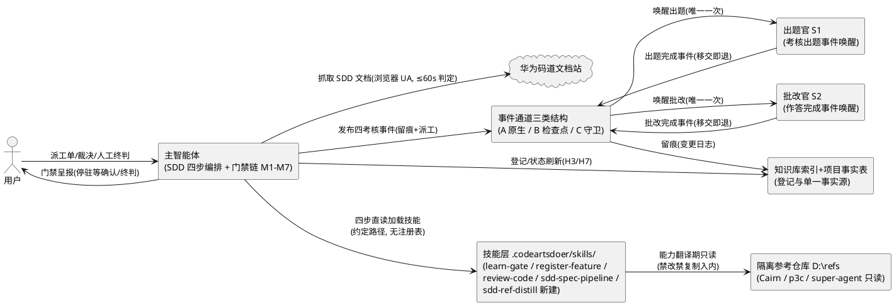
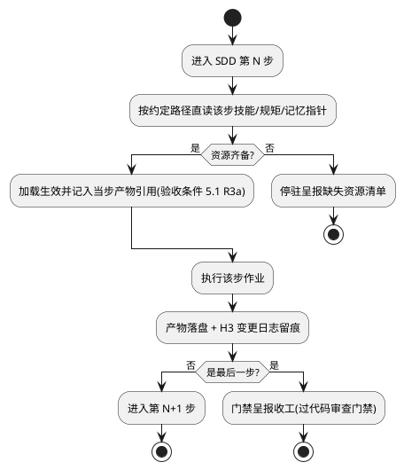
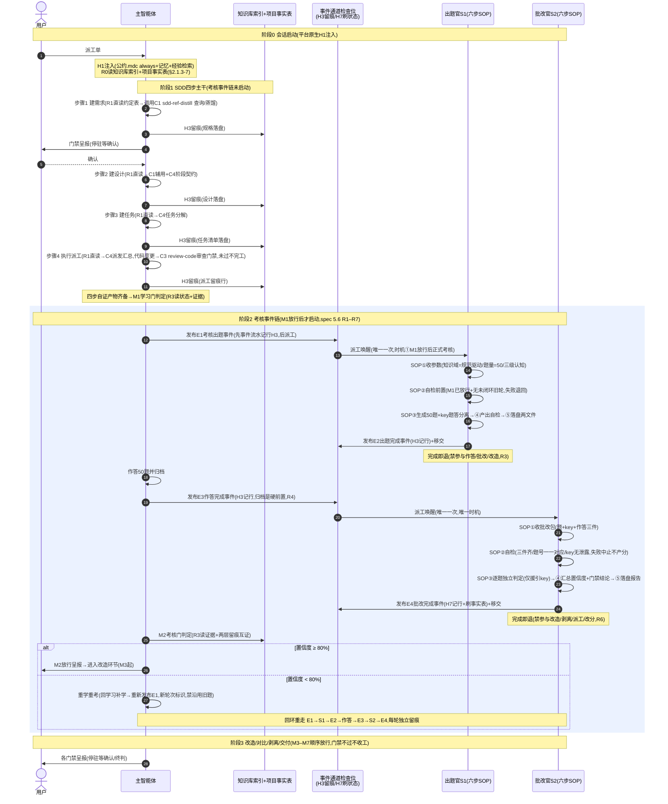
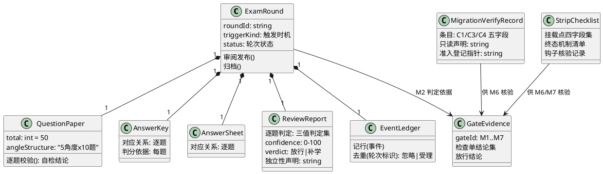

# 规范驱动接入与两智能体改造 —— 技术设计

> 特性名：sdd_agent_refactor ｜ 版本：v3 ｜ 日期：2026-11-08 ｜ 状态：待用户审阅（v3 极简同步修订：对齐 spec v5/U6）
> v3 修订说明（2026-11-08，对齐 U6 七条/spec v5，减法最小变更集；**执行已实质完成——M1/M2/M3/M4/M6/M7 六门放行、提交候选停驻待人工终判，v3 为文档口径对齐修订，不改变任何已闭环证据与判定结论**）：
> 【生效时点切割（来源：经验 2026-11-08-minimal-revision-effective-time-slicing）】U6 七条生效时点=2026-11-08 指令下达时刻；既往既成事实处置（只登记、不回滚、不改判）：①已放行六门（M1/M2/M3/M4/M6/M7）判定结论与证据链保留不追溯；②R1 轮 50 题 98%、V1 轮 100% 为既成事实不追溯；③OLD 轮已中止留档（exam/OLD/events.md）；④M5 对比门已取消（U6-4），gates/ 无 m5 门禁文件为正常终态；⑤AI 已直改 5 规则文件（examiner.md/grader.md/register-feature/review-code/sdd-spec-pipeline）列入待人工复核清单，不回滚（U6-6）。
> 【全局题量注记（代替逐处改写）】本设计正文所有"50 题"条款值（S1 SOP 步骤③、IF-1/IF-5 载荷、QuestionPaper.total、B4 承接等）自 U6 起改为 **5 题**，适用于今后的考核轮/重学重考轮；正文条款值原样保留，统一以本注记+spec 5.11 全局注记生效，不逐处改写。合格线维持 80%。
> v2 修订说明（2026-11-07，用户四疑问逐条落实，只增不删、口径与 spec v4 一致）：
> ①疑问1（直读约定表读取时机+无注册表变体证明）→新增 **§2.1.3-7**：读取时机策略表（5 个读取点×触发时机×读取文件×失败降级）+可执行验证方法（rg 扫描命令+关键词清单+豁免区+零命中判定+留档要求，写入 M6 检查单条件⑥）；
> ②疑问2（H3/H7 底层实查+gates/ 落地）→**§2.1.3-4** 增补通道底层实查证据表与承载性结论（实查定性=规程式动作检查点，非文件监视/事件回调/轮询；结论=四事件可承载、零新增通道、零定时器；投递边界如实报告）+**§2.1.3-5** 增补 gates/ 落地细化（命名规范+证据文件统一模板+逐门写入时机表+事件流水/门禁证据两层留痕互证）；
> ③疑问3（C3/C4 扩展旧框架引用代码级清零）→**§2.1.3-6** 增补剥离核验扫描方法（关键词清单三组+扫描范围+现行区零命中判定+归档 archived 标记与不可加载要求+M6 验收四步）与 C3/C4 扩展自证约束；
> ④疑问4（时序显式化）→新增 **§2.1.3-8** 端到端时序图（Mermaid sequenceDiagram：会话启动→四步主干→考核事件链→置信度分支回环，事件箭头与四步推进先后关系对齐 spec 5.6 R1–R7 与 5.5 R5）+图下七条关键时序约束；
> ⑤联动更新：M6 门禁行（§2.1.3-5）、追溯表 7 行、风险 1、第五章 B6 行、第七章自检 1/2、§2.3.2 目录树。
> 上游规格：`.codeartsdoer/specs/sdd_agent_refactor/spec.md`（v4，2026-11-07）——本设计严格承接 spec v4 全部 EARS 条款与 M1–M7 门禁定义，未改变任何需求口径；spec 附录 B 待裁决项按各项目录预设方案承接设计，单列第五章说明，最终以用户裁决为准、可改判。
> 约束基线：项目协作公约 6 条（规矩层冻结）+ 用户意见 U1–U5 + 单一事实源 `notes/项目事实表.md`（机制状态以此为准）。

# 一、需求与存量功能关系分析

## 1.1 需求功能与存量功能对比

### 1.1.1 已实现功能

判定依据说明：以下各项以项目现行机制实查为准（核验日期 2026-11-07，来源=项目事实表/知识库索引/机制文档），需求条款与存量实现的输入输出契约可逐项对照、无语义缺口，故判为"已实现"。

| 需求功能 | 存量功能 | 代码位置 | 匹配度 |
|---------|---------|---------|--------|
| 学习材料先三查后引用（5.1 R1 / A2） | learn-gate 技能内置"材料三查（来源权威/内容保真/时效核验）→学习沉淀→考核"全流程，且 st2-materials 实证有淘汰记录机制 | `.codeartsdoer/skills/learn-gate/SKILL.md` | 75% |
| 单一事实源与三层仲裁（4.2 / 5.7 R4 / A6） | 项目事实表（唯一写者 H7）+ 仲裁顺序"规则>知识库>记忆>推断"已在运行规则固化 | `notes/项目事实表.md`、`notes/阶段状态机运行规则.md` §1/§8 | 100% |
| 编码必审（5.3 R6 / 5.7 R5 / A6） | review-code 技能已封装 P3C 审查为一条命令（定位变更 Java 文件→审查→留痕，exit 0/4 语义），P3C 底座 214/214 测试全绿 | `.codeartsdoer/skills/review-code/SKILL.md`、`D:\refs\p3c`（只读） | 100% |
| 考教分离 / 批改独立红线（4.3 / 5.2 R5 / 5.5 R6） | 两智能体配置已含"key 禁入执行代理会话"与"禁协商改判、禁倾向暗示、批改从严"红线原文 | `.codeartsdoer/agents/examiner.md`、`.codeartsdoer/agents/grader.md` | 100% |
| 题答分离交付（5.2 R2 / 6.1） | 出题官已实现题目+key 两文件分离、逐题对应可对照（st2-exam-* 四件套实证一轮全链路可跑通） | `.codeartsdoer/agents/examiner.md` 步骤③、`notes/知识库索引.md` 变更日志 2026-11-07 考核行 | 100% |
| 独立批改三值判定+置信度+门禁二值结论（5.2 R3 / 6.1-4） | 批改官已实现逐题 PASS/PARTIAL/FAIL、综合自信度、≥80% 门禁二值结论（前次考核 96% 过门实证） | `.codeartsdoer/agents/grader.md` 步骤①–⑤ | 100% |
| 禁定时任务、事件通道三类结构（4.4-3 / A5） | 通道 A 平台原生（H1/H4/H5）+通道 B 动作检查点（H2/H3/H7 别名）+通道 C 迁移守卫（H6 别名）已生效，别名防断链+幂等去重已内建 | `notes/阶段状态机运行规则.md` §4 | 100% |
| 参考仓库只读隔离（5.1 R4 / 5.4 R5 / A3） | D:\refs 三仓库已就位且与本项目 .git 物理隔离（Cairn 2ae4eef / super-agent e705e87 / p3c，浅克隆） | `notes/项目事实表.md` §3 refs 隔离目录行 | 100% |
| 知识库增删改登记（4.4-1） | 知识库索引+变更日志（日期+条目+动作+触发来源）现行运转中 | `notes/知识库索引.md` | 100% |
| 平台注册机制（5.5 R3 / 5.4 R6） | 文件落盘即注册+listSkills 运行时权威源，已有 codearts-platform-registration 技能沉淀注册/验证方法 | `.codeartsdoer/skills/codearts-platform-registration/SKILL.md` | 100% |

### 1.1.2 需要扩展的功能

差异说明与扩展方向逐项给出"差异点（输入/输出/逻辑/边界）→扩展方案（修改范围/新增依赖/兼容性）"。判定依据：存量实现与需求条款在核心语义上同向，但触发方式、承载载体、范围边界三者至少一项不同，须改造存量文件或流程。

| 需求功能 | 存量功能 | 差异说明 | 扩展方向 |
|---------|---------|---------|---------|
| 出题官事件驱动触发+六步 SOP（5.5 R1 / 5.6 R1–R3） | 现状按"主智能体考核派工"被动响应，五段 SOP，触发条件=learn-gate 第 4 步 | 差异：①输入从"学习材料清单指针+考核角度列表"收窄为"知识域=规范驱动、题量=50、认知层级=记忆/理解/应用+轮次标识"；②触发从"learn-gate 派工"变为"考核出题事件（四时机，5.6 R1）"；③SOP 从五段升六步（新增"自检前置条件 M1 已放行+无未闭环旧轮次"与"发布出题完成事件移交"两步）；④边界新增"非规范驱动范围请求拒绝并上报" | 改写 `.codeartsdoer/agents/examiner.md`（frontmatter description 触发条件重写+正文六步 SOP+四时机清单）；frontmatter permission.skill 白名单从 learn-gate:allow 调整为不挂考核外技能；兼容性：保留纪律红线原文语义（5.5 R6），st2-exam-* 命名模式沿用并加轮次目录 |
| 批改官事件驱动触发+六步 SOP（5.5 R2 / 5.6 R4–R6） | 现状按"主智能体批改派工"被动响应，五段 SOP | 差异：①触发收窄为唯一时机"作答完成事件"；②SOP 升六步（新增"自检三件齐备/题号一一对应/key 无泄露"显式步骤与"发布批改完成事件移交"）；③输出增加独立性声明与轮次标识；④中止语义新增"步骤②自检失败不产出任何分数" | 改写 `.codeartsdoer/agents/grader.md`（同上模式）；兼容性：独立性红线原文保留；批改报告命名沿用 st2-exam-review 模式加轮次目录 |
| 动态加载不依赖注册表（5.1 R3 / 5.4 R2b / B1） | 现状技能/规矩/记忆定位依赖注册表"调用理由"列做路由判据（register-feature 五步准入第 4 步=注册表登记） | 差异：①定位机制从"注册表查表路由"改为"约定路径直读+知识库索引检索"；②register-feature 第 4 步载体变更；③新增反绑死边界约束（新逻辑任一环节调用链无注册表读取） | ①在 spec 交付的设计中固化"四步→技能/规矩/记忆"直读路径约定表（本设计 §2.1.3-1）；②改 `.codeartsdoer/skills/register-feature/SKILL.md` 第 4 步为"知识库索引登记+项目事实表状态刷新"；③兼容性：知识库索引条目契约（条目名/类别/路径/主题/核验日期/状态）现成可用，无新增依赖 |
| C1 查询/蒸馏能力翻译（5.4 R1） | Cairn 以 tool 形态登记于注册表（MCP 只读查询+CLI 备用），能力=两层知识图谱+蒸馏编排 | 差异：①承载形态从"MCP/CLI 运行时工具+注册表条目"变为"自有蒸馏方法技能"（壳子剥离后技能不得依赖 cairn-mcp 运行时，反绑死）；②挂载点新增四步映射（建需求主/建设计辅） | 新建 `.codeartsdoer/skills/sdd-ref-distill/SKILL.md`（提炼 Cairn 的查询检索与要点蒸馏方法论，来源指针 `D:\refs\Cairn` 相对路径）；扩展方向详见 §2.1.3-2；兼容性：D:\refs\Cairn 实体不动（B2 预设） |
| C3 审查能力挂载确认（5.4 R3） | review-code 已是编码必审唯一承载（G4 检查点） | 差异：需求要求"C3 与代码审查门禁同一承载、无双轨并存"的显式核验结论与"SDD 执行步门禁环节"挂载标注，现状 SKILL.md 无 SDD 四步语境挂载描述 | 扩展 `.codeartsdoer/skills/review-code/SKILL.md`：增补挂载描述段（执行步第 4 步代码审查门禁环节），不改变审查本体逻辑与 exit 语义；核验记录落能力迁移核验文件 |
| C4 编排模式翻译（5.4 R4 / 5.7 R6） | sdd-spec-pipeline 技能已承载"SDD 四阶段派工流水线契约"（经验技能化） | 差异：①缺"任务分解→子任务派发→结果汇总"的编排范式显式语义（Super Agent 来源）；②缺"派工动作可追溯至该技能调用留痕"的留痕约定 | 扩展 `.codeartsdoer/skills/sdd-spec-pipeline/SKILL.md`：增补编排范式段（分解→派发→汇总三动作与四步阶段映射）+派工留痕约定（每次派工在执行轨迹记一行含技能名）；依据 register-feature 查重红线"可复用禁新建"，不新建重复技能 |
| 五步准入登记载体变更（5.4 R6 / 5.5 R4 / B1） | register-feature 五步：提出→评估归类（查重入口=注册表可复用性列）→生成配置→注册表登记→H3 留痕 | 差异：①第 2 步查重入口与第 4 步登记载体均原指向注册表，注册表整体剥离后失效；②新载体=知识库索引（查重+登记）+项目事实表（状态），符合公约第 6 条单一事实源 | 改 `.codeartsdoer/skills/register-feature/SKILL.md`：第 2 步查重入口=知识库索引条目检索；第 4 步=知识库索引登记（类别/路径/主题/状态）+项目事实表状态行刷新（如适用）；第 5 步 H3 留痕不变；兼容性：公约第 4 条五步流程语义零改动（B1 预设承接） |
| 门禁状态迁移留痕（4.2-1 / 5.10） | 现行迁移守卫规程（准出条件满足+证据链接+变更日志留痕三要素）作用于七态状态机 ST0–ST5 | 差异：本特性引入 M1–M7 七道特性级门禁，与状态机七态不同粒度（状态机管项目阶段，M 链管本特性任务流），需要独立的门禁检查单与证据目录 | 新建 `specs/sdd_agent_refactor/gates/` 证据目录与每门检查单（本设计 §2.1.3-5）；复用迁移守卫规程三要素纪律，不修改运行规则文件 |

### 1.1.3 需要新增的功能或接口

按业务模块分组；每个功能点标注输入、输出、核心逻辑与依赖关系。

**模块 A：考核事件与留痕（承接 5.6 / 6.5 / B6）**
- A1 四事件定义与载荷契约：考核出题事件、出题完成事件、作答完成事件、批改完成事件——输入=轮次上下文（轮次标识/触发时机/产物指针），输出=事件留痕行+具名载荷文件；核心逻辑=事件发布=写留痕（H3 检查点）+派工/移交动作，去重以轮次标识为准。依赖：通道 B 动作检查点、平台 subagent 派工。详见 §2.2.2 与 §2.1.3-4。
- A2 事件留痕文件：每考核轮次一份事件流水（六字段：事件名/轮次标识/时间戳/发布方/接收方/产物指针）+去重记录与 SOP 步骤记录。依赖：A1。

**模块 B：规范驱动四步主干与动态加载（承接 5.1 / 5.7 / B1）**
- B1 四步直读路径约定表：建需求/建设计/建任务/执行四步各自映射"技能（脚本）+规矩文件+记忆指针"的约定路径清单——输入=当前步骤名，输出=该步可加载资源路径集；核心逻辑=文件系统直读（约定路径）+知识库索引检索定位，无注册表中间层。依赖：知识库索引、.codeartsdoer/skills/、.codeartsdoer/rule/。
- B2 四步自证产物集：学习完成的证据=四阶段产物齐备且顺序无跳步。依赖：B1、learn-gate。

**模块 C：能力迁移产物（承接 5.4 / 6.6 / U4/U5）**
- C1 新技能 sdd-ref-distill（C1 查询/蒸馏）。依赖：D:\refs\Cairn 只读、register-feature（扩展版）。
- C2 review-code 挂载扩展（C3 审查）。依赖：既有 review-code、P3C 底座。
- C3 sdd-spec-pipeline 编排范式扩展（C4 编排）。依赖：既有 sdd-spec-pipeline、D:\refs\deepseek-super-agent 只读。
- C4 能力迁移核验记录文件：三项逐条五字段（能力编号/来源/产物形态与路径/挂载步骤/核验结论）+只读访问声明+准入登记指针。依赖：C1–C3。

**模块 D：旧逻辑剥离与换绑（承接 5.3 / 6.4 / U3/U5）**
- D1 剥离对象清单与清点方法：图框架（预设=Cairn 壳子）+自研注册表（整体剥离）的文件/路径/脚本/引用四类清点方式与核验方法。依赖：全项目 grep 检索、知识库索引档案区。
- D2 剥离核对清单：每对象四字段（原路径/原挂载方式/剥离动作/核验结果）+终态机制清单+H1–H7 钩子核验记录。依赖：D1。
- D3 剃旧上新换绑动作序：剥离验收通过的同批动作（新逻辑挂接为唯一主干），换绑前新逻辑处验证运行态。依赖：M6。

**模块 E：对比测试（承接 5.8 / 6.2 / B5）**
- E1 旧逻辑临时复现方案：git 历史检出旧版两智能体配置至临时目录验证态运行。依赖：git 历史、temp/ 目录。
- E2 对比报告：两份置信度+口径统一说明+独立性声明+结论。依赖：E1、A1/A2。

## 1.2 存量功能详细分析

### 1.2.1 learn-gate 技能（学习与考核流程底座）

- **接口契约**：输入=新框架/新领域接入诉求（含材料来源）；输出=学习材料清单、学习成果条目、考核证据链四件套（st2-exam-*）、80% 门禁结论；异常=材料三查不过→淘汰并找替代；副作用=知识库索引登记+变更日志留痕。
- **业务规则**：流程序=拉取修复→材料三查→学习沉淀→出题考核→80% 门禁；学不会不干（学习门未过禁考核）。
- **扩展点**：考核环节以独立 Worker（examiner/grader）承接，本特性四事件链即挂接于此扩展位。
- **约束**：材料限大厂高引用/近 1 年论文门槛；失败最多 3 次修复尝试后降级呈报（用户既定授权模式）。
- **与本设计的关系**：本特性学习阶段（spec 5.1）直接复用其三查与沉淀机制，仅学习对象换为 SDD 官方文档（华为码道文档站，带浏览器 UA），新增"四步自证"作为学习完成判据（M1 放行条件之一）。

### 1.2.2 examiner.md / grader.md 两智能体（考核执行体）

- **接口契约**：examiner 输入=材料清单指针+考核角度列表+每角度题数（默认 10），输出=题目+key 两文件；grader 输入=题目+key+作答三件，输出=批改报告（逐题三值+自信度+门禁二值结论）；异常=材料缺失上报/作答不对应上报；副作用=落 specs 同目录。
- **业务规则**：仅响应主智能体派工、完成即退、禁主动对话；examiner 纪律红线=考教分离（key 禁入执行代理会话）；grader 纪律红线=独立性（禁协商、禁暗示、批改从严）。
- **扩展点**：frontmatter 的 description 承载触发条件，permission.skill 承载技能白名单——本特性改造即落位于这两处+正文 SOP。
- **约束**：tools 白名单极小（examiner=read/write/glob/grep，grader=read/write）；mode=all；scope=project。
- **与本设计的关系**：改造设计（§2.1.3-3）在保留红线与工具白名单前提下重写触发条件、输入契约与 SOP 步骤序列。

### 1.2.3 事件通道三类结构（H1–H7，触发与检查点底座）

- **接口契约**：通道 A=平台原生（会话启动/规则变化/经验反思）；通道 B=动作检查点（采信记忆前/写知识库前/事实变更后，别名 H2/H3/H7）；通道 C=迁移守卫（门禁执行，别名 H6，四查+迁移三要素）。
- **业务规则**：别名防断链（旧名保留可解析）；多维度并发命中幂等去重（先到先处理一次）；无痕即违规；加载上限=索引+事实表+至多 2 个命中条目。
- **扩展点**：检查位语义按"触发时机+呈报/静默"定义，新事件类型可通过"动作检查点+事件留痕文件"组合承载，无需新增通道实体。
- **约束**：禁定时器（H5 反思窗口是唯一既有定时性兜底、非触发主体）；禁常驻监听自建组件。
- **与本设计的关系**：四考核事件的承载映射（§2.1.3-4）全部落在既有通道 B/C 检查位上，零新增通道、零新增定时器——直接满足 B6 预设与 A5。

### 1.2.4 知识库索引与项目事实表（登记与状态底座）

- **接口契约**：知识库索引字段契约=条目名/类别/路径/主题/最后核验日期/状态，类别枚举含"机制文档、档案、流水线产物、技能"等；项目事实表分区=git 状态/机制状态/环境状态/未决指针/阶段状态，唯一写者=H7 on_fact_change。
- **业务规则**：全库唯一登记与查重入口；变更日志每动作一行；历史行禁篡改禁删除。
- **扩展点**：类别枚举可扩展；档案区承载退役条目（复用评估表"已冻结"先例：索引状态标记+原文件留存）。
- **约束**：写知识库前必过 H3 查重检查点；事实表写者唯一。
- **与本设计的关系**：B1 预设承接的"五步准入登记新载体"（§2.1.3-2）与注册表档案化退役（§2.1.3-6）均以本底座承载，零新组件。

### 1.2.5 register-feature 技能（五步准入流程载体）

- **接口契约**：输入=新功能提案；输出=登记完成的条目+H3 留痕；异常=查重命中禁新建、归类两可停止呈报。
- **业务规则**：五步=提出→评估归类→生成配置→登记→留痕；未走完禁入调用链。
- **扩展点**：第 2/4 步的入口载体是可替换的（原文为注册表可复用性列/注册表登记）。
- **与本设计的关系**：注册表剥离后此技能是唯一需要同步换载体的既有技能，扩展方案见 §2.1.3-2。

### 1.2.6 注册表（notes/注册表.md）——整体剥离对象，非保留功能

- **现状**：模板层（六要素+可复用性/缺口清单两列）+16 挂载项+五步准入规程+演进记录；承载能力注册、查重入口、五步准入登记载体三职能。
- **剥离口径（spec v4，U5）**：本体+挂载项+路由能力一并清除，无迁移保留项、不设 C2；反绑死——新逻辑任一环节不得依赖其存在；禁新注册表变体。
- **约束调和**：5.3 R4 档案留存例外要求历史记录原值可追溯（索引状态标记+新行追加留痕），与"整体清除"的调和方案见 §2.1.3-6（退役归档而非物理删除历史证据行，现行机制引用清零）。
- **其承载职能的去向**：查重与登记→知识库索引（§2.1.3-2）；路由→事件通道+文件直读（§2.1.3-1）；条目契约语义（能力描述/调用理由等）→由知识库索引"主题"字段+技能 SKILL.md frontmatter description 天然承载，无需新组件。

### 1.2.7 覆盖结论

spec v4 的五组核心能力（5.1 学习、5.2 考核门禁、5.3 剥离、5.4 能力迁移、5.5–5.7 改造与编排）与 5.8–5.10（测试/交付/门禁全景）中：约 30% 可直接复用存量（红线、底座、通道、登记）；约 35% 为存量扩展（两智能体 SOP、register-feature 载体、C3/C4 挂载标注、learn-gate 四步自证）；约 35% 为全新增（四事件契约、C1 技能、M1–M7 门禁链、剥离清单与核验、对比测试、各核验记录文件）。无任何需求条款落入"存量已完全覆盖可不动"区间——两智能体收窄与事件化、注册表剥离、能力翻译三项是本设计的主战场。
# 二、增量设计方案

## 2.1 实现模型

### 2.1.1 上下文视图（架构总览）

改造后体系=**规范四步主干 + 事件驱动两智能体 + 三项能力技能挂载 + 门禁链 M1–M7**，全部状态与登记落在既有单一事实源与知识库索引上，零注册表、零定时器、零常驻自建组件。



通信方式与频率说明：Main↔Doc 为 HTTP 抓取（学习期突发，每次 ≤60 秒判定）；Main↔S1/S2 为平台 subagent 派工调用（事件驱动，考核/验证/对比期出现，每轮各一次）；Main↔Skills 为文件直读（每步一次）；Main↔KB 为文件读写（每动作留痕一次）；Refs 仅在能力翻译期只读访问（一次性提炼）。

### 2.1.2 服务/组件总体架构

```plantuml
@startuml
package "规范四步主干（5.7）" {
  [步骤1 建需求] as P1
  [步骤2 建设计] as P2
  [步骤3 建任务] as P3
  [步骤4 执行派工] as P4
  [C4 编排模式\n(sdd-spec-pipeline 扩展)] as C4
}
package "考核事件驱动（5.6）" {
  [考核出题事件] as E1
  [出题完成事件] as E2
  [作答完成事件] as E3
  [批改完成事件] as E4
  [事件留痕文件\n(每轮一份流水)] as EVT
}
package "两智能体（5.5）" {
  [S1 出题官\n(六步 SOP)] as AG1
  [S2 批改官\n(六步 SOP)] as AG2
}
package "能力迁移挂载（5.4）" {
  [C1 sdd-ref-distill\n(新建)] as SK1
  [C3 review-code 扩展\n(执行步审查)] as SK3
  [C4 挂载点] as SK4
}
package "门禁链（5.10）" {
  [M1 学习门] as G1
  [M2 考核门] as G2
  [M3 改造门] as G3
  [M4 全链路门] as G4
  [M5 对比门] as G5
  [M6 剥离门] as G6
  [M7 交付门] as G7
}
package "登记底座（B1 预设承载）" {
  [知识库索引\n(登记+查重)] as KB1
  [项目事实表\n(单一事实源)] as KB2
  [register-feature 扩展\n(五步准入新载体)] as RF
}
P1 --> P2 --> P3 --> P4
C4 .> P1 : 阶段编排
C4 .> P4 : 派工留痕
P1 .> SK1 : 主挂载(资料查询/蒸馏)
P2 .> SK1 : 辅挂载
P4 .> SK3 : 代码审查门禁(未过不完工)
E1 --> AG1 --> E2 --> E3 --> AG2 --> E4
E1 ..> EVT
E2 ..> EVT
E3 ..> EVT
E4 ..> EVT
G1 --> E1 : 放行才发布
E4 --> G2 : 置信度判定
G2 --> G3 --> G4 --> G5 --> G6 --> G7
RF ..> KB1 : 登记
RF ..> KB2 : 状态刷新
G1..G7 ..> KB2 : 阶段/门禁状态刷新
G1..G7 ..> KB1 : 变更日志留痕
SK1..SK4 ..> RF : 迁移产物准入
@enduml
```

模块职责与依赖说明：

| 模块 | 职责 | 关键组件 | 依赖 |
|------|------|---------|------|
| 规范四步主干 | 建→设→任→行顺序推进，禁跳阶段；派工动作经 C4 承载 | sdd-spec-pipeline（扩展）、四步直读路径约定表 | 技能层、登记底座 |
| 考核事件驱动 | 四具名事件的发布/去重/留痕/移交 | 事件留痕文件、通道 B/C 检查位 | 平台 subagent、登记底座 |
| 两智能体 | 出题（收窄 50 题）与独立批改，六步 SOP，完成即退 | examiner.md / grader.md（新版） | 考核事件驱动 |
| 能力迁移挂载 | C1/C3/C4 三项能力的技能产物与四步挂载 | sdd-ref-distill（新建）、review-code（扩展）、sdd-spec-pipeline（扩展） | 隔离仓库（只读）、register-feature |
| 门禁链 | M1–M7 顺序放行，证据留痕，未过停驻 | gates/ 证据文件、迁移守卫纪律 | 登记底座 |
| 登记底座 | 唯一事实源+查重登记+五步准入新载体 | 知识库索引、项目事实表、register-feature（扩展） | — |

配置项与取值策略：合格线=80%（B3 预设，配置于批改官 SOP 步骤④与 M2 检查单，改判只需改两处）；50 题结构=5 角度×10 题（B4 预设，配置于出题官 SOP 步骤①③）；重试上限=3 次（沿用现行授权模式，事件无响应重发≤3 次、文档站修复尝试≤3 次）；轮次标识取值域={R1,R2,…正式/重考轮, V1…可运行验证, OLD/NEW 对比轮}。

### 2.1.3 实现设计文档

#### 1）规范驱动四步落地机制（动态加载：事件通道+文件直读，无注册表）

**约定路径直读规则**（承接 5.1 R3 与 B1 预设①）：每步所需"技能（脚本）+规矩文件+记忆指针"按固定约定路径定位，主智能体进入任一步骤时按表直读加载，全程无注册表查表环节。

| SDD 步骤 | 技能（约定路径 .codeartsdoer/skills/<id>/SKILL.md） | 规矩文件（.codeartsdoer/rule/） | 记忆指针 |
|---------|------|------|------|
| 步骤1 建需求 | sdd-ref-distill（C1，资料查询与需求素材蒸馏）、grill-me（澄清可选用） | 项目协作公约.mdc | MEMORY.md 项目状态指针→项目事实表 |
| 步骤2 建设计 | sdd-ref-distill（C1 辅用）、sdd-spec-pipeline（C4 阶段契约） | 同上 | 同上 |
| 步骤3 建任务 | sdd-spec-pipeline（C4 任务分解） | 同上 | 同上 |
| 步骤4 执行派工 | sdd-spec-pipeline（C4 派发汇总）、review-code（C3，代码变更时必调） | 同上 | 同上 |

加载失败处理：约定路径文件缺失→视为该步前置资源缺失，停驻呈报（禁静默跳步、禁临时注册新组件兜底）；知识库索引检索命中过多→按现行加载上限纪律（索引+事实表+至多 2 个命中条目）。

**加载时序**（活动图）：



**设计决策与理由**：不重建任何"路由层"——注册表的路由语义由两张静态约定表承载（四步直读表+技能 frontmatter description 触发条件），理由：①反绑死原则（5.4 R2）要求调用链无注册表中间层；②四步为有限固定集合，静态映射足够，无需动态查表能力；③知识库索引已是全库唯一登记入口，双入口反而制造仲裁冲突。

#### 2）三项能力翻译方案（C1/C3/C4）与准入登记（承接 5.4、B1 预设②）

翻译总原则：**能力翻译为"流程方法技能"而非"运行时依赖"**——壳子剥离后，迁移产物不得依赖被剥离框架的可执行体（反绑死），故从参考仓库提炼的是方法论、流程契约与调用规范，落在自有 SKILL.md 中；产物=项目自有新文件，带来源指针，允许落项目内（5.4 R5）。

| 项 | 来源（只读） | 翻译产物 | 产物形态与落盘路径 | 挂载点 | 关键提炼内容 | 准入方式 |
|----|------|------|------|------|------|------|
| C1 | `D:\refs\Cairn`（core/ docs/ 两层知识图谱与蒸馏编排） | 新建技能 sdd-ref-distill | skill｜`.codeartsdoer/skills/sdd-ref-distill/SKILL.md` | 建需求（主：参考资料查询与需求素材蒸馏）、建设计（辅） | 查询检索动作序（定位→抽取→溯源指针保留）+要点蒸馏法（分层提炼、要点可追溯至来源指针） | register-feature 五步（扩展版载体）+平台注册 |
| C3 | `D:\refs\p3c`（p3c-pmd 规约集，已构建可用） | 扩展既有 review-code | skill｜`.codeartsdoer/skills/review-code/SKILL.md` 增补挂载描述 | 执行步（代码审查门禁环节，与 5.3 R6 保留对象同一承载） | 不改审查本体；仅增补"SDD 执行步第 4 步门禁环节"挂载段与调用时机说明 | 既有已登记，扩展走变更日志留痕 |
| C4 | `D:\refs\deepseek-super-agent`（prompts/ src/ 编排范式） | 扩展既有 sdd-spec-pipeline | skill｜`.codeartsdoer/skills/sdd-spec-pipeline/SKILL.md` 增补编排范式段 | 四步主干（1–4 步阶段编排）+执行步派工 | 任务分解→子任务派发→结果汇总三动作语义、派工留痕约定（每次派工记技能调用一行） | 既有已登记，扩展走变更日志留痕 |

C2 说明：注册表路由能力不迁移（U5），编号缺口保留，此处无产物无挂载——注册表承载职能去向见 §1.2.6 与 §2.1.3-1/2.1.3-2。

准入登记执行（B1 预设②，register-feature 扩展后）：
1. 提出：迁移产物提案（来源指针+能力描述）记入执行轨迹；
2. 评估归类：查重入口=知识库索引检索（sdd-ref-distill 无既有同类→新建；review-code/sdd-spec-pipeline 有既有条目→扩展复用，符合"可复用禁新建"红线）；层归属按四层判据标注于索引"主题"字段与 SKILL.md；
3. 生成配置：SKILL.md（name=动词+名词、description 含触发条件+适用场景+不适用边界、来源指针段）；
4. 登记：知识库索引技能层新增/修订条目（条目名/类别=技能/路径/主题/核验日期/状态）+项目事实表状态行刷新（如注册状态变化）；
5. H3 留痕：变更日志记行（日期+条目+动作+触发来源）。

验收挂钩：三项产物均须 listSkills 可查（5.4 R6a）+登记留痕完成，进入 M6 逐项核验（§2.1.3-5）。

#### 3）examiner.md / grader.md 改造设计（承接 5.5、5.6、U1/U2）

**S1 出题官新版设计**：
- frontmatter：description 重写为"仅响应考核出题事件（四触发时机：M1 放行后正式考核/任一轮重学重考/改造后可运行验证/对比测试旧逻辑轮），出规范驱动知识 50 题，题答分离两文件交付，完成即退"；tools 白名单维持 read/write/glob/grep；permission.skill 调整——出题作业不再依赖 learn-gate（触发改事件直连），白名单收紧为全 deny（保持零技能纯出题，与 grader 对称）；禁主动对话、完成即退语义保留在正文。
- 六步 SOP（改写正文，替换现五段）：
  1. 接收派工参数：知识域=规范驱动、题量=50、认知层级=记忆/理解/应用、轮次标识；
  2. 自检前置条件：M1 已放行（检查门禁证据文件存在）、无未闭环旧考核轮次；失败→不出题，携带原因退回事件发布方；
  3. 生成 50 题并题答分离：5 角度×10 题（B4 预设：SDD 总纲/建需求/建设计/建任务/执行），每题带题号+认知层级标签，题目不含答案；key 文件逐题对应（答案要点+判分依据）；
  4. 产出自检：题数=50、三级认知均覆盖且逐题可归类、key 与题目逐题可对照；失败→本轮作废退回；
  5. 落盘交付：`specs/sdd_agent_refactor/exam/<轮次>/questions.md` + `key.md` 两文件；
  6. 发布出题完成事件（事件流水记行+移交主智能体），完成即退，禁参与作答/批改/改造。
- 保留红线：考教分离（key 仅交付主智能体）原文语义保留（5.5 R6）。

**S2 批改官新版设计**：
- frontmatter：description 重写为"仅响应作答完成事件（唯一时机：主智能体完成一轮 50 题作答归档后），按 key 独立批改，输出逐题判定+综合置信度+门禁结论，禁协商分，完成即退"；tools=read/write 维持；零技能白名单维持。
- 六步 SOP：
  1. 接收批改包：题目+key+作答三件；
  2. 自检前置条件：三件齐备、题号一一对应、key 无泄露痕迹；失败→中止批改不产出任何分数，携带原因退回；
  3. 逐题独立判定：仅援引 key，每题 PASS/PARTIAL/FAIL 三值，无协商记录无改分痕迹；
  4. 汇总综合置信度（逐题判定加权百分数，口径=现行批改官公式）与门禁结论二值（≥80% 放行/<80% 补学，B3 预设）；
  5. 落盘独立批改报告：`specs/sdd_agent_refactor/exam/<轮次>/review-report.md`（含独立性声明）；
  6. 发布批改完成事件（记行+移交），完成即退，禁参与改造/剥离/派工/改分。
- 保留红线：独立性（禁协商、禁暗示、批改从严）原文语义保留。

**门禁分支接续**（主智能体侧）：批改完成事件后按置信度分支——≥80% 进 M2 放行呈报并进入改造环节；<80% 发起重学重考（回到学习补学→重新发布考核出题事件→新一轮轮次标识，禁沿用旧题免考放行，5.2 R4）。

#### 4）事件设计（载荷、通道映射、去重与留痕——承接 5.6 R7、6.5、B6 预设）

**通道映射表**（复用 H1–H7 三类通道，零新增通道、零定时器；"事件"的物理实现=动作检查点留痕+subagent 派工/移交动作的组合，符合通道 B"动作检查点规程"语义）：

| 事件 | 发布方 | 通道承载 | 触发动作 | 载荷（事件流水字段+文件） |
|------|------|------|------|------|
| 考核出题事件 | 主智能体 | 通道 B 检查位 2（H3 写留痕前）+ 派工调用 | 事件流水记行→派工 S1 | 轮次标识、触发时机（四时机之一）、知识域/题量/层级参数、留痕文件指针 |
| 出题完成事件 | 出题官 | 通道 B 检查位 2（H3）+ 移交 | 流水记行→控制权交还主智能体 | 轮次标识、题目/key 文件指针、自检结论 |
| 作答完成事件 | 主智能体 | 通道 B 检查位 2（H3）+ 派工调用 | 作答归档后流水记行→派工 S2 | 轮次标识、作答文件指针 |
| 批改完成事件 | 批改官 | 通道 B 检查位 3（H7 事实变更后，门禁结论属状态变化）+ 移交 | 流水记行→置信度刷新事实表/留痕→主智能体分支接续 | 轮次标识、批改报告指针、置信度数值、门禁结论 |

事件流水文件：`specs/sdd_agent_refactor/exam/<轮次>/events.md`，每行六字段（事件名/轮次标识/时间戳/发布方/接收方/产物指针）+SOP 步骤执行记录+去重记录区（6.5）。

**去重规则**（5.6.3-2）：以轮次标识为去重键——同一轮次同一事件名出现第二次→忽略动作但留痕"重复命中"（沿用通道结构幂等去重纪律）；轮次标识由主智能体单调递增分配，出题官/批改官无分配权。

**无响应处置**（5.6.3-1）：事件发布后派工无响应或自检退回→主智能体重发（新留痕行），最多 3 次；仍失败→登记未决停驻呈报，禁改定时轮询兜底。

**SOP 中断处置**（5.6.3-3）：步骤③④⑤任一中断→该轮作废、不发布完成事件、事件流水记作废结论，退回主智能体重新走触发链路。

**通道底层实查证据与承载性结论（v2 新增，疑问2 逐条落实）**

为回答"H3/H7 复用，底层是否真支持'零新增通道+无定时器'"，本设计在修订阶段对项目内事件钩子体系做了文件级实查（实查日期 2026-11-07），证据与结论如下：

实查证据表：

| 实查项 | 证据文件与位置 | 实查结论 |
|--------|--------------|---------|
| H3/H7 机制定性 | `notes/阶段状态机运行规则.md` §4 通道 B（2026-11-07 简化重构动作 1 版本） | H3=检查位 2"写知识库前"、H7=检查位 3"事实变更后"——两者是**动作检查点规程**：由流程执行主体在特定动作节点主动执行留痕与检查，**不是文件监视（file watcher）、不是事件回调（callback）、不是轮询（polling）、无定时器**；H2/H3/H6/H7 名称保留为检查位别名（防断链），多维度并发命中幂等去重 |
| 三类通道生效状态 | `notes/项目事实表.md` §2 机制状态行（核验日期 2026-11-07） | 通道 A 平台原生（H1/H4/H5）+通道 B 动作检查点（H2/H3/H7 别名）+通道 C 迁移守卫（H6 别名）已生效，检查位一个不减；载体=运行规则 §4 |
| 钩子定义溯源 | `notes/知识库维护机制.md` §9 指针标注 | 原七钩子定义保留为溯源，运行时以运行规则 §4 三类通道为准（单一权威源，无双口径） |
| 无自建定时任务 | 知识库索引变更日志"T7 cron 禁用核验在档"行 + 运行规则 §4 通道 A 注 | 全项目禁 cron/自建定时任务；H5 反思窗口（00:00–06:00）为**唯一既有定时性兜底、非触发主体** |

承载性结论：

1. **四事件可承载，零新增通道、零定时器（结论成立）**：E1/E2/E3 的发布动作=事件流水记行（属"知识库写动作"，天然落入 H3 检查位语义"任何知识库写动作前"）+subagent 派工/移交（平台原生能力）；E4 的发布动作=流水记行+置信度/门禁结论刷新事实表（属"事实变更"，天然落入 H7 检查位语义"状态/提交/裁决/环境变化后"）。四事件全部落在既有检查位语义内——检查位一个不减、无新增通道实体、无新增定时器，与通道 B"新事件类型可通过动作检查点+事件留痕文件组合承载"的既有扩展点语义一致（§1.2.3）。
2. **如实边界报告（机制定性不夸大）**：H3/H7 是规程式检查点，**不是运行时推送总线**（无文件监视、无异步消息队列）；"唤醒子智能体"的物理投递载体=**平台 subagent 派工调用**。事件留痕与投递在同一动作序列中完成（先流水记行→后派工/移交），两者组合构成"事件发布"的完整语义。学习考核旧链路（learn-gate 第 4 步触发→出题→批改）已由 st2-exam-* 一轮实证跑通（96% 过门留痕）；本设计的"事件直连派工"路径（不经 learn-gate）属首次使用，在 M3 可运行验证轮实测（对应风险 1，已预留重发≤3 次→停驻呈报的处置，禁定时轮询兜底）。
3. **与 A5/4.4-3 对账**：本设计无任何自建定时任务、轮询、常驻监听组件——结论不变，且由上述实查证据直接支撑（此前为设计声明，现升级为实查结论）。

#### 5）门禁链 M1–M7 实现设计（放行条件与证据留痕——承接 5.10）

实现载体：`specs/sdd_agent_refactor/gates/` 目录，每门一份证据文件（m1-learn-gate.md … m7-delivery-gate.md），内容=检查单逐项结论+证据指针+放行/未过结论+时间戳；复用现行迁移守卫三要素纪律（准出条件满足+证据链接呈报+变更日志留痕，缺一即无效）；M1–M7 与既有状态机七态并行不悖（状态机管项目阶段、M 链管本特性任务流，两套守卫不互改文件）。

| 门禁 | 放行条件（检查单） | 证据文件 | 未过后果 |
|------|------|------|------|
| M1 学习门 | ①材料三查通过（清单带来源指针+核验日期+淘汰记录）②学习成果落盘并登记索引 ③四步自证产物齐备且顺序无跳步 | gates/m1-learn-gate.md | 禁发布考核出题事件（出题官自检步骤②拦截）、禁启动改造，回补学 |
| M2 考核门 | ①四事件链留痕完整（events.md 顺序可复核）②题数=50 三级覆盖 ③作答归档 ④独立批改报告 ⑤置信度≥80% | gates/m2-exam-gate.md + exam/<轮次>/ | 重学重考循环（新轮次重新出题），禁改造/剥离/派工 |
| M3 改造门 | ①新版两配置落盘（含触发时机与六步 SOP）②listSkills 注册实证 ③各自可运行验证通过（S1 实出 50 题、S2 实批一份） | gates/m3-agent-gate.md | 禁进入全链路测试 |
| M4 全链路门 | 学完→考核合格→改造→正常派工一次跑通，四环节各有产物与证据链接且顺序可复核 | gates/m4-e2e-gate.md | 禁进入对比测试 |
| M5 对比门 | **已取消（U6 指令 4，2026-11-08；与 spec v5 5.10 同口径，保链改写不删行）**：OLD/NEW 对比不再执行（OLD 轮批改已中止、NEW 轮未开始，均不再继续）；本门"M6 硬前置"职能由 U6 指令放行替代 | ——（无 m5 门禁文件为正常终态；既成事实留档不追溯：exam/OLD/events.md 留痕） | ——（无未过后果；既成事实留档不追溯） |
| M6 剥离门 | ①旧框架引用清零（档案区只读历史除外）②H1–H7 零断链 ③终态机制清单核对通过 ④新逻辑挂接核验可用（剃旧上新换绑）⑤三项能力迁移核验全过（C1/C3/C4 一个都不能漏）⑥反绑死核验通过（无注册表依赖痕迹）+无注册表变体证明（扫描方法与判定标准见 §2.1.3-7，验收步骤见 §2.1.3-6 清零验证）⑦剥离扫描仅 1 次终扫（U6 指令 4，v3 对齐；不再多轮扫描/改写产物） | gates/m6-strip-gate.md + migration-verify.md + strip-checklist.md + m6-variant-scan.txt（已放行：1 次终扫已执行留档，2026-11-08） | 禁交付禁新逻辑转正，回补剥离与能力迁移 |
| M7 交付门 | ①M6 放行证据存在（硬前置）②五项交付物齐 ③功能正常 ④提交候选就绪（提交动作待人工终判）⑤SPEC_OPTIMIZATION.md 留档（U6 指令 5，v3 对齐：最终产出以代码块存 `.codeartsdoer/SPEC_OPTIMIZATION.md`） | gates/m7-delivery-gate.md（已停驻待人工终判，2026-11-08） | 不收工停驻；提交等用户终判 |

**gates/ 证据目录落地细化（v2 新增，疑问2：事件留痕机制在 gates/ 目录如何落地）**

1. **目录结构与文件命名规范**：`specs/sdd_agent_refactor/gates/` 目录下，门禁证据文件统一命名 `m<N>-<语义名>-gate.md`（如 M2 门禁证据文件=`gates/m2-exam-gate.md`，即"M2_evidence"语义的落盘件；M6 扫描留档=`gates/m6-variant-scan.txt`）；完整清单见 §2.3.2 目录树。命名规则固定为"小写门禁号-语义名-gate"三级，禁自由命名，保证 M 链证据可枚举可核对。

2. **每门禁证据文件统一模板（六段结构，逐门实例化）**：

| 段 | 字段 | 说明 |
|----|------|------|
| ①标识 | 门禁号+名称+对应 spec 条款号 | 如"M2 考核门 / spec 5.10 M2 行" |
| ②判定时间戳 | 判定动作发生的日期时间 | 与事件流水时间戳同源记录 |
| ③检查单逐项结论 | 每项：检查项/结论（过\|未过）/证据指针 | 证据指针=产物文件路径+事件流水行指针（两层互证锚点） |
| ④放行结论 | 放行 \| 未过（二值，无中间态） | 对应 IF-11 门禁核验契约输出 |
| ⑤缺口清单 | 仅未过时填写：缺项+回补要求 | 对应"未过后果"列与停驻呈报 |
| ⑥签署区 | 判定依据条款号+变更日志留痕指针+执行方签名（主智能体） | 迁移三要素之"留痕"落点 |

3. **逐门写入时机表（哪一步的哪一动作后写入，即时落盘纪律：判定动作完成即写入，禁事后批量补记，运行规则 §7）**：

| 门禁 | 写入触发动作（判定发生点） |
|------|--------------------------|
| M1 | 学习沉淀+四步自证产物落盘（learn/self-evidence/ 四阶段齐备）后，主智能体执行守卫检查单判定时写入 |
| M2 | 批改完成事件 E4 处理动作后、置信度分支接续前，主智能体核对事件链留痕完整性后写入 |
| M3 | 可运行验证 V1 轮两件套落盘+listSkills 注册实证取得后写入 |
| M4 | 正常派工执行完毕、派工留痕行落盘+四步产物齐备后写入 |
| M5 | 对比报告 compare-report.md 落盘后写入 |
| M6 | 代码级清零扫描+反绑死扫描+H1–H7 钩子核验+三项能力迁移核验全部完成后写入（扫描输出 m6-variant-scan.txt 同批留档） |
| M7 | 五项交付物清点完成+M6 放行证据核对通过后写入 |

每次门禁证据写入动作本身走 H3 留痕（知识库索引变更日志记行），写入时机与 §2.1.3-4 通道映射表同构。

4. **两层留痕互证关系（事件流水 vs 门禁证据）**：

| 层 | 载体 | 定位 | 内容边界 |
|----|------|------|---------|
| 过程层 | `exam/<轮次>/events.md` 事件流水 | 记录事件**发生** | 六字段行（事件名/轮次标识/时间戳/发布方/接收方/产物指针）+SOP 步骤执行记录+去重记录——只记事实，不写门禁判定结论 |
| 判定层 | `gates/m<N>-*-gate.md` 门禁证据 | 记录检查单**结论与放行判定** | 逐项结论+放行二值——不重复抄录事件过程，只存指针 |

互证规则：
- **正向互证**：门禁证据检查单逐项结论中的证据指针，包含对应轮次事件流水行指针（如 M2 证据引用 `exam/R1/events.md` 的 E1→E2→E3→E4 四行及 questions/key/answers/review-report 产物指针）；
- **反向互证**：E4 事件行的产物指针字段包含批改报告与 M2 门禁证据文件指针（判定产物可回查到判定依据）；
- **互证校验方法**：按门禁证据中指针逐一回查事件流水行与产物文件（正向可达），且按事件流水行指针可回查判定文件（反向可达），双向可追溯=互证成立；任一方向断链=留痕断链，按轨迹断链处置（磁盘实查重建+标注"重建"+登记偏差，运行规则 §7）；
- **分工防冲突**：两层各写各的事实（流水=过程、证据=判定），互不抄录对方内容值，只存指针——符合单一事实源纪律（4.2-2），防双写状态冲突。

#### 6）旧逻辑剥离清单与核验方法（承接 5.3、B1/B2 预设、U3/U5）

**剥离对象清单**（实查现状，剥离执行时以同方法复查一次为准）：

| 对象 | 位置（原路径） | 原挂载方式 | 剥离动作 | 核验方法 |
|------|------|------|------|------|
| 图框架壳子（B2 预设=Cairn 壳） | `.codeartsdoer/mcp/mcp_settings.json` 的 cairn-mcp 条目 | MCP stdio 注册 | 移除该条目（JSON 校验通过） | 文件重读无 cairn-mcp 键 |
| 图框架引用 | 知识库索引/机制文档中 Cairn 现行条目引用 | 索引条目+文档引用 | 索引状态标记"已剥离"+档案留存（历史行不篡改，新增行留痕）；现行机制文档正文引用清零 | grep "cairn"/"Cairn" 全项目，现行区（非档案区/非 specs 历史产物/非 D:\refs）命中=0 |
| 注册表本体 | `notes/注册表.md` | 知识库索引登记条目（现行） | 退役归档：文件移入 `notes/档案区/`（原值可追溯），索引登记行状态改"已剥离（U5/B1，归档指针=档案区路径）"，变更日志追加新行 | 索引 notes 层无"注册表"现行条目；档案区有完整原件 |
| 注册表引用 | 现行机制文档/技能/agents 中指向注册表的运行依赖引用 | register-feature 第 2/4 步、learn-gate/各 SKILL.md 描述 | register-feature 换载体（§2.1.3-2）；其余现行文档引用改为档案区指针或删除引用（新行留痕） | grep "注册表" 于 .codeartsdoer/skills/、agents/、现行 notes 机制文档，命中仅限"已剥离"语义说明与档案指针 |
| 旧路由职能 | 注册表"调用理由"查表路由 | 运行时查表 | 随本体退役；新逻辑由四步直读约定表承载（§2.1.3-1） | 反绑死核验：新逻辑调用链无注册表读取 |
| 挂载项中的壳承载项 | 注册表 Cairn/P3C 行等 | 注册表条目 | 随本体归档；P3C/review-code 能力由 C3 产物继续承载（同一能力非双轨） | C3 核验（migration-verify） |

不剥离对象（保留）：`D:\refs\Cairn` 实体（项目外隔离区，处置权在用户，B2 预设明确"项目外实体目录不动"）；review-code 与 P3C 底座（5.3 R6 保留对象）；SDD 四步承载机制；H1–H7 通道结构（4.5-3）；test_mini（禁用留存现状）；知识库索引历史行与事实表历史行（5.3 R4）。

**H1–H7 钩子零断链核验方法**：剥离后逐通道走一遍检查位语义验证——通道 A 三钩子（会话启动注入/规则 diff/反思）为平台原生不涉剥离，验证注入正常；通道 B 三检查位以一次真实写留痕动作验证（事件流水记行成功）；通道 C 以一次门禁核验动作验证（三要素齐全）；结论逐通道记入 strip-checklist.md 钩子核验记录。若出现断链：立即以别名/迁移守卫方式回补并重核（5.3.3-1）。

**剃旧上新换绑动作序**（U3，5.3 R7/R8）：M6 判定输入齐备→同批执行"旧引用清零核验+终态机制清单=新逻辑核验+换绑标记落盘"→换绑完成前新逻辑仅验证运行态（对比测试即验证态运行），换绑完成后旧逻辑禁复活（禁回挂禁双轨常驻；对比测试旧配置仅临时目录验证态，见 §三）。

**剥离失败回退设计**：换绑挂接失败（四步或审查门禁不可用）→M6 不放行，保持清零状态回补挂接重核（5.3.3-3）；剥离动作本身先于换绑核验前仅写入临时核验记录，M6 放行后才刷新事实表机制状态行——保证事实表任何时刻可读出一致状态（单一事实源纪律）。

**代码级清零验证（剥离核验扫描方法，v2 新增，疑问3：C3/C4 扩展既有技能后，旧框架引用如何在代码级清零、M6 怎么验）**

C3/C4 采用扩展既有技能方案（review-code/sdd-spec-pipeline 增补段落），扩展动作本身不引入旧框架引用；旧框架（图框架/自研注册表）引用的代码级清零由本扫描方法核验，作为 M6 验收的执行细则：

1. **扫描关键词清单（三组，rg 语法，-i 不区分大小写）**：

| 组 | 关键词 | 覆盖对象 |
|----|--------|---------|
| 图框架组 | `cairn|cairn-mcp|mcp_settings|graph[-_]?framework|图框架|langgraph|knowledge[-_]?graph` | Cairn 壳子条目/注册引用/图框架类名残留 |
| 注册表组 | `注册表|registry|register[-_]?table` | 注册表本体/模板层/挂载项/登记依赖残留 |
| 路由职能组 | `route[-_]?table|router|路由表|查表路由|调用理由` | 旧路由职能（C2 取消项）残留 |

register-feature 技能名豁免说明：register-feature 是保留技能（换载体扩展），其名称命中不算残留——判定口径：出现在"查表路由/注册表登记/注册表查重"语境的引用=残留；出现在"技能调用/索引登记/五步准入"语境=正常引用。

2. **扫描范围与残留形态**：项目内全部代码（*.ps1/*.py/*.js 等，含 scripts/）+配置（*.json/*.mdc/*.properties/*.yaml）+文档（*.md：现行机制文档与现行 specs）。残留形态实测三种（2026-11-07 预扫描实证）：markdown 引用（notes/ 现行机制文档）、JSON 注册条目（.codeartsdoer/mcp/mcp_settings.json 的 cairn-mcp 条目，实查确认存在）、脚本内路径引用（*.ps1 硬编码路径）；本项目无 Python/JS import/require 依赖旧框架的形态——import/require/引用注释维度由关键词清单同式覆盖（命中即查），不留盲区。
3. **清零判定标准（两条同时满足）**：
   - 现行引用零命中：现行区（.codeartsdoer/ 全部 + notes/ 现行机制文档 + docs/ 现行文档 + specs/sdd_agent_refactor/ 全部产物）对三组关键词命中=0（register-feature 正常语境引用与"已剥离"语义说明/档案指针除外）；
   - 归档留痕有标记且不可加载：notes/档案区/、specs 历史特性产物、知识库索引/事实表变更日志历史行内的命中允许存在（历史禁篡改，5.3 R4），但须同时满足：①归档件目录/条目已标记 archived（沿用"已冻结 2026-11-07"标记先例=复用评估表）；②不可被现行流程加载——现行加载入口（四步直读约定表 §2.1.3-1 + 知识库索引现行条目 + register-feature 查重入口）不指向任何归档区路径。
4. **C3/C4 扩展自证约束**：review-code/sdd-spec-pipeline 增补段禁引用 cairn/注册表/图框架任何标识（出处标注一律用"来源指针=D:\refs\p3c / D:\refs\deepseek-super-agent"，不引旧壳）；两文件扩展完成后单独重扫（三组关键词，命中=0 即过）——保证"扩展既有技能"动作本身不成为残留引入源。
5. **M6 验收步骤（逐步执行，全过才放行）**：

| 步骤 | 动作 | 产出 |
|------|------|------|
| 1 扫描 | 按三组关键词逐组执行 rg 全项目扫描（范围见上），并对 review-code/sdd-spec-pipeline 两扩展文件单独扫描 | 命中行清单（逐组） |
| 2 输出留档 | 扫描命令+关键词清单+逐组命中计数+完整命中行→写入 gates/m6-variant-scan.txt（追加式不覆盖），M6 证据文件引用其指针 | 扫描留档件 |
| 3 异常处理 | 现行区命中→分类清理（现行引用改直读约定/改档案指针/删除引用；归档区未标记→补 archived 标记）→重扫直至判定标准满足；每轮重扫追加留档 | 清理记录+重扫输出 |
| 4 放行签署 | 清零判定满足+三项能力迁移核验全过（§2.1.3-2）+H1–H7 零断链+终态清单核对过→M6 证据文件写入放行结论并签署，同步刷新事实表机制状态行（H7） | m6-strip-gate.md 放行件 |
#### 7）直读约定表读取时机策略与无注册表变体证明（v2 新增，疑问1）

**读取时机策略**（回答"启动时全量读还是走到哪步读哪步"）：**非启动全量读，而是按读取点按需直读**——会话启动仅读底座（平台原生注入），其余读取点随动作触发逐点读取，全程禁全量扫描（符合现行加载上限纪律：索引+事实表+至多 2 个命中条目，运行规则 §6）。

读取点×时机×文件×失败降级表：

| 读取点 | 触发时机 | 读取文件（约定路径） | 失败降级 |
|--------|---------|---------------------|---------|
| R0 会话启动 | 平台原生 H1 注入（首动作静默执行，运行规则 §4 通道 A） | `.codeartsdoer/rule/项目协作公约.mdc`（triggerType=always）+记忆层 MEMORY（指针→项目事实表）+经验检索注入；随后按查询模板读知识库索引+项目事实表 | 索引/事实表缺失或矛盾→必呈报（禁静默推断）；记忆与实况冲突→H2 检查位拦截呈报 |
| R1 进入 SDD 第 N 步 | 步骤动作开始前（主智能体按步触发） | 该步约定资源集（§2.1.3-1 直读表）：技能 SKILL.md（`.codeartsdoer/skills/<id>/SKILL.md`）+规矩文件（`.codeartsdoer/rule/项目协作公约.mdc`）+记忆指针（记忆层→`notes/项目事实表.md` §2 机制状态） | 约定路径缺失→停驻呈报缺失资源清单，禁跳步、禁临时注册新组件兜底 |
| R2 技能调用时 | 技能调用动作前 | `.codeartsdoer/skills/<id>/SKILL.md` 直读（frontmatter description 即触发条件契约，按技能路径直读） | 技能未注册/文件缺失→停驻，走 register-feature 五步准入（扩展版载体）后再用 |
| R3 门禁判定前 | 迁移守卫规程第 1 步（发起跨阶段动作前，运行规则 §2） | `notes/项目事实表.md` §5 当前状态+前序门禁证据文件（gates/m<N>-*.md） | 证据缺失→判未过停驻（无痕即违规）；状态与证据矛盾→以证据实况回退状态并登记偏差 |
| R4 知识库检索定位 | 查询定位需求出现时 | 知识库索引+项目事实表+至多 2 个命中条目 | 命中过多→返回路径清单+前 2 条展开+其余二次查询入口（禁全量扫描） |

一句话口径：**"启动读一次底座、进步读一次约定表、调用读一次技能、判定读一次状态"——其余动作零预读。** 读取时机与既有检查位天然对齐（R0=H1 注入位、R1/R2 产物落盘走 H3、R3 状态刷新走 H7），无需新增任何读取机制。

**无注册表变体证明（可执行验证方法，写入 M6 检查单条件⑥）**（回答"如何证明无注册表变体"）：不依赖口头声明，以全项目敏感标识扫描的**零命中输出**为证——五要素固定如下：

1. **扫描命令**（PowerShell，逐组执行，输出留档）：
```powershell
rg -n -i "registry|register[-_]?table|注册表|route[-_]?table|router|路由表|capability[-_]?map|lookup[-_]?table|dispatch[-_]?table" . --glob "!.git/*" --glob "!.obsidian/*" > .codeartsdoer/specs/sdd_agent_refactor/gates/m6-variant-scan.txt
```
2. **关键词清单**（敏感标识 9 项）：registry / register-table / 注册表 / route-table / router / 路由表 / capability-map / lookup-table / dispatch-table——覆盖"注册表/路由/查表/能力映射"四类变体命名空间。
3. **豁免区**（历史留痕，允许命中但须已标记）：notes/档案区/（退役归档件）、知识库索引/事实表变更日志历史行（禁篡改）、specs 非本特性历史产物、D:\refs（项目外隔离区，实体不动）。
4. **判定标准**：现行区（.codeartsdoer/skills/、agents/、rule/、mcp/、notes/ 现行机制文档、specs/sdd_agent_refactor/ 全部产物、docs/ 现行文档）命中数=0→通过；现行区命中→按 §2.1.3-6 清零验证异常处理步分类清理后重扫，直至零命中。
5. **留档要求**：扫描输出全文存 `gates/m6-variant-scan.txt`（追加式，每轮重扫不覆盖），M6 证据文件引用其指针——留扫描输出为证，可复核可重放。

基线预扫描实证（2026-11-07，v2 修订阶段实测）：全项目敏感标识命中 29 行，全部落在注册表本体（notes/注册表.md）、知识库索引登记/日志行、机制文档描述行、mcp_settings.json cairn-mcp 条目——逐项对应 §2.1.3-6 剥离清单与换载体方案，无一漏网；证明剥离动作覆盖面完整，剥离执行后按本方法重扫即可证明清零（含无变体）。

#### 8）端到端时序图（四步主干×考核事件嵌套，v2 新增，疑问4）

完整嵌套顺序：会话启动→四步主干（建需求[含 C1 调用]→建设计[含 C1 辅]→建任务→执行[含 C3 审查门禁、C4 派工]）→考核出题事件→出题官六步→出题完成事件→主智能体作答归档→作答完成事件→批改官六步→批改完成事件→置信度分支（≥80% 进下一门/<80% 回环重学重考）。事件箭头与四步推进的先后关系与 spec 5.6 R1–R7 触发时机条款及 5.5 R5 事件触发规则一致。



图下关键时序约束（编码时必须遵守的先后硬序，与 spec 5.6 R1–R7 逐条对应）：

1. **四步先行**：四步自证产物齐备→M1 判定放行→才允许发布 E1；M1 未放行禁发布考核出题事件、出题官不被唤醒（spec 5.1 R5a / 5.10 M1）——图中 E1 箭头位于阶段 1 结束之后。
2. **考核期间四步不推进**：M2 未放行禁改造/剥离/派工（5.2 R6）——四步主干与考核事件链不交叉嵌套，考核链是 M1 放行后的独立阶段。
3. **事件硬序**：E1→（S1 六步）→E2→（主智能体作答+归档）→E3→（S2 六步）→E4；每个事件"先流水记行、后派工/移交"——留痕先于投递，无痕即违规（4.2-4）。
4. **批改官唯一唤醒信号=作答完成事件 E3**，作答归档是 E3 发布的硬前置（5.6 R4）——图中 S2 无任何其他入口箭头；同理 S1 唯一唤醒信号=考核出题事件 E1（四时机之一，每次唤醒且仅一次，5.6 R1）。
5. **完成即退**：S1 在 E2 后、S2 在 E4 后无任何主动动作（5.6 R3/R6）——图中两官均无回环出边。
6. **置信度分支**（5.6 R6 / 5.2 R3）：≥80%→M2 放行呈报进入改造环节（M3）；<80%→重学重考回环（回到 E1，新轮次标识，禁沿用旧题免考）——分支动作全部由主智能体执行，批改官不参与分支。
7. **门禁不过不收工**（5.7 R2）：任一门禁未过→主智能体停驻呈报，无下一阶段动作——图中所有门禁判定节点均无"未过继续"出边；全链路所有唤醒箭头均由"事件发布（H3/H7 记行）+派工"组合触发，无时钟驱动（5.6 R7 / A5，禁定时轮询）。

#### 9）U6 极简纪律设计落位（v3 新增，对齐 spec 5.11；执行已实质完成，本节为口径对齐）

| U6 条款 | 设计落位（今后动作适用） | 既成事实处置（生效时点=2026-11-08，只登记不回滚） |
|---------|------------------------|------|
| U6-1 题量 5 题/80% 门禁 | 今后考核轮按 5 题执行：IF-1 载荷 total=5、S1 SOP 步骤③题量参数、QuestionPaper.total、M2 检查单题数项——正文条款值原样保留，以 v3 头部全局注记统一生效；examiner/grader 配置 50→5 的修改建议列入 U6-6 建议清单，待人工终改 | R1 轮 50 题 98%、V1 轮 100% 不追溯 |
| U6-2 40 分钟硬限+TIMEOUT.md | 超时自停机制：任务总耗时>40 分钟→立即停+落盘 `TIMEOUT.md`（字段=已耗时长/当前进度/中断点指针）；不新增定时器组件（计时为会话侧核对，符合 A5） | 机制设计即生效于后续动作 |
| U6-3 学习时机纪律 | learn-gate 使用口径收窄：需求阶段先学（读仓库/README）+干中遇阻随时学（不阻断主流程）+禁事后学 | M1 已放行不追溯 |
| U6-4 取消 V1/OLD/NEW+单次终扫 | M5 门已取消（保链改写见 §2.1.3-5 表）；V1 证据（m3-agent-gate 所引 exam/V1/）与 OLD 留痕（exam/OLD/events.md）原址保留为历史证据，不删除不加载；剥离扫描=仅 M6 终扫 1 次（m6-variant-scan.txt 已留档），不再多轮扫描/改写产物 | V1 已完成、OLD 已中止、终扫已执行，均不追溯 |
| U6-5 SPEC_OPTIMIZATION.md 留档 | M7 交付物追加：最终产出以代码块存 `.codeartsdoer/SPEC_OPTIMIZATION.md`（已入 M7 检查单条件⑤） | m7 证据已含该项 |
| U6-6 规则文件人工终改 | AI 边界：对 SKILL.md/.mdc 类规则文件仅产出"人工修改建议清单"（含 examiner/grader 50→5 题量建议），最终修改由人工执行；待人工复核清单（AI 已直改 5 项）=examiner.md/grader.md/register-feature/review-code/sdd-spec-pipeline，如实登记不回滚 | 5 文件已直改，待人工复核 |
| U6-7 违一即停 | U6 全部条款纳入 M7 收工口径：任一条不满足→任务失败立即停（无重试无降级） | 生效于后续动作 |

## 2.2 接口设计

### 2.2.1 总体设计

本项目为文档/流程型特性，接口均为**契约接口**（事件契约、派工契约、技能调用契约、核验契约），无运行时 API。分类与稳定性：

| 分类 | 接口 | 稳定性 | 变更策略 |
|------|------|------|------|
| 事件契约 | 四考核事件（E1–E4） | 稳定 | 承接 B6，用户裁决通道映射改判时只改 §2.1.3-4 表与本清单 |
| 派工契约 | S1 出题派工、S2 批改派工 | 稳定 | 收窄范围/题量结构属 B4 预设，改判走 SOP 参数修改 |
| 技能调用契约 | C1 sdd-ref-distill、C3 review-code、C4 sdd-spec-pipeline | 实验→稳定 | 迁移核验（M6）通过后转稳定 |
| 登记契约 | register-feature 五步准入（扩展版载体） | 稳定 | B1 改判则第 2/4 步载体同步改 |
| 核验契约 | M1–M7 门禁检查单 | 稳定 | 放行条件与 spec 5.10 一一对应，禁自行增减 |

调用关系：主智能体是四考核事件与 M 链检查单的唯一调用方/执行方；S1/S2 仅响应对应事件；技能契约由四步主干按直读约定调用；登记契约由一切新产物落盘前调用。

### 2.2.2 接口清单

**IF-1 考核出题事件（E1）**

```
事件名: exam.issue
载荷: { roundId: string,          // 轮次标识 R*/V*/OLD/NEW
        trigger: "M1_PASS" | "RETAKE" | "RUNTIME_VERIFY" | "COMPARE_OLD",
        domain: "sdd",             // 固定=规范驱动
        total: 50,                 // 固定
        levels: ["记忆","理解","应用"],
        evidenceRef: string }      // M1 放行证据指针
```

- 业务说明：出题官唯一唤醒信号；发布=事件流水记行（H3）+派工 S1。
- 前置条件：M1 已放行（trigger=COMPARE_OLD 时为其门禁分支允许）。
- 后置条件：S1 被唤醒且仅一次；事件流水+1 行。
- 异常映射：无响应/自检退回→重发≤3 次→登记未决停驻（禁轮询）。

**IF-2 出题完成事件（E2）**

```
事件名: exam.questions_done
载荷: { roundId: string,
        questionsFile: string,     // exam/<roundId>/questions.md
        keyFile: string,           // exam/<roundId>/key.md（仅主智能体可读）
        selfCheck: "PASS" }
```

- 业务说明：出题官移交即退信号；主智能体接续作答。
- 前置条件：SOP 步骤④产出自检通过（题数=50/三级覆盖/逐题可对照）。
- 后置条件：出题官无后续主动动作；留痕可查。
- 异常映射：自检失败→不出题携原因退回（无本事件）。

**IF-3 作答完成事件（E3）**

```
事件名: exam.answers_done
载荷: { roundId: string,
        answersFile: string }      // exam/<roundId>/answers.md
```

- 业务说明：批改官唯一唤醒信号；发布=流水记行+派工 S2。
- 前置条件：50 题作答完成且题号与题目文件一一对应并归档。
- 后置条件：S2 被唤醒且仅一次。
- 异常映射：作答无法对应→批改官步骤②中止退回，补齐后重发。

**IF-4 批改完成事件（E4）**

```
事件名: exam.grading_done
载荷: { roundId: string,
        reportFile: string,        // exam/<roundId>/review-report.md
        confidence: number,        // 0–100 综合置信度
        verdict: "PASS" | "RETAKE" }  // ≥80% 放行 / <80% 补学
```

- 业务说明：批改官移交即退信号；主智能体按 verdict 分支接续（M2 判定或重学重考）。
- 前置条件：逐题判定完成且报告含独立性声明。
- 后置条件：置信度与结论留痕并刷新事实表/留痕区。
- 异常映射：步骤②自检失败→中止不产出分数退回。

**IF-5 S1 出题派工契约**（六步 SOP 输入/输出）

```
输入:  IF-1 载荷
输出:  exam/<roundId>/questions.md（50 题，题号+层级标签，无答案）
       exam/<roundId>/key.md（逐题答案要点+判分依据）
       IF-2 事件
约束:  非规范驱动范围请求→拒绝并上报；步骤②前置自检失败→退回不出题
```

**IF-6 S2 批改派工契约**

```
输入:  IF-3 载荷 + questions.md + key.md（批改包三件）
输出:  exam/<roundId>/review-report.md（逐题三值判定+各角度得分+置信度+门禁二值+独立性声明）
       IF-4 事件
约束:  仅援引 key 判定；禁协商禁暗示；自检失败中止不产分
```

**IF-7 C1 sdd-ref-distill 调用契约**

```
用途:   建需求（主）/建设计（辅）的参考资料查询与要点蒸馏
输入:   { sources: string[],      // 来源指针清单（含 D:\refs 相对路径或项目内文档路径）
          goal: string }          // 蒸馏目标（如"需求素材要点"）
输出:   蒸馏结果（分层要点，每要点带来源指针，可追溯）
前置:   技能已注册（listSkills 可查）；来源仅只读访问
后置:   蒸馏产物被当步产物引用；无整仓复制入项目
异常:   来源不可读→停驻呈报（禁自行改动隔离区仓库）
```

**IF-8 C3 review-code 调用契约**（扩展既有接口，签名不变）

```
用途:   执行步代码审查门禁环节（编码必审，未过不完工）
输入:   变更文件集（定位变更 Java 文件）
输出:   审查报告 + exit 语义（0=过 / 4=未过）
约束:   与代码审查门禁同一承载（无双轨）；非 Java 变更按豁免语义标注
```

**IF-9 C4 sdd-spec-pipeline 调用契约**（扩展既有接口）

```
用途:   四步阶段编排 + 执行步派工（分解→派发→汇总）
输入:   当前阶段上下文（产物指针、任务描述）
输出:   阶段产物/派工单 + 派工留痕行（每次派工记技能调用一行，可追溯）
约束:   禁回旧编排壳子；门禁不过不收工语义内建
```

**IF-10 register-feature 五步准入契约**（扩展后载体）

```
步骤:   ①提出(提案+场景) → ②评估归类(查重入口=知识库索引检索) →
        ③生成配置(SKILL.md/agents 文件) → ④登记(知识库索引条目+事实表状态刷新) →
        ⑤H3 留痕(变更日志记行)
前置:   注册表已剥离（本契约不再触达注册表路径）
后置:   条目索引可查+留痕完成；未走完禁入调用链
异常:   查重命中→禁新建；归类两可→停驻呈报用户裁决
```

**IF-11 门禁核验契约（M1–M7 通用）**

```
输入:   { gateId: "M1".."M7", evidenceSet: string[] }   // 检查单证据指针集
输出:   放行结论（通过/未过）+ 缺口清单 + gates/mN-*.md 证据文件 + 变更日志留痕
前置:   前序门禁已放行（M2 前置 M1，…，M7 硬前置 M6）
后置:   通过→事实表/留痕刷新；未过→停驻呈报，禁下一阶段动作
异常:   证据缺失→未过即停驻（无痕即违规）
```

## 2.3 数据模型

### 2.3.1 设计目标

1. 支撑业务场景：考核轮次全生命周期留痕（出题→作答→批改→门禁判定→重考循环）、能力迁移核验、剥离核对、对比测试——四类记录须可逐轮追溯、逐项打钩。
2. 兼容与约束目标：与现行数据约束零冲突——项目事实表仍是核心状态唯一存放处（本特性新增字段仅限机制状态区新行），知识库索引承载登记与查重，历史行禁篡改（剥离以新行追加留痕）。
3. 性能/容量目标：无硬性要求；但每考核轮次文件集独立目录存放，保证多轮重考互不覆盖。
4. 与存量数据的关系：st2-exam-* 命名模式与批改报告字段结构沿用（沿用现行格式），新增字段（轮次标识、独立性声明、认知层级标签）向后兼容——旧文件不回改。

### 2.3.2 模型实现

核心领域对象类图（只显示业务字段与方法签名，不含技术字段）：



对象关系与生命周期说明：
- **ExamRound（考核轮次）**：聚合根，一次考核事件链为一个轮次；生命周期=出题中→作答中→批改中→已判定（放行/补学）；补学分支派生新 ExamRound（新 roundId），旧轮次状态终止但文件永久留存（每轮独立留痕，5.2 R4）。
- **轮次状态机**（ExamRound.status）：`出题中 →（E2）→ 作答中 →（E3）→ 批改中 →（E4）→ 已判定`；任一环节中断→`已作废`（不发布完成事件，5.6.3-3）；状态迁移与 E1–E4 事件一一对应，事件流水即状态迁移日志。
- **QuestionPaper/AnswerKey/AnswerSheet/ReviewReport**：考核四件套（spec 6.1），轮次内 1:1；key 与作答禁止混入题目文件；ReviewReport 的逐题判定集驱动 confidence 汇总。
- **EventLedger（事件流水）**：轮次内事件行追加式记录，去重键=roundId+事件名。
- **MigrationVerifyRecord（能力迁移核验记录）**：三条固定条目（C1/C3/C4），每条五字段+只读声明+准入登记指针（spec 6.6）；C2 无条目（编号缺口在记录文件头部注明取消依据 U5）。
- **StripChecklist（剥离核对清单）**：剥离对象行集（四字段：原路径/原挂载方式/剥离动作/核验结果）+终态机制清单（仅 SDD 四步+代码审查门禁及承载技能，含换绑标记）+H1–H7 逐通道核验记录（spec 6.4）。
- **GateEvidence（门禁证据）**：M1–M7 各一份，检查单结论集+放行结论+时间戳；与 ExamRound 是"判定依据"引用关系而非聚合（证据可引用多轮次）。

持久化策略（目录布局，不含表结构）：

```
specs/sdd_agent_refactor/
├── spec.md / design.md / tasks.md        # SDD 流水线产物
├── learn/                                # 学习阶段产物
│   ├── materials.md                      # 材料清单（三查结论+淘汰记录）
│   └── self-evidence/                    # 四步自证产物
├── exam/
│   ├── R1/ V1/ OLD/ NEW/ ...             # 每轮一目录（roundId 命名）
│   │   ├── questions.md / key.md / answers.md / review-report.md
│   │   └── events.md                     # 本轮事件流水+去重记录+SOP 步骤记录
│   └── compare-report.md                 # 对比报告（M5 依据）
├── gates/
│   ├── m1-learn-gate.md ... m7-delivery-gate.md
│   ├── migration-verify.md               # 能力迁移核验记录
│   ├── strip-checklist.md                # 剥离核对清单
│   └── m6-variant-scan.txt               # 清零/反绑死扫描留档（v2 新增，追加式）
└── archive/（如需）                       # 本特性内退役留痕
notes/
├── 项目事实表.md                          # 核心状态唯一事实源（机制状态区新行）
├── 知识库索引.md                          # 登记+查重+变更日志
└── 档案区/注册表.md                       # 注册表退役归档件
```

创建与销毁策略：ExamRound 及其四件套在 E1 发布时创建目录、E4 后封存（只读，不再修改）；GateEvidence 在每门判定时创建/追加；StripChecklist 在 M6 前创建、M6 放行后封存；无对象物理删除（档案留存纪律贯穿）。
# 三、测试方案（承接 5.8 / 5.9 / B5 预设）

## 3.1 新逻辑全链路验证路径（M4 全链路门）

验证路径四环节，每环节产物与证据：

| 环节 | 动作 | 产物/证据 | 顺序约束 |
|------|------|------|------|
| ①学完 | 三查 SDD 官方文档→学习沉淀→四步自证 | learn/materials.md + self-evidence/ 四阶段产物 | M1 放行才可进② |
| ②考核合格 | E1→S1 出 50 题→主智能体作答→E3→S2 独立批改→置信度≥80% | exam/R*/ 四件套 + events.md + m2 证据 | M2 放行才可进③ |
| ③两智能体改造 | 新版配置落盘→注册实证→各自可运行验证派工 | 新版 examiner/grader + listSkills 结果 + exam/V1/ 验证轮 | M3 放行才可进④ |
| ④正常派工 | 走一次 SDD 四步编排派工（C4 承载）真实任务 | 派工留痕行 + 四步产物 + m4 证据 | 全过才 M4 放行 |

复核方法：m4-e2e-gate.md 中四环节按时间顺序排列证据指针，任一环节缺产物/顺序倒置即未过。

## 3.2 新旧逻辑对比测试方案（独立置信度评分，M5 对比门）

**口径统一**（5.8.3-2 预防）：同材料（规范驱动学习材料）、同题量（50 题、5 角度×10 题）、同判分规则（PASS/PARTIAL/FAIL→同一置信度汇总公式）、同合格线口径（报告呈现 80% 参照线）；两轮仅"两智能体配置版本"不同。

**执行步骤**：
1. 旧逻辑临时复现（5.8.3-1）：从 git 版本库历史（改造提交前的 examiner.md/grader.md 版本，来源版本号记入对比报告）检出旧版配置副本至 `temp/compare/` 临时目录，以验证态运行——不动现行文件、对比后临时目录不入库（禁旧逻辑复活回挂，4.5-4）。
2. 旧逻辑轮：临时配置跑完整链路 出题→作答→批改，产 `exam/OLD/`（独立置信度 A）。
3. 新逻辑轮：新版配置（验证运行态）同场景跑完整链路，产 `exam/NEW/`（独立置信度 B）。
4. 独立性保障（5.8 R3）：出题官出题时不知批改结果，批改官批改时不知出题倾向与另一轮任何信息；两轮之间无协商通道；对比报告含独立性声明+两份可溯源批改报告指针。
5. 对比报告：`exam/compare-report.md`——两份置信度、口径统一说明、独立性声明、结论；落盘路径登记知识库索引。
6. 判定与放行：M5 以"两份置信度+报告落盘齐备"为放行条件（对置信度数值高低不作门槛——功能正常为底线，差异分析供用户终判参考，5.9 R2 人工终判）。

**边界说明**：对比测试场景范围按 B5 预设=同考核场景两轮链路对比，不扩为四步+派工全链路对比（改判则追加环节，本设计 M4 证据可复用作全链路对比素材）。

## 3.3 验收对照 spec 条款

测试方案与 spec 验收条件的对照（抽查关键项，全量见第六章追溯表）：

| spec 条款 | 测试验证点 | 所属门禁 |
|------|------|------|
| 5.1 R1a/b | 材料清单含来源指针+核验日期，未三查材料零引用 | M1 |
| 5.1 R2a | 四步自证产物齐备无跳步 | M1 |
| 5.1 R3a | 任一步骤技能/规矩/记忆可加载且被产物引用 | M1/M4 |
| 5.2 R1a/R2a | 题数=50、三级覆盖、题答分离可对照 | M2 |
| 5.2 R3a/b | ≥80% 放行 / <80% 重学重考 | M2 |
| 5.2 R5a | 批改判定仅援引 key、无协商痕迹 | M2 |
| 5.5 R1a/R2a | 出题范围收窄、批改仅含三要素输出 | M3 |
| 5.5 R3a | listSkills 可查+产物落盘齐备 | M3 |
| 5.6 R1a/R2a/R4a/R5a | 事件触发唯一一次、六步顺序完整可追溯 | M2/M3 |
| 5.6 R7a | 触发与移交留痕可查、通道无定时器 | M2 全程 |
| 5.7 R1a | 三类产物齐备后才出现执行动作 | M4 |
| 5.7 R5a | 无未审代码变更宣布完工 | M4/M7 |
| 5.8 R1a | 全链路四环节顺序可复核 | M4 |
| 5.8 R2a/R3a | 两份独立置信度+对比报告+独立性声明 | M5 |
| 5.3 R1a/R2a | 引用清零、钩子零断链 | M6 |
| 5.4 R2a–d / R7a | 反绑死核验+三项迁移逐项通过 | M6 |
| 5.9 R1/R2/R3 | 五项交付物齐、提交候选停驻待终判、旧框架零残留 | M7 |

# 四、风险与应对

| # | 风险 | 触发条件/征兆 | 应对措施 | 依据 |
|---|------|------|------|------|
| 1 | 平台 subagent 派工事件直连调用方式未实测（v2 实查已定性：H3/H7=规程式动作检查点+平台派工投递，见 §2.1.3-4；learn-gate 触发路径已由 st2-exam-* 一轮实证，残余不确定=事件直连派工） | M2 首轮事件发布后 S1 无响应 | 重发≤3 次→登记未决停驻呈报，禁定时轮询兜底；M3 可运行验证轮实测覆盖；借鉴 T1 listSkills 实证经验与会话边界重载先例 | 5.6.3-1、§2.1.3-4 实查结论 2 |
| 2 | listSkills 会话边界可见性问题 | 改造后注册状态查不到 | 登记会话边界问题，新会话重载后复验（现行注册机制经验已实证此路径） | 5.5.3-2 |
| 3 | 文档站抓取失败（UA/SPA/网络） | 请求超时或 403 | 带浏览器 UA 重试≤3 次→降级替代官方来源+登记未决呈报；SPA 搜索页已知不可达，直连已知可达路径 | 5.1.3-1、事实表网络怪癖行 |
| 4 | 剥离致 H1–H7 断链 | 剥离后通道核验失败 | 别名/迁移守卫方式回补重核至零断链；断链点与修复方式留痕呈报 | 5.3.3-1 |
| 5 | 能力翻译失真（C1/C4 语义漏译错译） | M6 核验产物与参考实现语义不一致 | 对照参考仓库只读复核→修正产物→重新登记核验；偏差项呈报 | 5.4.3-1 |
| 6 | 能力迁移遗漏 | M6 核验任一项无产物/未挂载/调用失败 | M6 不放行，回补后重核；禁放行缺项新逻辑 | 5.4.3-2 |
| 7 | key 泄露（考教分离破线） | key 出现在执行代理可见会话/共享文件 | 本轮作废重新出题重考+登记泄露事件呈报 | 5.2.3-2 |
| 8 | 对比口径不一致 | 新旧题量/判分规则不同致置信度不可比 | 统一口径后重跑不一致轮次；报告注明口径统一说明 | 5.8.3-2 |
| 9 | 旧逻辑无法复现 | 旧配置被覆盖或缺失 | git 历史检出至临时目录验证态运行，不动现行文件；报告记来源版本号 | 5.8.3-1 |
| 10 | 注册表剥离与公约第 4 条张力（B1 改判可能） | 用户对 B1 预设提出改判 | 按第五章承接口径执行并显式呈报差异；改判则仅调整登记载体实现，剥离与反绑死主结论不变 | 5.3.3-2、附录 B-1 |
| 11 | 注册表残留引用致反绑死核验失败 | grep 命中现行区注册表引用 | 引用分类清理（现行改直读/档案指针）；核验口径含档案区豁免 | 5.4 R2a、5.3 R4 |
| 12 | 门禁证据缺失即迁移 | 任何门禁无证据而放行 | 无痕即违规——迁移三要素纪律（准出+证据+留痕）缺一即无效，发现即回退登记偏差 | 4.2-1、运行规则 §2 |

# 五、承接 spec 附录 B 预设方案（最终以用户裁决为准，可改判）

| 编号 | 事项 | 本设计承接口径 | 设计落位 | 改判影响面 |
|------|------|------|------|------|
| B1 | 注册表整体剥离与承载替代（v4 已闭合） | 整体承接：注册表退役归档（档案留存）+引用清零+反绑死；动态加载=事件通道+文件直读（四步直读约定表）；五步准入登记载体=知识库索引+项目事实表 | §2.1.3-1（直读表）、§2.1.3-2（登记执行）、§2.1.3-6（剥离清单）、§1.2.5/2.2.2 IF-10 | 改判则调整 register-feature 第 2/4 步与直读表实现；剥离与反绑死主结论由 U5 锚定，预期不动 |
| B2 | 图框架实体指认 | 预设承接：图框架=Cairn 壳子（mcp_settings.json cairn-mcp 条目+项目内现行引用）；D:\refs\Cairn 实体不动；该仓库同时为 C1 只读翻译来源 | §2.1.3-6 剥离清单前两行 | 改判则剥离对象清单重列，C1 来源不受影响（来源=D:\refs\Cairn 独立于壳子剥离） |
| B3 | 合格线数值 | 预设承接：80%（沿用现行惯例与前次 96% 过门实证） | §2.1.3-3 S2 SOP 步骤④、§2.2.2 IF-4、M2 检查单 | 改判则仅改 S2 SOP 与 M2 检查单一处口径值（两处同步） |
| B4 | 50 题结构划分 | 预设承接：5 角度×10 题（SDD 总纲/建需求/建设计/建任务/执行），三级认知逐题标注 | §2.1.3-3 S1 SOP 步骤③、§2.2.2 IF-1/IF-5、QuestionPaper.angleStructure | 改判则仅改 S1 SOP 参数与题目文件结构约定，链路其余不变 |
| B5 | 对比测试场景范围 | 预设承接：同考核场景（规范驱动材料）新旧各跑一次 出题→作答→批改 链路 | §3.2 | 改判扩为全链路对比则复用 M4 证据追加对比环节，M5 检查单增列 |
| B6 | 四事件通道承载 | 预设承接：复用 H1–H7 三类通道，映射设计阶段定——E1/E2/E3 走通道 B 检查位 2（H3），E4 走通道 B 检查位 3（H7）；零新增通道、零定时器。v2 实查支撑：通道 B=动作检查点规程（运行规则 §4），四事件全部落入既有检查位语义，承载性结论见 §2.1.3-4 实查证据表 | §2.1.3-4 通道映射表+实查证据、§2.1.3-5 两层留痕互证 | 改判新增独立考核事件通道则替换映射表并重验通道核验，事件契约与去重设计不变 |

# 六、需求-设计追溯表（spec v4 EARS 条款 → 设计章节）

| spec 条款 | 设计承接章节 |
|------|------|
| 5.1 R1 学习材料来源（三查） | §1.2.1、§2.1.3-3（S1 自检前置）、§3.1 环节①、M1 检查单（§2.1.3-5） |
| 5.1 R2 四步能力（自证） | §3.1 环节①、M1 检查单、learn/self-evidence/ 目录（§2.3.2） |
| 5.1 R3 动态加载（反绑死） | §2.1.3-1（直读约定表+加载时序）、§2.1.3-7（读取时机策略+无注册表变体证明）、§2.1.3-6（反绑死核验）、M6 条件⑥ |
| 5.1 R4 参考仓库隔离 | §1.1.1（已实现）、§2.1.3-2（只读翻译）、C1 契约 IF-7 |
| 5.1 R5 学习门禁项 | M1 未过后果与 E1 前置（§2.1.3-4、§2.2.2 IF-1） |
| 5.2 R1 出题总量 50 题 | IF-1/IF-5、S1 SOP 步骤③、M2 检查单 |
| 5.2 R2 题答分离 | S1 SOP 步骤③⑤、四件套数据模型（§2.3.2）、IF-2 |
| 5.2 R3 合格线 | IF-4 verdict、S2 SOP 步骤④、M2 检查单 |
| 5.2 R4 重学重考 | §2.1.3-3 门禁分支接续、ExamRound 生命周期（§2.3.2） |
| 5.2 R5 独立批改 | S2 SOP 步骤③、ReviewReport.独立性声明（§2.3.2） |
| 5.2 R6 考核门禁项 | M2 未过后果（§2.1.3-5） |
| 5.3 R1 剥离对象（剥壳保本事） | §2.1.3-6 剥离清单、§2.1.3-2 能力翻译、§2.1.3-6 代码级清零验证 |
| 5.3 R2 不留路径不挂旧脚本 | §2.1.3-6 核验方法列+代码级清零验证、strip-checklist 钩子核验 |
| 5.3 R3 终态机制清单 | §2.1.3-6、StripChecklist（§2.3.2）、M6 条件③ |
| 5.3 R4 档案留存例外 | §2.1.3-6（退役归档而非物理删改历史）、§1.2.6 |
| 5.3 R5 顺序硬门禁（先对比后剥离） | M5 未过后果=禁剥离（§2.1.3-5）、§3.2 |
| 5.3 R6 保留编码必审与四步承载 | §1.1.1（已实现）、§2.1.3-2 C3 同一承载 |
| 5.3 R7 剃旧上新换绑 | §2.1.3-6 换绑动作序、M6 条件④ |
| 5.3 R8 不放行绑定（M7 硬前置 M6） | M7 条件①（§2.1.3-5）、IF-11 前置 |
| 5.3 R9 能力迁移规则 | §2.1.3-2 总则与三项产物、M6 条件⑤ |
| 5.4 R0 剥壳保本事总则 | §2.1.3-2 翻译总原则、migration-verify（§2.3.2） |
| 5.4 R1 C1 迁移 | §2.1.3-2 C1 行、IF-7、挂载 P1/P2 |
| 5.4 R2 C2 取消与反绑死 | §1.2.6/§2.1.3-1/§2.1.3-2 C2 说明、§2.1.3-7 无注册表变体证明、M6 条件⑥ |
| 5.4 R3 C3 迁移 | §2.1.3-2 C3 行、IF-8、挂载 P4 |
| 5.4 R4 C4 迁移 | §2.1.3-2 C4 行、IF-9、挂载主干+P4 |
| 5.4 R5 只读翻译规则 | §2.1.3-2 总原则、IF-7 异常、migration-verify 只读声明 |
| 5.4 R6 迁移产物准入 | §2.1.3-2 准入登记执行五步、IF-10 |
| 5.4 R7 逐项核验红线 | M6 条件⑤（一个都不能漏）、migration-verify 三条目 |
| 5.5 R1 出题官收窄 | §2.1.3-3 S1 设计（description+拒绝越界） |
| 5.5 R2 批改官收窄 | §2.1.3-3 S2 设计（仅 key 依据+三要素输出） |
| 5.5 R3 可运行验证 | §3.1 环节③、M3 检查单、exam/V1/ 轮 |
| 5.5 R4 流程分装 | §2.1.3-2 准入登记（新流程走五步禁散落） |
| 5.5 R5 事件触发规则 | §2.1.3-4（四时机+唯一事件通道，禁定时） |
| 5.5 R6 保留红线 | §2.1.3-3 两官红线保留条款 |
| 5.6 R1 出题官触发 | §2.1.3-4 E1 四时机、IF-1、§2.1.3-8 时序图 |
| 5.6 R2 出题官 SOP | §2.1.3-3 S1 六步 |
| 5.6 R3 出题官移交 | S1 SOP 步骤⑥完成即退、IF-2 后置 |
| 5.6 R4 批改官触发 | §2.1.3-4 E3 唯一时机、IF-3、§2.1.3-8 时序图 |
| 5.6 R5 批改官 SOP | §2.1.3-3 S2 六步 |
| 5.6 R6 批改官移交与分支 | S2 SOP 步骤⑥、§2.1.3-3 门禁分支接续 |
| 5.6 R7 事件通道承载 | §2.1.3-4 通道映射表+底层实查证据与承载性结论（B6 承接）、§2.1.3-8 时序图 |
| 5.7 R1 四步前置 | §2.1.3-1 四步主干、M4 复核 |
| 5.7 R2 门禁不过不收工 | §2.1.3-5 全表未过后果列、IF-11 |
| 5.7 R3 确认点显式 | §2.1.3-5（呈报=停驻声明，各门未过后果） |
| 5.7 R4 单一事实源 | §2.3.2 持久化策略（事实表唯一）、§2.1.3-6 失败回退设计 |
| 5.7 R5 编码必审 | §2.1.3-2 C3、IF-8（未过不完工） |
| 5.7 R6 编排能力承载 | §2.1.3-2 C4 行、IF-9 派工留痕 |
| 5.8 R1 新逻辑全链路 | §3.1 |
| 5.8 R2 对比测试 | §3.2 步骤 1–6 |
| 5.8 R3 独立评分 | §3.2 步骤 4 |
| 5.8 R4 功能底线 | M7 条件③（§2.1.3-5）、§3.2 判定说明 |
| 5.9 R1 交付物齐套 | M7 条件②、五项交付物对应：①§2.1.3-3+M3、②exam/R*/、③compare-report、④strip-checklist、⑤migration-verify |
| 5.9 R2 人工终判 | M7 条件④（提交候选停驻，禁自动提交） |
| 5.9 R3 不落旧框架 | §2.1.3-6 核验方法、M7 条件① |
| 5.10 M1–M7 门禁全景 | §2.1.3-5 门禁链表（逐门对应；v3 对齐：M5 已取消 U6-4 保链改写、M6 单次终扫、M7 含 SPEC_OPTIMIZATION.md 留档）+gates/ 落地细化（模板/写入时机/互证）、§2.1.3-8 时序图 |
| 5.11 U6 极简执行纪律（v3 对齐） | §2.1.3-9 U6 极简纪律设计落位、§2.1.3-5 门禁链表 M5/M6/M7 行、v3 头部全局题量注记 |
| 6.1 考核记录四件套 | §2.3.2 四件套字段、exam/<轮次>/ 布局 |
| 6.2 对比评分结果 | compare-report.md（§2.3.2、§3.2 步骤 5） |
| 6.3 学习成果条目 | learn/materials.md + 知识库索引登记（§2.3.2） |
| 6.4 剥离核对清单 | StripChecklist 三组成（§2.3.2、§2.1.3-6） |
| 6.5 事件与 SOP 留痕 | EventLedger 六字段+去重记录（§2.1.3-4、§2.3.2）、事件流水/门禁证据两层互证（§2.1.3-5） |
| 6.6 能力迁移核验记录 | MigrationVerifyRecord 五字段+声明+指针（§2.3.2） |

# 七、设计自检

1. 反绑死核查：本设计全部运行机制（四步直读、事件驱动、门禁核验、登记）均无注册表依赖；注册表仅以"剥离对象+档案指针"身份出现——与 5.4 R2 一致；无注册表变体证明已升级为可执行扫描方法（§2.1.3-7，入 M6 检查单条件⑥），基线预扫描 29 行命中全为剥离对象/换载体对象，覆盖面实证完整。
2. 零定时核查：全设计无任何定时器/轮询/常驻组件；H5 反思窗口为平台既有兜底非触发主体——与 A5 一致；v2 实查升级：H3/H7 定性=规程式动作检查点（非文件监视/回调/轮询，运行规则 §4），T7 cron 禁用核验在档，四事件承载零新增通道零定时器结论有实查证据（§2.1.3-4）。
3. 规矩冻结核查：公约 6 条零改动；新流程（四步主干、考核事件链、门禁链）全部分装技能或登记流程——与 A4 一致。
4. 单一事实源核查：核心状态仅落项目事实表；本设计所有核验记录均为证据文件（可追溯），不复制状态值——与 A6 一致。
5. 范围核查：不产出 tasks.md、不进入编码；design.md 定位=架构与契约设计，无实现代码。