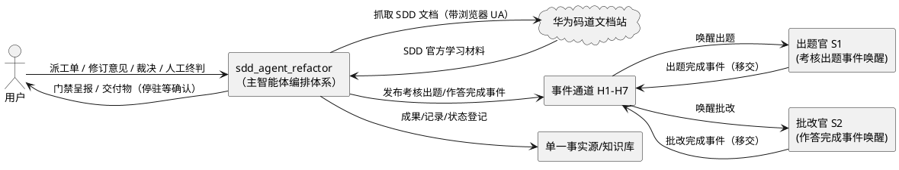
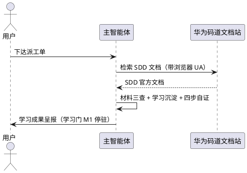
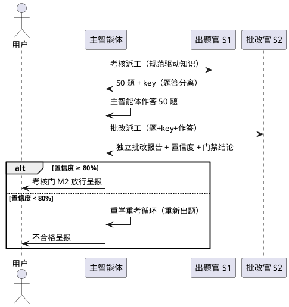
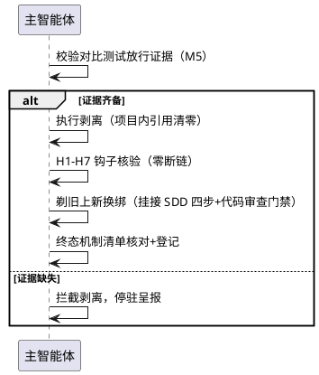
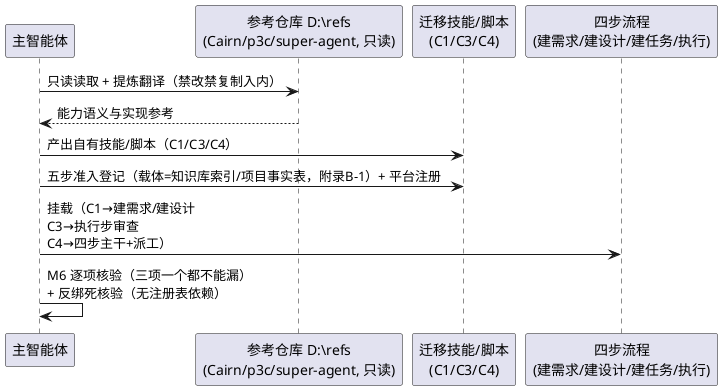
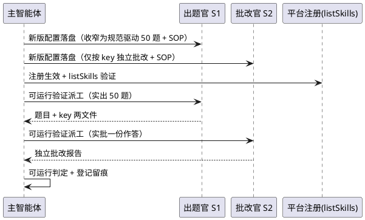
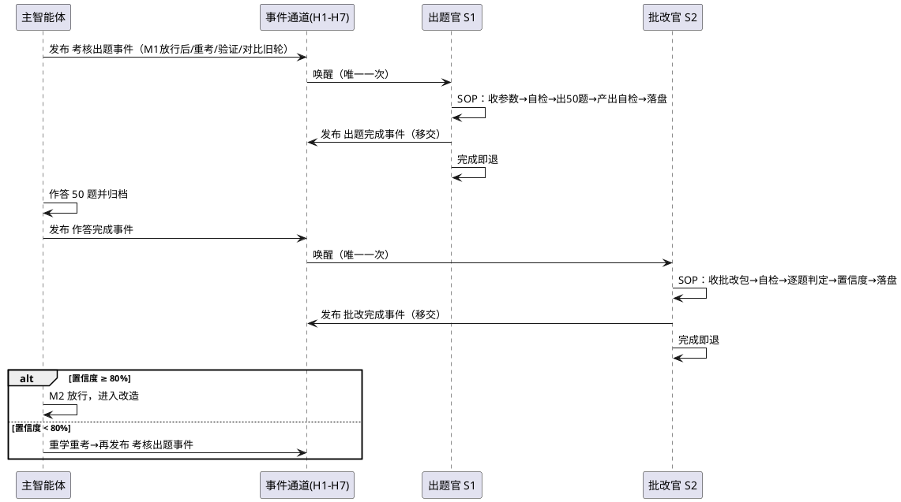
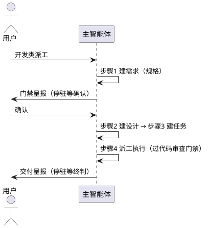
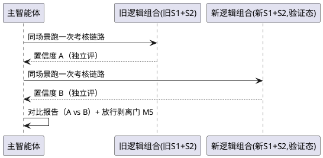
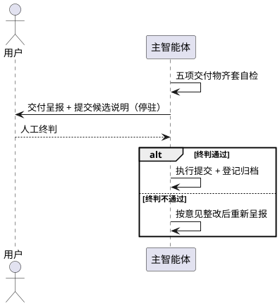

# 规范驱动接入与两智能体改造 —— 需求规格

> 特性名：sdd_agent_refactor ｜ 版本：v5 ｜ 日期：2026-11-08 ｜ 状态：待用户审阅（v5 极简修订）
> 上游依据：派工单《规范驱动接入与两智能体改造》（2026-11-07）+ 项目协作公约 6 条（规矩层冻结）+ 用户意见 U1–U3（2026-11-07 语音转写）+ 用户意见 U4（2026-11-07 文字补充：剥壳保本事·能力迁移）+ 用户意见 U5（2026-11-07 文字：注册表不需要·整体剥离·反绑死）+ 用户意见 U6（2026-11-08 文字：极简七条——5 题/40 分钟/随时学/取消对比/留档/人工终改/违一即停）
> v2 修订说明：① 新增 5.5「子智能体触发时机与作业 SOP」（事件驱动闭环，承接 U1/U2）；② 强化 5.3「剃旧与上新先后绑定」（承接 U3）；③ 原 5.5–5.8 顺延为 5.6–5.9；④ 附录 A 增 U1–U3 映射，附录 B 增 B6
> v3 修订说明（承接 U4）：① 新增 5.4「能力迁移（剥壳保本事）」——四项能力（C1 Cairn 查询/蒸馏、C2 注册表路由、C3 P3C 审查、C4 Super Agent 编排模式）按「来源→能力描述→翻译产物形态→挂载到四步哪一步→验收核验点」逐项 EARS 条款化并附对照表；原 5.4–5.9 顺延为 5.5–5.10；② 5.3 更新「剥壳保本事」原则（新增 R9），M6 剥离门放行条件追加「四项能力迁移核验全过，一个都不能漏」；③ 交付物由四项扩为五项（追加「能力迁移核验记录」，新增 6.6 数据约束）；④ 附录 B1 依据 U4 闭合（壳子剥离、能力保留）；⑤ 附录 A 增 U4 映射行
> v4 修订说明（承接 U5，推翻 v3 的 B1 闭合）：① 注册表整体剥离（本体+挂载项+路由能力一并清除），路由能力不再迁移、不设 C2 迁移项，能力清单由四项收窄为三项（C1/C3/C4，保留编号缺口并注明 C2 已取消）；② 反绑死原则条款化（5.4 R2 改写为「C2 取消与反绑死规则」）：新逻辑任一环节不得依赖注册表存在，原由注册表承载的机制改由规范驱动流程自身、既有事件通道（H1–H7）+ 文件系统直读（动态加载预设）与知识库索引/项目事实表（五步准入登记载体预设）承载，禁引入新注册表变体（预设方案见附录 B-1）；③ 同步修订：5.1 R3、5.3 R1/R9、5.3.3-2、5.4 R0/R2/R6/R7/对照表/流程图/异常、5.9 R1-⑤、5.10 M6、6.6、术语表（自研注册表整体剥离口径、路由能力标注失效、三项能力）；④ 附录 B1 重新闭合、B6 加不受 U5 影响注；⑤ 附录 A 增 U5 映射行并更新 U4/③ 行
> v5 修订说明（承接 U6 七条，2026-11-08，减法为主的最小变更集）：① **全局题量注记**：正文所有"50 题"条款值自 U6 起改为 **5 题**，适用于今后的考核轮/重学重考轮；M2 已放行的 50 题轮（R1 98%、V1 100%）为既成事实，不追溯、不回溯改判（正文条款值不逐处改写，统一以本注记+5.11 生效）；② M5 对比门取消（OLD/NEW 对比不再执行），其"M6 硬前置"职能由 U6 指令放行替代；③ 总耗时硬限 40 分钟 + TIMEOUT.md 超时自停留档；④ 学习时机改"需求阶段先学 + 干中遇阻随时学（不阻断主流程），禁事后学"；⑤ 新增 5.11「U6 极简执行纪律」（七条逐条 EARS 简条）；⑥ M7 交付追加 SPEC_OPTIMIZATION.md 留档项（最终产出代码块）；⑦ 规则文件（SKILL.md/.mdc）改人工最终修改、AI 仅提建议（已直改的 5 项列待人工复核清单，不回滚）；⑧ 附录 A 增 U6 行，附录 B 全部闭合（B2–B6 按 U6 极简口径：按预设执行或随取消项失效，不再裁决）
> 约束覆盖映射见附录 A；待用户裁决事项见附录 B（v5：B1–B6 全部闭合，不再裁决）

# 1. 组件定位

## 1.1 核心职责
本组件负责将主智能体的工作流程切换为规范驱动开发（SDD）四步模式，并把出题官、批改官两个子智能体改造为规范驱动考核专用（含各自的事件驱动触发时机与标准作业程序 SOP），实现"先学习、考核合格才干活、先四步再派工、门禁不过不收工、不剃老逻辑不放行新逻辑"的受控演进，以及"剥壳保本事"的旧机制退出（图框架壳子全剥、三项能力全迁；注册表整体剥离、路由能力不迁移、新逻辑反绑死注册表）。

## 1.2 核心输入
1. 派工单（用户下达）：《规范驱动接入与两智能体改造》全文，含学习方向、考试门槛、旧逻辑剥离、两智能体改造、测试要求、交付清单六部分。
2. 用户修订意见 U1–U3（2026-11-07 语音转写）：U1/U2 两子智能体须明确 SOP 与事件驱动触发时机；U3 剃旧与换新逻辑先后绑定。
3. 用户补充意见 U4（2026-11-07 文字）：旧框架全剥但"本事"全留——Cairn 查询/蒸馏、注册表路由、P3C 审查、Super Agent 编排模式四项能力全部翻译为规范驱动可调用的技能/脚本并挂到四步流程，"老壳子扔了，本事留着，新逻辑里一个都不能漏"。【v4 注：其中"注册表路由"一项已由 U5 取消，能力清单收窄为三项 C1/C3/C4】
4. 用户修订意见 U5（2026-11-07 本轮文字）："注册表不需要，按照规范驱动开发的流程来做，不允许绑死这玩意"——注册表整体剥离（本体+能力一并清除，路由能力不迁移、不设 C2 迁移项）；新逻辑（SDD 四步流程）任一环节不得依赖注册表存在（反绑死），禁引入新注册表变体。派工单"三、旧逻辑剥离：去掉旧两个框架（图框架、自研注册表）"与本意见方向一致（全剥）。
5. 只读参考仓库（能力翻译来源，用户截图实证，2026-11-07）：`D:\refs\Cairn`（C1 查询/蒸馏）、`D:\refs\p3c`（C3 审查）、`D:\refs\deepseek-super-agent`（C4 编排模式）。【v4 注：原 v3 所列"C2 路由能力来源=项目内自研注册表"已随 U5 取消】
6. 华为码道文档站的规范驱动开发官方文档（外部学习材料）。
7. 现行两子智能体配置：`.codeartsdoer/agents/examiner.md`（出题官 S1）、`.codeartsdoer/agents/grader.md`（批改官 S2）。
8. 现行机制状态（单一事实源 `notes/项目事实表.md`）：事件钩子 H1–H7 三类通道、技能注册清单、考核门禁惯例值（综合置信度 ≥80%）。

## 1.3 核心输出
1. SDD 学习成果沉淀：学习材料清单 + 学习成果条目（登记知识库）。
2. 50 题考核记录四件套：题目文件 + key 文件 + 作答文件 + 独立批改报告（落 specs 同目录）。
3. 改造后的两子智能体配置（新版 examiner.md / grader.md）及平台注册实证。
4. 新旧逻辑对比评分结果：两份独立置信度 + 对比报告。
5. 旧框架剥离核对清单与终态机制清单。
6. 可正常运行的新逻辑派工能力：主智能体按 SDD 四步编排派工的全链路证据。
7. 子智能体触发事件定义与 SOP 步骤序列（考核出题/出题完成/作答完成/批改完成四事件清单 + 各自作业闭环步骤），及每次触发/移交的事件留痕。（用户意见 U1/U2）
8. 三项能力迁移产物（C1/C3/C4 技能/脚本，经五步准入登记 + 平台注册；登记载体预设见附录 B-1）+ 能力迁移核验记录（含三项能力与四步流程的挂载映射、逐项核验结论；C2 已由 U5 取消）。（用户意见 U4，U5 修正）

## 1.4 职责边界
本特性不负责：
1. 不修改项目协作公约（规矩层冻结，公约零改动；冲突一律升裁决）。
2. 不承担具体开发任务的 SDD 四步产物编写与实现——本特性只交付"会用四步、按四步编排"的能力与验证。
3. 不修改、不移动、不删除 `D:\refs\` 隔离区内的仓库实体（项目外目录，处置权在用户）；对其只读访问与能力提炼翻译属于本特性职责（见 5.4），翻译提炼产出的新技能/脚本文件属本项目自有产物、允许落在项目内（此为"禁复制入内"与"自有产物落盘"的明确区分）。
4. 不启用任何自建定时任务（一切触发走事件）。
5. 不产出 design.md / tasks.md（由后续阶段代理负责）。
6. 不删除、不启用 test_mini 子智能体（维持禁用留存现状）。

# 2. 领域术语

**规范驱动开发（SDD，Spec-Driven Development）**
: 一种以规格文档为先导的软件开发方法，要求先建需求规格、再建技术设计、再建任务清单、最后执行实现，四个阶段顺序推进、禁跳阶段。

**SDD 四步**
: 规范驱动开发的四个阶段动作：建需求、建设计、建任务、执行。本特性要求主智能体学完后能独立走通这四步。

**出题官（S1，examiner）**
: 持久化子智能体，改造后唯一职能是按规范驱动知识出考核题（总量固定 50 题，覆盖记忆/理解/应用三级认知），题目与答案要点分离交付；仅响应"考核出题事件"被唤醒，完成即退。

**批改官（S2，grader）**
: 持久化子智能体，改造后唯一职能是按标准答案（key 文件）独立批改作答，输出逐题判定、综合置信度与门禁结论；禁与执行代理协商改分，禁受主智能体倾向暗示；仅响应"作答完成事件"被唤醒，完成即退。

**触发时机**
: 子智能体被唤醒执行作业的唯一合法条件：一个具名事件（如考核出题事件）的发布。触发时机必须事件驱动，禁止定时/轮询。（用户本轮意见 U1/U2 引入）

**SOP（标准作业程序）**
: 子智能体被事件唤醒后必须按固定顺序执行完毕的步骤序列，含接收参数、前置自检、核心作业、产出自检、落盘交付、发布完成事件并移交六个环节；SOP 步骤中断则本轮作业作废。（用户本轮意见 U1/U2 引入）

**考核出题事件**
: 主智能体在 M1 放行后发起正式考核、重学重考、可运行验证或对比测试旧逻辑轮时发布的事件，是出题官的唯一唤醒信号。

**作答完成事件**
: 主智能体完成一轮 50 题作答并归档后发布的事件，是批改官的唯一唤醒信号。

**考核门禁**
: 主智能体获得"干活资格"的前置关卡：50 题考核的独立批改结论达到合格线才放行；未达线触发重学重考，禁止进入后续任何阶段。

**置信度评分**
: 批改官按逐题判定（PASS/PARTIAL/FAIL）汇总出的综合自信度百分数（0–100），是门禁判定与新旧逻辑对比的量化依据。

**旧逻辑**
: 改造前的机制组合：旧版出题官/批改官（按任意学习材料清单出题的通用考核模式）+ 图框架 + 自研注册表等现行框架机制。

**新逻辑**
: 改造后的机制组合：规范驱动四步 + 专用考核门禁（50 题独立批改）+ 代码审查门禁，且不再挂接图框架与自研注册表（旧壳子承载的三项能力已按 5.4 迁移入新逻辑；注册表整体剥离、路由能力不迁移，新逻辑任一环节不得依赖注册表存在——反绑死，U5）。新逻辑在剥离验收通过前仅处于对比/验证运行态，剥离换绑完成后方为正式主干逻辑。

**图框架**
: 现行知识图谱类框架机制；预设指认为 Cairn（mcp_settings.json 的 cairn-mcp 注册条目与项目内相关引用）。该指认为预设方案，见附录 B-2 裁决项。

**自研注册表**
: 现行项目自建的能力注册机制（`notes/注册表.md`：抽象模板层 + 挂载项 + 新功能五步准入登记）。整体剥离：本体、旧挂载路径、旧脚本入口及其承载的路由能力一并清除，无迁移保留项、不设 C2（v4 依用户意见 U5 重新闭合，见附录 B-1）；其承载的五步准入登记流程不随壳消亡，改由知识库索引/项目事实表承载（预设方案见附录 B-1）。新逻辑任一环节不得依赖注册表存在，禁止引入任何新注册表变体（反绑死原则，U5）。

**代码审查门禁**
: 编码必审机制（review-code 技能 + P3C 规约审查），审查未通过的代码变更不得宣布完工（公约第 6 条）。本特性中的保留对象。

**重学重考**
: 考核未达合格线时的强制循环：主智能体回到学习阶段补学 → 重新发布考核出题事件 → 出题官重新出题 → 重新作答 → 批改官重新独立批改，直至合格；每轮记录独立留痕。

**剃旧上新换绑**
: 剥离验收通过后，将新逻辑挂接为唯一主干机制的同批动作；换绑完成前新逻辑不得转正，换绑完成后旧逻辑不得复活。（用户意见 U3 引入）

**能力迁移（剥壳保本事）**
: 剥离旧框架时执行的同批动作：剥离框架"壳子"（框架本体、旧挂载路径、旧脚本入口），同时把壳子承载的核心能力（注册表除外——依 U5 整体剥离、路由能力不迁移）全部翻译为规范驱动四步流程可调用的技能/脚本并挂载到四步流程——老壳子扔了，本事留着。（用户意见 U4 引入，U5 修正范围）

**三项能力（C1/C3/C4）**
: 本特性要求迁移保留的三项核心能力：C1 Cairn 查询/蒸馏能力、C3 P3C 审查能力、C4 Super Agent 编排模式。验收时逐项核验，漏一项即剥离门不放行。（用户意见 U4 引入；v4 注：编号保留 v3 缺口——C2 注册表路由能力已由用户意见 U5 取消，注册表整体剥离、路由能力不迁移）

**参考仓库（D:\refs）**
: 存放于项目外隔离目录 `D:\refs` 的三个只读参考仓库（Cairn、p3c、deepseek-super-agent），是 C1/C3/C4 三项能力的翻译来源；只允许读取、提炼、翻译，禁止修改仓库实体、禁止 submodule/嵌套/整仓复制入项目；翻译产出的新技能/脚本属本项目自有产物，允许落在项目内。（用户意见 U4 引入）

**路由能力（已失效条目，U5）**
: 【v3 原定义，仅作历史留痕】自研注册表承载的"按当前步骤/任务需要定位并分发到对应技能、规矩文件与记忆指针"的能力。【v4 失效标注】自用户意见 U5 起本条目失效：注册表整体剥离，路由能力不再迁移（C2 取消）；原动态加载职能改由既有事件通道（H1–H7）与文件系统直读承载，见 5.1 R3 与附录 B-1。本术语不得在新逻辑中引用实现。

# 3. 角色与边界

## 3.1 核心角色
用户：下达派工单与修订意见、裁决待决事项（附录 B）、终判提交版本；唯一验收人。
主智能体（执行代理）：本特性的执行与编排者——学习 SDD、参加考核、执行两智能体改造、组织对比测试、执行剃旧上新换绑、走门禁收工；改造后作为新逻辑的常任编排者与四个考核事件的唯一发布方。
出题官（S1）：子智能体，仅由"考核出题事件"唤醒，按 SOP 出规范驱动 50 题。
批改官（S2）：子智能体，仅由"作答完成事件"唤醒，按 SOP 独立批改。

## 3.2 外部系统
华为码道文档站：SDD 官方文档唯一指定来源；存在 UA 检测（须携带浏览器 UA 访问，2026-11-07 实证见项目事实表）。
平台技能/子智能体注册（listSkills）：两智能体改造后须重新注册生效并验证可查。
知识库与单一事实源：学习成果、考核记录、对比结果、剥离核对须登记（知识库索引 + 变更日志），核心状态写项目事实表。
事件通道（H1–H7 三类通道）：承载两子智能体全部触发与移交事件（映射见附录 B-6）。
经验库 hook：自动检索注入生效；本特性过程经验按现行反思机制沉淀。

## 3.3 交互上下文

# 4. DFX 约束

## 4.1 性能
1. 学习阶段对文档站的每次抓取请求应当在 60 秒内得到响应或判定失败；失败按异常场景降级，禁止无限重试。
2. 其余性能指标（考核全链路时长等）：待定（无硬性要求，不人为设限）。

## 4.2 可靠性
1. 门禁状态迁移必须留痕：每个门禁的放行/未过判定须有证据文件链接，缺证据的迁移无效。
2. 项目核心状态变化（注册状态、剥离进度等）只写单一事实源（`notes/项目事实表.md`）一处，其他文档活引用。
3. 冲突裁决顺序固定为：规则文件 > 知识库最新文档 > 记忆偏好 > 自行推断，且每次仲裁必须报告用户并留痕。
4. 子智能体每次事件触发与移交必须有事件留痕（事件名、轮次标识、时间戳、产物指针）；缺留痕的作业轮次视为无效轮。（承接 U1/U2）

## 4.3 安全性
1. key 文件（标准答案）只能交付主智能体，禁止泄露给执行代理会话（考教分离红线延续）。
2. 批改独立性红线：批改期间禁止与执行代理协商、禁止接受任何倾向性暗示改分（不打协商分）。
3. 文档站抓取零凭据：不得引入任何 API key 或账号凭据。

## 4.4 可维护性
1. 本特性产生的知识库增删改必须登记知识库索引 + 变更日志（日期+条目+动作+触发来源）。
2. 新编排流程一律分装技能并走五步准入登记（查重归类→配置生成→登记→留痕；登记载体预设为知识库索引 + 项目事实表——注册表已整体剥离，不设注册表登记载体，见附录 B-1），禁止散落为无登记脚本。
3. 两智能体触发必须走事件（考核出题事件 / 作答完成事件），禁止定时任务、轮询与常驻监听自建组件；SOP 步骤序列与事件定义以 5.6 为准。

## 4.5 兼容性
1. 项目协作公约 6 条零改动；本特性所有条款不得与公约冲突，潜在冲突须升用户裁决（见附录 B-1）。
2. test_mini 子智能体维持禁用留存状态（disable=true），不删除、不启用。
3. 剥离动作不得破坏现行事件钩子 H1–H7 三类通道结构；剥离后须核验钩子链零断链。
4. 换绑完成后旧逻辑不得以任何形式复活（禁回挂、禁双轨常驻）；对比测试所需旧版配置仅允许在临时目录以验证态运行（见 5.8.3-1）。

# 5. 核心能力

## 5.1 规范驱动学习

### 5.1.1 业务规则
1. **学习材料来源规则**：当主智能体进入学习阶段时，系统应当以华为码道文档站的规范驱动开发官方文档为学习材料，且材料须先过三查（来源权威性 / 内容保真 / 时效核验）再引用。
a. 验收条件：[材料未经三查] → [禁止进入学习沉淀、禁止引用]；
b. 验收条件：[材料清单落盘] → [每条材料带来源指针与核验日期]。
2. **四步能力规则**：当学习阶段完成时，主智能体应当能独立走通 SDD 四步（建需求→建设计→建任务→执行），并以一次四步自证产出作为学习完成证据。
a. 验收条件：[要求演示四步] → [四阶段产物齐备且顺序无跳步]。
3. **动态加载规则**：当主智能体执行 SDD 任一步骤时，系统应当能通过现行事件通道（H1–H7）动态加载所需技能（脚本）、规矩文件与记忆指针，无需用户手动注入；该定位过程不得依赖注册表（反绑死，U5），预设由既有事件通道 + 文件系统直读承载（预设方案见附录 B-1）。
a. 验收条件：[进入任一步骤] → [对应技能/规矩/记忆可被加载且被产物引用]。
4. **参考仓库隔离规则**：当学习过程需要克隆任何参考仓库时，系统应当将仓库存放于项目外隔离目录（D:\refs\），禁止 submodule/嵌套/复制入项目。
a. 验收条件：[任一克隆动作] → [仓库实体仅在项目外目录且项目内无副本]。
5. **禁止项**：禁止在学习门未放行时启动考核与改造（新框架先学后干，学不会不干）。
a. 验收条件：[M1 未放行] → [考核出题事件不发布，出题官不被唤醒，改造动作不启动]。

### 5.1.2 交互流程

### 5.1.3 异常场景
1. **文档站访问失败**
a. 触发条件：抓取请求失败或超时（UA 被拦、网络异常）。
b. 系统行为：按已实证经验携带浏览器 UA 重试；最多修复尝试 3 次，仍失败则降级为替代官方来源并登记未决事项。
c. 用户感知：呈报降级决定与替代来源清单，等用户裁决。
2. **材料三查不通过**
a. 触发条件：材料来源不可核验、内容失真或不符合口径（非大厂高引用官方文档）。
b. 系统行为：淘汰该材料并记录淘汰原因，寻找替代材料。
c. 用户感知：材料清单呈现淘汰记录与替代方案。
3. **四步自证失败**
a. 触发条件：主智能体无法产出齐备的四步产物或出现跳步。
b. 系统行为：回到学习阶段补学，M1 不放行。
c. 用户感知：呈报缺口清单与补学计划。

## 5.2 考核门禁

### 5.2.1 业务规则
1. **出题总量规则**：当主智能体发起考核派工时，出题官应当一次产出恰好 50 道规范驱动知识题，题目覆盖记忆、理解、应用三级认知（结构划分见附录 B-4）。
a. 验收条件：[题目文件交付] → [题数=50，三级认知均覆盖且逐题可归类]。
2. **题答分离规则**：当出题完成时，出题官应当交付题目文件与答案要点（key）文件两个独立文件，且 key 与题目逐题对应。
a. 验收条件：[两文件交付] → [可逐题对照，答案不得混入题目文件]。
3. **合格线规则**：当批改官完成批改时，系统应当按综合置信度判定考核是否合格；预设合格线=80%（沿用现行门禁惯例，见附录 B-3）。
a. 验收条件：[置信度≥80%] → [考核门放行，主智能体获得干活资格]；
b. 验收条件：[置信度<80%] → [不放行，触发重学重考]。
4. **重学重考规则**：当考核未达合格线时，主智能体应当回到学习阶段补学并重新走完整考核链路（重新发布考核出题事件→重新出题→重新作答→重新独立批改），禁止沿用旧题免考放行。
a. 验收条件：[任一轮不合格] → [下一轮为重新出题，且每轮批改报告独立留痕]。
5. **独立批改规则**：当批改进行时，批改官应当只依据 key 标准答案逐题判定，禁止与执行代理协商分数、禁止接受主智能体倾向性暗示（不打协商分）。
a. 验收条件：[批改报告产出] → [每题判定仅援引 key 依据，无协商记录、无改分痕迹]。
6. **禁止项**：禁止在考核门未放行时执行智能体改造、剥离或任何正式派工。
a. 验收条件：[M2 未放行却出现后续动作] → [判定违规，回退到考核环节]。

### 5.2.2 交互流程
> 触发与移交事件见 5.6；本图聚焦考核链路的门禁判定分支。

### 5.2.3 异常场景
1. **作答与题目无法对应**
a. 触发条件：作答文件题号/顺序与题目文件无法匹配。
b. 系统行为：批改官中止批改，上报主智能体核对归档。
c. 用户感知：呈报缺失项，补齐后重新批改。
2. **key 泄露风险**
a. 触发条件：key 内容出现在执行代理可见会话或共享文件中。
b. 系统行为：本轮考核作废，重新出题重考，并登记泄露事件。
c. 用户感知：呈报作废原因与重考安排。

## 5.3 旧逻辑剥离

### 5.3.1 业务规则
1. **剥离对象规则（剥壳保本事）**：当剥离阶段启动时，系统应当剥离旧两个框架的"壳子"——图框架（预设指认 Cairn，见附录 B-2）与自研注册表（整体剥离：本体+挂载项+路由能力一并清除，无迁移保留项；处置口径见附录 B-1，v4 依用户意见 U5 重新闭合），实现项目内引用清零；图框架壳子承载的能力不随壳剥离，按 5.4 逐项迁移保留（三项 C1/C3/C4）。
a. 验收条件：[项目内全量检索旧框架挂载点] → [mcp 注册条目、脚本挂载、现行机制文档引用均为零（档案区只读历史记录除外，见规则 4）]。
2. **不留路径不挂旧脚本规则**：当剥离完成时，系统应当确保项目工作区内无旧框架可执行路径、无旧脚本挂载（事件钩子、配置、技能引用均不指向旧框架）。
a. 验收条件：[事件钩子 H1–H7 全链路核验] → [零断链、零旧脚本触发]。
3. **终态机制清单规则**：当剥离完成后，系统应当仅保留规范驱动四步与代码审查门禁作为主干机制，形成终态机制清单并登记。
a. 验收条件：[终态清单核对] → [清单外机制全部有剥离去向记录（移除/归档/迁移）]。
4. **档案留存例外规则**：当剥离涉及现行知识库条目时，系统应当采用"索引状态标记 + 档案留存"方式处理历史记录，禁止篡改或删除既有事实表与变更日志的历史行。
a. 验收条件：[任一历史记录] → [原值可追溯，剥离动作以新行追加留痕]。
5. **顺序硬门禁规则**：当新旧对比测试未放行时，系统禁止执行剥离动作（先对比后剥离）。
a. 验收条件：[剥离动作尝试] → [无 M5 放行证据则被拦截并停驻]。
6. **禁止项**：禁止剥离编码必审机制（review-code + P3C 审查能力，经 5.4 C3 迁移承载）与 SDD 四步承载机制——两者是保留对象。
a. 验收条件：[剥离清单核对] → [两者不在剥离对象之列且功能核验可用]。
7. **剃旧上新换绑规则**（用户本轮意见 U3）：当剥离验收通过时，系统应当立即将规范驱动新逻辑（SDD 四步 + 代码审查门禁）挂接为唯一主干机制，实现"剃旧"与"上新"同批换绑；换绑完成前，新逻辑仅处于对比/验证运行态，不得作为正式逻辑使用。
a. 验收条件：[剥离门 M6 放行] → [终态机制清单=新逻辑 且 旧框架挂载点为零，两项同批核验通过]；
b. 验收条件：[新逻辑被用作正式逻辑] → [此前必有 M6 放行证据，否则判定违规回退]。
8. **不放行绑定规则**（用户意见 U3）：当剥离未完成验收时，系统禁止放行新逻辑收工——交付门 M7 以剥离门 M6 放行为硬前置（不剃老逻辑不放行新逻辑）。
a. 验收条件：[M6 无放行证据而请求交付] → [M7 拒绝受理，任务保持未收工并停驻]。
9. **剥壳保本事能力迁移规则**（用户意见 U4，U5 修正）：当剥离任一旧框架壳子时，系统应当同步执行能力迁移——三项能力（C1 Cairn 查询/蒸馏、C3 P3C 审查、C4 Super Agent 编排模式；C2 注册表路由已由 U5 取消，注册表整体剥离、能力不迁移）全部翻译为规范驱动可调用的技能/脚本并挂载到四步流程，剥离与迁移同批验收，三项一个都不能漏。
a. 验收条件：[M6 放行判定] → [三项能力迁移核验记录齐备（5.4 对照表）且逐项通过，漏任一项即不放行]；
b. 验收条件：[任一壳子被剥离] → [图框架承载能力在迁移清单中登记了去向（产物名 + 挂载步骤）；注册表承载能力登记"整体剥离、不迁移"结论（U5）]。

### 5.3.2 交互流程

### 5.3.3 异常场景
1. **剥离致钩子断链**
a. 触发条件：剥离某挂载点后 H1–H7 链路核验出现断链。
b. 系统行为：立即以别名/迁移守卫方式回补并重核，直至零断链。
c. 用户感知：断链点与修复方式留痕呈报。
2. **剥离对象与公约保护机制重叠**
a. 触发条件：剥离对象承载公约第 4 条要求的五步准入登记（自研注册表）。
b. 系统行为：按附录 B-1 v4 重新闭合方案执行（依据用户意见 U5：注册表整体剥离、路由能力不迁移、不设迁移项；五步准入登记改由知识库索引/项目事实表承载，动态加载改由事件通道 + 文件系统直读承载，见 5.4 R2/R6），差异呈报。
c. 用户感知：闭合依据与差异项显式呈报，用户可推翻重裁。
3. **换绑挂接失败**（用户本轮意见 U3）
a. 触发条件：旧框架引用清零后，新逻辑挂接核验失败（四步或代码审查门禁不可用）。
b. 系统行为：M6 不放行，保持清零状态并回补新逻辑挂接，重核通过后再放行。
c. 用户感知：呈报挂接失败项与回补计划。

## 5.4 能力迁移（剥壳保本事，用户意见 U4）

### 5.4.1 业务规则
0. **剥壳保本事总则**（用户意见 U4，U5 修正）：当剥离旧框架壳子时，系统应当将其承载的核心能力全部翻译为规范驱动可调用的技能/脚本并挂载到四步流程——老壳子扔了，本事留着；迁移范围以下表 C1/C3/C4（三项）为准，验收逐项核验、一个都不能漏；C2 已由 U5 取消（保留编号缺口并注明，见对照表注与 R2）。
a. 验收条件：[任一壳子被剥离] → [图框架对应能力条目在 5.4 对照表中登记产物形态与挂载步骤；注册表剥离则登记整体剥离结论（无迁移项，见 5.4 R2）]；
b. 验收条件：[三项能力任一未被翻译/未挂载/未登记] → [剥离门 M6 不放行]。

**能力迁移对照表（验收逐项打钩，漏一即 M6 不放行；v4 注：C2 注册表路由能力已由用户意见 U5 取消——注册表整体剥离、能力不迁移，编号缺口保留）**：

| # | 能力 | 来源 | 能力描述 | 翻译产物形态 | 挂载到四步哪一步 | 验收核验点 |
|---|------|------|---------|-------------|-----------------|-----------|
| C1 | 查询/蒸馏 | `D:\refs\Cairn`（只读） | 面向知识/文档的查询检索与要点蒸馏提炼 | 技能/脚本 | 建需求（主用：参考资料查询与需求素材蒸馏）+ 建设计（辅用） | 产物经五步准入注册可查；调用产出蒸馏结果；来源指针可追溯；无整仓复制入项目 |
| C3 | 审查 | `D:\refs\p3c`（只读） | 规约审查（编码必审的审查能力） | 技能/脚本 | 执行步（第 4 步的代码审查门禁环节，与 5.3 R6 保留对象对齐） | 审查技能可被调用并输出审查结论；与代码审查门禁同一承载、无双轨并存 |
| C4 | 编排模式 | `D:\refs\deepseek-super-agent`（只读） | 任务分解→子任务派发→结果汇总的编排范式 | 技能/脚本 | 四步主干（第 1–4 步的阶段编排）+ 执行步派工（与 5.7 对齐） | 编排技能可被调用；派工动作可追溯至该技能留痕 |

1. **C1 查询/蒸馏迁移规则**（用户意见 U4）：当图框架壳子（预设指认 Cairn）被剥离时，系统应当把 Cairn 的查询/蒸馏能力翻译为规范驱动可调用的技能/脚本，并挂载到建需求（主）/建设计（辅）步。
a. 验收条件：[剥离 Cairn 壳子完成] → [C1 产物已注册且在四步流程中可被调用]；
b. 验收条件：[核验来源] → [能力可追溯至 `D:\refs\Cairn` 对应实现，项目内无该仓库整仓副本]。
2. **C2 取消与反绑死规则**（用户意见 U5，v4）：注册表路由能力不再迁移（C2 取消，编号缺口保留）；当新逻辑（SDD 四步流程）任一环节运行时，系统应当保证该环节不依赖注册表存在（反绑死），原由注册表承载的机制改由规范驱动流程自身、既有事件通道与知识库承载，禁止引入任何新注册表变体。预设承载方案（附录 B-1）：①动态加载（原路由职能）→既有事件通道（H1–H7）+ 文件系统直读（技能/规矩/记忆按约定路径定位）；②五步准入登记载体→知识库索引 + 项目事实表登记（符合公约第 6 条单一事实源）。
a. 验收条件：[新逻辑任一环节运行] → [调用链无注册表读取/依赖痕迹（注册表路径与引用检索为零）]；
b. 验收条件：[出现动态加载需求] → [由事件通道 + 文件系统直读完成，调用链无注册表中间层]；
c. 验收条件：[任一新流程产物落盘] → [不含注册表形态新组件（禁新注册表变体）]；
d. 验收条件：[五步准入登记执行] → [登记在知识库索引/项目事实表留痕可查，公约第 4 条不失效]。
3. **C3 审查迁移规则**（用户意见 U4）：当执行剥离时，系统应当把 P3C 的审查能力翻译为规范驱动可调用的技能/脚本，与代码审查门禁对齐挂载到执行步，保持编码必审闭环（审查未过不完工）。
a. 验收条件：[执行步产生代码变更] → [C3 技能可被调用并输出审查结论，未过不完工]；
b. 验收条件：[审查承载核对] → [C3 与代码审查门禁同一承载，无双轨并存]。
4. **C4 编排模式迁移规则**（用户意见 U4）：当旧编排壳子被剥离时，系统应当把 Super Agent 的编排模式翻译为规范驱动可调用的技能/脚本，与主智能体编排流程对齐挂载（四步主干 + 执行步派工）。
a. 验收条件：[主智能体走四步编排] → [C4 技能可被调用且派工动作可追溯]。
5. **参考仓库只读翻译规则**（用户意见 U4）：当能力翻译过程读取 `D:\refs` 参考仓库时，系统应当只读取、提炼、翻译，禁止修改参考仓库实体、禁止 submodule/嵌套/整仓复制入项目；翻译产出的新技能/脚本文件属本项目自有产物，允许落在项目内。
a. 验收条件：[任一参考仓库访问] → [仓库实体零改动，项目内无整仓副本]；
b. 验收条件：[翻译产物落盘] → [产物为本项目自有新文件，带来源指针（D:\refs 相对路径）与准入登记记录]。
6. **迁移产物准入规则**：当任一能力迁移产物以技能形态落地时，系统应当按公约第 4 条走五步准入登记（查重归类→配置生成→登记→留痕；登记载体预设为知识库索引 + 项目事实表——注册表已整体剥离，不设注册表登记载体，见附录 B-1），禁止散落为无登记脚本。
a. 验收条件：[任一迁移技能启用] → [平台注册可查（listSkills）+ 登记留痕完成]。
7. **逐项核验红线规则**（用户意见 U4，U5 修正）：当剥离门 M6 判定时，系统应当对 C1/C3/C4 三项逐项核验（来源→产物→挂载步骤→调用可用），漏一项即不放行——"新逻辑里一个都不能漏"。
a. 验收条件：[C1/C3/C4 核验记录齐备且全部通过] → [该项放行条件满足]；
b. 验收条件：[任一项缺失/未挂载/调用失败] → [M6 不放行，回补迁移后重核]。

### 5.4.2 交互流程

### 5.4.3 异常场景
1. **能力翻译失真**
a. 触发条件：迁移产物行为与参考仓库实现语义不一致（漏译/错译）。
b. 系统行为：对照参考仓库只读复核，修正产物后重新登记与核验。
c. 用户感知：呈报偏差项与修正记录。
2. **能力迁移遗漏**
a. 触发条件：M6 核验发现 C1/C3/C4 三项中任一项无产物、无挂载或调用失败。
b. 系统行为：M6 不放行，回补迁移后重核；禁止放行缺项的新逻辑。
c. 用户感知：呈报缺失项与回补计划。
3. **参考仓库不可读**
a. 触发条件：`D:\refs` 某仓库缺失/损坏/被占用，无法完成能力提炼。
b. 系统行为：停止该能力迁移，登记未决并停驻呈报；禁止自行改动隔离区仓库。
c. 用户感知：呈报受影响能力项（C1/C3/C4）与待用户处置事项。

## 5.5 两智能体改造

### 5.5.1 业务规则
1. **出题官收窄规则**：当出题官改造完成时，系统应当将其出题范围收窄为"仅出规范驱动知识 50 题"，禁止出其他领域题目。
a. 验收条件：[改造后出题派工] → [题目 100% 属规范驱动知识且总量=50；非该范围请求被拒绝并上报]。
2. **批改官收窄规则**：当批改官改造完成时，系统应当将其批改依据收窄为"仅 key 标准答案"，输出仅含逐题判定 + 置信度 + 门禁结论，禁止打协商分。
a. 验收条件：[改造后批改派工] → [批改报告无协商/折中分数，逐题判定均援引 key]。
3. **可运行验证规则**：当两智能体改造完成时，系统应当各以一次真实派工任务验证可运行（出题官实出 50 题；批改官实批一份作答并出报告）。
a. 验收条件：[各自验证完成] → [平台注册状态可查（listSkills）且产物落盘齐备]。
4. **流程分装规则**：当新考核编排逻辑固化时，系统应当分装技能并走五步准入登记，禁止以未登记脚本形式散落。
a. 验收条件：[新流程启用] → [对应技能平台注册可查且登记留痕完成]。
5. **事件触发规则**：当两智能体被调用时，系统应当仅通过事件触发（考核出题事件 / 作答完成事件），禁止定时任务触发；触发时机与 SOP 展开见 5.6。
a. 验收条件：[任一次调用] → [触发来源为事件通道，无定时任务痕迹]。
6. **保留红线规则**：当改造落地时，系统应当保留两智能体既有纪律红线（考教分离、批改独立性、完成即退、禁主动对话）。
a. 验收条件：[新版配置文件] → [红线条款原文语义保留且可核对]。

### 5.5.2 交互流程

### 5.5.3 异常场景
1. **改造后验证派工失败**
a. 触发条件：出题官题数≠50 或范围越界，或批改官报告缺项，或 SOP 步骤缺失。
b. 系统行为：判定改造未完成，退回修订配置后重验，禁止带病进入下一门禁。
c. 用户感知：呈报失败项与修订计划。
2. **平台注册不可见**
a. 触发条件：listSkills 查不到改造后的注册状态。
b. 系统行为：登记会话边界问题，待新会话重载后复验（沿用现行注册机制经验）。
c. 用户感知：呈报注册状态与复验计划。

## 5.6 子智能体触发时机与作业 SOP（用户意见 U1/U2）

### 5.6.1 业务规则
1. **出题官触发规则**：当"考核出题事件"发布时，出题官应当被唯一一次唤醒执行出题作业；触发时机限定为四种：①学习门 M1 放行后的正式考核；②任一轮重学重考；③改造后可运行验证；④对比测试旧逻辑轮。非上述事件不得唤醒出题官。
a. 验收条件：[考核出题事件发布] → [出题官被触发且仅触发一次]；
b. 验收条件：[无考核出题事件] → [出题官零调用，全链路无轮询/定时唤醒痕迹]。
2. **出题官 SOP 规则**：当出题官被考核出题事件唤醒时，系统应当按固定步骤序列完成作业闭环：①接收派工参数（知识域=规范驱动、题量=50、认知层级=记忆/理解/应用）→ ②自检前置条件（M1 已放行、无未闭环旧考核轮次）→ ③生成 50 题并题答分离 → ④产出自检（题数=50、三级覆盖、逐题与 key 对应）→ ⑤落盘交付题目文件与 key 文件 → ⑥发布"出题完成事件"移交主智能体，完成即退。
a. 验收条件：[任一次出题作业] → [六步顺序完整、逐步可追溯，产出两文件+完成事件]；
b. 验收条件：[步骤②自检失败] → [不出题，携带原因退回事件发布方]。
3. **出题官移交规则**：当出题完成事件发布后，出题官应当交还控制权并退出，禁止参与作答、批改、改造或任何后续环节。
a. 验收条件：[出题完成事件已发布] → [出题官无后续主动动作，移交留痕可查]。
4. **批改官触发规则**：当"作答完成事件"发布时，批改官应当被唯一一次唤醒执行批改作业；触发时机限定为一种：主智能体完成一轮 50 题作答并归档之后。非该事件不得唤醒批改官。
a. 验收条件：[作答完成事件发布] → [批改官被触发且仅触发一次]；
b. 验收条件：[无作答完成事件] → [批改官零调用，全链路无轮询/定时唤醒痕迹]。
5. **批改官 SOP 规则**：当批改官被作答完成事件唤醒时，系统应当按固定步骤序列完成作业闭环：①接收批改包（题目+key+作答三件）→ ②自检前置条件（三件齐备、题号一一对应、key 无泄露）→ ③逐题独立判定（仅援引 key，输出 PASS/PARTIAL/FAIL）→ ④汇总综合置信度与门禁结论 → ⑤落盘独立批改报告 → ⑥发布"批改完成事件"移交主智能体，完成即退。
a. 验收条件：[任一次批改作业] → [六步顺序完整、逐步可追溯，产出批改报告+完成事件]；
b. 验收条件：[步骤②自检失败] → [中止批改，不产出任何分数，携带原因退回]。
6. **批改官移交规则**：当批改完成事件发布后，批改官应当交还控制权并退出；主智能体按置信度分支接续：≥80% 进入 M2 放行与改造环节，<80% 发起重学重考（重新发布考核出题事件回到出题官）；批改官禁止参与改造、剥离、派工或改分。
a. 验收条件：[批改完成事件已发布] → [门禁结论被主智能体采纳留痕，批改官无后续主动动作]。
7. **事件通道承载规则**：出题官与批改官的全部触发与移交必须由现行事件通道承载（H1–H7 三类通道，通道映射见附录 B-6），全链路禁止定时任务、轮询与常驻监听自建组件。
a. 验收条件：[两智能体任一次作业] → [触发与移交均有事件留痕可查，通道核验无定时器]。

### 5.6.2 交互流程

### 5.6.3 异常场景
1. **事件发布后智能体无响应**
a. 触发条件：考核出题/作答完成事件已发布，但被唤醒方未响应或自检失败退回。
b. 系统行为：主智能体重发事件，最多 3 次；仍失败则登记未决并停驻呈报，禁止改为定时轮询兜底。
c. 用户感知：呈报失败事件、重试次数与停驻原因。
2. **重复事件/重复唤醒**
a. 触发条件：同一考核轮次的事件被重复发布。
b. 系统行为：以事件中的轮次标识去重，重复事件被忽略并留痕。
c. 用户感知：重复事件记录在考核留痕中可查。
3. **SOP 步骤中断**
a. 触发条件：出题官/批改官在步骤③④⑤任一步中断（产物缺失或落盘失败）。
b. 系统行为：该轮作业作废，不发布完成事件，退回主智能体重新走触发链路。
c. 用户感知：呈报中断步骤与作废原因。

## 5.7 主智能体编排流程

### 5.7.1 业务规则
1. **四步前置规则**：当主智能体接到任何开发类派工时，系统应当先走 SDD 四步（建需求→建设计→建任务），四步完成后才允许派工执行；禁跳阶段（先规格后动作）。
a. 验收条件：[收到开发类任务] → [需求规格/设计/任务清单三类产物齐备后才出现执行动作]。
2. **门禁不过不收工规则**：当任一阶段门禁未放行时，主智能体应当保持任务未收工状态（停驻呈报等确认），禁止宣布完工或进入下一阶段。
a. 验收条件：[任一门禁未过] → [无下一阶段动作，呈报停在当前阶段]。
3. **确认点显式规则**：当执行层需要用户拍板时，系统应当仅在门禁确认点呈报请求确认；执行层日常动作不反问（反问=模糊处自问自答，禁用；确认=阶段产物呈报，保留）。
a. 验收条件：[非门禁点] → [无确认请求]；[门禁点] → [呈报含停驻声明（当前阶段/放行条件/循环方式）]。
4. **单一事实源规则**：当编排过程产生状态变化时，系统应当只写单一事实源一处（项目事实表），其他位置活引用；冲突按 规则>知识库>记忆>推断 裁决并报告。
a. 验收条件：[任一状态查询] → [事实表为唯一权威值；每次仲裁有报告留痕]。
5. **编码必审规则**：当编排过程中产生代码变更时，系统应当先过代码审查门禁（P3C 规约审查，经 5.4 C3 迁移技能承载），审查未过不完工。
a. 验收条件：[存在未审代码变更] → [不得宣布完工/提交]。
6. **编排能力承载规则**（用户意见 U4）：当主智能体执行四步编排与派工时，系统应当通过 5.4 迁移产出的 C4 编排模式技能承载任务分解、派发与汇总动作，禁止回到旧编排壳子。
a. 验收条件：[任一次派工] → [编排动作可追溯至 C4 技能调用留痕]。

### 5.7.2 交互流程

### 5.7.3 异常场景
1. **四步产物被质疑跳步**
a. 触发条件：任一阶段产物缺失或顺序错乱。
b. 系统行为：编排自检拦截，回补缺失阶段。
c. 用户感知：呈报缺失阶段与回补证据。
2. **门禁判定依据冲突**
a. 触发条件：规则、知识库、记忆对门禁口径不一致。
b. 系统行为：按三层仲裁顺序裁决并报告，裁决记录留痕。
c. 用户感知：呈报冲突项与裁决依据。

## 5.8 测试要求（新逻辑跑通与对比测试）

### 5.8.1 业务规则
1. **新逻辑全链路规则**：当改造完成后，系统应当完整跑通一次新逻辑链路：学完→考核合格→两智能体改造→正常派工，全程无跳步、无门禁绕过。
a. 验收条件：[链路走完] → [四个环节各有产物与证据链接且顺序可复核]。
2. **对比测试规则**：当新逻辑全链路跑通后、剥离启动前，系统应当执行一次对比测试：旧逻辑与新逻辑在同一考核场景（规范驱动学习材料）下各跑一次完整考核链路（出题→作答→批改），各产出一份置信度评分（场景范围见附录 B-5）；此时新逻辑为验证运行态，转正以换绑（5.3 R7）为准。
a. 验收条件：[对比完成] → [两份置信度 + 对比报告落盘，评分过程独立]。
3. **独立评分规则**：当对比测试评分时，出题官与批改官应当各自独立评价（出题不知批改结果，批改不知出题倾向），禁止两官间协商分数。
a. 验收条件：[对比报告产出] → [含独立性声明与两份可溯源批改报告]。
4. **功能底线规则**：当任何测试环节出现功能异常时，系统应当以功能正常为底线修复后重测，禁止带异常进入交付。
a. 验收条件：[存在未修复异常] → [交付门 M7 不放行]。

### 5.8.2 交互流程

### 5.8.3 异常场景
1. **旧逻辑无法复现**
a. 触发条件：旧版配置被覆盖或缺失导致旧逻辑无法运行。
b. 系统行为：从版本库历史检出旧版配置副本至临时目录运行，不动现行文件。
c. 用户感知：呈报复现方式与来源版本号。
2. **两轮评分口径不一致**
a. 触发条件：新旧两次考核题量/判分口径不同导致置信度不可比。
b. 系统行为：统一对比口径（同材料、同题量、同判分规则）后重跑不一致轮次。
c. 用户感知：对比报告注明口径统一说明。

## 5.9 交付与人工终判

### 5.9.1 业务规则
1. **交付物齐套规则**：当任务收工时，系统应当交付五项：①可运行的两智能体（新版配置 + 注册实证）；②50 题考核记录四件套；③对比评分结果（两份置信度 + 对比报告）；④剥离核对清单与终态机制清单；⑤能力迁移核验记录（C1/C3/C4 三项逐项：来源→产物→挂载步骤→核验结论，见 5.4 / 6.6；C2 已由 U5 取消）。
a. 验收条件：[交付呈报] → [五项各有落盘路径与核验方式，缺一不收工]。
2. **人工终判规则**：当功能验证全部通过时，系统应当形成提交候选并停驻，git 提交动作须待用户终判授权后执行，禁止自动提交。
a. 验收条件：[提交候选就绪] → [呈报提交范围与待判说明，等待用户指令]。
3. **不落旧框架规则**：当交付完成时，系统应当保证项目内不落无用旧框架（无残留路径、无挂载脚本、无死配置）。
a. 验收条件：[终检检索] → [旧框架挂载点检索结果为零（档案区只读历史记录除外）]。

### 5.9.2 交互流程

### 5.9.3 异常场景
1. **交付物缺项**
a. 触发条件：五项交付物任一缺失或证据链接无效。
b. 系统行为：交付门不放行，补齐后重新自检。
c. 用户感知：呈报缺项清单。
2. **用户终判不通过**
a. 触发条件：用户对提交候选提出整改意见。
b. 系统行为：记录意见，整改后重新走交付呈报循环。
c. 用户感知：每轮意见→整改→再呈报，直至通过。

## 5.10 阶段门禁全景
按执行顺序共 7 道编号门禁；门禁不过不收工，未过后果如下：

| 门禁 | 名称 | 放行条件 | 未过后果 |
|------|------|---------|---------|
| M1 | 学习门 | 材料三查通过 + 学习成果落盘 + 四步自证产物齐备 | 禁止发布考核出题事件（出题官不被唤醒）、禁止启动改造，回补学 |
| M2 | 考核门 | 考核出题→作答→批改事件链留痕完整（见 5.6）+ 50 题出齐 + 作答 + 独立批改报告 + 置信度≥80% | 重学重考循环（重新发布考核出题事件），禁止改造/剥离/派工 |
| M3 | 改造门 | 两智能体新版配置落盘（含触发时机与 SOP）+ 平台注册实证 + 各自可运行验证通过 | 禁止进入全链路测试 |
| M4 | 全链路门 | 学完→考核合格→改造→正常派工一次跑通且证据齐 | 禁止进入对比测试 |
| M5 | 对比门 | **已取消（U6 指令 4，2026-11-08）**：OLD/NEW 对比测试不再执行（OLD 轮批改已中止、NEW 轮未开始，均不再继续）；本门"M6 硬前置"职能由 U6 指令放行替代 | ——（无未过后果；既成事实留档不追溯） |
| M6 | 剥离门 | 旧框架引用清零 + H1–H7 零断链 + 终态机制清单核对通过 + 新逻辑挂接核验可用（剃旧上新换绑，5.3 R7）+ **三项能力迁移核验全过（C1/C3/C4 一个都不能漏，5.3 R9 / 5.4 R7；C2 已由 U5 取消）** + 反绑死核验通过（无注册表依赖痕迹，5.4 R2） | 禁止交付、禁止新逻辑转正，回补剥离与能力迁移 |
| M7 | 交付门 | 剥离门 M6 已放行（不剃老逻辑不放行新逻辑，5.3 R8）+ 五项交付物齐（含能力迁移核验记录）+ **SPEC_OPTIMIZATION.md 留档（U6 指令 5：最终产出以代码块存于 `.codeartsdoer/SPEC_OPTIMIZATION.md`，本文件即留档）** + 功能正常 + 提交候选就绪 | 不收工；提交动作等人工终判 |

## 5.11 U6 极简执行纪律（用户意见 U6 七条，2026-11-08）

> **全局题量注记（U6 指令 1）**：本文件正文所有"50 题"条款值自 U6 起改为 **5 题**，适用于今后的考核轮与重学重考轮；已放行的 M2 轮次（R1 50 题 98%、V1 100%）为既成事实，不追溯。合格线维持 80%，≥80% 放行。

1. **题量规则**（U6-1）：当今后的考核出题事件发布时，出题官应当产出恰好 5 题（覆盖记忆/理解/应用三级），批改置信度≥80% 即放行门禁。a. 验收条件：[题目文件交付] → [题数=5，置信度≥80% 放行]。
2. **耗时硬限规则**（U6-2）：当本任务从接收到 M7 终判时，总耗时应当≤40 分钟；超时系统应当立即自停，留档 `TIMEOUT.md`（含已耗时长+当前进度），禁止继续执行。a. 验收条件：[耗时>40 分钟] → [立即停 + TIMEOUT.md 落盘]。
3. **学习时机规则**（U6-3）：当需求阶段启动时，系统应当先学（读仓库/README）；干中遇阻应当随时学且不阻断主流程；禁止事后学。a. 验收条件：[干中遇阻] → [即时补学不中断主干]；[事后学] → [判定违规]。
4. **流程极简规则**（U6-4）：V1 验证轮与 OLD/NEW 对比一律取消（已完成的 V1 轮不追溯，不新增验证轮）；剥离扫描仅 M6 终扫 1 次；不反复改写产物。a. 验收条件：[再次发起对比/验证轮/多轮改写] → [拦截并登记]。
5. **留档规则**（U6-5）：当任务收工时，最终产出应当以代码块形式存于 `.codeartsdoer/SPEC_OPTIMIZATION.md`，本文件即留档。a. 验收条件：[M7 交付] → [SPEC_OPTIMIZATION.md 存在且含最终产出代码块]。
6. **规则文件人工终改规则**（U6-6）：当任何 SKILL.md/.mdc 类规则文件需修改时，AI 仅应当产出修改建议（"人工修改建议清单"，含 examiner/grader 配置 50→5 题量的修改建议），最终修改由人工执行；此前 AI 已直改的 5 项（examiner.md/grader.md/register-feature/review-code/sdd-spec-pipeline）列入"待人工复核清单"，如实登记、不回滚。a. 验收条件：[AI 直改规则文件] → [判定违规]；[需修改] → [仅产出建议清单]。
7. **失败判定规则**（U6-7）：当以上任一条不满足时，系统应当判定任务失败并立即停。a. 验收条件：[任一条违规] → [任务失败，立即停]。

# 6. 数据约束

## 6.1 考核记录（四件套）
1. **题目文件**：题数必须等于 50；每题带题号与认知层级标签（记忆/理解/应用）；不含答案。
2. **key 文件**：与题目逐题对应；仅主智能体可读；含每题答案要点与判分依据。
3. **作答文件**：题号与题目文件一一对应；一轮考核一份。
4. **批改报告**：每题判定为 PASS/PARTIAL/FAIL 三值之一；含各角度得分、综合置信度百分数、门禁结论二值（放行/补学）、独立性声明。

## 6.2 对比评分结果
1. **旧逻辑置信度**：取值 0–100 百分数；来自旧版两智能体一次完整考核链路。
2. **新逻辑置信度**：取值 0–100 百分数；来自新版两智能体一次完整考核链路。
3. **对比报告**：含两份置信度、口径统一说明、独立性声明、结论；落盘路径登记知识库索引。

## 6.3 学习成果条目
1. **材料清单**：每条含来源指针、核验日期、三查结论；淘汰材料留淘汰原因。
2. **学习成果**：SDD 四步要点沉淀，含正反例；登记知识库索引（沿用现行学习成果条目格式）。

## 6.4 剥离核对清单
1. **挂载点记录**：每个剥离对象含四字段：原路径 / 原挂载方式 / 剥离动作（移除/归档/迁移）/ 核验结果。
2. **终态机制清单**：仅含规范驱动四步与代码审查门禁及其承载技能；每项含功能可用性核验结论与换绑完成标记。
3. **钩子核验记录**：H1–H7 逐通道核验结论（零断链）。

## 6.5 触发事件与 SOP 留痕（用户意见 U1/U2）
1. **事件清单**：四个具名事件——考核出题事件、出题完成事件、作答完成事件、批改完成事件；每条留痕含事件名、轮次标识、时间戳、发布方、接收方、产物指针。
2. **SOP 步骤记录**：每次作业的六步执行记录逐步可追溯；步骤②自检失败或步骤③–⑤中断须记录失败原因与作废结论。
3. **去重记录**：重复事件以轮次标识去重，忽略动作留痕。

## 6.6 能力迁移核验记录（用户意见 U4）
1. **迁移条目**：C1/C3/C4 三项逐项一条，每条含五字段：能力编号与名称 / 来源（`D:\refs` 相对路径；v4 注：原"项目内自研注册表"来源项已随 C2 取消，U5）/ 翻译产物形态与落盘路径 / 挂载步骤（四步中的哪一步或哪几步）/ 核验结论（通过/未过 + 原因）。
2. **来源声明**：参考仓库来源项须附只读访问声明（未修改仓库实体、无 submodule/嵌套/整仓复制入内）。
3. **准入登记指针**：每个迁移产物附五步准入登记记录指针与平台注册（listSkills）查询结果。

# 附录 A 约束覆盖映射（查漏清单）

| 派工单/公约/用户意见条目 | 承接条款 |
|---|---|
| ① 华为码道文档站学 SDD | 5.1 R1 |
| ② 学完能走四步 | 5.1 R2 |
| ③ 动态加载脚本/规矩/记忆 | 5.1 R3（反绑死：不依赖注册表，承载预设见 5.4 R2 / 附录 B-1，U5） |
| ④ 出题官 50 题（记忆理解应用） | 5.2 R1 / R2 |
| ⑤ 批改官独立打分，合格才能干活 | 5.2 R3 / R5 |
| ⑥ 不合格重学重考 | 5.2 R4 |
| ⑦ 去掉旧两个框架 | 5.3 R1 |
| ⑧ 不留路径、不挂旧脚本 | 5.3 R2 |
| ⑨ 只留四步 + 代码审查门禁 | 5.3 R3 / R6 / R7 |
| ⑩ 出题官只出规范驱动 50 题 | 5.5 R1 |
| ⑪ 批改官只按标准答案独立批改，不打协商分 | 5.5 R2 |
| ⑫ 先走四步再派工，门禁不过不收工 | 5.7 R1 / R2 |
| ⑬ 新逻辑跑通（学完→合格→改造→派工） | 5.8 R1 |
| ⑭ 对比测试，置信度独立评 | 5.8 R2 / R3 |
| ⑮ 功能正常为底线，提交待人工终判 | 5.8 R4 + 5.9 R2 |
| ⑯ 两智能体改完可运行 | 5.5 R3 |
| ⑰ 50 题考核记录 | 5.9 R1-② + 6.1 |
| ⑱ 对比评分结果 | 5.9 R1-③ + 6.2 |
| ⑲ 不落无用旧框架 | 5.3 R2 + 5.9 R3 |
| U1（用户意见）出题官触发时机与作业 SOP（事件驱动闭环） | 5.6 R1 / R2 / R3 |
| U2（用户意见）批改官触发时机与作业 SOP（事件驱动闭环） | 5.6 R4 / R5 / R6 / R7 |
| U3（用户意见）剃旧与上新先后绑定（不剃老逻辑不放行新逻辑） | 5.3 R7 / R8 |
| U4（用户意见）能力迁移——三项能力（Cairn 查询/蒸馏、P3C 审查、Super Agent 编排模式）全部翻译为技能/脚本挂四步流程，剥壳保本事一个都不能漏（v4 注：原四项口径中的注册表路由项已由 U5 取消） | 5.3 R9 + 5.4 R0–R7（对照表 C1/C3/C4）+ 5.7 R6 + 5.10 M6/M7 + 5.9 R1-⑤ + 6.6 |
| U5（用户意见）注册表不需要——整体剥离（含能力）、路由能力不迁移、新流程反绑死注册表、禁新注册表变体 | 5.3 R1 / 5.3.3-2 + 5.4 R2 / R6 + 5.1 R3 + 术语表（自研注册表/路由能力/三项能力）+ 5.10 M6 + 5.9 R1-⑤ + 6.6 + 附录 B-1 |
| U6（用户意见，2026-11-08）极简七条——考核 5 题/80% 门禁、总耗时 40 分钟硬限+TIMEOUT.md 自停、需求阶段先学+干中随学禁事后学、取消 V1/OLD-NEW 对比+M6 单次终扫、SPEC_OPTIMIZATION.md 留档、规则文件人工终改（AI 仅建议）、违一即任务失败立停 | 5.11 R1–R7 + 5.10 M5（已取消）/M7 + 全局题量注记 + 附录 B 全闭合 |
| A1 全程 SDD 禁跳阶段 | 5.7 R1 |
| A2 学习材料先评估后引用 | 5.1 R1 |
| A3 参考仓库只读隔离 | 5.1 R4 + 5.4 R5 |
| A4 规矩冻结 + 新流程分装技能五步准入 | 4.5-1 + 5.4 R6 + 5.5 R4 |
| A5 禁自建定时任务 | 4.4-3 + 5.5 R5 + 5.6 R1 / R4 / R7 |
| A6 单一事实源 + 仲裁 + 编码必审 | 4.2 + 5.7 R4 / R5（R5 与 5.4 C3 对齐） |

# 附录 B 待用户裁决事项（v5：全部闭合——U6 极简口径，不再裁决；按预设执行或随取消项失效，逐项标注闭合方式）

| 编号 | 事项 | 预设方案 | 备选 |
|---|---|---|---|
| B1 | 【v4 依 U5 闭合】"自研注册表"剥离范围与承载替代 | 整体剥离：本体、挂载项、路由能力一并清除，无迁移保留项（不设 C2）；反绑死生效，禁新注册表变体。预设承载：①动态加载→事件通道（H1–H7）+ 文件系统直读；②五步准入登记载体→知识库索引 + 项目事实表登记 | ——（已闭合） |
| B2 | "图框架"实体指认 | 【v5 闭合：按预设执行，不再裁决】Cairn（mcp_settings.json 的 cairn-mcp 条目 + 项目内相关引用）；D:\refs\Cairn 隔离区不动；该仓库兼为 5.4 C1 只读翻译来源 | ——（已闭合） |
| B3 | 考核合格线数值 | 【v5 闭合：U6 指令 1 确认 80%，与预设一致】80% 通过即放行 | ——（已闭合） |
| B4 | 50 题结构划分 | 【v5 闭合：随 U6 指令 1 失效——题量改 5 题，50 题结构划分不再适用；5 题直接覆盖记忆/理解/应用三级，划分不再单列】 | ——（已闭合，条目失效） |
| B5 | 对比测试场景范围 | 【v5 闭合：随 U6 指令 4 取消失效——OLD/NEW 对比测试取消，M5 门已取消】 | ——（已闭合，条目失效） |
| B6 | 两子智能体触发/移交事件的通道承载 | 【v5 闭合：按预设执行，不再裁决】复用现行 H1–H7 三类事件通道承载四事件，具体通道映射设计阶段定，禁新增定时器（动态加载预设见 B1） | ——（已闭合） |