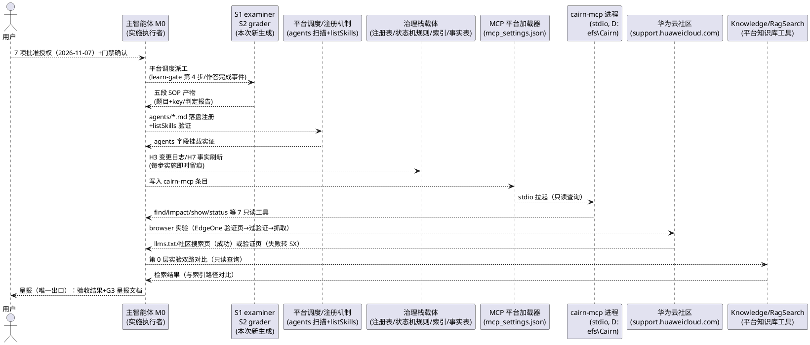
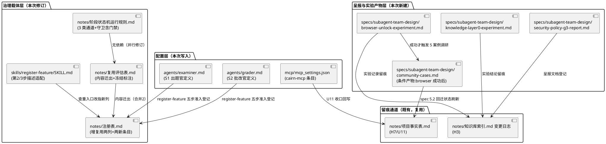
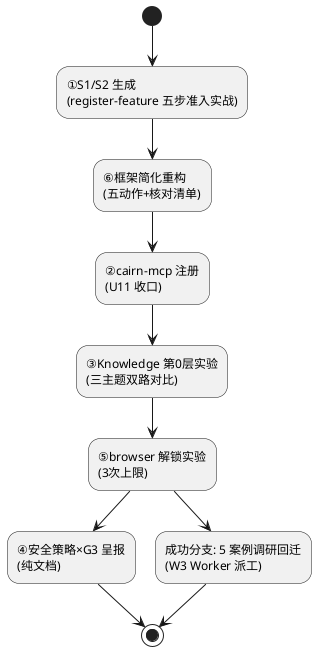
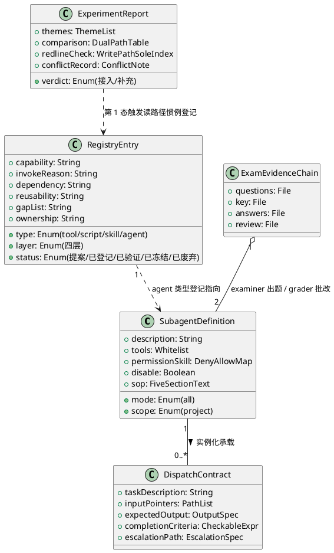

# subagent-team-design 技术设计（design.md）

> 上游：spec.md（v3，用户已确认）+ rule-skill-restructure-plan.md（10→6 规矩判定+test_mini 实证）+ v4-final-proposal.md（7 项实施清单，用户 2026-11-07 全部批准）。
> 本文档状态：待用户确认（设计阶段门禁）。确认前禁生成 tasks.md，禁任何实施动作。
> 设计范围：v4-final-proposal.md 第四节 7 项批准项的实施细则、实施顺序、验收标准。全程事件驱动零定时任务；规矩 6 条（SDD/材料门槛/refs 隔离/规矩层冻结/禁定时任务/单一事实源+仲裁+编码必审）为不可违背约束。

# 一、需求与存量功能关系分析

**本章实查基线**（2026-11-07，全部为文件实读/命令实测，非推断）：
- `.codeartsdoer/agents/test_mini.md`（31 行，持久化子智能体格式唯一实证样本）
- `.codeartsdoer/skills/`（8 技能目录+ProjectSkillStatus.txt 实存）
- `.codeartsdoer/mcp/mcp_settings.json`（实读内容=`{"mcpServers":{}}`）
- `notes/注册表.md`（62 行：六要素+四类型判据+五步准入+14 挂载项+三问自检样例）
- `notes/阶段状态机运行规则.md`（68 行：七态+迁移守卫+SX+H1–H7 四维触发表+呈报分级+查询协议）
- `notes/复用评估表.md`（41 行：本地技能 5 项+平台技能 4 项+三缺口收口记录）
- `notes/知识库索引.md`（106 行：全库索引+U1–U13 未决+变更日志）
- `notes/项目事实表.md`（55 行：当前状态 ST5；refs 环境行；U 指针区）
- `D:\refs\`（Cairn/deepseek-super-agent/p3c 三仓库实存；`D:\refs\Cairn\bin\cairn-mcp.exe` 存在性 Test-Path=True 实测）

## 1.1 需求功能与存量功能对比

### 1.1.1 已实现功能

| 需求功能 | 存量功能 | 代码位置 | 匹配度 |
|---------|---------|---------|--------|
| 持久化子智能体文件格式（YAML frontmatter+正文 SOP） | test_mini 实验品提供完整格式样本（description/mode/tools/permission.skill/disable/scope/avatar 七字段+正文提示词） | .codeartsdoer/agents/test_mini.md:1-29 | 100% |
| 文件落盘即注册机制 | test_mini 落盘后 listSkills 实证 agents 字段自动挂载 5 技能（与 skills 同机制） | rule-skill-restructure-plan.md §一.1–2（实证记录） | 100% |
| 五步准入登记流程 | register-feature 技能已创建并平台注册实证；注册表 §4 载规程全文 | .codeartsdoer/skills/register-feature/SKILL.md；notes/注册表.md:30-37 | 100% |
| S1/S2 的 SOP 五段定义 | spec 5.9.1 第 3/4 条已裁决（用户 v3 批准），出题官/批改官 SOP 逐段在档 | .codeartsdoer/specs/subagent-team-design/spec.md:592-603 | 100% |
| 运行时 Task 派工通道（W1/W2/W3 形态） | 出题官/批改官实战（st2 考核 50 题+批改自信度 96%）+spec 三代理+bug-fix 先例 | notes/项目事实表.md:50（最近迁移证据行）；notes/知识库索引.md:104（考核全链路行） | 100% |
| H3/H7 留痕通道 | 变更日志（索引）+事实表刷新机制现行运行 | notes/阶段状态机运行规则.md:30-42（§4 钩子表）、57-61（§7 即时落盘） | 100% |
| cairn-mcp 可运行性 | exit 0 实证+二进制文件在档；CLI 备用路线可用 | D:\refs\Cairn\bin\cairn-mcp.exe（Test-Path=True）；notes/知识库索引.md:87（U11 行） | 100%（"可运行"维度） |
| MCP 配置载体 | mcp_settings.json 文件存在（内容为空对象） | .codeartsdoer/mcp/mcp_settings.json:1-3 | 100%（载体）；内容写入属扩展项 |
| cron 族永久禁用 | 已登记（v4 §二：规矩 5 永久豁免项） | v4-final-proposal.md:32 | 100%（已闭环，无实施动作） |
| 6 条精简规矩生效 | 用户界面粘贴完成，session-rules 注入实证 | rule-skill-restructure-plan.md §三（条文）；本项目 session-rules 注入实证 | 100%（已闭环） |

### 1.1.2 需要扩展的功能

| 需求功能 | 存量功能 | 差异说明 | 扩展方向 |
|---------|---------|---------|---------|
| cairn-mcp 平台注册接入 | mcp_settings.json 空对象+CLI 备用可用 | 输入差异：现无任何服务条目，无平台 schema 实例可参照；输出差异：注册成功后平台会话新增 MCP 只读工具族；边界差异：command/args 字段名为 MCP stdio 通用惯例（推断），平台确切 schema 未实证 | 写入 cairn-mcp stdio 条目→注册后验证（工具列出/调用测试）→失败回滚原文+U11 更新；CLI 备用路线保持不变 |
| 注册表结构（六要素模板） | 六要素+四类型判据+14 挂载项 | 差异：模板层无"可复用性/缺口清单"两列，复用评估职能由独立表承载（notes/复用评估表.md），两表登记对象重叠（本地 5 技能重复登记） | 模板层增两列+存量条目值迁移+五步准入第 2 步查重入口改指新列（框架简化·合并 2） |
| 钩子描述结构（H1–H7） | 七钩子分立描述（§4 四维触发表） | 差异：H2/H3/H7 三个动作级检查点与 H6 门禁分立四处描述，执行模式相同（核对→放行或呈报+留痕）；心智负担 7 个钩子 | §4 改写为 3 类通道结构（平台原生/动作检查点规程/迁移守卫），H2/H3/H6/H7 保留为别名防引用断链；检查位一个不减（合并 1+H6 并守卫） |
| register-feature 技能正文 | 第 2 步"查复用评估表"、第 3 步"生成 SKILL" | 差异：①评估表并入注册表后第 2 步查重入口变更；②第 3 步产物按四类型判据应适配——agent 类型产物=agents/*.md 定义文档，非 SKILL.md | 第 2 步改指注册表可复用性列；第 3 步补 agent 类型产物映射说明；更新走 SOP 变更纪律（登记+H3 留痕） |
| 呈报/静默分级与查询协议 | §5 呈报分级清单（列举式静默清单）、§6 三问三答查询协议 | 差异：协议化包装与静默清单列举的维护成本>收益（J4 MetaGPT 维护衰减教训）；但其承载的红线（加载上限/四类必呈报）必须保留 | 降为呈报模板惯例：查询入口固定两处（索引+事实表）、默认行为=静默+留痕；加载上限纪律与四类必呈报原文逐字保留并标注硬约束（降惯例 2 项） |

### 1.1.3 需要新增的功能或接口

**模块 A：编队持久化生成（批准项①）**
- agents/examiner.md（S1 出题官持久化定义）：输入=学习材料清单指针+学习成果指针+考核角度列表+每角度题数；输出=题目+key 两文件落 specs 同目录；核心逻辑=spec 5.9.1 第 3 条 SOP 五段；依赖=主智能体经平台调度派工（learn-gate 第 4 步事件触发）。
- agents/grader.md（S2 批改官持久化定义）：输入=题目+key+作答三件；输出=判定报告（逐题三值+综合自信度+门禁二值结论）；核心逻辑=spec 5.9.1 第 4 条 SOP 五段+独立性红线；依赖=执行代理作答完成事件。
- 配套：注册表两条目六要素登记（走 register-feature 五步准入，无旁路）。

**模块 B：MCP 接入（批准项②）**
- mcp_settings.json 的 cairn-mcp 服务条目：输入=注册 JSON；输出=平台会话内 MCP 只读工具族（find/impact/show/status/why/timeline/sentinel）；核心逻辑=stdio 传输拉起 D:\refs\Cairn\bin\cairn-mcp.exe；依赖=refs 只读隔离约束（禁改源码）；与模块 A 无依赖。

**模块 C：知识库第 0 层实验（批准项③）**
- Knowledge/RagSearch 双路检索对比实验：输入=3 个既有已答案主题查询；输出=实验报告（对比表+判定结论接入/补充两态，冲突情形归入补充并附冲突记录——【用户审批意见 2026-11-07 修订】）；核心逻辑=A 路（索引检索）vs B 路（Knowledge 直查）同题对比；依赖=无（实验不改动任何现行机制，纯只读+报告落盘）。

**模块 D：安全策略×G3 联动呈报（批准项④）**
- security-policy-g3-report.md 呈报文档：输入=.env 拦截事件复盘（G3 先例）；输出=策略建议清单（每条标注执行方，全部"用户操作"）；核心逻辑=复盘→建议→边界声明（不改平台设置）；依赖=平台安全策略模块界面实查（用户操作项）。

**模块 E：browser 解锁实验（批准项⑤）**
- browser 内置浏览器过 EdgeOne 验证实验：输入=华为云文档/社区 URL；输出=实验记录（成功=llms.txt 与搜索页原文；失败=SX 四字段登记）；核心逻辑=browser 打开验证页→过验证→抓取→核验；成功后续=按 spec 5.2 执行 5 案例调研（W3 调研 Worker 派工）；依赖=无前置。

**模块 F：框架简化重构落盘（批准项⑥）**
- 四文件变更集：notes/阶段状态机运行规则.md（合并 1+H6 并守卫+降惯例 2 项的载体）、notes/注册表.md（合并 2+合并 3 载体）、notes/复用评估表.md（内容迁出+冻结标注）、.codeartsdoer/skills/register-feature/SKILL.md（第 2/3 步描述适配）；核心逻辑=三合并+两降惯例的文本收敛，检查位一个不减；依赖=模块 A 先行（其登记条目在合并 2 时补新列）。

## 1.2 存量功能详细分析

### 1.2.1 持久化子智能体注册机制（test_mini 实证）

- **接口契约**：`.codeartsdoer/agents/<name>.md` 单文件即完整定义。frontmatter 七字段实证语义：
  - `description`：一句话能力+触发条件（平台路由与用户识别依据）；
  - `mode`：运行形态，实证枚举值仅 `all`（test_mini.md:3，语义=主/子皆可派工）；
  - `tools`：工具白名单（键=工具名，值=true；白名单外工具不可用）；
  - `permission.skill`：技能授权，模式=默认 deny+逐项 allow（test_mini.md:18-25 实证 `'*': deny`+5 项 allow）；
  - `disable`：开关（true=禁用，test_mini 当前禁用态实证）；
  - `scope`：生效层级（实证值 `project`）；
  - `avatar`：头像标识（实证值 `avatar1`）。
- **业务规则**：文件落盘即注册（平台自动扫描），listSkills agents 字段自动挂载；正文 Markdown 即该子智能体的提示词/SOP 载体。
- **扩展点**：正文五段 SOP 写法已被 learn-gate/register-feature 的 SKILL.md 实证（技能载体），agents 正文沿用同一格式（spec 5.9.1 第 2 条裁决）。
- **约束**：`mode` 的子智能体专属枚举值、`avatar` 合法枚举集未实证（仅出现 all/avatar1 各一例）——设计取实证安全值并以正文约束补足形态语义（详见 2.2.2）；两字段标注为**推断值**，实测方法=生成后 listSkills 观察 agents 挂载形态（mode）、纯 UI 偏好低风险沿用（avatar），实测触发点=首次真实派工时验证，实测结果回写 design.md 附录 A（标注实测值 vs 推断值）【用户审批意见 2026-11-07 修订】。

### 1.2.2 register-feature 五步准入与 agent 类型适配

- **五步流程**（notes/注册表.md:30-37）：提出→评估归类（先查复用评估表，复用优先）→生成 SKILL→注册表登记六要素→H3 留痕。缺一即功能未准入，禁旁路。
- **四类型判据**（notes/注册表.md:16-23）：tool/script/skill/agent 四值；其中 agent 判据="Router/Worker 角色或 subagent 定义文档存在"。
- **适配结论**：第 3 步"生成 SKILL"对 skill 类型产物=SKILL.md；对 agent 类型产物=agents/*.md 定义文档（四类型判据的直接推论，本次 S1/S2 适用）。第 2 步查重入口在合并 2 实施后由"复用评估表"改为"注册表可复用性列"。
- **约束**：归类两可=停止准入呈报裁决；未走完五步禁入调用链；SOP 修订视同能力变更须重新登记。

### 1.2.3 治理栈留痕通道与载体现状

- **H1–H7 现状**（notes/阶段状态机运行规则.md:30-42）：H1/H4/H5 为平台原生通道（会话注入/规则 diff/反思窗口）；H2/H3/H7 为动作内嵌检查点（采信前核对/写库前查重/事实变更刷新）；H6 为门禁执行检查点；并发命中走幂等去重（先到先处理）。
- **迁移守卫现状**（同文件 §2:17-23）：迁移三要素（准出条件满足+证据链接呈报+变更日志留痕）+跳状态豁免规程+证据实况回退——H6 的检查对象（阶段准出）与守卫检查单同一，为合并提供结构基础。
- **注册表现状**（notes/注册表.md）：§1 六要素模板、§2 四类型判据、§3 挂载/摘除/冻结规程、§4 五步准入、§5 十四挂载项（含 learn-gate/register-feature 已登记行）、§6 三问自检样例。
- **复用评估表现状**（notes/复用评估表.md）：本地技能 5 项+平台技能 4 项+脚本资源+三缺口收口记录+增量更新记录；与注册表本地 5 技能条目重叠登记（合并 2 的实证依据）。
- **约束**：零删除纪律（废弃项只标状态禁删行禁删文件）；指针化纪律（公约引用只存路径指针）；单一事实源（核心状态只存 notes/项目事实表.md，他处只存指针）。

### 1.2.4 MCP 载体与 Cairn 能力现状

- **载体**：`.codeartsdoer/mcp/mcp_settings.json` 实读=`{"mcpServers":{}}`——结构骨架已存在（mcpServers 键），无任何服务实例可参照 schema（平台字段确证依赖注册实测）。
- **Cairn 能力**：注册表条目（notes/注册表.md:52）登记为"技能文档蒸馏两层知识图谱+GitOps 版本化+MCP 只读查询（find/impact/show/status/why/timeline/sentinel）"；8 二进制构建成功+4 条不变量 PASS+CLI 备用可用；所有权边界=只读引用 refs 仓库，禁改其源码禁复制入本项目。
- **U11 现状**（notes/知识库索引.md:87）："平台 MCP 自定义服务注册能力 ST5 实证中：cairn-mcp 可运行已证（exit 0），平台注册（写 mcp_settings.json）在门禁二授权后实施；CLI 备用路线可用"——本次批准项②即 U11 的收口动作。
- **约束**：注册动作不得引入网络依赖（stdio 本地进程）；失败回退=回滚 JSON 原文（回滚前内容留痕），CLI 备用不变，禁盲目重试超 3 次。
# 二、增量设计方案

## 2.1 实现模型

### 2.1.1 上下文视图

本设计与外部各方的交互关系（实施阶段视角，全部事件驱动零定时任务）：



交互说明：①S1/S2 与 M0 之间为平台调度派工通道（与既有 Task Worker 通道互备，spec 5.8 双通道裁决）；②MCP 通道为进程级 stdio，注册后由平台加载器管理，M0 仅消费工具；③browser 与 Knowledge 均为只读实验通道，实验产物只落报告文件；④G3 呈报文档与全部验收结果经 M0 唯一出口呈报用户。

### 2.1.2 服务/组件总体架构

本次实施全部落点在"配置与文档层"，零业务代码新增；组件关系如下：



组件职责与依赖要点：
1. **配置层**三个文件为平台直接消费（agents 扫描注册/mcp 加载器），写入即生效，写前必须备份留痕（回退依据）。
2. **治理载体层**四文件为机制文档修订，遵守零删除纪律（旧内容以别名/冻结标注保留，禁物理删除）；修订相互独立可并行，但登记动作统一在修订完成后执行（避免半程状态登记）。
3. **留痕通道**为既有机制零改动复用——本设计不新增任何留痕载体，严守单一事实源。

### 2.1.3 实现设计文档

#### 实施细则一：S1/S2 持久化子智能体生成（批准项①）

**文件名裁决**：采用用户派工单建议命名——S1 出题官=`.codeartsdoer/agents/examiner.md`，S2 批改官=`.codeartsdoer/agents/grader.md`；与 spec 5.8 编号映射：S1=examiner、S2=grader（spec 表内 exam-setter/exam-grader 为职责名，落盘文件名以本设计为准，登记注册表时同名一致）。

**examiner.md frontmatter 逐字段值**（基于 test_mini 实证格式，.codeartsdoer/agents/test_mini.md:1-29）：

| 字段 | 值 | 依据与理由 |
|------|-----|-----------|
| description | `learn-gate 第 4 步考核环节触发：按学习材料清单与考核角度出题（每角度 10 题，覆盖记忆/理解/应用三级），题目与答案要点分离两文件交付；仅响应主智能体考核派工，完成即退；不适用于日常问答与编码任务。` | spec 5.8.1 第 4 条要求 description 含触发条件；skill-writer 基准 bp0010 要求触发条件+适用+不适用三要素 |
| mode | `all` | **推断值**【用户审批意见 2026-11-07 修订】：实证枚举仅此一值（test_mini.md:3），无子智能体场景实测佐证；"子智能体形态"语义由 description"仅响应派工、完成即退"+正文约束承载。**实测方法**=生成后 listSkills 观察 agents 挂载形态（核验子智能体是否需 mode=worker 或独立值）；**实测触发点**=首次真实派工时验证；实测结果回写 design.md 附录 A（标注实测值 vs 推断值） |
| tools | `read: true`、`write: true`、`glob: true`、`grep: true` | 最小白名单：读材料清单与学习成果（read）、写题目+key 两文件（write）、按指针定位 specs 目录文件（glob/grep）；禁 bash/edit/webfetch/browser（出题无此需求，最小授权原则） |
| permission.skill | `'*': deny` + `learn-gate: allow` | 用户裁决"examiner 只允许 learn-gate 相关"；默认 deny+白名单模式与 test_mini.md:18-25 实证格式一致 |
| disable | `false` | 新建即启用（与 test_mini 实验态相反） |
| scope | `project` | test_mini.md:27 实证值；编队为项目级资产 |
| avatar | `avatar1` | **推断值**【用户审批意见 2026-11-07 修订】：实证枚举仅此一值（test_mini.md:28），合法枚举集未实证；avatar=纯 UI 偏好、低风险沿用。实测触发点=首次真实派工时验证（与 mode 一并核验）；实测结果回写 design.md 附录 A（标注实测值 vs 推断值） |

**grader.md frontmatter 逐字段值**：

| 字段 | 值 | 依据与理由 |
|------|-----|-----------|
| description | `执行代理作答完成事件触发：独立批改作答（逐题对照 key 判 PASS/PARTIAL/FAIL），汇总各角度得分并计算综合自信度，给出≥80% 门禁二值结论（放行/补学）；仅响应主智能体批改派工，禁与执行代理协商改判，完成即退；不适用于出题与编码任务。` | 同上；独立性红线写入 description 使平台路由侧即感知约束 |
| mode | `all` | 同 examiner：**推断值**+实测方法=生成后 listSkills 观察 agents 挂载形态（核验是否需 mode=worker 或独立值）+实测触发点=首次真实派工时验证+结果回写附录 A（【用户审批意见 2026-11-07 修订】） |
| tools | `read: true`、`write: true` | 最小白名单下限：读题目+key+作答三件（read）、写判定报告（write）；零技能纯判定无需 glob/grep（三件路径由派工契约给全） |
| permission.skill | `'*': deny`（无 allow 项） | 用户裁决"grader 零技能纯判定"——全技能禁用，判定能力完全由正文 SOP 承载 |
| disable | `false` | 同 examiner |
| scope | `project` | 同 examiner |
| avatar | `avatar1` | 同 examiner：**推断值**，纯 UI 偏好低风险沿用+实测触发点=首次真实派工时验证+结果回写附录 A（【用户审批意见 2026-11-07 修订】） |

**正文提示词（五段 SOP 嵌入）**：两文件正文均按统一骨架写入——开头一句角色定位（含"仅响应派工、完成即退、禁主动对话"形态约束），随后五段：
- **examiner 正文**：直接嵌入 spec 5.9.1 第 3 条 SOP 五段原文（输入=材料清单指针/学习成果指针/考核角度列表/每角度题数默认 10；步骤=读材料→按角度出题覆盖三级→答案要点单独成 key 文件→交付两文件+出题说明；输出=题目+key 两文件落 specs 同目录，命名沿用 st2-exam-questions/key 模式；完成判据=每角度题数齐+题答分离+key 与题目逐题对应；升级路径=材料缺失/歧义上报主智能体补料，禁自行放宽或缩量，连续 3 次交付不合格转 SX）；附加纪律行：key 文件仅交付主智能体，禁主动向执行代理会话泄露 key 内容（考教分离红线，spec 5.8 S1 行裁决）。
- **grader 正文**：直接嵌入 spec 5.9.1 第 4 条 SOP 五段原文（输入=题目+key+作答三件齐套才可开批；步骤=逐题对照→三值判定→汇总得分→计算自信度→出判定报告含门禁二值结论；输出=批改报告落 specs 同目录，st2-exam-review 模式；完成判据=逐题有判定+自信度数值明确+门禁结论明确；升级路径=作答与题目无法对应上报核归档）；附加纪律行：禁与执行代理协商改判、禁受主智能体倾向性暗示（独立性红线，spec 5.8 S2 行裁决）。

**register-feature 五步准入执行记录**（实施时逐项落留痕文件，模板如下，五步缺一即未准入）：

| 步骤 | 执行内容 | 留痕位置 |
|------|---------|---------|
| 1 提出 | 编队提案指针=spec 5.8 表 S1/S2 行+用户批准记录（v4 清单第 1 项） | specs/subagent-team-design/design.md 本节 |
| 2 评估归类 | 查复用评估表=无出题/批改能力既有条目（notes/复用评估表.md 实查）；归类=agent 类型（四类型判据"subagent 定义文档存在"）；层归属=业务层；两可则停呈报 | 实施记录文件 |
| 3 生成配置 | 生成 agents/examiner.md+agents/grader.md（agent 类型产物=agents 定义文档，见 1.2.2 适配结论）；禁 '*' 授权核验 | 文件落盘+内容备份 |
| 4 注册表登记 | notes/注册表.md §5 增两行六要素（能力描述/调用理由/层归属=业务层/依赖/状态=已登记/所有权边界，全文见 2.2.2 接口清单） | 注册表新增行 |
| 5 H3 留痕 | notes/知识库索引.md 技能层增两行+变更日志记一行；H7 刷事实表技能注册行（8→10 个注册成员） | 索引+事实表 |

**验证与回退**：落盘后调 listSkills 验证 agents 字段含 examiner/grader 且非 disable 态（与 test_mini 实证验证路径同构）；未挂载→按 spec 5.8.3 第 2 条回退运行时 Task 派工通道（双通道互备）+登记未决事项；首次真实派工的调用方式（对话 @引用或平台选择器）登记为待实测项，在下一次 learn-gate 考核时验证。

#### 实施细则二：cairn-mcp 注册（批准项②）

**写入格式**（`.codeartsdoer/mcp/mcp_settings.json`，写前原文备份至实施记录留痕）：

```json
{
  "mcpServers": {
    "cairn-mcp": {
      "command": "D:\\refs\\Cairn\\bin\\cairn-mcp.exe",
      "args": [],
      "env": {}
    }
  }
}
```

- 字段依据标注：`mcpServers.<name>.command/args/env` 为 MCP stdio 服务通用字段（MCP 官方规范惯例，标注=推断）；平台确切 schema（是否要求 type/transport 等附加字段）无实例可参照，以首次注册实测为准（U11 收口动作）。
- **注册后验证方式**：①JSON 语法有效性核验（解析通过）；②新会话/重载后平台工具列表出现 cairn 只读工具族（find/impact/show/status/why/timeline/sentinel 至少 1 项可见）；③实际调用一次只读查询（如 status 或 find）验证进程拉起与返回（exit 0 已实证其可运行，注册验证聚焦平台加载环节）。
- **回退（CLI 备用不变）**：注册失败（平台不识别/加载报错）→3 次调整内（按报错原文改 schema）仍未成功→回滚 mcp_settings.json 为原文（备份恢复）→U11 更新为"注册失败+报错原文+CLI 备用维持"→CLI 路线继续作为 Cairn 查询唯一入口（主备择一已满足，notes/知识库索引.md:87 基线）。
- **约束**：仅注册只读查询用途（注册表 Cairn 条目所有权边界）；禁在 env 中写入任何凭据（凭据零暴露，spec 4.3.2）。

#### 实施细则三：Knowledge/RagSearch 第 0 层实验（批准项③）

**实验设计**（纯只读+报告落盘，零机制改动）：
- 选取 3 个既有已答案主题（答案锚点先行登记，保证可复核）：
  - T1"三库分工判定规则"——答案锚点=notes/知识库维护机制.md §1；
  - T2"H4 规则变化钩子的触发通道"——答案锚点=notes/阶段状态机运行规则.md §4；
  - T3"register-feature 五步准入第 2 步内容"——答案锚点=notes/注册表.md §4。
- 双路执行：A 路=现行索引路径（读 notes/知识库索引.md→命中条目→读文件）；B 路=Knowledge/RagSearch 直接查询同一问题。每主题记录：命中正确锚点与否（二值）、返回条目数（对照"索引+事实表+至多 2 命中"上限纪律符合性）、相关性排序、结论可复核性（是否附来源）。

**判定标准（三情形，实验报告中显式给出一态；【用户审批意见 2026-11-07 修订】情形 3 由"冲突即终止"改为"按索引唯一、Knowledge 补充继续实验"）**：
1. **接入第 0 层**：B 路 3/3 命中锚点且条目数符合上限纪律→Knowledge 作为读路径第 0 层统一检索入口（新流程=先 Knowledge 检索→索引兜底→命中文件精读）；**登记写路径仍唯一走索引**（单一事实源红线：Knowledge 只接入读路径，一切登记/更新动作仍经索引+H3）。
2. **降为补充**：B 路命中≤2/3 或返回条目数违反上限纪律→不设第 0 层，Knowledge 仅作按需手动调用的全文检索补充工具，现行索引流程零改动。
3. **冲突→按索引唯一、Knowledge 补充继续实验**【用户审批意见 2026-11-07 修订】：双路结论冲突（B 路返回与文件实况矛盾/疑似幻觉或过期内容）→**写路径仍唯一走索引（不变量，任何情形不变）**，Knowledge 降为只读补充检索通道**继续实验不终止**——冲突主题记录对比结论（冲突详情+疑似幻觉/过期证据+不可信原因），剩余主题照常执行；存在冲突即不满足情形 1 的接入条件，实验按全部主题完成后的综合判定收口归入情形 2"补充"态并附冲突记录。v4 裁决"以索引为唯一登记入口"在本情形下照常成立。

**退出条件**【用户审批意见 2026-11-07 修订】：实验不再因双路冲突终止——3 主题全部执行完毕后按判定结论收口（接入/补充两态，冲突主题附对比结论记录）；仅工具级故障（Knowledge/RagSearch 检索连续 3 次不可用）走 SX 四字段登记并中止实验。实验报告落 specs/subagent-team-design/knowledge-layer0-experiment.md，H3 留痕；若收口为"接入第 0 层"态，读路径新流程以惯例形式登记于知识库维护机制文档指针标注（不改机制文件主体，更新走 SOP 变更纪律）。

#### 实施细则四：安全策略×G3 联动细则呈报（批准项④）

**性质裁决**：呈报文档（不改平台设置）——用户批准项原文"呈报文档，不改平台设置"；平台安全策略模块的全部配置动作均为用户前端操作项。

**呈报文档结构**（specs/subagent-team-design/security-policy-g3-report.md）：
1. **事件复盘**：.env 拦截先例时间线（G3 敏感排查既有运行证据：凭据零 API key 记录于 notes/项目事实表.md 环境区+spec 4.3.2 凭据零暴露约束）。
2. **平台安全策略模块盘点**：设置页安全策略模块可用项清单（每项标注"用户操作"——须用户界面实查截图佐证，Agent 无法后端实查的部分登记存疑，禁臆断，沿用 spec 5.1.1 第 6 条）。
3. **策略建议清单**：每条含 策略建议/对应 G3 检查点/建议配置层级/执行方（全部=用户操作）四字段；方向包括：敏感文件访问告警（.env/密钥类文件读写事件）、凭据零暴露审计（会话内容凭据扫描）、审查工具族联动（security_scan/security_audit 与 G4 审查位互补，v4 §二已列评估项）。
4. **两层联动细则**：平台安全策略=硬拦截层（用户界面配置，平台托管执行）；G3=流程检查层（Agent 动作内嵌检查点，沿用动作检查点规程通道）——两层职责边界=平台拦"能不能碰"、G3 查"该不该碰"，互不替代。
5. **边界声明**：本文档不改任何平台设置；全部建议项待用户界面操作；呈报后本项实施即完结（无后续 Agent 动作）。

**验收即落盘**：本项无配置类产物，文档落盘+H3 留痕即验收（见第三章汇总表第 4 行）。

#### 实施细则五：browser 解锁华为云文档实验（批准项⑤）

**实验步骤**（同一验证场景 3 次尝试上限，禁盲目重试，spec 4.1.3）：
1. browser（内置浏览器）打开 support.huaweicloud.com 任一文档 URL→记录 EdgeOne 验证页形态（若直接放行=内置浏览器会话指纹已过验证，记录现象）。
2. 观察验证交互：自动通过=记录；需交互=尝试内置浏览器能力完成（禁第三方打码/禁绕过类手段——来源合法性红线）。
3. 过验证后抓取：①文档站 llms.txt（若存在，记录 URL+原文头 100 行）；②社区搜索页（关键词依次："CodeArts Agent 子智能体""AgentTeam 实战""智能体 编排"），记录命中列表。
4. 逐篇核验候选文章（打开正文+记录 URL/访问日期/核心做法/匹配维度）。
5. 产出落盘：specs/subagent-team-design/browser-unlock-experiment.md（实验记录：成功=抓取原文+过程留痕；失败=验证页原文+尝试记录）。

**失败回退**：3 次尝试未过验证→停止→转 SX 登记（四字段：阻塞原因=EdgeOne 人机验证 browser 不可过/恢复条件=平台验证策略变化或用户提供文章清单/回迁目标=spec 5.2 案例调研/进入时间）→呈报用户裁决（扩源/接受降级）。实验记录照常落盘（失败也是留痕资产）。

**成功后 5 案例检索执行路径**：实验成功=spec 5.2 降级状态解除→W3 调研 Worker 按需 Task 派工（五字段契约，上下文隔离）执行案例检索与核验→产出 specs/subagent-team-design/community-cases.md（每案例七字段：标题/URL/访问日期/核心做法/匹配维度/可借鉴点/不适用点——【用户审批意见 2026-11-07 修订】，原"来源标注"字段由来源范围在文档头统一标注替代；实施细则见本节后细则七；spec 6.1 数据约束）→案例<5 即降级呈报禁编造（spec 5.2.1 第 4 条）→H7 刷事实表网络怪癖行。

#### 实施细则六：框架简化重构实施（批准项⑥）

**裁决基线**：用户已批准"合并 3+降惯例 2+保硬 5+原样 4"（spec 5.10 判定表+v4 清单第 6 项）。实施原则=检查位一个不减、零删除纪律、逐项留痕、禁硬切换。

**动作 1（合并 1：H2/H3/H7 三检查点→动作检查点规程；载体=notes/阶段状态机运行规则.md §4）**：
- §4 表格由"七钩子分立"改写为"3 类通道"结构：通道 A=平台原生（H1 会话启动/H4 规则变化/H5 反思窗口，三行原样保留）；通道 B=动作检查点规程（原 H2 采信前核对/H3 写前查重/H7 变更后刷新三个检查位合并承载，三位的触发时机与呈报/静默语义逐位保留）；通道 C=迁移守卫（原 H6 并入，门禁=迁移守卫检查单，与 §2 同一对象）。
- 兼容处理：H2/H3/H6/H7 名称保留为对应检查位的别名标注（全库既有引用如"H3 留痕"仍可解析），禁物理删除旧名称。
- 配套指针标注：notes/知识库维护机制.md §9（H1–H7 定义处）加一行指针"钩子通道已收敛至阶段状态机运行规则 §4（3 类通道结构，H2/H3/H6/H7 为别名）"——指针化纪律，禁重写该节全文。

**动作 2（合并 2：复用评估表并入注册表；载体=notes/注册表.md+notes/复用评估表.md）**：
- 注册表 §1 六要素模板增"可复用性/缺口清单"两列；§5 存量 14 条目逐行补两列值（值源=notes/复用评估表.md 对应行，含"直接复用/改造复用/缺口"原语义）；S1/S2 新登记条目（细则一）同步补列。
- 注册表 §4 五步准入第 2 步文本改写：查重入口由"notes/复用评估表.md"改为"注册表可复用性列（原复用评估表职能并入，2026-11-07 裁决）"；查重判据完整迁入，"可复用禁新建"红线不变。
- 复用评估表处置：文件头加冻结标注"已并入注册表（2026-11-07 用户裁决），本表冻结只读，后续更新在注册表"；全部原文保留（零删除纪律）；**处置建议呈报**——是否移入 notes/档案区/ 归档由用户确认（本设计不执行移动）。
- 增量更新记录表随内容迁入注册表尾部"演进记录"节。

**动作 3（合并 3：三问自检并入六要素；载体=notes/注册表.md）**：
- §1 六要素表加注："三问自检=能力描述/调用理由/层归属三要素的问答复述，登记时自查即完成，不再独立成节（2026-11-07 裁决）"。
- §6 三问自检样例节保留原文+标注"已并入六要素（样例留存备查）"；后续新登记禁再要求独立三问自检节（登记模板以两列六要素为准）。

**动作 4（降惯例 1：三问三答查询协议→呈报模板；载体=notes/阶段状态机运行规则.md §6）**：
- §6 标题改"查询呈报模板（惯例）"；正文收敛为固定模板：查询入口=索引+事实表两处、返回格式（当前状态+最近动作+卡点+产物路径，全附证据链接）。
- 末段加载上限纪律（"索引+事实表+至多 2 命中，禁全量扫描"）**原文逐字保留**并标注"硬约束"——降级底线（spec 5.10.1 第 4 条：清单为空即判定无效，本条即红线清单成员）。

**动作 5（降惯例 2：呈报/静默分级→惯例；载体=notes/阶段状态机运行规则.md §5）**：
- 四类必呈报（异常/冲突/状态迁移/越权）原文保留并标注"硬约束"（红线清单成员）。
- 静默清单由列举式收敛为一句："默认行为=静默+留痕（无痕即违规）"——列举清单的维护成本>收益（J4 指针），必呈报四类一个不减。

**实施保障规程**：
- 逐动作实施→每动作完成即 H3 记变更日志（禁批量补记，§7 即时落盘纪律）→五动作完成后执行核对清单：①检查位对照表核验"一个不减"（3 检查位+迁移守卫+四类必呈报+加载上限+状态机七态+六要素五步+四查+双通道）；②grep 全库旧引用（"复用评估表""三问自检""H6 门禁""H2/H7"）确认全部解析到新位置或别名，引用断链=0 才收口；③H7 刷事实表机制状态行。
- 进行中引用检查：五动作实施前实查现行流水线产物（specs/ 各目录）对旧载体的引用形态——kb_arch_foundation 已处 ST5 持续态且编码实施完成，实施在空档期执行；若发现进行中引用则按 spec 5.10.3 第 2 条延后或并行过渡，禁硬切换。

#### 实施细则七：community-cases.md 案例调研实施细则（批准项⑤成功分支产物）【用户审批意见 2026-11-07 修订 新增】

**性质与前置依赖**：本细则为细则五 browser 解锁实验成功分支的实施细则（spec 5.2 案例调研回迁）；**前置依赖=EdgeOne 拦截解除**——browser 解锁实验（细则五）成功是本细则的唯一启动条件：实验成功=EdgeOne 拦截状态解除→本细则启动；实验失败（3 次尝试未过验证）→EdgeOne 拦截持续→本细则不启动，按细则五失败回退转 SX 登记（回迁目标=spec 5.2 案例调研）+呈报用户裁决，**禁绕过拦截或更换未验证通道硬抓**（来源合法性红线）。

**检索关键词组合**（依次轮换，命中不足再组合变体）：
1. "CodeArts Agent 智能体"
2. "AgentTeam"
3. "主子智能体"
4. 变体组合："CodeArts 智能体 编排""AgentTeam 子智能体""智能体 主从 实战"

**候选来源范围**（两源限定，禁扩第三方源）：
1. support.huaweicloud.com 社区文章（华为云支持社区）；
2. 华为云开发者联盟（developer.huaweicloud.com 等开发者侧官方社区载体）。

来源范围在 community-cases.md 文档头统一标注（【用户审批意见 2026-11-07 修订】七字段以"不适用点"为第 7 字段，单案例内不再设"来源标注"字段）。

**单案例七字段**（每案例逐项登记，禁缺字段）：

| 字段 | 填写要求 |
|------|---------|
| 标题 | 文章原题，禁改写 |
| URL | 原文完整链接 |
| 访问日期 | 实际抓取日期（YYYY-MM-DD） |
| 核心做法 | 案例所述做法的客观提炼（禁臆断补充） |
| 匹配维度 | 与本项目主子智能体编队/派工契约/SOP 承载的对应维度（如编队形态、派工五字段、留痕机制） |
| 可借鉴点 | 可引入本项目的具体做法（逐条可执行表述） |
| 不适用点 | 案例中与本项目规矩层/约束不兼容的部分（如定时任务触发、违反零删除纪律的做法），逐条说明不适用原因 |

**执行路径与产出**：
- 派工形态=W3 调研 Worker 按需 Task 派工（五字段契约+上下文隔离，spec 5.8 双通道裁决）；
- 产出文件名固定=`community-cases.md`，**落同目录 specs/subagent-team-design/**（与细则五实验记录 browser-unlock-experiment.md 同目录）；
- 案例数量=目标 5 个真实案例；**案例不足 5 个的降级呈报规则=引用 spec 5.2 既有条款（spec 5.2.1 第 4 条）**：实测不足 5 个→如实登记实际数量→降级呈报用户裁决（接受降级/扩源），**禁编造凑数**；
- 留痕：community-cases.md 落盘即 H3 记变更日志；H7 刷事实表网络怪癖行（spec 5.2 回迁状态刷新，与细则五成功分支共用）。

#### 实施顺序与依赖（批准项⑦）

**顺序裁决**（用户指定）：①S1/S2 → ⑥简化重构 → ②MCP 注册 → ③第 0 层实验 → ⑤browser 实验 → ④G3 细则呈报。



**顺序理由**：
1. **①最先**：编队核心能力是 learn-gate 考核链路依赖；其登记动作本身=register-feature 五步准入的实战验证（为后续所有登记复用）。
2. **⑥第二**：简化重构改注册表结构与查重入口——②③⑤产生的所有登记动作若在重构前执行，将写入旧载体再迁移（双重劳动+断链风险）；①登记的两条目在⑥动作 2 中统一补新列（唯一交叉点，已列入动作 2 范围）。
3. **②第三**：U11 收口依赖⑥后的注册表演进条目登记；MCP 可用性对③⑤实验非必需（Knowledge/browser 均平台内置工具），但注册收口后环境状态更干净。
4. **③→⑤→④**：三项相互独立，按用户指定串行（一致性优先，避免并行留痕交叉）；⑤的成功分支（5 案例回迁）为条件触发事件，不阻塞④。
5. **每步留痕**：每步完成即 H3 记变更日志+H7 刷事实表对应行；实施全过程记录于 specs/subagent-team-design/implementation-log.md（新建，逐步追加）。
6. **G4 豁免语义标注**：本次实施全部产物为 Markdown/JSON 配置（零 Java 代码变更）；编码必审检查位（G4）逐步执行"豁免语义标注"——在 implementation-log.md 每步记录"变更类型=Markdown/JSON，非 Java，P3C 审查不适用（语言边界=仅 Java，注册表 review-code 条目实证），豁免标注留痕"——检查位不跳过、结论为豁免，"编码必审未过不完工"以标注审查形式闭环；若实施中出现任何 Java/脚本代码变更，则必须走 review-code 实审后才收口。
## 2.2 接口设计

### 2.2.1 总体设计

本次实施无传统运行时 API，接口=四类契约（配置契约、派工契约、注册契约、报告契约）。变更策略：所有契约一经登记即为稳定版；修改走 SOP 变更纪律（register-feature 登记+H3 留痕）；契约间零循环依赖（派工契约依赖 frontmatter 契约的路由描述，注册契约依赖 frontmatter 契约的产物，报告契约独立）。

| 接口（契约） | 类型 | 稳定性 | 消费方 | 载体 |
|-------------|------|--------|--------|------|
| 持久化子智能体定义契约（frontmatter+正文） | 配置契约 | 稳定 | 平台注册/调度机制、listSkills | .codeartsdoer/agents/examiner.md、grader.md |
| 主→子派工契约（五字段） | 派工契约 | 稳定 | S1/S2 及 W1/W2/W3 | 派工消息载荷（spec 5.9.1 第 8 条模板实例化） |
| cairn-mcp 服务注册契约 | 配置契约 | 实验（schema 待实测确证） | 平台 MCP 加载器 | .codeartsdoer/mcp/mcp_settings.json |
| 注册表条目契约（六要素+复用两列） | 注册契约 | 稳定 | M0 路由决策、register-feature | notes/注册表.md |
| 实验报告契约（判定结论结构：接入/补充两态——【用户审批意见 2026-11-07 修订】） | 报告契约 | 实验 | 用户裁决、后续流程收口 | specs/subagent-team-design/ 各报告文件 |

### 2.2.2 接口清单

**接口 1：持久化子智能体定义契约（frontmatter）**

签名（YAML 结构，字段语义见 2.1.3 细则一逐字段表）：

```yaml
---
description: <触发条件+能力+适用/不适用，一句话>
mode: all                      # 推断值（实证枚举仅 all 一例）；实测=listSkills 观察挂载形态（是否需 worker 或独立值），首次真实派工验证，结果回写附录 A【用户审批意见 2026-11-07 修订】
tools:                         # 最小白名单，未列即不可用
  read: true
  write: true
  # glob/grep 按成员需要
permission:
  skill:
    '*': deny                  # 默认拒绝，禁 '*' 授权（用户裁决红线）
    # <skill-name>: allow      # 仅 examiner 声明 learn-gate
disable: false
scope: project
avatar: avatar1                # 推断值，纯 UI 偏好低风险沿用；首次真实派工一并核验，结果回写附录 A【用户审批意见 2026-11-07 修订】
---
# 正文：角色定位一句 + 五段 SOP（输入→步骤→输出→完成判据→升级路径）+ 纪律红线行
```

- 业务说明：S1/S2 落盘注册的唯一载体；平台按 description 路由、按 tools/permission.skill 收敛能力面、按正文执行 SOP。
- 前置条件：register-feature 五步走完第 1–2 步（提案+评估归类）方可生成文件。
- 后置条件：文件落盘即注册；listSkills agents 字段可见；注册表条目就位。
- 异常映射：平台未识别→回退运行时 Task 派工（spec 5.8.3 第 2 条）+登记未决；'*' 授权出现→实施自查拦截（禁落盘）；mode/avatar 实测值与推断值不符→按附录 A 回写实测值并修正 frontmatter+H3 留痕（【用户审批意见 2026-11-07 修订】）。

**接口 2：主→子派工契约（五字段，统一载体）**

签名（字段表，spec 6.8 第 3 条数据约束）：

| 字段 | 类型约束 | 说明 |
|------|---------|------|
| 任务描述 | 非空字符串 | 任务目标+触发事件来源（如"learn-gate 第 4 步考核"） |
| 输入材料指针 | 非空路径清单 | 文件指针数组（S1=材料清单+学习成果+角度列表；S2=题目+key+作答三件） |
| 预期产出 | 产出物+落盘路径 | 如"题目文件+key 文件→specs/<feature>/st2-exam-questions.md/key" |
| 完成判据 | 可判定表述 | 二值或数值，禁"尽量/适当" |
| 升级路径 | 上报目标+上限 | 终点=主智能体或 SX，含 3 次上限 |

- 业务说明：契约=运行时 Worker 的 SOP 实例化（spec 5.9.1 第 8 条）；S1/S2 持久化后其 SOP 已在正文，契约字段侧重输入指针与本次考核的具体参数（角度列表/题数/落盘目录）。
- 前置条件：S2 派工须三件齐套（题目+key+作答），缺件禁派。
- 后置条件：派工与结果落执行轨迹留痕。
- 异常映射：字段不全→Worker 拒收回呈缺字段清单，补齐重派（spec 5.9.3 第 3 条）；超时/失败 3 次→SX。

**接口 3：cairn-mcp 服务注册契约**

签名（JSON，schema 标注=推断，见 2.1.3 细则二）：

```json
{
  "mcpServers": {
    "cairn-mcp": {
      "command": "D:\\refs\\Cairn\\bin\\cairn-mcp.exe",
      "args": [],
      "env": {}
    }
  }
}
```

- 业务说明：平台 MCP 加载器消费的唯一注册入口；服务名=cairn-mcp（与注册表 Cairn 条目对应，二进制能力一致）。
- 前置条件：D:\refs\Cairn\bin\cairn-mcp.exe 存在（已实证）+写前原文备份。
- 后置条件：注册成功=新会话工具列表含 cairn 只读工具族；U11 状态回写。
- 异常映射：加载失败→3 次内按报错调 schema→仍失败回滚原文+U11 登记"注册失败+CLI 备用维持"；env 出现凭据→自查拦截。

**接口 4：注册表条目契约（六要素+复用两列，合并 2 后形态）**

签名（登记模板，S1/S2 两条目值如下，其余条目沿用既有值补两列）：

| 要素 | examiner（S1） | grader（S2） |
|------|---------------|--------------|
| 类型 | agent | agent |
| 能力描述 | 按学习材料清单与考核角度出题（每角度 10 题覆盖记忆/理解/应用三级，题答分离两文件交付） | 独立批改作答并计算综合自信度，给出≥80% 门禁二值结论（逐题 PASS/PARTIAL/FAIL） |
| 调用理由 | learn-gate 第 4 步考核环节触发（事件：考核派工下发） | 执行代理作答完成事件触发（事件：作答回传） |
| 层归属 | 业务层 | 业务层 |
| 依赖 | agents/examiner.md；工具白名单 read/write/glob/grep；技能授权=learn-gate | agents/grader.md；工具白名单 read/write；零技能授权 |
| 可复用性 | 直接复用（每次新框架接入必考，高频） | 直接复用（与 examiner 成对，考核链路固定成员） |
| 缺口清单 | 首派工调用方式待实测（@引用 or 平台选择器） | 同左（首派工实测后收口） |
| 状态 | 已登记（首派工实测后升已验证） | 已登记（同左） |
| 所有权边界 | key 文件仅交付主智能体禁入执行代理上下文；禁自行放宽出题/缩量 | 判定报告归考核证据链；禁与执行代理协商改判、禁受倾向性暗示 |

- 业务说明：M0 路由决策的唯一依据（调用理由判据命中才派工）；复用两列为五步准入第 2 步查重入口（合并 2 后）。
- 前置条件：frontmatter 产物已生成+五步第 1–3 步完成。
- 后置条件：条目可被三问三答查询协议（降惯例后=呈报模板）检索作答。
- 异常映射：归类两可→停止准入呈报裁决；缺要素→登记无效禁入调用链。

**接口 5：实验报告契约（判定结论结构，接口 5 为报告族代表；【用户审批意见 2026-11-07 修订】：终止态取消，冲突归入补充态）**

签名（章节结构）：实验主题清单（含答案锚点指针）→双路对比表（主题×{A 路结果/B 路结果/条目数/相关性/可复核性}）→判定结论（枚举单选：接入/补充；冲突情形归入"补充"并附冲突对比结论）→红线核验（写路径唯一索引性，任何判定态均核验）→冲突记录（如触发，【用户审批意见 2026-11-07 修订】替代原"退出条件记录"）。

- 业务说明：Knowledge 第 0 层实验（细则三）专属；browser 实验记录与 G3 呈报文档复用"结论前置+证据分级（实查/推断）+字段齐备"同一骨架。
- 前置条件：实验为纯只读动作，零机制改动前提已自查。
- 后置条件：报告落盘+H3 留痕；第 1 态时读路径惯例更新（SOP 变更纪律）。
- 异常映射：双路冲突→冲突记录+按"补充"态收口继续实验（【用户审批意见 2026-11-07 修订】，不终止）；检索 3 次失败→SX 四字段。

## 2.3 数据模型

### 2.3.1 设计目标

1. **支持的业务场景**：编队持久化定义的落盘与注册（考核链路自动化）、MCP 工具接入（知识图谱查询）、实验结论的可裁决留痕（判定结论接入/补充两态可回溯+冲突对比结论留痕，【用户审批意见 2026-11-07 修订】）、治理载体收敛后的单一登记入口。
2. **性能与容量目标**：全部数据模型为文件态（零数据库、零新增存储组件）；单文件定义（agents）承载完整成员语义，注册表单表承载全部能力登记；实验报告按"结论前置+至多 2 命中展开"纪律控制加载量。
3. **与存量数据的兼容策略**：零删除纪律（旧表冻结标注不删文件）；别名兼容（H2/H3/H6/H7 名称保留）；指针化（公约/机制引用只存路径指针）；单一事实源不变（核心状态只存事实表，本设计及产物只存指针不抄值）。

### 2.3.2 模型实现

核心领域对象与关系（类图，只含业务字段，技术字段如核验日期以标注承载）：



对象说明与生命周期：
1. **SubagentDefinition**（S1/S2 载体）：创建=register-feature 第 3 步落盘；销毁=禁（disable=true 替代，test_mini 先例）；状态流转=已登记→已验证（首派工实测）。
2. **DispatchContract**：每次派工临时创建、随执行轨迹归档；五字段缺一即无效（Worker 可拒收）；对 S1/S2 而言其 SOP 已内置于定义正文，契约只实例化本次参数。
3. **RegistryEntry**：注册表行对象；合并 2 后扩展 reusability/gapList 两列；摘除=状态置已废弃（禁删行）。
4. **ExamEvidenceChain**（考核证据链聚合）：questions/key 由 examiner 产出、answers 由执行代理产出、review 由 grader 产出；四文件齐=一次考核闭环证据（st2 先例：specs/kb_arch_foundation/st2-exam-*.md 四件套）；key 对 answers 产出方物理隔离（考教分离）。
5. **ExperimentReport**：实验一次性产物，创建后只读（结论回溯依据）；verdict 枚举收敛为接入/补充两值、原 exitRecord 字段更名 conflictRecord（【用户审批意见 2026-11-07 修订】：冲突不终止实验，冲突记录承载对比结论）；"接入"态判定将触发一次 RegistryEntry 式惯例登记（读路径流程）。

持久化策略（不含表结构）：全部对象持久化为 Markdown/YAML/JSON 文件；SubagentDefinition=agents/*.md（frontmatter+正文一体）；RegistryEntry=notes/注册表.md 表行；ExperimentReport 与 ExamEvidenceChain=specs/subagent-team-design/（实验报告）与 specs/<feature>/（考核链，沿用 st2 模式）目录文件；任何对象变更即时 H3/H7 留痕，禁会话记忆态存续。

# 三、验收标准（7 项批准项逐一可判定条件）

| # | 实施项 | 可判定验收条件 |
|---|--------|---------------|
| 1 | S1/S2 生成 | ①agents/examiner.md 与 agents/grader.md 落盘且 frontmatter 八字段齐备（值符合 2.1.3 细则一逐字段表）；②permission.skill 无 '*' 授权（examiner 仅 learn-gate allow，grader 全 deny 无 allow 项）；③两文件正文五段 SOP 齐备且完成判据可判定（禁"尽量/适当"）；④listSkills 返回 agents 字段含 examiner/grader 且 disable=false；⑤注册表两行六要素+复用两列齐备；⑥H3 变更日志+implementation-log.md 记录在案。任一不满足即该项未验收。 |
| 2 | cairn-mcp 注册 | ①mcp_settings.json 含 cairn-mcp 条目且 JSON 解析通过；②平台工具列表可见 cairn 只读工具至少 1 项且一次实际调用成功；或③注册失败时——备份回滚完成+U11 更新（失败原文+CLI 备用维持）留痕（②③二值验收，其一满足即收口）；④env 零凭据核验通过。 |
| 3 | Knowledge 第 0 层实验 | ①knowledge-layer0-experiment.md 落盘且含 3 主题×双路对比表+判定结论单选（接入/补充两态，冲突情形归入"补充"并附冲突对比结论，实验不因冲突终止——【用户审批意见 2026-11-07 修订】）；②红线核验=登记写路径唯一走索引（不变量，任何判定态均核验）；③冲突记录完整（如触发）；④H3 留痕。 |
| 4 | G3 联动呈报 | ①security-policy-g3-report.md 落盘且五节齐备（复盘/盘点/建议清单/联动细则/边界声明）；②建议清单每条含执行方字段且全部=用户操作；③平台设置零改动核验（mcp_settings/规则文件 diff 仅含本设计允许范围）；④H3 留痕。 |
| 5 | browser 解锁实验 | ①browser-unlock-experiment.md 落盘（成功=llms.txt/搜索页原文+过程记录；失败=验证页原文+3 次尝试记录+SX 四字段）；②成功分支——community-cases.md 落盘于 specs/subagent-team-design/ 且每案例七字段齐（标题/URL/访问日期/核心做法/匹配维度/可借鉴点/不适用点——【用户审批意见 2026-11-07 修订】）、检索关键词组合与两源候选（support.huaweicloud.com 社区+华为云开发者联盟）按细则七执行、案例<5 时降级呈报无编造（spec 5.2.1 第 4 条）；③H3/H7 留痕。 |
| 6 | 框架简化重构 | ①注册表 §1 含复用两列且存量条目+S1/S2 条目两列值齐备；②复用评估表冻结标注在档且原文零删除；③状态机运行规则 §4 呈 3 类通道且检查位对照清单核验"一个不减"；④§5 四类必呈报原文保留+§6 加载上限纪律原文保留且标注硬约束；⑤register-feature SKILL.md 第 2/3 步描述已适配；⑥全库 grep 旧引用断链=0；⑦每动作 H3 留痕（五动作五条）。 |
| 7 | 顺序与留痕 | ①implementation-log.md 按 ①→⑥→②→③→⑤→④ 顺序逐步记录且每步含 G4 豁免语义标注行；②每步 H3/H7 留痕可查（变更日志行数=实施动作数）；③全程零定时任务（无任何 cron 类触发登记）；④零删除核验（实施前后文件清单 diff 仅新增与标注，无物理删除）。 |

> 验收执行说明：第三章汇总表为 tasks 阶段拆解与门禁（G6）判定的直接输入；每项验收条件均为文件存在性/字段齐备性/枚举单选/核验通过类可判定表述，无模糊项。
# 附录 A：mode/avatar 推断值实测回写登记区【用户审批意见 2026-11-07 修订 新增】

> 本附录为 S1/S2 frontmatter 推断字段的实测结果回写载体；回写仅更新本表"实测结果"列，不改设计正文其他章节；实测值与推断值不符→修正 agents frontmatter+H3 留痕。

| 字段 | 成员 | 推断值 | 实测方法 | 实测触发点 | 实测结果（标注实测值/推断值） |
|------|------|--------|----------|-----------|------------------------------|
| mode | examiner、grader | all | 生成后 listSkills 观察 agents 挂载形态，核验子智能体是否需 mode=worker 或独立值 | 首次真实派工时验证 | **生成后 listSkills 实测（2026-11-07）**：examiner 以子智能体形态挂载 learn-gate（agents 字段实证），无 mode=worker/独立值要求的表现——all 值无矛盾，最终判定留待首次真实派工【仍为推断值+无矛盾实测】 |
| avatar | examiner、grader | avatar1 | 纯 UI 偏好低风险沿用；listSkills/平台展示一并核验 | 首次真实派工时验证 | **待回写**（listSkills 不含 avatar 维度，留待首次真实派工平台展示核验） |

# 附录 B：7 项验收标准汇总表【用户审批意见 2026-11-07 修订 新增】

> 按 v4-final-proposal.md 7 项批准实施项汇总；验收条件均为可判定表述（详细版见第三章对应行）；状态列由 tasks/实施阶段推进更新，实施过程证据以 implementation-log.md 为准；任务 ID 供 tasks.md 拆解映射。

| 任务 ID | 验收项 | 验收条件（可判定） | 证据载体 | 状态 |
|---------|--------|-------------------|----------|------|
| T1 | S1/S2 生成 | 第三章 #1 行六条件全满足：examiner.md/grader.md 落盘且 frontmatter 八字段齐备；无 '*' 授权；五段 SOP 完成判据可判定；listSkills agents 字段可见且 disable=false；注册表两行六要素+复用两列齐备；H3+implementation-log 留痕 | agents/examiner.md、agents/grader.md、notes/注册表.md、implementation-log.md | **已完成（2026-11-07）**：六条件全过（listSkills 实证 learn-gate 挂 examiner；grader 零技能无挂载=符合设计） |
| T2 | cairn-mcp 注册 | 第三章 #2 行：注册成功（JSON 解析通过+cairn 只读工具可见≥1+实际调用成功）或注册失败回滚留痕（备份恢复+U11 失败登记）二值其一满足即收口；env 零凭据核验通过 | mcp_settings.json、notes/知识库索引.md（U11）、implementation-log.md | **已完成（2026-11-07，配置层）**：写入+JSON 解析通过+零凭据（env-props=0）；运行时可见性/实际调用**待新会话重载**（会话边界，U11 承载，非失败不回滚）——二值收口=配置注册完成态 |
| T3 | Knowledge 第 0 层实验 | 第三章 #3 行（2026-11-07 修订版）：报告落盘含 3 主题×双路对比表+判定结论单选（接入/补充两态，冲突情形归入"补充"并附冲突对比结论，实验不因冲突终止）；写路径唯一走索引不变量核验通过；冲突记录完整（如触发）；H3 留痕 | knowledge-layer0-experiment.md、implementation-log.md | **已完成（2026-11-07）**：判定②降为补充（B 路命中锚点 0/3——Knowledge 检索对象为 .codebase 平台快照 updated_at=2026-11-06 滞后于当日知识库更新且不覆盖 notes/；RagSearch 无企业知识库接入）；写路径唯一索引核验通过；U14 登记 build_index 重建可选项 |
| T4 | 安全策略细则（G3 呈报） | 第三章 #4 行：security-policy-g3-report.md 五节齐备（复盘/盘点/建议清单/联动细则/边界声明）；建议清单每条执行方=用户操作；平台设置零改动核验通过；H3 留痕 | security-policy-g3-report.md、implementation-log.md | **已完成（2026-11-07）**：五节齐备+四条建议四字段齐（执行方全=用户操作）+零平台改动核验 |
| T5 | browser 解锁+案例回迁 | 第三章 #5 行（2026-11-07 修订版）：实验记录落盘（成功/失败二值其一）；成功分支——community-cases.md 落 specs/subagent-team-design/、每案例七字段齐（含"不适用点"）、检索关键词组合与两源候选（support.huaweicloud.com 社区+华为云开发者联盟）按细则七执行、案例<5 降级呈报无编造（spec 5.2.1 第 4 条）；失败分支——SX 四字段登记；H3/H7 留痕 | browser-unlock-experiment.md、community-cases.md（条件产物）、implementation-log.md | **已完成（2026-11-07，失败分支）**：browser 仅"打开成功"无内容读取能力（3 次尝试+Doom Loop 遵从停止）；失败留痕落盘+U15 四字段登记（SX 语义等效）+呈报用户裁决（扩源/接受降级）；禁绕过红线未破 |
| T6 | 简化重构 | 第三章 #6 行七条件：注册表复用两列齐备（存量+S1/S2 条目）；复用评估表冻结标注+零删除；状态机规则 §4 呈 3 类通道且检查位一个不减；四类必呈报+加载上限硬约束保留；register-feature 第 2/3 步描述适配；全库旧引用断链=0；五动作五条 H3 留痕 | notes/注册表.md、notes/阶段状态机运行规则.md、notes/复用评估表.md、skills/register-feature/SKILL.md、implementation-log.md | **已完成（2026-11-07）**：五动作全落盘+核对清单全过（检查位一个不减+grep 断链=0+1 处索引条目修正） |
| T7 | cron 禁用（已登记） | 既有登记核验：v4 §二规矩 5 永久豁免项在档；实施全程零 cron 类任务登记（事件驱动核验） | v4-final-proposal.md:32、implementation-log.md（零定时任务核验行） | 已闭环（2026-11-07 登记，无实施动作） |

> 映射说明：T1–T6 分别对应第三章汇总表 #1–#6 行；第三章 #7 行（顺序与留痕）为 T1–T6 的跨项实施过程验收条件（顺序 ①→⑥→②→③→⑤→④、每步留痕、G4 豁免标注、零删除核验），不单设任务 ID；T7 对应 1.1.1 已实现功能表"cron 族永久禁用"行（100% 已闭环，无实施动作）。