# 主/子智能体协作体系（subagent-team-design）需求规格

> 建立：2026-11-07。状态：待用户确认（第一阶段门禁）。来源：用户派工单（2026-11-07 语音转写+3 截图）+ 本地实查基线（notes/项目事实表.md、notes/注册表.md、notes/阶段状态机运行规则.md、.codeartsdoer/experience-reuse/ 目录实查、listSkills 工具实查）。
> 【v2 2026-11-07】修订来源：用户新消息（2026-11-07 语音+2 张截图）。修订内容：①5.5 章落定"后端生成子智能体"可行性三态结论（实证证据链）；②新增 5.7 章"技能/规则合理性方案"（10 条公约逐条判定，复用 kb_arch_foundation 已验证 J1–J5 经验指针，禁重复调研）；③5.2 章社区案例调研标注 EdgeOne 拦截受阻、按降级规则呈报；④5.5 章补充前后端分工清单。基线版本 v1 已随版本提交 2a83004（15 文件）留痕。
> 【v3 2026-11-07】修订来源：用户裁决与新调研要求（2026-11-07）。修订内容：①登记裁决基线三项（6 条精简规矩草稿已批准、learn-gate/register-feature 两技能已批准并注册、test_mini 已禁用留存）；②新增 5.8 章"子智能体编队规划"（数量+职责+不可合并论证，回应"一共定义几个子智能体、怎么构建"）；③新增 5.9 章"子智能体 SOP 标准流程"（五段统一格式：输入→步骤→输出→完成判据→升级路径，载体实证=SKILL.md/agents/*.md）；④新增 5.10 章"治理栈框架层简化重构"（H1–H7+状态机+注册表等全栈盘点，三态判定：合并/降为惯例/保留硬约束，回应"框架比较复杂，从框架层重构"）；⑤新增 6.7–6.9 数据约束。基线版本 v2 已随文档留痕（rule-skill-restructure-plan.md 同目录在档）。
> 门禁提示：本文档经用户确认前，禁生成 design.md / tasks.md，禁任何实施动作。

# **1. 组件定位**

## **1.1 核心职责**
本组件负责定义主/子智能体协作体系与治理基座适配重构的需求边界，实现任务自动路由、后端生成子智能体与全程留痕。

## **1.2 核心输入**
1. **用户派工单**：语音转写需求+3 张截图（平台设置页四层级分组、系统内置 3 主智能体、鸿蒙开发主/子两级形态），来自用户会话消息。
2. **平台智能体体系数据**：设置→智能体页面（企业级/项目级/个人级/系统内置四层级）；listSkills 返回的 50 技能与 agents 字段；`.codeartsdoer/agent-team/` 与 `.codeartsdoer/agents/` 目录结构。
3. **华为云社区案例**：support.huaweicloud.com 上与 CodeArts Agent 主/子智能体或 AgentTeam 相关的实战文章。
4. **既有治理基座**：阶段状态机（ST0–ST5+SX）、注册表（12 挂载项）、H1–H7 事件钩子、经验库（experience-reuse 目录：experiences/ 分 6 类、reflect-reports/、.manager-history.jsonl、.session-traces.jsonl）、平台记忆库（MEMORY.md 索引+9 篇记忆文件）。
5. **用户裁决**：对调研结论、盘点判定、方案骨架的多轮沟通确认意见。
6. 【v2 2026-11-07】**用户后续消息（2026-11-07 语音+2 张截图）**：①技能/规则合理性诉求（原话观点："规矩太多了，越简单越好；有些东西应该分装成技能而非规矩"），审视对象=10 条扩展公约（.codeartsdoer/rule/项目协作公约.mdc）与既有技能体系；②授权语境："只要流程不卡住，然后咱们可以继续往下走"；③既有指令已执行留痕：版本提交先行（2a83004，15 文件，含 spec v1 与经验库治理）、后端生成子智能体初步实证（证据链见 5.5.1 第 5 条）。
7. 【v3 2026-11-07】**用户裁决与新调研要求（2026-11-07）**：
   - **裁决基线（已批准落地）**：①6 条精简规矩草稿已批准（待用户界面粘贴替换 10 条版——规矩层冻结，Agent 禁自改）；②learn-gate/register-feature 两个新技能已批准并创建（平台注册实证，注册表已登记）；③test_mini 实验品保留但已禁用（agents/test_mini.md disable=true）。
   - **批评与拓宽要求（原话要点）**："你刚才调研的方案方向有点太窄了……重构后的那些智能体的 SOP（标准流程）怎么定？重构完了之后一共要定义几个子智能体？怎么构建？现在的框架比较复杂，我需要你从框架层怎么重构重新给我提建议。"
   - **三个调研维度**：①子智能体编队规划（数量+职责，每个成员须论证不可合并）；②每个子智能体的 SOP 标准流程定义（输入→步骤→输出→完成判据→升级路径，格式统一）；③框架层重构建议（H1–H7 钩子+状态机+注册表+复用评估表+五步准入+三问三答+四查门禁+双通道子智能体+知识库三级加载全栈盘点：哪些合并/哪些降为惯例/哪些保留硬约束，目标=框架更简单但治理能力不降级）。
   - **实测素材约束**：现有 8 个 project 技能（find-skills/grill-me/lazy-exec/ruleinit/skill-writer/review-code/learn-gate/register-feature，skills 目录实查）+平台 Worker 类型（bug-fix/developer-test/spec 三代理）+出题官/批改官实战先例（st2 考核 50 题+批改自信度 96%）+test_mini 实验品；J1–J5 框架经验指针复用 st2-materials，禁重复调研。

## **1.3 核心输出**
1. **平台智能体体系调研报告**：落盘于 specs/subagent-team-design/ 专门文件夹，含四层级语义、3 系统内置主智能体差异、主/子形态、AgentTeam 与单智能体差异、前后端能力边界实证。
2. **华为云社区案例调研报告**：≥5 个真实案例，每案例附真实链接与匹配点分析。
3. **现有自定义逻辑盘点与合理性判定清单**：逐项给出"合理保留/不合理重构/缺失补建"三态判定与重构维度。
4. **主/子智能体架构方案骨架**：分工、配合机制（任务路由/汇报/留痕）、与状态机/注册表/钩子的衔接点。
5. **后端生成子智能体可行性结论**：实证依据+实施路径。
6. **spec.md 及后续 SDD 文档**：本文件及其迭代版本，全部留痕。
7. 【v2 2026-11-07】**技能/规则合理性方案**：10 条扩展公约逐条判定（保留为规矩/分装为技能/合并精简/删除候选）+ 精简后规矩草稿 + 技能封装清单，落盘于 specs/subagent-team-design/ 同目录（详见 5.7 章）。
8. 【v2 2026-11-07】**可行性三态结论（已实证落定）**：运行时派工=可行已验证、持久化注册=部分可行待实证、建议路径=前端最小实验反推格式（详见 5.5.1 第 5 条）。【v3 2026-11-07】进展：持久化格式已经 test_mini 实证（agents/*.md=YAML frontmatter+正文，落盘即注册，listSkills 实证挂载 5 技能），②态收口为"可行已验证"。
9. 【v3 2026-11-07】**子智能体编队清单**：重构后完整编队定义（主智能体+持久化子智能体+运行时 Worker 全清单），每成员含 名称/形态/职责/挂载技能/触发条件/与主智能体分工/存在理由（不可合并论证）七字段，落盘于本 spec 5.8 章（详见 5.8.1 第 2 条）。
10. 【v3 2026-11-07】**子智能体 SOP 标准流程集**：编队每个成员的 SOP 定义，统一五段格式（输入→步骤→输出→完成判据→升级路径），落盘于本 spec 5.9 章；SOP 实施载体=SKILL.md/agents/*.md 正文（已实证）+运行时 Worker 派工契约模板。
11. 【v3 2026-11-07】**治理栈简化重构方案**：当前治理栈全组件三态判定（合并/降为惯例/保留硬约束/保留原样），落盘于本 spec 5.10 章，实施须用户逐项裁决。

## **1.4 职责边界**
1. 本组件不负责编码实施：重构与子智能体生成在 design/tasks 确认后由执行阶段完成。
2. 本组件不负责修改规则文件：10 条扩展公约为锚点零改动（规则第 5 条），规则创建仅由用户界面完成。【v2 2026-11-07】边界细化：用户提出"规矩精简/分装"诉求后，本组件职责=产出逐条判定与精简草稿（5.7 章）呈报待裁决；规则文件的实际修改动作须经用户明示裁决+豁免冻结条款后，仍仅由用户界面完成。【v3 2026-11-07】裁决基线落地：6 条精简草稿已获批准，替换动作（界面粘贴 10 条版→6 条版）仍仅由用户界面完成，Agent 禁自改规则文件（.mdc），规矩层冻结不变。
3. 本组件不负责删除文件：零删除纪律，废弃项只标"已废弃"。
4. 本组件不负责定时任务：一切触发走事件（注入/消息/diff/动作检查点/后台任务），禁自建定时任务（规则第 6 条）。
5. 本组件不负责平台侧产品功能开发：调研对象是平台既有能力，不改动平台本体。
6. 【v3 2026-11-07】本组件不负责框架简化的直接实施：5.10 章治理栈三态判定仅为提案，任何合并/降级动作在用户逐项裁决前禁执行，既有机制照常运行（沿用 5.3.1 第 4 条禁止项）。
7. 【v3 2026-11-07】本组件不负责定时任务触发编队调度：编队内所有子智能体触发一律走事件（learn-gate 考核环节/作答完成事件/SDD 阶段开工/bug 任务进入/调研契约下发），禁自建定时任务（规则第 6 条）。

# **2. 领域术语**

**主智能体**
: 在 CodeArts Agent 平台中承担任务接收、编排与路由的一级智能体，可直接与用户对话并调度子智能体或工具。备注：本项目当前主智能体=developer-test-agent；平台系统内置含智能问答/智能体/AgentTeam 三个主智能体形态。

**子智能体**
: 由主智能体按任务派工调用的二级执行单元，在隔离会话中运行，完成后向主智能体汇报结果。备注：listSkills 实证清单含 bug-fix-agent、spec 三代理（spec-requirement/design/task-agent）、harmonyos-ascf、harmonyos-plugin 等。

**AgentTeam**
: 平台提供的一个主智能体+多个子智能体组成团队的组网形态，区别于单智能体独立执行。备注：`.codeartsdoer/agent-team/` 空目录疑为其配置载体，结构语义待实查确认。

**四层级分组**
: 平台设置→智能体页面对智能体的层级组织方式：企业级、项目级、个人级、系统内置。备注：listSkills 的 scope 字段实证出现 system/project/cloud_enterprise 三类，与四层级的映射关系待界面实查确认。

**任务路由**
: 主智能体依据注册表的"调用理由"判据，将任务分派给匹配的子智能体或工具的决策过程。

**留痕**
: 任何动作在知识库（变更日志/执行轨迹/报告文件）留下可审计记录的纪律，审计口径=无痕即违规。

**门禁**
: 阶段推进前必须满足并经用户确认的检查机制；未过必呈报，通过静默留痕。备注：对应 H6 门禁执行钩子与本 spec 第 5.6 节。

**三态判定**
: 对现有自定义逻辑的合理性判定枚举：合理保留、不合理重构、缺失补建。

**经验库（experience-reuse）**
: 项目内 `.codeartsdoer/experience-reuse/` 下的经验体系：experiences/（按 workflow/agent-ops/debugging/build-env/architecture/testing 六类分目录）、reflect-reports/（反思报告）、.manager-history.jsonl（管理历史）、.session-traces.jsonl（会话轨迹）。

**平台记忆库**
: 平台按工作目录隔离的文件式记忆体系（C:\Users\Administrator\.codeartsdoer\memory\<工作目录>\），含 MEMORY.md 索引+记忆文件，会话启动自动注入索引。

**裁决基线**【v3】
: 经用户明示批准并留痕的裁决结论集合，后续迭代以其为不可回退基线；推翻任一条须用户再次明示裁决并留痕。备注：v3 登记三项（6 条精简规矩草稿批准、learn-gate/register-feature 两技能注册、test_mini 禁用留存），见 5.7 章引言。

**持久化子智能体**【v3】
: 以 .codeartsdoer/agents/<name>.md 文件落盘注册的子智能体形态（YAML frontmatter+正文提示词/SOP），文件落盘即注册、平台自动调度派工。备注：test_mini 已实证该机制（落盘后 listSkills 实证挂载 5 技能）；frontmatter 关键字段=description/mode/tools/permission.skill/disable/scope。

**运行时 Worker**【v3】
: 由主智能体经 Task 工具派工的临时子智能体，在隔离会话中执行、完成即退、会话存档留痕（agent-team/session/ses_*），不落持久化定义文件。备注：出题官/批改官/spec 三代理/bug-fix 均以此为运行先例；其 SOP 由派工契约承载（5.9.1 第 8 条）。

**SOP（标准作业流程）**【v3】
: 子智能体的标准作业流程，统一五段格式：输入→步骤→输出→完成判据→升级路径；SOP 写进 SKILL.md 或 agents/*.md 正文即成为可执行的标准流程（载体已实证），运行时 Worker 以派工契约实例化同一格式。

**编队**【v3】
: 重构后主智能体与全部子智能体的整体清单，含形态（主/持久化/运行时）与分工；数量以克制为原则，每新增一个成员必须论证不可合并。

**治理栈**【v3】
: 本项目自建治理组件全集：H1–H7 事件钩子、阶段状态机（ST0–ST5+SX）、注册表（六要素+五步准入）、复用评估表、三问自检、三问三答查询协议、四查门禁、双通道子智能体、知识库三级加载纪律。备注：5.10 章对其逐项做简化三态判定。

# **3. 角色与边界**

## **3.1 核心角色**
用户（裁决者）：派工、审阅调研与判定结论、多轮沟通修改需求、门禁确认；所有前端操作（界面创建规则、智能体配置确认）由其完成。
主智能体（本会话执行者，developer-test-agent）：执行调研、盘点、方案撰写、留痕；按需派工子智能体。

## **3.2 外部系统**
CodeArts Agent 平台：提供智能体设置面板、skills 注册机制（.codeartsdoer/skills/<id>/SKILL.md 自动注册）、经验与记忆系统（experience_retrieve 注入/反思窗口/experience-collect/refine 工具）、subagent 调度。
华为云社区：案例检索来源（support.huaweicloud.com，历史抓取可达）。【v2 2026-11-07】状态更新：现被腾讯 EdgeOne 人机验证拦截（curl 返回 Security Verification 验证页，原文留痕见 5.2 降级呈报），检索受阻，降级为本地实证优先+案例调研待网络恢复或用户提供资料。
既有治理基座（项目内知识库）：状态机/注册表/钩子/单一事实源，作为方案衔接对象。

## **3.3 交互上下文**

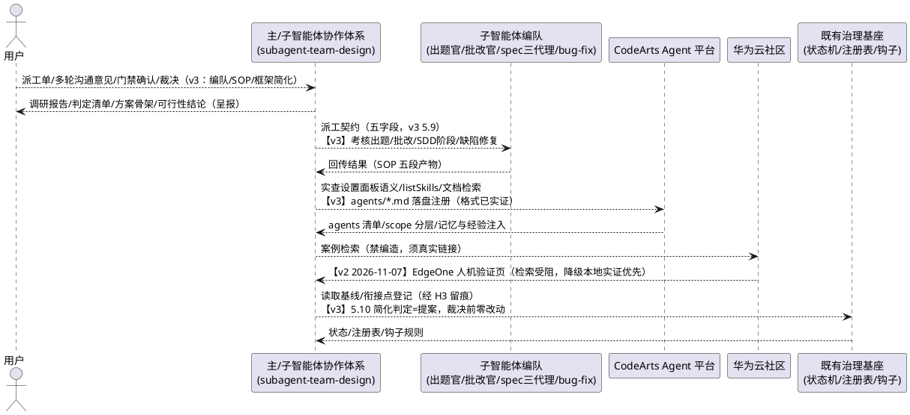

# **4. DFX约束**

## **4.1 性能**
1. 调研过程信息加载遵循"索引+事实表+至多 2 个命中条目"上限纪律，禁全量扫描。
2. 单次呈报结论前置：先结论后依据，摘要 ≤300 字。
3. 外部检索（社区/文档）同一问题 3 次尝试未成功必须停止转 SX 阻塞登记，禁盲目重试。

## **4.2 可靠性**
1. 全程留痕：调研/判定/呈报动作即落盘（H3 记变更日志、H7 刷事实表指针），禁事后批量补记。
2. 单一事实源：项目核心状态只存 notes/项目事实表.md，本 spec 及产出物只存指针不抄值。
3. 调研降级安全：案例数量不足时降级登记实查结果并呈报，禁编造凑数。

## **4.3 安全性**
1. 引用真实：所有外部案例/文档引用必须附真实 URL 与访问日期，禁编造；官方文档与推断必须分别标注。
2. 凭据零暴露：调研与产出物不含 API key、凭据等敏感信息。
3. 只读引用：外部参考仓库保持项目外隔离，禁复制入本项目。

## **4.4 可维护性**
1. 变更日志：spec 每轮修改记入 notes/知识库索引.md 变更日志。
2. 产出物索引：所有第一产出入库知识库索引，可按"三问三答"协议查询（做了什么/做到哪/产物在哪）。
3. 版本演进：spec 多轮迭代保留版本意识（呈报时标注轮次），禁覆盖丢失用户意见脉络。

## **4.5 兼容性**
1. 治理基座零破坏为默认：对状态机/注册表/钩子的任何改动必须先经三态判定+用户裁决，禁静默重构。
2. 仲裁顺序不变：规则>知识库>记忆>推断的仲裁顺序在本体系内沿用。
3. 既有实战成果继承：出题官/批改官 subagent 闭环、review-code 自动注册等已验证路径作为方案基线，不推倒重来。

# **5. 核心能力**

## **5.1 平台智能体体系调研**

### **5.1.1 业务规则**
1. **四层级语义澄清**：必须实查平台设置→智能体页面四层级（企业级/项目级/个人级/系统内置）的语义与 listSkills scope 字段（system/project/cloud_enterprise）的映射关系，并落盘结论。
   a. 验收条件：[调研报告产出] → [四层级各自含义、与 scope 字段对应关系、个人级是否在 API 可见范围内均有结论且每条标注"实查/推断"]
2. **系统内置主智能体差异**：必须对 3 个系统内置主智能体（智能问答/智能体/AgentTeam）产出差异对比与适用场景结论。
   a. 验收条件：[对比表产出] → [三者的定位差异、能力差异、适用场景各≥1 条结论，依据标注来源]
3. **主/子两级形态实证**：必须以"鸿蒙开发"（主）与 harmonyos-ascf/harmonyos-plugin（子）两级形态（listSkills 实证+用户图 3）为样本，描述主/子智能体的挂载、开关与协作表现。
   a. 验收条件：[形态描述产出] → [子智能体带开关的机制、子技能共享挂载方式（harmonyos 系技能同时挂 developer-test-agent 与主/子）均有实证描述]
4. **AgentTeam 与单智能体差异**：必须明确 AgentTeam 相对单智能体的组网差异（派工/汇报/隔离会话），并实查 `.codeartsdoer/agent-team/` 与 `.codeartsdoer/agents/` 空目录的结构语义。
   a. 验收条件：[实查完成] → [两目录的角色结论（确认/排除/存疑）落盘，存疑项列入未决事项呈报]
5. **前后端能力边界**：必须实证哪些智能体配置可由后端（Agent 写文件/工具）完成、哪些必须用户前端界面操作，逐项标注。
   a. 验收条件：[边界清单产出] → [每一配置项标注"用户操作"或"后端动作"，标注依据为实查证据（如 review-code 创建后 ProjectSkillStatus.txt 自动出现）]
6. **禁止项**：禁止在无实查证据时给出平台能力断言。
   a. 验收条件：[任一结论无证据] → [必须标注"推断"或列入未决事项，禁冒充实查]

### **5.1.2 交互流程**

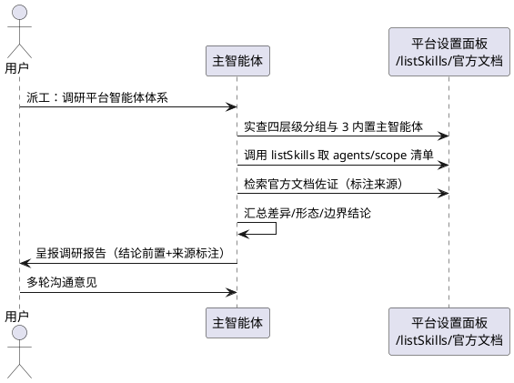

### **5.1.3 异常场景**
1. **界面语义无法后端实查**
   a. 触发条件：四层级中个人级等分组在 listSkills/文件系统均不可见。
   b. 系统行为：以已可见部分下结论，不可见部分登记未决事项。
   c. 用户感知：呈报"该项需用户界面截图佐证"，禁臆断。
2. **目录结构语义存疑**
   a. 触发条件：agent-team/agents 目录为空或结构无法判定用途。
   b. 系统行为：登记未决事项（U 编号）并在报告中标注存疑。
   c. 用户感知：结论分"确认/排除/存疑"三态呈现。
3. **官方文档检索失败**
   a. 触发条件：文档检索 3 次未命中。
   b. 系统行为：停止重试，以本地实证为据完成报告，缺口列未决。
   c. 用户感知：呈报检索失败原文+已有结论降级说明。

## **5.2 华为云社区真实案例调研**

> 【v2 2026-11-07】受阻降级呈报：support.huaweicloud.com 现被腾讯 EdgeOne 人机验证拦截（curl 返回 Security Verification 验证页，原文已留痕），官方文档检索与社区案例调研暂不可达。按本章 5.2.1 第 4 条降级规则处理：降级为"**本地实证优先**"（目录实查+Task Worker 行为+skills 注册先例为据），案例调研待网络恢复或用户提供资料后回迁；≥5 案例门槛暂停计数，禁编造凑数。

### **5.2.1 业务规则**
1. **案例数量**：必须调研不少于 5 个与主/子智能体或 AgentTeam 实战匹配的华为云社区案例。
   a. 验收条件：[调研报告产出] → [≥5 个案例各含标题、URL、访问日期、核心做法、与本项目的匹配点]
2. **真实性红线**：所有案例必须来自真实检索结果，禁编造 URL 与内容。
   a. 验收条件：[每个案例入表] → [URL 可访问或附"检索时间+失败原文"；无法核实即剔除，不计入 5 个门槛]
3. **匹配度标注**：每案例必须标注其与"主/子智能体方案"的具体匹配维度（组网形态/任务路由/留痕/经验沉淀等）。
   a. 验收条件：[案例入表] → [匹配维度≥1 项且说明可借鉴点与不适用点]
4. **降级规则**：实查后可用案例不足 5 个时，禁止凑数。
   a. 验收条件：[可用案例<5] → [呈报实得数量+检索过程证据+缺口，由用户裁决是否扩源或接受降级]

### **5.2.2 交互流程**

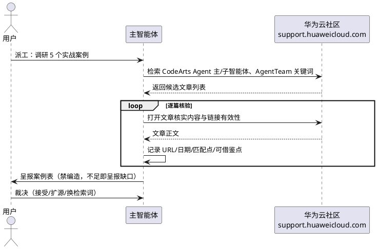

### **5.2.3 异常场景**
1. **检索结果空/不相关**
   a. 触发条件：关键词检索无命中或命中文章与主题无关。
   b. 系统行为：换关键词≤3 轮（如"智能体 编排""AgentTeam 实战""子智能体"），仍不足则降级呈报。
   c. 用户感知：呈报已尝试的检索词与命中数，等待裁决。
2. **链接失效**
   a. 触发条件：候选文章 URL 无法访问。
   b. 系统行为：剔除该案例并记录失败原文，不计入门槛数量。
   c. 用户感知：案例表只保留可核验条目。
3. **网络中断**
   a. 触发条件：社区站点连续 3 次不可达。
   b. 系统行为：转 SX 阻塞登记（原因/恢复条件/回迁目标/时间），暂停该项。
   c. 用户感知：呈报阻塞四字段，恢复后继续。

## **5.3 现有自定义逻辑盘点与合理性判定**

### **5.3.1 业务规则**
1. **盘点范围**：必须覆盖 H1–H7 事件钩子、阶段状态机（ST0–ST5+SX）、注册表（两级/12 挂载项/六要素）、五步准入、学习沉淀机制、经验库（experience-reuse）六大块。
   a. 验收条件：[盘点清单产出] → [六大块每块有现状描述（附文件指针）+对标观察+三态判定]
2. **对标基准**：判定必须以平台"经验与记忆"系统为对标（文件式记忆库+启动注入+按用户消息检索注入+反思窗口+collect/refine 工具+轨迹 JSONL），逐维度比对。
   a. 验收条件：[每项判定] → [注明对标平台哪个机制、用户关切（"动态性不足、像状态机维护的知识库而非数据库"）得到正面回应]
3. **三态判定与重构维度**：每项判定必须落为"合理保留/不合理重构/缺失补建"之一，重构项必须给出重构维度（≥1 个：触发方式/存储形态/更新时机/检索注入/留痕审计/生命周期）与影响面。
   a. 验收条件：[判定产出] → [重构项有维度+影响面+衔接改动点；保留项有保留理由；补建项有补建目标]
4. **禁止项**：禁止静默重构任何判定为"不合理"的机制；重构必须先经用户裁决。
   a. 验收条件：[判定完成] → [重构清单仅呈报待裁决，未裁决前既有机制照常运行]

### **5.3.2 交互流程**

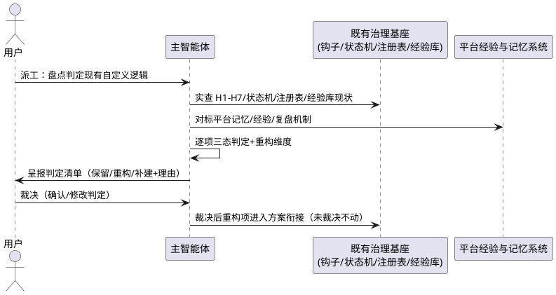

### **5.3.3 异常场景**
1. **对标机制无法确证**
   a. 触发条件：平台某机制（如反思窗口内部逻辑）无法从文档/实查确证。
   b. 系统行为：以可观察行为（配置文件、注入表现）为据，内部机制标"推断"。
   c. 用户感知：判定附证据等级标注。
2. **判定争议**
   a. 触发条件：某项合理性与用户意见不一致。
   b. 系统行为：呈现双方依据，登记争议项等待裁决，不擅自定论。
   c. 用户感知：争议项单独成节呈报。
3. **盘点中触发既有钩子冲突**
   a. 触发条件：盘点动作命中 H2/H3 检查点冲突。
   b. 系统行为：按钩子规程呈报冲突，仲裁顺序处理。
   c. 用户感知：冲突原文+仲裁结果呈报。

## **5.4 主/子智能体架构方案骨架**

> 【v3 2026-11-07】衔接说明：本章保留为架构骨架级需求（分工标注/配合三要素/基座衔接）；编队细化（几个子智能体、各自职责与构建）移交 5.8 章，SOP 定义移交 5.9 章，框架层简化移交 5.10 章，本章不重复。

### **5.4.1 业务规则**
1. **分工标注**：方案中所有动作必须二选一标注："用户操作"（前端界面）或"后端动作"（Agent/工具完成），不允许未标注项。
   a. 验收条件：[方案骨架产出] → [分工清单完整，用户操作项集中列出让用户一目了然]
2. **配合机制三要素**：方案必须定义任务路由（依据注册表"调用理由"派工）、汇报（子智能体完成后向主智能体回传结果）、留痕（派工与结果落盘执行轨迹）三项机制。
   a. 验收条件：[机制描述产出] → [三要素各有触发事件、数据流向、留痕位置；全程事件驱动，零定时任务]
3. **治理基座衔接**：方案必须明确与状态机（ST5 持续态）、注册表（新子智能体走五步准入登记六要素）、钩子（H1–H7 通道复用）、经验库（子智能体产出沉淀路径）的衔接点。
   a. 验收条件：[衔接节产出] → [四个基座各有衔接方式描述；新子智能体登记路径=五步准入，无旁路]
4. **方案落位**：方案骨架及其后续细化文档必须落盘于 specs/subagent-team-design/ 专门文件夹，并登记知识库索引。
   a. 验收条件：[文件写入] → [路径可查+索引变更日志留痕（H3）]
5. **禁止项**：禁止方案引入定时任务、破坏仲裁顺序、绕过单一事实源。
   a. 验收条件：[任一条款疑似引入] → [呈报冲突，禁落盘]

### **5.4.2 交互流程**

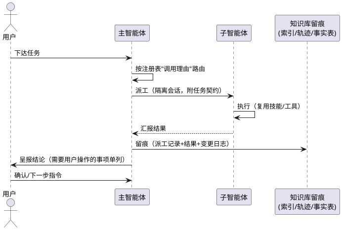

### **5.4.3 异常场景**
1. **无匹配子智能体**
   a. 触发条件：路由时注册表无命中条目。
   b. 系统行为：主智能体自行执行或提出新子智能体提案（走五步准入）。
   c. 用户感知：呈报路由未命中+处置选择。
2. **子智能体执行失败**
   a. 触发条件：子智能体汇报失败或超时无响应。
   b. 系统行为：按 3 次上限纪律，失败转 SX 登记，结果留痕。
   c. 用户感知：呈报失败原文+阻塞四字段。
3. **配合机制与钩子并发冲突**
   a. 触发条件：多子智能体汇报同时命中同一钩子。
   b. 系统行为：沿用幂等去重纪律（先到先处理，其余登记重复命中）。
   c. 用户感知：静默留痕，异常时呈报。

## **5.5 后端直接生成子智能体的可行性**

### **5.5.1 业务规则**
1. **可行性结论**：必须基于实证（非推断）回答"后端能否直接生成子智能体"，给出可行/不可行/部分可行的结论。
   a. 验收条件：[结论产出] → [结论+实证依据链（agent-team/agents 目录实查、skills 自动注册实证、平台文档引用），推断部分单独标注]
2. **若可行则路径化**：结论为可行/部分可行时，必须给出后端生成子智能体的实施路径（含留痕方式）。
   a. 验收条件：[路径产出] → [每步骤标注"后端动作"或"用户操作"；后端生成动作留痕位置明确]
3. **若不可行**：结论为不可行时，必须给出替代路径（前端操作指引+后端产草稿）。
   a. 验收条件：[替代路径产出] → [用户操作步骤清单可执行，Agent 产草稿的交付形式明确]
4. **留痕红线**：无论哪种结论，后端执行的生成动作必须留痕（写文件即记变更日志）。
   a. 验收条件：[任一生成动作] → [变更日志+索引登记同步完成，无痕即违规]
5. 【v2 2026-11-07】**三态结论（初步实证已落定）**：用户指令"先调研后端能不能直接生成子智能体，这是所有工作的前提"已完成初步实证，结论按三态登记：
   - ①**运行时子智能体（Task Worker 派工）=可行，已验证**：Task 工具派独立会话 Worker（出题官/批改官/spec 三代理）实战多次成功；用户级 C:\Users\Administrator\.codeartsdoer\agent-team\session\ses_* 目录为这些 subagent 会话的存档实证（证据等级：实查）。
   - ②**持久化注册自定义子智能体（设置页形态）=部分可行/待实证**：磁盘有预留载体（用户级 agent-team\roles\、agent-team\scene\ 目录存在但全空；项目级 agent-team/ 同构全空；agents/ 用户级与项目级均空），格式未实证；skills 有文件创建自动注册先例（review-code 创建后 ProjectSkillStatus.txt 自动出现），agents 无实例可参照格式（证据等级：实查）。
   - ③**建议路径**：用户前端创建一个最小测试子智能体 → 后端实查 roles/scene 生成文件格式 → 格式确认后即可后端批量生成（skills 自动注册先例的等价逻辑）（证据等级：推断，待实验验证）。
   a. 验收条件：[结论登记] → [三态各附实证依据链，实查与推断分级标注；推断项列入待验证实验呈报]
6. 【v2 2026-11-07】**前后端分工清单**：必须维护用户前端操作项与后端动作项的分隔清单，用户操作项集中列出供用户一目了然：
   - **用户前端操作项**：①创建最小测试子智能体（反推持久化格式，建议路径第 1 步）；②规则修订类操作（如 5.7 裁决后的规矩精简落盘、规则粘贴）；③平台设置页智能体配置确认。
   - **后端动作项**：①Task Worker 派工（已验证可用）；②roles/scene 生成文件格式实查与批量生成（格式确认后）；③技能/规则合理性方案产出（5.7 章）；④全程留痕（变更日志/事实表指针/索引登记）。
   a. 验收条件：[分工清单呈现] → [每项标注执行方（用户操作/后端动作）二值枚举，无未标注项]

### **5.5.2 交互流程**

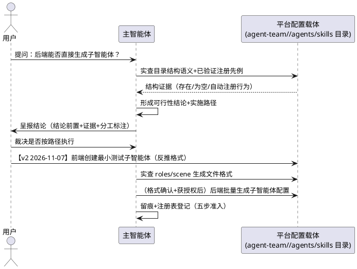

### **5.5.3 异常场景**
1. **证据不足以定论**
   a. 触发条件：目录语义与文档均无法确证生成机制。
   b. 系统行为：结论降级为"部分可行+待验证"，提出最小验证实验设计（交用户裁决后执行）。
   c. 用户感知：呈报结论置信度与验证建议。
2. **生成后平台不识别**
   a. 触发条件：后端写入配置后平台未注册生效。
   b. 系统行为：记录现象，回退至前端路径，登记未决事项。
   c. 用户感知：呈报失败证据+前端操作指引。
3. **越权风险**
   a. 触发条件：生成动作超出用户授权范围。
   b. 系统行为：阻断并呈报待授权，禁先斩后奏。
   c. 用户感知：授权请求（范围+影响面）。
4. 【v2 2026-11-07】**官方文档与社区渠道受阻**
   a. 触发条件：华为云文档站被腾讯 EdgeOne 人机验证拦截（已发生：curl 返回 Security Verification 页，原文留痕）。
   b. 系统行为：以本地实证（目录实查+Task Worker 行为+skills 注册先例）为据完成结论，文档缺口登记未决事项。
   c. 用户感知：呈报拦截原文+降级说明；恢复条件=网络恢复或用户提供官方资料。

## **5.6 需求门禁与多轮呈报**

### **5.6.1 业务规则**
1. **第一阶段产出即停**：spec.md 生成后必须呈报用户预览并停止，禁进入 design/tasks。
   a. 验收条件：[spec.md 落盘] → [预览+文件路径呈现+明确的审查请求，无任何下游阶段动作]
2. **多轮迭代**：用户每轮提出修改意见必须更新 spec.md 并重新呈报，直至用户明确确认。
   a. 验收条件：[收到修改意见] → [spec.md 更新+变更日志留痕+再次呈报；轮次标注清晰]
3. **确认后放行**：仅当用户明确确认（如"OK/确认/无修改"）后，才允许进入 design 阶段（由 spec-design-agent 负责）。
   a. 验收条件：[用户确认] → [登记确认证据（日期+原文指针），门禁放行留痕]
4. **禁止项**：禁止在未确认状态下实施任何重构、生成子智能体或写入方案细节文档。
   a. 验收条件：[未确认期间] → [仅 spec.md 迭代与调研留痕允许，其余动作阻断]

### **5.6.2 交互流程**

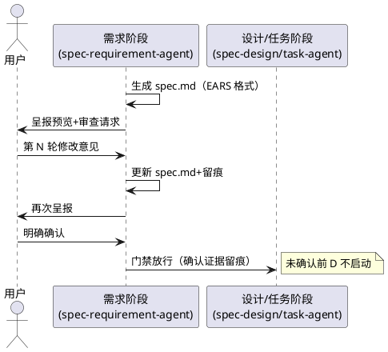

### **5.6.3 异常场景**
1. **用户长期未响应**
   a. 触发条件：呈报后等待确认超过当前会话窗口。
   b. 系统行为：spec.md 与状态留盘，事实表登记"待确认"指针，下次会话 H1 注入后可续。
   c. 用户感知：产物路径+当前轮次可查（三问三答协议）。
2. **修改意见与门禁红线冲突**
   a. 触发条件：用户意见涉及改规则/删文件/定时任务等红线。
   b. 系统行为：呈报冲突（意见原文 vs 公约条款），按仲裁顺序处理。
   c. 用户感知：冲突对照+豁免需明示的提示。
3. **误触下游阶段**
   a. 触发条件：确认前任何动作试图生成 design.md/tasks.md。
   b. 系统行为：H6 门禁拦截，阻断并留痕违规。
   c. 用户感知：呈报拦截原因。

## **5.7 技能/规则合理性方案**【v2 2026-11-07 新增】

> 来源：用户新消息（2026-11-07 语音+2 张截图），观点原话："规矩太多了，越简单越好；有些东西应该分装成技能而非规矩"。审视对象=10 条扩展公约（.codeartsdoer/rule/项目协作公约.mdc）与既有技能体系。
> 【v3 2026-11-07】裁决基线落地（用户已批准，记录为裁决基线）：①6 条精简规矩草稿已批准——待用户界面粘贴替换 10 条版，规矩层冻结，Agent 禁自改 .mdc，替换前后以 H4 规则变化钩子感知并呈报；②learn-gate/register-feature 两个新技能已批准并创建（平台注册实证 learn-gate=true/register-feature=true，注册表已登记）；③test_mini 实验品保留但已禁用（agents/test_mini.md disable=true，留存备查）。本章判定表与草稿的"待裁决"状态就此收口；后续技能/规则合理性新诉求按本章流程再走。

### **5.7.1 业务规则**
1. **逐条判定**：必须对 10 条扩展公约逐条给出四态判定之一：保留为规矩 / 分装为技能 / 合并精简 / 删除候选。
   a. 验收条件：[判定表产出] → [10 条各含现状摘要、判定、理由、影响面四字段；每条理由至少引用 1 个参考依据]
2. **五项目经验复用（禁重复调研）**：判定依据必须复用 kb_arch_foundation 已验证的 J1–J5 框架治理经验（J1 autogen 多代理对话编排 / J2 langgraph 图式编排 / J3 dify 低代码+License 治理 / J4 MetaGPT 维护衰减反例 / J5 OpenHands 事件流运行时），以指针引用，禁重新调研。
   a. 验收条件：[判定表产出] → [引用以指针形式指向 .codeartsdoer/specs/kb_arch_foundation/st2-materials.md（J1–J5 清单与验证状态）、st2-exam-answers.md（B10/E9/E10 等作答）、st2-exam-key.md（三条军规），零重复调研动作]
3. **产出物**：必须产出精简后的规矩草稿+技能封装清单两份成果，落盘于 specs/subagent-team-design/ 同目录。
   a. 验收条件：[文件写入] → [①规矩草稿：保留/合并后公约条文全文，合并条目标注来源原条号；②技能封装清单：每项含技能名、封装内容（由哪条规矩转化）、触发条件（写入 SKILL 描述）、登记方式（注册表六要素）；路径可查+知识库索引留痕（H3）]
4. **裁决红线（禁止项）**：判定与草稿仅为提案，规则文件实际改动必须经用户明示裁决；"分装为技能"的新技能创建按公约第 9 条走"先登记再使用"（SKILL 生成+注册表六要素+变更日志）；冻结条款（规则第 5 条）的豁免须用户明示。
   a. 验收条件：[裁决前] → [既有 10 条公约照常生效零改动；草稿不写入 .codeartsdoer/rule/，仅存 specs/subagent-team-design/]
5. **精简原则**：判定必须回应用户"越简单越好"诉求——优先合并重复项、优先将操作型条款（如编码必审、新功能登记）分装为技能，保留原则型条款（如 SDD 流程、单一事实源、仲裁顺序）为规矩。
   a. 验收条件：[精简草稿产出] → [草稿条文数 ≤ 原条文数；每条删除/合并/分装均有理由；原则型保留清单单独列出]

### **5.7.2 交互流程**

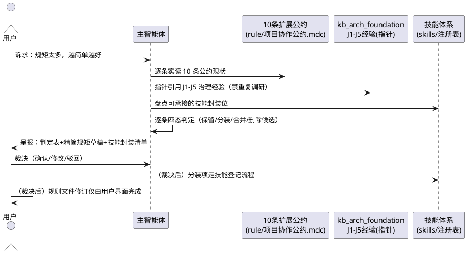

### **5.7.3 异常场景**
1. **冻结条款冲突**
   a. 触发条件：精简诉求触碰规则第 5 条"规矩层冻结"。
   b. 系统行为：呈报冲突对照（用户诉求 vs 公约条款），豁免权交用户明示，禁擅自改规则。
   c. 用户感知：冲突对照+豁免声明要求。
2. **判定争议**
   a. 触发条件：某条公约判定与用户直觉不一致。
   b. 系统行为：呈现双方依据（公约原文+J1–J5 经验指针），登记争议项待裁决。
   c. 用户感知：争议项单独成节呈报。
3. **技能承接位不足**
   a. 触发条件：某操作型条款无法映射为既有技能形态（无明确触发事件）。
   b. 系统行为：保留为规矩并在清单中说明不可分装原因，禁强行封装。
   c. 用户感知：不可分装项附原因说明。

## **5.8 子智能体编队规划（数量+职责+构建）**【v3 2026-11-07 新增】

> 来源：用户 v3 裁决批评"调研方案方向太窄"，要求回答"重构完了之后一共要定义几个子智能体？怎么构建？"。数量原则=克制：每新增一个成员必须论证不可合并。依据素材（全部实测）：8 个 project 技能、平台 Worker 类型（bug-fix/developer-test/spec 三代理）、出题官/批改官实战先例（st2 考核 50 题+批改自信度 96%）、test_mini 实验品（格式实证，已禁用）、J1–J5 经验指针（复用 st2-materials，禁重复调研）。

### **5.8.1 业务规则**
1. **编队总数与结构**：重构后编队=1 主智能体+2 持久化子智能体+4 类运行时 Worker（其中 2 类平台内置零自定义、1 类按需临时定义、1 类已禁用留存），**新增定义仅 2 个**（出题官/批改官持久化），其余全部复用平台既有或按需临时化。
   a. 验收条件：[编队清单产出] → [总数字段明确（1 主+2 持久化+4 运行时）+每成员七字段齐备+新增/复用属性标注]
2. **编队完整清单（核心交付）**：必须落盘完整编队清单，每成员含 名称/形态/职责/挂载技能/触发条件/与主智能体分工/存在理由（不可合并论证）字段：

| 编号 | 名称 | 形态 | 职责 | 挂载技能 | 触发条件 | 与主智能体分工 | 存在理由（不可合并论证） |
|------|------|------|------|---------|---------|--------------|------------------------|
| M0 | developer-test-agent | 主智能体 | 任务路由+唯一对外汇报+知识库调度（H1–H7）+状态机维护 | 全部 8 个 project 技能 | 用户消息进入 | 编排者：只做路由/汇报/留痕，不直接做长流程执行，防执行噪声污染路由决策（P3 Router/Worker 编排理论） | 唯一用户接口与治理中枢，并入任何子智能体即丧失对外单一出口 |
| S1 | exam-setter（出题官） | 持久化（agents/*.md） | learn-gate 考核出题（每角度 10 题，题目与答案要点分离两文件） | 无技能依赖（read/write 即可） | learn-gate 第 4 步考核环节（事件触发） | 主智能体下发材料清单指针→出题官交付题目+key 两文件→主智能体组织执行代理作答 | 考教分离红线：出题者与执行代理必须隔离（key 不能进执行代理上下文，否则考核失效）；流程固定+高频复用（每次新框架接入必考），持久化免除每次重写提示词；实战先例已验证（st2 出题 50 题） |
| S2 | exam-grader（批改官） | 持久化（agents/*.md） | 独立批改作答+综合自信度判定（learn-gate ≥80% 门禁依据） | 无技能依赖（read 即可） | 执行代理作答完成事件 | 主智能体提交题目+key+作答三件→批改官交付判定报告（逐题 PASS/PARTIAL/FAIL+自信度） | 独立裁判红线：执行代理自批=既当运动员又当裁判，判定失去客观性；自信度直接驱动门禁放行，须独立会话背书；实战先例已验证（96% 判定）；与 S1 不可合并——出题时 key 须对作答方隔离、批改时 key 是输入，一体则批改上下文已含出题意图，客观性下降 |
| W1 | spec 三代理 | 运行时 Worker（平台内置） | SDD 流水线三阶段文档生成与迭代（spec/design/tasks） | 平台 spec 能力 | SDD 各阶段开工（规则第 1 条强制） | 主智能体凭用户确认放行门禁→派工对应阶段代理→回收文档呈报用户 | 平台既有形态+三阶段互为前置审查（规格/设计/任务独立视角）；阶段化隔离会话防上下文互染；已实战验证；不并入主智能体（SDD 文档工作量大且须独立视角） |
| W2 | bug-fix Worker | 运行时 Worker（平台内置） | 缺陷定位/复现/修复/补丁 | bug-fix 族工具 | bug 修复任务进入 | 主智能体派工（附缺陷现象+复现指针+验收标准契约）→Worker 执行→结果回传留痕 | 复用评估表已登记"执行代理不可直接调用，经 Worker 派工"；定位/复现/验证循环自成一体，混入主智能体路由上下文会干扰编排；平台内置零自定义成本 |
| W3 | 调研 Worker | 运行时 Worker（按需临时定义，不持久化） | 外部检索/目录实查/材料收集（learn-gate 第 1–2 步、平台能力调研、案例检索） | find-skills（按需） | 主智能体判定检索量大或须上下文隔离时（事件：调研契约下发） | 主智能体下发调研契约（问题+范围+来源约束）→Worker 回传证据链纪要 | 上下文隔离：webfetch/browser 检索噪声不污染主智能体路由决策；低频场景按需 Task 派工即可，持久化反增维护面（J4 MetaGPT 维护衰减教训：定义越多维护负担越重）——故不持久化 |
| X0 | test_mini | 已禁用实验品（不入编队） | 已禁用（disable=true），留存备查 | 无 | 不触发 | 无 | 格式验证使命已完成（agents/*.md 注册机制实证），保留作格式参照样本与回滚实验位 |

   a. 验收条件：[清单落盘] → [7 行齐备+每行七字段非空（X0 除外）+每行存在理由含"为什么单独一个而不是并入其他"的正面论证]
3. **克制论证（反设必须呈报）**：spec 必须记录"为什么不更多/不少"的反设结论——出题官与批改官不可合并（考教分离+批改客观性，论证见上表 S2 行）；调研不设常驻子智能体（低频，按需即可）；编码实施不设专职子智能体（ST5 编码由主智能体执行+review-code 技能审查，尚无编队必要，若后续编码任务量大可在实施阶段再评估走 register-feature 准入）。
   a. 验收条件：[反设结论在档] → [至少覆盖"考核官合一""调研常驻化""编码专职化"三个反设方向并给出否定/暂缓结论]
4. **构建方式**：S1/S2 按 test_mini 已实证格式（.codeartsdoer/agents/<name>.md=YAML frontmatter+正文 SOP）由后端批量生成，frontmatter 必须 description 含触发条件、permission.skill 按最小授权、mode 子智能体；生成动作必须先走 register-feature 五步准入（查复用评估表→归类→生成→注册表登记六要素→H3 留痕）；W1/W2 平台内置直接复用零改动；W3 无持久化文件，按需 Task 派工附五字段契约。
   a. 验收条件：[构建路径产出] → [每成员标注构建方式（后端生成/平台内置/按需派工）+S1/S2 标注"须走 register-feature 五步准入"+禁旁路登记]
5. **触发全事件化（禁止项）**：编队所有成员触发一律走事件通道（技能流程环节/作答完成/SDD 阶段开工/bug 任务进入/契约下发），禁自建定时任务、禁轮询派工。
   a. 验收条件：[任一成员触发方式审查] → [触发源为既有事件通道之一（注入/消息/diff/动作检查点/后台任务），零定时器]

### **5.8.2 交互流程**

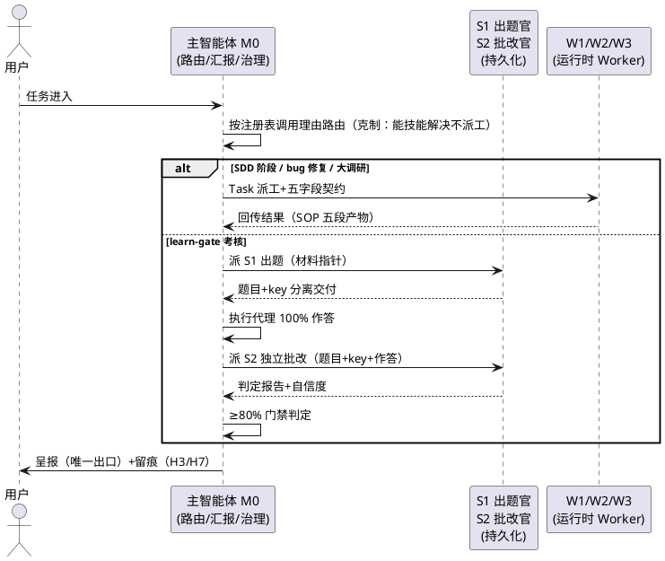

### **5.8.3 异常场景**
1. **派工无匹配成员**
   a. 触发条件：任务路由时编队无命中（既非考核/SDD/bug/调研场景）。
   b. 系统行为：主智能体自行执行或提出新成员提案（走 register-feature 五步准入+不可合并论证），禁未经论证私自扩编。
   c. 用户感知：呈报路由未命中+处置选择（自执行/扩编提案）。
2. **持久化成员注册未生效**
   a. 触发条件：agents/*.md 落盘后平台未识别（理论上已被 test_mini 排除，仍保留防御）。
   b. 系统行为：记录现象→回退运行时 Task 派工通道（双通道互备）→登记未决事项。
   c. 用户感知：呈报失败证据+降级说明，考核流程不断链。
3. **成员执行失败/超时**
   a. 触发条件：子智能体汇报失败或超时无响应。
   b. 系统行为：同一问题 3 次上限，失败转 SX 登记（四字段），结果留痕；考核场景可回退主智能体临时充当执行代理但禁充当批改官（独立性红线）。
   c. 用户感知：呈报失败原文+阻塞四字段+回退方案。
4. **编队膨胀回潮**
   a. 触发条件：后续迭代中出现"给每个小场景都建子智能体"的提案倾向。
   b. 系统行为：以 5.8.1 第 3 条克制论证拦截——无不可合并论证即驳回提案并留痕。
   c. 用户感知：驳回理由呈报（引本条）。

## **5.9 子智能体 SOP 标准流程定义**【v3 2026-11-07 新增】

> 来源：用户 v3 裁决："重构后的那些智能体的 SOP（标准流程）怎么定？"格式统一五段：输入→步骤→输出→完成判据→升级路径。载体实证：SOP 写进 SKILL.md 正文即"标准流程"（learn-gate/register-feature 两技能已实证此写法）；agents/*.md 持久化注册+skills 挂载=执行载体（test_mini 已实证）；运行时 Worker 以派工契约实例化同一五段格式。

### **5.9.1 业务规则**
1. **统一五段格式（强制）**：编队每个成员的 SOP 必须含五段——输入（派工下发材料与字段）/步骤（编号动作序列）/输出（产出物+落盘位置+留痕要求）/完成判据（可判定条件，二值或数值）/升级路径（失败/超界上报路径）；缺任一段即 SOP 无效。
   a. 验收条件：[每个 SOP 审查] → [五段齐备+完成判据为可判定表述（禁"尽量/适当"）+升级路径终点为主智能体或 SX]
2. **SOP 载体归属**：持久化子智能体（S1/S2）SOP 写入 agents/<name>.md 正文（frontmatter 注册+正文 SOP，同 test_mini 模式）；运行时 Worker（W1/W2/W3）SOP 由主智能体派工契约承载（第 8 条模板）；技能型流程（review-code/learn-gate/register-feature）SOP 已在各自 SKILL.md 正文（实证在档，不在本章重复定义）。
   a. 验收条件：[载体登记] → [每成员标注 SOP 载体（agents 正文/派工契约/SKILL.md）+路径可查]
3. **S1 出题官 SOP（定义）**：
   - 输入：学习材料清单指针（st2-materials 式）+学习成果条目指针+考核角度列表+每角度题数（默认 10）。
   - 步骤：①读材料清单与学习成果→②按角度各出 10 题（覆盖记忆/理解/应用三级）→③答案要点单独成 key 文件（与题目文件分离）→④交付题目文件+key 文件+出题说明。
   - 输出：题目+key 两文件落 specs 同目录（考核证据链成员，命名沿用 st2-exam-questions/key 模式）。
   - 完成判据：每角度题数齐+题答分离两文件+key 与题目逐题对应可对照。
   - 升级路径：材料缺失/歧义→上报主智能体补材料（禁自行放宽出题或缩量）；连续 3 次交付不合格→转 SX 登记。
4. **S2 批改官 SOP（定义）**：
   - 输入：题目文件+key 文件+执行代理作答文件（三件齐套才可开批）。
   - 步骤：①逐题对照 key 批改→②每题判 PASS/PARTIAL/FAIL 三值→③汇总各角度得分→④计算综合自信度（数值）→⑤出判定报告（含 ≥80% 门禁结论二值判定）。
   - 输出：批改报告落 specs 同目录（st2-exam-review 模式）。
   - 完成判据：全部题目逐题有判定+自信度数值明确+门禁结论明确（放行/补学二值）。
   - 升级路径：作答与题目无法对应→上报主智能体核归档；禁与执行代理协商改判、禁受主智能体倾向性暗示（独立性红线）。
5. **W1 spec 三代理 SOP（定义）**：平台内置流程为准；主智能体派工契约必含——阶段名称（spec/design/task）+上游文档指针+用户上轮意见原文+预期产出路径+完成判据。完成判据=对应阶段文档落盘+呈报预览就绪；升级路径=门禁未过（用户未确认）即停在该阶段呈报，禁代用户确认。
6. **W2 bug-fix Worker SOP（定义）**：平台内置流程为准；派工契约必含——缺陷现象描述+复现指针（日志/报错原文/截图）+验收标准。完成判据=修复补丁+复现验证结论（复现消失）；升级路径=无法复现或修复 3 次失败→转 SX+呈报用户裁决。
7. **W3 调研 Worker SOP（定义）**：
   - 输入：调研问题+范围边界+来源约束（禁编造、真实 URL、来源分级标注）。
   - 步骤：①检索/实查→②逐条记录证据（来源+URL/路径+访问日期）→③按"结论前置+证据分级（实查/推断）"汇总→④回传主智能体。
   - 输出：调研纪要（证据链完整，每条结论附证据指针）。
   - 完成判据：每条结论附证据+标注来源类型；同一检索 3 次未成功必须停止并上报（禁盲目重试）。
   - 升级路径：网络受阻（EdgeOne 式拦截）→呈报拦截原文+降级本地实证建议，由主智能体转呈用户。
8. **主智能体派工契约模板（统一载体）**：Task 派工时必附五字段契约——任务描述/输入材料指针/预期产出/完成判据/升级路径；契约即运行时 Worker 的 SOP 实例化，缺字段=派工无效，Worker 可拒收。
   a. 验收条件：[模板固化] → [五字段名称固定+随每次 Task 派工下发+留痕于执行轨迹]
9. **SOP 变更纪律**：SOP 修订视同能力变更，必须走 register-feature 五步准入登记+H3 留痕；禁在派工契约外口头改流程。
   a. 验收条件：[任一 SOP 修改动作] → [注册表条目更新+变更日志记行，无痕即违规]

### **5.9.2 交互流程**

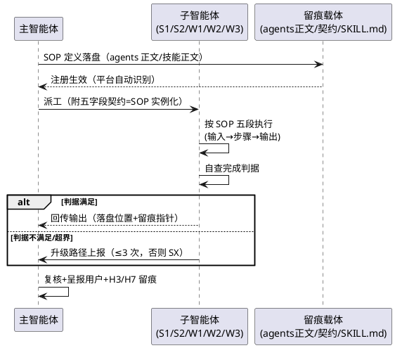

### **5.9.3 异常场景**
1. **SOP 五段缺失**
   a. 触发条件：任一成员 SOP 审查发现缺段（如无升级路径）。
   b. 系统行为：判定 SOP 无效，补全前该成员禁派工；补全走 SOP 变更纪律。
   c. 用户感知：呈报缺失段位+补全计划。
2. **完成判据不可判定**
   a. 触发条件：判据含"尽量/适当"等模糊表述，无法二值/数值判定。
   b. 系统行为：退回重写判据；执行中不得以模糊判据自行宣布完成。
   c. 用户感知：呈报不可判定项+改写建议。
3. **契约字段不全被拒收**
   a. 触发条件：Worker 收到五字段不全的派工契约。
   b. 系统行为：Worker 拒收并回呈缺字段清单，主智能体补齐重派；禁 Worker 凭猜测开工。
   c. 用户感知：静默（补齐重派正常流转）；重复发生 2 次以上呈报。
4. **升级路径终点缺失**
   a. 触发条件：失败场景超出 SOP 升级路径覆盖（未定义的异常）。
   b. 系统行为：Worker 停止执行+原样上报现场（禁自行发挥），主智能体按仲裁顺序处置或转 SX。
   c. 用户感知：呈报未定义异常原文+处置结果。

## **5.10 治理栈框架层简化重构**【v3 2026-11-07 新增】

> 来源：用户 v3 裁决："现在的框架比较复杂，我需要你从框架层怎么重构重新给我提建议。"目标=**框架更简单但治理能力不降级**。盘点对象=治理栈全组件（H1–H7 钩子+状态机+注册表+复用评估表+五步准入+三问自检+三问三答+四查门禁+双通道子智能体+知识库三级加载）。判定依据=J1–J5 经验指针（复用 st2-materials，禁重复调研）：J2 langgraph 图式编排（状态机正例）、J4 MetaGPT 维护衰减反例（定义越多维护负担越重——复杂度即衰减源）、J5 OpenHands 事件流运行时（事件驱动正例）、J1 autogen 多代理编排（编队参照）、J3 dify 低代码治理（简洁分层正例）。

### **5.10.1 业务规则**
1. **全栈盘点与三态判定**：必须对治理栈每个组件给出四态判定之一：合并 / 降为惯例 / 保留硬约束 / 保留原样，每条附处置、理由（含 J 指针）、治理能力不降级论证：

| # | 治理组件 | 判定 | 处置 | 理由（J 指针） | 治理能力不降级论证 |
|---|---------|------|------|--------------|------------------|
| 1 | H1 会话启动注入 | 保留原样 | 平台原生通道不动 | J5（事件流起点） | 注入是治理链第一环 |
| 2 | H2 采信记忆前 / H3 写库前 / H7 事实变更（三个动作级检查点） | **合并** | 合并为单一"动作检查点规程"（H3 为文档载体），规程内保留三个检查位：采信前核对 / 写前查重 / 变更后刷新 | 三者同为"动作内嵌检查点"通道，执行模式相同（核对→放行或呈报+留痕），三处分散描述一处承载即可 | 检查位一个不减，仅合并规程文本；触发时机逐位保留 |
| 3 | H4 规则变化 | 保留原样 | 平台原生 diff 通道+比对分支不动 | J5 | 独有内容级通道，不可并入动作检查点 |
| 4 | H5 反思窗口 | 保留原样 | 平台托管不动 | — | 平台原生兜底，非触发主体 |
| 5 | H6 门禁执行 | **合并** | 并入状态迁移守卫：一处定义"门禁=迁移守卫检查单"（阶段状态机运行规则 §2 与 H6 对象同一，两处描述收敛为一处） | 与守卫同为动作检查点且检查对象同一（阶段准出） | 检查单内容与三要素（准出+证据+留痕）不变 |
| 6 | 阶段状态机 ST0–ST5+SX | 保留硬约束 | 七态+迁移三要素+SX 四字段不变 | J2（图式编排正例：状态机是治理主干） | SDD 门禁核心，不简化 |
| 7 | 注册表六要素+五步准入 | 保留硬约束 | 已技能化（register-feature），机制不动 | — | 新功能准入红线（规则第 9 条流程化） |
| 8 | 复用评估表 | **合并** | 并入注册表：注册表增"可复用性/缺口清单"两列，独立表不再维护 | 五步准入第 2 步本就查它；两表登记对象重叠（本地 5 技能重复登记）——J3 简洁分层：一物一表 | 查重判据完整迁入，"可复用禁新建"红线不变 |
| 9 | 三问自检 | **合并** | 并入六要素登记动作：三问=能力描述/调用理由/层归属的问答复述，降为登记时自查步骤，不再独立成节 | 纯冗余映射，六要素是其超集 | 信息量不减反聚 |
| 10 | 三问三答查询协议 | **降为惯例** | 降为呈报模板惯例（查询入口=索引+事实表固定两处，无需协议化包装）；加载上限纪律（索引+事实表+至多 2 命中，禁全量扫描）保留为硬约束 | 协议名≠治理能力，上限纪律才是红线 | 上限纪律原文保留 |
| 11 | 四查门禁（编码必审） | 保留硬约束 | 已技能化（review-code），四查检查位不动 | — | 编码质量红线（规则第 10 条流程化） |
| 12 | 双通道子智能体 | 保留硬约束 | 已实证（Task Worker+agents/*.md 互备） | — | 编队（5.8）基础设施 |
| 13 | 呈报/静默分级 | **降为惯例** | 四类必呈报（异常/冲突/状态迁移/越权）保留为硬约束；静默清单不再逐一列举，默认行为=静默+留痕 | 列举式静默清单维护成本>收益（J4 维护衰减教训） | 必呈报四类一个不减 |
| 14 | 公约权威源三副本 | 保留原样 | 平台机制使然（.mdc 权威源+docs 副本+平台缓存），指针化纪律已去重 | — | H4 比对依赖，不可减 |

   a. 验收条件：[判定表产出] → [治理栈全组件入表无遗漏+每条五字段（组件/判定/处置/理由+J 指针/不降级论证）齐备]
2. **简化收益量化**：必须盘点简化前后对比——登记载体从 3 张表（注册表+复用评估表+三问自检节）收敛为 1 张注册表（含复用两列）；钩子心智从 7 个收敛为 3 类通道（平台原生 H1/H4/H5 不动+动作检查点规程 1 个+迁移守卫[含门禁] 1 个）；判定依据每条附 J 指针。
   a. 验收条件：[收益盘点] → [前后对比量化（3 表→1 表、7 钩子心智→3 类通道）+每项收益不牺牲任何检查位/红线]
3. **裁决红线（禁止项）**：本节全部判定为提案；任何合并/降级动作实施前必须经用户逐项裁决+留痕；裁决前既有机制（复用评估表/三问自检/H2-H3-H7 分立描述等）照常运行零改动；实施时逐项走 register-feature 式登记（若涉及注册表结构变更则登记注册表演进条目）。
   a. 验收条件：[裁决前] → [既有机制文件零改动；简化判定表仅存本 spec，禁直接改写 notes/ 机制文档]
4. **降级底线**：判定为"降为惯例"的组件，其承载的红线（加载上限/四类必呈报）必须逐条点名保留为硬约束；禁借降级之名删除红线。
   a. 验收条件：[每个降级判定] → [附"保留为硬约束的红线清单"，清单为空即判定无效]

### **5.10.2 交互流程**

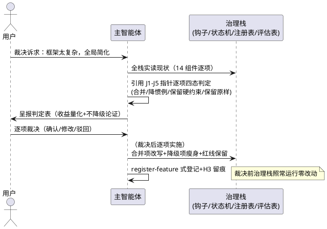

### **5.10.3 异常场景**
1. **判定争议**
   a. 触发条件：某组件判定与用户直觉不一致（如用户认为状态机也应简化）。
   b. 系统行为：呈现双方依据（组件现状+J 指针+不降级论证），登记争议项待裁决，不擅自定论。
   c. 用户感知：争议项单独成节呈报。
2. **合并动作破坏运行中流程**
   a. 触发条件：裁决后实施合并（如复用评估表并入注册表）时，发现进行中任务正在引用旧载体。
   b. 系统行为：实施动作延后至当前任务完结（动作检查点空档期），或新旧载体并行一个过渡期后收口；禁硬切换。
   c. 用户感知：呈报过渡方案+切换时间点。
3. **简化后治理漏洞回溯**
   a. 触发条件：简化实施后出现治理事故（如本该必呈报的事项被静默）。
   b. 系统行为：按"证据实况回退"原则回滚该项判定（状态回退+登记偏差+留痕），呈报用户复议。
   c. 用户感知：事故原文+回滚记录+复议请求。
4. **J 指针不适用**
   a. 触发条件：某组件无法从 J1–J5 找到直接对应经验。
   b. 系统行为：判定理由改用本地实测证据（目录实查/实战先例），标注"本地实证"；禁强行套用 J 结论。
   c. 用户感知：证据等级标注（本地实证/推断）。

# **6. 数据约束**

## **6.1 调研报告（平台体系/社区案例）**
1. **案例条目**：每条必含 标题、URL、访问日期、核心做法、匹配维度、可借鉴点、来源标注（官方文档/社区实战/推断）七字段。
2. **结论条目**：每条结论必含 结论正文、证据指针（文件路径/工具返回/URL）、证据等级（实查/推断）三字段。
3. **未决事项**：存疑项必须取得 U 编号并登记 notes/知识库索引.md 未决事项登记区。

## **6.2 盘点判定清单**
1. **盘点条目**：每条必含 对象（机制名）、现状指针、对标观察、判定（三态枚举）、重构维度（重构项必填）、影响面、保留/补建理由（对应项必填）七字段。
2. **判定枚举**：只允许"合理保留/不合理重构/缺失补建"三值，禁中间态。
3. **裁决状态**：每条附裁决状态（待裁决/已确认/已驳回），初始均为待裁决。

## **6.3 架构方案骨架**
1. **分工标注**：动作条目二值枚举："用户操作"/"后端动作"，无第三态。
2. **机制条目**：路由/汇报/留痕三机制各含 触发事件、数据流向、留痕位置 三字段，触发事件必须为既有事件通道（注入/消息/diff/动作检查点/后台任务）。
3. **衔接条目**：与状态机/注册表/钩子/经验库四基座各≥1 条衔接描述，指向具体规则文件路径。

## **6.4 可行性结论**
1. **结论枚举**：可行/不可行/部分可行 三值。【v2 2026-11-07】细化：三态子结论（①运行时派工=可行已验证；②持久化注册=部分可行待实证；③建议路径=前端最小实验反推格式）登记于 5.5.1 第 5 条，证据等级分"实查/推断"标注。
2. **依据链**：每条依据含 来源类型（目录实查/工具行为/平台文档）、证据内容、路径或 URL。
3. **实施路径**：步骤条目含 步骤序号、执行方（用户操作/后端动作）、留痕方式 三字段。

## **6.5 留痕记录**
1. **变更日志**：所有 spec 迭代与产出物入库动作记入 notes/知识库索引.md 变更日志（日期/条目/动作/触发来源）。
2. **事实表指针**：本 spec 状态（待确认/已确认）由 H7 更新至 notes/项目事实表.md 未决指针区，他处只存指针。

## **6.6 技能/规则合理性方案判定**【v2 2026-11-07 新增】
1. **判定条目**：每条必含 原条号、现状摘要、判定（四态枚举：保留为规矩/分装为技能/合并精简/删除候选）、理由（含 J1–J5 经验指针）、影响面 五字段。
2. **技能封装清单条目**：每项含 技能名、封装内容、触发条件、登记方式（注册表六要素）四字段。
3. **草稿条目**：精简规矩草稿每条含 条文正文、来源原条号（合并条目可多个）、变更类型（保留/合并/新增）三字段。
4. **裁决状态**：判定表与草稿每条附裁决状态（待裁决/已确认/已驳回）。【v3 2026-11-07】收口：用户已批准 6 条精简草稿+2 个技能创建+test_mini 禁用（裁决基线，见 5.7 章引言），相关条目状态置"已确认"；规则文件替换动作仍仅由用户界面完成，确认前禁写入 .codeartsdoer/rule/ 的约束对 Agent 持续有效。

## **6.7 子智能体编队清单**【v3 2026-11-07 新增】
1. **编队条目**：每成员必含 编号、名称、形态、职责、挂载技能、触发条件、与主智能体分工、存在理由（不可合并论证）八字段（对应 5.8.1 第 2 条清单表）。
2. **形态枚举**：主智能体/持久化（agents/*.md）/运行时 Worker（Task 派工）/已禁用留存 四值。
3. **克制约束**：编队每新增一个成员必须附不可合并论证；无法论证即并入既有成员或降为技能；扩编一律走 register-feature 五步准入。
4. **裁决状态**：编队清单整体为提案，须用户确认后方可实施构建（S1/S2 生成）；确认前禁写 agents/ 目录（test_mini 已在档者除外）。

## **6.8 SOP 标准流程条目**【v3 2026-11-07 新增】
1. **五段字段**：每个 SOP 必含 输入/步骤/输出/完成判据/升级路径 五段，缺任一段即 SOP 无效。
2. **完成判据**：必须可判定（二值或数值），禁"尽量/适当"等模糊表述。
3. **派工契约条目**：必含 任务描述、输入材料指针、预期产出、完成判据、升级路径 五字段；缺字段=派工无效，Worker 可拒收。
4. **载体登记**：每 SOP 附载体标注（agents 正文/派工契约/SKILL.md）+路径指针；SOP 变更须走 register-feature 五步准入+H3 留痕。

## **6.9 治理栈简化判定**【v3 2026-11-07 新增】
1. **判定条目**：每条必含 治理组件、判定（四态枚举：合并/降为惯例/保留硬约束/保留原样）、处置、理由（含 J1–J5 指针或本地实证标注）、治理能力不降级论证 五字段。
2. **降级红线清单**：判定为"降为惯例"的条目必须附"保留为硬约束的红线清单"，清单为空即判定无效。
3. **裁决状态**：每条附裁决状态（待裁决/已确认/已驳回），初始均为待裁决；裁决前既有治理栈机制照常运行零改动；实施须逐项登记留痕。