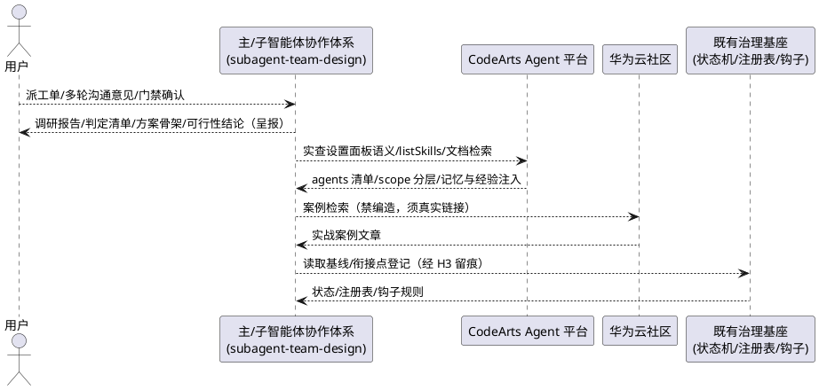
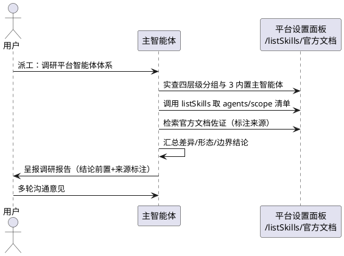
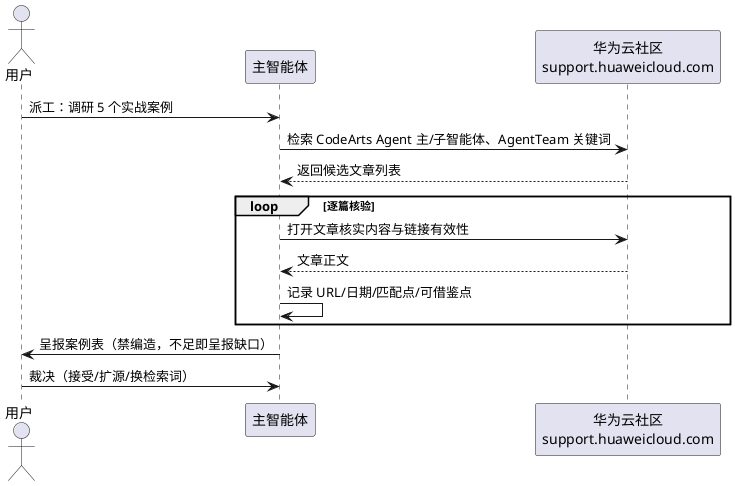
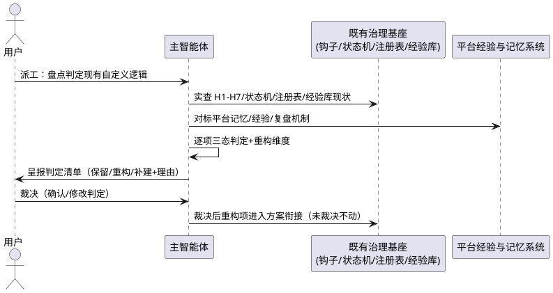
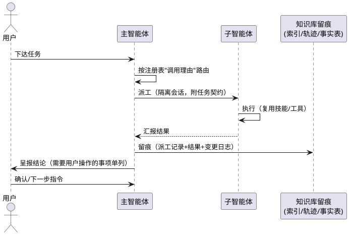
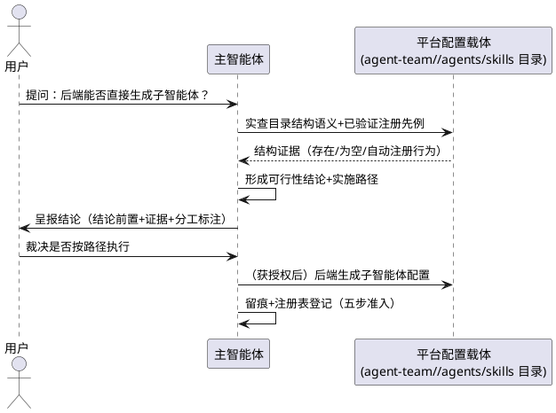
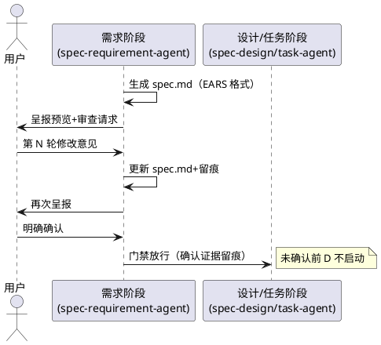

# 主/子智能体协作体系（subagent-team-design）需求规格

> 建立：2026-11-07。状态：待用户确认（第一阶段门禁）。来源：用户派工单（2026-11-07 语音转写+3 截图）+ 本地实查基线（notes/项目事实表.md、notes/注册表.md、notes/阶段状态机运行规则.md、.codeartsdoer/experience-reuse/ 目录实查、listSkills 工具实查）。
> 门禁提示：本文档经用户确认前，禁生成 design.md / tasks.md，禁任何实施动作。

# **1. 组件定位**

## **1.1 核心职责**
本组件负责定义主/子智能体协作体系与治理基座适配重构的需求边界，实现任务自动路由、后端生成子智能体与全程留痕。

## **1.2 核心输入**
1. **用户派工单**：语音转写需求+3 张截图（平台设置页四层级分组、系统内置 3 主智能体、鸿蒙开发主/子两级形态），来自用户会话消息。
2. **平台智能体体系数据**：设置→智能体页面（企业级/项目级/个人级/系统内置四层级）；listSkills 返回的 50 技能与 agents 字段；`.codeartsdoer/agent-team/` 与 `.codeartsdoer/agents/` 目录结构。
3. **华为云社区案例**：support.huaweicloud.com 上与 CodeArts Agent 主/子智能体或 AgentTeam 相关的实战文章。
4. **既有治理基座**：阶段状态机（ST0–ST5+SX）、注册表（12 挂载项）、H1–H7 事件钩子、经验库（experience-reuse 目录：experiences/ 分 6 类、reflect-reports/、.manager-history.jsonl、.session-traces.jsonl）、平台记忆库（MEMORY.md 索引+9 篇记忆文件）。
5. **用户裁决**：对调研结论、盘点判定、方案骨架的多轮沟通确认意见。

## **1.3 核心输出**
1. **平台智能体体系调研报告**：落盘于 specs/subagent-team-design/ 专门文件夹，含四层级语义、3 系统内置主智能体差异、主/子形态、AgentTeam 与单智能体差异、前后端能力边界实证。
2. **华为云社区案例调研报告**：≥5 个真实案例，每案例附真实链接与匹配点分析。
3. **现有自定义逻辑盘点与合理性判定清单**：逐项给出"合理保留/不合理重构/缺失补建"三态判定与重构维度。
4. **主/子智能体架构方案骨架**：分工、配合机制（任务路由/汇报/留痕）、与状态机/注册表/钩子的衔接点。
5. **后端生成子智能体可行性结论**：实证依据+实施路径。
6. **spec.md 及后续 SDD 文档**：本文件及其迭代版本，全部留痕。

## **1.4 职责边界**
1. 本组件不负责编码实施：重构与子智能体生成在 design/tasks 确认后由执行阶段完成。
2. 本组件不负责修改规则文件：10 条扩展公约为锚点零改动（规则第 5 条），规则创建仅由用户界面完成。
3. 本组件不负责删除文件：零删除纪律，废弃项只标"已废弃"。
4. 本组件不负责定时任务：一切触发走事件（注入/消息/diff/动作检查点/后台任务），禁自建定时任务（规则第 6 条）。
5. 本组件不负责平台侧产品功能开发：调研对象是平台既有能力，不改动平台本体。

# **2. 领域术语**

**主智能体**
: 在 CodeArts Agent 平台中承担任务接收、编排与路由的一级智能体，可直接与用户对话并调度子智能体或工具。备注：本项目当前主智能体=developer-test-agent；平台系统内置含智能问答/智能体/AgentTeam 三个主智能体形态。

**子智能体**
: 由主智能体按任务派工调用的二级执行单元，在隔离会话中运行，完成后向主智能体汇报结果。备注：listSkills 实证清单含 bug-fix-agent、spec 三代理（spec-requirement/design/task-agent）、harmonyos-ascf、harmonyos-plugin 等。

**AgentTeam**
: 平台提供的一个主智能体+多个子智能体组成团队的组网形态，区别于单智能体独立执行。备注：`.codeartsdoer/agent-team/` 空目录疑为其配置载体，结构语义待实查确认。

**四层级分组**
: 平台设置→智能体页面对智能体的层级组织方式：企业级、项目级、个人级、系统内置。备注：listSkills 的 scope 字段实证出现 system/project/cloud_enterprise 三类，与四层级的映射关系待界面实查确认。

**任务路由**
: 主智能体依据注册表的"调用理由"判据，将任务分派给匹配的子智能体或工具的决策过程。

**留痕**
: 任何动作在知识库（变更日志/执行轨迹/报告文件）留下可审计记录的纪律，审计口径=无痕即违规。

**门禁**
: 阶段推进前必须满足并经用户确认的检查机制；未过必呈报，通过静默留痕。备注：对应 H6 门禁执行钩子与本 spec 第 5.6 节。

**三态判定**
: 对现有自定义逻辑的合理性判定枚举：合理保留、不合理重构、缺失补建。

**经验库（experience-reuse）**
: 项目内 `.codeartsdoer/experience-reuse/` 下的经验体系：experiences/（按 workflow/agent-ops/debugging/build-env/architecture/testing 六类分目录）、reflect-reports/（反思报告）、.manager-history.jsonl（管理历史）、.session-traces.jsonl（会话轨迹）。

**平台记忆库**
: 平台按工作目录隔离的文件式记忆体系（C:\Users\Administrator\.codeartsdoer\memory\<工作目录>\），含 MEMORY.md 索引+记忆文件，会话启动自动注入索引。

# **3. 角色与边界**

## **3.1 核心角色**
用户（裁决者）：派工、审阅调研与判定结论、多轮沟通修改需求、门禁确认；所有前端操作（界面创建规则、智能体配置确认）由其完成。
主智能体（本会话执行者，developer-test-agent）：执行调研、盘点、方案撰写、留痕；按需派工子智能体。

## **3.2 外部系统**
CodeArts Agent 平台：提供智能体设置面板、skills 注册机制（.codeartsdoer/skills/<id>/SKILL.md 自动注册）、经验与记忆系统（experience_retrieve 注入/反思窗口/experience-collect/refine 工具）、subagent 调度。
华为云社区：案例检索来源（support.huaweicloud.com，历史抓取可达）。
既有治理基座（项目内知识库）：状态机/注册表/钩子/单一事实源，作为方案衔接对象。

## **3.3 交互上下文**

# **4. DFX约束**

## **4.1 性能**
1. 调研过程信息加载遵循"索引+事实表+至多 2 个命中条目"上限纪律，禁全量扫描。
2. 单次呈报结论前置：先结论后依据，摘要 ≤300 字。
3. 外部检索（社区/文档）同一问题 3 次尝试未成功必须停止转 SX 阻塞登记，禁盲目重试。

## **4.2 可靠性**
1. 全程留痕：调研/判定/呈报动作即落盘（H3 记变更日志、H7 刷事实表指针），禁事后批量补记。
2. 单一事实源：项目核心状态只存 notes/项目事实表.md，本 spec 及产出物只存指针不抄值。
3. 调研降级安全：案例数量不足时降级登记实查结果并呈报，禁编造凑数。

## **4.3 安全性**
1. 引用真实：所有外部案例/文档引用必须附真实 URL 与访问日期，禁编造；官方文档与推断必须分别标注。
2. 凭据零暴露：调研与产出物不含 API key、凭据等敏感信息。
3. 只读引用：外部参考仓库保持项目外隔离，禁复制入本项目。

## **4.4 可维护性**
1. 变更日志：spec 每轮修改记入 notes/知识库索引.md 变更日志。
2. 产出物索引：所有第一产出入库知识库索引，可按"三问三答"协议查询（做了什么/做到哪/产物在哪）。
3. 版本演进：spec 多轮迭代保留版本意识（呈报时标注轮次），禁覆盖丢失用户意见脉络。

## **4.5 兼容性**
1. 治理基座零破坏为默认：对状态机/注册表/钩子的任何改动必须先经三态判定+用户裁决，禁静默重构。
2. 仲裁顺序不变：规则>知识库>记忆>推断的仲裁顺序在本体系内沿用。
3. 既有实战成果继承：出题官/批改官 subagent 闭环、review-code 自动注册等已验证路径作为方案基线，不推倒重来。

# **5. 核心能力**

## **5.1 平台智能体体系调研**

### **5.1.1 业务规则**
1. **四层级语义澄清**：必须实查平台设置→智能体页面四层级（企业级/项目级/个人级/系统内置）的语义与 listSkills scope 字段（system/project/cloud_enterprise）的映射关系，并落盘结论。
   a. 验收条件：[调研报告产出] → [四层级各自含义、与 scope 字段对应关系、个人级是否在 API 可见范围内均有结论且每条标注"实查/推断"]
2. **系统内置主智能体差异**：必须对 3 个系统内置主智能体（智能问答/智能体/AgentTeam）产出差异对比与适用场景结论。
   a. 验收条件：[对比表产出] → [三者的定位差异、能力差异、适用场景各≥1 条结论，依据标注来源]
3. **主/子两级形态实证**：必须以"鸿蒙开发"（主）与 harmonyos-ascf/harmonyos-plugin（子）两级形态（listSkills 实证+用户图 3）为样本，描述主/子智能体的挂载、开关与协作表现。
   a. 验收条件：[形态描述产出] → [子智能体带开关的机制、子技能共享挂载方式（harmonyos 系技能同时挂 developer-test-agent 与主/子）均有实证描述]
4. **AgentTeam 与单智能体差异**：必须明确 AgentTeam 相对单智能体的组网差异（派工/汇报/隔离会话），并实查 `.codeartsdoer/agent-team/` 与 `.codeartsdoer/agents/` 空目录的结构语义。
   a. 验收条件：[实查完成] → [两目录的角色结论（确认/排除/存疑）落盘，存疑项列入未决事项呈报]
5. **前后端能力边界**：必须实证哪些智能体配置可由后端（Agent 写文件/工具）完成、哪些必须用户前端界面操作，逐项标注。
   a. 验收条件：[边界清单产出] → [每一配置项标注"用户操作"或"后端动作"，标注依据为实查证据（如 review-code 创建后 ProjectSkillStatus.txt 自动出现）]
6. **禁止项**：禁止在无实查证据时给出平台能力断言。
   a. 验收条件：[任一结论无证据] → [必须标注"推断"或列入未决事项，禁冒充实查]

### **5.1.2 交互流程**

### **5.1.3 异常场景**
1. **界面语义无法后端实查**
   a. 触发条件：四层级中个人级等分组在 listSkills/文件系统均不可见。
   b. 系统行为：以已可见部分下结论，不可见部分登记未决事项。
   c. 用户感知：呈报"该项需用户界面截图佐证"，禁臆断。
2. **目录结构语义存疑**
   a. 触发条件：agent-team/agents 目录为空或结构无法判定用途。
   b. 系统行为：登记未决事项（U 编号）并在报告中标注存疑。
   c. 用户感知：结论分"确认/排除/存疑"三态呈现。
3. **官方文档检索失败**
   a. 触发条件：文档检索 3 次未命中。
   b. 系统行为：停止重试，以本地实证为据完成报告，缺口列未决。
   c. 用户感知：呈报检索失败原文+已有结论降级说明。

## **5.2 华为云社区真实案例调研**

### **5.2.1 业务规则**
1. **案例数量**：必须调研不少于 5 个与主/子智能体或 AgentTeam 实战匹配的华为云社区案例。
   a. 验收条件：[调研报告产出] → [≥5 个案例各含标题、URL、访问日期、核心做法、与本项目的匹配点]
2. **真实性红线**：所有案例必须来自真实检索结果，禁编造 URL 与内容。
   a. 验收条件：[每个案例入表] → [URL 可访问或附"检索时间+失败原文"；无法核实即剔除，不计入 5 个门槛]
3. **匹配度标注**：每案例必须标注其与"主/子智能体方案"的具体匹配维度（组网形态/任务路由/留痕/经验沉淀等）。
   a. 验收条件：[案例入表] → [匹配维度≥1 项且说明可借鉴点与不适用点]
4. **降级规则**：实查后可用案例不足 5 个时，禁止凑数。
   a. 验收条件：[可用案例<5] → [呈报实得数量+检索过程证据+缺口，由用户裁决是否扩源或接受降级]

### **5.2.2 交互流程**

### **5.2.3 异常场景**
1. **检索结果空/不相关**
   a. 触发条件：关键词检索无命中或命中文章与主题无关。
   b. 系统行为：换关键词≤3 轮（如"智能体 编排""AgentTeam 实战""子智能体"），仍不足则降级呈报。
   c. 用户感知：呈报已尝试的检索词与命中数，等待裁决。
2. **链接失效**
   a. 触发条件：候选文章 URL 无法访问。
   b. 系统行为：剔除该案例并记录失败原文，不计入门槛数量。
   c. 用户感知：案例表只保留可核验条目。
3. **网络中断**
   a. 触发条件：社区站点连续 3 次不可达。
   b. 系统行为：转 SX 阻塞登记（原因/恢复条件/回迁目标/时间），暂停该项。
   c. 用户感知：呈报阻塞四字段，恢复后继续。

## **5.3 现有自定义逻辑盘点与合理性判定**

### **5.3.1 业务规则**
1. **盘点范围**：必须覆盖 H1–H7 事件钩子、阶段状态机（ST0–ST5+SX）、注册表（两级/12 挂载项/六要素）、五步准入、学习沉淀机制、经验库（experience-reuse）六大块。
   a. 验收条件：[盘点清单产出] → [六大块每块有现状描述（附文件指针）+对标观察+三态判定]
2. **对标基准**：判定必须以平台"经验与记忆"系统为对标（文件式记忆库+启动注入+按用户消息检索注入+反思窗口+collect/refine 工具+轨迹 JSONL），逐维度比对。
   a. 验收条件：[每项判定] → [注明对标平台哪个机制、用户关切（"动态性不足、像状态机维护的知识库而非数据库"）得到正面回应]
3. **三态判定与重构维度**：每项判定必须落为"合理保留/不合理重构/缺失补建"之一，重构项必须给出重构维度（≥1 个：触发方式/存储形态/更新时机/检索注入/留痕审计/生命周期）与影响面。
   a. 验收条件：[判定产出] → [重构项有维度+影响面+衔接改动点；保留项有保留理由；补建项有补建目标]
4. **禁止项**：禁止静默重构任何判定为"不合理"的机制；重构必须先经用户裁决。
   a. 验收条件：[判定完成] → [重构清单仅呈报待裁决，未裁决前既有机制照常运行]

### **5.3.2 交互流程**

### **5.3.3 异常场景**
1. **对标机制无法确证**
   a. 触发条件：平台某机制（如反思窗口内部逻辑）无法从文档/实查确证。
   b. 系统行为：以可观察行为（配置文件、注入表现）为据，内部机制标"推断"。
   c. 用户感知：判定附证据等级标注。
2. **判定争议**
   a. 触发条件：某项合理性与用户意见不一致。
   b. 系统行为：呈现双方依据，登记争议项等待裁决，不擅自定论。
   c. 用户感知：争议项单独成节呈报。
3. **盘点中触发既有钩子冲突**
   a. 触发条件：盘点动作命中 H2/H3 检查点冲突。
   b. 系统行为：按钩子规程呈报冲突，仲裁顺序处理。
   c. 用户感知：冲突原文+仲裁结果呈报。

## **5.4 主/子智能体架构方案骨架**

### **5.4.1 业务规则**
1. **分工标注**：方案中所有动作必须二选一标注："用户操作"（前端界面）或"后端动作"（Agent/工具完成），不允许未标注项。
   a. 验收条件：[方案骨架产出] → [分工清单完整，用户操作项集中列出让用户一目了然]
2. **配合机制三要素**：方案必须定义任务路由（依据注册表"调用理由"派工）、汇报（子智能体完成后向主智能体回传结果）、留痕（派工与结果落盘执行轨迹）三项机制。
   a. 验收条件：[机制描述产出] → [三要素各有触发事件、数据流向、留痕位置；全程事件驱动，零定时任务]
3. **治理基座衔接**：方案必须明确与状态机（ST5 持续态）、注册表（新子智能体走五步准入登记六要素）、钩子（H1–H7 通道复用）、经验库（子智能体产出沉淀路径）的衔接点。
   a. 验收条件：[衔接节产出] → [四个基座各有衔接方式描述；新子智能体登记路径=五步准入，无旁路]
4. **方案落位**：方案骨架及其后续细化文档必须落盘于 specs/subagent-team-design/ 专门文件夹，并登记知识库索引。
   a. 验收条件：[文件写入] → [路径可查+索引变更日志留痕（H3）]
5. **禁止项**：禁止方案引入定时任务、破坏仲裁顺序、绕过单一事实源。
   a. 验收条件：[任一条款疑似引入] → [呈报冲突，禁落盘]

### **5.4.2 交互流程**

### **5.4.3 异常场景**
1. **无匹配子智能体**
   a. 触发条件：路由时注册表无命中条目。
   b. 系统行为：主智能体自行执行或提出新子智能体提案（走五步准入）。
   c. 用户感知：呈报路由未命中+处置选择。
2. **子智能体执行失败**
   a. 触发条件：子智能体汇报失败或超时无响应。
   b. 系统行为：按 3 次上限纪律，失败转 SX 登记，结果留痕。
   c. 用户感知：呈报失败原文+阻塞四字段。
3. **配合机制与钩子并发冲突**
   a. 触发条件：多子智能体汇报同时命中同一钩子。
   b. 系统行为：沿用幂等去重纪律（先到先处理，其余登记重复命中）。
   c. 用户感知：静默留痕，异常时呈报。

## **5.5 后端直接生成子智能体的可行性**

### **5.5.1 业务规则**
1. **可行性结论**：必须基于实证（非推断）回答"后端能否直接生成子智能体"，给出可行/不可行/部分可行的结论。
   a. 验收条件：[结论产出] → [结论+实证依据链（agent-team/agents 目录实查、skills 自动注册实证、平台文档引用），推断部分单独标注]
2. **若可行则路径化**：结论为可行/部分可行时，必须给出后端生成子智能体的实施路径（含留痕方式）。
   a. 验收条件：[路径产出] → [每步骤标注"后端动作"或"用户操作"；后端生成动作留痕位置明确]
3. **若不可行**：结论为不可行时，必须给出替代路径（前端操作指引+后端产草稿）。
   a. 验收条件：[替代路径产出] → [用户操作步骤清单可执行，Agent 产草稿的交付形式明确]
4. **留痕红线**：无论哪种结论，后端执行的生成动作必须留痕（写文件即记变更日志）。
   a. 验收条件：[任一生成动作] → [变更日志+索引登记同步完成，无痕即违规]

### **5.5.2 交互流程**

### **5.5.3 异常场景**
1. **证据不足以定论**
   a. 触发条件：目录语义与文档均无法确证生成机制。
   b. 系统行为：结论降级为"部分可行+待验证"，提出最小验证实验设计（交用户裁决后执行）。
   c. 用户感知：呈报结论置信度与验证建议。
2. **生成后平台不识别**
   a. 触发条件：后端写入配置后平台未注册生效。
   b. 系统行为：记录现象，回退至前端路径，登记未决事项。
   c. 用户感知：呈报失败证据+前端操作指引。
3. **越权风险**
   a. 触发条件：生成动作超出用户授权范围。
   b. 系统行为：阻断并呈报待授权，禁先斩后奏。
   c. 用户感知：授权请求（范围+影响面）。

## **5.6 需求门禁与多轮呈报**

### **5.6.1 业务规则**
1. **第一阶段产出即停**：spec.md 生成后必须呈报用户预览并停止，禁进入 design/tasks。
   a. 验收条件：[spec.md 落盘] → [预览+文件路径呈现+明确的审查请求，无任何下游阶段动作]
2. **多轮迭代**：用户每轮提出修改意见必须更新 spec.md 并重新呈报，直至用户明确确认。
   a. 验收条件：[收到修改意见] → [spec.md 更新+变更日志留痕+再次呈报；轮次标注清晰]
3. **确认后放行**：仅当用户明确确认（如"OK/确认/无修改"）后，才允许进入 design 阶段（由 spec-design-agent 负责）。
   a. 验收条件：[用户确认] → [登记确认证据（日期+原文指针），门禁放行留痕]
4. **禁止项**：禁止在未确认状态下实施任何重构、生成子智能体或写入方案细节文档。
   a. 验收条件：[未确认期间] → [仅 spec.md 迭代与调研留痕允许，其余动作阻断]

### **5.6.2 交互流程**

### **5.6.3 异常场景**
1. **用户长期未响应**
   a. 触发条件：呈报后等待确认超过当前会话窗口。
   b. 系统行为：spec.md 与状态留盘，事实表登记"待确认"指针，下次会话 H1 注入后可续。
   c. 用户感知：产物路径+当前轮次可查（三问三答协议）。
2. **修改意见与门禁红线冲突**
   a. 触发条件：用户意见涉及改规则/删文件/定时任务等红线。
   b. 系统行为：呈报冲突（意见原文 vs 公约条款），按仲裁顺序处理。
   c. 用户感知：冲突对照+豁免需明示的提示。
3. **误触下游阶段**
   a. 触发条件：确认前任何动作试图生成 design.md/tasks.md。
   b. 系统行为：H6 门禁拦截，阻断并留痕违规。
   c. 用户感知：呈报拦截原因。

# **6. 数据约束**

## **6.1 调研报告（平台体系/社区案例）**
1. **案例条目**：每条必含 标题、URL、访问日期、核心做法、匹配维度、可借鉴点、来源标注（官方文档/社区实战/推断）七字段。
2. **结论条目**：每条结论必含 结论正文、证据指针（文件路径/工具返回/URL）、证据等级（实查/推断）三字段。
3. **未决事项**：存疑项必须取得 U 编号并登记 notes/知识库索引.md 未决事项登记区。

## **6.2 盘点判定清单**
1. **盘点条目**：每条必含 对象（机制名）、现状指针、对标观察、判定（三态枚举）、重构维度（重构项必填）、影响面、保留/补建理由（对应项必填）七字段。
2. **判定枚举**：只允许"合理保留/不合理重构/缺失补建"三值，禁中间态。
3. **裁决状态**：每条附裁决状态（待裁决/已确认/已驳回），初始均为待裁决。

## **6.3 架构方案骨架**
1. **分工标注**：动作条目二值枚举："用户操作"/"后端动作"，无第三态。
2. **机制条目**：路由/汇报/留痕三机制各含 触发事件、数据流向、留痕位置 三字段，触发事件必须为既有事件通道（注入/消息/diff/动作检查点/后台任务）。
3. **衔接条目**：与状态机/注册表/钩子/经验库四基座各≥1 条衔接描述，指向具体规则文件路径。

## **6.4 可行性结论**
1. **结论枚举**：可行/不可行/部分可行 三值。
2. **依据链**：每条依据含 来源类型（目录实查/工具行为/平台文档）、证据内容、路径或 URL。
3. **实施路径**：步骤条目含 步骤序号、执行方（用户操作/后端动作）、留痕方式 三字段。

## **6.5 留痕记录**
1. **变更日志**：所有 spec 迭代与产出物入库动作记入 notes/知识库索引.md 变更日志（日期/条目/动作/触发来源）。
2. **事实表指针**：本 spec 状态（待确认/已确认）由 H7 更新至 notes/项目事实表.md 未决指针区，他处只存指针。