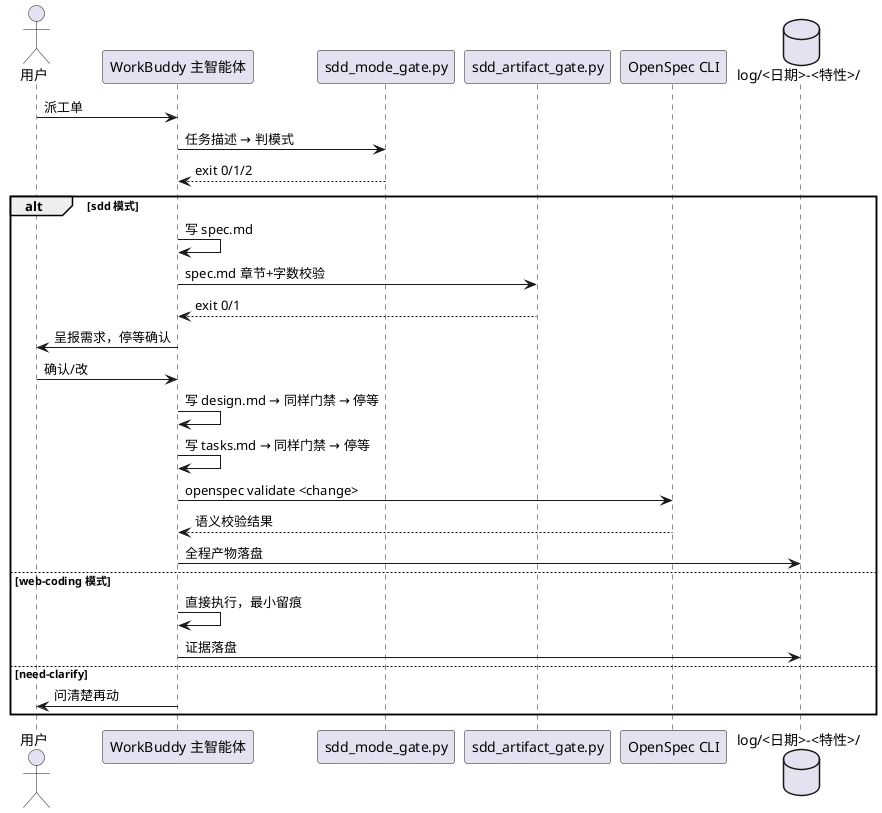

# 详细设计：SDD 双模式工作流

- 版本：v1.0
- 日期：2026-11-26 20:30
- 上游：spec.md v1.2（用户 20:29 已认可 R1-R13）
- 状态：待用户扫（按 R8/R9，用户只偶发纠偏，不逼拍细节）

## 1. 存量分析三分法

| 分类 | 项 | 匹配度 | 判定依据 |
|---|---|---|---|
| 已实现 | `.workbuddy/config/sdd_modes.json` | 100% | 触发表已落盘，含双模式关键词、门禁规则 |
| 已实现 | `sdd_mode_gate.py` | 100% | 自检 6/6 PASS，exit 语义已定 |
| 已实现 | `sdd_artifact_gate.py` | 100% | 章节+字数门禁已跑通 spec |
| 已实现 | `sdd-spec-pipeline` 技能 | 80% | 四步契约齐，但无机器触发、无自动门禁 |
| 已实现 | OpenSpec CLI v2.2.0 | 70% | 已装已 init，项目约束已写，但尚无 change 走完整链路 |
| 需扩展 | `sdd_artifact_gate.py` | — | 当前只查结构；建议 1 要加"派工单门禁命令"校验 |
| 需扩展 | `spec.md` 模板 | — | 建议 2 原话对照表已手工加，需沉淀成模板节 |
| 需新增 | 派工单模板（含门禁命令 + 期望 exit） | — | 目前无模板，靠我记着跑 |
| 需新增 | OpenSpec change（本特性） | — | CLI 已就绪但 `changes/` 空 |

结论：复用 5 项（71%）/ 扩展 2 项（29%）/ 新增 2 项。主体已存在，设计重点是"接起来 + 补模板"。

## 2. 实现模型

### 2.1 上下文视图（PlantUML）



### 2.2 组件职责依赖表

| 组件 | 职责 | 依赖 | 配置取值 |
|---|---|---|---|
| `sdd_modes.json` | 唯一触发表（关键词 + 门禁规则） | 无 | 改表不改码 |
| `sdd_mode_gate.py` | 按表判模式，输出 exit | `sdd_modes.json` | exit 0=sdd / 1=web / 2=问 / 3=错 |
| `sdd_artifact_gate.py` | 查产物存在、非空、章节、字数 | `sdd_modes.json` | 类型 spec/design/tasks |
| `sdd-spec-pipeline` | 四步契约与派工要素 | 上述脚本 | 斜杠入口手工按序 |
| OpenSpec CLI | 官方 validate/archive 语义校验 | `openspec/config.yaml` | schema=spec-driven |
| 派工单模板（新） | 强制写门禁命令 + 期望 exit | 无 | 见 §3 IF-3 |

### 2.3 实现设计要点

**决策 1：双门禁并行，不互相替代。** 理由：自写门禁查结构（快、稳、零依赖），CLI 查语义（慢、准、需 change）。两个都过才算完成。

**决策 2：建议 3 不做自动放行。** 理由：CLI 语义校验能补一部分，但 design/tasks 的内容偏差机器判不了；用户自述偶发纠偏，那就保留人工停等点。

**决策 3：派工单模板是"逼着跑门禁"的载体。** 理由：SOUL 第 52 行要求脚本必经，但光有脚本我会忘跑；模板里写死"门禁命令 + 期望 exit"，跑完贴输出才算完成。

**决策 4：`.agents/`、`.codebuddy/skills/` 不删不改。** 理由：CLI 官方生成，WorkBuddy 运行时只读 `.workbuddy/`，删了反而破坏 CLI 链路。

## 3. 接口设计（IF-N 契约，禁止实现代码）

### IF-1 模式判定
```
sdd_mode_gate.py <任务描述...> -> exit:int
输出: JSON { mode, exit, sdd_hits, web_hits, default }
前置: 配置文件存在
后置: 0=sdd, 1=web-coding, 2=need-clarify, 3=配置错
异常: 配置缺失 -> exit 3
```

### IF-2 产物门禁
```
sdd_artifact_gate.py <产物类型> <文件路径> -> exit:int
前置: 产物类型 ∈ {spec.md, design.md, tasks.md}
后置: 0=章节齐且字数达标, 1=缺章节/字数不足/文件不存在, 2=参数错
异常: 文件不存在 -> exit 1
```

### IF-3 派工单模板（建议 1 落点）
```
每步派工单必含字段:
- 本步产物: <文件名>
- 门禁命令: python .workbuddy/scripts/sdd_artifact_gate.py <类型> <路径>
- 期望 exit: 0
- 输出回执: 贴门禁真实输出，缺输出不算完成
前置: 模板随 spec/design/tasks 一起走
后置: 无门禁输出的派工单 = 未完成，禁止进下一步
异常: 门禁非 0 -> 当场补，不放行
```

### IF-4 OpenSpec 语义校验
```
openspec validate <change-name> --json -> exit:int
前置: change 目录存在且四件产物齐
后置: 0=语义一致, 非0=有漂移
异常: 无 change -> 提示先 new change
```

## 4. 数据模型

### 4.1 关键数据

| 数据 | 形态 | 位置 | 生命周期 |
|---|---|---|---|
| 触发表 | JSON | `.workbuddy/config/sdd_modes.json` | 长期，改表即生效 |
| 模式判定输出 | JSON（stdout） | 不落盘，贴回执 | 临时 |
| 门禁结果 | exit code + stdout | 贴进派工单回执 / 运行时报告 | 随报告长期 |
| SDD 产物 | Markdown | `log/<日期>-<特性>/` | 长期 |
| OpenSpec change | 目录 + YAML | `openspec/changes/<名>/` | archive 后入 `specs/` |

### 4.2 状态机

```
need-clarify --(用户说清)--> sdd / web-coding
sdd --spec门禁0--> 等需求确认 --用户确认--> design
design --门禁0--> 等设计扫 --用户扫无异议--> tasks
tasks --门禁0--> 等任务扫 --用户扫无异议--> apply
apply --验收通过--> archive
任何门禁非0 --> 停在原步修补（不回退到上一步，除非上游变更）
```

### 4.3 持久化目录布局

```
.workbuddy/
  config/sdd_modes.json          # 触发表（唯一事实源）
  scripts/sdd_mode_gate.py       # 模式判定
  scripts/sdd_artifact_gate.py   # 产物门禁
  rules/rules_index.json         # S1-6 出网口径
openspec/
  config.yaml                    # 项目约束（已写）
  changes/<特性>/                # 本特性 change（待建）
  specs/                         # 归档后的权威规格
log/2026-11-26-sdd-dual-mode/
  spec.md / design.md / tasks.md # 三份 SDD 产物
  反馈报告.md / 运行时报告.md / 优化建议报告.md
```

## 5. 测试方案 + 风险表 + EARS追溯表

### 5.1 测试方案

| 测试 | 命令 | 期望 |
|---|---|---|
| 模式自检 | `sdd_mode_gate.py --self-test` | 6/6 PASS |
| spec 门禁 | `sdd_artifact_gate.py spec.md <path>` | exit 0 |
| design 门禁 | `sdd_artifact_gate.py design.md <path>` | exit 0 |
| 规则一致 | `rule_lens.py check` + `check_rules_sync.py` | 双 PASS |
| CLI 可用 | `openspec --version` + `list --json` | 2.2.0 / changes |
| 派工单模板（建后） | 抽一份派工单看有无门禁字段 | 有 |

### 5.2 风险表

| 风险 | 影响 | 处置 |
|---|---|---|
| 门禁查结构不查语义 | 放过内容偏差 | CLI `validate` 并行补；用户偶发纠偏 |
| 我会忘跑门禁 | 未完成当完成 | 建议 1 派工单强制字段 + 贴输出 |
| CLI change 与 log 产物双写 | 两处漂移 | 以 log 三份产物为准，CLI change 只做校验 |
| 出网口径被误读回旧版 | 普通任务卡住/攻防误出网 | S1-6 常驻 + spec R12 + 双处留痕 |
| 建议 3 若日后启用自动放行 | 语义偏差无人拦 | 本版不做；要启需用户单独授权 |

### 5.3 待裁决项承接

无待裁决项。建议 3 用户已明确"暂不自动放行"，按此设计。

### 5.4 EARS追溯表

| 需求 | 设计落点 |
|---|---|
| R1-R4 模式 | §2.1 时序图 + §3 IF-1 |
| R5 授权例外 | §4.2 状态机（用户确认节点） |
| R6 目录 | §4.3 持久化布局 |
| R7 产物门禁 | §3 IF-2 + §5.1 |
| R8 逐步门禁 | §4.2 状态机 + §2.3 决策 2 |
| R9 需求优先 | §2.3 决策 2（用户只偶发纠偏） |
| R10 能力边界 | spec.md §6（上游） |
| R11 门禁必经 | §2.3 决策 3 + §3 IF-3 |
| R12 出网 | spec.md R12 + S1-6（上游） |
| R13 CLI | §2.2 组件表 + §3 IF-4 |
| 建议 1 | §3 IF-3 派工单模板 |
| 建议 2 | spec.md §8 原话对照表 |

## 6. 设计自检

- [x] 反绑死：改触发表不改代码（IF-1 读表）
- [x] 禁定时：无 cron/后台常驻
- [x] 规矩冻结：协作公约正文未动
- [x] 单一事实源：触发表一份、产物 log 一份、CLI change 只校验
- [x] 双门禁并行：结构 + 语义都过
- [x] 建议 1/2 落点明确，建议 3 按用户裁决不做
- [x] 出网口径与 SOUL/rules_index 一致

## 7. 内容偏差人工扫（门禁签收栏）

- 扫人：用户（20:40）
- 用户指出三处硬伤：①CLI 运行时找不到（NO_OPEN_SPEC_CLI 证据过时）②派工单模板只画未落地 ③双门禁只有单边跑过
- 整改状态：①CLI validate --strict 已跑通贴输出 ②派工单模板已落真实文件 ③自写门禁已加人工扫检查项 + CLI 门禁已跑
- 结论：整改完成，待用户复扫签字
